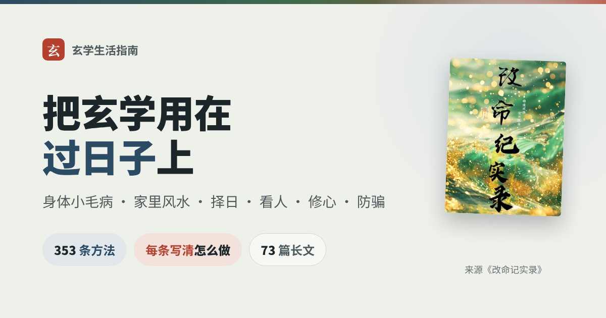
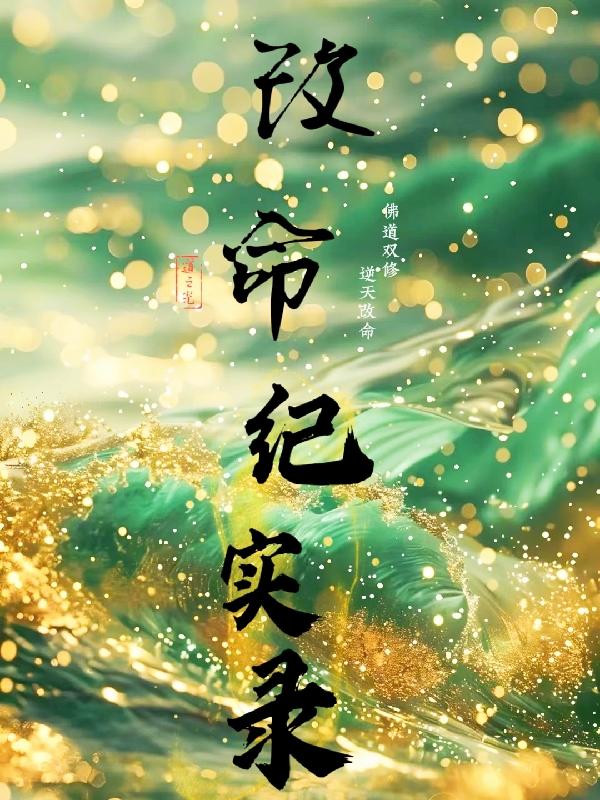

<div align="center">



# 玄学生活指南

讲睡不好、咳嗽、牙痛、肠胃不舒服、腰酸背痛时，书里有哪些家常办法可以先试。讲家里风水先查什么、查到了怎么调，挪东西、动土挑哪天。讲怎么从八字、名字、手机号、头像看人看自己。也讲起了情绪怎么转念，找"大师"看事怎么不被骗。<br>
353 条方法，每条写明用来做什么、怎么做、要注意什么、出自原书第几章。书里没写用量的，直接写"书里没写"，不编。

不用全做：这是一份备选单，不是任务清单——遇到哪件事，查哪一条就行。

这是民俗文化的整理，不是医疗、法律或投资建议。身体不舒服先看医生，偏方、象数最多当辅助。整理难免有错漏，发现了欢迎[提 issue](https://github.com/halfrightlab/xuanxue-life-guide/issues)。

第一个来源是道之光的《改命记实录》，以后会陆续加入其他书。

[](https://fatepaw.judeyang.com/knowledge/)
[](#目录)
[](docs/)
[](#内容来源)
[](#许可)
[](https://claude.com/claude-code)

### [打开在线检索页](https://fatepaw.judeyang.com/knowledge/) · [让 AI 照书回答（skill）](skills/xuanxue-life-guide/README.md)

在线检索页可以搜关键词、按"睡不好""肠胃""搬家看房"这些场景筛方法。AI 助手 skill 支持 Claude Code 和 Codex，装上后直接问"咳嗽带黄痰怎么办"，它先查书里的条目再回答，并注明出自第几节第几条、原书第几章。

<table>
<tr><td align="right"><b>查阅</b></td><td align="left">

[目录](#目录) · [术语表](#读懂说法术语表) · [逐章笔记（992 章）](chapters/改命记实录/README.md)

</td></tr>
<tr><td align="right"><b>按场景</b></td><td align="left">

[睡不好](book/01-%E7%9D%A1%E4%B8%8D%E5%A5%BD.md) · [咳嗽和嗓子](book/02-%E5%92%B3%E5%97%BD%E5%92%8C%E5%97%93%E5%AD%90.md) · [牙和口腔](book/03-%E7%89%99%E5%92%8C%E5%8F%A3%E8%85%94.md) · [肠胃](book/04-%E8%82%A0%E8%83%83.md) · [腰、颈和关节](book/05-%E8%85%B0%E3%80%81%E9%A2%88%E5%92%8C%E5%85%B3%E8%8A%82.md) · [皮肤和头发](book/06-%E7%9A%AE%E8%82%A4%E5%92%8C%E5%A4%B4%E5%8F%91.md) · [其他身体小毛病](book/07-%E5%85%B6%E4%BB%96%E8%BA%AB%E4%BD%93%E5%B0%8F%E6%AF%9B%E7%97%85.md) · [练功和日常养生](book/08-%E7%BB%83%E5%8A%9F%E5%92%8C%E6%97%A5%E5%B8%B8%E5%85%BB%E7%94%9F.md) · [情绪和修心](book/09-%E6%83%85%E7%BB%AA%E5%92%8C%E4%BF%AE%E5%BF%83.md) · [家里风水：先排查](book/10-%E5%AE%B6%E9%87%8C%E9%A3%8E%E6%B0%B4%EF%BC%9A%E5%85%88%E6%8E%92%E6%9F%A5.md) · [家里风水：怎么调](book/11-%E5%AE%B6%E9%87%8C%E9%A3%8E%E6%B0%B4%EF%BC%9A%E6%80%8E%E4%B9%88%E8%B0%83.md) · [看人和看自己](book/12-%E7%9C%8B%E4%BA%BA%E5%92%8C%E7%9C%8B%E8%87%AA%E5%B7%B1.md) · [孩子、感情和钱](book/13-%E5%AD%A9%E5%AD%90%E3%80%81%E6%84%9F%E6%83%85%E5%92%8C%E9%92%B1.md) · [民俗和生活小办法](book/14-%E6%B0%91%E4%BF%97%E5%92%8C%E7%94%9F%E6%B4%BB%E5%B0%8F%E5%8A%9E%E6%B3%95.md)

</td></tr>
<tr><td align="right"><b>长文</b></td><td align="left">

[九宫：家里每个方位管什么](docs/02-%E7%9C%8B%E6%88%BF%E5%AD%90/03-%E4%B9%9D%E5%AE%AB%EF%BC%9A%E5%AE%B6%E9%87%8C%E6%AF%8F%E4%B8%AA%E6%96%B9%E4%BD%8D%E7%AE%A1%E4%BB%80%E4%B9%88.md) · [缺角和补角](docs/02-%E7%9C%8B%E6%88%BF%E5%AD%90/12-%E7%BC%BA%E8%A7%92%E5%92%8C%E8%A1%A5%E8%A7%92.md) · [择日：九星吉日怎么算](docs/05-%E7%AE%97%E6%97%B6%E9%97%B4/10-%E6%8B%A9%E6%97%A5%EF%BC%9A%E4%B9%9D%E6%98%9F%E5%90%89%E6%97%A5%E6%80%8E%E4%B9%88%E7%AE%97.md) · [八颗星](docs/04-%E5%90%8D%E5%AD%97%E5%92%8C%E6%95%B0%E5%AD%97/10-%E5%85%AB%E9%A2%97%E6%98%9F.md) · [八字入门：从一个字开始](docs/05-%E7%AE%97%E6%97%B6%E9%97%B4/01-%E5%85%AB%E5%AD%97%E5%85%A5%E9%97%A8%EF%BC%9A%E4%BB%8E%E4%B8%80%E4%B8%AA%E5%AD%97%E5%BC%80%E5%A7%8B.md) · [咳嗽怎么办](docs/06-%E8%BA%AB%E4%BD%93%E4%B8%8E%E5%85%BB%E7%94%9F/21-%E5%92%B3%E5%97%BD%E6%80%8E%E4%B9%88%E5%8A%9E.md) · [失眠怎么办](docs/06-%E8%BA%AB%E4%BD%93%E4%B8%8E%E5%85%BB%E7%94%9F/24-%E5%A4%B1%E7%9C%A0%E6%80%8E%E4%B9%88%E5%8A%9E.md) · [象数速查：胃和肠](docs/06-%E8%BA%AB%E4%BD%93%E4%B8%8E%E5%85%BB%E7%94%9F/31-%E8%B1%A1%E6%95%B0%E9%80%9F%E6%9F%A5%EF%BC%9A%E8%83%83%E5%92%8C%E8%82%A0.md) · [转念的几个办法](docs/07-%E4%BF%AE%E5%BF%83/02-%E8%BD%AC%E5%BF%B5%E7%9A%84%E5%87%A0%E4%B8%AA%E5%8A%9E%E6%B3%95.md) · [防骗：常见套路](docs/09-%E9%98%B2%E9%AA%97/01-%E9%98%B2%E9%AA%97%EF%BC%9A%E5%B8%B8%E8%A7%81%E5%A5%97%E8%B7%AF.md) · [怎么分辨真假师父](docs/09-%E9%98%B2%E9%AA%97/04-%E6%80%8E%E4%B9%88%E5%88%86%E8%BE%A8%E7%9C%9F%E5%81%87%E5%B8%88%E7%88%B6.md) · [全部 73 篇](docs/)

</td></tr>
<tr><td align="right"><b>工具</b></td><td align="left">

[九星吉日计算](tools/jiri.py)：按书里的规则，算任意月份的九星吉日、去掉金神七煞日和红煞日、标出偷修日

</td></tr>
<tr><td align="right"><b>来源</b></td><td align="left">

来源《改命记实录》（道之光）· 633 张书中插图 · 后续会加入其他书

</td></tr>
</table>

<sub>插图版权归原作者所有，不在本仓库的许可范围内。</sub>

</div>

---

## 这份指南想回答的问题

| 问题 | 去哪看 |
| --- | --- |
| 睡不着、睡不踏实、老做噩梦，书里有哪些办法？ | [1. 睡不好](book/01-%E7%9D%A1%E4%B8%8D%E5%A5%BD.md) |
| 咳嗽、有痰、嗓子疼，家里能先试什么？ | [2. 咳嗽和嗓子](book/02-%E5%92%B3%E5%97%BD%E5%92%8C%E5%97%93%E5%AD%90.md) |
| 牙痛、牙龈肿、口腔溃疡，去医院之前能做什么？ | [3. 牙和口腔](book/03-%E7%89%99%E5%92%8C%E5%8F%A3%E8%85%94.md) |
| 拉肚子、便秘、胃不舒服、消化不好怎么办？ | [4. 肠胃](book/04-%E8%82%A0%E8%83%83.md) |
| 腰痛、脖子僵、肩膀疼，书里怎么调？ | [5. 腰、颈和关节](book/05-%E8%85%B0%E3%80%81%E9%A2%88%E5%92%8C%E5%85%B3%E8%8A%82.md) |
| 脚气、灰指甲、手脚干裂、掉头发，有什么土办法？ | [6. 皮肤和头发](book/06-%E7%9A%AE%E8%82%A4%E5%92%8C%E5%A4%B4%E5%8F%91.md) |
| 烫伤、晕车、头痛、减肥这些零碎的事，书里有办法吗？ | [7. 其他身体小毛病](book/07-%E5%85%B6%E4%BB%96%E8%BA%AB%E4%BD%93%E5%B0%8F%E6%AF%9B%E7%97%85.md) |
| 不生病的时候，每天做点什么能让身体更好？ | [8. 练功和日常养生](book/08-%E7%BB%83%E5%8A%9F%E5%92%8C%E6%97%A5%E5%B8%B8%E5%85%BB%E7%94%9F.md) |
| 心里堵、想不开、老是生气焦虑，怎么让自己好受点？ | [9. 情绪和修心](book/09-%E6%83%85%E7%BB%AA%E5%92%8C%E4%BF%AE%E5%BF%83.md) |
| 家里总出事、身体不好，怎么一处一处查风水？ | [10. 家里风水：先排查](book/10-%E5%AE%B6%E9%87%8C%E9%A3%8E%E6%B0%B4%EF%BC%9A%E5%85%88%E6%8E%92%E6%9F%A5.md) |
| 查到问题以后，家里该挪什么、放什么、撤什么？ | [11. 家里风水：怎么调](book/11-%E5%AE%B6%E9%87%8C%E9%A3%8E%E6%B0%B4%EF%BC%9A%E6%80%8E%E4%B9%88%E8%B0%83.md) |
| 怎么看一个人的性格和运势，自己的喜用神怎么查？ | [12. 看人和看自己](book/12-%E7%9C%8B%E4%BA%BA%E5%92%8C%E7%9C%8B%E8%87%AA%E5%B7%B1.md) |
| 孩子长个子、考试，找对象，求财，书里怎么说？ | [13. 孩子、感情和钱](book/13-%E5%AD%A9%E5%AD%90%E3%80%81%E6%84%9F%E6%83%85%E5%92%8C%E9%92%B1.md) |
| 端午水、还愿、烧纸、择日、穿衣颜色，这些老讲究怎么做？ | [14. 民俗和生活小办法](book/14-%E6%B0%91%E4%BF%97%E5%92%8C%E7%94%9F%E6%B4%BB%E5%B0%8F%E5%8A%9E%E6%B3%95.md) |
| 阴阳、五行、八卦、天干地支到底是什么，后面的内容为什么都离不开它们？ | [长文：先懂这几个词](docs/01-%E5%85%88%E6%87%82%E8%BF%99%E5%87%A0%E4%B8%AA%E8%AF%8D/) |
| 看风水第一步做什么，九宫怎么画，门、床、灶、厕所各有什么讲究，缺了一角怎么补？ | [长文：看房子](docs/02-%E7%9C%8B%E6%88%BF%E5%AD%90/) |
| 微信头像、眉毛能看出什么？ | [长文：看人](docs/03-%E7%9C%8B%E4%BA%BA/) |
| 手机号、车牌、名字怎么挑，八颗星是什么？ | [长文：名字和数字](docs/04-%E5%90%8D%E5%AD%97%E5%92%8C%E6%95%B0%E5%AD%97/) |
| 八字从哪入门，哪年顺哪年不顺，两个人合不合，挪东西挑哪天？ | [长文：算时间](docs/05-%E7%AE%97%E6%97%B6%E9%97%B4/) |
| 咳嗽、失眠、牙痛、腰痛、痔疮的整套办法，象数数字怎么念？ | [长文：身体与养生](docs/06-%E8%BA%AB%E4%BD%93%E4%B8%8E%E5%85%BB%E7%94%9F/) |
| 起情绪了怎么转念，忏悔和感恩怎么做，怎么判断自己修得对不对？ | [长文：修心](docs/07-%E4%BF%AE%E5%BF%83/) |
| 赚钱、合伙、选工作、帮人借钱、找对象，作者怎么看？ | [长文：做人做事](docs/08-%E5%81%9A%E4%BA%BA%E5%81%9A%E4%BA%8B/) |
| 找"大师"看事，怎么分辨真假，书里写过哪些骗局？ | [长文：防骗](docs/09-%E9%98%B2%E9%AA%97/) |
| 法事、还阴债、烧香供奉、魂魄和梦，书里怎么说，要不要做？ | [长文：信仰与神秘说法](docs/10-%E4%BF%A1%E4%BB%B0%E4%B8%8E%E7%A5%9E%E7%A7%98%E8%AF%B4%E6%B3%95/) |

## 怎么读

- **不用全做**：这是一份备选单，不是任务清单。遇到什么事查什么，挑一两条试就够了。同一件事书里往往给了好几种办法，挑自己做得到的那种。
- **有具体的事**：先在上面的问题表里对号入座，进到那一节。节开头有一段分组导览，按主题挑着看。
- **想按场景筛**：打开[在线检索页](https://fatepaw.judeyang.com/knowledge/)，可以按关键词搜，也可以按"睡不好""咳嗽、嗓子""搬家、看房"这些场景筛方法。
- **想让 AI 帮你查**：仓库里带了一个中文 skill（[skills/xuanxue-life-guide](skills/xuanxue-life-guide/)），Claude Code 和 Codex 都能装。装上以后直接问"牙痛有什么土办法""北边缺角怎么补"。它会先从正文里把相关条目查出来再回答，注明出自第几节第几条；查不到就直说书里没写。
- **想系统学**：先读长文里的[入门词语](docs/01-%E5%85%88%E6%87%82%E8%BF%99%E5%87%A0%E4%B8%AA%E8%AF%8D/)（阴阳、五行、八卦、天干地支），再看[九宫](docs/02-%E7%9C%8B%E6%88%BF%E5%AD%90/03-%E4%B9%9D%E5%AE%AB%EF%BC%9A%E5%AE%B6%E9%87%8C%E6%AF%8F%E4%B8%AA%E6%96%B9%E4%BD%8D%E7%AE%A1%E4%BB%80%E4%B9%88.md)和[八字入门](docs/05-%E7%AE%97%E6%97%B6%E9%97%B4/01-%E5%85%AB%E5%AD%97%E5%85%A5%E9%97%A8%EF%BC%9A%E4%BB%8E%E4%B8%80%E4%B8%AA%E5%AD%97%E5%BC%80%E5%A7%8B.md)。后面的方法大多建在这几样上面。
- **想核对原书**：每条的"来源"写了原书第几章，点"逐章笔记"能看到那一章的白话概括和插图。
- **看到"书里没写"**：说明原书只提了这个办法，没给用量或步骤。我们不替书补数字，你要用的话，自己掂量，或者问懂行的人。
- **看到"⚠️ 先去医院"**：这一条涉及重病或急症。书里记的办法最多当辅助，不能代替治疗。

每条方法长这样（取自[第 2 节第 3 条](book/02-%E5%92%B3%E5%97%BD%E5%92%8C%E5%97%93%E5%AD%90.md)）：

```markdown
### 3. 连皮香蕉冰糖汤
<!-- 标签: 类型=偏方 -->
- 用来：咳嗽，带黄痰、嗓子干、小便黄（热咳）
- 怎么做：香蕉带皮切段，加水和少许冰糖煮成汤；饭前空腹喝汤、吃香蕉肉（也可以连皮吃）。早晚各一次，一般吃两三根就可以了。
- 注意：适合带黄痰、嗓子干、小便黄的热咳。
- 来源：《改命记实录》第769章《获取无穷的宇宙能量》
```

## 方法类型

| 类型 | 指什么 |
| --- | --- |
| 偏方 | 家里能找到的东西做的小方子：大蒜、香蕉、蜂蜜、醋 |
| 食疗 | 当饭吃、当汤喝的做法 |
| 穴位 | 按、揉某个穴位 |
| 身体调理 | 拉伸、拍打、调姿势这类动作 |
| 功法、养生方法 | 站桩、晒太阳、泡脚、作息，长期做的保养 |
| 象数、祝由、手印、念经 | 念数字、虚写字、摆手势、念经，书里的"术" |
| 风水排查、风水调整 | 先查问题出在哪个方位，再决定挪什么、撤什么、放什么 |
| 看人方法 | 从八字、命宫、声音、头像看性格和运势 |
| 民俗方法、生活方法 | 端午水、还愿、择日、穿衣颜色，以及日常小窍门 |
| 修心方法 | 转念、静心、忏悔，以及"病和脾气"对照 |

同一个类型的方法会分散在不同的节里，比如"偏方"在咳嗽、牙痛、肠胃各节都有。节是按"遇到什么事"分的，不是按方法类型分的。

## 读懂说法（术语表）

正文尽量用大白话，但有些词绕不开。看不懂就查这张表；每个词在[长文](docs/)里都有更细的讲解。

<details>
<summary>展开 29 条术语（五行、九宫、坎1、缺角、喜用神、命宫、八颗星、象数、祝由、偷修日……）</summary>

| 术语 | 意思 |
| --- | --- |
| 阴阳 | 把事物分成相对的两面：动是阳、静是阴，亮是阳、暗是阴。书里说"阴气重"，一般指潮、暗、冷、不通风 |
| 五行 | 木、火、土、金、水五类。"相生"是一个帮一个：木生火、火生土、土生金、金生水、水生木；"相克"是一个管一个：木克土、土克水、水克火、火克金、金克木 |
| 先天八卦、后天八卦 | 八卦的两种排法。先天八卦的数是乾1、兑2、离3、震4、巽5、坎6、艮7、坤8，象数里的数字从这里来；后天八卦配方位，看房子用它 |
| 九宫 | 把房子按比例画成井字九格，每格一个方位一个数：坎1 北、坤2 西南、震3 东、巽4 东南、中5、乾6 西北、兑7 西、艮8 东北、离9 南。书里的图是南在上、北在下 |
| 坎1、坤2…… | "卦名加数字"就是九宫里的一格，比如"坎1"指正北那一格，"艮8"指东北那一格 |
| 大太极、小太极 | 整套房子画一个九宫是大太极，每个房间再画一个九宫是小太极，两层都要看 |
| 缺角、补角 | 房子不方正，某个方位凹进去一块就叫缺角，那个方位管的人和事容易出问题。补角是用摆件、颜色等办法把这一块的能量补回来 |
| 煞、化煞 | 书里把对人不好的形状、东西或气场叫"煞"，比如尖角对着门、路直冲大门。化煞就是避开、挡住或化解它 |
| 砂水 | 房子周围高的东西（楼、山、柜子）叫"砂"，低的、空的、有水的地方叫"水"。讲究高低搭配得当 |
| 天干、地支 | 天干是甲乙丙丁戊己庚辛壬癸十个字，地支是子丑寅卯辰巳午未申酉戌亥十二个字。两两配成六十组，用来记年、月、日、时 |
| 八字 | 出生的年、月、日、时，各用一个天干加一个地支表示，一共八个字 |
| 日干 | 出生那一天的天干。作者说学八字可以从这一个字开始，它代表一个人的本性 |
| 月令 | 出生那个月的地支，用来看一个人大概的运势和哪些年份顺 |
| 喜用神、忌神 | 对自己有帮助的五行叫喜用神，不利的叫忌神。书里的简便说法：多数人克月令的那个五行是喜用神，和月令同类的是忌神。穿衣、选颜色、挑方向会用到 |
| 命宫 | 你属于九宫里的哪一格，用出生的公历年份算。命宫是 1、3、4、9 的叫东四命，2、6、7、8 的叫西四命 |
| 流年 | 某一年的运势。看这一年的干支和自己八字、命宫的关系 |
| 八颗星（八星） | 两个数字放在一起组成的八种气场：四吉是延年、天乙（天医）、生气、伏位，四凶是六煞、祸害、五鬼、绝命。用来挑手机号、车牌、门牌 |
| 象数 | 一串念的数字，比如"640·380"。默念，一个数字一个数字地念，用来调身体。一个"·"隔开的一组叫一"元" |
| 祝由 | 用手指在空中或水上虚写字、画符来调身体的民间办法 |
| 剑指 | 食指和中指并拢伸直，其他手指弯起来。祝由和一些功法里用 |
| 手印 | 手指摆成固定的姿势，配合呼吸或静坐 |
| 站桩 | 站着不动的练功方法，书里讲得最多的是剑指站桩 |
| 性情疗法 | 把病和脾气对上号，比如"颈椎痛对应不服气"。作者认为改了脾气，病也会跟着好 |
| 九星吉日 | 金符经九星择日法里，煞贡、直星、人专三颗吉星当值的日子。作者挪东西、补角用这个挑日子 |
| 孟月、仲月、季月 | 每季的第一、二、三个月。孟月是寅巳申亥月，仲月是卯午酉子月，季月是辰未戌丑月。月份以节气里的"节"为界换，不按初一 |
| 金神七煞日、红煞日 | 书里说的大凶日，挑吉日时要先去掉 |
| 偷修日 | 书里说是神煞都不在的日子，动"煞位"（比如在凶方动土）用。八个大偷修日是壬子、癸丑、丙辰、丁巳、戊午、己未、庚申、辛酉 |
| 还阴债 | 书里的说法：前世或祖上欠下的"债"要还。作者讲法事时多次提醒别被借这个名义骗钱 |
| 篇外、番外 | 原书里不属于主线故事的章节。篇外多是作者答读者问，番外是专题整理，比如香蕉偏方、胃和肠的象数 |

</details>

## 目录

1. [睡不好](book/01-%E7%9D%A1%E4%B8%8D%E5%A5%BD.md)：偏方、穴位、身体调理、功法、养生方法、象数。共 7 条，如花生叶子泡水、手心搓脚心（引火归元）、拉耳朵、失眠——敲头侧和颈侧。
2. [咳嗽和嗓子](book/02-%E5%92%B3%E5%97%BD%E5%92%8C%E5%97%93%E5%AD%90.md)：偏方、食疗、穴位、功法、象数、祝由。共 16 条，如大蒜冰糖水止咳、香油煎姜丝鸡蛋止咳、连皮香蕉冰糖汤、枇杷叶煮水。
3. [牙和口腔](book/03-%E7%89%99%E5%92%8C%E5%8F%A3%E8%85%94.md)：偏方、穴位、身体调理、功法、象数、生活方法。共 14 条，如蜂蜜止牙痛、冷水冲脚止牙痛、牙痛的其他小办法、芦荟含服。
4. [肠胃](book/04-%E8%82%A0%E8%83%83.md)：偏方、食疗、穴位、功法、养生方法、手印、祝由。共 11 条，如烤大蒜止泻、胃不好——少抱怨＋瘪花生米、黄豆水、连皮炖香蕉。
5. [腰、颈和关节](book/05-%E8%85%B0%E3%80%81%E9%A2%88%E5%92%8C%E5%85%B3%E8%8A%82.md)：穴位、身体调理、养生方法、象数。共 8 条，如按肩井穴、腰疼急救按摩、脊柱操（开肩）、夹脊（夹肩胛骨）。
6. [皮肤和头发](book/06-%E7%9A%AE%E8%82%A4%E5%92%8C%E5%A4%B4%E5%8F%91.md)：偏方、象数、生活方法。共 7 条，如香蕉皮内侧擦脚、香蕉皮擦患处、醋精涂灰指甲、紫皮大蒜片贴灰指甲。
7. [其他身体小毛病](book/07-%E5%85%B6%E4%BB%96%E8%BA%AB%E4%BD%93%E5%B0%8F%E6%AF%9B%E7%97%85.md)：偏方、食疗、穴位、身体调理、象数、手印。共 50 条，如酱油抹烫伤、红线绑中指治麦粒肿、姜片贴肚脐防晕车、醋蛋（琪儿用的偏方）。
8. [练功和日常养生](book/08-%E7%BB%83%E5%8A%9F%E5%92%8C%E6%97%A5%E5%B8%B8%E5%85%BB%E7%94%9F.md)：功法、养生方法。共 30 条，如采日光功（晒太阳）、剑指站桩功（入门）、鸣天鼓、握固暖身法。
9. [情绪和修心](book/09-%E6%83%85%E7%BB%AA%E5%92%8C%E4%BF%AE%E5%BF%83.md)：念经和象数、转念和静心、病和脾气（性情疗法）、忏悔和感恩、情绪来了怎么办、其他。共 50 条，如孕期诵《地藏菩萨本愿经》、头痛象数 650、内修时出现异常感觉、经咒怎么选。
10. [家里风水：先排查](book/10-%E5%AE%B6%E9%87%8C%E9%A3%8E%E6%B0%B4%EF%BC%9A%E5%85%88%E6%8E%92%E6%9F%A5.md)：定方向、画九宫、看房和选房、按毛病查方位、其他。共 26 条，如用指南针定方向的注意事项、看房测方向、给斜户型画九宫、看房时带婴儿或狗。
11. [家里风水：怎么调](book/11-%E5%AE%B6%E9%87%8C%E9%A3%8E%E6%B0%B4%EF%BC%9A%E6%80%8E%E4%B9%88%E8%B0%83.md)：门、窗和镜子、卧室和床、厨房、厕所和中宫、水、鱼缸和植物、缺角和补角、各个方位受伤了怎么调、化煞和净宅、其他。共 76 条，如家里的镜子怎么处理、卧室大衣镜盖起来、卧室镜子、电视、电脑的处理、按开门位置找学习位（生气位）。
12. [看人和看自己](book/12-%E7%9C%8B%E4%BA%BA%E5%92%8C%E7%9C%8B%E8%87%AA%E5%B7%B1.md)：看人方法。共 14 条，如握手看运势、算命宫、查自己的财星和财库、查喜用神。
13. [孩子、感情和钱](book/13-%E5%AD%A9%E5%AD%90%E3%80%81%E6%84%9F%E6%83%85%E5%92%8C%E9%92%B1.md)：孩子、感情、钱和安全。共 12 条，如红线放水碗退烧（祝由）、摸高长个子、数学版剪刀石头布、考试第一感觉。
14. [民俗和生活小办法](book/14-%E6%B0%91%E4%BF%97%E5%92%8C%E7%94%9F%E6%B4%BB%E5%B0%8F%E5%8A%9E%E6%B3%95.md)：五行和颜色、择日和节气、烧香、还愿和祖先、端午水和各种水、日常小窍门。共 32 条，如五行助运穿衣法、五行助运穿衣法（每日颜色）、晚上不穿全身红、按五行喜忌选物品和方向。

### 长文

- **先懂这几个词**：[阴阳](docs/01-%E5%85%88%E6%87%82%E8%BF%99%E5%87%A0%E4%B8%AA%E8%AF%8D/01-%E9%98%B4%E9%98%B3.md) · [五行](docs/01-%E5%85%88%E6%87%82%E8%BF%99%E5%87%A0%E4%B8%AA%E8%AF%8D/02-%E4%BA%94%E8%A1%8C.md) · [八卦：先天和后天](docs/01-%E5%85%88%E6%87%82%E8%BF%99%E5%87%A0%E4%B8%AA%E8%AF%8D/03-%E5%85%AB%E5%8D%A6%EF%BC%9A%E5%85%88%E5%A4%A9%E5%92%8C%E5%90%8E%E5%A4%A9.md) · [天干地支](docs/01-%E5%85%88%E6%87%82%E8%BF%99%E5%87%A0%E4%B8%AA%E8%AF%8D/04-%E5%A4%A9%E5%B9%B2%E5%9C%B0%E6%94%AF.md)
- **看房子**：[风水管什么，不管什么](docs/02-%E7%9C%8B%E6%88%BF%E5%AD%90/01-%E9%A3%8E%E6%B0%B4%E7%AE%A1%E4%BB%80%E4%B9%88%EF%BC%8C%E4%B8%8D%E7%AE%A1%E4%BB%80%E4%B9%88.md) · [先找准方向：大太极和小太极](docs/02-%E7%9C%8B%E6%88%BF%E5%AD%90/02-%E5%85%88%E6%89%BE%E5%87%86%E6%96%B9%E5%90%91%EF%BC%9A%E5%A4%A7%E5%A4%AA%E6%9E%81%E5%92%8C%E5%B0%8F%E5%A4%AA%E6%9E%81.md) · [九宫：家里每个方位管什么](docs/02-%E7%9C%8B%E6%88%BF%E5%AD%90/03-%E4%B9%9D%E5%AE%AB%EF%BC%9A%E5%AE%B6%E9%87%8C%E6%AF%8F%E4%B8%AA%E6%96%B9%E4%BD%8D%E7%AE%A1%E4%BB%80%E4%B9%88.md) · [高低和水：砂水平衡](docs/02-%E7%9C%8B%E6%88%BF%E5%AD%90/04-%E9%AB%98%E4%BD%8E%E5%92%8C%E6%B0%B4%EF%BC%9A%E7%A0%82%E6%B0%B4%E5%B9%B3%E8%A1%A1.md) · [大门和窗户](docs/02-%E7%9C%8B%E6%88%BF%E5%AD%90/05-%E5%A4%A7%E9%97%A8%E5%92%8C%E7%AA%97%E6%88%B7.md) · [卧室和床](docs/02-%E7%9C%8B%E6%88%BF%E5%AD%90/06-%E5%8D%A7%E5%AE%A4%E5%92%8C%E5%BA%8A.md) · [厨房和炉灶](docs/02-%E7%9C%8B%E6%88%BF%E5%AD%90/07-%E5%8E%A8%E6%88%BF%E5%92%8C%E7%82%89%E7%81%B6.md) · [厕所和房子中间](docs/02-%E7%9C%8B%E6%88%BF%E5%AD%90/08-%E5%8E%95%E6%89%80%E5%92%8C%E6%88%BF%E5%AD%90%E4%B8%AD%E9%97%B4.md) · [办公室和书桌](docs/02-%E7%9C%8B%E6%88%BF%E5%AD%90/09-%E5%8A%9E%E5%85%AC%E5%AE%A4%E5%92%8C%E4%B9%A6%E6%A1%8C.md) · [字画和摆件](docs/02-%E7%9C%8B%E6%88%BF%E5%AD%90/10-%E5%AD%97%E7%94%BB%E5%92%8C%E6%91%86%E4%BB%B6.md) · [佛像和神像怎么摆](docs/02-%E7%9C%8B%E6%88%BF%E5%AD%90/11-%E4%BD%9B%E5%83%8F%E5%92%8C%E7%A5%9E%E5%83%8F%E6%80%8E%E4%B9%88%E6%91%86.md) · [缺角和补角](docs/02-%E7%9C%8B%E6%88%BF%E5%AD%90/12-%E7%BC%BA%E8%A7%92%E5%92%8C%E8%A1%A5%E8%A7%92.md) · [屋外的尖角、路冲和风](docs/02-%E7%9C%8B%E6%88%BF%E5%AD%90/13-%E5%B1%8B%E5%A4%96%E7%9A%84%E5%B0%96%E8%A7%92%E3%80%81%E8%B7%AF%E5%86%B2%E5%92%8C%E9%A3%8E.md) · [屋外的地形：四象](docs/02-%E7%9C%8B%E6%88%BF%E5%AD%90/14-%E5%B1%8B%E5%A4%96%E7%9A%84%E5%9C%B0%E5%BD%A2%EF%BC%9A%E5%9B%9B%E8%B1%A1.md) · [什么时候调整、怎么调整](docs/02-%E7%9C%8B%E6%88%BF%E5%AD%90/15-%E4%BB%80%E4%B9%88%E6%97%B6%E5%80%99%E8%B0%83%E6%95%B4%E3%80%81%E6%80%8E%E4%B9%88%E8%B0%83%E6%95%B4.md) · [房子和人的年龄](docs/02-%E7%9C%8B%E6%88%BF%E5%AD%90/16-%E6%88%BF%E5%AD%90%E5%92%8C%E4%BA%BA%E7%9A%84%E5%B9%B4%E9%BE%84.md) · [速查：书里列的 114 条风水口诀](docs/02-%E7%9C%8B%E6%88%BF%E5%AD%90/17-%E9%80%9F%E6%9F%A5%EF%BC%9A%E4%B9%A6%E9%87%8C%E5%88%97%E7%9A%84114%E6%9D%A1%E9%A3%8E%E6%B0%B4%E5%8F%A3%E8%AF%80.md)
- **看人：面相、手相、头像**：[头像怎么看](docs/03-%E7%9C%8B%E4%BA%BA/10-%E5%A4%B4%E5%83%8F%E6%80%8E%E4%B9%88%E7%9C%8B.md) · [眉毛怎么看](docs/03-%E7%9C%8B%E4%BA%BA/20-%E7%9C%89%E6%AF%9B%E6%80%8E%E4%B9%88%E7%9C%8B.md)
- **名字和数字**：[八颗星](docs/04-%E5%90%8D%E5%AD%97%E5%92%8C%E6%95%B0%E5%AD%97/10-%E5%85%AB%E9%A2%97%E6%98%9F.md) · [手机号、微信号和车牌](docs/04-%E5%90%8D%E5%AD%97%E5%92%8C%E6%95%B0%E5%AD%97/15-%E6%89%8B%E6%9C%BA%E5%8F%B7%E3%80%81%E5%BE%AE%E4%BF%A1%E5%8F%B7%E5%92%8C%E8%BD%A6%E7%89%8C.md) · [姓名学](docs/04-%E5%90%8D%E5%AD%97%E5%92%8C%E6%95%B0%E5%AD%97/20-%E5%A7%93%E5%90%8D%E5%AD%A6.md)
- **算时间：命理与择日**：[八字入门：从一个字开始](docs/05-%E7%AE%97%E6%97%B6%E9%97%B4/01-%E5%85%AB%E5%AD%97%E5%85%A5%E9%97%A8%EF%BC%9A%E4%BB%8E%E4%B8%80%E4%B8%AA%E5%AD%97%E5%BC%80%E5%A7%8B.md) · [流年：哪年顺哪年不顺](docs/05-%E7%AE%97%E6%97%B6%E9%97%B4/02-%E6%B5%81%E5%B9%B4%EF%BC%9A%E5%93%AA%E5%B9%B4%E9%A1%BA%E5%93%AA%E5%B9%B4%E4%B8%8D%E9%A1%BA.md) · [命宫婚配](docs/05-%E7%AE%97%E6%97%B6%E9%97%B4/03-%E5%91%BD%E5%AE%AB%E5%A9%9A%E9%85%8D.md) · [择日：九星吉日怎么算](docs/05-%E7%AE%97%E6%97%B6%E9%97%B4/10-%E6%8B%A9%E6%97%A5%EF%BC%9A%E4%B9%9D%E6%98%9F%E5%90%89%E6%97%A5%E6%80%8E%E4%B9%88%E7%AE%97.md) · [称骨算命歌诀](docs/05-%E7%AE%97%E6%97%B6%E9%97%B4/20-%E7%A7%B0%E9%AA%A8%E7%AE%97%E5%91%BD%E6%AD%8C%E8%AF%80.md)
- **身体与养生**：[练功：书里推荐的几个功法](docs/06-%E8%BA%AB%E4%BD%93%E4%B8%8E%E5%85%BB%E7%94%9F/10-%E7%BB%83%E5%8A%9F%EF%BC%9A%E4%B9%A6%E9%87%8C%E6%8E%A8%E8%8D%90%E7%9A%84%E5%87%A0%E4%B8%AA%E5%8A%9F%E6%B3%95.md) · [香蕉偏方](docs/06-%E8%BA%AB%E4%BD%93%E4%B8%8E%E5%85%BB%E7%94%9F/20-%E9%A6%99%E8%95%89%E5%81%8F%E6%96%B9.md) · [咳嗽怎么办](docs/06-%E8%BA%AB%E4%BD%93%E4%B8%8E%E5%85%BB%E7%94%9F/21-%E5%92%B3%E5%97%BD%E6%80%8E%E4%B9%88%E5%8A%9E.md) · [痔疮和便血](docs/06-%E8%BA%AB%E4%BD%93%E4%B8%8E%E5%85%BB%E7%94%9F/22-%E7%97%94%E7%96%AE%E5%92%8C%E4%BE%BF%E8%A1%80.md) · [脚气和手脚干裂](docs/06-%E8%BA%AB%E4%BD%93%E4%B8%8E%E5%85%BB%E7%94%9F/23-%E8%84%9A%E6%B0%94%E5%92%8C%E6%89%8B%E8%84%9A%E5%B9%B2%E8%A3%82.md) · [失眠怎么办](docs/06-%E8%BA%AB%E4%BD%93%E4%B8%8E%E5%85%BB%E7%94%9F/24-%E5%A4%B1%E7%9C%A0%E6%80%8E%E4%B9%88%E5%8A%9E.md) · [牙痛怎么办](docs/06-%E8%BA%AB%E4%BD%93%E4%B8%8E%E5%85%BB%E7%94%9F/25-%E7%89%99%E7%97%9B%E6%80%8E%E4%B9%88%E5%8A%9E.md) · [腰痛怎么办](docs/06-%E8%BA%AB%E4%BD%93%E4%B8%8E%E5%85%BB%E7%94%9F/26-%E8%85%B0%E7%97%9B%E6%80%8E%E4%B9%88%E5%8A%9E.md) · [象数速查：胃和肠](docs/06-%E8%BA%AB%E4%BD%93%E4%B8%8E%E5%85%BB%E7%94%9F/31-%E8%B1%A1%E6%95%B0%E9%80%9F%E6%9F%A5%EF%BC%9A%E8%83%83%E5%92%8C%E8%82%A0.md) · [象数速查：头面五官、皮肤和日常](docs/06-%E8%BA%AB%E4%BD%93%E4%B8%8E%E5%85%BB%E7%94%9F/32-%E8%B1%A1%E6%95%B0%E9%80%9F%E6%9F%A5%EF%BC%9A%E5%A4%B4%E9%9D%A2%E4%BA%94%E5%AE%98%E3%80%81%E7%9A%AE%E8%82%A4%E5%92%8C%E6%97%A5%E5%B8%B8.md) · [性情疗法：病和脾气对照表](docs/06-%E8%BA%AB%E4%BD%93%E4%B8%8E%E5%85%BB%E7%94%9F/40-%E6%80%A7%E6%83%85%E7%96%97%E6%B3%95%EF%BC%9A%E7%97%85%E5%92%8C%E8%84%BE%E6%B0%94%E5%AF%B9%E7%85%A7%E8%A1%A8.md)
- **修心**：[起情绪的地方就是要修的地方](docs/07-%E4%BF%AE%E5%BF%83/01-%E8%B5%B7%E6%83%85%E7%BB%AA%E7%9A%84%E5%9C%B0%E6%96%B9%E5%B0%B1%E6%98%AF%E8%A6%81%E4%BF%AE%E7%9A%84%E5%9C%B0%E6%96%B9.md) · [转念的几个办法](docs/07-%E4%BF%AE%E5%BF%83/02-%E8%BD%AC%E5%BF%B5%E7%9A%84%E5%87%A0%E4%B8%AA%E5%8A%9E%E6%B3%95.md) · [洗心养神功](docs/07-%E4%BF%AE%E5%BF%83/03-%E6%B4%97%E5%BF%83%E5%85%BB%E7%A5%9E%E5%8A%9F.md) · [能量引导术](docs/07-%E4%BF%AE%E5%BF%83/04-%E8%83%BD%E9%87%8F%E5%BC%95%E5%AF%BC%E6%9C%AF.md) · [忏悔和感恩](docs/07-%E4%BF%AE%E5%BF%83/05-%E5%BF%8F%E6%82%94%E5%92%8C%E6%84%9F%E6%81%A9.md) · [自省不是自责](docs/07-%E4%BF%AE%E5%BF%83/06-%E8%87%AA%E7%9C%81%E4%B8%8D%E6%98%AF%E8%87%AA%E8%B4%A3.md) · [怎么判断修得对不对](docs/07-%E4%BF%AE%E5%BF%83/07-%E6%80%8E%E4%B9%88%E5%88%A4%E6%96%AD%E4%BF%AE%E5%BE%97%E5%AF%B9%E4%B8%8D%E5%AF%B9.md) · [注意力就是生命力](docs/07-%E4%BF%AE%E5%BF%83/08-%E6%B3%A8%E6%84%8F%E5%8A%9B%E5%B0%B1%E6%98%AF%E7%94%9F%E5%91%BD%E5%8A%9B.md) · [爱和欲要分开](docs/07-%E4%BF%AE%E5%BF%83/09-%E7%88%B1%E5%92%8C%E6%AC%B2%E8%A6%81%E5%88%86%E5%BC%80.md)
- **做人做事：钱、工作和关系**：[赚钱的本质](docs/08-%E5%81%9A%E4%BA%BA%E5%81%9A%E4%BA%8B/01-%E8%B5%9A%E9%92%B1%E7%9A%84%E6%9C%AC%E8%B4%A8.md) · [利润、现金流和价格](docs/08-%E5%81%9A%E4%BA%BA%E5%81%9A%E4%BA%8B/02-%E5%88%A9%E6%B6%A6%E3%80%81%E7%8E%B0%E9%87%91%E6%B5%81%E5%92%8C%E4%BB%B7%E6%A0%BC.md) · [找客户、留客户](docs/08-%E5%81%9A%E4%BA%BA%E5%81%9A%E4%BA%8B/03-%E6%89%BE%E5%AE%A2%E6%88%B7%E3%80%81%E7%95%99%E5%AE%A2%E6%88%B7.md) · [把一份时间卖很多次](docs/08-%E5%81%9A%E4%BA%BA%E5%81%9A%E4%BA%8B/04-%E6%8A%8A%E4%B8%80%E4%BB%BD%E6%97%B6%E9%97%B4%E5%8D%96%E5%BE%88%E5%A4%9A%E6%AC%A1.md) · [选工作](docs/08-%E5%81%9A%E4%BA%BA%E5%81%9A%E4%BA%8B/05-%E9%80%89%E5%B7%A5%E4%BD%9C.md) · [合伙](docs/08-%E5%81%9A%E4%BA%BA%E5%81%9A%E4%BA%8B/06-%E5%90%88%E4%BC%99.md) · [劳务和用工纠纷](docs/08-%E5%81%9A%E4%BA%BA%E5%81%9A%E4%BA%8B/07-%E5%8A%B3%E5%8A%A1%E5%92%8C%E7%94%A8%E5%B7%A5%E7%BA%A0%E7%BA%B7.md) · [钱和情要分清](docs/08-%E5%81%9A%E4%BA%BA%E5%81%9A%E4%BA%8B/08-%E9%92%B1%E5%92%8C%E6%83%85%E8%A6%81%E5%88%86%E6%B8%85.md) · [帮人之前先想清楚](docs/08-%E5%81%9A%E4%BA%BA%E5%81%9A%E4%BA%8B/09-%E5%B8%AE%E4%BA%BA%E4%B9%8B%E5%89%8D%E5%85%88%E6%83%B3%E6%B8%85%E6%A5%9A.md) · [说话和沟通](docs/08-%E5%81%9A%E4%BA%BA%E5%81%9A%E4%BA%8B/10-%E8%AF%B4%E8%AF%9D%E5%92%8C%E6%B2%9F%E9%80%9A.md) · [婚姻和信任](docs/08-%E5%81%9A%E4%BA%BA%E5%81%9A%E4%BA%8B/11-%E5%A9%9A%E5%A7%BB%E5%92%8C%E4%BF%A1%E4%BB%BB.md) · [找对象和分手](docs/08-%E5%81%9A%E4%BA%BA%E5%81%9A%E4%BA%8B/12-%E6%89%BE%E5%AF%B9%E8%B1%A1%E5%92%8C%E5%88%86%E6%89%8B.md) · [不受控制、不受伤害](docs/08-%E5%81%9A%E4%BA%BA%E5%81%9A%E4%BA%8B/13-%E4%B8%8D%E5%8F%97%E6%8E%A7%E5%88%B6%E3%80%81%E4%B8%8D%E5%8F%97%E4%BC%A4%E5%AE%B3.md) · [陪孩子学习](docs/08-%E5%81%9A%E4%BA%BA%E5%81%9A%E4%BA%8B/14-%E9%99%AA%E5%AD%A9%E5%AD%90%E5%AD%A6%E4%B9%A0.md)
- **防骗**：[防骗：常见套路](docs/09-%E9%98%B2%E9%AA%97/01-%E9%98%B2%E9%AA%97%EF%BC%9A%E5%B8%B8%E8%A7%81%E5%A5%97%E8%B7%AF.md) · [书里写过的几个大骗局](docs/09-%E9%98%B2%E9%AA%97/02-%E4%B9%A6%E9%87%8C%E5%86%99%E8%BF%87%E7%9A%84%E5%87%A0%E4%B8%AA%E5%A4%A7%E9%AA%97%E5%B1%80.md) · [情感操控的套路](docs/09-%E9%98%B2%E9%AA%97/03-%E6%83%85%E6%84%9F%E6%93%8D%E6%8E%A7%E7%9A%84%E5%A5%97%E8%B7%AF.md) · [怎么分辨真假师父](docs/09-%E9%98%B2%E9%AA%97/04-%E6%80%8E%E4%B9%88%E5%88%86%E8%BE%A8%E7%9C%9F%E5%81%87%E5%B8%88%E7%88%B6.md)
- **信仰与神秘说法**：[法事和还阴债](docs/10-%E4%BF%A1%E4%BB%B0%E4%B8%8E%E7%A5%9E%E7%A7%98%E8%AF%B4%E6%B3%95/01-%E6%B3%95%E4%BA%8B%E5%92%8C%E8%BF%98%E9%98%B4%E5%80%BA.md) · [经和咒怎么念](docs/10-%E4%BF%A1%E4%BB%B0%E4%B8%8E%E7%A5%9E%E7%A7%98%E8%AF%B4%E6%B3%95/02-%E7%BB%8F%E5%92%8C%E5%92%92%E6%80%8E%E4%B9%88%E5%BF%B5.md) · [魂魄和梦](docs/10-%E4%BF%A1%E4%BB%B0%E4%B8%8E%E7%A5%9E%E7%A7%98%E8%AF%B4%E6%B3%95/03-%E9%AD%82%E9%AD%84%E5%92%8C%E6%A2%A6.md) · [烧香、供奉和送神像](docs/10-%E4%BF%A1%E4%BB%B0%E4%B8%8E%E7%A5%9E%E7%A7%98%E8%AF%B4%E6%B3%95/04-%E7%83%A7%E9%A6%99%E3%80%81%E4%BE%9B%E5%A5%89%E5%92%8C%E9%80%81%E7%A5%9E%E5%83%8F.md)

## 正文

方法按"遇到什么事"分成 14 节，放在 [book/](book/)；专题长文 73 篇放在 [docs/](docs/)，按类别分文件夹；原书每一章的白话笔记放在 [chapters/改命记实录/](chapters/改命记实录/README.md)，每 100 章一个文件；书中插图在 [images/](images/)。[在线检索页](https://fatepaw.judeyang.com/knowledge/)的内容和这里同步。

## 内容来源



来源《改命记实录》，作者道之光。

只整理知识点和方法，不放大段原文；每条都注明出自原书第几章，想看原文可以去读原书。

这份指南不只做一本书。以后加入其他书时，每条照样注明出自哪本书、第几章，同一件事几本书说法不一样的，会并排列出来，不替你挑。

## 许可

正文（book/、docs/、chapters/ 和本 README 的文字）用 [CC BY-NC-SA 4.0](LICENSE) 发布：可以转载、改编，但要做到三件事：

- 写明出处：「玄学生活指南」，附上仓库链接 https://github.com/halfrightlab/xuanxue-life-guide 。
- 不用于商业用途。
- 改编后的内容用同样的许可发布。

书中插图版权归原作者所有，不在上面的许可范围内，转载插图请先征得原作者同意。

代码（tools/、skills/）用 [MIT](LICENSE-CODE)。

本指南在 Claude Code 协助下整理：逐章阅读、提炼方法、核对出处和章节号、生成目录。取舍和审定由维护者负责。

## Star 走势

[](https://star-history.com/#halfrightlab/xuanxue-life-guide&Date)
