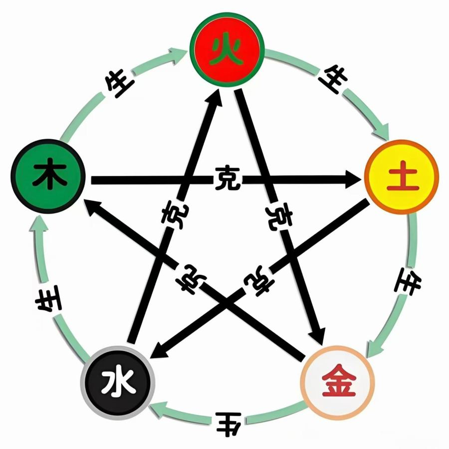

# 五行

> 木、火、土、金、水。书里看房子、看人、看八字、选颜色、念象数，全靠五行的生克。下面一张表把方位、颜色、季节、身体和情绪都对上，再记住"挨着相生、隔一个相克"就够用了。

## 生和克

- **相生**：木生火、火生土、土生金、金生水、水生木。
- **相克**：木克土、土克水、水克火、火克金、金克木。

把五行画成一个圈，**挨着的相生，隔一个的相克**。[^1]

用九宫记也行：冬水生春木，木生火，火烧完成了土灰，土里挖出金，金融化成水——顺时针一圈是相生，跳一个就是相克。[^1]

*五行生克五角星*

## 一张对照表

| 五行 | 方位 | 季节 | 颜色 | 九宫 | 身体 | 情绪 |
|---|---|---|---|---|---|---|
| 木 | 东 | 春 | 绿 | 震3、巽4 | 肝胆 | 怒 |
| 火 | 南 | 夏 | 红 | 离9 | 心、血液、眼、头 | 喜 |
| 土 | 中、四角 | 每季最后一个月 | 黄 | 坤2、艮8、中宫 | 脾胃 | 思 |
| 金 | 西 | 秋 | 白 | 兑7、乾6 | 肺、大肠 | 悲 |
| 水 | 北 | 冬 | 黑 | 坎1 | 肾、泌尿 | 恐 |

方位、季节、颜色见[^2]；九宫和身体见[^3]；情绪见[^4]。

## 怎么用

- **看房子**：哪个方位放了克它的东西，那个方位管的部位就容易出问题。比如正西（金）放炉灶（火），就是火克金。[^5]
- **调情绪**：五志也相克——生气时哭一场（悲克怒），害怕时把事想透（思克恐），见[转念的几个办法](../07-修心/02-转念的几个办法.md)。[^4]
- **穿衣**：按当天地支的五行，穿被它"生"的颜色，见第371、379章。[^6]
- **不要硬克**：给某个方位"加能量"时，能生它就生它，生不动就别硬生，无论如何不要去克它。[^5]

相关：[阴阳](01-阴阳.md)、[天干地支](04-天干地支.md)、[九宫：家里每个方位管什么](../02-看房子/03-九宫：家里每个方位管什么.md)

[^1]: 《改命记实录》第175章《五行生克关系（术）》（[笔记](../../chapters/改命记实录/0101-0200.md)）
[^2]: 《改命记实录》第114章《九宫五行方位速记（术）》（[笔记](../../chapters/改命记实录/0101-0200.md)）；《改命记实录》第379章《五行助运穿衣法详解》（[笔记](../../chapters/改命记实录/0301-0400.md)）
[^3]: 《改命记实录》第244章《头像预测的原理》（[笔记](../../chapters/改命记实录/0201-0300.md)）
[^4]: 《改命记实录》第528章《情绪是一味药》（[笔记](../../chapters/改命记实录/0501-0600.md)）
[^5]: 《改命记实录》第904章《篇外：听话听音儿》（[笔记](../../chapters/改命记实录/0901-0919.md)）
[^6]: 《改命记实录》第371章《五行助运穿衣法》（[笔记](../../chapters/改命记实录/0301-0400.md)）；《改命记实录》第379章《五行助运穿衣法详解》（[笔记](../../chapters/改命记实录/0301-0400.md)）
