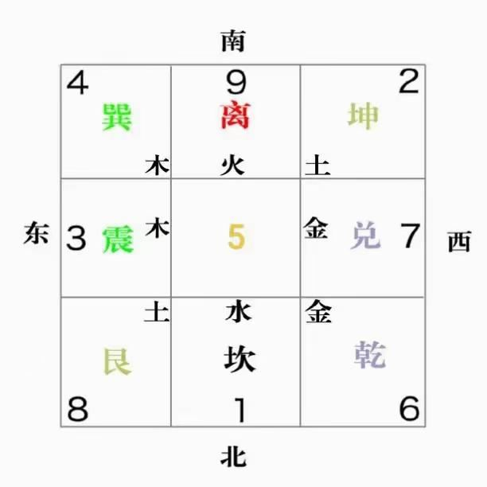
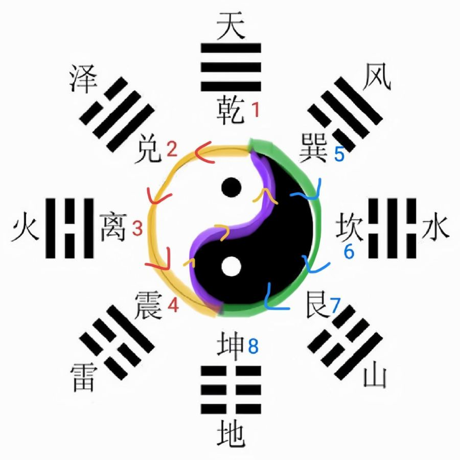

# 八卦：先天和后天

> 八卦有两套摆法。后天八卦就是九宫图（坎1北、离9南……），看房子、看人、八字都用它；先天八卦的数（乾1、兑2、离3……）是象数疗法里那些数字的来历。

先天为体，是不变的天道；后天为用，是人道。实际应用（八字、奇门、风水）多用后天八卦。[^1]

## 后天八卦：天天用的那一套

| 数字 | 卦 | 方位 | 一家人 |
|---|---|---|---|
| 1 | 坎 | 北 | 二儿子 |
| 2 | 坤 | 西南 | 母亲 |
| 3 | 震 | 东 | 大儿子 |
| 4 | 巽 | 东南 | 大女儿 |
| 5 | — | 中宫 | — |
| 6 | 乾 | 西北 | 父亲 |
| 7 | 兑 | 西 | 小女儿 |
| 8 | 艮 | 东北 | 小儿子 |
| 9 | 离 | 南 | 二女儿 |

[^2]

**一家人记法**：父母（乾6、坤2）护着小女儿（兑7）站在右边；二哥二姐（坎1、离9）在中间竖线；大哥大嫂（震3、巽4）带着小弟（艮8）在左边。[^3]

它也是一个太极：1 是冬至，最冷最阴；9 是夏至，最热最阳；阳气从艮8 开始生发。[^4]

*后天八卦图*

## 先天八卦：象数的数字从这来

先天八卦的数：**乾1、兑2、离3、震4、巽5、坎6、艮7、坤8**。[^1]

| 数 | 卦 | 对应身体（举例） |
|---|---|---|
| 1 | 乾 | 头、大肠 |
| 2 | 兑 | 口、肺 |
| 3 | 离 | 眼、心 |
| 4 | 震 | 脚、肝 |
| 5 | 巽 | 大腿、胆 |
| 6 | 坎 | 耳、肾 |
| 7 | 艮 | 手、胃 |
| 8 | 坤 | 腹、脾 |

[^5]

象数疗法"数取先天，象用后天"：比如念 650 治想太多引起的头痛，6 是坎水、5 是巽木，水生木，0 是加强。[^6]

*先天八卦的数字*

> [!NOTE]
> 不要把两套数字搞混：看房子、看八星时的"坎1、离9"是后天数；念象数时的"1 是乾、6 是坎"是先天数。

相关：[九宫：家里每个方位管什么](../02-看房子/03-九宫：家里每个方位管什么.md)、[阴阳](01-阴阳.md)、[象数速查：胃和肠](../06-身体与养生/31-象数速查：胃和肠.md)

[^1]: 《改命记实录》第115章《象数疗法的注意事项（术）》（[笔记](../../chapters/改命记实录/0101-0200.md)）
[^2]: 《改命记实录》第136章《投射效应／虚假同感偏差（术）》（[笔记](../../chapters/改命记实录/0101-0200.md)）；《改命记实录》第118章《光环效应的正面应用（术）》（[笔记](../../chapters/改命记实录/0101-0200.md)）
[^3]: 《改命记实录》第118章《光环效应的正面应用（术）》（[笔记](../../chapters/改命记实录/0101-0200.md)）
[^4]: 《改命记实录》第137章《鼻炎（术）》（[笔记](../../chapters/改命记实录/0101-0200.md)）
[^5]: 《改命记实录》第667章《给科学留点儿成长的时间》（[笔记](../../chapters/改命记实录/0601-0700.md)）
[^6]: 《改命记实录》第115章《象数疗法的注意事项（术）》（[笔记](../../chapters/改命记实录/0101-0200.md)）；《改命记实录》第172章《五行能量净化法2（术）》（[笔记](../../chapters/改命记实录/0101-0200.md)）
