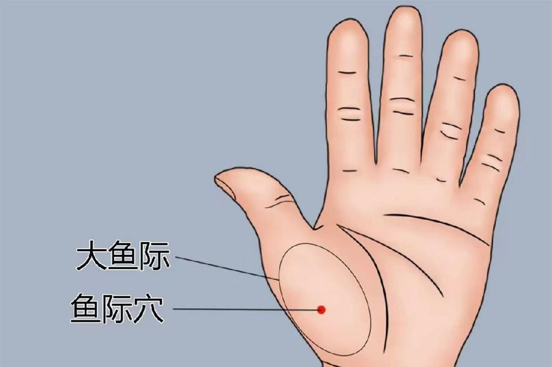

[← 回总目录](../README.md)

# 2. 咳嗽和嗓子

本节收止咳、化痰、护嗓子的办法。咳了很久不好、发烧、咳血、喘不上气，先去医院。

> [!NOTE]
> 这些是书里记的民间办法，不是医疗建议。身体不适、症状重或拖着不好，先去看医生。

相关长文：[咳嗽怎么办](../docs/06-身体与养生/21-咳嗽怎么办.md)、[香蕉偏方](../docs/06-身体与养生/20-香蕉偏方.md)。

本节条目按主题分成下面几块，括号里是条号。

**偏方**：大蒜冰糖水止咳（第 1 条），香油煎姜丝鸡蛋止咳（第 2 条），连皮香蕉冰糖汤（第 3 条），枇杷叶煮水（第 4 条），冰糖炖香蕉（第 5 条）。

**食疗**：白色食物止咳（作者列举）（第 6 条）。

**穴位**：揉大鱼际止咳（第 7 条），按承浆穴（第 8 条），揉拉耳屏（第 9 条）。

**功法**：气沉丹田（第 10 条），扁桃体——练气沉丹田、改急脾气（第 11 条）。

**象数**：咳嗽象数（最简单的）（第 12 条）。

**祝由**：祝由止咳：虚写"尚食江"（第 13 条），祝由化水："其"字套三圈（第 14 条），化骨水（祝由）（第 15 条），念"唵啊吽"（第 16 条）。

### 1. 大蒜冰糖水止咳
<!-- 标签: 类型=偏方 -->
- 用来：咳嗽
- 怎么做：七八瓣大蒜拍碎，加水煮开，放冰糖，吹凉了喝。（作者说白糖好像也可以，让大家验证。）
- 来源：《改命记实录》第107章《咳嗽的几个偏方（术）》（[逐章笔记](../chapters/改命记实录/0101-0200.md)）

### 2. 香油煎姜丝鸡蛋止咳
<!-- 标签: 类型=偏方 -->
- 用来：咳嗽
- 怎么做：用香油煎姜丝鸡蛋吃。（书里只提了名字，没写更细的步骤。）
- 来源：《改命记实录》第107章《咳嗽的几个偏方（术）》（[逐章笔记](../chapters/改命记实录/0101-0200.md)）

### 3. 连皮香蕉冰糖汤
<!-- 标签: 类型=偏方 -->
- 用来：咳嗽，带黄痰、嗓子干、小便黄（热咳）
- 怎么做：香蕉带皮切段，加水和少许冰糖煮成汤；饭前空腹喝汤、吃香蕉肉（也可以连皮吃）。早晚各一次，一般吃两三根就可以了。
- 注意：适合带黄痰、嗓子干、小便黄的热咳。
- 来源：《改命记实录》第769章《获取无穷的宇宙能量》（[逐章笔记](../chapters/改命记实录/0701-0800.md)）

### 4. 枇杷叶煮水
<!-- 标签: 类型=偏方 -->
- 用来：咳嗽有痰（不能吃甜、不适合用冰糖香蕉的人）
- 怎么做：用枇杷叶煮水喝。老叶比较大，一天用一片就够；对症的话一片就能明显感觉痰少了，普通咳嗽几片叶子就够。
- 来源：《改命记实录》第827章《番外：香蕉偏方》（[逐章笔记](../chapters/改命记实录/0801-0900.md)）

### 5. 冰糖炖香蕉
<!-- 标签: 类型=偏方 -->
- 用来：久咳；肺燥干咳无痰、口鼻干燥
- 怎么做：久咳：香蕉1–2根加冰糖炖，每天1–2次，连吃几天，可连皮吃。干咳无痰：3条香蕉去皮切段，加冰糖和一碗清水，隔水炖一小时，连渣吃。
- 来源：《改命记实录》第827章《番外：香蕉偏方》（[逐章笔记](../chapters/改命记实录/0801-0900.md)）

### 6. 白色食物止咳（作者列举）
<!-- 标签: 类型=食疗 -->
- 用来：咳嗽、养肺
- 怎么做：可选白糖大蒜水、葱白带须煮水、白糖凉拌白萝卜丝、香油白糖姜丝鸡蛋、冰糖雪梨水、川贝母炖梨。原文此处没有给出用量和次数。
- 注意：养肺首先要远离伤害源，比如空气污染。
- 来源：《改命记实录》第407章《叫爸爸》（[逐章笔记](../chapters/改命记实录/0401-0500.md)）

### 7. 揉大鱼际止咳
<!-- 标签: 类型=穴位 -->
- 用来：咳嗽（心肺弱时大鱼际会有痛点）
- 怎么做：按揉手掌大拇指根部的肉（大鱼际），有痛点尽量揉开。力度要看对方承受程度，一点点加。
- 来源：《改命记实录》第107章《咳嗽的几个偏方（术）》（[逐章笔记](../chapters/改命记实录/0101-0200.md)）

### 8. 按承浆穴
<!-- 标签: 类型=穴位 -->
- 用来：口腔溃疡、嗓子疼
- 怎么做：按揉下唇正下方、下巴中间凹陷处的承浆穴。
- 注意：书里只说按承浆穴，没写按多久；穴位位置为常规描述。
- 来源：《改命记实录》第840章《篇外：何为正道》（[逐章笔记](../chapters/改命记实录/0801-0900.md)）

### 9. 揉拉耳屏
<!-- 标签: 类型=穴位 -->
- 用来：鼻塞、嗓子有痰；头晕头痛、头脑不清醒；补肾、提升免疫力
- 怎么做：揉、拉耳眼前面的小凸起（耳屏），它的反射区对应头部。可配合对应的象数。
- 来源：《改命记实录》第899章《篇外：心境》（[逐章笔记](../chapters/改命记实录/0801-0900.md)）

### 10. 气沉丹田
<!-- 标签: 类型=功法 -->
- 用来：上火、牙痛、嗓子发炎等"气往上浮"的问题
- 怎么做：先感受吸进来的气停在哪里（多数人只到胸口或嗓子）；然后慢慢地、绵长轻缓地呼吸，想象气一次比一次深，一直沉到肚脐下方的丹田。
- 来源：《改命记实录》第305章《气沉丹田》（[逐章笔记](../chapters/改命记实录/0301-0400.md)）

### 11. 扁桃体——练气沉丹田、改急脾气
<!-- 标签: 类型=功法 -->
- 用来：扁桃体肥大、一感冒就发炎（尤其性子急的人和孩子）
- 怎么做：关注自己的情绪，同时随时感受自己的气吸到哪里，有意识地气沉丹田（方法见826章）；孩子的问题，父母先改自己的急脾气。
- 来源：《改命记实录》第822章《篇外：扁桃体问题》（[逐章笔记](../chapters/改命记实录/0801-0900.md)）

### 12. 咳嗽象数（最简单的）
<!-- 标签: 类型=象数 -->
- 用来：咳嗽（作者说820健脾益气、化痰利肺）
- 怎么做：默念"820"。
- 注意：咳嗽分很多种，其他类型书里这里没展开。
- 来源：《改命记实录》第102章《牙痛偏方（道/术）》（[逐章笔记](../chapters/改命记实录/0101-0200.md)）

### 13. 祝由止咳：虚写"尚食江"
<!-- 标签: 类型=祝由 -->
- 用来：咳嗽、喉咙痒（感冒或空气污染引起）
- 怎么做：手握剑指（食指中指并拢伸直），对着胸口和喉咙，在空中写"尚食江"三个字，7遍一组；哪里痒就写哪里。
- 来源：《改命记实录》第406章《考验的时候到了》（[逐章笔记](../chapters/改命记实录/0401-0500.md)）

### 14. 祝由化水："其"字套三圈
<!-- 标签: 类型=祝由 -->
- 用来：咳嗽严重、写字时咳得停不下来
- 怎么做：接一杯水，用剑指对着水杯虚写一个"其"字，外面套上三个开口的圈，然后把水喝下去。
- 来源：《改命记实录》第406章《考验的时候到了》（[逐章笔记](../chapters/改命记实录/0401-0500.md)）

### 15. 化骨水（祝由）
<!-- 标签: 类型=祝由 -->
- 用来：鱼刺卡喉咙
- 怎么做：一碗凉开水，上面交叉放一双筷子，把水面分成四份，每次喝其中一份，顺时针依次喝完。找不到筷子，就用剑指在水面上画个"井"字（收笔时顺时针画3个或9个圈），一般画1、3、7、21或49遍。
- 注意：卡得深、疼痛加重或出血要及时就医。
- 来源：《改命记实录》第874章《篇外：象数的用法》（[逐章笔记](../chapters/改命记实录/0801-0900.md)）

### 16. 念"唵啊吽"
<!-- 标签: 类型=祝由 -->
- 用来：嗓子不舒服（读者反馈有效）
- 怎么做：默念或轻念"唵（om）啊吽（hong）"，"唵"读om，念时感觉头颅里有震动。
- 来源：《改命记实录》第877章《篇外：从术数到修行（二）》（[逐章笔记](../chapters/改命记实录/0801-0900.md)）
