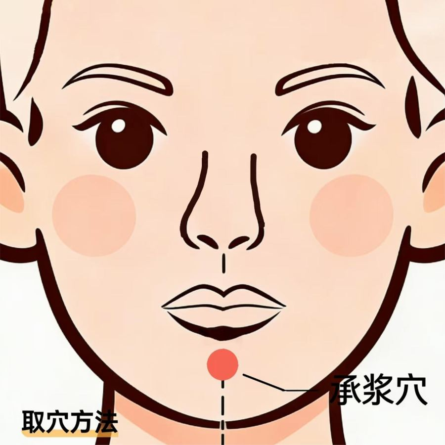

[← 回总目录](../README.md)

# 3. 牙和口腔

本节收止牙痛、护牙的办法。这些只能先缓一缓，蛀牙、牙根发炎还是要看牙医。

> [!NOTE]
> 这些是书里记的民间办法，不是医疗建议。身体不适、症状重或拖着不好，先去看医生。

相关长文：[牙痛怎么办](../docs/06-身体与养生/25-牙痛怎么办.md)。

本节条目按主题分成下面几块，括号里是条号。

**偏方**：蜂蜜止牙痛（第 1 条），冷水冲脚止牙痛（第 2 条），牙痛的其他小办法（第 3 条），芦荟含服（第 4 条），香蕉热汁含漱（第 5 条）。

**穴位**：按合谷穴止牙痛（第 6 条），按承浆穴（"百脉通"）（第 7 条）。

**身体调理**：牙痛——通开颧骨下的淤堵（第 8 条）。

**功法**：叩齿（第 9 条）。

**象数**：牙痛象数（第 10 条），象数 000·777·000 止牙痛（第 11 条），象数 1600·7200 护牙（第 12 条），象数000·777·000（第 13 条）。

**生活方法**：牙疼用的牙膏（作者亲测）（第 14 条）。

### 1. 蜂蜜止牙痛
<!-- 标签: 类型=偏方 依据=书中说法 -->
- 用来：牙痛（上火）
- 怎么做：把蜂蜜倒在痛的牙上，含着。作者说止痛很快。
- 依据：书中说法
- 来源：《改命记实录》第102章《牙痛偏方（道/术）》（[逐章笔记](../chapters/改命记实录/0101-0200.md)）

### 2. 冷水冲脚止牙痛
<!-- 标签: 类型=偏方 依据=书中说法 -->
- 用来：上火引起的牙痛
- 怎么做：把脚泡在流动的凉水里（作者半夜找了条小河），几分钟牙就不痛了。原理是借流动的水把火气往下引。
- 依据：书中说法
- 来源：《改命记实录》第102章《牙痛偏方（道/术）》（[逐章笔记](../chapters/改命记实录/0101-0200.md)）

### 3. 牙痛的其他小办法
<!-- 标签: 类型=偏方 依据=书中说法 -->
- 用来：牙痛
- 怎么做：嚼花椒、咬生姜、咬芦荟、含盐水都有效果，身边有什么用什么，试出最适合自己的。
- 依据：书中说法
- 来源：《改命记实录》第102章《牙痛偏方（道/术）》（[逐章笔记](../chapters/改命记实录/0101-0200.md)）

### 4. 芦荟含服
<!-- 标签: 类型=偏方 依据=书中说法 -->
- 用来：口腔溃疡
- 怎么做：掐一块芦荟放在嘴里含一会儿；家里不种芦荟的，可以用芦荟胶代替。
- 注意：芦荟带刺，不建议家里种；芦荟胶有添加剂。
- 依据：书中说法
- 来源：《改命记实录》第637章《口腔溃疡》（[逐章笔记](../chapters/改命记实录/0601-0700.md)）

### 5. 香蕉热汁含漱
<!-- 标签: 类型=偏方 依据=书中说法 -->
- 用来：牙痛
- 怎么做：香蕉两个煎成一碗热汁，含在嘴里漱口。
- 依据：书中说法
- 来源：《改命记实录》第827章《番外：香蕉偏方》（[逐章笔记](../chapters/改命记实录/0801-0900.md)）

### 6. 按合谷穴止牙痛
<!-- 标签: 类型=穴位 依据=书中说法 -->
- 用来：牙痛（合谷是止痛穴位）
- 怎么做：直接按合谷穴。作者说别人帮他按效果好，自己按效果差些。
- 依据：书中说法
- 来源：《改命记实录》第102章《牙痛偏方（道/术）》（[逐章笔记](../chapters/改命记实录/0101-0200.md)）

### 7. 按承浆穴（"百脉通"）
<!-- 标签: 类型=穴位 依据=书中说法 -->
- 用来：书中说颈椎不好、脑供血不足、牙龈肿、口腔溃疡、口干口苦、上火、皮肤干、眼睛干涩都有效
- 怎么做：承浆穴在下巴上、下嘴唇下方的小坑（颏唇沟正中凹陷处）。先用力按揉承浆穴十几下，再用另一只手依次按身上疼痛或淤堵的点，轻的按十秒、重的按二三十秒，津液会自己走过去，不需要用意念引导。
- 注意：作者说按完后牙疼引起的半边脸胀痛基本都通开了。
- 依据：书中说法
- 来源：《改命记实录》第196章《百脉通（术）》（[逐章笔记](../chapters/改命记实录/0101-0200.md)）

### 8. 牙痛——通开颧骨下的淤堵
<!-- 标签: 类型=身体调理 依据=读者反馈 -->
- 用来：牙痛
- 怎么做：在耳朵上方（眉毛高度）和颧骨下沿苹果肌附近找摸起来淤堵的地方，慢慢揉开、叩开；也可以用盐水、花椒、掐耳垂。
- 注意：书里没写盐水和花椒的具体用法（出自第102章读者留言）。
- 依据：读者反馈
- 来源：《改命记实录》第854章《篇外：何为贪》（[逐章笔记](../chapters/改命记实录/0801-0900.md)）

### 9. 叩齿
<!-- 标签: 类型=功法 依据=书中说法 -->
- 用来：书中说对牙齿和大脑有帮助（齿为骨之余，肾主骨，牙好不好看肾）
- 怎么做：闭着嘴叩；门牙和后面的牙分开叩，每次36下或49下。先按承浆穴再叩，更容易叩出唾液。
- 依据：书中说法
- 来源：《改命记实录》第204章《（天眼）叩齿和鸣天鼓》（[逐章笔记](../chapters/改命记实录/0201-0300.md)）

### 10. 牙痛象数
<!-- 标签: 类型=象数 依据=书中说法 -->
- 用来：牙痛
- 怎么做：默念"010·820·60"。
- 依据：书中说法
- 来源：《改命记实录》第102章《牙痛偏方（道/术）》（[逐章笔记](../chapters/改命记实录/0101-0200.md)）

### 11. 象数 000·777·000 止牙痛
<!-- 标签: 类型=象数 依据=书中说法 -->
- 用来：牙痛，也可以缓解其他疼痛
- 怎么做：默念或默想"零零零、七七七、零零零"，好了就停。
- 注意：000是强烈加强，不要长时间念。
- 依据：书中说法
- 来源：《改命记实录》第305章《气沉丹田》（[逐章笔记](../chapters/改命记实录/0301-0400.md)）

### 12. 象数 1600·7200 护牙
<!-- 标签: 类型=象数 依据=书中说法 -->
- 用来：平时保护牙齿
- 怎么做：平时默念"一六零零、七二零零"。
- 依据：书中说法
- 来源：《改命记实录》第313章《干土和湿土》（[逐章笔记](../chapters/改命记实录/0301-0400.md)）

### 13. 象数000·777·000
<!-- 标签: 类型=象数 依据=书中说法 -->
- 用来：止痛（如牙痛等）
- 怎么做：默念"零零零，七七七，零零零"。
- 注意：艮土克肾水，念多了下半身、腰可能不舒服；痛止了就停。
- 依据：书中说法
- 来源：《改命记实录》第668章《心念的磁场》（[逐章笔记](../chapters/改命记实录/0601-0700.md)）

### 14. 牙疼用的牙膏（作者亲测）
<!-- 标签: 类型=生活方法 依据=作者亲测 -->
- 用来：反复牙疼（作者说自己从小牙不好、常肿脸）
- 怎么做：青牛师父推荐日本佐藤（Sato）的 Acess 牙膏，新加坡药店有卖，咸味。作者用的是蓝色款，用后说牙疼再没犯过，也给父母寄了；父母平时不爱用咸牙膏，只在牙疼时用。网上还有绿色、黄色款，作者没试过。
- 注意：书中只是作者个人和身边人的反馈。
- 依据：作者亲测
- 来源：《改命记实录》第188章《牙疼》（[逐章笔记](../chapters/改命记实录/0101-0200.md)）
