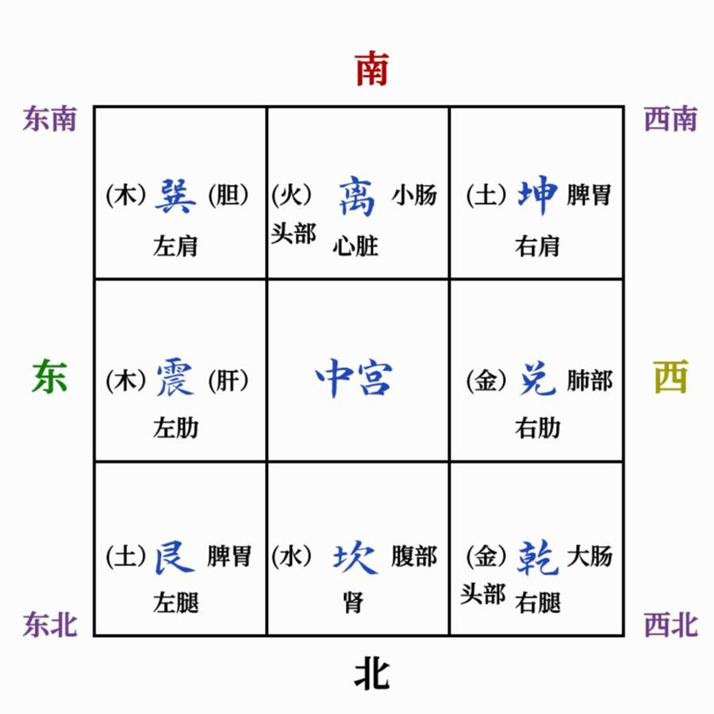

# 头像怎么看

> 作者认为微信头像反映一个人当下的心情和运势。看法和看房子一样：在头像上画九宫格，先看整体感觉，再看明暗，再看左右，最后看每一格里有什么。

## 为什么头像能看出东西

作者的解释很朴素：人只会喜欢和自己心情差不多的东西。[^1]

- 心情低落、运气不好的人，会不自觉地挑暗的、安静的、灰沉沉的图。
- 心情好、有劲头的人，挑的图也明亮。

所以头像不是"让你倒霉"的原因，而是**你现在状态的一面镜子**。[^2] 作者还说，头像和家里的风水是一一对应的：头像哪里有问题，家里对应的方位往往也有问题。[^3]

> [!NOTE]
> 作者反复强调：不是换个头像就万事大吉。头像只是提醒你"我现在处在什么状态"。真正要改的是心气，以及身边那些让你不舒服的东西。[^4]

## 先画九宫格

把头像当成一间房子，横竖各画两条线，分成九格。头像的上方当"南"，下方当"北"，左边当"东"，右边当"西"。[^5]

*作者给的九宫图：上南下北、左东右西。看房子、看脸、看头像都用这一张。*

每一格管的身体部位和事情（作者原话整理）：[^1]

| 位置 | 格子 | 五行 | 管什么 |
|---|---|---|---|
| 左上 | 巽4 | 木 | 肝胆；也管名声、传播 |
| 正上 | 离9 | 火 | 心脏、血液；眼睛、头、耳朵 |
| 右上 | 坤2 | 土 | 脾胃；女主人；妇科 |
| 正左 | 震3 | 木 | 肝胆；腰 |
| 正右 | 兑7 | 金 | 肺、呼吸；嘴 |
| 左下 | 艮8 | 土 | 脾胃；过敏（湿疹、鼻炎）；小儿子 |
| 正下 | 坎1 | 水 | 肾；手脚冰凉、男女科、泌尿、高血压、糖尿病、腰痛等 |
| 右下 | 乾6 | 金 | 男主人；钱库；脑子、直肠、痔疮 |

哪一格里有一块阴影，或者亮得刺眼，这一格管的部位就容易出问题。[^1]

## 看的顺序：从粗到细

作者打了个比方：像小朋友画画。先能看出"是个人"，再加上眉毛鼻子，再画出表情，最后画得跟照片一样。[^6] 看头像也一层一层来，每一层都能看出东西，只是细不细的区别。[^7]

1. **整体感觉**：第一眼什么感觉，就是什么感觉。比如黑白画面配一双红眼睛，让人想到"红了眼"——这不是想要的状态，也可能是眼睛本身不舒服。[^8]
2. **明暗（阴阳）**：太暗是阴，太亮也不行，亮得刺眼叫"光煞"。[^1]
3. **左右（四象）**：左边是"青龙"，右边是"白虎"。女生的头像，人物如果靠左边，再温柔，想事情也偏男性；男生头像人物靠右边，反过来。[^1]
4. **每一格的颜色和东西（五行八卦）**：比如右边兑7格里出现红色，火克金，伤呼吸系统。[^1]

*作者用来教人入门的例子：黄昏、背影。*

拿上面这张举例：黄昏是"阴"，说明心情不好或运势不顺；人背对着镜头，说明有不想面对的事。[^7]

## 常见的毛病

下面是书里点评过的头像问题，按出现多的排在前面。

### 太暗、黑白、背影

- 黑白色、灰暗、人藏在影子里的头像，说明情绪低落。作者建议卧室不挂黑白照片，微信头像、办公室也一样，尽量不用。[^9]
- 黑漆漆的头像会把运势往下拉。[^10]
- 头像里什么都没有、全是空白也不好："头像是空的，头脑也是空的。"[^11]

### 太亮：光煞

亮得发白、正中间一大片强光照着人，作者叫它光煞，看着就头晕。有读者在网上花钱买了个有光煞的头像，那段时间腰疼了两次。[^12]

### 右下角（乾6）放东西

- **国旗或红色**：乾6属金，红色属火，火克金，伤钱，还对应男主人、脑子、痔疮。[^1]
- **一盆绿植**：会影响男主人的运势。如果整张图都是草地花田，就不单独算。[^13]
- **奇形怪状的玩偶**：脑子容易迷糊。[^8]
- 有读者头像右下角写着"太急"两个字，正好对应他的痔疮——着急就是上火，火克乾6。[^13]

### 卡通头像：比例要正常

作者说的"选个正常的"，指的是五官和身体比例正常。[^14]

*作者举例：卡通头像普遍有比例问题。*

- **头比身子还大**：脑子停不下来，想得多、算计多，很难静下来；就算画的是打坐，也是"身静心不静"。[^15]
- **脖子特别细**：气会卡住；脖子上还有一圈红，说明说话急、爱抢话。[^16]
- **没有鼻子、鼻子很低**：鼻子管钱，没鼻子不利财运；鼻子也代表儿子，想生儿子的人尤其别用。[^17]
- **眉毛又细又长、纹成一根线**：夫妻运和人缘都一般。[^17]
- **眼下（卧蚕）有横竖交叉的纹**：作者叫"网罗纹"，不利子女，也说明脾胃不好。[^18]
- 大项链、大耳坠压着细脖子：容易压力大；没有鼻孔、画的蝴蝶没眼睛，都不好。[^2]

*头比身子大的卡通头像*

眉毛怎么看，书里一并讲了：长、清、弯、黑、亮的好；短、粗、薄、散、乱的差。详细见[眉毛怎么看](20-眉毛怎么看.md)。[^17]

### 猫、小人和身后的人

- **猫**：作者认为猫属阴、通灵，尽量不要用猫做头像。[^19]
- **小布偶、小动物**，尤其是丑的、藏在人身后的：代表身边有"小人"。景区拍的照片，背后一大群游客，也不适合做头像。[^20]
- **画面里有一条线射向头部**：不利头部健康。[^20]

### 拼图式、乱糟糟

一块一块拼起来的头像，"各自为政"，脑子也不容易闲着。[^2] 字或人物顶到边框上、有模糊的地方，也不协调——作者说可以把头像当成米字格里写字来看。[^21]

### 孩子的照片

作者建议尽量不用孩子的照片做头像，因为头像也带着本人的信息。[^22]

## "穿宫"是什么

头像里的主体（人、一条路、一道线）从九宫格的一格穿到另一格，叫"穿宫"。看它从哪格出发、到哪格结束，两个数字连起来读。[^20]

书里举过的几种：

- **14 生气**（左上到正下）、**19 延年**（正上到正下）、**68 天乙**（左下到右下）：好的。19 延年代表能力；68 天乙代表善良、和"天"连得上。[^23]
- **48 绝命**、**24 五鬼**：不好的。有读者把作者推荐的头像截成正方形时，把好好的"14 生气"截成了"48 绝命"。[^24]

方向也有讲究：同样从艮8到乾6，最好是平的或者往上斜，像上坡路越走越高；别用越走越低的。[^25]

这些数字组合的意思，见[八颗星](../04-名字和数字/10-八颗星.md)。

## 该怎么换

### 1. 挑明亮、温暖、干净的

作者自己找了几张"还可以"的底图，说缺点是"寡淡了一点"，建议加上字再用。[^26]

  
*作者推荐的底图（原话："喜欢的友友加上字可以用"）*

### 2. 加一句阳光、温暖的诗

直接用底图"太空了"，最好加一句阳光的、温暖的诗词。[^27] 但字也要"和气"：有棱有角、像刀一样的字体不行。[^28]

  
*作者做好的成品，可以用修图软件擦掉字，换成自己喜欢的诗句*

### 3. 截图时检查穿宫

截成正方形之后，再看一遍主体有没有被截歪。好好的 14 生气，截坏了就成了 48 绝命。[^28]

### 4. 颜色配合自己

能配合自己的命宫或喜用神最好。作者是艮8命宫、喜用神是火，所以用红色系：火生土，生自己；又帮了喜用神。两个都照顾不到，就先照顾一个，不行再换另一个试。[^28]

颜色对应的五行（作者确认过的读者笔记，加上他的补充）：[^27]

*读者问："绿色、青色：木；红色、橙色、紫色：火；黄色、棕色、灰色：土；白色：金；黑色、蓝色：水。"作者回复：书里写一下。*

- 橙色介于火和土之间，偏黄偏土，偏红偏火。
- 蓝色是水，也带一点木。
- 灰色介于金和水之间：深灰偏水，浅灰偏金，有时也按土算。

### 5. 最上面一层代表自己

看头像（看衣服图案也一样），最上层、最外层的图案代表自己。外面的颜色生自己（别人喜欢你），或者自己克外面（环境在你掌控中），都算好。[^25]

作者拿这本书自己的绿色封面举了反例：黑字（水）在黄色金光（土）上，黄光在绿色背景（木）上，一层克一层，自己是被克的一方。直接拿绿色背景当头像，木克土，对脾胃不好。[^25]

## 作者的提醒

- **别花钱买"大师头像"**：有读者找老师看户型花了 9999，看微信头像又花了 1300。作者说，现在跟玄学、五行、传统文化相关的课程，基本都是骗局；花钱买来的头像也可能有问题。[^29]
- **人体是最好的检验器**：用了某个头像觉得脑子迷糊、被压着，不管是谁给的，先换掉。[^21]
- **头像好改，心难改**：头像和风水是最容易改的地方，修正念才是根本。[^30]

相关：[九宫：家里每个方位管什么](../02-看房子/03-九宫：家里每个方位管什么.md)、[先找准方向：大太极和小太极](../02-看房子/02-先找准方向：大太极和小太极.md)、[什么时候调整、怎么调整](../02-看房子/15-什么时候调整、怎么调整.md)

[^1]: 《改命记实录》第244章《头像预测的原理》（[笔记](../../chapters/改命记实录/0201-0300.md)）
[^2]: 《改命记实录》第852章《篇外：人活一口气》（[笔记](../../chapters/改命记实录/0801-0900.md)）
[^3]: 《改命记实录》第244章《头像预测的原理》（[笔记](../../chapters/改命记实录/0201-0300.md)）；《改命记实录》第245章《头像与居家风水》（[笔记](../../chapters/改命记实录/0201-0300.md)）
[^4]: 《改命记实录》第852章《篇外：人活一口气》（[笔记](../../chapters/改命记实录/0801-0900.md)）；《改命记实录》第872章《篇外：聊聊运气》（[笔记](../../chapters/改命记实录/0801-0900.md)）
[^5]: 《改命记实录》第244章《头像预测的原理》（[笔记](../../chapters/改命记实录/0201-0300.md)）；《改命记实录》第902章《篇外：都是工具》（[笔记](../../chapters/改命记实录/0901-0919.md)）
[^6]: 《改命记实录》第230章《看头像》（[笔记](../../chapters/改命记实录/0201-0300.md)）
[^7]: 《改命记实录》第231章《头像之阴阳》（[笔记](../../chapters/改命记实录/0201-0300.md)）
[^8]: 《改命记实录》第486章《拓展的知识点》（[笔记](../../chapters/改命记实录/0401-0500.md)）
[^9]: 《改命记实录》第486章《拓展的知识点》（[笔记](../../chapters/改命记实录/0401-0500.md)）；《改命记实录》第594章《篇外：一切的发生，必有利于我》（[笔记](../../chapters/改命记实录/0501-0600.md)）；《改命记实录》第852章《篇外：人活一口气》（[笔记](../../chapters/改命记实录/0801-0900.md)）
[^10]: 《改命记实录》第825章《长在表面是好事儿》（[笔记](../../chapters/改命记实录/0801-0900.md)）
[^11]: 《改命记实录》第827章《番外：香蕉偏方》（[笔记](../../chapters/改命记实录/0801-0900.md)）
[^12]: 《改命记实录》第835章《篇外：向内求》（[笔记](../../chapters/改命记实录/0801-0900.md)）；《改命记实录》第840章《篇外：何为正道》（[笔记](../../chapters/改命记实录/0801-0900.md)）
[^13]: 《改命记实录》第605章《篇外：乾6宫》（[笔记](../../chapters/改命记实录/0601-0700.md)）
[^14]: 《改命记实录》第765章《篇外：个人的业力得自己修》（[笔记](../../chapters/改命记实录/0701-0800.md)）；《改命记实录》第820章《篇外：贵人不可贱用》（[笔记](../../chapters/改命记实录/0801-0900.md)）
[^15]: 《改命记实录》第821章《篇外：卡通头像》（[笔记](../../chapters/改命记实录/0801-0900.md)）；《改命记实录》第852章《篇外：人活一口气》（[笔记](../../chapters/改命记实录/0801-0900.md)）
[^16]: 《改命记实录》第765章《篇外：个人的业力得自己修》（[笔记](../../chapters/改命记实录/0701-0800.md)）；《改命记实录》第852章《篇外：人活一口气》（[笔记](../../chapters/改命记实录/0801-0900.md)）
[^17]: 《改命记实录》第821章《篇外：卡通头像》（[笔记](../../chapters/改命记实录/0801-0900.md)）
[^18]: 《改命记实录》第641章《卧蚕网罗纹》（[笔记](../../chapters/改命记实录/0601-0700.md)）
[^19]: 《改命记实录》第593章《篇外：正气不是软柿子》（[笔记](../../chapters/改命记实录/0501-0600.md)）
[^20]: 《改命记实录》第617章《篇外解答（甲状腺、乳腺）》（[笔记](../../chapters/改命记实录/0601-0700.md)）
[^21]: 《改命记实录》第902章《篇外：都是工具》（[笔记](../../chapters/改命记实录/0901-0919.md)）
[^22]: 《改命记实录》第908章《篇外：精神内守》（[笔记](../../chapters/改命记实录/0901-0919.md)）
[^23]: 《改命记实录》第617章《篇外解答（甲状腺、乳腺）》（[笔记](../../chapters/改命记实录/0601-0700.md)）；《改命记实录》第651章《番外：福利篇》（[笔记](../../chapters/改命记实录/0601-0700.md)）；《改命记实录》第836章《篇外：加一句小诗有多难》（[笔记](../../chapters/改命记实录/0801-0900.md)）
[^24]: 《改命记实录》第836章《篇外：加一句小诗有多难》（[笔记](../../chapters/改命记实录/0801-0900.md)）；《改命记实录》第594章《篇外：一切的发生，必有利于我》（[笔记](../../chapters/改命记实录/0501-0600.md)）
[^25]: 《改命记实录》第651章《番外：福利篇》（[笔记](../../chapters/改命记实录/0601-0700.md)）
[^26]: 《改命记实录》第834章《篇外：好的不灵坏的灵》（[笔记](../../chapters/改命记实录/0801-0900.md)）
[^27]: 《改命记实录》第835章《篇外：向内求》（[笔记](../../chapters/改命记实录/0801-0900.md)）
[^28]: 《改命记实录》第836章《篇外：加一句小诗有多难》（[笔记](../../chapters/改命记实录/0801-0900.md)）
[^29]: 《改命记实录》第872章《篇外：聊聊运气》（[笔记](../../chapters/改命记实录/0801-0900.md)）；《改命记实录》第840章《篇外：何为正道》（[笔记](../../chapters/改命记实录/0801-0900.md)）
[^30]: 《改命记实录》第840章《篇外：何为正道》（[笔记](../../chapters/改命记实录/0801-0900.md)）
