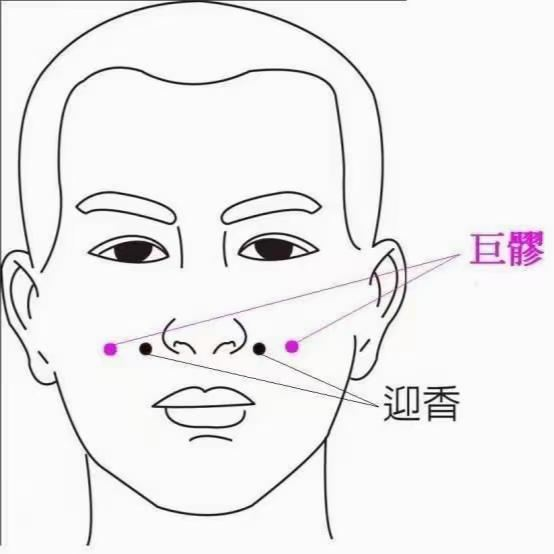

[← 回总目录](../README.md)

# 4. 肠胃

本节收肠胃方面的偏方、食疗、穴位和练功。胃和肠的象数数字很多，单独列在长文[象数速查：胃和肠](../docs/06-身体与养生/31-象数速查：胃和肠.md)。

> [!NOTE]
> 这些是书里记的民间办法，不是医疗建议。身体不适、症状重或拖着不好，先去看医生。

相关长文：[痔疮和便血](../docs/06-身体与养生/22-痔疮和便血.md)。

本节条目按主题分成下面几块，括号里是条号。

**偏方**：烤大蒜止泻（第 1 条），胃不好——少抱怨＋瘪花生米（第 2 条），黄豆水（第 3 条），连皮炖香蕉（第 4 条）。

**食疗**：鸡蛋茶（朱雀汤）（第 5 条）。

**穴位**：按巨髎穴、迎香穴（第 6 条）。

**功法**：升阳跳（第 7 条），六字诀（第 8 条）。

**养生方法**：复谷要循序渐进（第 9 条）。

**手印**：养心手印（瑜伽手印）（第 10 条）。

**祝由**：剑指祝由（产后便秘）（第 11 条）。

### 1. 烤大蒜止泻
<!-- 标签: 类型=偏方 -->
- 用来：腹泻，尤其急性腹泻
- 怎么做：大蒜用炭火烤（没有炭可以用煤气灶），烤到外面发黑、里面变软，有糊味、不辣了，直接吃下。注意补水。
- 注意：作者篇外提醒：偏方要客观验证，不要迷信；文中主角也说如果不减轻就送医院。
- 来源：《改命记实录》第22章《拉肚子（术）》（[逐章笔记](../chapters/改命记实录/0001-0100.md)）

### 2. 胃不好——少抱怨＋瘪花生米
<!-- 标签: 类型=偏方 -->
- 用来：胃病、脾胃不好
- 怎么做：遇事先找自己的问题，少抱怨别人；同时可以吃瘪花生米。
- 注意：书里没写瘪花生米怎么吃、吃多少。
- 来源：《改命记实录》第763章《篇外：怨伤脾胃》（[逐章笔记](../chapters/改命记实录/0701-0800.md)）

### 3. 黄豆水
<!-- 标签: 类型=偏方 -->
- 用来：发烧；补脾胃、调血脂
- 怎么做：喝黄豆煮的水。
- 注意：书里只说是读者分享的、截图在图里，正文没写做法和用量。
- 来源：《改命记实录》第814章《篇外：聊天》（[逐章笔记](../chapters/改命记实录/0801-0900.md)）

### 4. 连皮炖香蕉
<!-- 标签: 类型=偏方 -->
- 用来：痔疮、便后出血
- 怎么做：香蕉两个不去皮，炖热，连皮一起吃；或者两条香蕉连皮放火上烤，趁热吃。痔疮出血、大便干结的，每天早上空腹吃1–2根香蕉。
- 注意：香蕉性寒，脾胃虚寒、腹泻的慎用。
- 来源：《改命记实录》第827章《番外：香蕉偏方》（[逐章笔记](../chapters/改命记实录/0801-0900.md)）

### 5. 鸡蛋茶（朱雀汤）
<!-- 标签: 类型=食疗 -->
- 用来：保胃润肠、养肝明目、健脑；加不同调料有不同作用
- 怎么做：鸡蛋打散，用沸水冲开，加香油。想止咳化痰就加白糖；想补血养颜就加红糖；加少量盐据说能净化血液、平衡血糖。作者初中时每天早上冲两个当早餐。
- 来源：《改命记实录》第431章《异人异相》（[逐章笔记](../chapters/改命记实录/0401-0500.md)）

### 6. 按巨髎穴、迎香穴
<!-- 标签: 类型=穴位 -->
- 用来：肠胃火旺、面部淤堵；书中说能补气血、美容，对戴眼镜的人友好
- 怎么做：先按十来次承浆穴把水调上来，同时按鼻翼旁的迎香穴、瞳孔正下方的巨髎穴附近，哪里堵按哪里，一般十来下，重的多按几下。
- 来源：《改命记实录》第204章《（天眼）叩齿和鸣天鼓》（[逐章笔记](../chapters/改命记实录/0201-0300.md)）

### 7. 升阳跳
<!-- 标签: 类型=功法 -->
- 用来：书中说适合精神萎靡、浑身乏力、手脚冰凉、心慌气短、肾虚脾弱；能强壮筋骨、通经络、舒心解郁、减肥、提升心肺；也有助长个子
- 怎么做：三个动作要领：① 双手举过头顶，打开腋下（腋窝是气机汇聚的地方）；② 用前脚掌把人弹起来，像小孩蹦着走路（"八步赶蝉"）；③ 落地时脚后跟点地（就是八段锦最后一式"背后七颠百病消"的踮脚）。作者说三五分钟就有明显效果。老人跳不起来，就举手、弹起前脚掌、颠一下脚跟，脚不离地，阳气足了再慢慢跳高。
- 注意：网上版本很多，作者说的是双手举过头顶的版本。
- 来源：《改命记实录》第170章《升阳跳／回春功（术）》（[逐章笔记](../chapters/改命记实录/0101-0200.md)）

### 8. 六字诀
<!-- 标签: 类型=功法 -->
- 用来：把病气吐出来；调肝、补心、调脾、养肺、补肾、调三焦
- 怎么做：六个字依次是：嘘（hü，调肝）、呵（ho，补心气）、呼（fu，调脾）、嘶（sei，养肺）、吹（cui，补肾）、嘻（hei，补三焦，整体疏通上中下焦）。读音类似广东话、客家话。做法：1. 面对太阳，开着窗但避开风口，中午前更好；2. 先叩齿、用舌头在嘴里搅动（赤龙搅海），满口唾液后轻轻咽下；3. 念的时候只出气不出声；4. 轻轻低头用口呼气，轻轻仰头用鼻吸气；5. 吸气时间要大于或等于呼气时间。每个字6遍为一组，六个字各6遍共36遍是小周天；某个脏腑有病，单独把那个字再念36遍（无病则六个字再各6遍，共72遍）是中周天；三个36共108遍是大周天。病情重的每个字练50次，六个字共300次，并配合咽唾液。
- 注意：呼气太长会泄多补少；每个人呼吸深浅不同，不强求每次吐干净（见846章）。
- 来源：《改命记实录》第845章《篇外：六字诀功法》（[逐章笔记](../chapters/改命记实录/0801-0900.md)）

### 9. 复谷要循序渐进
<!-- 标签: 类型=养生方法 -->
- 用来：辟谷结束后防止反弹、伤胃
- 怎么做：复谷期要按要求的步骤，先喝米汤慢慢恢复，不要一开吃就刹不住。
- 注意：书里没写具体步骤；作者自己没坚持，很快反弹。辟谷应在有经验的老师带领下进行。
- 来源：《改命记实录》第736章《思想自由是前提》（[逐章笔记](../chapters/改命记实录/0701-0800.md)）

### 10. 养心手印（瑜伽手印）
<!-- 标签: 类型=手印 -->
- 用来：书中说可排毒、养肝、养心、补肾、健脾胃；书里用在生产时
- 怎么做：拇指、中指、无名指的指尖轻轻碰在一起，其他手指自然伸直。加强版：再把食指卷到大拇指根部。指尖轻碰就行，不用使劲；左右手可分开做也可同时做，走路、吃饭、睡觉随时都能做。
- 注意：作者篇外：这是瑜伽手印，自行验证，杜绝迷信；书里是在遵医嘱的前提下用，不耽误医院任何操作。（书中说"见图"，本书文本里没有这张图。）
- 来源：《改命记实录》第80章《养心补肾能量手印（术）》（[逐章笔记](../chapters/改命记实录/0001-0100.md)）

### 11. 剑指祝由（产后便秘）
<!-- 标签: 类型=祝由 -->
- 用来：产后便秘
- 怎么做：书里只写"讲了一下怎么用剑指祝由（见图）"，具体做法在图里，本书文本没有这张图，所以无法写出步骤。
- 注意：作者篇外：实践是检验真理的唯一标准，以自己验证为准，杜绝迷信。
- 来源：《改命记实录》第81章《祝由术便秘符（术）》（[逐章笔记](../chapters/改命记实录/0001-0100.md)）
