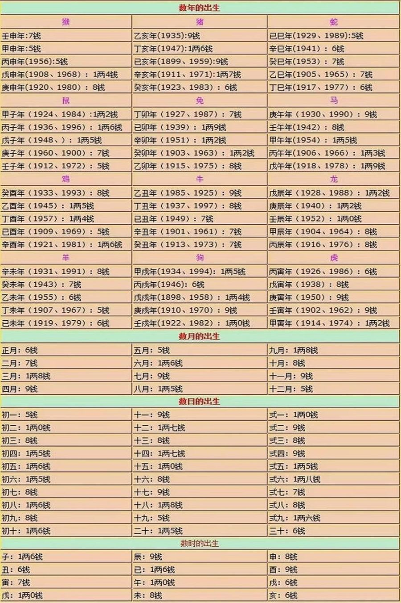

# 称骨算命歌诀

> 把出生的年、月、日、时各查一个"重量"加起来，从二两一钱到七两一钱，每个重量对应一首四句歌诀。作者说这只是普通意义上"安稳有福"的参考，骨轻不等于命不好。

## 怎么算

1. 对照称骨表，查出你出生的**年、月、日、时**各自对应的重量（几两几钱）。表在第155章的插图里。[^1]
2. 四个重量加起来，得出总重量，最低二两一钱，最高七两一钱左右。[^2]
3. 在下面的表里找到这个重量，看对应的歌诀。

*称骨算命表：年、月、日、时各自的重量*

> [!NOTE]
> 作者两次提醒（第155章借大师兄的口，第804章自己说）：重量大，说的是生活安稳、福气大；但成大事的人经历的磨难多，很多伟人的称骨只有三两多。测出来骨轻，只要放下贪念、跨过情绪上的卡点，同样能有非凡的成就——不必执着于这个数字。[^2]

## 歌诀全表

每个重量后面那句是原书给的一句话概括，下面四句是歌诀原文。

| 重量 | 一句话 | 歌诀 |
|---|---|---|
| 二两一钱 | 衣食奔波出外手艺之人 | 短命非业谓大空，平生灾难事重重， 凶祸频临陷逆境，终世困苦事不成。 |
| 二两二钱 | 幼年劳碌中年清泰之人 | 身寒骨冷苦伶仃，此命推来行乞人， 劳劳碌碌无度日，终年打拱过平生。 |
| 二两三钱 | 先难后易出外救人之命 | 此命推来骨肉轻，求谋做事事难成， 妻儿兄弟实难靠，外出他乡做散人。 |
| 二两四钱 | 人智巧多能出家求食之人 | 此命推来福禄无，门庭困苦总难荣， 六亲骨肉皆无靠，流浪他乡作老翁。 |
| 二两五钱 | 身闲心不闲九流艺术之人 | 此命推来祖业微，门庭营度似稀奇， 六亲骨肉如冰炭，一世勤劳自把持。 |
| 二两六钱 | 干办营运先贫后富劳碌之人 | 平生衣禄苦中求，独自营谋事不休， 离祖出门宜早计，晚来衣禄自无休。 |
| 二两七钱 | 超群出众聪明近贵衣禄之人 | 一生作事少商量，难靠祖宗作主张， 独马单枪空做去，早年晚岁总无长。 |
| 二两八钱 | 此乃自卓为人才能近贵之人 | 一生行事似飘蓬，祖宗产业在梦中， 若不过房改名姓，也当移徒二三通。 |
| 二两九钱 | 才能客商守权达变智慧之人 | 初年运限未曾亨，纵有功名在后成， 须过四旬才可立，移居改姓始为良。 |
| 三两 | 衣食有余独自卓立成家之命 | 劳劳碌碌苦中求，东奔西走何日休， 若使终身勤与俭，老来稍可免忧愁。 |
| 三两一钱 | 先贫后富近贵衣食足用之人 | 忙忙碌碌苦中求，何日云开见日头， 难得祖基家可立，中年衣食渐无忧。 |
| 三两二钱 | 性巧过人百事精衣食到老之人 | 初年运蹇事难谋，渐有财源如水流， 到得中年衣食旺，那时名利一齐收。 |
| 三两三钱 | 衣食丰满富贵巧艺术智之人 | 早年作事事难成，百计徒劳枉费心， 半世自如流水去，后来运到得黄金。 |
| 三两四钱 | 财榖有余主得内助爵禄富贵之人 | 此命福气果如何，僧道门中衣禄多， 离祖出家方为妙，朝晚拜佛念弥陀。 |
| 三两五钱 | 有福禄先难后易过房入赘之人 | 生平福量不周全，祖业根基觉少传， 营事生涯宜守旧，时来衣食胜从前。 |
| 三两六钱 | 超群拔类乖巧智慧衣禄厚重之人 | 不须劳碌过平生，独自成家福不轻， 早有福星常照命，任君行去百般成。 |
| 三两七钱 | 聪明富贵才能厚重有福寿之人 | 此命般般事不成、弟兄少力自孤行。 虽然祖业须微有，来得明时去不明。 |
| 三两八钱 | 财帛丰厚宜称之人 | 一身骨肉最清高，早入簧门姓氏标。 待到年将三十六，蓝衫脱去换红袍。 |
| 三两九钱 | 利上近贵有福有禄之人 | 此命终身运不通，劳劳作事尽皆空， 苦心竭力成家计，到得那时在梦中。 |
| 四两 | 富贵近益生涯鼎盛机关之命 | 平生衣禄是绵长，件件心中自主张。 前面风霜多受过，后来必定享安康。 |
| 四两一钱 | 税户近贵专才为人衣禄之人 | 此命推来事不同，为人能干异凡庸， 中年还有逍遥福，不比前时运未通。 |
| 四两二钱 | 兵权有职富贵才能之人 | 得宽怀处且宽怀，何用双眉皱不开， 若使中年命运济，那时名利一齐来。 |
| 四两三钱 | 财碌厚重白手成家之人 | 为人心性最聪明，作事轩昂近贵人， 衣禄一生天数定，不须劳碌过平生。 |
| 四两四钱 | 好学近贵巧智财禄富厚之人 | 万事由天莫苦求，须知福禄命里收， 少壮名利难如意，晚景欣然更不忧。 |
| 四两五钱 | 福禄丰厚极富且贵之人 | 名利推来竟若何，前番辛苦后奔波。 命中难养男与女，骨肉扶持也不多。 |
| 四两六钱 | 富贵有余福寿双全之命 | 东西南北尽皆通，出姓移居更觉隆， 衣禄无亏天数定，中年晚景一般同。 |
| 四两七钱 | 高官禄厚学业饱满之人 | 早年多波折，晚年享福之命 此命推为旺末年，妻荣子贵自怡然， 平生原有滔滔福，财源滚滚似水流。 |
| 四两八钱 | 官员财禄厚重之人 | 初年运道未曾亨，若是蹉跎再不兴， 兄弟六亲皆无靠，一身事业晚年成。 |
| 四两九钱 | 性巧精神仓库财禄之命 | 此命推来福不轻，自成自立显门庭， 从来富贵人钦敬，使婢差奴过一生。 |
| 五两 | 文武才能钱榖丰盛之人 | 为利为名终日劳，中年福禄也多遭， 老来是有财星照，不比前番目下高。 |
| 五两一钱 | 禄厚官职财禄荣华富贵之命 | 一世荣华事事通，不须劳碌自亨通， 弟兄叔侄皆如意，家业成时福禄宏。 |
| 五两二钱 | 掌握兵权富贵长寿之人 | 一世荣华事事能，不须劳思自然宁， 宗族欣然心皆好，家业丰亨自称心。 |
| 五两三钱 | 青衣贵人僧道门中近贵之人 | 此格推为气量真，兴家发达在其中， 一生福禄安排定，却是人间一富翁。 |
| 五两四钱 | 有勇有谋威权富贵财禄之命 | 此命推来厚且清，诗书满腹看功成， 丰衣足食自然稳，正是人间有福人。 |
| 五两五钱 | 八品官职财禄丰盛之人 | 走马扬鞭争利名，少年作事费筹论， 一朝福禄源源至，富贵荣华显六亲。 |
| 五两六钱 | 七品官职长享荣华富贵之命 | 此格推来礼义通，一身福禄用无穷， 甜酸苦辣皆尝过，滚滚财源稳且丰。 |
| 五两七钱 | 六品官职文章压众精通之人 | 福禄丰盈万事全，一身荣耀乐天年。 名扬威震人争羡，此世逍遥宛似仙。 |
| 五两八钱 | 官禄旺相才能性直富贵之人 | 平生福禄自然来，名利兼全福寿偕， 雁塔题名为贵客，紫袍金带走金阶。 |
| 五两九钱 | 五品官职财禄厚重之人 | 细推此格妙且清，必定才高礼义通， 甲第之中应有分，扬鞭走马显威荣。 |
| 六两 | 四品官职荣华福寿财禄之人 | 一朝金榜快题名，显祖荣宗立大功， 衣禄定然原裕足，田园财帛更丰盈。 |
| 六两一钱 | 法身官掌风雷权柄之人 | 不作朝中金榜客，定为世上大财翁， 聪明天赋经书熟，名显高科自是荣。 |
| 六两二钱 | 三品官职有权柄之人 | 此命生来福不穷，读书必定显亲宗， 紫衣金带为卿相，富贵荣华皆可同。 |
| 六两三钱 | 指挥太守万户封侯之命 | 命主为官福禄长，得来富贵实丰常， 名题金塔传金榜，定中高科天下扬。 |
| 六两四钱 | 二品官职尚书郎之命 | 此格威权不可当，紫袍金带尘高堂。 荣华富贵谁能及？万古留名姓氏扬。 |
| 六两五钱 | 掌楬权威极大齐福禄之人 | 细推此命福非轻，富贵荣华孰与争？ 定国安邦人极品，威声显赫震寰瀛。 |
| 六两六钱 | 公侯驸马丕相之命 | 此格人间一福人，堆金积玉满堂春， 从来富贵由天定，正笏垂绅谒圣君。 |
| 六两七钱 | 英名冠世万国来朝之人 | 此命生来福自宏，田园家业最高隆， 平生衣禄盈丰足，一世荣华万事通。 |
| 六两八钱 | 温和富贵繁荣极吉之命 | 富贵由天莫苦求，万金家计不须谋， 如今不比前翻事，祖业根基千古留。 |
| 六两九钱 | 惠收高位功名显达之命 | 君是人间衣禄星，一生富贵众人钦， 纵然福禄由天定，安享荣华过一生。 |
| 七两 | 权力具备极品上流之命 | 此命推来福禄宏，不须愁虑苦劳心， 一生天定衣与禄，富贵荣华主一生。 |
| 七两一钱 | — | 此命生成大不同，公侯卿相在其中。 一生自有逍遥福，富贵荣华极品隆 |

相关：[姓名学](../04-名字和数字/20-姓名学.md)、[择日：九星吉日怎么算](10-择日：九星吉日怎么算.md)

[^1]: 《改命记实录》第155章《称骨算命（术）》（[笔记](../../chapters/改命记实录/0101-0200.md)）
[^2]: 《改命记实录》第155章《称骨算命（术）》（[笔记](../../chapters/改命记实录/0101-0200.md)）；《改命记实录》第804章《番外【称骨算命歌诀】》（[笔记](../../chapters/改命记实录/0801-0900.md)）
