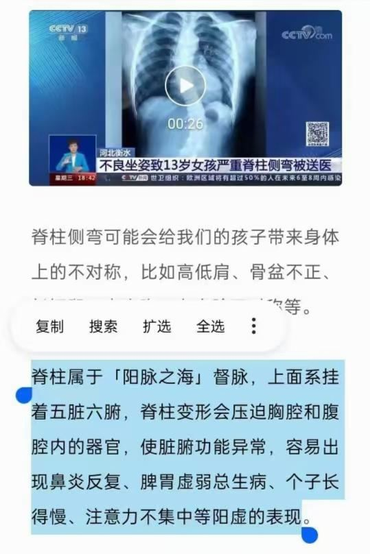

[← 回总目录](../README.md)

# 5. 腰、颈和关节

本节收腰、颈、肩、膝的办法：拉伸动作、穴位、泡脚，还有作者讲的"哪里疼对应什么脾气"。

> [!NOTE]
> 这些是书里记的民间办法，不是医疗建议。身体不适、症状重或拖着不好，先去看医生。

相关长文：[腰痛怎么办](../docs/06-身体与养生/26-腰痛怎么办.md)、[性情疗法：病和脾气对照表](../docs/06-身体与养生/40-性情疗法：病和脾气对照表.md)。

本节条目按主题分成下面几块，括号里是条号。

**穴位**：按肩井穴（第 1 条），腰疼急救按摩（第 2 条）。

**身体调理**：脊柱操（开肩）（第 3 条），夹脊（夹肩胛骨）（第 4 条），正骨时多揉硬的一边（第 5 条）。

**养生方法**：泡脚（肾虚腰痛）（第 6 条），泡脚治肾虚腰痛要注意保暖（第 7 条）。

**象数**：象数650·82000（第 8 条）。

### 1. 按肩井穴
<!-- 标签: 类型=穴位 依据=书中说法 -->
- 用来：鼻梁发青、肝火旺、压力大
- 怎么做：长按肩井穴（肝胆的反射点），减轻心理压力，改善鼻子颜色。
- 依据：书中说法
- 来源：《改命记实录》第73章《打通人体的财务通道（术）》（[逐章笔记](../chapters/改命记实录/0001-0100.md)）

### 2. 腰疼急救按摩
<!-- 标签: 类型=穴位 依据=书中说法 -->
- 用来：急性腰疼
- 怎么做：手：在手背上顺着指骨之间的缝隙往手腕方向推开指骨缝，哪个缝里有疙瘩（或像长在一起）就推哪里；找不到就在指骨交叉点沉下去按。有人帮你两点一起按更好，同时前后活动不舒服的腰部。脚：在无名趾的关节处，从趾根往趾尖方向捋，中间有痛点就揉开，内外两侧都要揉，一两分钟揉透即可（可用按摩工具，能脱袜子的话脚比手效果好）。
- 注意：腰部问题大的话脚上会很疼。
- 依据：书中说法
- 来源：《改命记实录》第877章《篇外：从术数到修行（二）》（[逐章笔记](../chapters/改命记实录/0801-0900.md)）

### 3. 脊柱操（开肩）
<!-- 标签: 类型=身体调理 依据=书中说法 -->
- 用来：鼻梁塌、颈椎胸椎问题、改善面相和财运
- 怎么做：双手在背后交叉，向后挤压肩胛骨。按摩、打坐也能改善脊柱。（作者说在抖音"daozhiguang"发过"开肩美背"视频）
- 依据：书中说法
- 来源：《改命记实录》第73章《打通人体的财务通道（术）》（[逐章笔记](../chapters/改命记实录/0001-0100.md)）

### 4. 夹脊（夹肩胛骨）
<!-- 标签: 类型=身体调理 依据=书中说法 -->
- 用来：鼻梁塌、朝天鼻、颧骨高；书中说能牵动任督二脉、锻炼脊柱
- 怎么做：向后夹肩胛骨，八段锦里也有类似动作。练之前可以先拍张照片，留着对比。
- 依据：书中说法
- 来源：《改命记实录》第179章《体态提升阳气（夹脊）》（[逐章笔记](../chapters/改命记实录/0101-0200.md)）

### 5. 正骨时多揉硬的一边
<!-- 标签: 类型=身体调理 依据=书中说法 -->
- 用来：面部徒手正骨两边效果不一样
- 怎么做：哪边的筋肉更硬，就多揉一会儿；同时少思少怒。
- 依据：书中说法
- 来源：《改命记实录》第910章《篇外：执着》（[逐章笔记](../chapters/改命记实录/0901-0919.md)）

### 6. 泡脚（肾虚腰痛）
<!-- 标签: 类型=养生方法 依据=书中说法 -->
- 用来：肾虚引起的腰痛（一般是湿寒引起）
- 怎么做：先泡几天脚看看。泡脚没什么副作用。
- 注意：腰痛分很多种，腰本身受伤的痛不在此列。
- 依据：书中说法
- 来源：《改命记实录》第101章《与人为善有错吗》（[逐章笔记](../chapters/改命记实录/0101-0200.md)）

### 7. 泡脚治肾虚腰痛要注意保暖
<!-- 标签: 类型=养生方法 依据=书中说法 -->
- 用来：肾虚腰痛泡脚后又反复
- 怎么做：泡脚要坚持，同时脚要保暖，天热了也穿袜子，别让脚受凉。
- 依据：书中说法
- 来源：《改命记实录》第145章《玄学是一种推理》（[逐章笔记](../chapters/改命记实录/0101-0200.md)）

### 8. 象数650·82000
<!-- 标签: 类型=象数 依据=读者反馈 -->
- 用来：肩膀问题（读者反馈）
- 怎么做：默念650·82000，念时心要跟着念。
- 注意：书里只是读者反馈，没写念多久；没效果就换别的方法。
- 依据：读者反馈
- 来源：《改命记实录》第918章《篇外：非法，非非法》（[逐章笔记](../chapters/改命记实录/0901-0919.md)）
