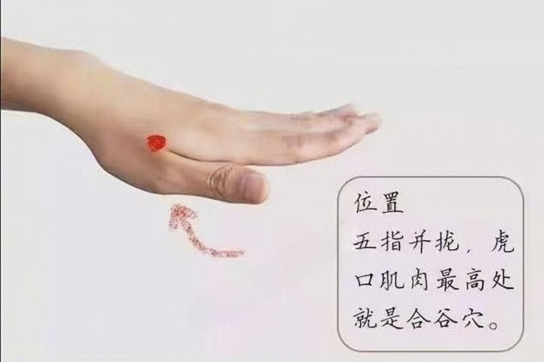

# 牙痛怎么办

> 书里治牙痛的办法有十几种：按合谷、含蜂蜜、冷水冲脚、念 000·777·000、气沉丹田……作者的理解是牙痛多是"气往上浮"，所以很多办法都是把火往下引。下面每个都写清楚怎么做。

> [!NOTE]
> 牙齿有洞、化脓、脸肿起来，先去看牙医。下面是缓解的办法。

作者说：上火多因生气，"火是气之余"；牙痛、嗓子发炎一般是气上浮了。[^1]

## 马上能用的

| 办法 | 怎么做 |
|---|---|
| **按合谷穴** | 手背上大拇指和食指之间的合谷穴，直接按。作者说别人帮着按比自己按效果好。[^2] |
| **含蜂蜜** | 把蜂蜜倒在痛的那颗牙上含着，作者说止痛很快。[^2] |
| **冷水冲脚** | 上火牙痛时，把脚泡在流动的凉水里，几分钟就不痛了——借流水把火往下引。作者当年是半夜找了条小河。[^2] |
| **身边有什么用什么** | 嚼花椒、咬生姜、咬芦荟、含盐水都有效果，试出适合自己的。[^2] |
| **香蕉热汁含漱** | 两根香蕉煮出一碗热汁，含在嘴里漱。[^3] |
| **掐耳垂、揉颧骨下** | 在耳朵上方（眉毛高度，避开太阳穴）和颧骨下沿苹果肌附近，找摸着发硬的地方慢慢揉开、叩开；也可以掐耳垂。[^4] |
| **按承浆穴** | 下嘴唇下面那个小坑，用力按揉十几下，再按其他疼的地方。作者说牙疼引起的半边脸胀痛基本都通开了。[^5] |

*合谷穴的位置*

## 念的

| 象数 | 用法 |
|---|---|
| **000·777·000** | 默念"零零零、七七七、零零零"，好了就停。000 是强烈加强，别长时间念；念多了下半身、腰可能不舒服。[^6] |
| 010·820·60 | 牙痛时默念。[^2] |
| 1600·7200 | 平时护牙。[^7] |

更多（上火牙痛 160·70、火牙痛 070·050 等）见[象数速查：头面五官、皮肤和日常](32-象数速查：头面五官、皮肤和日常.md)。

## 把气沉下去

先感受吸进来的气停在哪里（多数人只到胸口或嗓子），然后慢慢地、绵长轻缓地呼吸，想象气一次比一次深，沉到肚脐下面。[^1] 更细的要领见第826章：腰放松、含胸、百会轻轻上顶，像拎重水桶时丹田憋住的那股劲。[^8]

## 平时护牙

- **叩齿**：闭着嘴叩，门牙和后面的牙分开叩，每次 36 下或 49 下；先按承浆穴再叩更容易出唾液。[^9]
- **牙膏**：作者反复牙疼，用了青牛师父推荐的日本佐藤 Acess 牙膏（咸味，蓝色款）后再没犯过。这只是他个人和家人的反馈。[^10]
- **家里**：正北门放了红色地垫后容易上火、牙痛、口腔溃疡的，把地垫撤掉。[^11]

相关：[象数速查：头面五官、皮肤和日常](32-象数速查：头面五官、皮肤和日常.md)、[香蕉偏方](20-香蕉偏方.md)、[咳嗽怎么办](21-咳嗽怎么办.md)

[^1]: 《改命记实录》第305章《气沉丹田》（[笔记](../../chapters/改命记实录/0301-0400.md)）
[^2]: 《改命记实录》第102章《牙痛偏方（道/术）》（[笔记](../../chapters/改命记实录/0101-0200.md)）
[^3]: 《改命记实录》第827章《番外：香蕉偏方》（[笔记](../../chapters/改命记实录/0801-0900.md)）
[^4]: 《改命记实录》第854章《篇外：何为贪》（[笔记](../../chapters/改命记实录/0801-0900.md)）
[^5]: 《改命记实录》第196章《百脉通（术）》（[笔记](../../chapters/改命记实录/0101-0200.md)）
[^6]: 《改命记实录》第305章《气沉丹田》（[笔记](../../chapters/改命记实录/0301-0400.md)）；《改命记实录》第668章《心念的磁场》（[笔记](../../chapters/改命记实录/0601-0700.md)）
[^7]: 《改命记实录》第313章《干土和湿土》（[笔记](../../chapters/改命记实录/0301-0400.md)）
[^8]: 《改命记实录》第826章《篇外：气沉丹田》（[笔记](../../chapters/改命记实录/0801-0900.md)）
[^9]: 《改命记实录》第204章《（天眼）叩齿和鸣天鼓》（[笔记](../../chapters/改命记实录/0201-0300.md)）
[^10]: 《改命记实录》第188章《牙疼》（[笔记](../../chapters/改命记实录/0101-0200.md)）
[^11]: 《改命记实录》第557章《正北开门的化解》（[笔记](../../chapters/改命记实录/0501-0600.md)）
