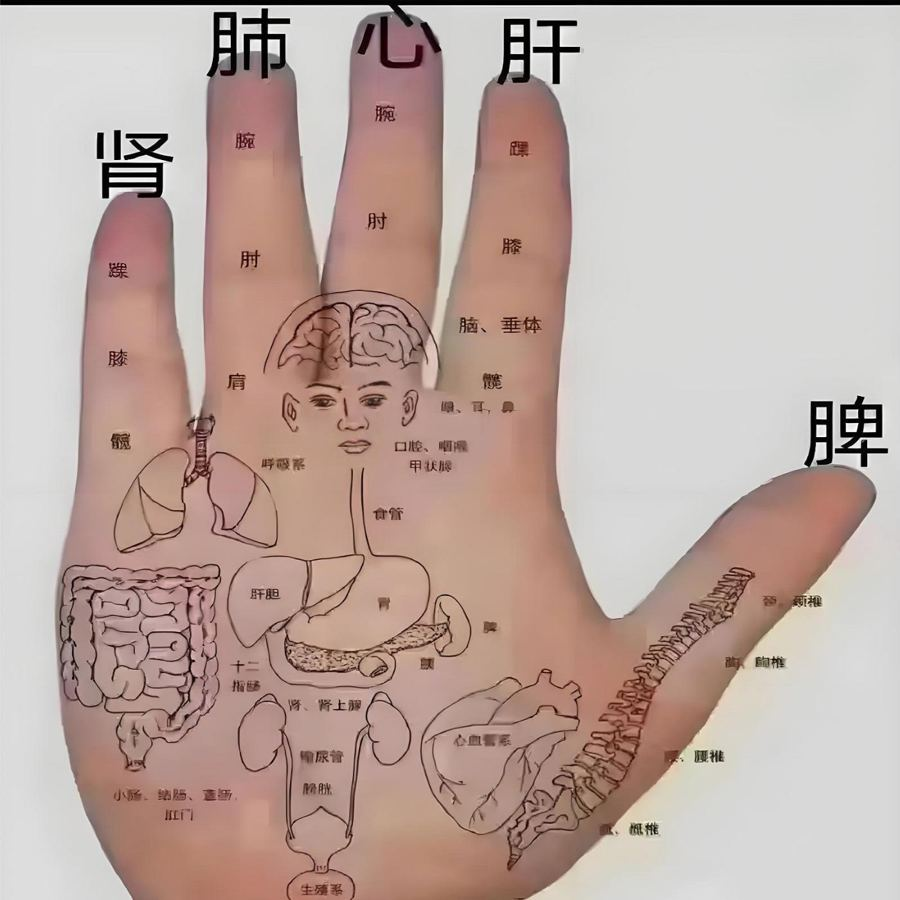
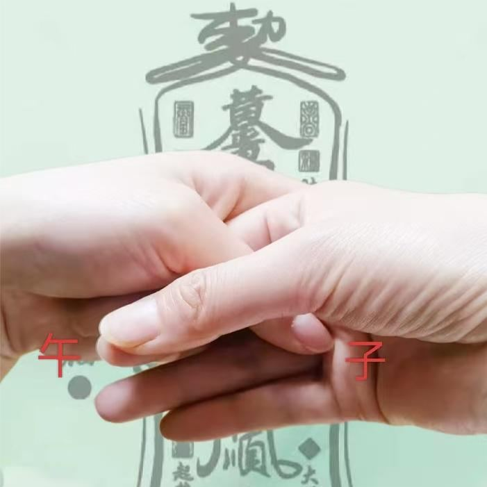
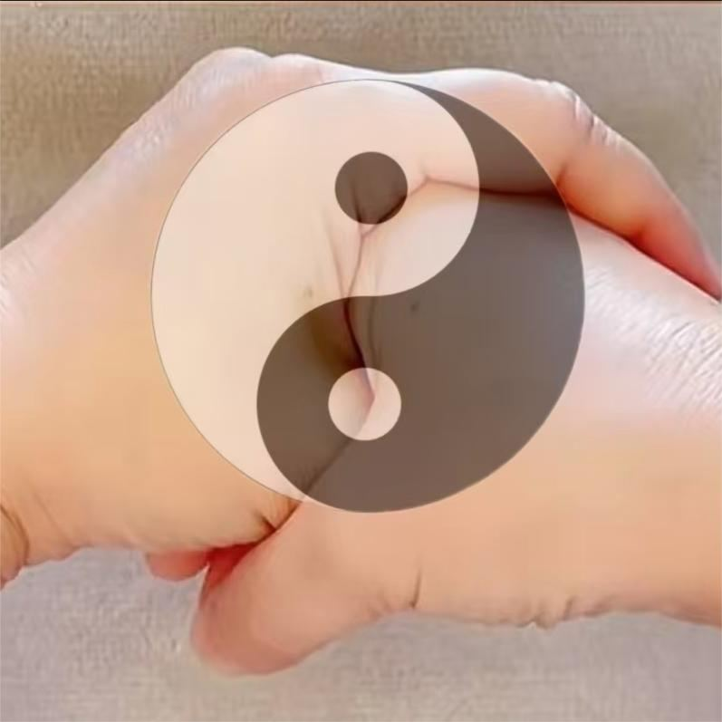

[← 回总目录](../README.md)

# 7. 其他身体小毛病

前面几节放不下的身体办法都在这里，按方法类型分组。象数是一串念的数字，用法见[象数速查](../docs/06-身体与养生/32-象数速查：头面五官、皮肤和日常.md)开头的"怎么念"。

> [!NOTE]
> 这些是书里记的民间办法，不是医疗建议。身体不适、症状重或拖着不好，先去看医生。

相关长文：[香蕉偏方](../docs/06-身体与养生/20-香蕉偏方.md)。

本节条目按主题分成下面几块，括号里是条号。

**偏方**：酱油抹烫伤（第 1 条），红线绑中指治麦粒肿（第 2 条），姜片贴肚脐防晕车（第 3 条），醋蛋（琪儿用的偏方）（第 4 条），醋鸡蛋（快速版）（第 5 条），蒲公英鹅蛋汤（第 6 条），霜桑叶泡水（第 7 条），玉米须泡水（第 8 条），香蕉皮（果柄）煎汤（第 9 条），香蕉果柄冲水（第 10 条），香蕉根煮水（第 11 条）。

**食疗**：醋饮料（第 12 条），醋蛋液（第 13 条），姜水（第 14 条），绿豆朱雀汤（第 15 条），香蕉蜂蜜热牛奶（第 16 条）。

**穴位**：捏指尖明目（第 17 条），按承泣穴（第 18 条），艾灸大椎补卫气（第 19 条），捋小指根（水星丘）调月经（第 20 条）。

**身体调理**：鼻子歪：反向压腿（第 21 条），勾脚趾养肾（第 22 条），转眼球（第 23 条），悬针纹手法放松（第 24 条），五行杵（凤凰三啄）（第 25 条），擀皮（第 26 条），空心掌拍胸（第 27 条），测经络通不通（第 28 条），掉眉毛——先查肺经（第 29 条）。

**象数**：晕车象数 070（第 30 条），减肥象数（第 31 条），只瘦肚子的象数（第 32 条），植物长得弱的象数（第 33 条），象数 20·60·050·070（第 34 条），象数 2000·650 壮阳（第 35 条），象数07（第 36 条），象数640（第 37 条），象数430 / 4300（第 38 条），象数380·650（第 39 条），象数720·40（第 40 条），选用象数的步骤（第 41 条），象数好了就停（第 42 条），象数20·60·50（第 43 条），象数380·650（第 44 条），自己选象数的步骤（第 45 条），念象数要走心（第 46 条），选车牌号（第 47 条）。

**手印**：子午诀（太极诀）（第 48 条），握固（第 49 条），做手印时手指微弯（第 50 条）。

### 1. 酱油抹烫伤
<!-- 标签: 类型=偏方 -->
- 用来：轻度烫伤（防起泡）
- 怎么做：被烫后马上在烫伤处抹酱油（没有可以用面酱、豆瓣酱），抹几遍。书里小包子抹完第二天不疼也不红。
- 注意：书里是小面积轻微烫伤的例子。
- 来源：《改命记实录》第39章《创业危险，打工安全？（术）》（[逐章笔记](../chapters/改命记实录/0001-0100.md)）

### 2. 红线绑中指治麦粒肿
<!-- 标签: 类型=偏方 -->
- 用来：麦粒肿（眼睛红肿、长针眼）
- 怎么做：用红线在中指根部轻轻绑上，不要太紧。书里说通常一晚上就见效。
- 来源：《改命记实录》第58章《麦粒肿（术）》（[逐章笔记](../chapters/改命记实录/0001-0100.md)）

### 3. 姜片贴肚脐防晕车
<!-- 标签: 类型=偏方 -->
- 用来：晕车
- 怎么做：出门前用胶布把一片姜贴在肚脐（神阙穴）上。没有姜片可以用重物压住肚脐，比如装满沙子的书包。
- 来源：《改命记实录》第102章《牙痛偏方（道/术）》（[逐章笔记](../chapters/改命记实录/0101-0200.md)）

### 4. 醋蛋（琪儿用的偏方）
<!-- 标签: 类型=偏方 -->
- 用来：扁平疣（扁扁的小瘊子）
- 怎么做：10个生鸡蛋放进陶瓷罐（琪儿家用的是茶壶），倒满高度米醋，密封泡7天，把蛋煮熟，每天吃1个。泡得越久蛋壳越化，越难吃。琪儿吃了大半个月，还剩最后一个蛋时疣子已经全掉了。
- 注意：非常难吃（酸、涩）。琪儿去医院时医生建议手术切除并做病理检查。
- 来源：《改命记实录》第125章《扁平疣（术）》（[逐章笔记](../chapters/改命记实录/0101-0200.md)）

### 5. 醋鸡蛋（快速版）
<!-- 标签: 类型=偏方 -->
- 用来：扁平疣
- 怎么做：鸡蛋煮熟去壳，泡在醋里密封24小时后就能吃。每天吃2个，书中说3周见效。
- 来源：《改命记实录》第125章《扁平疣（术）》（[逐章笔记](../chapters/改命记实录/0101-0200.md)）

### 6. 蒲公英鹅蛋汤
<!-- 标签: 类型=偏方 -->
- 用来：血糖偏高
- 怎么做：蒲公英适量，加1个鹅蛋，用清水一起煮汤，不加油盐等调料，每天吃一份。君君父母是长期坚持吃的。
- 注意：作者本人未验证；书中这家人后来血糖仍然突然升高。糖尿病是严重疾病，降糖药请遵医嘱，不要因为吃偏方自行停药。
- 来源：《改命记实录》第554章《降血糖偏方》（[逐章笔记](../chapters/改命记实录/0501-0600.md)）

### 7. 霜桑叶泡水
<!-- 标签: 类型=偏方 -->
- 用来：减肥；清肝明目、养肺
- 怎么做：用霜打过的桑叶（中药）泡水喝。
- 注意：书里没给用量。
- 来源：《改命记实录》第635章《降三高和利尿减肥的偏方》（[逐章笔记](../chapters/改命记实录/0601-0700.md)）

### 8. 玉米须泡水
<!-- 标签: 类型=偏方 -->
- 用来：三高、利尿、补肾、水肿
- 怎么做：用玉米须泡水喝。
- 注意：孕妇要少量：书里孕晚期的人喝了消肿，但胎检羊水减少了，立刻停了。
- 来源：《改命记实录》第635章《降三高和利尿减肥的偏方》（[逐章笔记](../chapters/改命记实录/0601-0700.md)）

### 9. 香蕉皮（果柄）煎汤
<!-- 标签: 类型=偏方 -->
- 用来：高血压
- 怎么做：香蕉皮或香蕉果柄30–60克，煎汤喝。
- 注意：正在住院或吃药治疗的慎用，以免冲突。
- 来源：《改命记实录》第827章《番外：香蕉偏方》（[逐章笔记](../chapters/改命记实录/0801-0900.md)）

### 10. 香蕉果柄冲水
<!-- 标签: 类型=偏方 -->
- 用来：胆固醇偏高
- 怎么做：香蕉果柄50克洗净切片，开水冲泡喝，连续10–20天。
- 注意：量不能太大，否则腹泻。
- 来源：《改命记实录》第827章《番外：香蕉偏方》（[逐章笔记](../chapters/改命记实录/0801-0900.md)）

### 11. 香蕉根煮水
<!-- 标签: 类型=偏方 -->
- 用来：肾结石（利尿排石）
- 怎么做：五六把香蕉根煮水，每天早晚各喝一大碗，连喝半个月。
- 来源：《改命记实录》第827章《番外：香蕉偏方》（[逐章笔记](../chapters/改命记实录/0801-0900.md)）

### 12. 醋饮料
<!-- 标签: 类型=食疗 -->
- 用来：日常养生
- 怎么做：醋直接加温水冲着喝，可以加蜂蜜，最好别加糖；也可以用水果醋（含钾，书中说能预防高血压）。醋还可以腌小菜开胃，煮骨头汤利于补钙。
- 来源：《改命记实录》第125章《扁平疣（术）》（[逐章笔记](../chapters/改命记实录/0101-0200.md)）

### 13. 醋蛋液
<!-- 标签: 类型=食疗 -->
- 用来：书中说可美容养颜、淡斑、减肥、降压降脂、健脑、增强免疫力
- 怎么做：前面和醋蛋一样，把生鸡蛋加醋密封泡好；区别是不煮，直接生着加热水和蜂蜜喝。同时配合外用涂抹效果更好。
- 来源：《改命记实录》第125章《扁平疣（术）》（[逐章笔记](../chapters/改命记实录/0101-0200.md)）

### 14. 姜水
<!-- 标签: 类型=食疗 -->
- 用来：体内湿寒重（书中BUN按道医要求全天喝）
- 怎么做：一般人早上吃姜补阳气；湿寒特别重的人，书里是按道医的要求全天喝姜水。
- 注意：晚上吃姜可能伤阴、睡不着；作者说自己不是医生，BUN是在道医指导下喝的。
- 来源：《改命记实录》第683章《姜》（[逐章笔记](../chapters/改命记实录/0601-0700.md)）

### 15. 绿豆朱雀汤
<!-- 标签: 类型=食疗 -->
- 用来：嘴角上火、发红、起泡
- 怎么做：绿豆30克，冷水泡10分钟，加热煮沸5分钟；趁热用这碗绿豆汤冲一枚打散的新鲜鸡蛋液。早晚各一次，现做现喝。
- 来源：《改命记实录》第705章《嘴角上火》（[逐章笔记](../chapters/改命记实录/0701-0800.md)）

### 16. 香蕉蜂蜜热牛奶
<!-- 标签: 类型=食疗 -->
- 用来：痛经
- 怎么做：每晚睡前喝一杯加了一勺蜂蜜的香蕉热牛奶。
- 来源：《改命记实录》第827章《番外：香蕉偏方》（[逐章笔记](../chapters/改命记实录/0801-0900.md)）

### 17. 捏指尖明目
<!-- 标签: 类型=穴位 -->
- 用来：眼睛看不清、视物模糊
- 怎么做：捏食指指尖（肝开窍于目）和小指指尖（对应肾），按压10秒后松手，停1秒再睁眼，就会觉得看东西清楚了。左右手共四个点，单做一个就有效，作者一般四个都捏。
- 来源：《改命记实录》第194章《近视（术）》（[逐章笔记](../chapters/改命记实录/0101-0200.md)）

### 18. 按承泣穴
<!-- 标签: 类型=穴位 -->
- 用来：眼睛问题、迎风流泪；书中说散风去热、明目止泪
- 怎么做：承泣穴在眼珠正下方（流眼泪时泪水滴到的位置），经常按压。
- 来源：《改命记实录》第194章《近视（术）》（[逐章笔记](../chapters/改命记实录/0101-0200.md)）

### 19. 艾灸大椎补卫气
<!-- 标签: 类型=穴位 -->
- 用来：后脑勺大椎穴上方一块容易出汗、怕风
- 怎么做：用艾灸在这个部位稍微灸一下，几分钟就好；也可以练气功增强自身的气。
- 注意：最长不要超过15分钟，时间长了容易上火。
- 来源：《改命记实录》第313章《干土和湿土》（[逐章笔记](../chapters/改命记实录/0301-0400.md)）

### 20. 捋小指根（水星丘）调月经
<!-- 标签: 类型=穴位 -->
- 用来：月经不调
- 怎么做：手心朝下，用另一只手的食指按住小指根部，往小指指尖方向捋。每天3次，每次10分钟，捋几天、捋到不痛了，气血就通了。
- 来源：《改命记实录》第396章《月经不调的小技巧》（[逐章笔记](../chapters/改命记实录/0301-0400.md)）

### 21. 鼻子歪：反向压腿
<!-- 标签: 类型=身体调理 -->
- 用来：鼻子歪、脊柱偏（鼻子左斜的人习惯右腿压左腿，反之亦然）
- 怎么做：先放松对应部位的肌肉，再有意识地反过来压腿。
- 来源：《改命记实录》第73章《打通人体的财务通道（术）》（[逐章笔记](../chapters/改命记实录/0001-0100.md)）

### 22. 勾脚趾养肾
<!-- 标签: 类型=身体调理 -->
- 用来：跳不动升阳跳的老人；温肾阳、固肾精
- 怎么做：平时多勾勾脚趾头，一松一拉活动涌泉穴。
- 来源：《改命记实录》第190章《消气操》（[逐章笔记](../chapters/改命记实录/0101-0200.md)）

### 23. 转眼球
<!-- 标签: 类型=身体调理 -->
- 用来：近视、眼睛疲劳
- 怎么做：闭上眼睛，眼珠向左转36圈，再向右转36圈。
- 来源：《改命记实录》第194章《近视（术）》（[逐章笔记](../chapters/改命记实录/0101-0200.md)）

### 24. 悬针纹手法放松
<!-- 标签: 类型=身体调理 -->
- 用来：眉间悬针纹
- 怎么做：1. 在皱眉肌附近（眉头）找到肌肉很厚、淤堵紧绷的地方，把皮捏起来，放松里面的肌肉，连续几分钟；2. 顺着眉毛方向，从眉头到眉尾用捏脊的手法擀皮；3. 用眼保健操刮眼眶的手势，用食指稍用力刮眉毛，刮的是里面的肌肉。
- 注意：最重要的是修心，少发怒、少多虑——让放松的速度大于产生新淤堵的速度。
- 来源：《改命记实录》第828章《美人在骨不在皮》（[逐章笔记](../chapters/改命记实录/0801-0900.md)）

### 25. 五行杵（凤凰三啄）
<!-- 标签: 类型=身体调理 -->
- 用来：面部淤堵（美容）；脑子迷糊（提神醒脑，作者说这是他知道最有效的醒脑法）
- 怎么做：五根手指尖捏在一起，轻轻叩击皮肤。醒脑：轻叩头顶百会穴和眉心（祖窍）。美容：轻叩面部摸起来特别厚的淤堵处。也可以叩后脑勺、颈椎、胸口等有淤堵的地方。
- 注意：1. 适量：淤堵叩开了就停，不用天天做。2. 用五指，不习惯可用三指，别翘小指用四指（单数为阳）。3. 尽量避开耳后、腋下，只叩晒得到太阳的裸露部位（除非那里淤堵很厚）。4. 避开太阳穴，要叩就叩它斜上方发际线里——眉头到眉峰的延长线和鬓角向上延长线的交点附近，可从听宫一路往上叩。
- 来源：《改命记实录》第833章《篇外：几个偏方》（[逐章笔记](../chapters/改命记实录/0801-0900.md)）

### 26. 擀皮
<!-- 标签: 类型=身体调理 -->
- 用来：皮下淤堵；川字纹、悬针纹；判断哪里堵
- 怎么做：用捏脊的手法把皮捏起来往前推着走（擀皮）。经常擀印堂和眉毛部位；不方便捏脊的，捏手背擀擀皮也好。捏不起来、很疼、凹凸不平的地方就是淤堵。
- 注意：淤堵重的会很疼，怕疼的慢慢来。
- 来源：《改命记实录》第837章《篇外：本书正确的打开方式》（[逐章笔记](../chapters/改命记实录/0801-0900.md)）

### 27. 空心掌拍胸
<!-- 标签: 类型=身体调理 -->
- 用来：轻微卡气、胸闷、气沉不下去
- 怎么做：手掌拱成空心，拍打胸口中上部（不拍正心口窝），可同时跺脚跳一跳，借震动把气排出来。
- 来源：《改命记实录》第902章《篇外：都是工具》（[逐章笔记](../chapters/改命记实录/0901-0919.md)）

### 28. 测经络通不通
<!-- 标签: 类型=身体调理 -->
- 用来：想知道某条经络是否堵
- 怎么做：三种办法任选：顺着经络推；依次揉按经络上的穴位，看能不能按透（里面像有肉垫、气垫就是不透）；用捏脊手法擀皮，能擀着皮走就通，捏不起来、擀不动或捻着很痛就是不通。
- 注意：不好理解时，找个几岁小孩捏一下就知道"通"是什么感觉。
- 来源：《改命记实录》第914章《篇外：人体的气》（[逐章笔记](../chapters/改命记实录/0901-0919.md)）

### 29. 掉眉毛——先查肺经
<!-- 标签: 类型=身体调理 -->
- 用来：掉眉毛（肺主皮毛）
- 怎么做：先捏肺经（在手臂上）看通不通；如果通，说明不一定是肺经的问题，就练金刚功或大礼拜调理全身气机。
- 来源：《改命记实录》第914章《篇外：人体的气》（[逐章笔记](../chapters/改命记实录/0901-0919.md)）

### 30. 晕车象数 070
<!-- 标签: 类型=象数 -->
- 用来：晕车
- 怎么做：默念数字"070"。书里星辰晕车吐了一路，默默念着感觉好多了。
- 注意：作者：实践是检验真理的唯一标准，有没有效看自己。象数疗法源自李玉山老师（见第99章）。
- 来源：《改命记实录》第100章《八卦象数（术）》（[逐章笔记](../chapters/改命记实录/0001-0100.md)）

### 31. 减肥象数
<!-- 标签: 类型=象数 -->
- 用来：减肥
- 怎么做：默念"010·820"。
- 来源：《改命记实录》第102章《牙痛偏方（道/术）》（[逐章笔记](../chapters/改命记实录/0101-0200.md)）

### 32. 只瘦肚子的象数
<!-- 标签: 类型=象数 -->
- 用来：只想瘦肚子
- 怎么做：试试"10·820·640"。
- 来源：《改命记实录》第102章《牙痛偏方（道/术）》（[逐章笔记](../chapters/改命记实录/0101-0200.md)）

### 33. 植物长得弱的象数
<!-- 标签: 类型=象数 -->
- 用来：盆栽（书里是富贵竹）长得没精神
- 怎么做：念"640·070"，念完把数字写下来贴在花盆上。
- 来源：《改命记实录》第102章《牙痛偏方（道/术）》（[逐章笔记](../chapters/改命记实录/0101-0200.md)）

### 34. 象数 20·60·050·070
<!-- 标签: 类型=象数 -->
- 用来：感冒：体内发热、体表怕冷
- 怎么做：默念"二零、六零、零五零、零七零"。
- 注意：作者说明自己不是医生，分不清各种流感。
- 来源：《改命记实录》第393章《脚踏实地的赚钱》（[逐章笔记](../chapters/改命记实录/0301-0400.md)）

### 35. 象数 2000·650 壮阳
<!-- 标签: 类型=象数 -->
- 用来：阳痿、性功能弱
- 怎么做：默念"二零零零、六五零"。（番外1-3也收录了"阳痿：2000·650 或 010·60"。）
- 来源：《改命记实录》第444章《回春功》（[逐章笔记](../chapters/改命记实录/0401-0500.md)）

### 36. 象数07
<!-- 标签: 类型=象数 -->
- 用来：鼻炎
- 怎么做：默念"零七"。
- 来源：《改命记实录》第668章《心念的磁场》（[逐章笔记](../chapters/改命记实录/0601-0700.md)）

### 37. 象数640
<!-- 标签: 类型=象数 -->
- 用来：肝血不足
- 怎么做：默念"六四零"。
- 来源：《改命记实录》第668章《心念的磁场》（[逐章笔记](../chapters/改命记实录/0601-0700.md)）

### 38. 象数430 / 4300
<!-- 标签: 类型=象数 -->
- 用来：肝气郁结
- 怎么做：默念"四三零"或"四三零零"。
- 来源：《改命记实录》第668章《心念的磁场》（[逐章笔记](../chapters/改命记实录/0601-0700.md)）

### 39. 象数380·650
<!-- 标签: 类型=象数 -->
- 用来：辟谷时用：养心补肾、补气血、增加热量
- 怎么做：默念"三八零，六五零"。
- 来源：《改命记实录》第671章《象义》（[逐章笔记](../chapters/改命记实录/0601-0700.md)）

### 40. 象数720·40
<!-- 标签: 类型=象数 -->
- 用来：胆结石
- 怎么做：默念"七二零，四零"。也可用530，或5000·720。
- 来源：《改命记实录》第671章《象义》（[逐章笔记](../chapters/改命记实录/0601-0700.md)）

### 41. 选用象数的步骤
<!-- 标签: 类型=象数 -->
- 用来：想用现成的象数配方
- 怎么做：1. 找到别人验证过的数组；2. 对照症状描述，看和自己是否相符；3. 用五行生克分析是否对症；4. 先试念几分钟，看有没有不良反应；5. 没问题再用，好了就停。
- 来源：《改命记实录》第672章《象数配方》（[逐章笔记](../chapters/改命记实录/0601-0700.md)）

### 42. 象数好了就停
<!-- 标签: 类型=象数 -->
- 用来：念象数的人
- 怎么做：针对性调整，病好了巩固一下就不要再念，避免某个五行一直被加强而失衡。
- 来源：《改命记实录》第833章《篇外：几个偏方》（[逐章笔记](../chapters/改命记实录/0801-0900.md)）

### 43. 象数20·60·50
<!-- 标签: 类型=象数 -->
- 用来：感冒鼻子不通气
- 怎么做：默念"二零，六零，五零"。
- 来源：《改命记实录》第874章《篇外：象数的用法》（[逐章笔记](../chapters/改命记实录/0801-0900.md)）

### 44. 象数380·650
<!-- 标签: 类型=象数 -->
- 用来：痛经（也可温暖子宫、加强气血循环）
- 怎么做：默念"三八零，六五零"。
- 来源：《改命记实录》第874章《篇外：象数的用法》（[逐章笔记](../chapters/改命记实录/0801-0900.md)）

### 45. 自己选象数的步骤
<!-- 标签: 类型=象数 -->
- 用来：想找适合自己症状的象数
- 怎么做：1. 网上或公众号按症状搜现成的象数；2. 对照先天八卦数字的象义（如2兑肺、6坎肾、5巽风/胆、3离心火、8坤脾腹）看是否符合；3. 自己试念，看反应；4. 好了就停，症状反复再念。
- 来源：《改命记实录》第874章《篇外：象数的用法》（[逐章笔记](../chapters/改命记实录/0801-0900.md)）

### 46. 念象数要走心
<!-- 标签: 类型=象数 -->
- 用来：念象数没效果
- 怎么做：念的时候心也跟着念，别一边念一边想别的；心静下来再念。
- 来源：《改命记实录》第905章《篇外：象数无效的原因》（[逐章笔记](../chapters/改命记实录/0901-0919.md)）

### 47. 选车牌号
<!-- 标签: 类型=象数 -->
- 用来：挑一个对自己有利的车牌
- 怎么做：一、先确定自己的喜用神。二、选一种体系看：八星（看数字组合，字母可忽略或按A=1…Z=26换成数字）；或河图/外五行（看每个数字的五行）。三、数字之间避免相克，尽量是喜用神的五行；避开相冲（两数差6）和八绝（1-8、1-9、7-11、7-12、4-10、3-5、3-6、2-6）。四、能兼顾几种体系更好，避开主要的冲克就行。
- 注意：术是小术，提升自己的能量更关键。
- 来源：《改命记实录》第915章《篇外：车牌号》（[逐章笔记](../chapters/改命记实录/0901-0919.md)）

### 48. 子午诀（太极诀）
<!-- 标签: 类型=手印 -->
- 用来：镇惊辟邪、避免幻觉（道家打坐常用；也是道士正式的拱手礼）
- 怎么做：子位在无名指根部，午位在中指指尖。左手大拇指压住右手无名指根部；右手拇指指尖捏住右手中指指尖，抱住左手大拇指；左手其余四指放松，包住右手四指。
- 注意：左手在外还是右手在外有三种说法；作者见过的是左手在外（左手为善，抱住右手制恶从善）。
- 来源：《改命记实录》第158章《子午诀（术）》（[逐章笔记](../chapters/改命记实录/0101-0200.md)）

### 49. 握固
<!-- 标签: 类型=手印 -->
- 用来：镇惊辟邪；平时固肾气、升阳气、疏肝安神
- 怎么做：大拇指指尖压住无名指根部（子位），四指把大拇指握在手心里。进入陌生环境、清明上坟时都可以用。
- 来源：《改命记实录》第158章《子午诀（术）》（[逐章笔记](../chapters/改命记实录/0101-0200.md)）

### 50. 做手印时手指微弯
<!-- 标签: 类型=手印 -->
- 用来：做养心补肾等手印
- 怎么做：中指和无名指微微弯曲，不要绷直，能量更柔和。
- 来源：《改命记实录》第875章《篇外：辨别》（[逐章笔记](../chapters/改命记实录/0801-0900.md)）
