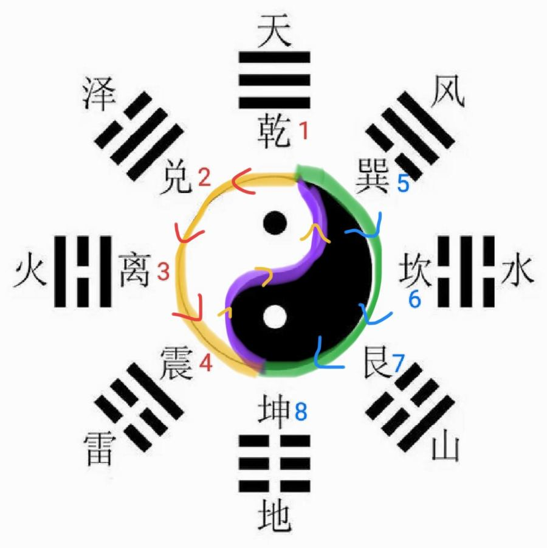

[← 回总目录](../README.md)

# 9. 情绪和修心

作者认为修心是一切的根。本节收转念、静心、忏悔这些办法，也收"哪种病对应哪种脾气"的性情疗法。抑郁、焦虑严重到影响吃饭睡觉，先找医生。

相关长文：[起情绪的地方就是要修的地方](../docs/07-修心/01-起情绪的地方就是要修的地方.md)、[转念的几个办法](../docs/07-修心/02-转念的几个办法.md)、[性情疗法：病和脾气对照表](../docs/06-身体与养生/40-性情疗法：病和脾气对照表.md)。

本节条目按主题分成下面几块，括号里是条号。

**念经和象数**：孕期诵《地藏菩萨本愿经》（第 1 条），头痛象数 650（第 2 条），内修时出现异常感觉（第 3 条），经咒怎么选（第 4 条）。

**转念和静心**：洗心养神功（简易版）（第 5 条），洗心养神功（静心）（第 6 条），"那又怎样"追问法（第 7 条），两步走出迷茫（第 8 条），情绪梳理三问（第 9 条），一念之转四句话（第 10 条），观呼吸冥想（第 11 条），求财先静心（第 12 条），写（描）篆书（第 13 条），只动手不动脑的解压法（第 14 条），有觉知地生活（第 15 条），用注意力感知疼痛（第 16 条），自修三步（第 17 条）。

**病和脾气（性情疗法）**：哪里疼就找对应的人和解（第 18 条），腰不好——修柔和（第 19 条），颈椎痛——解开"不服气"（第 20 条），甲状腺——不生闷气（第 21 条），肠道问题——查西方的金、放下看不起和记恨（第 22 条），性情疗法——找"犯上"和"恨"（第 23 条），背痛——查北方、停止背后中伤（第 24 条），肩周炎——放下担子（第 25 条）。

**忏悔和感恩**：大忏悔（第 26 条），忏悔排毒（第 27 条）。

**情绪来了怎么办**：想太多、闷在屋里的人怎么调（第 28 条），木型人"拨阴取阳"（第 29 条），能量引导术（夸张接纳法）（第 30 条），消气操：拍腋窝（第 31 条），用情绪对治情绪（五志相克）（第 32 条），赤脚踩土缓解焦虑（第 33 条），走夜路害怕时发怒（第 34 条），被挑刺时不自证（第 35 条），抑郁时向外做事升阳（第 36 条），握固调情绪（第 37 条），整理视野里的颜色（第 38 条），春夏多晒太阳（第 39 条），从起情绪的地方找卡点（第 40 条），看见小时候的委屈（第 41 条）。

**其他**：意念治病（第 42 条），土多的人戴木（第 43 条），从术中退出来（第 44 条），觉察卡点（第 45 条），复盘自己的人生（第 46 条），反省要一直问"还有呢"（第 47 条），帮人时的停止线（第 48 条），看不透时换个人来看（第 49 条），觉察自己的语言（第 50 条）。

### 1. 孕期诵《地藏菩萨本愿经》
<!-- 标签: 类型=念经 依据=资料摘录 -->
- 用来：静心安神、为胎儿祈福
- 怎么做：每天诵读《地藏菩萨本愿经》，把功德回向给孩子和一切众生；平时念地藏菩萨、观世音菩萨、释迦牟尼佛等佛号。熟练读一遍约一个多小时。
- 注意：刚开始读不熟练，需要坚持。
- 依据：资料摘录
- 来源：《改命记实录》第60章《《地藏菩萨本愿经》改命》（[逐章笔记](../chapters/改命记实录/0001-0100.md)）

### 2. 头痛象数 650
<!-- 标签: 类型=象数 依据=书中说法 -->
- 用来：想太多、思虑过重导致的头痛
- 怎么做：默念"650"。原理：6是坎水、5是巽木，水生木，0是加强；头痛中医叫"头风"，要平肝熄风，肝属木，风是巽卦。
- 依据：书中说法
- 来源：《改命记实录》第172章《五行能量净化法2（术）》（[逐章笔记](../chapters/改命记实录/0101-0200.md)）

### 3. 内修时出现异常感觉
<!-- 标签: 类型=修心方法 依据=书中说法 -->
- 用来：念象数、读经、看视频或书时感到发凉、心里不舒服、头晕、发酸、像被腐蚀
- 怎么做：先停下来；用感恩来提升正气，用忏悔来排出毒气。
- 依据：书中说法
- 来源：《改命记实录》第883章《篇外：心的力量》（[逐章笔记](../chapters/改命记实录/0801-0900.md)）

### 4. 经咒怎么选
<!-- 标签: 类型=修心方法 依据=资料摘录 -->
- 用来：想读经持咒修心
- 怎么做：不会分辨时，只读最基本的《金刚经》《心经》《道德经》《清静经》；几本就够，重点是去做。
- 注意：宣称"念了就发财、就得好处"的经咒要格外小心，可能是伪经伪咒。
- 依据：资料摘录
- 来源：《改命记实录》第919章《完结：为了心中的美好》（[逐章笔记](../chapters/改命记实录/0901-0919.md)）

### 5. 洗心养神功（简易版）
<!-- 标签: 类型=功法 依据=书中说法 -->
- 用来：想太多、心理困扰（书里用来帮有洁癖、不敢出门的女孩）
- 怎么做：出门散步，一边走一边把所有注意力放在依次看到的东西上：只数颜色（红、黄、灰……）或只数形状（三角形、正方形、多边形……），选一种就行。像小婴儿一样好奇地看世界。
- 注意：完整版见番外"洗心养神完整版"。
- 依据：书中说法
- 来源：《改命记实录》第47章《洗心养神功（术）》（[逐章笔记](../chapters/改命记实录/0001-0100.md)）

### 6. 洗心养神功（静心）
<!-- 标签: 类型=修心方法 依据=书中说法 -->
- 用来：心浮气躁、想事情乱
- 怎么做：见第47章的做法：看花看草、让心静下来。
- 依据：书中说法
- 来源：《改命记实录》第253章《心安，神才定》（[逐章笔记](../chapters/改命记实录/0201-0300.md)）

### 7. "那又怎样"追问法
<!-- 标签: 类型=修心方法 依据=书中说法 -->
- 用来：焦虑、压力大、纠结放不下
- 怎么做：遇到让你焦虑的事，问自己"那又怎样？"；如果还能找到焦虑的理由，再问一次；一直问到最坏结果出现"那又怎样"。想明白最坏结果也能接受，就有了面对的勇气。
- 依据：书中说法
- 来源：《改命记实录》第276章《面对的力量》（[逐章笔记](../chapters/改命记实录/0201-0300.md)）

### 8. 两步走出迷茫
<!-- 标签: 类型=修心方法 依据=书中说法 -->
- 用来：情绪麻木、分不清自己想要什么
- 怎么做：1. 每天找个时间问自己："我现在有什么感觉？"如果答案是"没感觉"，就继续找。2. 找到感觉后问："为什么会有这种情绪？我应该有什么样的情绪？"
- 依据：书中说法
- 来源：《改命记实录》第329章《从迷茫中走出来》（[逐章笔记](../chapters/改命记实录/0301-0400.md)）

### 9. 情绪梳理三问
<!-- 标签: 类型=修心方法 依据=书中说法 -->
- 用来：憋屈、内耗、心里不舒畅
- 怎么做：1. 让我不开心的人或事，符不符合阴阳之道？2. 我做这件事是心甘情愿，还是被道德绑架？3. 放下面子和礼仪问自己的心：我愿意吗？不愿意就不做；想要什么就拿自己愿意付出的去换。再试着换个解读（转念）。
- 依据：书中说法
- 来源：《改命记实录》第597章《篇外：情绪是修行的重要指标》（[逐章笔记](../chapters/改命记实录/0501-0600.md)）

### 10. 一念之转四句话
<!-- 标签: 类型=修心方法 依据=书中说法 -->
- 用来：生气、委屈、对某人强烈不满
- 怎么做：遇到让你不开心的想法（如"他不应该对我冷暴力"），依次问自己：1. 那是真的吗？2. 那真的是真的吗？3. 抱着这个想法时，我会怎样？4. 没有这个想法时，我会怎样？比较两种状态，哪种对彼此更好。
- 依据：书中说法
- 来源：《改命记实录》第603章《夫妻宫》（[逐章笔记](../chapters/改命记实录/0601-0700.md)）

### 11. 观呼吸冥想
<!-- 标签: 类型=修心方法 依据=书中说法 -->
- 用来：心乱、想太多、生闷气
- 怎么做：静坐，不执着于任何一个点，也不加意念，只是静静关注自己的呼吸，感受它，不评判。出现光、声音、画面等，随它来去，不理会。
- 依据：书中说法
- 来源：《改命记实录》第617章《篇外解答（甲状腺、乳腺）》（[逐章笔记](../chapters/改命记实录/0601-0700.md)）

### 12. 求财先静心
<!-- 标签: 类型=修心方法 依据=书中说法 -->
- 用来：急需用钱，越急越赚不到
- 怎么做：先把心静下来，不着急上火；把注意力放在把事情做好、动脑找更有效的方法上，而不是一味重复体力劳动。
- 依据：书中说法
- 来源：《改命记实录》第693章《注意力就是生命力》（[逐章笔记](../chapters/改命记实录/0601-0700.md)）

### 13. 写（描）篆书
<!-- 标签: 类型=修心方法 依据=资料摘录 -->
- 用来：静心、借文字能量加持
- 怎么做：用软笔（秀丽笔、钢笔式毛笔）描篆书字帖或抄《道德经》，下笔放柔，不用硬笔的力道。
- 注意：经济不宽裕或没时间的不必买，这不是摆件。
- 依据：资料摘录
- 来源：《改命记实录》第749章《篇外：篆书的灵力加持》（[逐章笔记](../chapters/改命记实录/0701-0800.md)）

### 14. 只动手不动脑的解压法
<!-- 标签: 类型=修心方法 依据=书中说法 -->
- 用来：压力大、想太多、情绪淤堵
- 怎么做：描红、撕纸、用小抹布擦地板、用手搓洗衣服等简单重复的动作；做的时候把注意力放在手上，感受笔的柔软、地板的平滑、水流过手指。
- 依据：书中说法
- 来源：《改命记实录》第749章《篇外：篆书的灵力加持》（[逐章笔记](../chapters/改命记实录/0701-0800.md)）

### 15. 有觉知地生活
<!-- 标签: 类型=修心方法 依据=书中说法 -->
- 用来：注意力被情绪和欲望牵走、心神不宁
- 怎么做：把注意力放在当下：吃饭时感知每一口的味道，走路时感知脚的一起一落和风吹过皮肤，用心听、闻、看身边的声音气味颜色形状。
- 依据：书中说法
- 来源：《改命记实录》第839章《篇外：阴阳》（[逐章笔记](../chapters/改命记实录/0801-0900.md)）

### 16. 用注意力感知疼痛
<!-- 标签: 类型=修心方法 依据=书中说法 -->
- 用来：身体任何部位疼痛
- 怎么做：心平气和，不急不躁，把注意力放到疼的地方，去感知疼痛的范围、形状、强弱，找最核心的那个点；一般还没找到核心点疼就消失了。一次不行，就先把注意力放到外面的实物上（如[洗心养神功](../docs/07-修心/03-洗心养神功.md)）一两分钟，再回来感知，反复几次。
- 注意：原理：疼痛是提醒，注意到了它，能量就不再淤堵。
- 依据：书中说法
- 来源：《改命记实录》第864章《篇外：自我疗愈》（[逐章笔记](../chapters/改命记实录/0801-0900.md)）

### 17. 自修三步
<!-- 标签: 类型=修心方法 依据=资料摘录 -->
- 用来：不知道从哪开始修
- 怎么做：1. 读经书（《道德经》《金刚经》，或较短的《心经》《太上老君说常清静经》，《黄帝内经》也可）；2. 在生活里好好做事、修行为修脾气；3. 再用打坐冥想加强"静"。看不进书也可以先练功，呼吸顺其自然。
- 依据：资料摘录
- 来源：《改命记实录》第864章《篇外：自我疗愈》（[逐章笔记](../chapters/改命记实录/0801-0900.md)）

### 18. 哪里疼就找对应的人和解
<!-- 标签: 类型=修心方法 依据=书中说法 -->
- 用来：头颈、腰胯、腿脚的不适（书中认为与生气有关）
- 怎么做：头颈不舒服，想想和父母、师长、领导的气；腰胯不舒服，想想和爱人、同事的气；腿脚不舒服，想想和孩子的气。找到后用忏悔和感恩把这口气化掉。
- 依据：书中说法
- 来源：《改命记实录》第152章《梅花易数（外应）》（[逐章笔记](../chapters/改命记实录/0101-0200.md)）

### 19. 腰不好——修柔和
<!-- 标签: 类型=修心方法 依据=书中说法 -->
- 用来：腰痛、腰不舒服（心里常不服气的人）
- 怎么做：有意识地柔和、包容，该软的时候软下来，修掉自己的清高和不服。
- 依据：书中说法
- 来源：《改命记实录》第753章《等我学好了再去渡人》（[逐章笔记](../chapters/改命记实录/0701-0800.md)）

### 20. 颈椎痛——解开"不服气"
<!-- 标签: 类型=修心方法 依据=书中说法 -->
- 用来：颈椎不舒服（排除长期保持一个姿势的情况）
- 怎么做：想一想自己对谁不服气、和谁较劲（领导、老师、长辈、兄长等），找到原因，把心结解开。
- 注意：如果是累的，活动一下、气血通了就好；情绪造成的要从情绪上解。
- 依据：书中说法
- 来源：《改命记实录》第755章《颈椎问题》（[逐章笔记](../chapters/改命记实录/0701-0800.md)）

### 21. 甲状腺——不生闷气
<!-- 标签: 类型=修心方法 依据=书中说法 -->
- 用来：甲状腺问题、甲亢
- 怎么做：风水上检查东南（巽4）有没有水；情绪上找出让自己生闷气的事，转念想通、彻底释怀。
- 注意：躲去佛堂清净不算化解。
- 依据：书中说法
- 来源：《改命记实录》第757章《命宫的性格》（[逐章笔记](../chapters/改命记实录/0701-0800.md)）

### 22. 肠道问题——查西方的金、放下看不起和记恨
<!-- 标签: 类型=修心方法 依据=书中说法 -->
- 用来：肠部疾病
- 怎么做：风水上检查正西、西北（金）有没有火克金、缺角，或变压器等煞；情绪上想想自己是不是看不起谁、记恨谁（尤其长辈），自己想通才算解开。
- 依据：书中说法
- 来源：《改命记实录》第757章《命宫的性格》（[逐章笔记](../chapters/改命记实录/0701-0800.md)）

### 23. 性情疗法——找"犯上"和"恨"
<!-- 标签: 类型=修心方法 依据=书中说法 -->
- 用来：头部问题（头痛、头晕等）；心脏问题；孩子的脑萎缩、脑瘫等
- 怎么做：回想自己（孩子的问题就让母亲回想）跟谁生过气、恨过谁，尤其是领导、长辈、老师、兄长——包括明面顶撞后回家生的闷气；找到根源，放下心里那个"应该"，把情绪疏通开。平时多看别人的优点（聚阳）。
- 依据：书中说法
- 来源：《改命记实录》第761章《头、心、胃等问题的根源》（[逐章笔记](../chapters/改命记实录/0701-0800.md)）

### 24. 背痛——查北方、停止背后中伤
<!-- 标签: 类型=修心方法 依据=书中说法 -->
- 用来：背痛
- 怎么做：风水上检查正北（坎1，肾主骨）和东北（艮8，也管骨）；性情上想想自己有没有带着情绪在背后说别人坏话，停止并化解。
- 依据：书中说法
- 来源：《改命记实录》第764章《篇外：排毒反应》（[逐章笔记](../chapters/改命记实录/0701-0800.md)）

### 25. 肩周炎——放下担子
<!-- 标签: 类型=修心方法 依据=书中说法 -->
- 用来：肩周炎、肩膀酸痛僵硬
- 怎么做：别谁的事都想管，该放下的放下，减轻心理压力。
- 依据：书中说法
- 来源：《改命记实录》第765章《篇外：个人的业力得自己修》（[逐章笔记](../chapters/改命记实录/0701-0800.md)）

### 26. 大忏悔
<!-- 标签: 类型=修心方法 依据=书中说法 -->
- 用来：业障病、性情引起的病
- 怎么做：回想当初是跟谁生气招来的病，真心向那个人（或在心里）忏悔、认自己的不是；出现呕吐、排泄、放屁、打嗝等反应是在排；之后大笑，把阳气提起来。以后照本位踏实做人。
- 依据：书中说法
- 来源：《改命记实录》第810章《番外：性情疗法（讲病2）》（[逐章笔记](../chapters/改命记实录/0801-0900.md)）

### 27. 忏悔排毒
<!-- 标签: 类型=修心方法 依据=书中说法 -->
- 用来：性情引起的病
- 怎么做：走心地忏悔，跟随身体反应：想吐就吐，不想吐不刻意；吐出来的多是黏痰，可能持续几天到几个月，吐干净自然停。
- 依据：书中说法
- 来源：《改命记实录》第860章《篇外：积极心理学》（[逐章笔记](../chapters/改命记实录/0801-0900.md)）

### 28. 想太多、闷在屋里的人怎么调
<!-- 标签: 类型=生活方法 依据=书中说法 -->
- 用来：想法太多、不愿出门、情绪闷
- 怎么做：卧室常拉开窗帘、多通风；随时抬头看看窗外景色；按"洗心养神功"简易版经常出去走走。
- 依据：书中说法
- 来源：《改命记实录》第48章《注意力就是生命力（道）》（[逐章笔记](../chapters/改命记实录/0001-0100.md)）

### 29. 木型人"拨阴取阳"
<!-- 标签: 类型=修心方法 依据=书中说法 -->
- 用来：木型人脾气硬、肝火旺、脖子和睡眠问题
- 怎么做：做到两个字：仁（心存善念）、礼（有礼貌、讲道理、明事理）。道理是木生火，用火泄掉过旺的木气。
- 依据：书中说法
- 来源：《改命记实录》第65章《五行人之木（术）》（[逐章笔记](../chapters/改命记实录/0001-0100.md)）

### 30. 能量引导术（夸张接纳法）
<!-- 标签: 类型=修心方法 依据=书中说法 -->
- 用来：懒、对抗情绪、靠意志力撑着做事很累
- 怎么做：以"懒"为例：先感受"我好懒"，然后接纳它，不批判，甚至夸张地接纳——"我真的好懒""我也太懒了吧""哇我真懒"。再感受，还剩一点就继续夸张接纳——"我就是懒""我懒又怎样"。直到心里平静下来，没有懒也没有不懒。
- 注意：内在没有对抗，能量才回到自己身上。
- 依据：书中说法
- 来源：《改命记实录》第78章《能量引导术（道/术）》（[逐章笔记](../chapters/改命记实录/0001-0100.md)）

### 31. 消气操：拍腋窝
<!-- 标签: 类型=身体调理 依据=书中说法 -->
- 用来：爱生气、胸闷；书中说腋窝对应心、肝胆、乳腺
- 怎么做：两种拍法：① 用大臂夹着振拍腋窝；② 一只手从头顶上方拉住对侧耳尖，另一只手拍打这一侧的腋窝。腋窝鼓鼓的、没有"窝"的人一定要拍开。（作者说抖音有视频）
- 依据：书中说法
- 来源：《改命记实录》第190章《消气操》（[逐章笔记](../chapters/改命记实录/0101-0200.md)）

### 32. 用情绪对治情绪（五志相克）
<!-- 标签: 类型=修心方法 依据=书中说法 -->
- 用来：害怕、焦虑、生气、悲伤、过度兴奋
- 怎么做：害怕焦虑时就去思考，把逻辑想透（土克水）；生气时允许自己哭一场（金克木）；悲伤时找点开心好笑的事（火克金）；过度兴奋时冷静一下、泼点冷水（水克火）。
- 依据：书中说法
- 来源：《改命记实录》第528章《情绪是一味药》（[逐章笔记](../chapters/改命记实录/0501-0600.md)）

### 33. 赤脚踩土缓解焦虑
<!-- 标签: 类型=养生方法 依据=书中说法 -->
- 用来：焦虑、想太多、心里不踏实
- 怎么做：找一块田地干点农活、刨刨土；赤着脚在泥土上走一走，把注意力放在脚底，让往上冲的能量沉下来。
- 依据：书中说法
- 来源：《改命记实录》第529章《修真》（[逐章笔记](../chapters/改命记实录/0501-0600.md)）

### 34. 走夜路害怕时发怒
<!-- 标签: 类型=修心方法 依据=书中说法 -->
- 用来：走夜路害怕、怕"撞邪"
- 怎么做：害怕的时候让自己生起一股怒气（木主怒，向上冲），而不是缩着害怕。
- 依据：书中说法
- 来源：《改命记实录》第578章《发怒可以辟邪》（[逐章笔记](../chapters/改命记实录/0501-0600.md)）

### 35. 被挑刺时不自证
<!-- 标签: 类型=修心方法 依据=书中说法 -->
- 用来：被人污蔑、挑毛病，事后气得睡不着
- 怎么做：不去证明自己，把矛头扔回去，找对方的问题；不会找角度，就用原话阴阳怪气地回一句（"是，就你最好看""是，就你没偷懒"），或者直接回"你有病吧？"。
- 依据：书中说法
- 来源：《改命记实录》第744章《你有病吧》（[逐章笔记](../chapters/改命记实录/0701-0800.md)）

### 36. 抑郁时向外做事升阳
<!-- 标签: 类型=修心方法 依据=书中说法 -->
- 用来：抑郁、低落
- 怎么做：动起来，向外为别人做点实事、出点体力，赚不赚钱先放一边，把注意力放到外面的事情上。
- 依据：书中说法
- 来源：《改命记实录》第755章《颈椎问题》（[逐章笔记](../chapters/改命记实录/0701-0800.md)）

### 37. 握固调情绪
<!-- 标签: 类型=手印 依据=书中说法 -->
- 用来：情绪控制不住、火气大
- 怎么做：用大拇指指尖压住无名指指根（掌中诀的子位），其余四指把大拇指包在手心里，用力握紧——像小婴儿攥拳头那样紧（做法见216–217章）。
- 注意：握得太松没效果。
- 依据：书中说法
- 来源：《改命记实录》第813章《篇外：回答友友们的提问》（[逐章笔记](../chapters/改命记实录/0801-0900.md)）

### 38. 整理视野里的颜色
<!-- 标签: 类型=生活方法 依据=书中说法 -->
- 用来：情绪低落、焦虑、压力大
- 怎么做：换掉黑白色的头像，少把黑白照片放在常看到的地方；焦虑的人少用大红色，卧室不用太活跃的颜色、可用浅咖色；多看绿色植物；需要平静可用蓝色，需要深思可用紫色。
- 依据：书中说法
- 来源：《改命记实录》第852章《篇外：人活一口气》（[逐章笔记](../chapters/改命记实录/0801-0900.md)）

### 39. 春夏多晒太阳
<!-- 标签: 类型=养生方法 依据=书中说法 -->
- 用来：阳气不足、抑郁
- 怎么做：春夏经常出门走走、晒晒太阳、踏春，吸收太阳和大地的生发之气。
- 依据：书中说法
- 来源：《改命记实录》第869章《篇外：胜境》（[逐章笔记](../chapters/改命记实录/0801-0900.md)）

### 40. 从起情绪的地方找卡点
<!-- 标签: 类型=修心方法 依据=书中说法 -->
- 用来：经常生气、心里过不去
- 怎么做：一起情绪就问自己：我贪在哪里、执着什么结果？是不是在强求能力之外的事？找到了就接纳，或者去提升能力；点太多就先修重复最多的那个。
- 依据：书中说法
- 来源：《改命记实录》第912章《篇外：修行的点》（[逐章笔记](../chapters/改命记实录/0901-0919.md)）

### 41. 看见小时候的委屈
<!-- 标签: 类型=修心方法 依据=书中说法 -->
- 用来：心里有说不清的恨、戾气，脑子上早已原谅了
- 怎么做：回想小时候受委屈的画面，不急着替对方辩解，先让那个孩子的委屈被看见；情绪来了允许它流出来，不要马上用理智掐断。
- 依据：书中说法
- 来源：《改命记实录》番外《拜师5》（[逐章笔记](../chapters/改命记实录/番外.md)）

### 42. 意念治病
<!-- 标签: 类型=修心方法 依据=书中说法 -->
- 用来：小毛病（作者用在小瘊子上有效）
- 怎么做：对这个病全然接纳、觉得无所谓：不排斥、不抵抗、不执着、不生气，然后轻轻起一个念头，不轻也不重，像拿纸杯喝水一样。
- 注意：越在意越不灵；念头要稳，乱起的念也会实现（见648章）。
- 依据：书中说法
- 来源：《改命记实录》第647章《意念治病》（[逐章笔记](../chapters/改命记实录/0601-0700.md)）

### 43. 土多的人戴木
<!-- 标签: 类型=生活方法 依据=书中说法 -->
- 用来：八字土多、固执、多疑、想太多（木是喜用神时）
- 怎么做：戴木质或绿色的手串，木能松土，土透气了就不那么固执。
- 依据：书中说法
- 来源：《改命记实录》第867章《篇外：贪心是大忌》（[逐章笔记](../chapters/改命记实录/0801-0900.md)）

### 44. 从术中退出来
<!-- 标签: 类型=修心方法 依据=书中说法 -->
- 用来：学了相面、风水后忍不住分析每个人每件事
- 怎么做：学习验证阶段可以分析；熟练后有意识地停下脑子——看到一个人眉毛细、眼睛大、下巴尖，就只是看到，不再推理他的财运健康；停不下来就多练[洗心养神功](../docs/07-修心/03-洗心养神功.md)。
- 依据：书中说法
- 来源：《改命记实录》第919章《完结：为了心中的美好》（[逐章笔记](../chapters/改命记实录/0901-0919.md)）

### 45. 觉察卡点
<!-- 标签: 类型=修心方法 依据=书中说法 -->
- 用来：想让自己越活越通透
- 怎么做：平时留意自己哪里起情绪、性格上哪里卡住，遇到一个修一个，不着急；有事就做，没事正常生活。
- 依据：书中说法
- 来源：《改命记实录》番外《拜师2》（[逐章笔记](../chapters/改命记实录/番外.md)）

### 46. 复盘自己的人生
<!-- 标签: 类型=修心方法 依据=书中说法 -->
- 用来：找出自己反复遇到的人生课题
- 怎么做：从小到大把自己的经历按时间写一遍或想一遍，看看哪类问题反复出现——那就是要修的课题。
- 依据：书中说法
- 来源：《改命记实录》番外《修行修自己30不得不说的故事》（[逐章笔记](../chapters/改命记实录/番外.md)）

### 47. 反省要一直问"还有呢"
<!-- 标签: 类型=修心方法 依据=书中说法 -->
- 用来：一件事过后复盘自己的错
- 怎么做：列出自己做错的地方后，再问自己"还有呢？"，一层层往下挖，直到真想不出来；也可以请信得过的人追问你。
- 依据：书中说法
- 来源：《改命记实录》番外《修行修自己58还有呢》（[逐章笔记](../chapters/改命记实录/番外.md)）

### 48. 帮人时的停止线
<!-- 标签: 类型=修心方法 依据=书中说法 -->
- 用来：帮助别人却被对方带偏、纠缠
- 怎么做：对方言行越界（如动了情欲、反复暧昧）时先明确提醒；提醒后仍不改，就及时停止，不再继续聊——不论对方是同性还是异性。
- 注意：只帮听劝的人；对方一碰底线，就不是你能帮得了的。
- 依据：书中说法
- 来源：《改命记实录》番外《修行修自己59亵渎》（[逐章笔记](../chapters/改命记实录/番外.md)）

### 49. 看不透时换个人来看
<!-- 标签: 类型=修心方法 依据=师父所传 -->
- 用来：当局者迷，自己的事想不明白
- 怎么做：假设这件事发生在别人身上（或某位你尊敬的师父身上），你会怎么评价？用旁观者的眼光再看一遍自己。
- 依据：师父所传
- 来源：《改命记实录》番外《修行修自己60贪》（[逐章笔记](../chapters/改命记实录/番外.md)）

### 50. 觉察自己的语言
<!-- 标签: 类型=修心方法 依据=书中说法 -->
- 用来：习惯性贬低自己（如总说"我傻""我笨"）
- 怎么做：留意自己挂在嘴边的话，尤其是自我贬低的口头禅，发现了就停下；别人说你傻可以不反驳，但心里不要真的认同，守住内心的中正——既不傲慢，也不自卑。
- 依据：书中说法
- 来源：《改命记实录》番外《修行修自己62语言是有力量的》（[逐章笔记](../chapters/改命记实录/番外.md)）
