# 《改命记实录》逐章笔记：0001-0100

## 第1章 大道至简

主角王三合当老师，下班路上遇到一个老道士，老道士说中了他的学校和近况，留下一句"南上北下"。

- 作者在篇外交代全书立场：风水是外因，人自己是内因；外因要通过内因起作用，只追求外因就是迷信。
- 这本书最基本的观点是"修行修自己"：书里的话也不要全信，自己验证。
- 网上打着书中人物名号给人看事的都是骗子；作者本人不接个案。
- 评论区有真诚分享的，也有立人设"割韭菜"的，要提防。

关键词：本书立场、防骗、修行修自己

## 第2章 最惨高考

回忆2003年高考：数学题极难，很多人崩溃，主角心大反而超常发挥；发小何香讲"南上北下"的来历。

- 古代地图上南下北，帝王坐北朝南，以南为尊；清朝以后才变成上北下南。
- 古代厕所多在南或西南（离正房远），厨房在北或东北（便于取暖），所以叫"上厕所""下厨房"。

关键词：南上北下、心态

## 第3章 南上，应验

何香讲完"上""下"的意思；主角被邻村冯大叔画饼说动，辞去教师工作去新加坡。

- 作者预告：何香后来去世，根源在"对风水的无知"，这也是写这本书的原因。
- 主角被"读研+兼职月入一万多"的说法打动，没想过为什么突然冒出两个素不相识又能说会道的人——这是后面被骗的伏笔。

关键词：出国留学、防骗

## 第4章 预测与化解的原理（道）

上海转机时再遇老道士，拜了师。师父讲预测为什么会"不准"。

- 师父的说法：预测是数学推理，条件列对了答案就对；像天气预报不准，是条件有遗漏或变化。
- "不准"有时只是无意中化解了，就像人工降雨能改变天气。

关键词：预测原理

## 第5章 雕虫小技

师父教了婚配方位和小六壬（掐指算），主角算去新加坡的结果是"赤口"。

- 这两章原来的术数内容被作者删了，作者说"术数不重要"。
- 验证要客观：别人过得好不好，外人看不准，"谁家的锅底都有灰"。
- 小六壬又叫诸葛马前课；师父说为什么此时测此事就是天意，不满意结果过两小时再测，那才是真不准。

关键词：小六壬、婚配方位

## 第6章 命运的掌控者

师父说一眼认出主角的学校并没用"术"，而是看气质和环境；讲"命越算越薄"的道理。

- 人是环境的产物，同校的人气质相近，所以"学校写在脸上"。
- 术数是工具，人是主导；迷信术数就成了五行的奴隶。
- "命越算越薄"：迷信算命会让人内心越来越乱（师父用"熵增"打比方），修行修的是内在的稳定。
- 不做亏心事不怕鬼敲门，把自己做好就行。

关键词：面相、算命、修心

## 第7章 封建迷信进课本

塞翁原文是"善术者"；机场一对夫妻吵架，师父讲吵架的本质。

- "一阴一阳之谓道"：人世间大部分问题是阴阳失衡。
- 人吵架是因为观点不同，不是因为事实；观点就是"看事物的点"，每人经历不同。

关键词：吵架、阴阳

## 第8章 不要给别人算命（道）

师父说与其责怪别人不如修自己；送主角三本书，叮嘱"学完不要给别人算命"。

- 能理解自己的观点、又能包容对方的立场，就不会吵架。
- 师父只要求记住一句话："万物尊道而贵德"，道离不开德。
- 三本书：《穷通宝鉴》《滴天髓》《天乙笔记》，涵盖八字、六爻、梅花易数、风水、面相、道医等。

关键词：道德、算命

## 第9章 齐桓公怎么死的

为什么不要给别人算命：算不准挨揍，算准了说出来也挨揍。

- 努力能学到东西是一定的，能不能考上清华还要看外在因素——这就是"命"。
- 算命先生三种：说坏话吓人掏钱化解的（最常见）；说好话哄人掏钱的；有真本事、实话实说替人挡灾，最后"五弊三缺"的。

关键词：算命、防骗

## 第10章 法不轻施，道不轻传

讲扁鹊见蔡桓公的另一种解读，引出"医不叩门"。

- 同一个病，饮食、中医、西医、道医、佛家各有说法，背后可能是同一个道理。
- "师不顺路，医不叩门，法不轻传，道不贱卖"：别人没主动求你，不要上赶着帮，好为人师会适得其反。
- 付钱只是表达诚意的一种方式，心诚才是根本。

关键词：帮人、医不叩门

## 第11章 开天眼

师父给主角"开天眼"后离开，没留名字；主角喊得满机场的人都看他。

- 这是全书神秘叙事的开端，属于小说情节。

关键词：天眼

## 第12章 人总要有梦想

主角和"小包子"在机场交换联系方式；看到一位带两个孩子仍然优雅的女人。

## 第13章 新加坡的第一个面相（术）

到新加坡，冯姐来接机。主角从她的面相看出隐忧。

- 面相：下眼睑（子女宫）纹路明显、颜色青黄，作者说影响生育，也预示夫妻不和。
- 作者说新加坡温度湿度适宜、植物茂盛，是风水宝地，人均寿命长。

关键词：面相、子女宫

## 第14章 幻灭，节食省钱

留学生活开始幻灭：房租贵、承诺的高薪兼职变成发报纸和刷盘子，只能节食省钱。

- 四个人挤一间小房间，月租一万人民币；所谓高薪工作一个月只有几百新币。

关键词：出国留学、防骗

## 第15章 压死骆驼的最后一根稻草（术）

主角发现上的不是国立大学、也不是研究生，学费只交了四个月，私立学校学生打工还违法。

- 面相：三角眼的人性格固执；再加上颧骨横张、鬓角有十字纹，作者说这种人心地险恶、脾气暴躁、有家暴倾向。
- 天庭饱满、地阁方圆是容易得到祖上福荫的面相。
- 主角用梅花易数心算，算出两个室友都靠"出卖体力"破局。

关键词：面相、出国留学、防骗、梅花易数

## 第16章 赤口，应验

中介冯大叔、冯姐吞了学费还反咬一口，威胁把主角遣送回国。应验了小六壬算出的"赤口"。

- 给私立学校招生的中介本来就拿学校的提成，还克扣学生学费。

关键词：防骗、出国留学、小六壬

## 第17章 语言隔阂阻挡不了的应验

主角想通"天命"不等于"宿命"，决定搬家远离骗子。

- "尽人事，听天命"：该努力的努力，该放下的放下；儒、释、道都不是宿命论。
- 远离无德之人，免得受牵连。

关键词：宿命论、搬家

## 第18章 搬家

主角独自搬到巴耶利巴一间别墅单间；介绍新加坡三类住房。

- 新加坡房子分三类：政府组屋（HDB）、私人公寓（带泳池等设施的高档住宅）、有地房产（别墅）。

关键词：新加坡

## 第19章 美女如云（术）

学校只教会计（ACCA 课程），美女很多；认识同学白志高。

- 面相：皮肤很薄、皮肉分离的人敏感，容易被感情左右；成大事的人一般不拘小节。

关键词：面相

## 第20章 找不到组织的国际友人

认识斯里兰卡同学纳加，三个内向的人成了好朋友。

## 第21章 失之东隅，收之桑榆

主角靠煮面条省钱；去预科班蹭课认识一群女同学；半夜听见楼下房客威哥出事。

## 第22章 拉肚子（术）

威哥急性腹泻，主角用师父书里的偏方"烤大蒜"止住了。

> **偏方｜烤大蒜止泻**  
> 用来：腹泻，尤其急性腹泻  
> 怎么做：大蒜用炭火烤（没有炭可以用煤气灶），烤到外面发黑、里面变软，有糊味、不辣了，直接吃下。注意补水。  
> 注意：作者篇外提醒：偏方要客观验证，不要迷信；文中主角也说如果不减轻就送医院。

关键词：腹泻、偏方、大蒜

## 第23章 采日光功（术）

讲采日光功；认识邻居蔡总，蔡总浑身关节疼、医院查不出病。

- "正气存内，邪不可干"：正气足，不容易被传染，传染了也好得快。
- 作者把病分成"实病"（医院查得出）和"虚病"（查不出：心理病、风水病、业力病、因果病等），说虚病拖久了会变成实病。

> **功法｜采日光功（晒太阳）**  
> 用来：补阳气、补正气  
> 怎么做：极简版就是晒太阳：清晨在户外，全身放松，手心朝着太阳。  
> 注意：不要晒太久，以免"火毒"。

关键词：采日光功、晒太阳、功法、虚病

## 第24章 采阴补阳

蔡总介绍他练的剑指站桩功，主角讲"采阴补阳"是借口。

- 作者说"采阴补阳"多半是心术不正的人纵欲的幌子，举嘉靖皇帝"壬寅宫变"为例。
- 练完功气血循环快，不要马上进空调房。

关键词：站桩、功法

## 第25章 第一次调风水之境煞（术）

主角给蔡总看风水：客厅一整面墙的镜子和亮面装饰形成"光煞"，是他关节疼的原因。

- 镜子本身不招邪，问题是反光容易形成"光煞"：人走过时晃过的影子会吓自己一跳，哪怕只在潜意识里。
- 作者的推理：恐伤肾，肾主骨，所以容易伤关节和骨头，久了变成风湿类骨病；肾受损也影响心脏和精神（心血管、神经衰弱）。
- 有光照到镜子再反射出去，形成"刀光剑影"，潜意识里会有血光之灾的暗示。
- 主角只收了一百新币的"彩头"，说等对方真改善了再收谢礼。

> **风水调整｜家里的镜子怎么处理**  
> 用来：防光煞（关节疼、骨病、心神不宁）  
> 怎么做：家里不要有大面积镜子；小镜子用完收起来；收不起来的大镜子，要么拆掉，要么用不透光的米色布帘盖住。

关键词：镜子、光煞、关节疼、风水

## 第26章 英语？华语？

新加坡日常英语夹着各种方言；大学同学李广想来新加坡打工。

- 来新加坡打工赚钱可以，千万别拿学生证（不能合法打工）。

关键词：出国打工

## 第27章 清水煮面

威嫂教主角煮面；主角第一次跟蔡总去吴师父那里练剑指站桩功，站在中间头晕恶心。

- 练功前后一小时最好不要吃东西。
- 煮面要等水开了再下面条。

关键词：站桩、功法

## 第28章 剑指站桩功（道）

吴师父解释头晕：最近怄过气，气血一下子加快就会头晕；主角想通"百病生于气"。蔡总缺人手，主角想到介绍同学。

- 新学员站队列中间气感最强；怄过气的人在强气感处会头晕恶心，可以先站外围、不行就蹲下休息。
- 事情忘了，气还滞在身体里；作者引《黄帝内经》"百病生于气"，认为大部分疾病是情绪引起的（情志疗法）。
- 新加坡请外国劳工有比例限制；S Pass 有学历要求。

关键词：站桩、怄气、情志疗法、百病生于气

## 第29章 绝处逢生的发财之路

主角想到做合法的劳工中介：既能帮人找到出路，自己也能赚钱；研究新加坡公司法。

- 作者的感悟："陷阱本身就是一条出路"——骗子掌握了门路，是因为正派的人没站出来。
- 新加坡介绍人按法律可以收两个月薪水；外国人开公司必须有一位本地董事（新加坡籍或永久居民）。
- 工作签证可以打工、读书，还能申请永久居民；学生签证打工有诸多限制。

关键词：创业、出国打工、赚钱

## 第30章 红灯区的跟踪者

学校在芽笼红灯区中间，女同学李萱回家常被骚扰，请主角送她回家。

## 第31章 万事俱备

主角找合伙人，李萱的表姐可以挂名本地董事；杜乐不自信，拉大家去"灵隐寺"问事。

- 有人想向上，有人想躺平，每个人有选择的权利，这也是阴阳之道。

关键词：合伙、创业

## 第32章 不刮东风

灵隐寺用"扶鸾"问事，给主角的答案是"胸有大志，天不借力"，主角想不通。

- 扶鸾：三个人围着沙盘，正鸾、副鸾扶笔写字，唱生念出来，旁边有人记录和解签。

关键词：扶鸾、问事

## 第33章 剑指出气

吴师父让大家用手感受"加持过的水"，主角练三四个小时就能用剑指打出气感。

> **功法｜剑指站桩功（入门）**  
> 用来：打通经络、练出气感  
> 怎么做：热身后半蹲、两手抱球，感受气感；再练剑指。快结束时，伸开左手，右手剑指指向左手掌心轻轻画圈，感受打出来的气感。  
> 注意：书里说一般人练几个小时就能感受到；吴师父是公益授课。

关键词：站桩、剑指、气感、功法

## 第34章 不再为钱所困

李广要来新加坡打工，主角先把工作辛苦讲清楚；和白志高打赌"再努力运势也不如我"。

- 介绍别人出来打工，先把真实情况反复讲清楚，免得对方以为遍地黄金。
- 作者引《孙子兵法》"激水之疾，至于漂石者，势也"：大势面前个人努力只占一部分，不努力不行，只靠努力也难。

关键词：顺势、努力

## 第35章 被家暴（术）

作者讲"相"不只是面相：还有声相、行相等。冯姐被男友家暴应验。

- 相学包括面相、手相、身相、声相、动相（站、坐、行、睡、吃相）；其实人人都会看，只是不细。
- 皮肤薄的人敏感，太敏感担不住福气。
- 声相：气浮在喉咙、嗓子尖、语速快，说明容易激动、心浮气躁；走路往上窜也一样。
- 气沉丹田、上虚下实，声音沉、走路稳，气运就通达。养生和气运是一回事。
- "身弱不胜财"：身体弱的人担不住财；面相、声相等都可以变化。

关键词：面相、声相、气沉丹田、身弱不胜财

## 第36章 女神被包养

班上的女神采文被"包养"，还在劝其他女同学也找"男朋友"。

## 第37章 招小人（术）

主角给李萱的表姐看家（她总招小人）：收掉假花，别放空花瓶。小包子打电话哭诉"被骗"。

- 收费：请人看事要本人出钱，别人替付不行；作者给表姐定价"她半天的薪水"。
- 假花只有花的样子、没有花的生气，"真为阳、假为阴"，周围被假象围绕，遇到的人也没真心——作者说这就是招小人。
- 假花五行属木火，气机足的人可以用来增加木火；气机不顺的人最好别摆。
- 不用专门"布局破小人"：自己正气足、硬气了，负面的人和事自然远离。
- 植物属木，乱摆容易克土，伤脾胃，对妇科也不好。家里宜简单整洁、"留白"，像五星级酒店那样少放东西。
- 不透明、又高又深、口小的空花瓶，空荡阴黑，让人心里不安，有风时还会发出怪声。
- 小包子说的"被骗"其实是现实和想象不符，不是和对方承诺不符——要分清事实和自己的想象。

> **风水调整｜招小人时先收假花**  
> 用来：总遇到小人、人际不顺  
> 怎么做：把家里显眼位置的假花收起来；家里尽量简单整洁，少放东西。

> **风水调整｜不放空花瓶**  
> 用来：心神不宁、疑神疑鬼  
> 怎么做：家里不要摆空花瓶，尤其是又高又深、瓶口小、不透明的那种。

关键词：假花、花瓶、招小人、留白、风水

## 第38章 性病

杜乐说孙奇瑞可能得了性病，主角掐指一算说是虚惊，让他去医院。

## 第39章 创业危险，打工安全？（术）

小包子被蒸笼烫了手，主角让她抹酱油；聊"创业危险还是打工安全"。

- 作者的观点：老板也是创业者，给"处在危险里的人"打工未必更安全；打到四五十岁公司倒闭、技术被淘汰，赔进去的是后半辈子。

> **偏方｜酱油抹烫伤**  
> 用来：轻度烫伤（防起泡）  
> 怎么做：被烫后马上在烫伤处抹酱油（没有可以用面酱、豆瓣酱），抹几遍。书里小包子抹完第二天不疼也不红。  
> 注意：书里是小面积轻微烫伤的例子。

关键词：烫伤、酱油、偏方、创业、打工

## 第40章 手艺人

孙奇瑞检查只是感染；他讲自己怎么跟美国女友交流。

## 第41章 一个圈里支棱三根小棍儿

金灵儿被介绍去见一个开奔驰的"老头"，气得骂人，大家把她哄好。

## 第42章 天不助力

李广来新加坡上班；蔡总办公室的桌子摆法；"天不借力"揭晓：2008年金融危机。

- 蔡总办公室门在东南角，桌子放正东、背对着门，面朝西边的窗户，书柜在西北角。作者说这个摆法很少见，但正合适，"福人居福地"。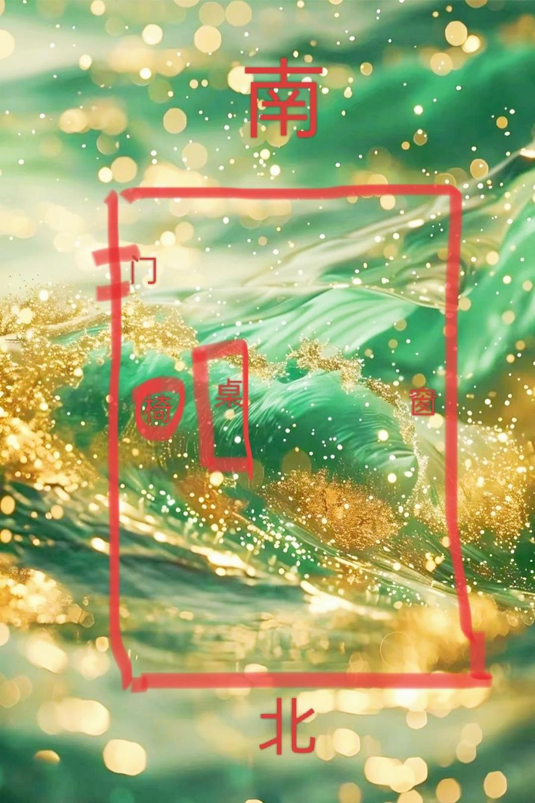
- "天不借力"原来是指2008年全球金融危机——天时不对，不是政府不允许。作者说要顺势而为。
- 主角改为找工作，换成工作签证。

关键词：办公室、书桌、顺势

## 第43章 没有我教不会的学生

主角三分钟教会纳加游泳；纳加向他表白被拒。

> **生活方法｜三分钟学会浮起来（游泳入门）**  
> 用来：怕水、学不会游泳  
> 怎么做：① 在齐胸深的浅水区，先站着深吸一口气憋住，默数能数到几。② 再深吸一口气，全身放松趴进水里默数，旁边的人数到二三十前把他扶起来——数到六七人就会自己浮起来。③ 再试一次，数到10时把双腿收到小腹，下身重了人就会竖起来站住。④ 会浮、会站起来以后，随便划手脚就能前进，累了就站起来。  
> 注意：一定要有会游泳的人在旁边看着、到时间拉人。

关键词：游泳

## 第44章 正宗的新加坡早餐（术）

房东陈总来请主角看女儿的怪病；带主角吃新加坡早餐。

- 眉毛：清淡、根根见肉、顺直秀丽的人灵感强、运势好，多是"智力型"。
- 浓眉大眼不一定是好相：又浓又黑又粗又长的人冷酷；逆着长的脾气暴躁冲动；眉毛粗壮的多是"武官"型，性急胆大，灵性少。

关键词：眉毛、面相

## 第45章 不能出门的怪病

陈总16岁的女儿古拉一出门就吐，医院查不出问题，心理测试也问不出什么。

## 第46章 人人都是神经病（术）

古拉说一想到吸进别人吐出的空气就恶心；主角说"人人都有点精神问题"。

- 作者的说法：抑郁、强迫、妄想等的共同点是"大脑不受自己控制"，也就是想太多；安静打坐3分钟就会发现念头根本停不下来。

关键词：想太多、心理、洁癖

## 第47章 洗心养神功（术）

主角带古拉在屋外散步，教她"洗心养神功"：把注意力放在眼前看到的颜色或形状上。

- 【注意力就是神魂】走神就是魂飞了；【注意力就是生命力】越有生命力的人注意力越集中；【注意力也是钱财】注意力在哪，钱就花在哪。

> **功法｜洗心养神功（简易版）**  
> 用来：想太多、心理困扰（书里用来帮有洁癖、不敢出门的女孩）  
> 怎么做：出门散步，一边走一边把所有注意力放在依次看到的东西上：只数颜色（红、黄、灰……）或只数形状（三角形、正方形、多边形……），选一种就行。像小婴儿一样好奇地看世界。  
> 注意：完整版见番外"洗心养神完整版"。

关键词：洗心养神功、注意力、功法、想太多

## 第48章 注意力就是生命力（道）

散步半小时后古拉不想吐了，说"世界真美"。主角讲注意力放在哪里，人就是什么状态。

- 注意力放在自己身上会觉得有力量；放在无聊的小视频上会空虚疲惫；放在实实在在的东西上会踏实；放在虚无的想法上会陷入"梦魇"。
- 跟世界连接少，那就多连接：多晒太阳、多看真实的世界。

> **生活方法｜想太多、闷在屋里的人怎么调**  
> 用来：想法太多、不愿出门、情绪闷  
> 怎么做：卧室常拉开窗帘、多通风；随时抬头看看窗外景色；按"洗心养神功"简易版经常出去走走。

关键词：注意力、想太多、洗心养神功

## 第49章 很正确的废话

主角说古拉的问题是"想太多"：想法属阴，阴多阳少；解法不是"别想太多"，而是"少用脑"。

- 想法看不见，属阴；看得见的实物属阳。她又总拉着窗帘闷在屋里，阳就更少，恶性循环。
- 不需要买护身符或风水物件，她自己想变好就够了；《黄帝内经》"病不许治者，病必不治"——病人自己想好，病才治得好。
- "别想太多"是正确的废话，因为用脑去控制脑不可能。办法是把发力点放在外面——用"心"不用"脑"，心神安宁就不太用脑。
- 判断一个人心理健康有个关键标准：情绪积极，热爱学习（像小婴儿那样快乐地主动学）。

关键词：想太多、阴阳、心理健康

## 第50章 咱俩不是同一个物种

作者讲阴阳的通俗含义；古拉变得活泼，还想学完整版洗心养神功、闹着要嫁给主角。

- 阴：向下的、低沉的、不动的、看不见的；阳：向上的、活泼的、看得见的、温暖的。
- 运动是补阳：心情不好跑一跑、爬爬山、晒晒太阳就好了。想得多属阴；想好了就去做，做就是注入阳。
- 任何事都要阴阳平衡：读书光进不出成书呆子；钱光进不出就是储钱罐，早晚给别人留着。
- 洗心养神功完整版从"六根"（眼、耳、鼻、舌、身、意）六方面净养，简易版只练"眼净"。

关键词：阴阳、运动、洗心养神功

## 第51章 桃花乱乱开

古拉缠着主角；陈总的外甥女阿茵胎象不稳，请主角去看。

## 第52章 啮指痛心（术）

主角见阿茵：她怀孕后有一次炒菜时灶台正对着肚子，闪过"胎儿怕高温"的念头。

- 面相：功德纹在眼下（子女宫，也叫阴德位）的小横纹，代表常积德行善、有灵性和福报。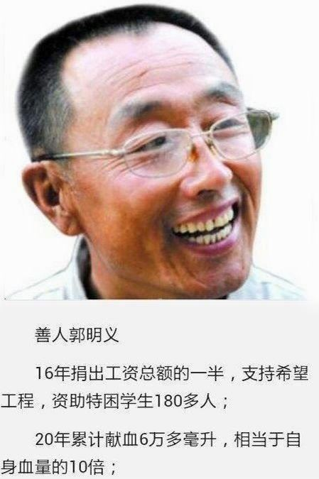
- 作者说"一念闪过"是心的感应，后面的分析是大脑推理，心比脑的层次高（用曾子"啮指痛心"的故事说明）。

关键词：功德纹、面相、怀孕

## 第53章 报恩宝宝

阿茵说好朋友帮她带零食还收路费，她很伤心；主角讲朋友之间钱怎么算；说这个孩子是"报恩宝宝"。

- 朋友之间也可以收钱，打个折、给友情价更像朋友；如果从来不收，对方一计较就会伤心有怨气。
- 作者把炒菜、不开心、风水、医院检查都看作"果"，不是"因"。
- 作者篇外提醒：务实不务虚。即使有无形的因果，治病最终靠的是科学进步；不要总想找大师走捷径。

关键词：钱和情、朋友、因果、怀孕

## 第54章 薄薄的大红包

陈总给了一张支票作谢礼；蔡总带主角吃叻沙，去见"无优禅师"。

- 有出有进才是阴阳之道，别人真受益了，可以接受心意。
- 作者篇外重点提醒：人越缺什么越想显摆什么；拼命给自己立又慈悲又无私人设的"大师"，要防骗。

关键词：防骗、人设、红包

## 第55章 修行的本质（道）

无优禅师唱诵，众人感动落泪；禅师说修行修的就是日常行为。

- 修行不是只打坐念佛，修的是日常行为。

关键词：修行

## 第56章 念经念咒的原理（道）

禅师讲修行不避世、不忌讳钱；讲念经念咒的道理：唵、阿、吽三个音。

- 在家修行首先要踏实工作、敬养父母、抚育子女；修行人不贪钱，也不必忌讳钱。
- 婚姻和谐很好，过不下去离婚也很好，"日日是好日"。
- 声音有形状也有力量（如超声波碎石）。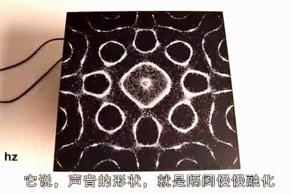
- 唵（ong）作用于头，调和阴阳、振奋精神；阿（a）作用于口和内脏气脉；吽（hong）作用于心，震开脉结、促进新陈代谢。
- 念经念咒尽量接近梵音，不标准也没关系，发心更重要。作者篇外：感觉有帮助最好，感觉不到别执迷。
- 中医道医讲五行，佛医讲"四大"：地、水、火、风。

关键词：念经、念咒、唵阿吽、声音、佛医

## 第57章 佛医断食治病（道/术）

佛医讲病分两种：四大不调和业力病；讲断食治病和布施。讲音乐和"声煞"。

- 佛医认为大多数病是吃多了引起的；《大唐西域记》记载生病"绝粒七日"多能痊愈。
- 业报病最有效的两个办法：忏悔和布施。布施分财布施（不贪）、法布施（传播智慧）、无畏布施（给人信心和希望），法布施功德最大。
- 被人揍了，多半是现世报，扯不上前世。
- 声音能治病也能致病：风水里有"声煞"，比如次声波和人体器官共振，会头晕恶心、影响精神。选房子要考虑声音。

> **养生方法｜断食（佛医）**  
> 用来：积食、吃多引起的病  
> 怎么做：书里引《大唐西域记》：生病时断食七日；可以结合催吐。  
> 注意：断食结束不要马上吃饭，先喝几天米汤。（书中只是转述古籍。）

关键词：断食、布施、忏悔、业力病、声煞、音乐疗法

## 第58章 麦粒肿（术）

蔡总的女儿长麦粒肿，主角教了红线绑中指的偏方，第二天就好了。

> **偏方｜红线绑中指治麦粒肿**  
> 用来：麦粒肿（眼睛红肿、长针眼）  
> 怎么做：用红线在中指根部轻轻绑上，不要太紧。书里说通常一晚上就见效。

关键词：麦粒肿、针眼、红线、偏方

## 第59章 悬针纹（术）

阿茵检查发现胎儿发育不好，家人意见不一；作者借阿茵爸爸讲"悬针纹"。阿茵决定留下孩子。

- 悬针纹：眉间的竖纹，代表性格刚硬、肝火旺。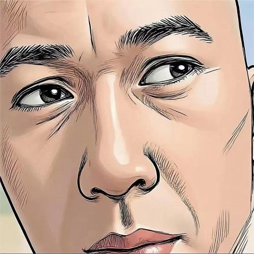
- 震卦主肝，也代表长子，所以悬针纹又叫"斩子剑"，作者说不利长子，往往第一胎留不住。
- 肝属木、主怒，风为木之摇，容易得和"风"相关的病：中风、痛风、风湿、白癜风、抑郁、头晕、颤抖等。
- 打填充针把纹填平是掩耳盗铃；面相就是中医"望诊"，化妆盖住脸色并不能治病。只有锻炼让身体自己修复，纹路淡了才是根本。

关键词：悬针纹、面相、肝火、怒

## 第60章 《地藏菩萨本愿经》改命

主角抽签讲"牛报恩"的故事，建议阿茵一家调整作息、诵《地藏经》。

> **养生方法｜睡子午觉**  
> 用来：基本养生  
> 怎么做：子时（晚11点到凌晨1点）和午时（中午11点到下午1点）尽量休息、闭目养神，也就是晚上和中午12点前后。

> **念经｜孕期诵《地藏菩萨本愿经》**  
> 用来：静心安神、为胎儿祈福  
> 怎么做：每天诵读《地藏菩萨本愿经》，把功德回向给孩子和一切众生；平时念地藏菩萨、观世音菩萨、释迦牟尼佛等佛号。熟练读一遍约一个多小时。  
> 注意：刚开始读不熟练，需要坚持。

关键词：子午觉、地藏经、念经、怀孕

## 第61章 念头会影响基因的表达（道）

主角从"念头影响基因表达"解释念经的好处；讲命和结果的关系。

- 作者说生物学已证实人的念头会影响基因表达（书中说法）。
- 人的智慧比起宇宙太有限，连栀子花香都描述不准，不必凡事纠结原因。
- 很多怒气来自把自己看得太重；意识到自己只是沧海一粟，就不争对错了。
- 什么样的命理对应相匹配的风水：别人花一辈子积蓄买的房，你一进去可能哪都不舒服，那就是"匹配"。
- "命是起手牌"：命里有坑是天定的，但输赢看怎么打，结果是自己选的。

关键词：命运、念经、风水匹配

## 第62章 快乐的本质（道）

讲快乐的本质，以及"看似没有选择其实有很多选择"。

- 命里有坑时的几种选择：闭眼听天由命、坐在坑边哭、绕路韬光养晦、积德行善提前把坑填上。
- 【快乐的本质就是变成更优秀的自己】：从不会到会，就是快乐的来源。
- 被小孩泼一身咖啡也有选择：可以改约、可以穿脏衣服去、可以平心静气；一开始指责外界，就放弃了人生的主动权。
- 作者篇外：修行修自己，把问题都归给外在，人就没法成长。

关键词：快乐、选择、修行修自己

## 第63章 皇帝的床只有一米多宽（术）

给阿茵家调风水：卧室大衣镜盖起来、收刀剑和猛虎图、落地窗、厕所和卧室太大。

- 镜子反光像刀光剑影，有血光的心理暗示；镜子能化煞也能聚气，但都不适合经常对着人，尤其体弱的人。有的门派干脆不用镜子化煞，直接避开。
- 家里不放看起来凶狠的东西：刀剑（包括辟邪的桃木剑）、猛虎图。作者篇外：凶狠的摆设时间久了会影响潜意识。
- 大面积落地窗、外面又没有树荫遮挡，阳气太旺、阴气太弱，伤女人，也伤财（"财不露白"）。
- 厕所代表浊气，不宜大，尤其不宜放在卧室里。
- 卧室不宜太大：故宫那么大，皇帝的床只有一米多宽，"店大欺客，屋大欺人"。房子比人的气场大太多会没安全感，太小会压抑、总想往外跑。

> **风水调整｜卧室大衣镜盖起来**  
> 用来：体弱、心神不宁、孕妇  
> 怎么做：用不透光的帘子盖住大衣镜，用的时候才打开。

关键词：镜子、卧室、落地窗、厕所、桃木剑、风水

## 第64章 记忆是可以遗传的（术）

阿茵家南边是地基更高的饭店，"南高北低、离火太旺"；主角做了化解并换了小卧室。朋友大飞说他是"神棍"。

- 风水讲"南低北高"：古时北边有山挡北风，南边开阔夏天来凉风，冬暖夏凉少生病。
- 南方是离卦，五行属火，宜低平开阔或有水。南边高、又开饭店（属火），离火太旺。
- 火代表心脏、心情、火气、炎症：住处火太旺，容易伤心脏、和人起冲突、身上发炎。
- 离卦也代表头：家宅火旺对应头部问题，尤其眼睛、耳朵、牙齿。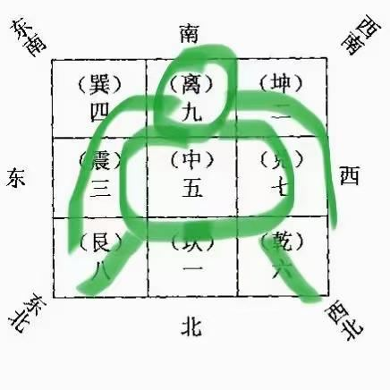
- 同一栋楼的人命理不同，表现不同，但本质都是"火旺"。

关键词：南低北高、离9、火旺、风水

## 第65章 五行人之木（术）

主角一眼说中大飞颈椎不好、肠胃不好、母亲已去世，讲"木型人"及化解办法"仁和礼"。

- 相由心生：长什么样的人，就有相应的性格、情绪、身体和经历。
- 木型人：脸窄长、身材瘦直、四肢细长、肩耸背直。木主生发、向上。
- 阳木：仁厚正直、能忍、有担当；阴木：不受管束、宁折不屈、说话硬、不接受反驳、"亢上"（对抗上级长辈）。
- 木主肝胆，木旺肝火旺、爱较劲；木过旺一生多难。亢上伤双亲，阴木尤其影响母亲。
- 木克土：脾胃不好。阴木也代表颈项，亢上的人脖子不舒服。木型人容易神经衰弱、入睡难。

> **修心方法｜木型人"拨阴取阳"**  
> 用来：木型人脾气硬、肝火旺、脖子和睡眠问题  
> 怎么做：做到两个字：仁（心存善念）、礼（有礼貌、讲道理、明事理）。道理是木生火，用火泄掉过旺的木气。

关键词：木型人、五行人、面相、颈椎、失眠

## 第66章 梵音咒语

李广送来两个月薪水当谢礼；阿茵读《地藏经》，主角给她整理了带拼音、咒语标梵音的版本。

- 不少中国工人通过中介花三四万来新加坡，薪水还是假的。
- 修行修正的是行为，得先行动起来才有的修。

关键词：地藏经、念经、出国打工

## 第67章 一次又一次的显化

主角跳槽到人力资源公司，但不会和老板打交道；网上认识一位餐饮创业失败的女生，请她合作，业绩起来了。

- 新加坡工作准证分 WP（不能申请永久居民）、SP、EP（级别最高）。

关键词：跳槽、合作

## 第68章 跟钉子较真儿的人

沙发厂学徒于路为"钉3颗还是5颗钉子"跟老板吵；作者说他是阴木型人。

- 很多青少年是木型人，亢上、叛逆，长大后体型往土型、水型转，对抗性就慢慢收了。
- "善易者不卜"：作者说自己很少占卜，与其好奇路上有没有坑，不如研究填坑的技术。

关键词：木型人、叛逆

## 第69章 有听没有懂

助理钟雨"有听没有懂"；白志高认为三鹿事件头版是资本主义抹黑；工人周燕吓到了老板。

- "尊重他人命运，放下助人情结，避免自我感动"。

关键词：帮人

## 第70章 我明天可能会死

工人周燕上班前跟老板说"我明天可能会死"，说这是在普及世界本质。

关键词：修行出偏

## 第71章 走火入魔的修行者

主角跟周燕"聊佛法"说服她先好好工作，别把人吓跑。

- 修行修偏的人往往没坏心，但要注意说话方式：同样的意思说正面的话，比如"路上注意安全"，不说"别被车撞死"。

关键词：修行出偏、说话

## 第72章 每15年刨一次坟（术）

于老板家墓地到期要迁（新加坡墓地期限15年）；主角聊面相：牙齿、发际线、下巴。

- 牙齿太白、两边额角发际线高（M型），作者说性情"浪漫"（好色）。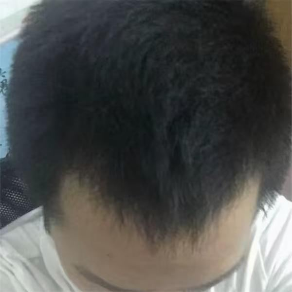
- 下巴很短：头脑敏锐但神经质，爱批评别人、不自省，晚年运差。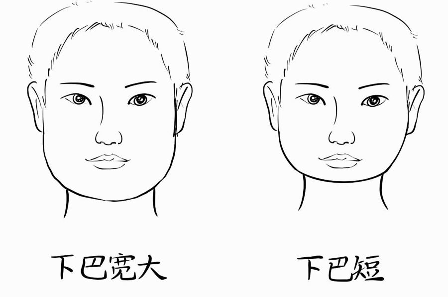
- 下巴长、侧面向前凸：自信、热衷工作、精力旺，外热内冷。
- 下巴凹陷往里缩：优柔寡断，对爱情冷淡。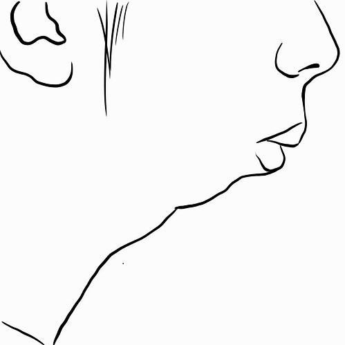
- 下巴代表下属、子女、晚年运，饱满为好，尖窄不利。九宫图放在脸上，下巴是坎1。

关键词：下巴、发际线、牙齿、面相、阴宅

## 第73章 打通人体的财务通道（术）

主角给于老板讲鼻子：鼻子对应脊柱，脊柱是"人体的财务通道"。

- 鼻子是肺的窍，通过鼻子可以判断内脏健康（鼻诊）。
- 面相、手相、身相一一对应：鼻子在脸中间，对应脊柱。鼻子挺直，脊柱就端正；五脏六腑挂在脊柱上。
- 鼻梁低、山根（两眼中间）塌陷或凹凸不平，对应颈椎、胸椎问题，也会压迫心脏和呼吸。
- 颈椎前面是呼吸道，颈椎不好嗓子也会不舒服；鼻梁上有明显骨节，是含胸驼背导致的胸椎问题。
- 鼻梁发青：鼻梁是肝胆反射区，发青代表肝火旺、脾气暴、压力大，容易祸不单行。
- 心理学上，肩膀酸痛僵硬代表心理压力大（压力大→呼吸急→肝气不舒，肝主筋）。
- 鼻子居中属土，土生金代表财富；鼻梁高的人精力足、财运好（作者备注：鼻子高低不是唯一指标）。
- 面相不错却财运不通的人，多半是脊柱歪斜或肌肉僵硬——脊柱在身相上就代表财务通道。

> **身体调理｜鼻子歪：反向压腿**  
> 用来：鼻子歪、脊柱偏（鼻子左斜的人习惯右腿压左腿，反之亦然）  
> 怎么做：先放松对应部位的肌肉，再有意识地反过来压腿。

> **身体调理｜脊柱操（开肩）**  
> 用来：鼻梁塌、颈椎胸椎问题、改善面相和财运  
> 怎么做：双手在背后交叉，向后挤压肩胛骨。按摩、打坐也能改善脊柱。（作者说在抖音"daozhiguang"发过"开肩美背"视频）

> **穴位｜按肩井穴**  
> 用来：鼻梁发青、肝火旺、压力大  
> 怎么做：长按肩井穴（肝胆的反射点），减轻心理压力，改善鼻子颜色。

关键词：鼻子、脊柱、财运、肩井穴、颈椎、面相

## 第74章 上市的风水公司

于老板请"上市风水公司"的风水师 Jason 迁坟，原来是主角的师兄。

- 很多大富豪的风水师都不止一位。

关键词：阴宅、迁坟

## 第75章 我爷爷要复活了？

迁坟时师兄说可能"尸变"（小说情节）。

## 第76章 真真假假

开棺时一道白光（幻境情节），师兄眼睛受伤，用"有毒气体"开玩笑地解释。

## 第77章 意念联系

师兄说新加坡多数人火化放在庙里的格子间；建议主角多接触不同门派和宗教，介绍泰国"秉烛大师"。

- 新加坡只有少数有钱人土葬，大多数人火化后放在庙里一层层的格子间。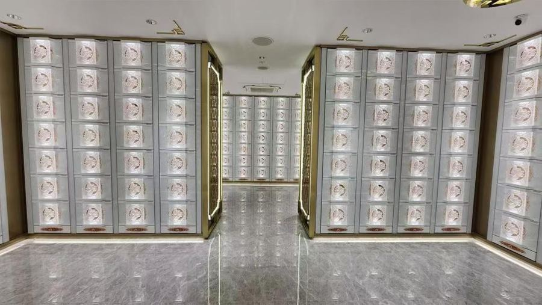
- 师兄说主角的机缘适合"跨种族、跨宗教"学习。

关键词：新加坡、宗教

## 第78章 能量引导术（道/术）

秉烛大师讲"越排斥越来、接纳了才放下"，作者整理出"能量引导术"。嘉艺求大师做法让劈腿的男友回来。

- "顺成人逆成仙"：越排斥什么什么越来；接受了，它反而消失。比如越提醒自己别笑场越会笑。
- "受了受了，一受就了，不受不了"——接纳了才能放下。
- 不要用意志力强迫自己做事：那是压制、是消耗，意志力用完就打回原形（比如靠意志力减肥会反弹）。
- 很多人在"努力上进"中不断掏空自己，一直消耗到抑郁、迷茫，再向外找"救赎"。

> **修心方法｜能量引导术（夸张接纳法）**  
> 用来：懒、对抗情绪、靠意志力撑着做事很累  
> 怎么做：以"懒"为例：先感受"我好懒"，然后接纳它，不批判，甚至夸张地接纳——"我真的好懒""我也太懒了吧""哇我真懒"。再感受，还剩一点就继续夸张接纳——"我就是懒""我懒又怎样"。直到心里平静下来，没有懒也没有不懒。  
> 注意：内在没有对抗，能量才回到自己身上。

关键词：接纳、能量引导术、意志力、懒

## 第79章 你爱他吗

主角劝嘉艺：一个心不在你这里的人，弄回来干什么？她放下了，半年后找到了新男友。

- 爱他就该让他开心；想把人"做法弄回来"，其实不是爱，是想占有。
- 不属于自己的好东西多了，不必天天为它哭。
- "没有忘不了的前任，只要有足够好的现任"；很多坚持就像小时候非要集齐的贴画，看开就不执着了。

关键词：分手、做法、执着

## 第80章 养心补肾能量手印（术）

阿茵难产二十多小时，主角推荐"养心手印"，最后顺产；孩子取名 Jaya。

- 疼的时候人习惯憋气，憋气也是对抗、是消耗；拉玛泽呼吸法就是有意识地对抗下意识的憋气，主要缓解阵痛。
- 秉烛大师募捐很"佛系"，从不宣传捐钱有什么功德。

> **手印｜养心手印（瑜伽手印）**  
> 用来：书中说可排毒、养肝、养心、补肾、健脾胃；书里用在生产时  
> 怎么做：拇指、中指、无名指的指尖轻轻碰在一起，其他手指自然伸直。加强版：再把食指卷到大拇指根部。指尖轻碰就行，不用使劲；左右手可分开做也可同时做，走路、吃饭、睡觉随时都能做。  
> 注意：作者篇外：这是瑜伽手印，自行验证，杜绝迷信；书里是在遵医嘱的前提下用，不耽误医院任何操作。（书中说"见图"，本书文本里没有这张图。）

关键词：养心手印、手印、生孩子、呼吸

## 第81章 祝由术便秘符（术）

阿茵产后便秘不敢用力，主角教了"剑指祝由"，半小时后顺利排便。小包子哭诉杜乐不理她。

> **祝由｜剑指祝由（产后便秘）**  
> 用来：产后便秘  
> 怎么做：书里只写"讲了一下怎么用剑指祝由（见图）"，具体做法在图里，本书文本没有这张图，所以无法写出步骤。  
> 注意：作者篇外：实践是检验真理的唯一标准，以自己验证为准，杜绝迷信。

关键词：祝由、便秘、产后

## 第82章 他一定是爱惨了我

小包子认为杜乐不理她是"太爱她"；主角和杜乐搬去新公寓，认识海哥、莲姐、琪儿、星辰。

## 第83章 最特别的大拇指（术）

海哥看手相先看大拇指：直的和弯的。

- 大拇指伸直时能向后弯：为人随和、说话委婉、会说别人爱听的话（情商高）。
- 大拇指直、不能后弯：说话直接、正义感强、不能容忍谎言，原则性强也固执。
- 直得发硬：很固执，容易受挫，出力不讨好。
- 作者自己的拇指笔直、圆润、匀称，两手都有"夫子眼"。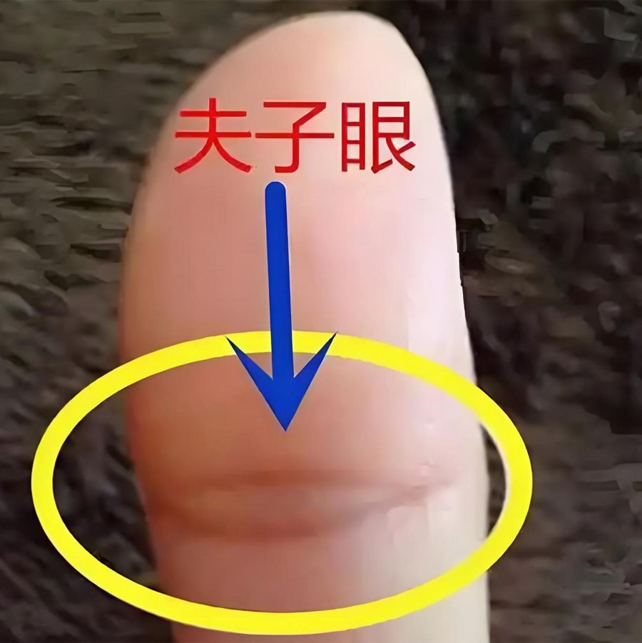

关键词：大拇指、手相

## 第84章 印度是最聪明的种族

合租室友的日常；和印度室友吃火锅；室友星辰住进来后总感冒。

## 第85章 跟房子八字不合

主角去星辰房间看，没看出风水问题；星辰觉得自己"跟房子八字不合"想搬家。

- 医生会治病，也不能包治百病——看风水也有看不出来的时候。

关键词：风水、生病

## 第86章 风煞

星辰调头睡后感冒好些了但脚趾骨缝疼，作者推断床头位置有"风煞"；停电时发现空调管线口漏光。

> **风水排查｜怀疑风水问题时先调个头睡**  
> 用来：某个位置睡觉总生病  
> 怎么做：先把头脚调换方向睡几天，看症状是否转移，用来判断是不是那个位置有问题（比如风煞）。

关键词：风煞、床、风水排查

## 第87章 风煞的本质（术）

空调管线口有一个透光的小缝，就是风煞来源；作者讲风煞的本质：风被挤压变强。

- 风煞都是风被挤压后加强，才伤人；旷野里的风一般不构成风煞。"在风口待久了容易头疼"就是这个道理。
- 冲背煞、剪刀煞、穿堂煞、尖角煞、反弓煞、天斩煞、飞刃煞等，都是"加强风"造成的；挤压越大，煞越重。
- 越小的洞，风被挤得越尖锐，伤害越明显。
- 学风水不要死记硬背一条条口诀（作者说有本书光讲腰疼就列了100多页），要懂原理。

> **风水排查｜找漏风缝隙**  
> 用来：某个位置总感冒、关节疼（风煞）  
> 怎么做：关掉屋里的灯，趁外面亮的时候看墙上、空调管线口等处有没有透光的缝；找到后用密封胶或泡沫胶反复糊严。

关键词：风煞、漏风、空调、感冒、风水

## 第88章 免费的小姐（术）

室友莲姐带"男朋友"阿强吃饭；作者借阿强讲额头面相。

- 额头叫上庭（天庭），代表祖先长辈、少年时期，也代表智商情商；饱满为好。
- 额头凹凸狭窄：少年运差、不受双亲疼爱、性格老实、情商低、固执。

关键词：额头、面相

## 第89章 首富赚钱也得有压力

来找主角咨询的人多了起来；小曦升职后压力大，想"布个赚得多又没压力的局"。

- 首富赚钱也有压力，命再好的人赚钱也得承担压力。

关键词：压力、布局

## 第90章 喝水不能改命，不喝水能

主角跟小曦讲：布局改命是骗局，风水命理是"必要不充分条件"——喝水不能改命，不喝水能。

- 如果真有摆上就能逆天改命的东西，普通人也买不起。
- 摩根说"百万富翁不需要命理师，亿万富翁需要"；富豪有风水师，但风水师并不能复制出一批首富。
- 打比方：人生像考大学，风水命理像语文——不识字不行，但字认得再多也不保证考上清华。
- "喝水不能改命，但不喝水能改命"：必要条件不能反过来推。

关键词：改命、布局、防骗、风水作用

## 第91章 三元九运～抑郁/虚假（术）

作者讲三元九运的"离火运"：心理问题和骗子都会变多。

- 从2024年起进入三元九运的第九运"离火运"（先天运从2017年已经开始）。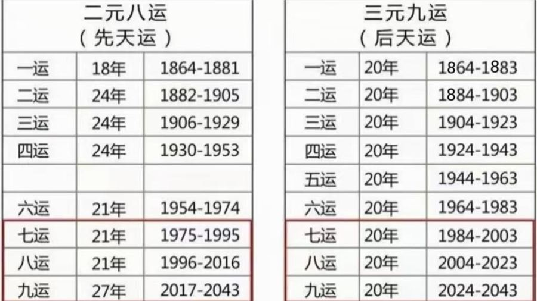
- 火的特点是中间空（"离中虚"）：心属火，心里空落落，抑郁、焦虑、暴力等心理问题会越来越多。
- 虚也代表虚假：各行各业会冒出很多骗子；心理疏导、情绪疗愈是趋势，但这行骗子也不会少。

关键词：三元九运、离火运、九运、防骗、心理问题

## 第92章 算命心理学

作者讲"算命心理学"：骗子也能算准；推荐读《英耀篇》防骗。

- 能遇到的大师99%是骗子。
- 骗子的套路：问婚姻就说婚姻不顺，问事业就说事业不顺，问孩子就说孩子不顺；不准就说"你心不诚"。
- 《英耀篇》是讲江湖术士揣摩人心套路的书，读了有助于防骗。

关键词：算命、防骗、英耀篇

## 第93章 神奇的清洁工

清洁工赵爱凤为了"干干净净"抠掉客户桌子的漆，第二次又抠了椅子。

## 第94章 重复的问题，我不会再犯

赵爱凤说"抠椅子是第一次犯错"，老板最终再给一次机会。

- 跟这样的人交代事情，要把范围说全（客户所有东西都不能破坏），不能只说一个例子。

关键词：沟通

## 第95章 爱发脾气的人最脆弱

助理钟雨情绪崩溃、在办公室骂人；主角说爱发脾气的人最脆弱。

- 越容易情绪失控的人，内心越脆弱无助；爆发只是懦弱的人竖起的刺。

关键词：发脾气、情绪

## 第96章 尿毒症

主角让钟雨想清楚"要解决什么问题、愿付出什么代价"；吴昊的表哥得了尿毒症，表嫂抑郁。

- 世界上没有免费的午餐，想得到帮助就要付出代价。

关键词：帮人、代价

## 第97章 三个月的薪水（术）

钟雨愿付三个月薪水求改变；主角说尿毒症和抑郁症在风水上是同一个原因：正北见水。

- 无条件的给予只会助长贪心和抱怨，"升米养恩，斗米养仇"；一开始就划清边界，彼此都舒服。
- 尿毒症（肾）和抑郁症（情绪）都和"水"有关；坎卦为水、在正北，正北见水就是"水受伤"。
- 路也算水：北边即使没有水，有路也等于有水。
- 看照片只能粗略判断，图片看不准方向。

关键词：正北见水、坎1、尿毒症、抑郁、帮人边界

## 第98章 命是天定还是人定

吴昊求主角救表哥，表哥表嫂不信，挂了电话；表哥后来去世。

- 尊重他人命运；对方警惕也是对的，骗子太多。
- 骗子多的根源是人的贪；"跟想听真话的人说真话只能赚个温饱，跟想听假话的人说假话才能赚大钱"。
- 自己选择相信什么样的人，就决定了自己的人生。

关键词：尊重他人命运、防骗

## 第99章 晕车象数疗法（术）

除夕去圣淘沙，星辰严重晕车，主角想起八卦象数疗法里有晕车的象数。

- 作者篇外：八卦象数疗法是李玉山老师提出的，出版过书。

关键词：晕车、象数

## 第100章 八卦象数（术）

沙滩上玩扒沙子；星辰说默念主角教的"070"后晕车好多了。主角讲中医望闻切都分阴阳。

- 中医望闻切也分阴阳：望诊色泽鲜明属阳、晦暗属阴；闻诊声音洪亮属阳、低微断续属阴；脉浮大滑属阳、沉迟涩属阴。阴气太重，身体和运势都差。

> **象数｜晕车象数 070**  
> 用来：晕车  
> 怎么做：默念数字"070"。书里星辰晕车吐了一路，默默念着感觉好多了。  
> 注意：作者：实践是检验真理的唯一标准，有没有效看自己。象数疗法源自李玉山老师（见第99章）。

关键词：晕车、象数、56、阴阳、中医
