# 《改命记实录》逐章笔记：0101-0200

## 第101章 与人为善有错吗

阴阳不是死规矩：与人为善也要看对象；主角发了一份象数集锦给大家。

- 中医以阴阳为辨证总纲：体表体内、脏腑、每个器官（如肾阴肾阳）都分阴阳。
- 把善良给善良的人才是善；给恶毒的人就是助纣为虐。只讲善、不分对象，可能是软弱怯懦、不敢保护自己的借口。
- 打骂也不一定是坏事，如禅宗"当头棒喝"是为了让人醒悟。
- 作者篇外：象数文件在公众号"道之光"的分享里有，以自己的感知为准，不要迷信。
- 同一种情况有很多组数字，不能随便挑，要念哪个舒服用哪个。

> **养生方法｜泡脚（肾虚腰痛）**  
> 用来：肾虚引起的腰痛（一般是湿寒引起）  
> 怎么做：先泡几天脚看看。泡脚没什么副作用。  
> 注意：腰痛分很多种，腰本身受伤的痛不在此列。

关键词：与人为善、阴阳、腰痛、泡脚、象数

## 第102章 牙痛偏方（道/术）

主角讲象数为什么要"一人一方"，给了减肥、咳嗽、牙痛、富贵竹的数字；讲牙痛的多种偏方和晕车贴姜片。

- 象数疗法以八卦为核心、中医为基础。正经中医是一人一方，方子里写"少许"是因为体质、病情、体重不同。
- 通用象数是假设其他五行都没问题；念了不舒服，可能是身体有别的失衡，和这组数不匹配——身体是最好的检验器。
- 牙痛多半是上火：火往上走（怒发冲冠）。正常应该"气降水升"（水火既济），火在上水在下就是"火水未济"，气血不顺；天地否、地天泰也是这个道理。

> **象数｜减肥象数**  
> 用来：减肥  
> 怎么做：默念"010·820"。

> **象数｜只瘦肚子的象数**  
> 用来：只想瘦肚子  
> 怎么做：试试"10·820·640"。

> **象数｜咳嗽象数（最简单的）**  
> 用来：咳嗽（作者说820健脾益气、化痰利肺）  
> 怎么做：默念"820"。  
> 注意：咳嗽分很多种，其他类型书里这里没展开。

> **象数｜植物长得弱的象数**  
> 用来：盆栽（书里是富贵竹）长得没精神  
> 怎么做：念"640·070"，念完把数字写下来贴在花盆上。

> **象数｜牙痛象数**  
> 用来：牙痛  
> 怎么做：默念"010·820·60"。

> **穴位｜按合谷穴止牙痛**  
> 用来：牙痛（合谷是止痛穴位）  
> 怎么做：直接按合谷穴。作者说别人帮他按效果好，自己按效果差些。

> **偏方｜蜂蜜止牙痛**  
> 用来：牙痛（上火）  
> 怎么做：把蜂蜜倒在痛的牙上，含着。作者说止痛很快。

> **偏方｜冷水冲脚止牙痛**  
> 用来：上火引起的牙痛  
> 怎么做：把脚泡在流动的凉水里（作者半夜找了条小河），几分钟牙就不痛了。原理是借流动的水把火气往下引。

> **偏方｜牙痛的其他小办法**  
> 用来：牙痛  
> 怎么做：嚼花椒、咬生姜、咬芦荟、含盐水都有效果，身边有什么用什么，试出最适合自己的。

> **偏方｜姜片贴肚脐防晕车**  
> 用来：晕车  
> 怎么做：出门前用胶布把一片姜贴在肚脐（神阙穴）上。没有姜片可以用重物压住肚脐，比如装满沙子的书包。

关键词：象数、一人一方、减肥、咳嗽、牙痛、合谷穴、蜂蜜、晕车、姜、肚脐、上火、水火既济

## 第103章 夜以继日

大年初一去找孙奇瑞吃饭，听到他和女友在屋里，主角拉着杜乐走了。

## 第104章 孔子是五行创始人？！

主角讲"善易者不卜"，以及《周易》和孔子的关系。

- 现在常见的《周易》分《经》和《传》：《经》是周文王和周公作的（卦象、卦辞、爻辞），约五千字；《传》（《十翼》）是孔子和弟子写的。
- 目前发现五行学说最早见于《尚书》；学术界一般认为五行生克学说始于春秋战国。
- "善易者不卜"：不是不能占卜，而是不必事事问神；懂阴阳变化的道理就明白因果。事事靠测算，等于放弃人生的可能性。

关键词：善易者不卜、周易、孔子、五行

## 第105章 精通《易经》的都是骗子

主角说"说自己精通易经的都是骗子"：光道家五术就学不完。

- 道家五术"山医命相卜"：山（修仙：丹药、拳法、符咒）、医（药方、针灸、推拿、灵治）、命（紫微斗数、八字）、相（星相、风水、面相手相等）、卜（太乙、奇门、六壬、六爻、梅花易数、测字、姓名学等）。
- 风水就有上百个流派，流派之间还互相矛盾（比如仙人球能不能化煞）。
- 谁说自己精通易经，基本可以断定是骗子。
- 想不劳而获的人，只有骗子能满足他。

关键词：防骗、易经、道家五术

## 第106章 儒家会算命吗（术）

讲符咒分阴阳、《尚书》里的五行和河图数字；历史上很多名人都是道士。

- 灵治指咒语符咒、心灵疗法、情志疗法等；符咒也分阴阳：修仙用阳性的咒为主，调病用阴性的符为主（比如祝由术）。
- 《尚书》讲五行的性质：水润下、火炎上、木曲直、金从革、土稼穑；味道：咸、苦、酸、辛、甘。
- 河图：奇数是天数（阳），偶数是地数（阴），一六属水、二七属火、三八属木、四九属金、五十属土。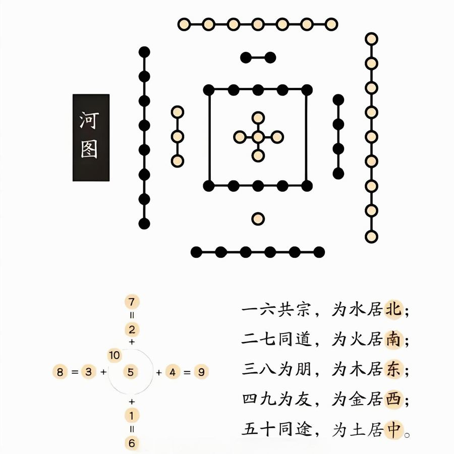
- "知变化之道者，其知神之所为乎"——懂了变化的规律就能预测。
- 作者说李白、王羲之、贺知章、苏轼、诸葛亮、华佗、孙思邈等都是道士；"道"是一种规律，道士只是多懂一门"大自然的语言"。

关键词：河图、五行、符咒、道士

## 第107章 咳嗽的几个偏方（术）

杜乐咳嗽，主角煮大蒜冰糖水、按大鱼际；顺便讲手相流派。

- 手相主要有印度派、西洋派、中国派；中国手相后来和洛书结合，在手心画九宫八卦，能推出家里风水布局。
- 手上有内脏的反射区，很多病发作前手上就有端倪。

> **偏方｜大蒜冰糖水止咳**  
> 用来：咳嗽  
> 怎么做：七八瓣大蒜拍碎，加水煮开，放冰糖，吹凉了喝。（作者说白糖好像也可以，让大家验证。）

> **偏方｜香油煎姜丝鸡蛋止咳**  
> 用来：咳嗽  
> 怎么做：用香油煎姜丝鸡蛋吃。（书里只提了名字，没写更细的步骤。）

> **穴位｜揉大鱼际止咳**  
> 用来：咳嗽（心肺弱时大鱼际会有痛点）  
> 怎么做：按揉手掌大拇指根部的肉（大鱼际），有痛点尽量揉开。力度要看对方承受程度，一点点加。

关键词：咳嗽、大蒜、冰糖、大鱼际、手相

## 第108章 从手指看男性的不可描述（术）

看食指和无名指的长短。

- 食指长：运动天赋弱，语言和记忆强；食指越长越有野心，事业型。
- 无名指长：少焦虑抑郁，立体思维强，肢体协调好；男人右手无名指比食指长得越多，男性特征越明显（作者认为有道理）。
- 食指和无名指一样长：通常正直诚实。

关键词：手指、食指、无名指、手相

## 第109章 心理学的100不等于100（术）

星辰的姐姐泡脚后腰不疼了，托星辰给主角包红包。主角讲"厌恶损失"心理和大拇指长短。

- 泡脚只对肾虚引起的腰痛有效。
- 厌恶损失：得到100元高兴一会儿，丢了100元记很久——"心理学的100不等于100"。
- 商家利用这一点：0元试用、满减；骗子也用：刷单被骗的人不愿接受损失，一次次继续汇钱。
- 大拇指代表祖先长辈、一生福禄：修长的人得祖荫、受长辈偏爱、事业运旺、聪明、学习能力强、认真、有行动力。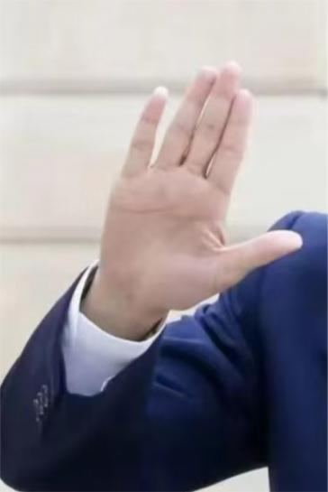
- 多长算长：五指并拢，大拇指尖超过食指第三关节的一半算长。

关键词：泡脚、腰痛、厌恶损失、防骗、大拇指、手相

## 第110章 肉为财（术）

继续讲大拇指和手指；"肉为财"，以及阴阳是相对的关系。

- 大拇指长容易有大成就，也容易有大波折。
- 眉间距宽（"眉头阔，大快活"）：心大、少生气、长寿乐天；但感情上心也大。
- 大拇指头尖：思维敏捷；头圆厚：不懂变通、反应慢、易生气，不适合当领导；张开向外：外向；紧贴食指：肾气不足、胆小。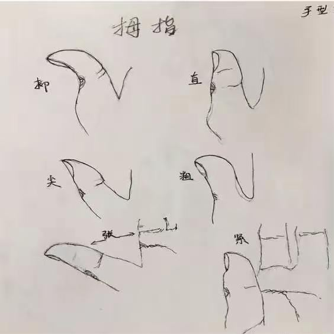
- 手指第一节短而硬、不易弯：容易有心脑问题（中风、头痛、心脏病）；手指瘦弱弯曲：容易神经衰弱、头痛失眠。
- 骨为阳、肉为阴；伸手露骨的"竹节手"传统上说漏财——"肉为财，肉少财少"；按骨架算，不露骨就行，不是越胖越好。竹节手的人阳性强、性格硬、活跃、善观察。
- 财属阴（财不露白）；阴重的人"破财消灾"、捐款是拨阴取阳；已经穷得只剩骨头的人就别往外拨了，要平衡。
- 阴阳不是标签，是一种关系：心脏和六腑比是阴，和肾比是阳。

关键词：大拇指、手指、眉间距、竹节手、肉为财、破财消灾、阴阳

## 第111章 改命？分分钟的事

主角说"命一定能改，而且立马见效"——往坏处改很容易，往好处改要付出；风水摆件像羽绒服。

- 命注定长寿的人天天拿刀砍人会被枪毙——命能往坏处改，自然也能往好处改，只是难，看你愿不愿意。
- 改命是付出多少收获多少；只给个小红包就想换一辈子富贵，是不劳而获。
- 如果风水摆件能让人发财，扶贫直接发摆件就行了。
- 计划生育改变了几十亿人"命里有几个孩子"——改命难，但不是做不到；别为懦弱找借口。
- 风水摆件像羽绒服：有用，但基本不能改命；买不买看情况——先看是不是真货，再看自己需不需要。

关键词：改命、风水摆件、防骗、宿命论

## 第112章 断头婚（术）

讲学习方法；用掌中诀讲婚配里的"断头婚"（大五婚、小五婚）。

- 掌中诀上的十二生肖：子鼠、丑牛……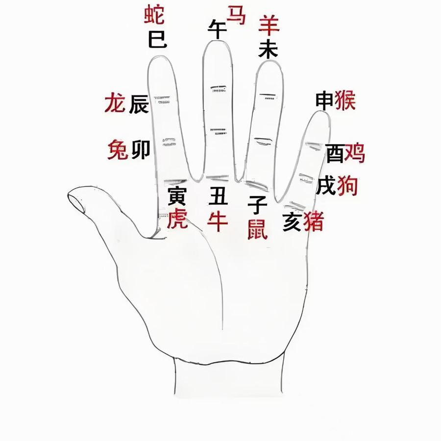
- 大五婚歌诀：白马怕青牛、羊鼠相交一旦休、蛇虎如刀错、兔见龙王泪交流、金鸡玉犬难躲避、猪与猿猴不到头。
- 规律：在掌中诀上以横中线上下对称的两个属相（马牛、羊鼠、虎蛇、兔龙、猪猴、鸡狗）叫"相害"，不用背歌诀，看是不是竖着对应就行。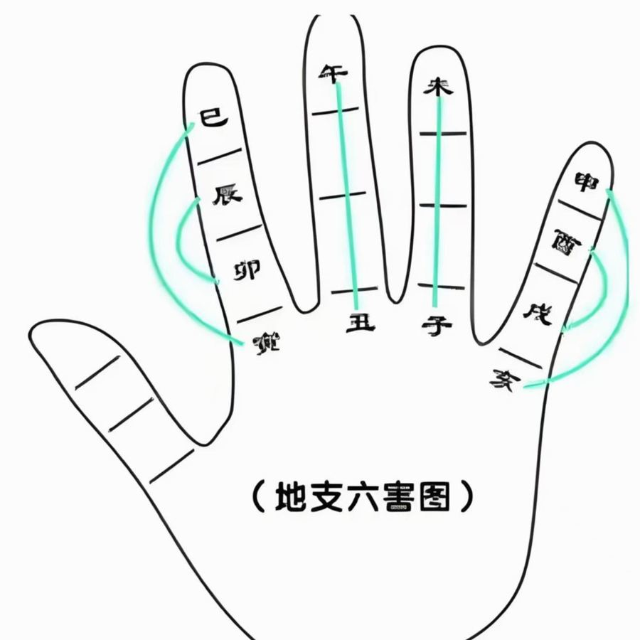
- 小五婚歌诀：鼠兔不成婚、虎猴两地分、鸡马、猪龙、狗蛇、牛羊。
- 学这些不是为了背出来唬人，重点是知道怎么化解。

关键词：断头婚、大五婚、小五婚、属相、相害、婚配、掌中诀

## 第113章 心理学的光环效应（术）

讲"光环效应"：会说的不一定会做，算得细的不一定会化解。

- 给人算命的人要背很多口诀装门面；实用派只关心：哪里有坑、怎么避、有几种办法、代价是什么。
- 光环效应：看到一个优点就以为全面优秀（比如穿得笔挺就以为能力强）；骗子特别光鲜亮丽。
- 很多命理学家预测很准，自己却过得不如普通人——只擅长预测，不擅长化解。
- "巧言令色，鲜矣仁"：面子和里子通常只能要一个。

关键词：光环效应、防骗、算命

## 第114章 九宫五行方位速记（术）

用颜色和数字速记十二生肖五行、九宫和洛书数字。

- 生肖五行按季节记：春木在东（绿）、夏火在南（红）、秋金在西（白）、冬水在北（黑），每季最后一个月是土（黄）。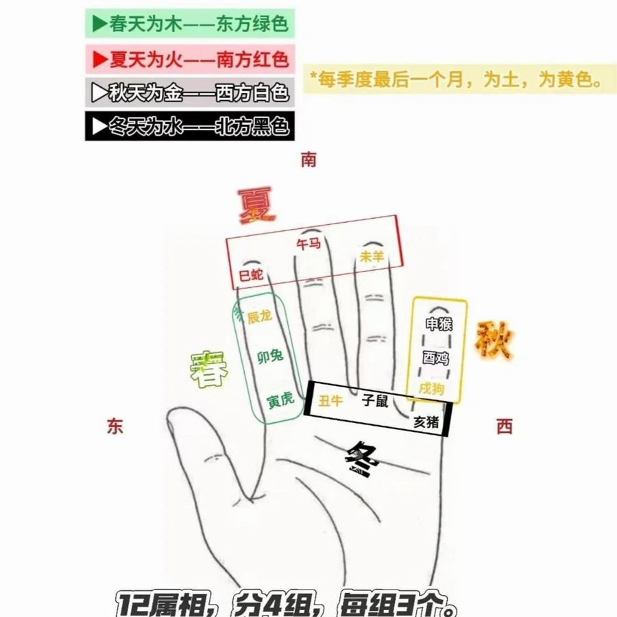
- 九宫格上南下北、左东右西：东边两格绿（木），西边两格白（金），南一格红（离火），北一格黑（坎水），其余三格黄（土）。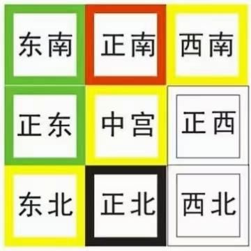
- 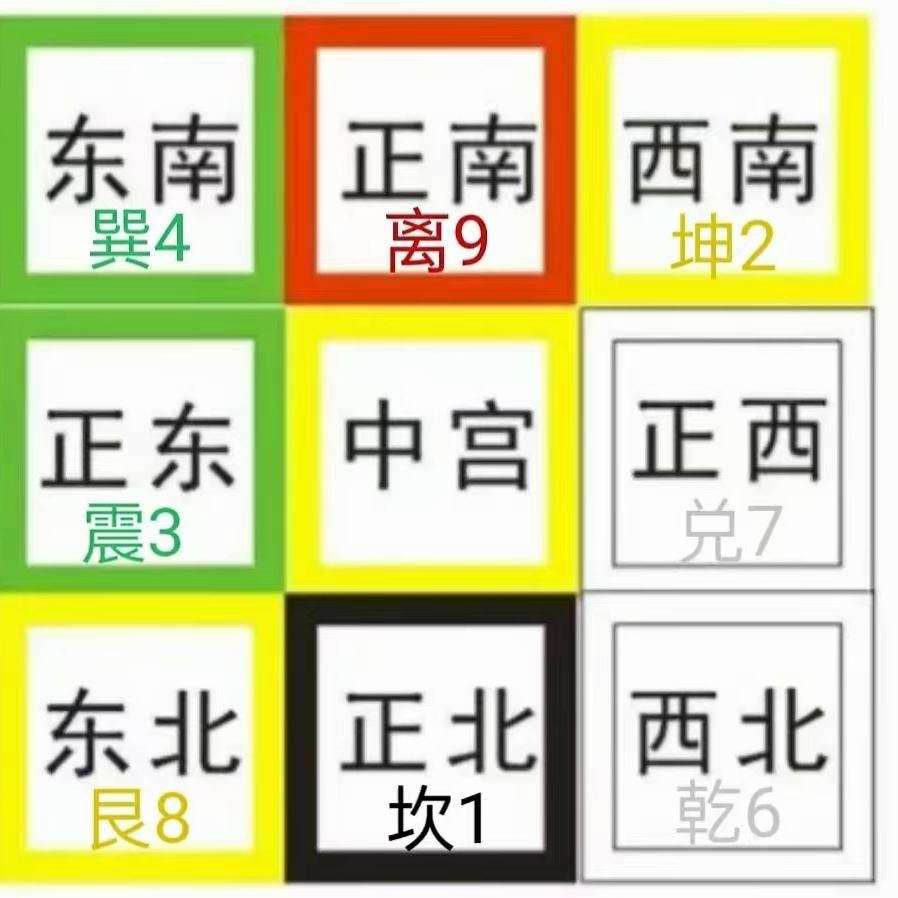
- 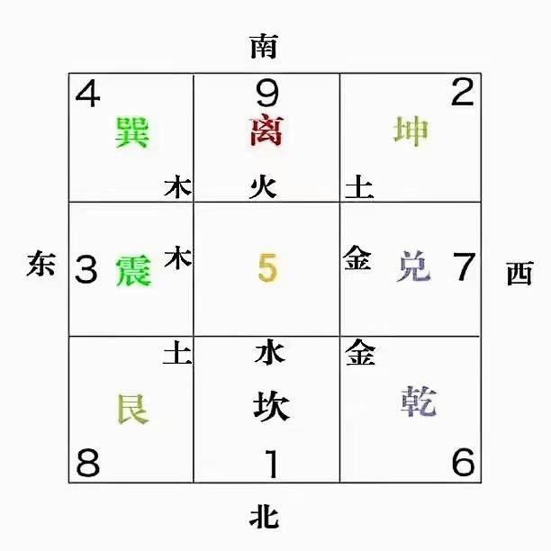
- 九宫数字横、竖、斜加都等于15。口诀"戴九履一，左三右七，四二为肩，八六为足"，像一个站着的人。
- 更简单的记法：奇数放四正（9上1下，3、5、7从左到右横着），偶数放四角（4、2在上当肩膀，8、6在下当脚）。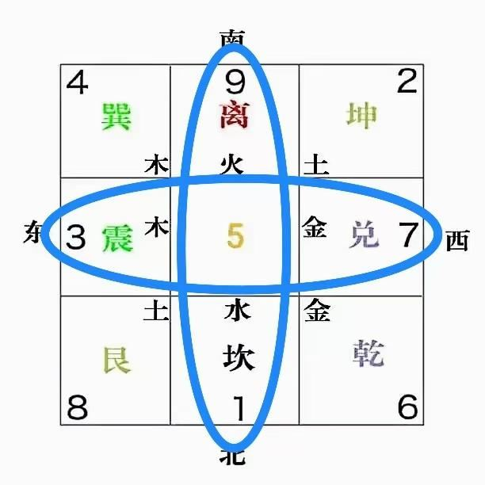

关键词：九宫、洛书、五行、生肖、速记

## 第115章 象数疗法的注意事项（术）

讲先天八卦和后天八卦的区别；象数疗法用先天八卦的"数"、后天八卦的"象"。念象数不舒服是指头、心、胃不舒服。

- 先天为体（不变的天道），后天为用（人道）。八字、奇门、风水等实际应用多用后天八卦。
- 虚岁比周岁多出的一岁就是胎里的"先天"阶段；先天定了性别父母，后天可以选择理想、伴侣、工作。学易是为了改变，重点在后天。
- 后天八卦方位依据"帝出乎震……成言乎艮"，从震开始顺时针转一圈。
- 先天八卦依据"天地定位，山泽通气，雷风相薄，水火不相射"。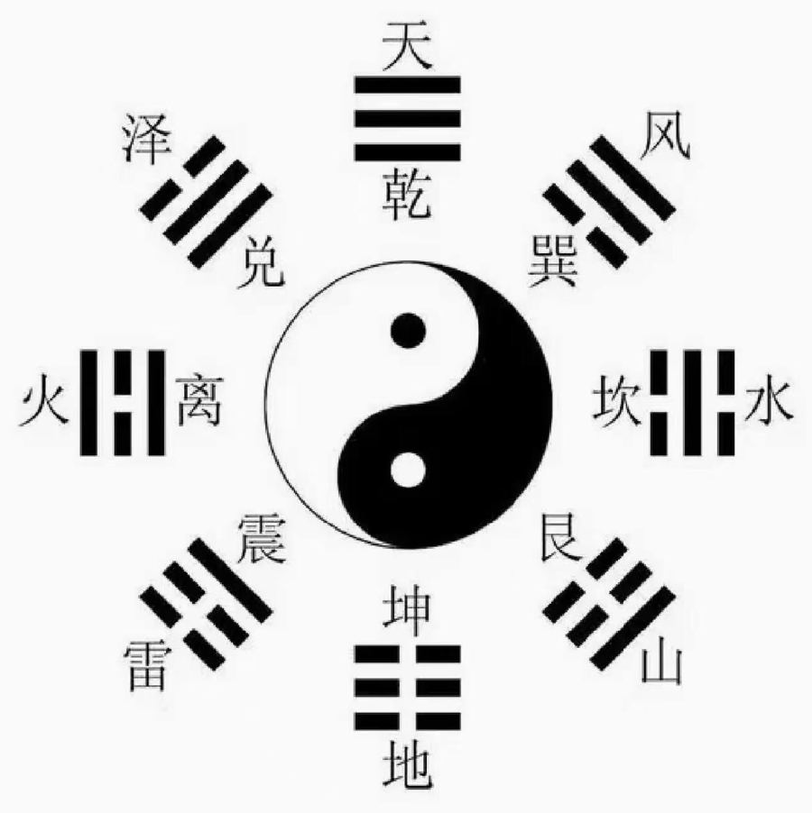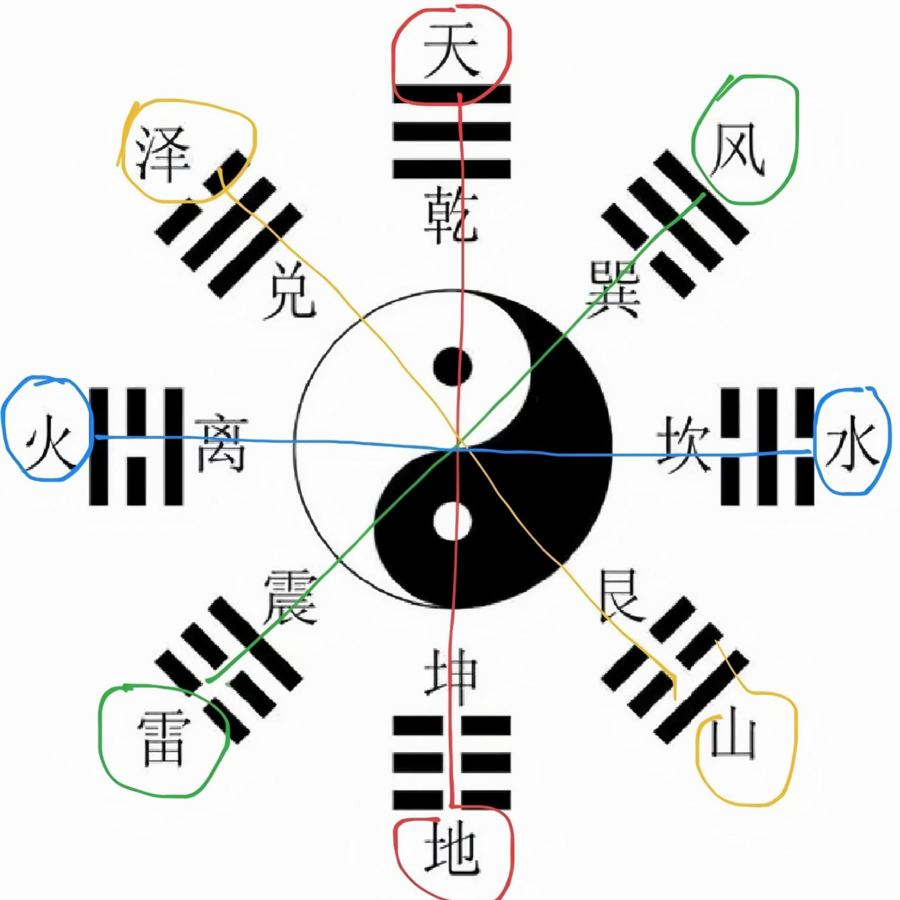
- 先天八卦的数：从乾开始，乾1、兑2、离3、震4，再从右上开始巽5、坎6、艮7、坤8。象数疗法取的就是这组数。
- 念象数觉得"不舒服"，指的是头、心、胃三个部位不舒服——它们连着潜意识，这时就换一组数。

关键词：先天八卦、后天八卦、象数、九宫

## 第116章 心疼是哪儿疼？

解释为什么"胃"也连着潜意识：太阳神经丛；推荐《硅谷禁书》。

- 心口窝其实是胃的位置；胃常疼要注意查心脏，胃疼的人常被转去心脏科。
- 书中说潜意识由胃后部的"太阳神经丛"负责，迷走神经连接显意识和潜意识。被看不起、自尊受伤、过度紧张，容易胃溃疡；放弃表达、拒绝社交，容易消化不良、胃食道反流。
- 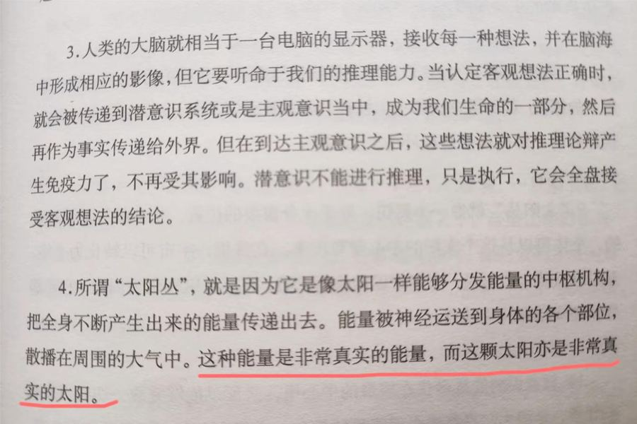
- 作者推荐《硅谷禁书》（又名《世界上最神奇的24堂课》），说有的版本讲了太阳神经丛，有的没讲。

关键词：胃、心脏、太阳神经丛、潜意识、推荐书

## 第117章 先天八卦（术）

用"一家人"的逻辑记先天八卦的位置。

- 一长横是阳爻，两短横是阴爻。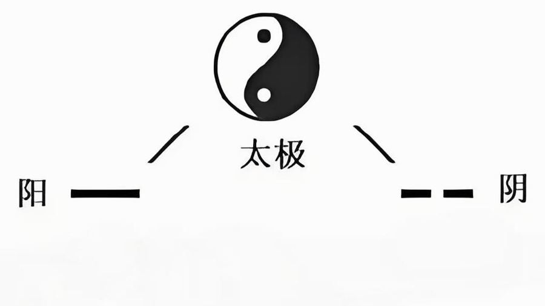
- 乾三阳爻是父亲（老男），坤三阴爻是母亲（老女）。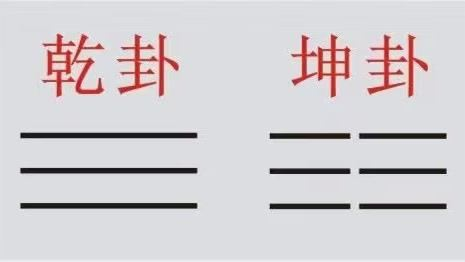
- 震、坎、艮各只有一个阳爻，是大儿子、二儿子、小儿子（画卦从下往上，阳爻在第一笔是震）。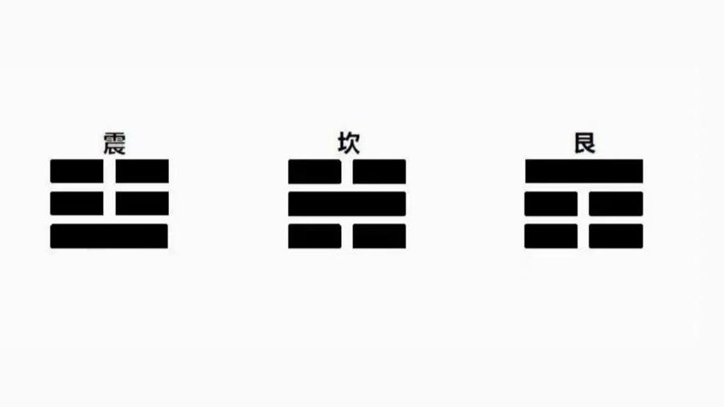
- 巽、离、兑是大女儿、二女儿、小女儿。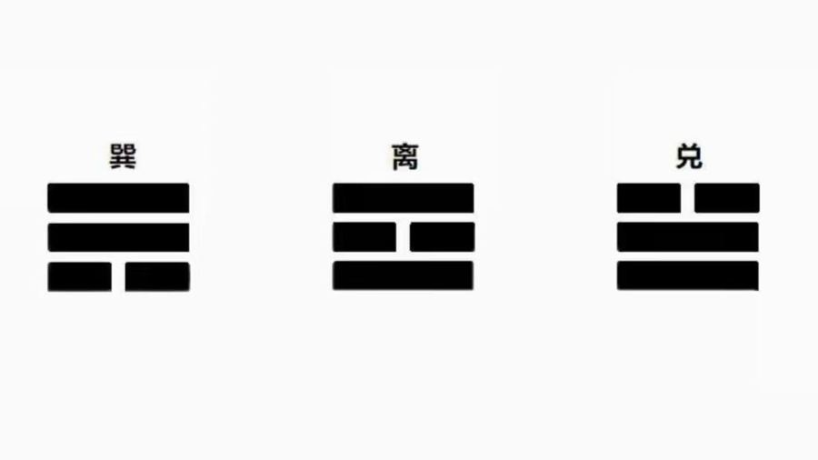
- 先天八卦：天上地下（乾上坤下），离坎在东西相对；乾两边是大女儿巽和小女儿兑，坤两边是大儿子震和小儿子艮，"左为大"。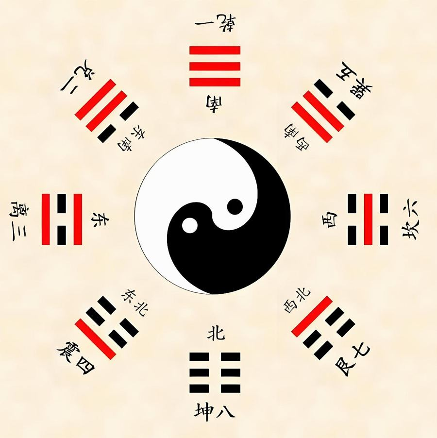

关键词：先天八卦、八卦、阴爻、阳爻、速记

## 第118章 光环效应的正面应用（术）

用"一家人"记后天八卦；讲光环效应的正面用法。

- 后天八卦：父母（乾6坤2）护着小女儿（兑7）在右边627；二哥二姐（坎1离9）在中间竖线；大哥大嫂（震3巽4）带着小弟（艮8）在左边青龙位348。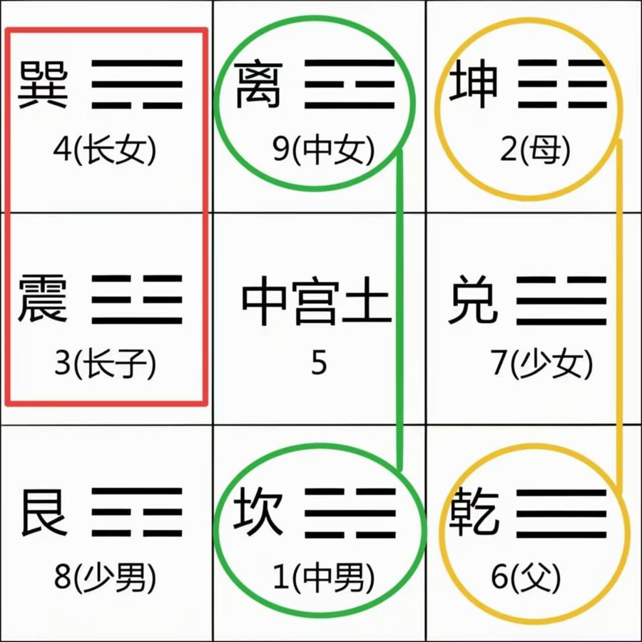
- 画一条线把九宫分上下：上半边都是女人（阴），下半边都是男人（阳）——像太极图，阴阳交合才有生命（地天泰的道理）。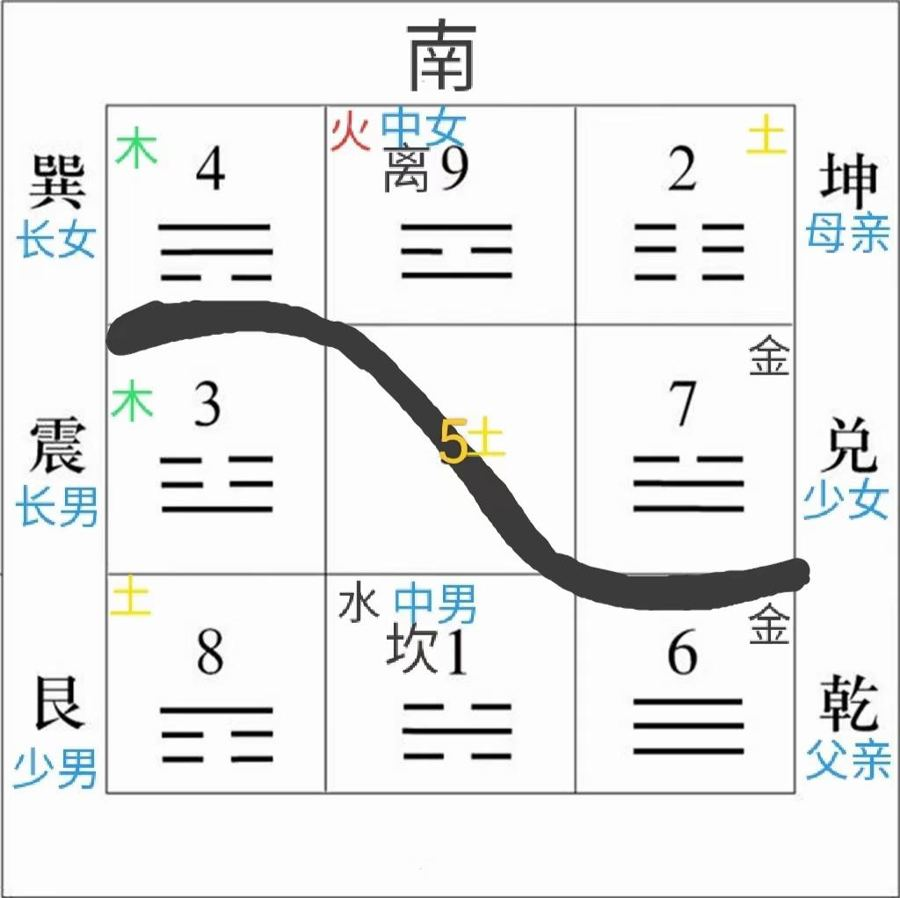
- 光环效应可以正面用：有一个足够亮的闪光点，别人会忽略你的缺点。

关键词：后天八卦、九宫、光环效应

## 第119章 一秒测运势（术）

琪儿想要"超级简单的看运势方法"，主角教她握手看冷热。

- 阳是温暖的、向上的、积极的、富足的、运势好的；阴是寒冷的、向下的、消极的、贫穷的、运势差的。
- 冷的时候人会抱紧双臂，掏钱付款的概率低；会销现场先把气氛炒热就是这个道理。

> **看人方法｜握手看运势**  
> 用来：见客户、见领导时快速判断对方状态  
> 怎么做：见面伸手一握，感受温度：手冰凉说明对方最近运势有问题，他要是画大饼就多留个心眼。走的时候一定再握一次手（排除刚从外面进来手冻凉的情况）。

关键词：握手、阴阳、看运势

## 第120章 癌症的前兆（道/术）

主角讲体温偏低可能是癌症前兆，以及怎么提高体温；简单讲辟谷和"水毒"。

- 人体在36.5～37.2℃状态最好；书中说正常范围内体温越高免疫力越强，37.1℃时免疫力是36℃时的5倍以上；癌症患者大多体温偏低。
- 心脏只占体重0.5%却产生11%的热量，是最不容易长癌的器官；其次是温度偏高的脾脏。
- 辟谷（断食）可以重启免疫系统；最重要的是结束后的"复食"阶段。第一次辟谷最好参加有传承的集体辟谷（道观、寺庙、禅修中心）；要求必须喝水的辟谷班别参加。
- 中医有"水毒"的说法：喝水过量会导致心律不齐、肾功能不全，过量为毒。

> **养生方法｜提高体温的办法**  
> 用来：体温偏低、手脚冰凉、免疫力差  
> 怎么做：先避免伤阳气：早上别空腹吃凉的、晚上别洗头、少喝冷饮。再做能升温的事：晒太阳、泡脚、运动、桑拿、喝红糖姜茶。

关键词：体温、癌症、免疫力、辟谷、水毒、红糖姜茶、泡脚

## 第121章 癌变的原因

体温只是"分数"不是原因；讲细胞缺氧和酸性体质。

- 体温是结果不是原因：就像只改试卷分数考不上清华，身体调养好了体温自然就上来。根本是体内阴阳不平衡。
- 书中引德国学者的"缺氧说"：体液酸化会降低溶氧，细胞氧含量低于正常的65%时可能癌变。

关键词：体温、癌症、缺氧、酸性体质

## 第122章 慧观

适当空腹减轻缺氧压力；佛家道家对神通的态度。

- 消化食物要耗氧，适当空腹能减轻缺氧压力；"要想小儿安，三分饥与寒"，大人也一样。
- 佛家道家都不追求神通，态度是"不拒绝、不主动、不承诺"；执着修神通被视为旁门左道。
- 佛经《入胎经》描述胎儿每七天的变化，书中说与B超结果一致，道医称这种能力为"慧观"。

关键词：三分饥与寒、空腹、神通

## 第123章 辟谷喝生水？

解释"三分饥与寒"不是越冷越好；辟谷班让喝生水是错的。

- 三分饥与寒是"适当"饿一饿、冷一冷，激发身体自己产热和免疫；提高体温的办法里没有"多穿衣服"——捂出来的温度是假分数，还影响皮肤呼吸。
- 道家养生提倡每口饭嚼36下。
- 水烧开时含氧量降低，但放凉后含氧量会回升；所以辟谷班宣称要喝生水来"增氧"没有依据，水还是要烧开再喝。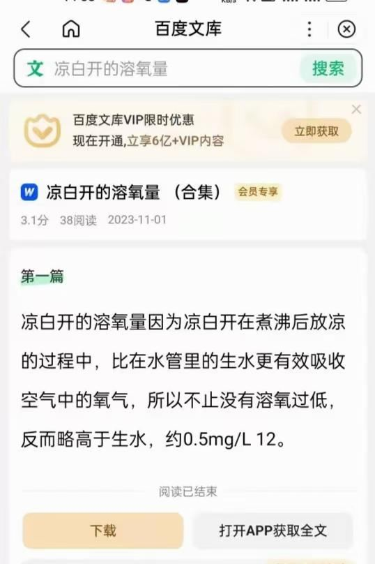

关键词：三分饥与寒、辟谷、生水、咀嚼

## 第124章 吃酸性好还是碱性好

吃碱性食物能不能改善酸性体质？作者说不能，倒是偶尔吃点醋有好处。

- 食物酸碱和体液酸碱不是一回事，体液酸碱受代谢影响；胃液本身是强酸，大量吃碱性食物中和胃酸反而伤胃。
- 网上把葡萄、柠檬、醋等酸的东西说成"碱性食物"是自相矛盾的噱头。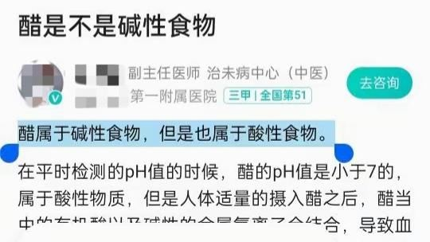
- 醋的功效：降血压、防动脉硬化、杀菌、润皮肤、消除疲劳、助消化。

关键词：酸碱体质、醋、碱性食物

## 第125章 扁平疣（术）

琪儿讲她用"醋蛋"治好扁平疣的经历；作者补充醋蛋液和另一种醋鸡蛋做法。

> **食疗｜醋饮料**  
> 用来：日常养生  
> 怎么做：醋直接加温水冲着喝，可以加蜂蜜，最好别加糖；也可以用水果醋（含钾，书中说能预防高血压）。醋还可以腌小菜开胃，煮骨头汤利于补钙。

> **偏方｜醋蛋（琪儿用的偏方）**  
> 用来：扁平疣（扁扁的小瘊子）  
> 怎么做：10个生鸡蛋放进陶瓷罐（琪儿家用的是茶壶），倒满高度米醋，密封泡7天，把蛋煮熟，每天吃1个。泡得越久蛋壳越化，越难吃。琪儿吃了大半个月，还剩最后一个蛋时疣子已经全掉了。  
> 注意：非常难吃（酸、涩）。琪儿去医院时医生建议手术切除并做病理检查。

> **偏方｜醋鸡蛋（快速版）**  
> 用来：扁平疣  
> 怎么做：鸡蛋煮熟去壳，泡在醋里密封24小时后就能吃。每天吃2个，书中说3周见效。

> **食疗｜醋蛋液**  
> 用来：书中说可美容养颜、淡斑、减肥、降压降脂、健脑、增强免疫力  
> 怎么做：前面和醋蛋一样，把生鸡蛋加醋密封泡好；区别是不煮，直接生着加热水和蜂蜜喝。同时配合外用涂抹效果更好。

关键词：醋蛋、醋蛋液、扁平疣、瘊子、醋、偏方

## 第126章 改善酸性体质

作者讲怎么改善酸性体质：少产生、多排出。

- 气血就是人体内部的"风水"。

> **养生方法｜改善酸性体质**  
> 用来：酸性体质  
> 怎么做：少产生：少喝饮料、少吃肉、少喝酒（糖、脂肪、蛋白质、酒代谢会产酸）。多排出：早睡修复身体；适量喝水从尿排；适量运动从汗排。

关键词：酸性体质、早睡、运动

## 第127章 祝由术小儿退烧（术）

Jaya发烧，主角教阿茵用"红线放水碗"的祝由方法，第二天退烧。

- 《黄帝内经》："古之治病，惟其移精变气，可祝由而已。"祝由除了符和咒，还有借助外物做仪式的方法。

> **祝由｜红线放水碗退烧（祝由）**  
> 用来：小孩发烧  
> 怎么做：晚上孩子睡着时，用家里缝被子的红线，从孩子头顶量到脚，按这个长度剪断；线的一头穿上一根缝衣针。接一碗水放在灶台上，把穿针的那头搭进水碗里，另一头搭在碗外面，就可以了。  
> 注意：作者篇外：书中所有方法仅供参考，杜绝迷信。作者说祝由属于"中医心理学"、意念疗法。

关键词：祝由、发烧、小孩发烧、红线

## 第128章 姓名学

讲"一念天堂一念地狱"；名字要避开字义消极的字，也要看字形。

- 被人骂了一句，骂完就过是天堂；几个月后想起来还气得发抖就是地狱——天堂地狱就在此时此地。
- 头像、昵称都能看出潜意识：一个黑乎乎、凌乱颓废的头像，运势不难判断。
- 起名先避开字义消极的字（如灾、厄），再兼顾字形：比如"忍"是心上一把刀；"超"字义好，但拆开是走、刀、口，容易受伤，还影响家人。

关键词：姓名学、起名、头像、一念天堂

## 第129章 仙家还阳丹

一个对不同人报不同姓氏的"周师父"想收主角当徒弟，还在卖"仙家还阳丹"。

- 什么病都能治，约等于什么都不行。

关键词：防骗、保健品

## 第130章 开悟的骗子

"周师父"坦白：药丸是纯面粉现捏的，卖的是"希望"；作者称他是"开悟的骗子"，借主角把骗局公开。

- 这类骗子的逻辑：小病死不了，自己会好，就说是仙丹好用；大病医院都放弃了，来买个希望，没人会追究。
- 所有被骗的人，都是因为心存侥幸。作者说自己道理都懂，后来仍掉过一次坑。

关键词：防骗、保健品、侥幸

## 第131章 识人之术（上）

老周讲"识人"：看相先看眼。

- 孟子："存乎人者，莫良于眸子"——心正，眼睛就明亮（像小婴儿那样）。
- 曾国藩《冰鉴》："静若含珠，动若木发；静若无人，动若赴的"——安静时眼神沉稳，动时犀利有神，这是清澈坦荡的眼神。
- "静若荧光，动若流水"——静时像萤火虫一样闪烁不定，动时游移漂浮，是伪善欺诈之相。
- 面相、声相可以伪装；看相不能只看看得见的部分。

关键词：识人、眼神、冰鉴、面相

## 第132章 识人之术（下）

老周讲"孔子识人三步"：视其所以、观其所由、察其所安；以及微表情。

- 甲骨文"道"是十字路口中间画一只大眼睛，意思是好好看路。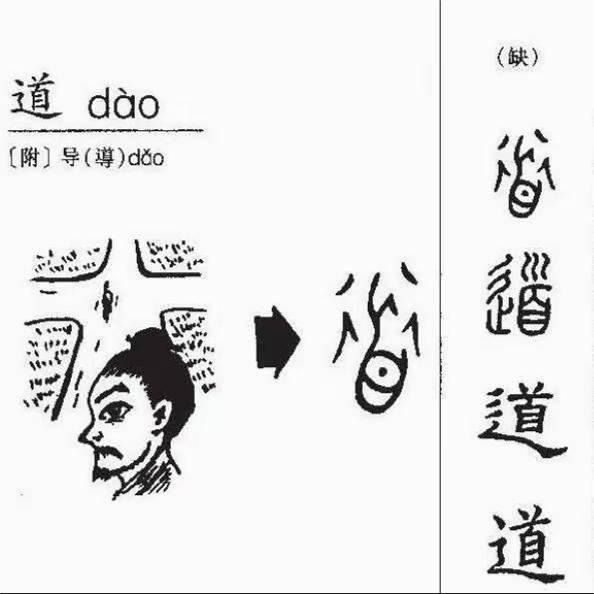
- 看人更重要的是"观神""观气"，很难伪装。
- 第一步"视其所以"：看他说了什么、更要看他做了什么——天天说爱你却不肯花一分钱，或天天说爱你只为让你花钱，都不是真爱。
- 第二步"观其所由"：看动机。同样的事动机不同，意思不同（颜回"偷食"是因为饭落了灰）。
- 第三步"察其所安"：看他安于什么——清贫、上进、享乐、现实、孝礼，还是哪都安不住。作者说自己后来被骗就是忽略了这一步。
- 微表情：紧张时鼻腔收缩、屏气；惊讶时张嘴；心无城府的人听人说话时爱咬嘴唇、吐舌头。
- "君子欲讷于言而敏于行"：嘴笨的人往往办事靠谱。

关键词：识人、孔子、微表情、防骗

## 第133章 远离妖孽

老周带主角见他的"师兄弟儿"，一个美得让人心神不稳的人，主角决定远离。

- 作者的提醒：遇到让自己心神不稳、魅惑的人，有多远躲多远，别好奇。

关键词：识人

## 第134章 魂与魄的滋养

老周讲魂与魄：魂主心灵智慧，魄主身体机能；两者都要滋养。

- 魂动属阳，魄静属阴。"丢了魂""魂被勾走"就是魂被扰动。
- 《黄帝内经》：肝藏魂，肺藏魄。魂受伤，人反应迟钝像行尸走肉；魄受伤，身体器官运转出问题。
- 吃好穿好是滋养魄（物质需求）；精神需求是滋养魂。富裕了魂得不到滋养也会出事（明星吸毒、抑郁等）。
- 魂魄健全的标准：醒着时清醒（不迷糊、有灵感），睡着时也"清醒"——睡前告诉自己几点起，不用闹钟就能准时醒。

关键词：魂魄、三魂七魄、精神需求

## 第135章 靠山（术）

青牛师父讲"哪些方位见山好"，主角一句话总结：九宫格1234位喜见山。

- 前有罩后有靠"的"靠"，古代主要指北面有山；现代房子坐向各异，不能死套。
- 青牛师父讲的四个宜见山的方位：正东（震，贵人山，"东山再起"）、西南（坤，地气旺、母亲治家有方）、正北（玄武）、东南（先天文昌位，利学业）。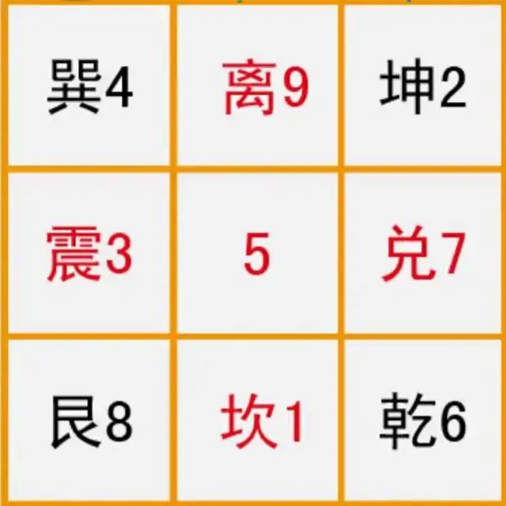
- 坐西朝东的房子背后（西）见山是"小人山"。
- 作者的总结：九宫格里坎1、坤2、震3、巽4这四个位置喜欢见山。

关键词：靠山、见山、九宫、风水

## 第136章 投射效应／虚假同感偏差（术）

青牛师父的课让学员背大量口诀；作者讲"投射效应"。

- 八卦歌诀：乾三连、坤六断、震仰盂、艮覆碗、离中虚、坎中满、兑上缺、巽下断。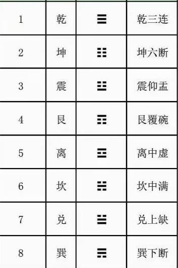
- 后天八卦数和方位：坎1北、坤2西南、震3东、巽4东南、5中宫、乾6西北、兑7西、艮8东北、离9南。
- 八卦五行：乾兑金、震巽木、坤艮土、离火、坎水。
- 九宫对应人体：9头，4、2肩，3、7肋腰，5胸，8、6足，1腹。
- 艮卦类象：山、止；少男、孙子、员工、门卫；脾、鼻、关节、手指脚趾；鼻炎、脾胃虚、关节痛、缺钙、皮肤过敏等；东北方。
- 投射效应（虚假同感偏差）：以为别人都和自己一样，比如以为"人人都有鼻炎"，父母觉得冷就让孩子穿秋裤。

关键词：八卦、八卦歌诀、后天八卦、艮8、投射效应

## 第137章 鼻炎（术）

主角上台用"一家人"讲八卦，青牛师父讲宫位能量：1234喜高、6789喜低；艮8受伤会得鼻炎等，以及怎么用水降能量。

- 震仰盂（碗口朝上）、艮覆碗（碗口朝下）；与众不同的那根爻代表性别和排行。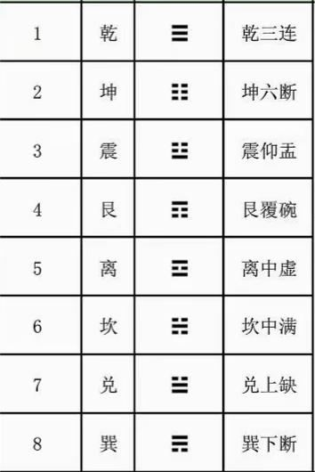
- 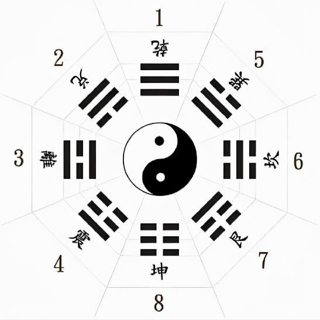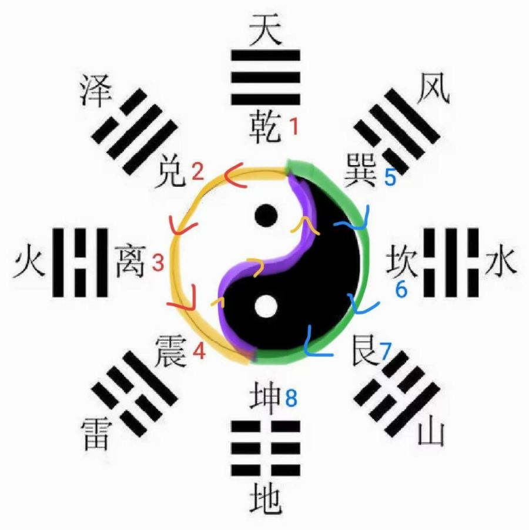
- 后天八卦是一个太极：1是冬至（极阴），9是夏至（极阳）；从艮8开始阳气生发，春木、夏火、秋金、冬水。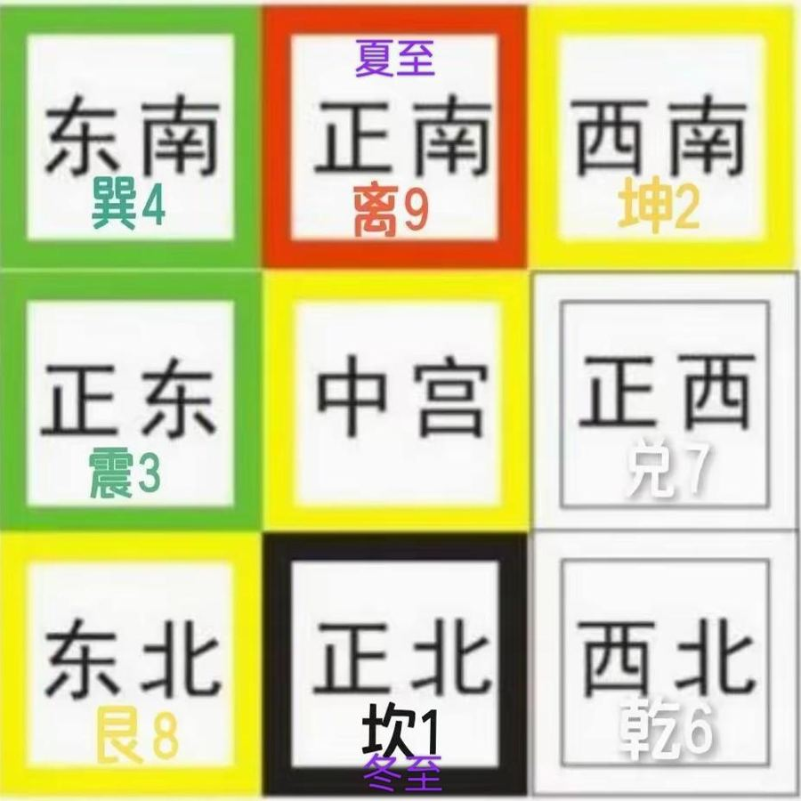
- 斜对角8、5、2属土。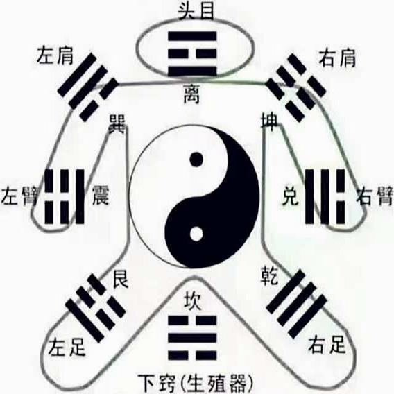
- 1234是"生数"，能量偏低，宜加高（喜砂，高的为砂）；6789是"成数"，能量高，宜降低（喜水，低的为水）；中宫5不宜见山也不宜见水，宽敞明亮为好。
- 艮8本来能量高，再放高能量的东西（佛像、属火的、红色的、电器、字画）就失衡受伤；东北缺角、有煞（屋里放镜子刀剑凶兽图，屋外有风煞光煞）也算受伤。
- 艮8受伤容易：鼻炎、脾胃不和、皮肤病、缺钙、腿脚疼；艮代表子孙，也容易不孕、流产。
- 有鼻炎的人一般脾胃虚弱或火旺；皮肤长疙瘩易过敏的人一般脾胃也不好——这些是关联症状，不是简单因果。

> **风水调整｜宫位受伤怎么处理（青牛师父的办法）**  
> 用来：某个宫位有煞或能量失衡  
> 怎么做：有煞：能搬走的先搬走；搬不走就挡住；都不行再请人化煞。能量太高：把高能量的东西搬走，再放两盆水降能量——盆子二三十厘米左右，房子大可以更大；用不锈钢盆，别用红色盆（红色属火又把能量加上去了）。  
> 注意：例子：一个人家里那个位置是很小的厨房，放不下盆就放了两碗水，头皮屑就没了。

关键词：艮8、鼻炎、脾胃、宫位能量、喜砂喜水、放水、头皮屑、风水调整

## 第138章 乌龙盘打（术）

青牛师父讲大小太极；主角发现九宫顺序像武术"乌龙盘打"，五指也能对应九宫。

- 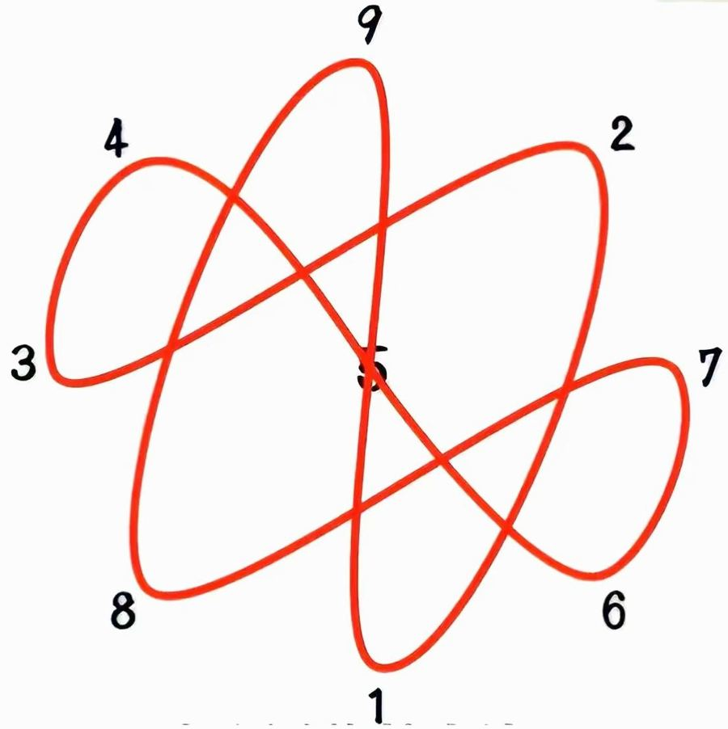
- 一物一太极：整套房子画一个九宫（大太极），每个房间也各画一个九宫（小太极），两个都要看。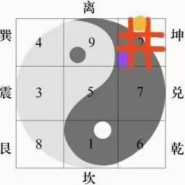
- 五指对应五行：大拇指土、食指木、中指火、无名指金、小指水；右手扣在九宫图上正好是这个顺序。剑指（食指+中指）是木火同发，其气属阳。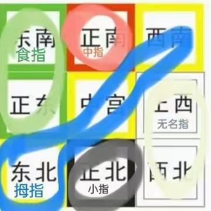

关键词：大小太极、九宫、五指五行、剑指

## 第139章 太岁的由来

主角发现九宫的五行顺序和太阳系行星顺序一样；讲为什么"太岁"化解的是木星；看风水先定大环境。

- 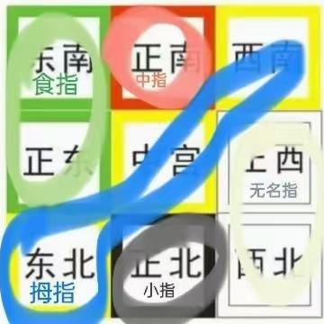
- 从离太阳最远开始：土星、木星、火星、地球、金星、水星——正好是九宫从艮8开始顺时针的五行顺序，地球落在坤位。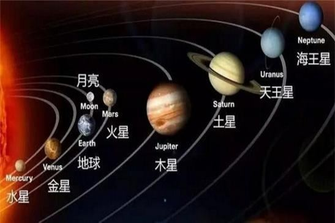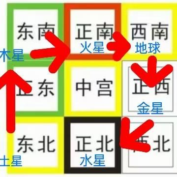
- 木星约12年转一圈，所以用木星代表太岁；作者说其他行星加起来质量不到木星一半，所以木星对人影响最大。七星连珠被视为不祥之兆。
- 看风水要先看大格局：先找治安好的国家地区，战乱地方风水再好也不如和平地方普通的房子。
- 作者说自己不想以看风水为业，更想分享思路，让大家自己推导。

关键词：太岁、木星、七星连珠、九宫、大环境

## 第140章 辟邪解厄的正阳神水

端午加更：讲"正阳水"（午时水）怎么做、怎么用，以及"阴阳水"。

- 古人认为"论药之前先论水"；作者还引了诺贝尔奖得主关于水的"分子记忆"、心理学家"细胞记忆"的说法。
- 掌中诀：左东春、上南夏、右西秋、下北冬；午马在中指指尖，属火，是阳气的顶点。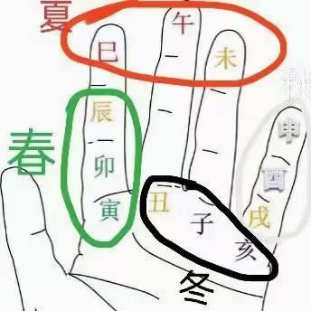
- 农历五月叫"恶月"，端午起有九个"九毒日"，端午是第一天，热毒在顶点，正好调理。
- 作者说他本人极少验证招财局，"没验证过的就没有底气"；书里写到的各种改运局只是介绍，还是要相信科学。

> **民俗方法｜正阳水（端午午时水）**  
> 用来：书中说可提升阳气、止泻、净身、消除四肢无力，民间用来净宅、驱邪、化煞  
> 怎么做：选水按顺序：雨水（没落地的"无根水"）最好；没有就用泉水；再没有用井水；都没有就用矿泉水或自来水。端午节午时（中午12点前后各一小时）把水放在太阳下晒半小时以上。可以喝，可以洗澡（洗澡时可加艾叶或藿香）；可用来擦洗房间、车子；放一杯在财位增财运、放文昌位助考运；也可以装进喷雾瓶，重要时刻喷在头上身上。  
> 注意：作者说是简便做法；如果能在午时找到竹竿里的"竹液"更好。

> **民俗方法｜阴阳水（生熟水）**  
> 用来：书中说可调和阴阳、降心火、温肾水、清热毒  
> 怎么做：新打的井水（生水）和烧开的水（熟水）等量混匀。最好早上5～7点（卯时）喝，或中午11点～1点（午时）。招财用法：用阴阳水洗手、洗脸或洗脚；古法是一半没落地的雨水、一半没见过天日的井水。

关键词：正阳水、端午、午时水、阴阳水、艾叶、藿香、招财

## 第141章 何香生病（术）

发小何香得了尿毒症；作者讲她家正北开门的问题；何香不信风水。

- 何香家是别墅，北边是主路，为了方便在正北开了主门。正北是坎1位。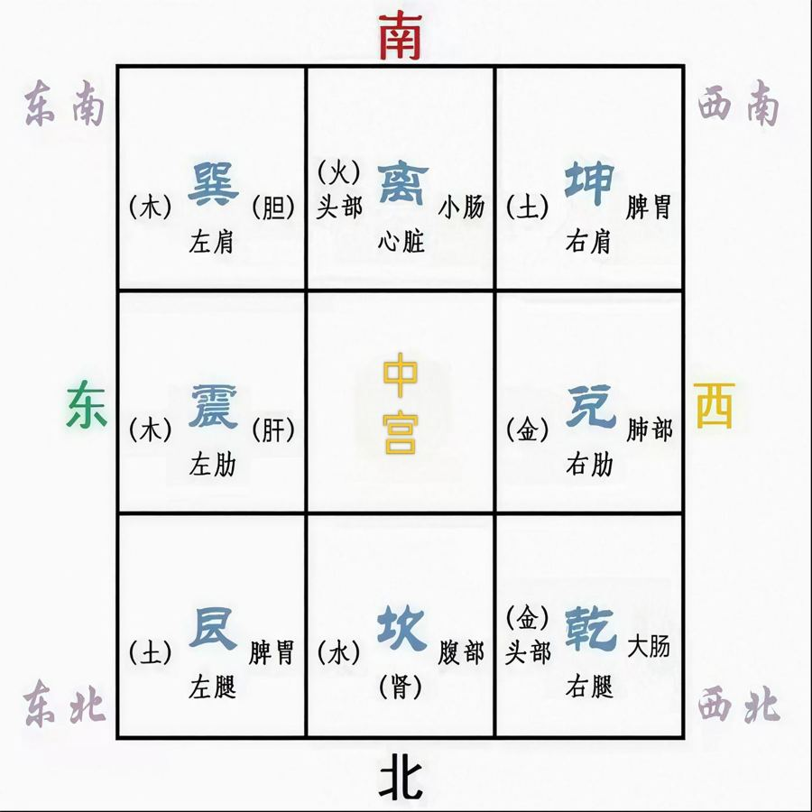
- 坎位是玄武位，宜有山、宜静不宜动。不管平房楼房，正北（坎宫）开门都不好，一梯三户的中间户很多是这样。
- 正北开门也叫"败北门"，主家道日下；也叫"孤独门"（北为阴，阴气入宅）。房子南高北低也有类似说法。作者说这种格局常见，中年以后运势会有气无力。
- 坎为陷、为险；坎是二儿子，男孩尤其老二更容易受伤。
- 坎为水、水主肾：正北有问题会有肾病（肾虚、肾病综合征、尿毒症），还有高血压、高血糖、痛风。正北有水池、马路（路为水）也会伤肾，有煞更严重。
- 熟人之间更难说服，"外来的和尚会念经"。
- 何香能"一目十行"：读书不必一个字一个字看，抓住核心意思，越练越快（作者说这是格式塔心理学）。

关键词：正北开门、坎1、尿毒症、肾病、高血压、痛风、风水

## 第142章 阶层的突破

美发师瑞克在金融危机里逆势开店，说"阶级固化是弱者的借口"。

- 瑞克的观点：时代平稳时底层很难翻身，危机是破圈的机会；危机中店面便宜、对手保守。

关键词：破圈、经济危机、创业

## 第143章 经济危机是破圈的机会

瑞克用1元理发吸引会员办卡，用会员费开新店，十个月开了十家。

- 经济危机没有减少社会财富，只是财富转移。
- 1元理发是为了吸引会员，利润在烫染（"做大头"）；店里热闹，从众心理让人也愿意做。
- 会员卡的钱等于客户的无息贷款，用来开新店。"穷人拿时间换钱，富人拿钱换时间。"

关键词：创业、会员卡、商业模式、赚钱

## 第144章 人心即风水

瑞克又开美容店、建网上商城；作者总结他成功的原因："人心即风水"。

- 风水像语文：是基础，但再好也不保证考状元；店开在偏僻难停车的地方，拜什么都不行。
- 瑞克成功的原因：霹雳手段（执行力强）、菩萨心肠（坦荡、肯分钱给员工）、爱笑、自信、又懂得敬畏。
- 抱怨、嫉妒、算计、憎恨是"聚阴"，脸会变成苦瓜相；乐善好施、想人好处是"聚阳"，脸上带笑。微笑的脸是元宝形，嘴像莲花。
- 心里惶惶不定的人，风水再好自己也会破掉。
- 有的老板设了奖励，看工人赚多了就找理由罚款——赚钱不难，难的是舍得分出去。

关键词：人心即风水、微笑、老板、分钱、赚钱

## 第145章 玄学是一种推理

星辰的姐姐泡脚后腰痛又反复，主角推断是"天热不穿袜子"；作者说不要用"算"字，要用"推理"。

- 所有测算都是推理：用已知条件或感应推出结果。
- 推理过程：冬天泡脚有效，说明腰痛是肾的原因；春天变暖反而不灵，说明脚受凉了——最可能是天热不穿袜子。

> **养生方法｜泡脚治肾虚腰痛要注意保暖**  
> 用来：肾虚腰痛泡脚后又反复  
> 怎么做：泡脚要坚持，同时脚要保暖，天热了也穿袜子，别让脚受凉。

关键词：泡脚、腰痛、袜子、推理

## 第146章 白志高回国

白志高要回国，讲了他为爱来新加坡、一天两顿面条的经历；包子店老板要送他配方。

## 第147章 心理学的锚定效应

白志高觉得配方"值十多万"不敢拿，作者说这是"锚定效应"。

- 锚定效应：商场先标高价划掉，旁边写低价——就是让你被第一个数字"锚住"。

关键词：锚定效应

## 第148章 灌顶VS姓名学

白志高没拿配方回国了；老周带主角去看"灌顶"和"姓名学"，灌顶师父说一次加寿30年，主角马上离开。

- 我们给出去的，终究会回来，不论好坏。
- 说"一次灌顶能增加30年寿命"的，无法证明原本寿命是多少——听一句就可以走了。

关键词：灌顶、防骗、因果

## 第149章 姓名禁忌汇总（术）

一位老师父讲起名字的禁忌：字义、性别、发音、字形、伤害符号、谐音；并劝大家别随便改名。

- 名字定了尽量别改来改去；很多"姓名学老师"就是为了卖你一个新名字，新名字还不一定比原来的好。
- 名字像衣服：一看布料做工（名字本身好不好），二看合不合身（和命理匹不匹配）。
- 过阳不用（太大的字担不住）：圣、帝、天、霸、昊、宇、山，以及祖先长辈、圣贤、皇帝的名字。
- 过阴不用（不吉的字）：影、梦（虚幻）、波（动荡）、乐（古时是"藥"的下半，忧愁）、鑫（金多为伤）、笑（下面是"夭"）、器（上面是"哭"）、婵（女+单，孤独）、丹（残舟）、云（飘忽，除非属龙格局大）。
- 阴阳颠倒不用：女用男字主强势、操劳（伟、英、华、清、倩；"凤"本是雄鸟）；男用女字主感情纠葛（如梅兰芳、曹雪芹、李时珍）。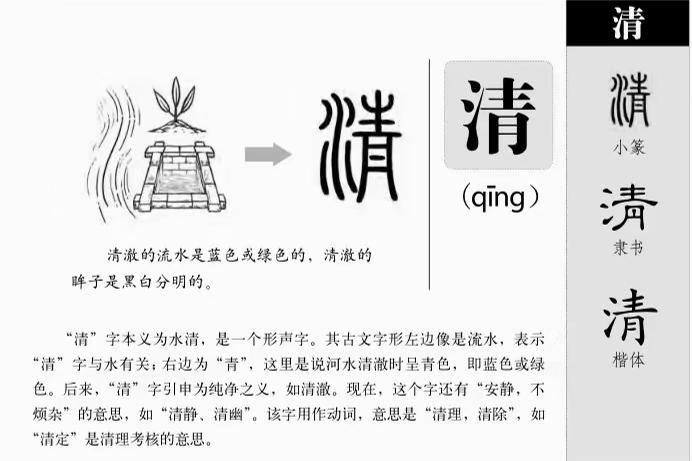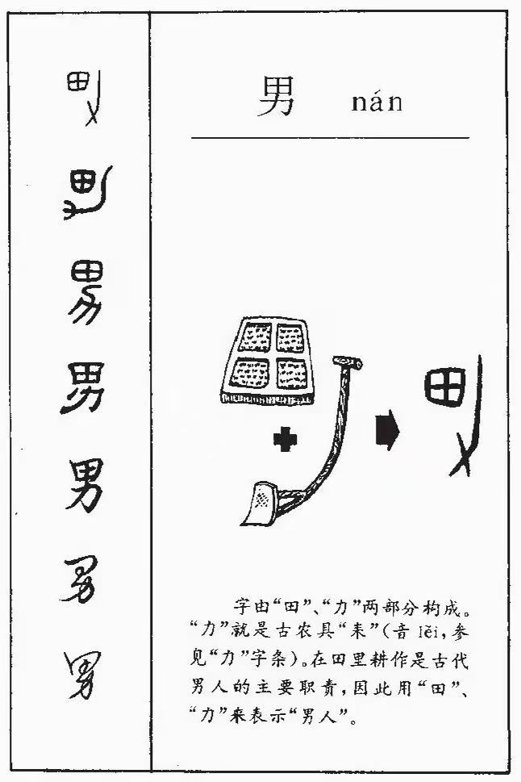
- 发音要阴阳平衡、朗朗上口：避免"张常商""吕宇习""李妮礼"这类拗口的；可选 ong 音（东、通、咏）或 a 音（达、杭、良）；开口音、闭口音要搭配，全开口急躁高傲，全闭口畏手畏脚。
- 字形也要平衡：避免全是横、全是竖、全是斜、全是框（如川、闫闯阁、唐庚序）。
- 避开"伤害符号"（易受伤、手术）：乂（风、译、义、希、刚、爽）、匕（花、华、妮）、刀（娜、芬、照、初）、戈（尧、戏、成、威、战，主口舌争斗、脚易受伤）、三撇（珍，伤人伤财伤感情）。用了也不是一事无成，只是某方面不顺，比如李时珍屡考不中。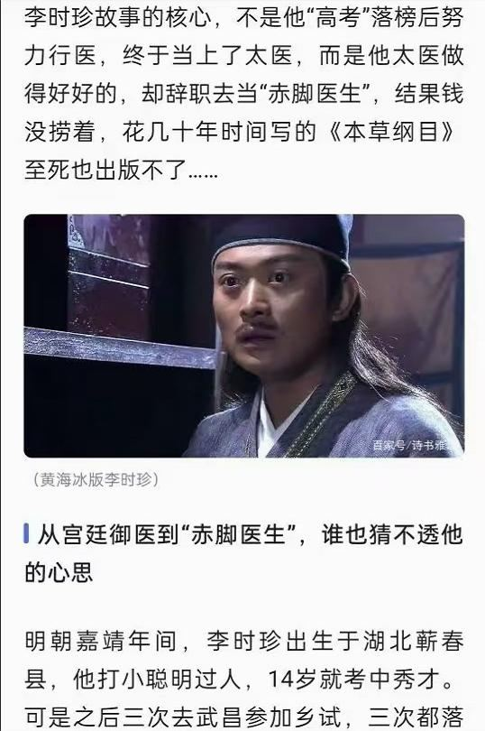
- "康"本意是用簸箕扬谷去壳，字义好、发音饱满，但两个半包围结构的字放一起，单调古板。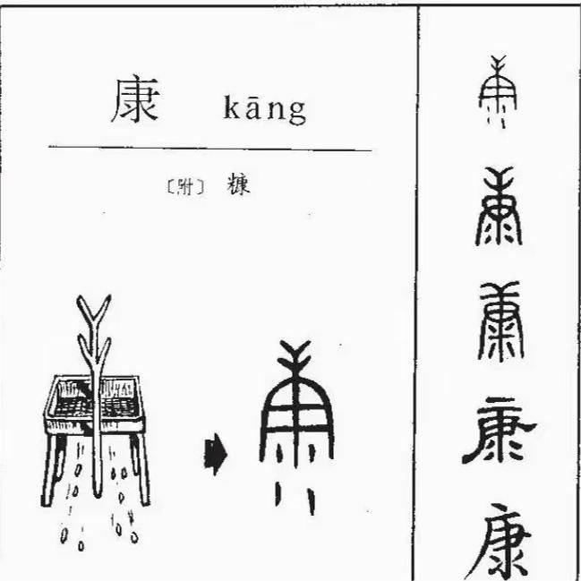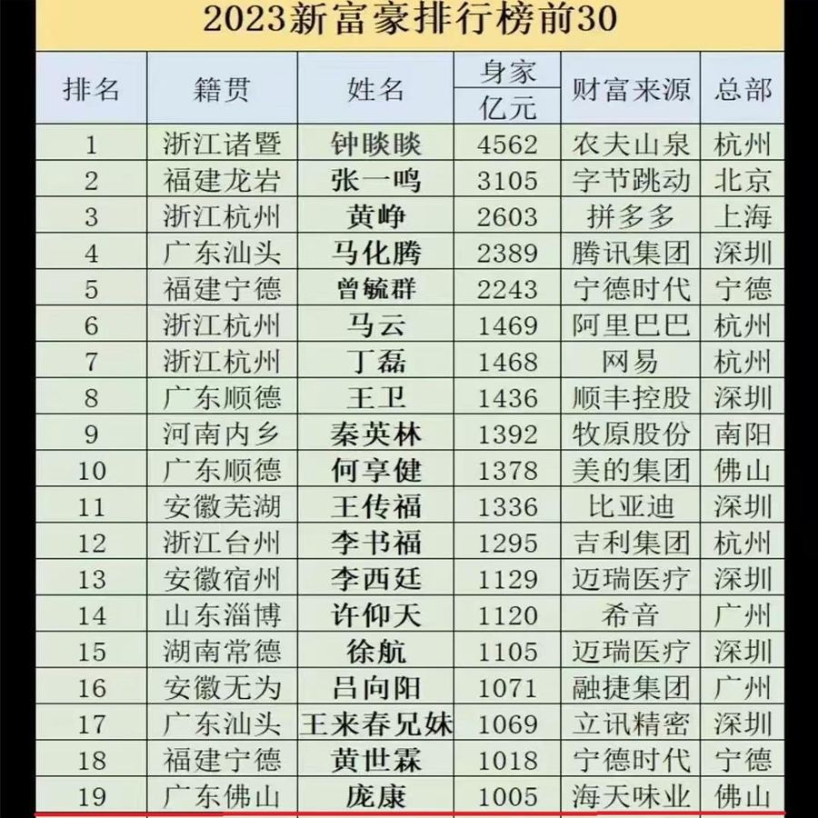
- 最好用三个字（两字名重名多）；大姓（王李张刘陈）避免简单字；不用生僻字、多音字、谐音有歧义的字（吴立=无力、沈晶=神经、梅君=霉菌、魏笙今=卫生巾）。
- 有人花9800买了个"魏笙今"，三才五格打90多分。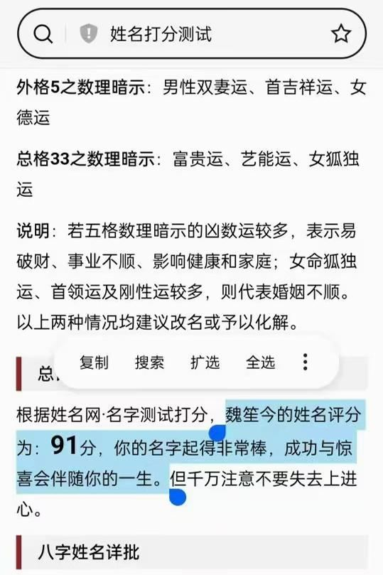
- 真想起个好名字要花个把月，愿意为你花这么多心思的只有你自己。"人的名儿，树的影儿"——最终是把树调好，影子自然好。
- 作者的结论：名字有影响，小孩起名尽量避开禁忌；但除非有特殊原因（比如谐音让孩子抬不起头），不建议一时兴起去改名。

关键词：姓名学、起名、改名、名字禁忌、谐音、防骗

## 第150章 法布施得智慧

老周邀主角去马来西亚怡保给青牛师父的师父贺寿；讲"法布施得智慧"。

- 财布施得财富，法布施得智慧，无畏布施得健康长寿。
- 作者的体会：上学时给同学讲题，为了讲懂得找比老师更简单的思路，自己成绩也越来越好——这就是法布施得智慧。

关键词：法布施、布施

## 第151章 无畏布施得健康长寿

老周讲"无畏布施"：解除未知、消除恐惧，给人信心和希望。一行人去怡保。

- 人害怕是因为未知：刀落下来那一刻不会害怕，最怕的是刀悬在头顶不知道什么时候落。

关键词：无畏布施、恐惧

## 第152章 梅花易数（外应）

寿宴上几位师父用"梅花易数外应"断出一个人的兄弟逃跑后被抓、腿受伤；老神仙讲"跟谁生气伤哪里"。

- 外应断法：看到杨桃树——桃通"逃"，想逃；树有根，逃不掉被抓；树枝折断，"枝"通"肢"，四肢受伤；因为桃花（女人）；"杨"通"羊"，未羊在掌中诀上是西南方。结果应验。
- 老神仙的养生秘诀：心情好身体就好，"百病生于气，不生气就不生病，哪里生气哪里生病"。
- 和父母、师长、领导生气伤上面（头、脖子）；和爱人、同事等平辈怄气伤中间（腰胯）；和孩子失和伤下面（腿脚）。哪里疼，就想想跟对应的人怎么生的气。
- 把气连根拔起的办法：忏悔和感恩——宇宙中最纯粹的力量。

> **修心方法｜哪里疼就找对应的人和解**  
> 用来：头颈、腰胯、腿脚的不适（书中认为与生气有关）  
> 怎么做：头颈不舒服，想想和父母、师长、领导的气；腰胯不舒服，想想和爱人、同事的气；腿脚不舒服，想想和孩子的气。找到后用忏悔和感恩把这口气化掉。

关键词：梅花易数、外应、生气、百病生于气、忏悔、感恩

## 第153章 梅花易数起卦（术）

大师兄讲梅花易数的各种起卦法；老神仙的弟子讲供奉的神像怎么送走。

- 断卦用心神感应，刻意就不准了。
- 时间起卦法：年+月+日除以8，余数得上卦；年+月+日+时除以8得下卦；年+月+日+时除以6得动爻（余数0算8或6）。也可报数、测字、方位、声音起卦。
- 同时多人起卦可以加姓氏笔画或外应区分。
- "初筮告，再三渎，渎则不告"：第一次诚心占卜的结果就该相信；反复占就不准了。

关键词：梅花易数、起卦、占卜

## 第154章 什么是鬼？

供奉的地藏菩萨像想送走怎么办；"鬼"大多是人对未知的恐惧（用卡门涡街讲塔科马大桥倒塌）。

- 爱听经礼佛的"小鬼儿"不会害人；佛菩萨慈悲，不会报复。送走神像时请师父做个仪式告知一下就行。
- 塔科马大桥被风吹塌，不是鬼，是"卡门涡街效应"（风遇到阻挡形成涡旋共振）。很多不了解的事都赖在了鬼头上。
- 鬼魂有的人都有，人还多一个能作用于实物的身体，没什么好怕的。

> **民俗方法｜家里神像要送走**  
> 用来：供奉的神像（如地藏菩萨）因故要请走  
> 怎么做：请师父做个简单的仪式，告知神像搬家了即可；不用害怕神佛报复。

关键词：神像、地藏菩萨、鬼、恐惧

## 第155章 称骨算命（术）

称骨算命分量低不一定命不好；想开天眼不必追求天赋——修行修的是行为。

- 称骨算命：把出生年月日时对应的"重量"加起来，从2两1到7两2。
- 称骨重量低不一定不好，很多伟人只有三两多；重量大说的是生活安稳，有大成就的人坎坷也多。
- 人生本身就是修行，修的是行为；稻盛和夫："唯有读书和赚钱是最好的修行"——读书让人不惑，赚钱让人不屈。
- 佛道都不提倡追求神通；追求神通是旁门左道。

关键词：称骨算命、修行、神通

## 第156章 提升感知力

感知力人人都有，心静了自然敏锐；一个女孩总和妈妈吵架。

- 神通随神识清浊时有时无，来了就来，走了就走。
- 看房子可以抱个婴儿或带只狗，婴儿哭闹、狗乱叫说明"不干净"——小婴儿没有妄念，所以感知敏锐。
- 打坐只是让心静的手段，不是修行本身；心能静，打不打坐都行。
- 感知像接收信号：环境安静才听得清，心如止水才觉察得到。

> **风水排查｜看房时带婴儿或狗**  
> 用来：买房看房时判断房子"干不干净"  
> 怎么做：看房时抱个婴儿或牵只狗进去，婴儿哭闹或狗乱叫，说明房子可能有问题。

关键词：感知、静心、打坐、看房

## 第157章 人际关系的阴阳

大师兄劝和妈妈吵架的女孩："谁看不惯，谁有问题"，有人符合预期就一定有人不符合。

- 让你不开心的事都是你的人生课题。
- 希望身边的人都符合自己的预期，就是在追求"纯阳"、排斥所有的阴面，违背了阴阳之道。

关键词：母女关系、吵架、阴阳、接纳

## 第158章 子午诀（术）

大师兄讲"无为"；一位道士行礼时掐"子午诀"，作者讲子午诀和握固的做法。

- 解决别人难，解决自己易；理解了天道，原来的问题就不是问题了。
- 修行三境界：看山是山、看山不是山、看山还是山。无为不是懒。
- 陈抟老祖是先天易学的创始人，河图洛书、太极图、紫微斗数等都从他流传。

> **手印｜子午诀（太极诀）**  
> 用来：镇惊辟邪、避免幻觉（道家打坐常用；也是道士正式的拱手礼）  
> 怎么做：子位在无名指根部，午位在中指指尖。左手大拇指压住右手无名指根部；右手拇指指尖捏住右手中指指尖，抱住左手大拇指；左手其余四指放松，包住右手四指。  
> 注意：左手在外还是右手在外有三种说法；作者见过的是左手在外（左手为善，抱住右手制恶从善）。

> **手印｜握固**  
> 用来：镇惊辟邪；平时固肾气、升阳气、疏肝安神  
> 怎么做：大拇指指尖压住无名指根部（子位），四指把大拇指握在手心里。进入陌生环境、清明上坟时都可以用。

关键词：子午诀、握固、手印、无为、陈抟

## 第159章 介入他人因果的后果

老神仙讲修行人为什么不轻易介入他人因果，以及"替人消灾容易五弊三缺"的真正原因。

- "非我求童蒙，童蒙求我"：不是我求别人，是别人来求我才告诉他；他不认真反复问，就不告诉了。
- 不轻易介入他人因果，是因为因果难解：有人被追杀求到你这里，你不知道谁更无辜。
- 替人消灾的人容易受伤，不是因为泄露天机（不然天气预报员也该倒霉），而是像故事里的热心肠王五：替张三去说和，结果被正在气头上的李四揍了一顿。
- 自己的事自己了：真正认错、诚心诚意去忏悔，对方气消了，事就了了。

关键词：因果、帮人、五弊三缺、忏悔

## 第160章 何为济世渡人？

老神仙讲什么是真正的"济世渡人"：做道的传播者，信不信、学不学、做不做都在对方。

- 京房、郭璞能算出自己的结局却躲不过——因为介入了因果。
- 无为而治是顺应自然、顺势而为（陈抟屡辞官位）。
- 只自己成为有道之士还不够，让别人也成为有道之士才是根本的济世渡人：只说该说的，信不信、学不学、做不做都在他，那是他的因果。
- 像学校老师一视同仁地教，谁考上大学是学生自己的因果；老师人为干涉考试结果，才算介入因果。"别拿自己的能量去替他扛。"
- 妈妈可以教女儿识人，但不能替女儿定结婚对象——替别人拿主意容易结怨，两头受气。
- 心理学的"自我服务偏见"：成功归自己，失败怪别人。
- 渡劫也是成长；不经坎坷难有大成就。

关键词：因果、帮人、济世、替人做决定、自我服务偏见

## 第161章 安神祖窍

回程车上聊：怎么应对给假信息的人；青牛师父的师兄弟各行各业；讲"祖窍"（上丹田）。

- 算命是推理：可以先分辨对方给的信息是真是假，再用真实部分推理。
- 老周的观点：说话也要阴阳搭配，真真假假、虚虚实实；全阳不合道。作者认同为人处世过于刚直则不够圆融。
- 青牛师父的二师姐卖保险：给客户排运势，点出过去的转折来验证，再在未来受伤的年份追加保额。
- 祖窍就是上丹田，在两眉之间的印堂处，被视为入道之门；想修可以先读张伯端《悟真篇》。

关键词：祖窍、上丹田、印堂、推理

## 第162章 男左女右怎么论

子午诀分不分男左女右？青牛师父说不论男女都是左为大；讲中西方左右尊卑的来由。

- 盘古左眼化日（阳）、右眼化月（阴），所以左手为阳代表男，右手为阴代表女；传统以左为尊，"虚左以待"。
- 西方以右为大（如婚礼新郎站右边），吃饭座次现在也和国际接轨了。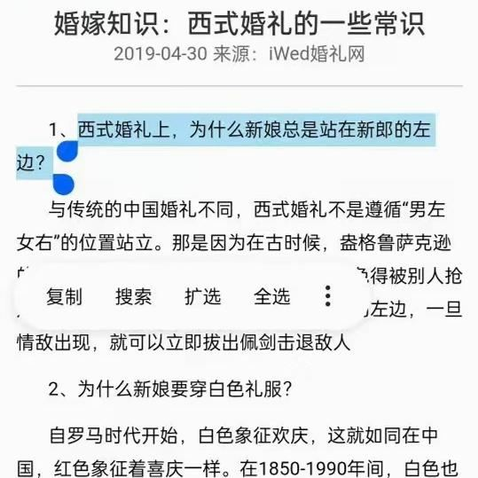
- 左右谁为大都因为太阳：西方地图上北下南，太阳从右边（东）升起；中国古代地图上南下北，太阳从左边升起。
- 医学上左右哪个为阳现在说法混乱；道医讲人体气机"左升右降"。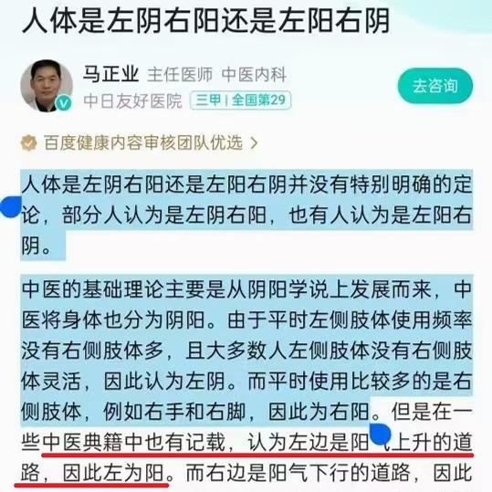

关键词：男左女右、子午诀、左右、阴阳

## 第163章 负阴而抱阳

老周讲"天道左旋"、人体气机左升右降；一个年轻人发现九宫数字和五脏阴阳正好对应；青牛师父讲子午诀的含义。

- 《易经》：天道左旋，地道右旋——太阳从左升、从右降。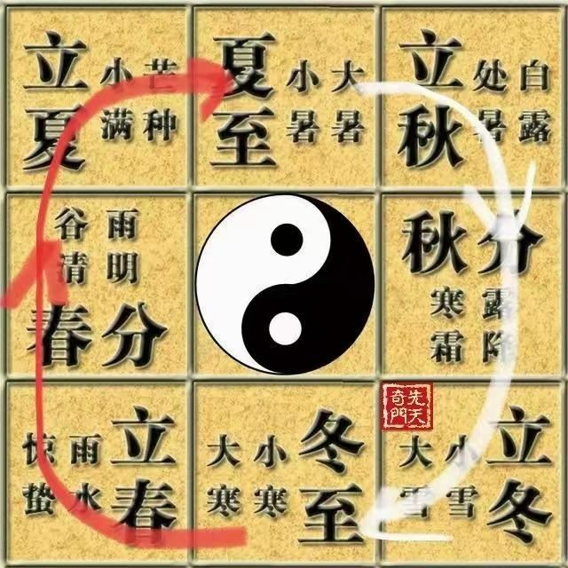
- 五脏中心肺为阳、肝脾肾为阴；阴（九宫左下）要升，阳（九宫右上）要降，还是左升右降。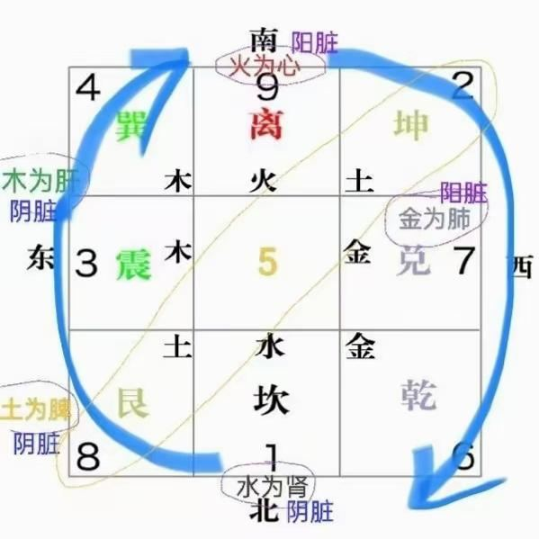
- 以横膈膜为界，心肺在上为阳，肝脾肾在下为阴。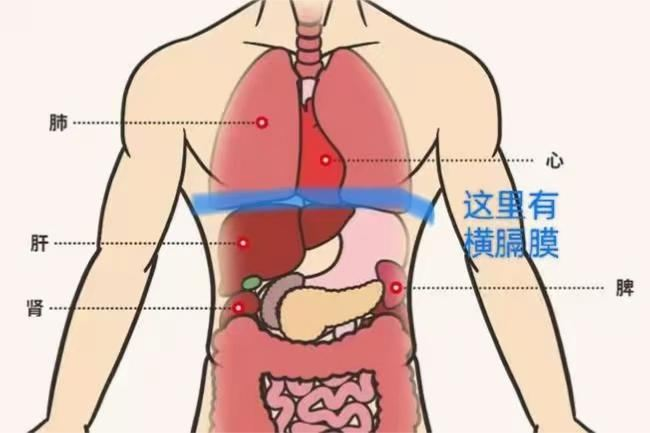
- 九宫里心（离9）、肺（兑7乾6）的数字都大于5；肾（坎1）、肝（震3巽4）都小于5；脾是土（艮8、坤2、中5）平均也是5——和五脏阴阳正好对应。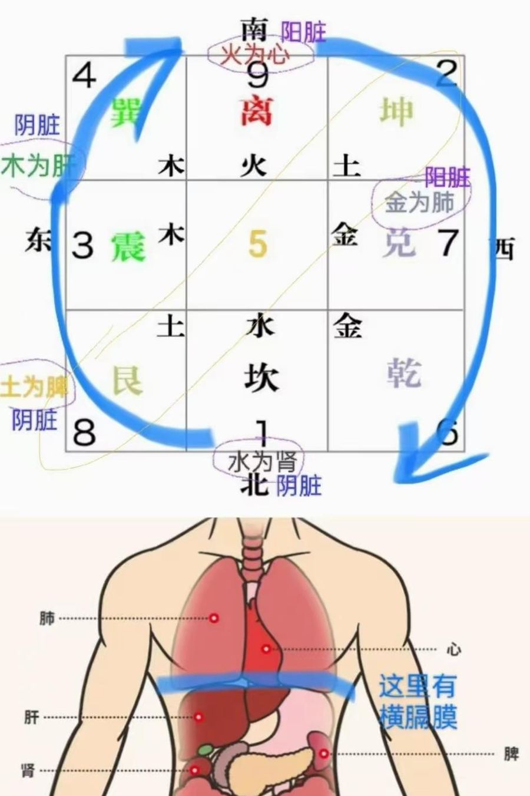
- 青牛师父讲子午诀：右手（阴）拇指捏中指尖（午位，阳）成圈，阴中含阳；左手（阳）拇指放入圈中压子位，阴阳交合，"万物负阴而抱阳，冲气以为和"。

关键词：天道左旋、左升右降、五脏、九宫、子午诀

## 第164章 见鬼说鬼话

公司有人传主角要"骗钟雨的钱"，主角干脆说自己没办法，不收钱也不调了，皆大欢喜。

- 基督徒同事说不信主就下地狱、算命烧香都是魔，作者不认同这种"跟着我就罩着你"的逻辑。
- 作者为避免麻烦，学老周"见鬼说鬼话"：说自己能力不足，鼓励对方去找别人。

关键词：帮人、职场

## 第165章 洗头没洗明白

琪儿的朋友说"早上洗头灭阳、晚上洗头增湿，中午洗最好，体弱的人要快洗"，作者说真假参半。

- 中午阳气最足，洗头洗澡比早上晚上好。

关键词：洗头、阳气

## 第166章 可算是把头洗明白了吧

作者讲清楚洗头洗澡的时间：所有"灭阳"的行为都尽量避免；举的例子不是全部，要自己推理。

- 人体阳气运行和九宫一致，可以代表一年，也可以代表一天：越靠近中午阳气越足，越靠近晚上阴气越足。
- 灭阳的行为（早上吃凉的、早上或晚上洗头洗澡、吃冷饮等）对谁都有损伤，只是体强的人暂时感觉不到——像偷财主家一万块他不在乎，但也不能一直偷。
- 洗澡不是越快越好：好好泡个澡更舒服放松。理论和实践冲突时，是理论错了。

> **养生方法｜洗头洗澡的时间**  
> 用来：护阳气（体弱、怕冷的人尤其注意）  
> 怎么做：最好中午阳气足时洗。早上洗，先起床活动一会儿、阳气升起来再洗；晚上洗，下班回家先洗，再吃饭玩手机，别拖到很晚。不必刻意洗得很快，好好洗、舒服放松就行。

关键词：洗头、洗澡、阳气、养生

## 第167章 财布施得财富

讨论"财布施得财富"：佛没说不用努力，只是告诉我们努力之外还有一条法门。

- "春种一粒粟，秋收万颗子"不是说不用施肥除草；佛只讲我们不知道的那部分，努力人人都知道。
- 作者说法布施除了得智慧，还交到了很多朋友。

关键词：财布施、法布施、布施

## 第168章 费曼学习法（术）

作者介绍"费曼学习法"；并在篇外交代书中人物都做了改编。

- 费曼学习法（以教促学）四步：概念（假设讲给小孩听）→回顾（卡壳就回去补）→简化→传授。就是"教学相长"。
- 作者说自己后来因为一时起了贪念不舍得布施，失去了更大的机会。
- 作者篇外交代：本书不是一比一的记录，人物都做了改编；扁平疣的醋蛋其实是作者自己用的（真的是用东方红茶壶泡的）；老道是很多前辈的综合体，《天乙笔记》是很多书的笔记；师兄抓鬼等是半真半假的人物，鬼神之事不必问。
- 作者说自己只是入门，不收徒；能看到的易经培训班基本都擅长营销，技术好的师父多是老学究性格，不会忽悠。

关键词：费曼学习法、学习方法、本书说明、防骗

## 第169章 心想事成长高（术）

琪儿的表弟靠"摸高"长高去当了兵；作者讲"布利斯效应"（脑中预演）。

- 布利斯实验：练投篮20天，天天练的提高24%，不练的没变化，每天在脑子里练20分钟的提高26%。
- 和吸引力法则不同：吸引力法则想象结果，布利斯效应想象过程（用多大力、什么角度投进）。
- 肌肉练到发酸会长壮，骨头也会因锻炼刺激生长。

> **生活方法｜摸高长个子**  
> 用来：青少年想长高  
> 怎么做：想起来就往上跳、伸手摸高处；同时相信自己能长高，在脑子里想象过程。

关键词：长高、摸高、布利斯效应、心理预演

## 第170章 升阳跳／回春功（术）

作者教"升阳跳"：举手、前脚掌弹跳、脚跟点地；作者也提醒"实践"有时也会骗人。

- 爱生气的人适合拍打腋窝，消气快、排肝毒。
- 长不高除了遗传，可能是脾胃吸收不好或肾气不足影响钙吸收。
- 作者后来掉进易学培训班的坑才明白："实践"也可能骗人：事实和道理冲突可以扔掉道理，但事实和真理冲突，要再琢磨那个"事实"。

> **功法｜升阳跳**  
> 用来：书中说适合精神萎靡、浑身乏力、手脚冰凉、心慌气短、肾虚脾弱；能强壮筋骨、通经络、舒心解郁、减肥、提升心肺；也有助长个子  
> 怎么做：三个动作要领：① 双手举过头顶，打开腋下（腋窝是气机汇聚的地方）；② 用前脚掌把人弹起来，像小孩蹦着走路（"八步赶蝉"）；③ 落地时脚后跟点地（就是八段锦最后一式"背后七颠百病消"的踮脚）。作者说三五分钟就有明显效果。老人跳不起来，就举手、弹起前脚掌、颠一下脚跟，脚不离地，阳气足了再慢慢跳高。  
> 注意：网上版本很多，作者说的是双手举过头顶的版本。

关键词：升阳跳、功法、阳气、长高、手脚冰凉、腋窝

## 第171章 五行能量净化法（术）

作者讲"五行能量净化法"：风浴（木）、水浴、火浴、土浴、金浴；洗澡就是水浴。

- 懂了道理就能自己分辨：牙口不好的人吃稀饭好，血糖高的人吃稀饭不好。
- 在阳气足的时候好好洗个澡，洗完神清气爽，这就是能量净化（水浴）。
- 艾灸也算一种"火浴"，能通经络、补肾气、驱寒。

关键词：五行能量净化、洗澡、艾灸

## 第172章 五行能量净化法2（术）

继续讲五行净化：晒太阳是最好的火浴，亲近草木是木浴，在草地打滚是土浴；讲头痛的象数和办法。

- 艾灸过量会阳亢，晚上睡不着、上火。最好的火浴是晒太阳。
- 去山上、公园，晒着太阳、被绿色包围，是火浴加木浴；在草地上打滚是土浴。小孩生气了在地上打滚，其实是在净化能量。
- 打滚功是一种古老的强身功法。
- 学习能力的差别不在记住多少，在于能不能归纳推理、举一反三（如门捷列夫的元素周期表）。
- 作者说涉及中药的偏方他都跳过不看，因为辨别不了真伪，不敢给人试。
- 屋外宽敞大气为好，屋里"藏风纳气"为好；屋里风大就成煞了，植物乱放不如不放，室内宜留白。

> **象数｜头痛象数 650**  
> 用来：想太多、思虑过重导致的头痛  
> 怎么做：默念"650"。原理：6是坎水、5是巽木，水生木，0是加强；头痛中医叫"头风"，要平肝熄风，肝属木，风是巽卦。

> **生活方法｜头痛的其他缓解办法**  
> 用来：头痛（治标）  
> 怎么做：按摩太阳穴；或者双手泡热水（热胀冷缩，血液流到手上，头部压力减小）。根本在情绪导致的气脉不通，可以用忏悔和感恩来调。

> **养生方法｜晒太阳、亲近自然、草地打滚**  
> 用来：净化负面能量、心情差  
> 怎么做：到山上或公园晒晒太阳，在草木中待一会儿；找块干净的草地打几个滚。

关键词：头痛、象数、650、太阳穴、晒太阳、打滚功、五行能量净化

## 第173章 朝天鼻（术）

让星辰用"推理"看朝天鼻：留不住钱、性子急、容易被骗。

- 人体气的运行和外界一样：直则冲，曲则顺，风冲为煞。肺开窍于鼻，属金。
- 朝天鼻（鼻孔外露）：留不住钱（花了、捐了、投资了、被骗了都算）；呼吸短、性子急、考虑不周、心眼浅、容易被骗。
- 鼻孔小、朝下、看不到鼻孔的人，花钱细，喜欢存钱。

关键词：朝天鼻、鼻子、面相、钱

## 第174章 开悟的是骗子

何香在吃一位老中医的药粉；琪儿想带主角去见一位自称"开悟者"的大师，主角拒绝。

- 没有人会自己说自己开悟，就像真有钱的人不会见人就说自己有钱——"缺什么显摆什么"。

关键词：开悟、防骗、自封大师

## 第175章 五行生克关系（术）

星辰推理"鼻子长红痘，火克金要破财"；讲五行生克。

- 五行相生：木生火、火生土、土生金、金生水、水生木；相克：木克土、土克水、水克火、火克金、金克木。挨着的相生，隔一个的相克。
- 用九宫记：冬水生春木，木生火，火烧完成土灰，土里挖出金，金融成金水——顺时针一圈是相生，跳一个就是相克。

关键词：五行生克、相生相克、九宫

## 第176章 终身生长的五官（术）

讲耳朵：耳朵大肾气足、胆识过人；耳垂大代表智慧，性格温和与世无争。

- 肾开窍于耳、心开窍于舌、肝开窍于目、脾开窍于口、肺开窍于鼻。
- 耳朵大的人肾气足、有魄力、胆子大，也较长寿。
- 富豪榜上的人多数耳朵大、耳垂小。肾属水，水主智，耳垂代表智慧；耳垂大的人多性格温和、与世无争、看透了不去争。
- 金主义（义气），水主智（上善若水）。
- 耳朵是五官里唯一一生都在长的，老人的耳朵比年轻时大。

关键词：耳朵、耳垂、面相、肾

## 第177章 改命的两个主要渠道

额头代表青少年运；"一命二运三风水……"，作者说读书和积德是改命的两个主要渠道。

- 额头饱满的人青少年时期运势好；但额头好不好好学是自己的选择——有漂亮裙子也可以光着出门。
- "一命、二运、三风水、四积阴德、五读书、六名、七相、八敬神、九交贵人、十养生"：命（家庭、父母、基因）和运（时代、经济周期）改不了，其余都可以选。
- 人与人的差距在业余时间。读书（提升自己）和积德（创造价值）是快速改命的两个主要渠道。

关键词：额头、改命、读书、积德

## 第178章 改面相最快的方法

改面相最快的是笑容；耳垂大的人适合找个行动力强的伴侣；教"拉耳朵"。

- 改面相最快、最高级的办法是真诚干净的笑容和好心态。
- 耳朵向上斜、贴着头、没有耳垂的人行动力很强，色泽白亮的还带贵气。
- 耳垂大的人脾气好、情绪稳定；没有哪个更好，只有适不适合。
- 《黄帝内经》"耳者，宗脉之所聚"：耳朵是一个倒着的人体缩影，耳垂相当于头。

> **身体调理｜拉耳朵**  
> 用来：书中说可提肾气、抗过敏、改善三高、清脑明目、止痛安神、缓解失眠头痛，还能改善耳相  
> 怎么做：先捏住耳尖（耳朵向前折叠时最高点）向上拉二三十下；再向两侧拉二三十下；最后往下拽耳垂二三十下。有时间可多按三五分钟。安神助眠：用食指和中指从耳垂往上搓耳朵前后，睡前或刚睡醒时做。

关键词：笑容、面相、耳朵、拉耳朵、失眠、头痛

## 第179章 体态提升阳气（夹脊）

朝天鼻怎么改善：夹脊（往后夹肩胛骨）；讲督脉。

- 朝天鼻的人可以有意识地气沉丹田，让呼吸慢而长，性子会沉下来。
- 李时珍：督脉是阳脉之海；阳气不足的人会下意识含胸、背挺不直。
- 气足不思食：练升阳跳或拉耳朵后有饱腹感、不饿，可以少吃点。

> **身体调理｜夹脊（夹肩胛骨）**  
> 用来：鼻梁塌、朝天鼻、颧骨高；书中说能牵动任督二脉、锻炼脊柱  
> 怎么做：向后夹肩胛骨，八段锦里也有类似动作。练之前可以先拍张照片，留着对比。

关键词：夹脊、脊柱、督脉、朝天鼻、鼻梁、颧骨

## 第180章 被人记在了本子上

钟雨辞职；主角认识了"很仙"的同事丘书妍；前合伙人离开时，主角发现她把每顿饭谁吃了几个丸子都记在本子上。

- 合作中有人计较到"章鱼小丸子我吃2粒他吃4粒"，作者很震撼——合伙要看对方是不是这么计较的人。

关键词：合伙、计较

## 第181章 风水的调整（术）

青牛师父讲风水调整原则：1234位喜"砂"、6789位喜"水"，并列出哪些东西算砂、哪些算水；厨房该放哪。

- 风水以平衡为吉：5是平衡数，小于5的位置要加高能量，大于5的位置要降低能量。
- 1234喜砂（高）：属于砂的有高大的东西——大树、山、柜子、火类物品、神佛像、厨房、电器、红色物品。
- 6789喜水（低）：属于水的有江河湖海、池塘、水沟、井、坑、凹地、街道马路、窗户、走廊过道、楼梯、庭院、通风口、泳池、水池、下水道、鱼缸、浴室、厕所、空地、黑色物品。
- 总结：向上的、大的、像火的是砂；向下的、低洼的、像水的是水。
- 五行生克都会耗能：我生别人泄我的能量，我克别人也费力，被克也耗能。
- 有人说"坎1属水，要放厕所、不能放厨房"，和"1234喜砂"相反；青牛师父反问：按相生相克的说法，厨房放哪都不合适。
- 《阳宅三要》：阳宅最重要的是门、主（主屋）、灶。
- 作者说书中引经据典和大段口诀都不用背，理解了能推理就行。

关键词：喜砂喜水、宫位能量、厨房、厕所、九宫、风水调整

## 第182章 居家风水之厕所（术）

青牛师父说风水优先考虑能量平衡、其次看五行；讲厕所放哪：6789里避开离9和乾6，优选兑7、艮8。

- 风水不是固定答案，以人为本：同一个布局对金旺的人刚好，对金弱的人就要再调。就像孩子成绩差，要从智商、态度、方法、身体、心理多方面找原因。
- 厕所是低能量，理论上放6789位；但离9在九宫里是头，"脑子里装着屎"不好；乾6是财库，也不宜。
- 如果厕所已经在乾6（西北角），一定打扫得干干净净；还没买房的尽量避开。
- 厕所优选兑7（正西）和艮8（东北）。

关键词：厕所、风水、宫位能量、乾6、离9

## 第183章 掉进了厕所里

学员们为"上厕所的'上'是哪个方向"吵成一团。

- 
- 古代厕所有建在猪圈上方的遗址。

关键词：厕所

## 第184章 坎1宫（术）

青牛师父主张厨房放坎1、厕所不放坎1，并讲坎1受伤的表现。

- 坎1本来能量就低，再放厕所（水）更低，坎位受伤。
- 坎1对应生殖部位：受伤容易有男女科问题、不孕不育；水为肾，对应肾病、尿毒症、糖尿病、痛风；水主寒，手脚冰凉、胆子小；肾虚腰腿疼；阴上加阴，容易抑郁甚至想不开；水多则淫，易犯烂桃花。

关键词：坎1、厕所、厨房、肾病、不孕、抑郁、烂桃花

## 第185章 离9宫（术）

离9（正南）放厨房，火上加火伤头、眼、耳、心脏；青牛师父叮嘱只默默验证，别对别人家指手画脚。

- 离9属火，在九宫里是头、在内脏是心；离9放厨房，眼睛或心脏容易出大问题（青牛师父说见过好几例）。
- 可以去亲友家验证学术，但只能默默验证，不要指手画脚、不要乱动，调好自己家就行。
- 风水门派上千，不要固执认为只有自己的对。
- 青牛师父的心态：课堂吵起来也是好事，学员交学费还让他学到新东西——事情本身没有好坏。

关键词：离9、厨房、心脏、眼睛、风水

## 第186章 理性情绪疗法

作者介绍"理性情绪疗法"（ABCDE），青牛师父说"无非阴阳"。

- 改变内脏节奏最快的方法就是生气——瞬间把心脏气得砰砰跳；心藏神、肝藏魂，最容易扰乱神魂的是情绪。
- 理性情绪疗法（艾利斯）：困扰人的不是事件本身，而是对事件的看法。A诱发事件、B信念（看法）、C后果（情绪）、D质疑（重新解读）、E效果。
- 青牛师父的说法：从阴面看不高兴，就从阳面再解读一遍。

关键词：理性情绪疗法、情绪、生气、认知

## 第187章 魂魄与精气神

青牛师父讲魂、魄、神与精、气、神的关系（偏虚，作者说能理解多少算多少）。

- 五脏阴阳：心是阳中阳、肺是阳中阴、肝是阴中阳、肾是阴中阴、脾是阴中至阴。心藏神、肝藏魂、肺藏魄。
- 《黄帝内经》：生命的来源叫"精"；阴阳两精相合产生"神"；跟着神往来的叫"魂"（偏无形）；跟着精出入的叫"魄"（偏有形，和本能反应有关）。
- 精藏于肾，"魄力"和肾有关：肾气不足就没魄力、胆子小。
- 精是物质基础、神是主导、气是两者之间的桥梁，三者缺一不可——这也是佛道都重视呼吸的原因。
- 用三种动物比喻：鹿代表精足（修行者守精、不重色欲）、乌龟代表气足（关注呼吸）、鹤代表神足（不贪睡）。
- "精气既足，神自旺"；精与气可以互相转化。

关键词：精气神、魂魄、五脏、呼吸

## 第188章 牙疼

节欲保精；主角牙疼，青牛师父推荐了一款治好他多年牙疼的牙膏。

- 节欲：有的门派禁欲，有的只节不禁；意淫、手淫、心动也算欲。
- 着急就是上火，牙疼时作者会先气沉丹田，回想是不是遇到着急的事。

> **生活方法｜牙疼用的牙膏（作者亲测）**  
> 用来：反复牙疼（作者说自己从小牙不好、常肿脸）  
> 怎么做：青牛师父推荐日本佐藤（Sato）的 Acess 牙膏，新加坡药店有卖，咸味。作者用的是蓝色款，用后说牙疼再没犯过，也给父母寄了；父母平时不爱用咸牙膏，只在牙疼时用。网上还有绿色、黄色款，作者没试过。  
> 注意：书中只是作者个人和身边人的反馈。

关键词：牙疼、牙膏、节欲、上火

## 第189章 记忆力差怎么改

青牛师父讲古人"节欲"的三方面：节情志、节食欲、节情欲；记忆力差怎么调。

- 第一节情志：喜怒忧思悲恐惊，一激动血往上涌，严重的脑出血。
- 第二节食欲：食物在小肠被"气化"成身体能用的东西，这个过程耗能，吃太多就会累、犯困。
- 第三节情欲："顺成人，逆成仙"；纵欲后反应迟钝、记忆下降。
- 心动则神疲，气乱则精摇；生活简单、欲望少，心不动、气不乱。

> **养生方法｜记忆力差、注意力不集中怎么调**  
> 用来：记忆力差、注意力不集中、脑子不够用  
> 怎么做：原因可能是精不足、气不足或神不足。养精：节欲；养气：少耗费——少吃、少说话；养神：早点休息，睡子午觉；再加适当运动和体力劳动，帮助精化为气。

关键词：节欲、记忆力、注意力、精气神、少吃少说

## 第190章 消气操

脚是精气之根；讲消气操：拍腋窝；升阳跳为什么适合懒人。

- 理论是虚的，实践是实的；只收藏不实践，是"给笔记本学的"。
- 精为灯油、气为火、神为光明。
- 《黄帝内经》"肾出于涌泉，涌泉者足心也"：脚是精气之根，被称为"第二心脏"。
- 肾经起点是涌泉穴（脚心），心经起点是极泉穴（腋窝）。升阳跳弹跳时按压涌泉固精，举手打开极泉安神。

> **身体调理｜消气操：拍腋窝**  
> 用来：爱生气、胸闷；书中说腋窝对应心、肝胆、乳腺  
> 怎么做：两种拍法：① 用大臂夹着振拍腋窝；② 一只手从头顶上方拉住对侧耳尖，另一只手拍打这一侧的腋窝。腋窝鼓鼓的、没有"窝"的人一定要拍开。（作者说抖音有视频）

> **身体调理｜勾脚趾养肾**  
> 用来：跳不动升阳跳的老人；温肾阳、固肾精  
> 怎么做：平时多勾勾脚趾头，一松一拉活动涌泉穴。

关键词：消气操、拍腋窝、极泉穴、涌泉穴、脚、升阳跳、勾脚趾

## 第191章 道家养生改运

走路脚后跟要着地；作者推理"修行之人越养精气神运势越好"；开始讲高血压。

- 泡脚治肾虚腰痛，更深的原因可能是温热刺激了涌泉穴，提升了精气。
- 相学："足不履地，福寿短"——走路脚后跟不着地，福气和健康都差；走路漂浮主生活辛苦、六亲无靠。走路要一步一个脚印。
- 作者说常年吃降压药的人很多最后死于心血管病；心梗放支架后血压变低，是心脏泵血能力下降，不是好消息。（这是书中观点）

关键词：走路、脚后跟、精气神、高血压

## 第192章 高血压的调整（术）

青牛师父讲高血压的风水调整：温肾（坎1加能量），同时看离9和震3；三高人士泡脚注意温度；讲近视。

- 中医上高血压多与肾功能不全有关；风水上的办法是温肾：给坎1位加能量（放电器、属火的东西、佛像等，青牛师父一般放电器）。作者提醒先看理论，后面还有注意事项，别急着动。
- 坎1和离9在一条中线两端，要一起调；高血压与心、肝、肾有关——肾水亏不能生木，肝火旺，还要调震3（肝木）。
- 青牛师父去医院验证：心脏不好放支架的人都肝火旺；很多人没有三高也心梗了，共同点是血管壁硬（肝主筋）。手背青筋凸起的人性格急躁或固执。
- 九运（离9运）主心脏、血液、头、眼耳、心情，青牛师父不太乐观，建议肝木也一起调；肝开窍于目。
- 火气上来了多去大自然走走，木气疏肝。

> **养生方法｜三高人士泡脚**  
> 用来：有三高又想泡脚  
> 怎么做：西医不建议三高人士泡脚是怕血流慢、感觉不敏感而烫伤；可以用恒温泡脚盆控制温度。

关键词：高血压、坎1、离9、震3、肝火、泡脚、心脏、近视

## 第193章 近视1（术）

近视真是看书累的吗？青牛师父的看法：一是阳气不足（户外活动少）。

- 过去点油灯绣花到半夜的人很少近视，80后以后近视却普遍——光用"累"解释不通。
- 欧美人和黑人近视比例低，是因为他们爱户外活动；80后以后的孩子都窝在教室和家里，"阴有余而阳不足"。
- 视力好的人用眼时间不一定少，区别是运动多（包括身体和眼球的运动）。

关键词：近视、阳气、户外活动

## 第194章 近视（术）

作者讲自己调风水后近视降了50度；近视的第二个原因是"被惯坏了、爱发脾气"；教按指尖、转眼球、按承泣穴。

- 作者认为近视是阳气不足，阳气不一定是阳光，"动"就是阳。
- 作者家调过风水：坎1放了冰柜（那里有窗，冰箱太高）；离9放了水（作者注：脾气急、火气大的人这个位置放水对心脏不好，他家后来也撤了；此处能量太高，红色窗帘、窗花、开花植物、假花都要挪走）；震3挂了较大的红色中国结。那段时间活动也多了，再配眼镜时度数降了50度。
- 作者特别提醒：家里调整要选吉日，别着急动，宁可不动也别动错。
- 人生是综合结果：风水像语文，天命像数学，个人努力像英语，提高任何一科总分都会上升。
- 第二个原因：独生子女被惯坏，脾气大；肝主怒、开窍于目，爱发脾气伤眼睛。和长辈闹情绪容易头上生病，可以"跟谁生气就跟谁忏悔"。
- 改善：木主仁、火主礼——心怀仁慈、尊重师长；心平气和；阳不足就多运动，包括眼球运动。

> **穴位｜捏指尖明目**  
> 用来：眼睛看不清、视物模糊  
> 怎么做：捏食指指尖（肝开窍于目）和小指指尖（对应肾），按压10秒后松手，停1秒再睁眼，就会觉得看东西清楚了。左右手共四个点，单做一个就有效，作者一般四个都捏。

> **身体调理｜转眼球**  
> 用来：近视、眼睛疲劳  
> 怎么做：闭上眼睛，眼珠向左转36圈，再向右转36圈。

> **穴位｜按承泣穴**  
> 用来：眼睛问题、迎风流泪；书中说散风去热、明目止泪  
> 怎么做：承泣穴在眼珠正下方（流眼泪时泪水滴到的位置），经常按压。

关键词：近视、明目、转眼球、承泣穴、坎1、离9、震3、发脾气

## 第195章 道家养生四宝

讲道家养生四宝：握固、叩齿、鸣天鼓、吞津（赤龙搅海）；青牛师父说吞津的"秘诀"就在下巴上。

- 肝开窍于目、藏魂；心开窍于舌、藏神——所以眼和舌内里关系密切，叫"心肝宝贝"。
- 唾液又叫"金津玉液"：《黄帝内经》"脾归涎，肾归唾"；书中引古籍说唾液能灌溉脏腑、祛病延年。
- 吞津法：用舌头在嘴里搅动，让口中生津再咽下，也叫"赤龙搅海"。

关键词：道家养生四宝、吞津、唾液、握固、叩齿、鸣天鼓

## 第196章 百脉通（术）

青牛师父讲承浆穴是"唾液的开关"，能把水调上来灭火，并现场让主角试效果。

- 大多数人"上焦下寒"：火气上头，口干眼干皮肤干，水却在下面寒着上不来；很多人一边水肿一边皮肤干燥。
- 调呼吸是为了"气降水升"：火下去温肾，水上来润上焦。
- 一味多喝水会喝到肾里，形成"水毒"更麻烦。

> **穴位｜按承浆穴（"百脉通"）**  
> 用来：书中说颈椎不好、脑供血不足、牙龈肿、口腔溃疡、口干口苦、上火、皮肤干、眼睛干涩都有效  
> 怎么做：承浆穴在下巴上、下嘴唇下方的小坑（颏唇沟正中凹陷处）。先用力按揉承浆穴十几下，再用另一只手依次按身上疼痛或淤堵的点，轻的按十秒、重的按二三十秒，津液会自己走过去，不需要用意念引导。  
> 注意：作者说按完后牙疼引起的半边脸胀痛基本都通开了。

关键词：承浆穴、唾液、上火、口腔溃疡、眼睛干涩、水毒

## 第197章 淫邪

一位学员的丈夫上门质问"谁不让我媳妇跟我睡觉"；作者讲招风耳；按完承浆穴后脸上淤堵基本通了。

- 招风耳：招外来之气，性格外向，在异乡容易有成就，勤快上进；但藏不住事，固执、好争辩、脾气大。
- 耳朵像倒置的婴儿，耳垂代表头，耳朵上部代表男女科；耳上部有痣，意味着男女科有问题。
- 修行的人只修理别人、学了一套道理去扣别人帽子，是没修自己。
- 如果要求人人禁欲、不禁欲就下地狱，人类就灭绝了——这不是佛菩萨的意思。
- 

关键词：招风耳、耳朵、禁欲、修行出偏、巨髎穴

## 第198章 东青龙西白虎

学员夫妇按"南朱雀北玄武、东青龙西白虎"选了一块山顶的地，以为很完美。

- 福人居福地：理论再扎实，福气不够也找不到合适的房子；大部分房子都不理想。

关键词：四象、选地、风水

## 第199章 青龙宜动白虎宜静

作者讲青龙白虎："青龙宜动，白虎宜静"；"宁可青龙高万丈"是个比喻，不是越高越好。

- 风水是一个整体，不能一句句拆开用；"男孩长高点好"也不是长到两米多更好。
- 青龙在东，是男人、春天、木，代表生发，宜动；白虎在西，是女人、秋天、金，代表收敛，宜静。西边动来动去（如菜市场）不合适。
- 西边（金）比东边（木）强势、太高太长，是"女欺男"；青龙太高压白虎也失衡，对女主人不利；东边高过北面正屋，主人受欺。
- "宁可青龙高万丈，不可白虎回头望"是"宁可"——就像"宁可吃屎也不想穷死"，不是说喜欢吃屎。

关键词：青龙白虎、四象、风水

## 第200章 命理之阴阳

青牛师父讲出生季节的阴阳；作者讲东西厢房要平衡、北边为什么要有靠山。

- 九宫横着画一条线：上半热为阳，偏心灵；下半冷为阴，偏肉体。
- 热的时候出生的人更追求心灵和智慧；冷的时候出生的人肢体运动更有天分。
- 盖房子东西厢房要平衡："有东无西，家无老妻；有西无东，家无老翁"——要么都有，要么都没有。
- 北边要有靠山，是为了挡冬天的西北风，北屋才不冷，人才健康——为了"北高"把房子选在山顶尖，是怕不够招风吗？

关键词：出生季节、东西厢房、靠山、风水
