# 《改命记实录》逐章笔记：0201-0300

## 第201章 孤阳煞

讲"孤阳煞"；背后（玄武位）宜静不宜动，后面有高速路不好。

- 孤阳煞（也叫露风煞、孤高煞、乔升煞等）：周围都是矮房子，孤零零一栋高楼，四周没有护卫，风直冲、不聚气、不聚财，人脾气也暴躁。
- 不必在意煞的名字，避开风煞就行（"指月"的故事：别把手指当月亮）。
- 把房子当成人：背后有人走来走去会不安心、总想回头看——房子背后宜静不宜动，后面有高速路车来车往不好。

关键词：孤阳煞、玄武、背后、马路、风水

## 第202章 玄武和朱雀

玄武位要高大安静稳定；朱雀位要宽敞明亮，但不能一路泄下去。

- 风水人人都懂，顺着自己舒服的感觉想就对了。
- 朱雀位（前方）宜宽敞明亮，但如果是一路下坡毫无阻挡，气就散了、财也溜走了。
- 朝山：南边远处秀丽饱满朝拱的山；案山：近处横向低矮的小山，像人面前的小案子。风水最基本的原则是藏风纳气。
- 有人只按命理选楼层（木命火命选几楼），周围却全被高楼围住、气都不透，是舍本逐末。

关键词：朱雀、玄武、朝山、案山、藏风纳气、楼层

## 第203章 自行推理

作者出题考学员：青龙位、白虎位种不种树？顶棚矮、房子太大怎么样？

- "家有青龙树，子孙代代富"：东边（震3，代表大儿子、男人）种树好；西边（兑7）不要种树。
- 东方为生气方，从东到南阳气越来越旺；西方为死气方，从西到北阴气越来越重。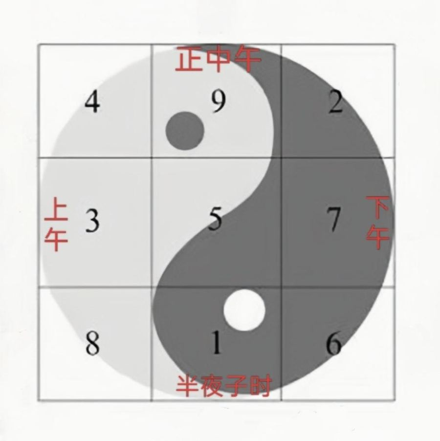
- 离火位旺极而衰，阴气从离9就开始产生，所以南边不按"生气"来种树。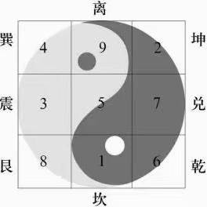
- 顶棚太矮、光线暗：压运势、阳气不足；房子又高又大、住的人少：担不住，"房大欺人"。

关键词：青龙树、种树、生气方、层高、房子太大

## 第204章 （天眼）叩齿和鸣天鼓

青牛师父教按巨髎、迎香疏通，讲叩齿和鸣天鼓的正确做法。

- 气功里说松果体叫"泥丸宫"、元神居所，有感知能力（俗称天眼）。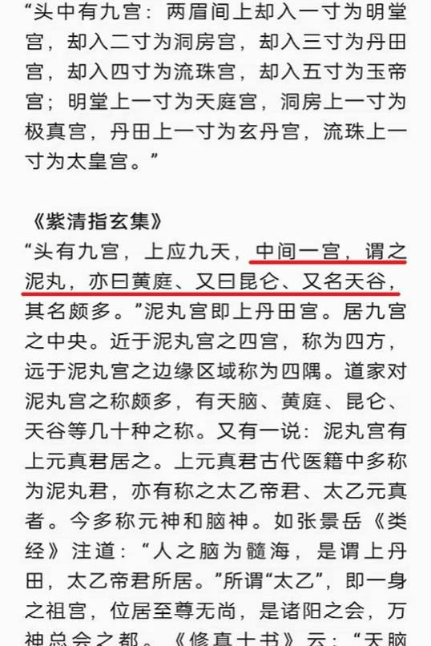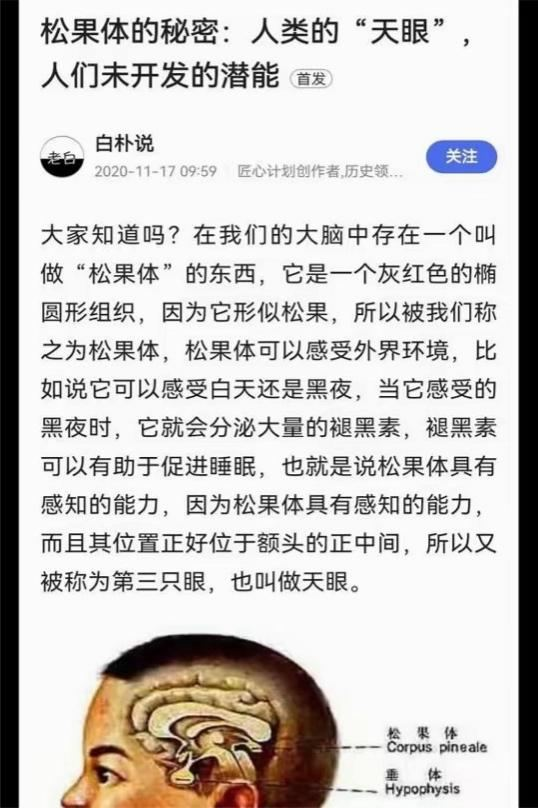

> **穴位｜按巨髎穴、迎香穴**  
> 用来：肠胃火旺、面部淤堵；书中说能补气血、美容，对戴眼镜的人友好  
> 怎么做：先按十来次承浆穴把水调上来，同时按鼻翼旁的迎香穴、瞳孔正下方的巨髎穴附近，哪里堵按哪里，一般十来下，重的多按几下。

> **功法｜叩齿**  
> 用来：书中说对牙齿和大脑有帮助（齿为骨之余，肾主骨，牙好不好看肾）  
> 怎么做：闭着嘴叩；门牙和后面的牙分开叩，每次36下或49下。先按承浆穴再叩，更容易叩出唾液。

> **功法｜鸣天鼓**  
> 用来：醒脑；读书开会累了、头脑不清醒时  
> 怎么做：双手捂住耳朵，用手指在后脑敲击（作者说做法见视频）。叩齿和鸣天鼓都是通过骨头传声震动大脑。

关键词：叩齿、鸣天鼓、迎香穴、巨髎穴、承浆穴、泥丸宫

## 第205章 鬼宫

讲任脉督脉的终点、人中穴（鬼宫）和"鬼门十三针"；作者回应读者问剑指功。

- 承浆穴被认为是任脉终点（也有说承泣穴），两个配合按可以滋养眼部经脉。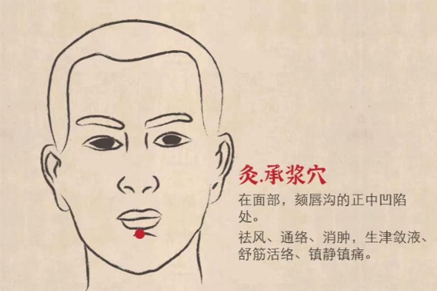
- 督脉终点在龈交（上嘴唇和牙龈连接处），开窍醒神。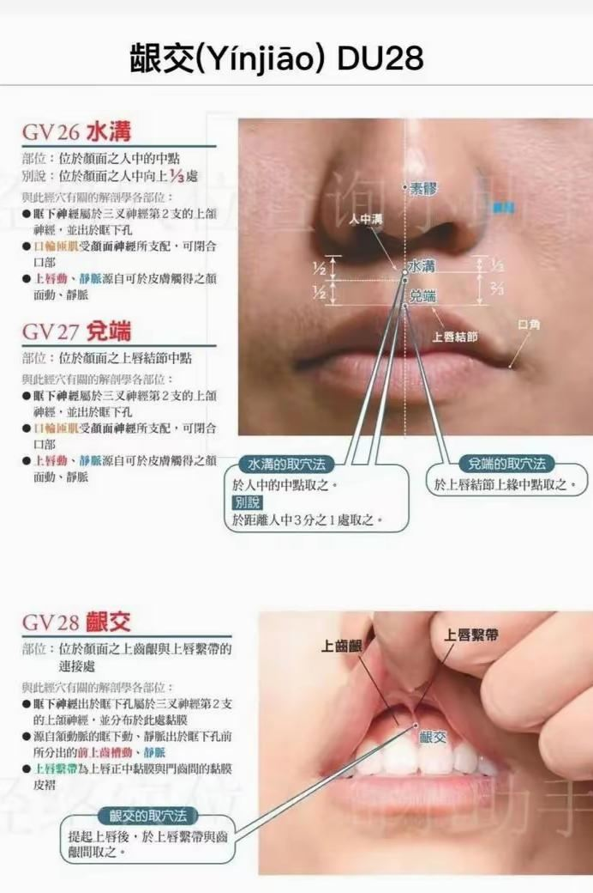
- "鼻通天气，口通地气"，口鼻之间叫人中。人中穴在人中沟靠上的位置（水沟穴），常用来急救，也叫"鬼宫"：魂不守舍、头脑迷糊时掐这里；腰背脊柱不舒服也管，按时斜向上抵住里面的龈交。
- 鬼门十三针有十三个鬼穴：人中（鬼宫）、承浆（鬼市）、劳宫（鬼窟）、会阴（鬼藏）等。
- 作者篇外：剑指功没有书，他只是去玩了几天，后来没坚持；很多气功都能练出气感。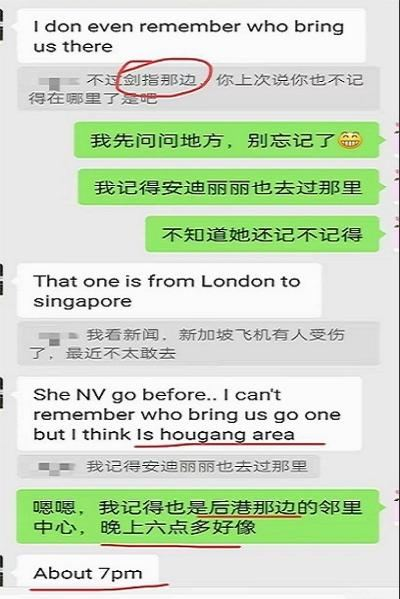

关键词：人中、鬼宫、承浆穴、任督二脉、鬼门十三针、剑指功

## 第206章 丢了个人

青牛师父讲为什么推崇人中和承浆：一个连天一个连地；体内气血比体外风水更重要，但他只能讲室内风水"怕饿死"。

- 魂魄都带"鬼"字旁，"鬼"代表一种神秘能量。
- "活"字拆开是"千口水"，流水不腐——这是人体内部的风和水。
- 体外空气流动叫风，体内叫气；体内气血比外面的风水更重要，所以修行者都关注呼吸、经脉。内在通畅，外在自然顺天而为，这叫"内圣外王"。
- 世人多想投机取巧，花钱买法器就想顺风顺水，很少愿意修自己。

关键词：人中、承浆穴、气血、内圣外王

## 第207章 找对象

学员大姐儿子快30岁找不到对象，作者教她看九宫里对应的人物位置；一套房子管三代。

- 从风水看找对象，就看家里对应人物的位置有没有受伤、能量平不平衡。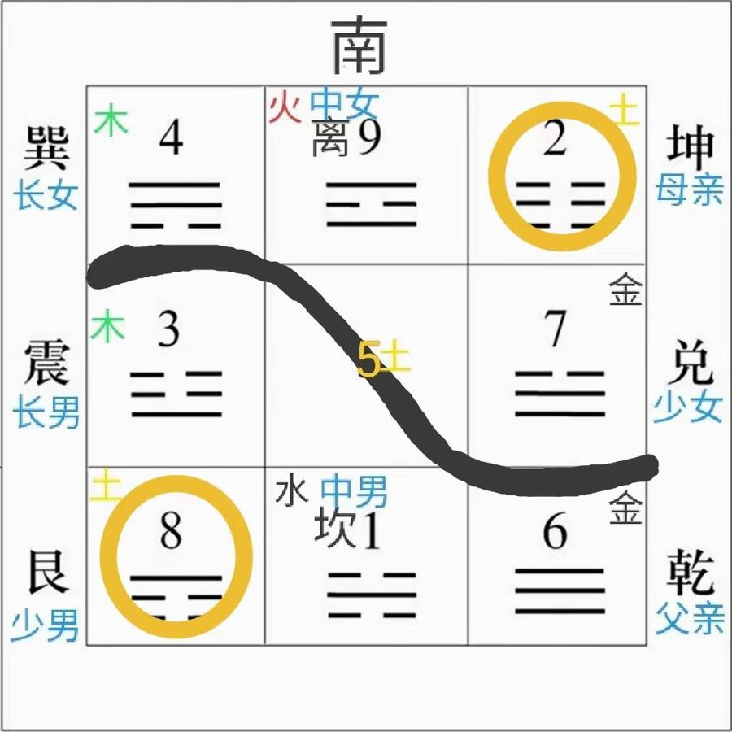
- 儿子找对象：看巽4（长女，也代表大嫂/长媳）和坤2（女主人）。女儿找对象：看震3（长子，也代表长女婿）和乾6（男主人）。
- 和你有关的房子都对你有影响：自己住的、租的、空着的都算；租出去的房子和租户关系更大。
- 一个房子管三代：父母的房子对孩子也有影响。在父母家看自己（如长女）就调巽4；在自己家（作为女主人）就调坤2。
- 青牛师父不开收费辅导，想留时间给自己修行；作者建议把问题记在本子上，上课集中问。
- 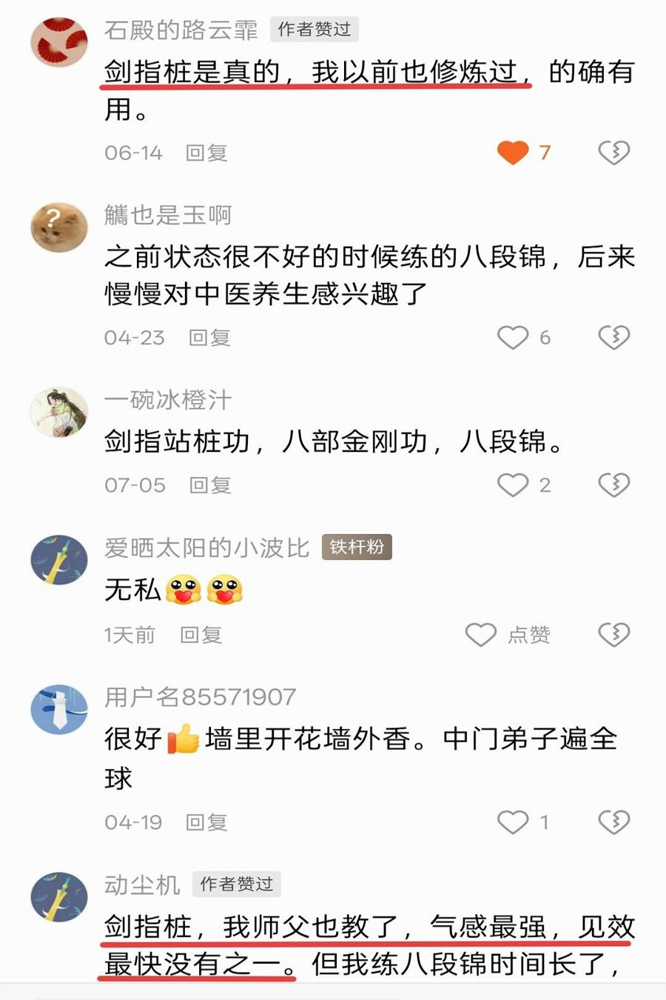

关键词：找对象、婚姻、巽4、坤2、震3、乾6、一房管三代、风水

## 第208章 儒释道三教合一

作者说改运要"天地人三合"；青牛师父讲真正的修行者没有教派之别，全真教主张三教合一。

- 房子的问题改房子，人的问题改人；只痴迷"地利"会忽略"人和"。
- 寺庙、皇家建筑都顺应天地规律；各门各派修的都是天道，只是用词不同。
- 全真教创始人王重阳推荐读《道德经》、佛家《心经》、儒家《孝经》，三教合一；不论读哪家经典，最终修的都是心中的清净。
- 佛家重天、道家重地、儒家重人，天地人三合才能得道。

关键词：天地人、三教合一、全真教、清净

## 第209章 祖窍

青牛师父讲人的九窍和祖窍：祖窍在眉心，经常皱眉会把它堵住。

- 以人中为界：上面两眼、两耳、两鼻孔六窍，两两一组是三个阴爻（坤）；下面口、前阴、后阴三窍是三个阳爻（乾）；合起来是"地天泰"。所以人中能接通天地之气，掐人中能急救。
- 五脏精气通达于脸上七窍；人生气上火叫"七窍生烟"。
- 祖窍是先天一窍，在眉心与两眼中间，不是具体穴位，负责超感官和灵性觉醒，又叫"神舍"。
- 费神时人会皱眉，愤怒不满也干扰祖窍；经常皱眉，负面能量聚在这里就"不开窍"。

关键词：祖窍、九窍、人中、皱眉、眉心

## 第210章 好运气的来源

不开窍怎么办？青牛师父说："向你学习，爱笑。"作者回忆初中时爱笑、大考运气好。

- 作者的态度：生气有用的话，大家都在生气不差我一个；生气没用，我为什么要生气？

关键词：爱笑、祖窍、心态

## 第211章 天眼

祖窍管超感官和灵性；"开天眼"其实是开启智慧，是"归元"不是"开"。

- 天眼不是真的眼睛，开天眼是开启智慧；智慧分层级，作者暂称这种超感官能力为"灵窍"。
- 小婴儿气纯净，灵窍本来就开着，长大后欲望情绪多了才慢慢关上；所以开天眼其实是"归元"——回到本来的样子。很多气功练的都是归元功。
- 天眼的"看到"更像是感知到：比如能感觉到背后有人盯着自己，一回头果然有。

关键词：天眼、归元、灵窍、感知

## 第212章 爱笑的人运气好

爱笑为什么运气好：笑的时候眉心（祖窍）是打开的；讲印堂和头皮"气垫"。

- 有的人进到风水不好的房子会浑身不得劲甚至想吐，是灵窍没完全关闭的感知。
- 愁眉苦脸时眉鼻嘴皱在一起，笑起来就"眉开眼笑"，眉心打开了——扬眉吐气、喜上眉梢、眉飞色舞都在这个位置。
- 祖窍的位置在面相上叫命宫，也叫印堂。印堂上接额头（少年运），下接鼻子（中年运）。走好运时印堂有光泽、微带红润；运气差时印堂无光晦暗。
- 青牛师父验证过：犯迷糊、头脑不清醒的人，头皮下都有一层厚薄不一的"气垫"，按不到骨头。

关键词：爱笑、印堂、命宫、祖窍、头皮、运气

## 第213章 命脉九窍

青牛师父讲"命脉九窍"；新加坡有公益性的闭关。

- 练功对疏通头皮"气垫"效果更好；青牛师父自己练"天门灌顶功"，新加坡有公益性的集体闭关（场地餐饮免费，靠有钱人捐赠）。
- 命脉九窍：顶窍（百会前）、祖窍（眉心，上丹田）、玉枕窍（脑后凹陷处）、泥丸宫（祖窍和玉枕之间）、绛宫（膻中上一寸半，中丹田，此窍开则心胸开阔）、夹脊窍、下丹田（肚脐下）、尾闾窍（命门关）、会阴窍。
- 前三田属阴（柔），后三关属阳（刚）；九窍涵盖任脉、督脉、冲脉。祖窍代表"意"。
- 作者说自己初中时根据小广告的"武功秘籍"打坐，松肩直背、呼吸平缓、气沉到肚脐，后来住校就没练了，感应也慢慢变迟钝。

关键词：命脉九窍、闭关、打坐、丹田

## 第214章 感恩行骗者

青牛师父说练功正常时体内没有异常感觉；作者讲自己意守丹田出过事。青牛师父说"得谢谢骗你来的人"。

- 体内气机正常运行时没有异常感觉；说练功后体内汹涌澎湃的，要么是装，要么是走火入魔——就像心脏咚咚跳是心慌心悸。
- 作者自述：后来一次练功不小心意守丹田，气淤成球卡住脖子，差点要命，幸好是共修，有护法师父及时处理——没有感觉才是最好的感觉。

关键词：练功、打坐、走火入魔、意守丹田

## 第215章 借福气

青牛师父讲"借福气"：被骗吃亏是福，骗子把福报给了你；作者当时不能接受。

- 青牛师父的说法：新加坡的机会像一张门票，要用福报支付；你当时福报不够，骗你的人让你吃了亏，等于把她的福报给了你。
- 也有人被骗后更倒霉，因为没有臣服、没有放下、没有舍得。
- "你生命中重复发生的伤害，是上天的启示，直到你接纳为止"——作者说后来一次次掉坑才明白，不理不睬还不算接纳。

关键词：被骗、吃亏是福、接纳、人生课题

## 第216章 人生课题

开悟者也有自己的人生课题；遇到"无所不能"的大师要警惕；握固要握紧握久。

- 稻盛和夫65岁患癌，曾仕强晚年也得癌症，佛陀也会生病、被刺扎到——修行让我们变好，但不能让我们脱离天道。
- 不要神话任何人；遇到无所不能的大师就该警惕了。
- 握固用不出效果，是握得太轻、时间不够长；刚出生的婴儿握拳握得很紧。

关键词：人生课题、神话、防骗、握固

## 第217章 握固瞬间暖身法

青牛师父教"握固暖身法"；作者遇到"东边日出西边雨"。

- 握固能养肾：无名指根是子位，子属水，对应坎1，水主肾。
- 命理测算像天气预报：只说好或不好很难准，一个水果摊两头都能一边下雨一边晴。

> **功法｜握固暖身法**  
> 用来：体温偏低、怕冷；书中说握固可养肾  
> 怎么做：一只手用力握固（大拇指压住无名指根部，四指紧握），同时用对侧的脚用力跺地10～20次；再换另一只手和另一只脚，同样跺10～20次。几十秒后身上就暖和了。

关键词：握固、暖身、怕冷、跺脚

## 第218章 顺手

琪儿被前男友偷拍威胁，"顺手"把他送进了警局；星辰因失去一个朋友在哭。

- 作者篇外：本书目的是教大家自己看懂阴阳五行；作者不接个案。

## 第219章 事情的大小

事情大小因人而异；作者劝星辰：缘分到了就放下，腾出地方迎接更好的朋友。

- 对方说"合得来就合，合不来就散，没必要勉强"是很通透的话。
- 像婴儿喝奶，喝完就放下；执着一直喝，就腾不出肚子品尝别的美食。放下一个人，也许是为了腾出地方给更好的朋友。

关键词：朋友、放下、执着

## 第220章 五行能量净化

补讲五行能量净化：水浴、土浴还能细分；日光浴（晒疗）和风浴的好处。

- 水浴有热水浴、冷水浴、蒸汽浴、矿泉浴、药浴、花浴、海水浴等；土浴有黄土浴、泥浴、沙浴等。
- 日光浴古代叫"晒疗"，《黄庭经》"日月之华救老残"：紫外线杀菌消炎、促进钙吸收（防小儿佝偻病）、对白癜风有帮助；红外线有温热效应，扩张血管、促进代谢。
- 不同颜色的光作用不同：红光让人兴奋、绿光镇静、粉光降血压、紫光蓝光有抑制作用。
- 风浴（木浴）含大量负离子，书中说能提升中枢神经功能。

关键词：五行能量净化、日光浴、晒太阳、风浴

## 第221章 魄力

讲"魄力"就是敢掀桌子、爱自己；金浴是用磬钵、碰铃的声音疗愈；五音对五脏。

- 从小被教舍己为人、不断退让，容易形成讨好型人格，最后既讨好不了别人又迷失自己。合得来就合，合不来就散。
- 五音对五脏（《黄帝内经》）：肝木-角-怒；心火-徵-喜；脾土-宫-思；肺金-商-忧；肾水-羽-恐。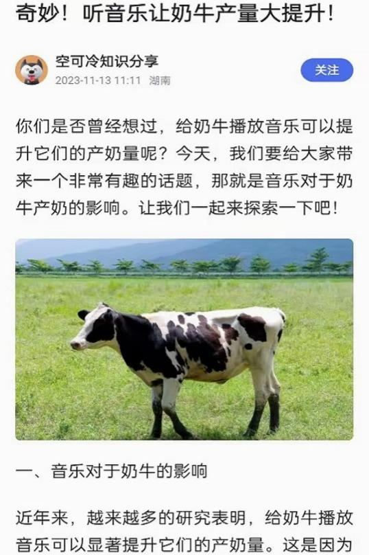
- 金浴是用磬钵、碰铃等金属乐器的声音引起脏腑振动；作者说不必特意买，手机里听这些声音也行（声音频率差不多）。

关键词：魄力、讨好型人格、金浴、音乐疗法、五音

## 第222章 开始加番外

作者教室友道家养生四宝，星辰说转舌头像在嘴里画太极；作者宣布开始加番外（象数）。

- 赤龙搅海：舌头在牙齿和嘴唇之间转，向上碰到龈交（阳脉终点），向下碰到承浆（阴脉终点）；舌为心之窍、心藏神，是神在阴阳之间转动，尤其适合心神不安、易失眠或早醒的人。
- 作者篇外：象数疗法是李玉山老师发明的，有正规出版的书；番外第一部分是网上的象数案例集锦，作者说自己也亲测过。

关键词：赤龙搅海、吞津、失眠、象数

## 第223章 篇外：世界如何才能变得更好

篇外：讲"熵增"——世界怎样才能变好：每个人守住内在秩序和公平正义的底线。

- 本章原来是番外1-1（象数），后来全文删改；象数文件在"道之光"的分享里。
- 孤立系统会自发走向混乱（熵增）；不断学习进步、持续和外界交换能量物质，就是"逆熵"。
- 刷手机上瘾是即时满足带来的虚假稳定；真正的稳定是通过自我成长提升对环境的掌控力。写文章、做手工、种菜，都是在建立自己的秩序。
- 作者以胖东来因房租"远远脱离公平"关店为例：公平正义是底线，老板的内在秩序决定企业的秩序。

关键词：熵增、秩序、自我成长

## 第224章 神奇的大师

星辰练吞津；作者讲36、49两个数字在道教等宗教里的意义；星辰的同学信了一个用精液"传灵力"的大师。

- 36：36天罡、36洞天、三十六计；49：七七四十九，"逢七必变"，人死后"过七"，《地藏经》七七日内广造众善。
- 吞津练完按揉脖子、放松舌根。

关键词：吞津、数字36、七七四十九、防骗

## 第225章 灵力

作者查不到"灵力"有任何根据；星辰进了一个"灵力算命群"，作者说那是心理学。

- "灵力"没有根基、没有传承，所有资料都是吹嘘，出现最多的是修仙小说。

关键词：灵力、防骗、算命群

## 第226章 婚姻不顺，谁算谁准

作者拆解"灵力大师"的套路：身体不好、招小人、感情不顺、破财——谁算谁准。

- 身体不好：人吃五谷杂粮都有病，闭眼断"脾胃虚、腰腿不好、妇科/男科、上火、父母注意心脑血管、家人皮肤问题"就有人对号入座。
- 招小人：人跟人想法不可能一样，总有人和你意见不同。
- 婚姻不顺：离婚率接近一半，没离的也有凑合、吵架的——一网打尽。
- 破财：财运旺的人不会去算，来算财运的多半是运势不顺的。

关键词：算命套路、防骗、冷读

## 第227章 知识的诅咒

讲几种认知偏差：自我服务偏见、知识的诅咒、防御性归因。

- 自我服务偏见：成功归功于自己，失败怪运气或别人——所以运气好的时候不去算，不顺时才去找大师。
- 知识的诅咒：以为别人和自己有一样的知识背景。
- 防御性归因：有同样遭遇的人更能共情受害者；没经历过的人可能反过来指责受害者（"完美受害者"）。
- 开心就是"心开"，心藏神，心被揪起来伤的是神。

关键词：认知偏差、自我服务偏见、知识的诅咒

## 第228章 星相效应

作者讲"富勒效应"（星相效应），附50条人人都觉得"说的就是我"的断语。

- 富勒效应：人容易把模糊笼统的描述当成是在说自己；很多"算得准"的大师用的就是这个，也叫"冷读"。
- 书中列了50条，比如"你外表自信，内心有烦躁不安的一面""你曾被信任的人背叛""你体内沉睡着尚未被发掘的才能""你并不像表面那么坚强"——几乎人人都觉得准。

关键词：富勒效应、冷读、算命套路、防骗

## 番外 1-2 象数疗法肠胃

番外：网上收集的象数案例集锦（胃和肠），列出各种胃痛、呃逆、腹痛、腹泻、肠炎等对应的数字。

- 读法：像幼儿园小朋友读数字那样读就行。
- 同一个症状分不同原因给不同数字，比如胃痛分"气滞郁热"（胀满、灼痛吞酸、易怒便干）和"脾胃虚寒"（隐痛、喜按喜暖、食后减轻、神疲肢冷）；腹泻分"脾肾阳虚"（五更泻、怕冷）和"饮食内伤"（泻下恶臭、嗳腐吞酸）。
- 全部数字见[象数速查：胃和肠](../../book/06-身体与养生/31-象数速查：胃和肠.md)（照原书整理）。括号里的"速愈""几分钟好"等是原书收集的案例反馈。

关键词：象数、胃痛、腹泻、肠炎、呃逆、打嗝

## 第230章 看头像

星辰问怎么看头像，作者从阴阳讲起（见[头像怎么看](../../book/03-看人/10-头像怎么看.md)）。

- 看头像和别的预测一样：太极生两仪（阴阳）、两仪生四象（青龙白虎朱雀玄武）、四象生八卦（五行八卦）。一层比一层细，像画画从简笔画到写实。

关键词：头像

## 第231章 头像之阴阳

星辰推理出"黄昏属阴、背影是不想面对"；作者回忆大学时被街头算命的老头"收徒"。

- 头像黄昏属阴，说明心情不好、运势不利；背对镜头代表有不想面对的问题。
- 说"玄"的人往往是没吃透。

关键词：头像、阴阳

## 第232章 凭空算卦

街头老头"算"出作者手机丢了、来买手机，作者给了200元。

关键词：算命、防骗

## 第233章 诺基亚手机

老头要2000元拜师费，作者剩下的钱买了个100元的旧诺基亚，其余1200都被收走。

- 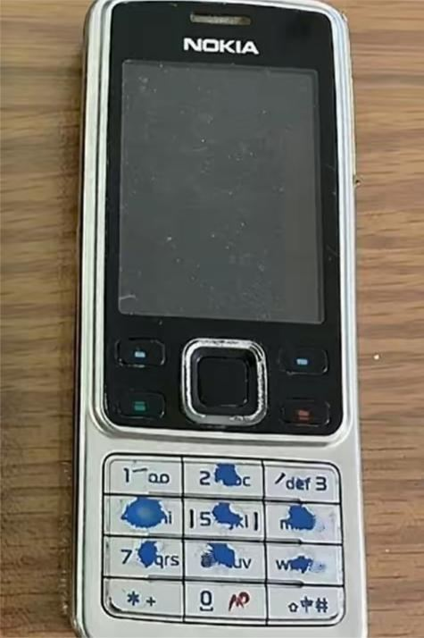

关键词：防骗、拜师

## 第234章 真假大师

作者一个月后请"徐师父"吃饭，想问他是怎么算出来的。

关键词：防骗

## 第235章 预测方法的高低贵贱

老徐揭秘：他是靠观察（宅、走得快、只在手机店招牌停顿）推断出主角丢了手机来买新的，不是靠卦。

- 冷读的过程：看出你很宅、走路快说明目标明确、只在白底蓝字的电子店招牌前停顿、面无表情不像来卖手机、步伐毫无犹豫说明不是去修——所以是丢了来买。
- "既然一眼就看出来了，为什么还要费事去卜卦？方法和方法之间没有高低贵贱。"

关键词：冷读、算命套路、观察

## 第236章 天才

老徐说穷学生身上那一两千也是钱；作者讲同学李雪是过目不忘的天才。

- 老徐说的"你快毕业了"其实是作者自己说漏的信息——套话也是算命常用手段。

关键词：冷读、算命套路

## 第237章 天才的崩溃

李雪考研压线进了复试却没准备，来找作者，作者想到问老徐。

## 第238章 六爻基础

老徐让李雪用六爻起卦；作者讲六爻基础：摇钱起卦、六神。

- 六爻起卦：三枚同样的硬币摇一次得一个爻，摇六次成一卦。
- 六神：青龙（东、木）、白虎（西、金）、朱雀（南、火）、玄武（北、水），再加勾陈、腾蛇（属土）。

关键词：六爻、六神、起卦

## 第239章 六爻的反断

讲六亲；卦象显示李雪成绩极弱，老徐却说"反断"，没问题。

- 六亲按五行关系分：生我者为父母，我生者为子孙，克我者为官鬼，我克者为妻财，同我者为兄弟。
- 父母代表"我之来处"，也代表学业成绩；兄弟代表"我的现在"——看你交往的朋友层次就知道你的水平，圈子很重要；子孙代表"我的未来"。
- 面相三停也这样对应：上停（额头）代表父母祖先、青少年运；中停代表兄弟配偶、中年运；下停代表子孙、晚年运。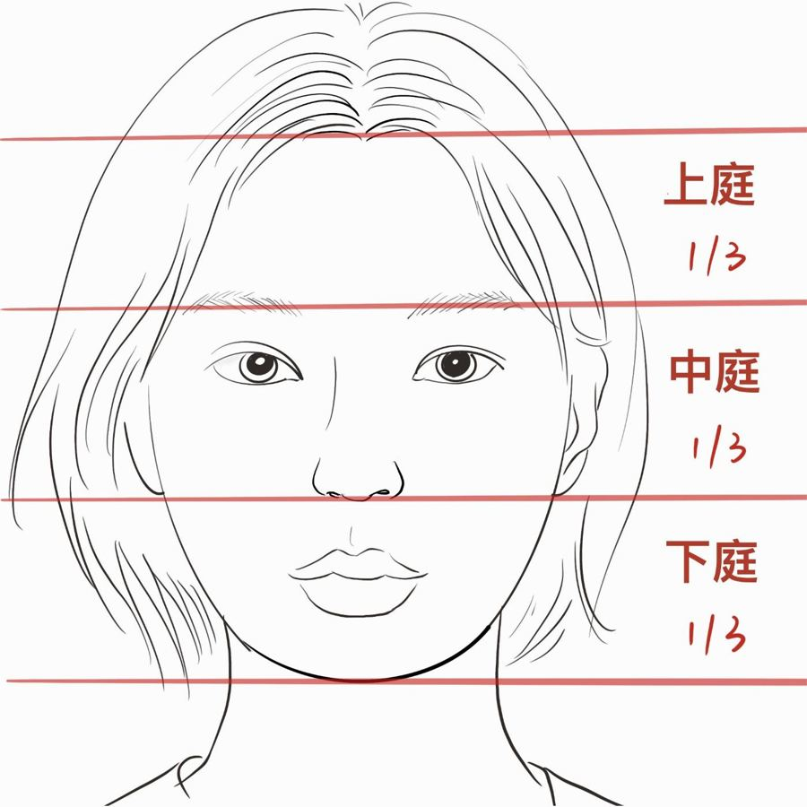
- 王阳明"父母本是在世佛"：父母祖先代表"过去的我"，过去积的福报是人生起点。
- 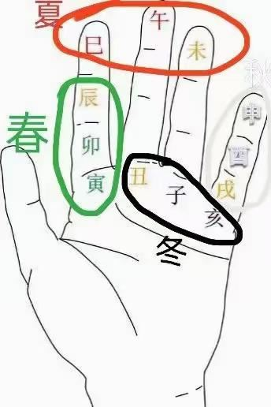

关键词：六爻、六亲、三停、面相、圈子

## 第240章 断卦要给人希望

老徐说"算卦无论结果如何都要给人留下希望"，并解释成绩出来是春天木生火。

- 老徐：要算准，不仅要懂五行八卦，还要了解对方行业的信息和时事，综合判断；考虑不周就会算反。

关键词：算卦、希望

## 第241章 悟性

作者因"反断""要悟"放弃学算卦；李雪复试第一，带奖学金录取。

- 李雪的面试表现靠的是平时广泛的兴趣和英语，不是复试准备——她进考场只是想看看卦准不准。

关键词：考试、希望

## 第242章 绝处逢生

作者放弃了老徐那条"精准预测"的路，选择了"用阴阳改变结果"的路。

- 一位师父追求出神入化的精准预测，一位追求简单朴素地改变结果——作者选了后者，更看重实用。

关键词：预测、改变结果

## 第243章 决定我们命运的不是卦

决定命运的不是卦，是心念和决定；作者说只写科学能证实的部分。

- 卦只是参考。如果当时按作者的判断"死绝之地"，李雪可能根本不进考场；是"有希望"让她全力以赴抓住了一线生机。
- 让人后悔的往往不是努力了没结果，而是明明可以拼一把却没去做。"往前看，不害怕；往后看，不后悔。"
- 作者说：科学能证实的部分他写，还不能证实的部分他不写。

关键词：命运、卦、努力、希望

## 第244章 头像预测的原理

头像为什么能看出心情和运势：人只喜欢和自己情绪相近的东西；用九宫格看头像各部位。详见[头像怎么看](../../book/03-看人/10-头像怎么看.md)。

- 图画心理学可以通过一个人的画分析心理、情绪和运势；情绪是一种频率，人只和近似的情绪共鸣。
- 
- 九宫各格管的身体部位：震3巽4木—肝胆；离9火—心、血液、眼、头、耳；兑7乾6金—肺，乾6还是男主人、财库、脑子、直肠、痔疮；坎1水—肾（手脚冰凉、男女科、泌尿生殖、高血压、糖尿病、痛风、腰痛、尿毒症等）；艮8坤2土—脾胃，艮8管过敏（湿疹鼻炎），坤2女主人、妇科。
- 看头像顺序：太极（第一感觉）→阴阳→四象（主体靠左青龙偏男性思维，靠右白虎偏女性思维）→五行八卦（如兑7有红色伤呼吸；乾6有国旗，火克金伤财）。
- 父母是"过去的我"，子孙是"未来的我"；很多看似遗传的病，遗传的可能是五行能量信息。一个房子管三代，头像和风水一一对应。
- 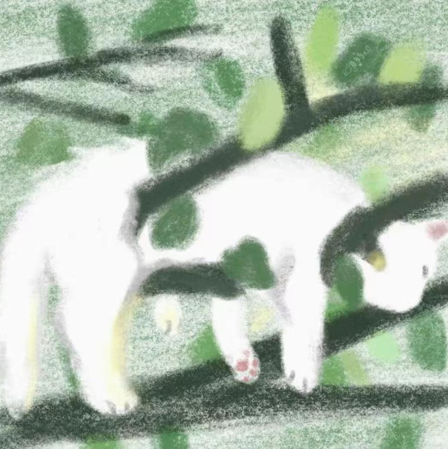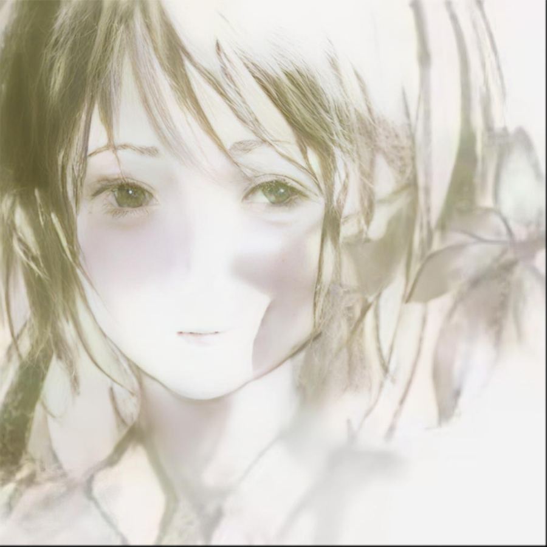

关键词：头像、九宫、一房管三代

## 第245章 头像与居家风水

头像有问题，家里对应位置风水也可能有问题；琪儿要给客户送生日礼物。

关键词：头像

## 第246章 送礼的诀窍

琪儿讲送礼的诀窍和她拿下第一个大客户的办法：一顿饭花了一年薪水。

- 送礼要送出效果：送中年男老板常用、有品牌、他自己没空买的小物件（腰带、钱包），每次用都会想起你。

关键词：送礼、客户

## 第247章 琪儿的“破圈”之路

琪儿"不怕花钱多，只怕对方不赴约"；她靠"有问题就退一半钱送回国"的模式暴富，作者不认同。

- 大老板不缺一顿饭，愿意赴约就说明愿意给合作机会。
- 琪儿的模式：工人一有不适应就退一半中介费送回国，名额反复用，赚十几倍；雇主无所谓，琪儿赚钱又赚名声，但工人亏了一半钱。作者说三方中有一方亏损就不完美，"共赢才是赢"。

关键词：赚钱、商业模式、共赢

## 第248章 保健品的套路

作者的父母省吃俭用，却花上万块买保健品；作者发现卖保健品和算命的套路一样：吓唬你。

- 保健品常见套路：饥饿营销（说很稀有、限量）、送鸡蛋、冒充"代表国家"下来送福利。
- 算命说"不化解就有血光之灾"，保健品说"不吃病就会加重、手术失败没人管"——都是狠狠地吓唬你。

关键词：保健品、防骗、老人被骗

## 第249章 心脏越跳越有劲

保健品"吃不好说明量不够"，风水摆件"不好用说明请的少"；"心脏越跳越有劲"恰恰可能是出问题了。

- 保健品和法器的套路：没效果就说你买得不够多，一直到你掏不出钱为止。
- 正常人感觉不到心脏在跳；作者去问心脏病人，改善后也不会感到"咕咚咕咚越跳越有劲"——那样反而是不舒服。
- 作者开始思考钱的本质和流向：钱像水，不能无限存，超过堤坝会一下子倾泻。

关键词：保健品、防骗、心脏、钱

## 第250章 申请绿卡

作者反思"省省省"的消费观，打算带父母出国玩；递交新加坡绿卡申请；何香说自己没调风水也好了，已停药。

- 作者：一家人对钱唯一的认知就是省，省下的钱最终也不是省给自己的；钱花出去了才是自己享受到的。
- 当时新加坡EP满3个月就能申请绿卡，但不是达标就批，每阶段有名额，招满就停。

关键词：钱、财商、新加坡

## 第251章 误入单身群

风水最容易走极端：不信的人真不信，信的人又容易迷信；作者误入一个找对象的群。

- 作者见过一位同修家里挂满法器、供着通电红蜡烛，大白天一片暗红——作者认为这样反而招邪。
- 风水对作者来说是推理，不是神神道道；指望摆件逆天改运、不去努力，是迷信。

关键词：风水、迷信、找对象

## 第252章 凭实力单身

群里的人很努力却找不到对象，比如留言只写"选我选我，我是男的"——没有任何有用信息。

- 只靠"积极"不够：留言除了性别什么都没写，对方无从了解你。

关键词：找对象

## 第253章 心安，神才定

先让心静下来，人才能想清楚；找对象既要静心，也得真的去找。群里人嫌婚介要提前收一个月工资。

- 《大学》："静而后能安，安而后能虑，虑而后能得。"心安了，神才定；人浮躁时有想法也多是胡思乱想。
- "做一朵安静的花，蝴蝶才能找得到你。"作者把[洗心养神功](../../book/07-修心/03-洗心养神功.md)发到了群里。
- 但静心只是让言行有灵性；找对象，得找才能有——前期广泛撒网有必要。

> **修心方法｜洗心养神功（静心）**  
> 用来：心浮气躁、想事情乱  
> 怎么做：见第47章的做法：看花看草、让心静下来。

关键词：修心、心安、找对象

## 第254章 查无此人

撒网要写清楚年龄、地点、职业、收入、长相、爱好；有人择偶要求写"不接受放屁的女生"——人类里查无此人。

- 自我介绍要多方面展示自己的特点，不能只有性别。
- 婚介不论成不成都先收费，群里人不愿意；作者认为收钱的前提是付出有价值。
- 条件越多越难找。差不多就行，人生不存在完美。
- 篇外：新加坡普工月薪约1万（人民币）；国内月薪三四千、二十出头的人可以去看看，超过5000不建议离乡背井。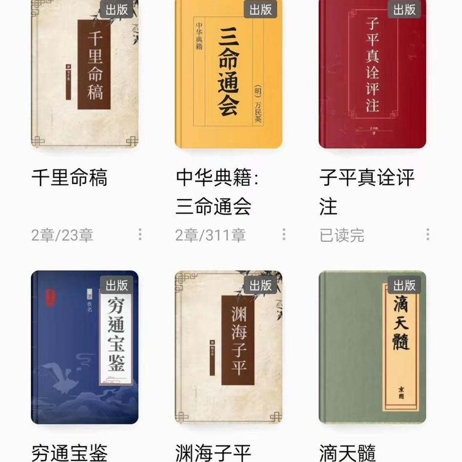

关键词：找对象、择偶条件、新加坡、出国打工

## 番外 1-3 象数疗法眼头心

番外：象数疗法的数字清单，覆盖头、眼、耳、鼻、牙、口、颈喉、咳嗽、皮肤、烫伤和日常小问题。完整查表见[象数速查：头面五官、皮肤和日常](../../book/06-身体与养生/32-象数速查：头面五官、皮肤和日常.md)。

- 用法和第一份番外相同：默念数字串（"·"分隔各段），括号里是原书收集的案例效果。
- 作者建议：不论用不用得上，都扫一眼，知道大概有哪些内容；有需要可以看《象数疗法》原书。
- 收录的部分很杂，连"手机掉水里""锁打不开""驱蚊"都有，属于原书收集的反馈，作者并未逐条验证。

关键词：象数、象数清单、咳嗽、牙痛、鼻炎、眼睛、皮肤

## 第256章 你的位置在哪里

征婚照片别在厕所拍；也别发大脸糊屏、侧脸、"死亡角度"、模糊照。

- 厕所在风水上是污浊之地、泄气之地；正对入户门、厨房门、卧室门叫"污口煞"。在厕所拍的照片至少拉低档次。
- 一个人的档次看气质、穿着和位置——"你们的位置，在厕所"。
- 没有人完美，也没有人一无是处。不需要所有人都喜欢你，扬长避短，把长处展示出来。

关键词：找对象、照片、厕所、污口煞

## 第257章 照片的扬长避短

照片要扬长避短：五官好拍脸，身材好拍全身，都一般就拍爱好或笑脸，再不行就展示别人没有的。

- 五官好看：拍一张立体的脸，离镜头稍远一点。
- 五官一般身材好：拍远景全身照。
- 都一般：拍打球、爬山等突出爱好的照片；或者一张有感染力的笑脸。
- 好大学毕业可以用校门做背景；会手工就展示手工——专注的男人最帅；擅长居家的女生可以拍围裙照。
- 但要做真实的自己：不爱下厨就别拍围裙照；也别往死里美颜，否则见光死。
- 吴昊因业绩超过作者而紧张。

> **生活方法｜征婚照怎么拍**  
> 用来：网上找对象、展示自己  
> 怎么做：先想清楚自己最强的一点（脸、身材、爱好、笑容、学历、手艺），拍能突出它的照片；背景别在厕所；别用大脸、侧脸、俯拍"死亡角度"或模糊照；适度修图。  
> 注意：照片要真实，不然见面就露馅。

关键词：找对象、照片、扬长避短

## 第258章 徒弟更厉害好不好

吴昊怕业绩超过师父惹他生气；作者说徒弟越厉害，师父越高兴。

关键词：师徒

## 第259章 属相三合

属相三合怎么记：把十二生肖画在手上（掌中诀）配九宫图，按"驿马+下一季正位+再下一季墓库"记。

- 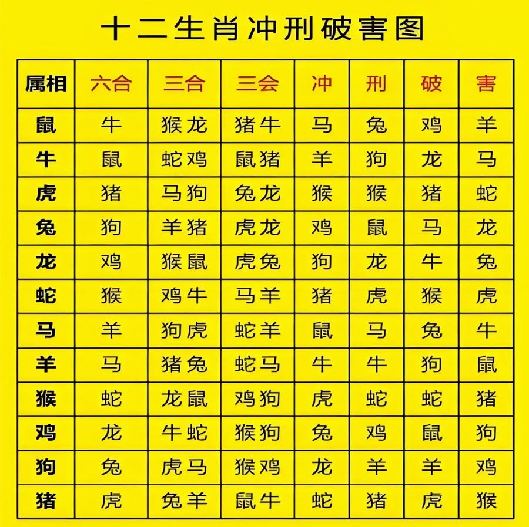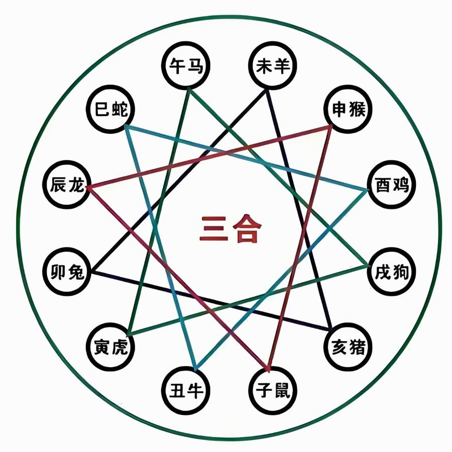
- 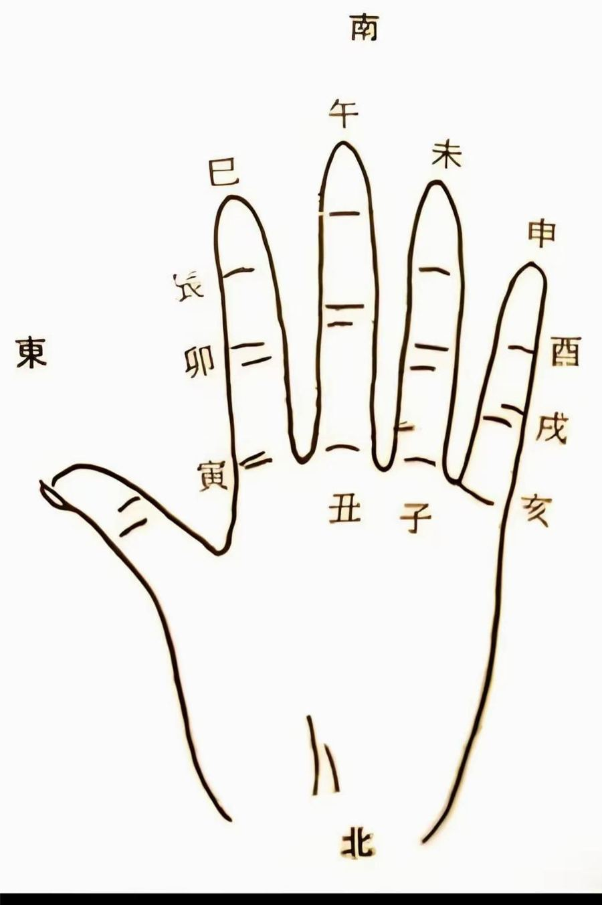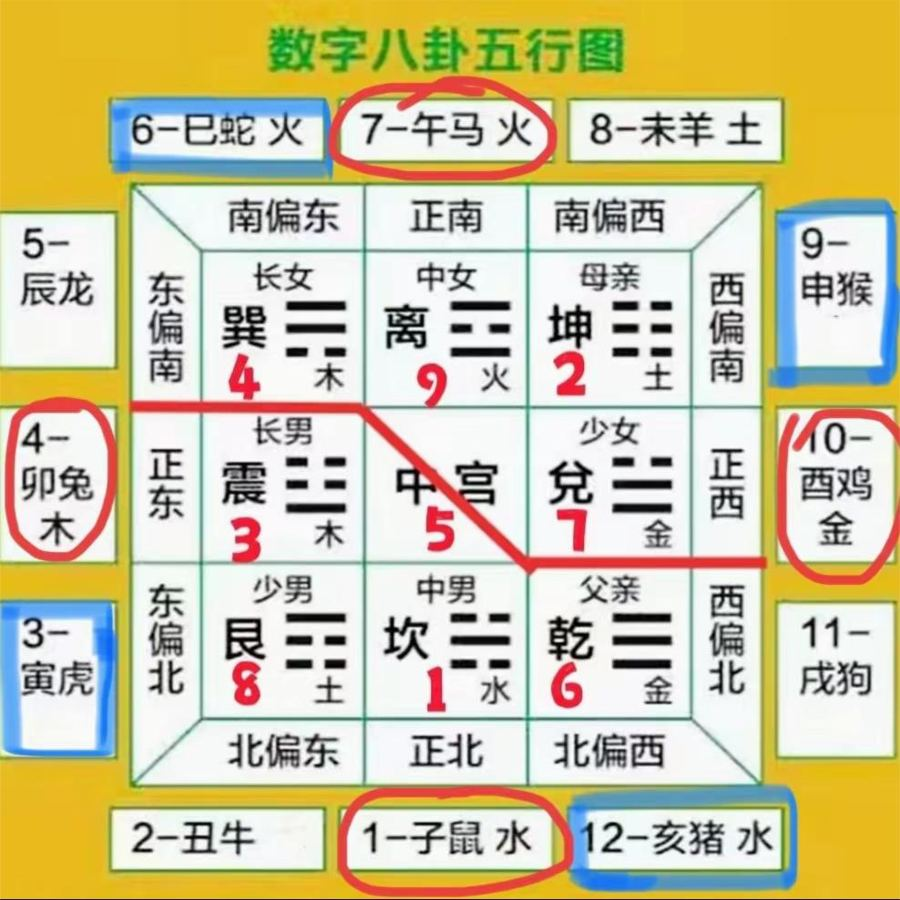
- 九宫图/掌中诀四面代表春夏秋冬，每季三个属相。
- 每季第一个：寅、巳、申、亥，在拐角，代表道路、行动、变动，叫"四驿马"。
- 每季第二个：子、卯、午、酉，居中，本气纯正，叫"四正位"，又叫"四桃花"。
- 每季第三个：丑、辰、未、戌，季节末尾，主收藏，叫"四墓库"（墓是坟墓，库是仓库）。
- 三合 = 一个季节的驿马 + 下一个季节的正位 + 第三个季节的墓库，五行跟正位相同。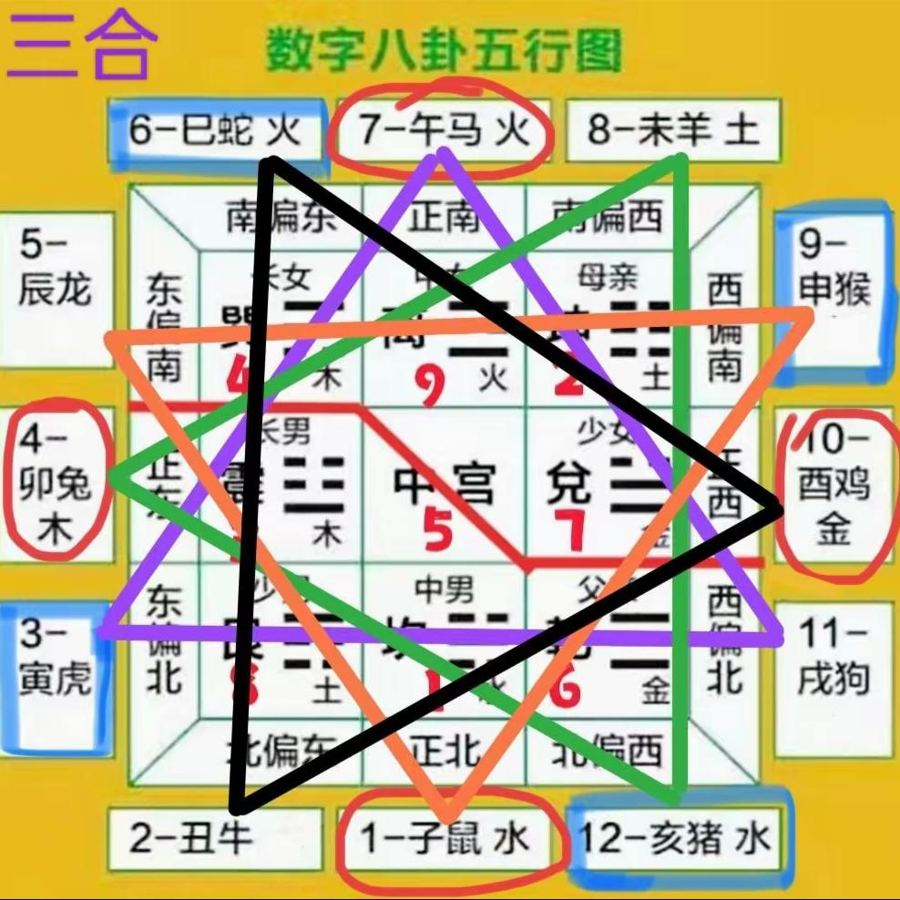
- 寅午戌合火；巳酉丑合金；申子辰合水；亥卯未合木。

关键词：属相、三合、掌中诀、驿马、桃花、墓库、婚配

## 第260章 属相相冲与六合

讲属相三会、相冲和六合，以及六对相冲属相的性格冲突。

- 三会：相邻三个属相聚成一方之气。寅卯辰（东、春）木；巳午未（南、夏）火；申酉戌（西、秋）金；亥子丑（北、冬）水。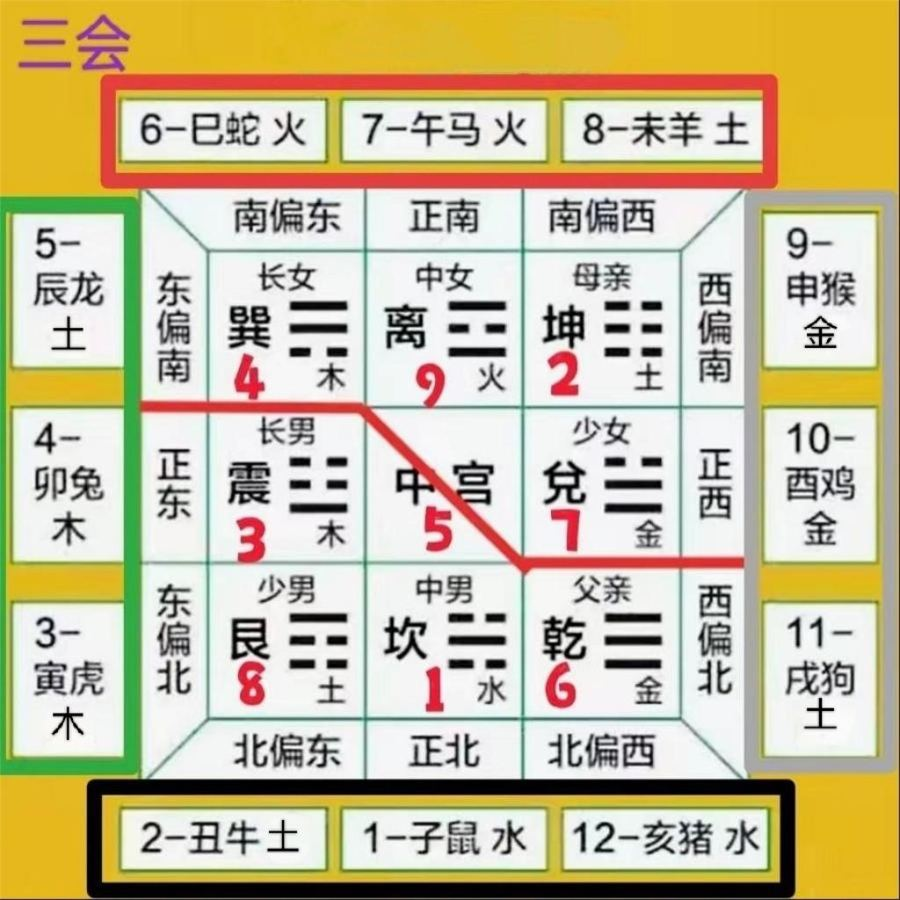
- 三合为什么隔着跳：它是五行力量从生到旺到入墓的过程。比如火"长生于寅，旺于午，墓于戌"；午既是最强点也是开始衰败的点（阳极而阴）。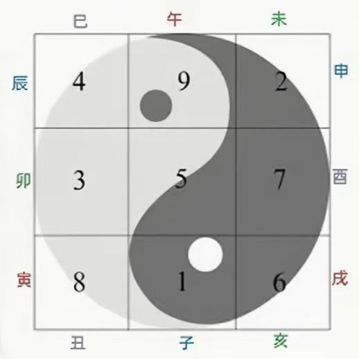
- 相冲：子鼠记1，依次到亥猪12，单数为阳、双数为阴；相差6的两个属相距离最远，为相冲，都是阴冲阴或阳冲阳。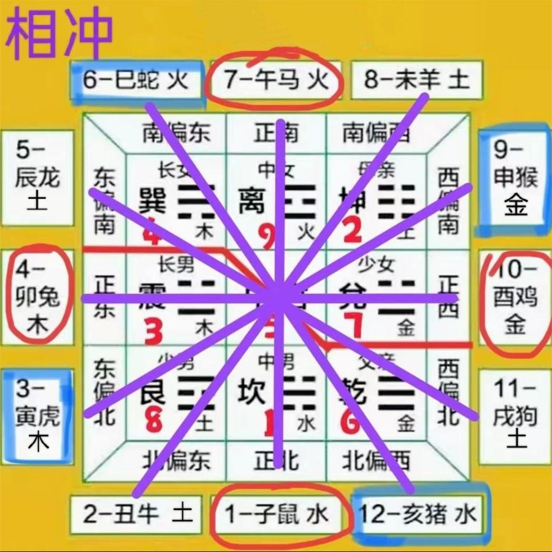
- 鼠马冲：鼠内心没安全感、疑心重；马不管不顾向前冲、容易相信人。鼠嫌马没脑子，马嫌鼠想太多。
- 牛羊冲：都不灵活又心思细腻，互相理解不了、看不上。
- 虎猴冲：猴子骨子里不服，都是阳，互相对抗。
- 兔鸡冲：兔子心眼多、未雨绸缪；鸡记吃不记打、不在意风险。
- 龙狗冲：龙大开大合、虚虚实实；狗踏实忠诚保守；都是阳，各不相让。
- 蛇猪冲：都阴都内敛，蛇冷静机智，猪正直天真不爱热脸贴冷屁股——能把日子过成冰。
- 已经结婚的属相相冲怎么办：预防大于治疗；已经结了就彼此包容，相冲本质是性格不合，多体谅对方。
- 六合：十二生肖左右对称两两一对，掌中诀上横向为合。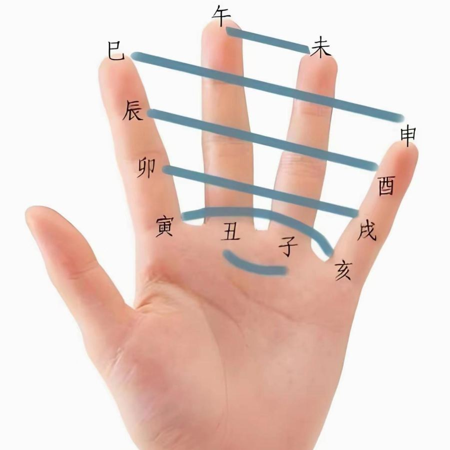
- 合也不一定都好，还有合中带克、带刑、带破。

关键词：属相、三会、三合、相冲、六合、婚配

## 第261章 属相相刑

讲属相相刑：三刑、互刑、自刑，以及口诀"金刚火强，水木一乡"。

- 刑是实力相当、互不服气。
- 驿马组：寅刑巳、巳刑申、申刑寅；亥亥自刑。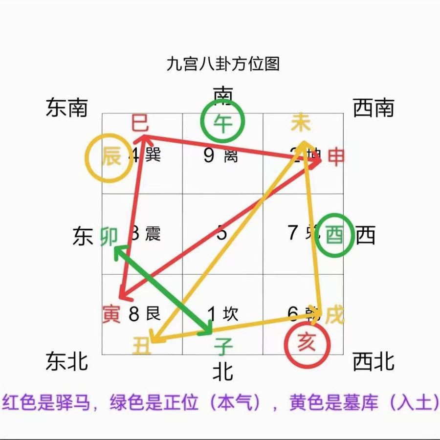
- 墓库组：丑刑戌、戌刑未、未刑丑；辰辰自刑。
- 正位组：子卯互刑；午午自刑、酉酉自刑。
- 找对象用不着管谁刑谁，凑一起不好就别凑；方向在化解时才用得上。
- 规律：三合局刑三会局，一对一地刑。金局：巳刑申、酉酉自刑、丑刑戌；火局：寅刑巳、午午自刑、戌刑未；木局刑水局：亥亥自刑、卯刑子、未刑丑；水局刑木局：申刑寅、子刑卯、辰辰自刑。
- 人生差不多就行：从二三十分提到八九十分容易，最后十分最难，不要也罢。

关键词：属相、相刑、婚配

## 第262章 属相的克害破

掌中诀上：斜对是冲，横对是合，竖对是害，菱形是破；再加五行相克。

- 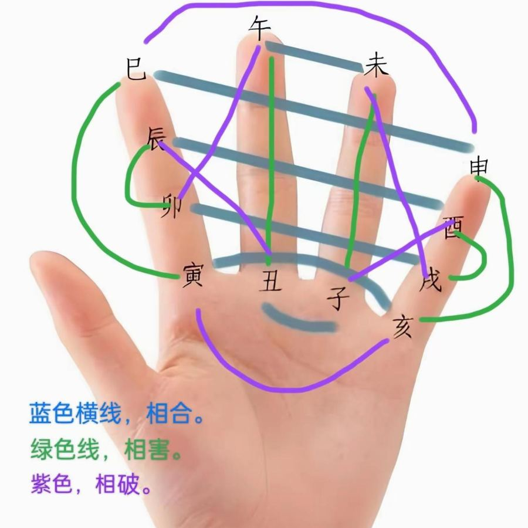
- 掌中诀左右折叠是六合，上下折叠是六害，斜对角是六冲。
- 相破按驿马、正位、墓库分：驿马破驿马（巳申、寅亥，这两对同时相合，所以是"合中带破"，最轻）；正位破正位（子酉、卯午，老大互不相让，破坏力最大；四正位又叫四桃花，相破多跟骚扰、感情有关）；墓库破墓库（未戌、丑辰，属土，伤脾胃或破阴阳宅）。
- 相克：火克金、金克木、木克土、土克水（还有水克火）。
- 例：属猴（申）——巳申合、申亥害、寅申冲，三合申子辰、三会申酉戌，寅巳申相刑、巳申相破，巳火和午火克申金。

关键词：属相、相冲、六合、相害、相破、婚配

## 第263章 谈什么悟性

例：属兔（卯）的关系全梳理；死记硬背谈不上悟性。

- 卯与戌合；卯与辰害；卯与酉冲；三合亥卯未；三会寅卯辰；卯与子刑；卯与午破；申金酉金克卯木。

关键词：属相、婚配

## 第264章 命宫算法

命宫怎么算：出生年四位数相加，大于9就减9；男用11减，女用4加；结果是5时男取2、女取8。

- 命宫跟属相一样按出生年算，但用的是八卦：每年出生的人属于九宫里的一个宫，男女不同。
- 例1：1995年男：1+9+9+5=24，减两次9得6，11-6=5，5改为2，属坤2宫。
- 例2：2018年女：2+0+1+8=11，减9得2，4+2=6，属乾6宫。
- 简便算法：相加时把凑成9的数字直接抹掉。

> **看人方法｜算命宫**  
> 用来：婚配、风水里查自己属于哪个卦  
> 怎么做：1. 出生年四位数字相加，结果大于9就反复减9。2. 男：用11减这个数；女：用4加这个数。3. 结果大于9再减9。4. 得5时男改为2（坤）、女改为8（艮）。

关键词：命宫、婚配、九宫

## 第265章 命宫的婚配

命宫婚配的简单用法：命宫在同一组（东四命或西四命）的两人更合拍。

- 八卦代表家里八个人：父、母、大哥、大姐、二哥、二姐、弟弟、妹妹。
- 分两组：活力组（大哥大姐二哥二姐）和天佑组（父母、弟弟妹妹）。一个在活力组、一个在天佑组，就像哥姐跟父母在一起容易叛逆、哥姐嫌弟妹麻烦。
- 挑对象的顺序：先用属相去掉冲、害、刑、破、克的；剩下的再算命宫，去掉跟自己不同组的。
- 作者说他见过几个癌症康复案例，算了一下恰好都是"一等婚"，说一等婚有逢凶化吉、挡灾、养身的作用，并让徒弟自己去验证。

关键词：命宫、婚配、东四命、西四命

## 第266章 婚配

只有父配母、大哥配大嫂、二哥配二嫂、弟弟配妹妹才是一等婚；但人生考的是综合成绩。

- 活力组又叫东四命，天佑组又叫西四命；同组只是相对好。
- 一等婚属相不合怎么办：就像买不起豪宅，在能力范围内选个看得上的——在合适的属相里找命宫差不多的。属相12年一圈、命宫9年一圈，放开年龄理论上能两全。
- 命运是数学题，婚配只告诉你哪个是正数哪个是负数。风水是语文，个人努力是数学，婚配是英语——提高一门就有一门的效果。
- 有些不好的婚配只伤身体不伤感情，幸福感也挺高。
- 你潜意识认同的东西会找一百个理由赞同，不认同的会找一百个理由质疑。
- 气场是两人合成的反应；婚后身体和精神上保持距离、少交流，好坏作用都会变弱。

关键词：命宫、婚配、一等婚、潜意识

## 第267章 婚配和坎宫的化解

婚配不好怎么化解：要么减少不利气场（保持距离、用"贵人属相"合住一方），要么增强自身抗伤害能力；坎1宫受伤的风水化解也是这个思路。

- 例：马牛相害。能合住丑牛的有巳蛇、酉鸡、子鼠，但子午冲、酉午克，所以选巳蛇；能合住午马的有寅虎、戌狗、未羊，但戌丑刑、未丑冲，所以选寅虎。
- 合住主动去刑的一方更根本，比如丑刑戌，合住丑；合住戌等于把戌保护起来。
- 贵人属相的用法：结婚日子、伴郎伴娘的属相、孩子的属相、家里摆设、手链等，都可以用。改运不外乎时间和空间。
- 坎1宫（正北，水，二男，主肾）管：肾病、尿毒症、白血病、泌尿、男女科、糖尿病、高血压、痛风、免疫系统。
- 不信的人你硬帮他改，效果也可能适得其反：人往下使劲，地利往上使劲，不知道哪股劲大。怀疑自己有病，阴性重了、阳气不足，气血慢、免疫下降，真的会病。
- 别人家不能乱动，父母家也要征得父母同意。
- 大太极、小太极：用指南针校准方向，站在房子正北、面朝南，按上南下北画户型图（房本图是上北下南，要倒过来），横竖各三等分画九宫，这是大太极；每个房间再画一次，是小太极。

> **风水调整｜坎1宫（正北）受伤的调整**  
> 用来：肾、泌尿、糖尿病、高血压、痛风、免疫等问题对应的方位  
> 怎么做：1. 大太极和每个房间小太极的正北，都不放属水的东西：水龙头、厕所、鱼缸、洗衣机下水口、黑色物品、画里的水、草本植物。2. 这里的窗尽量不开，门少开，有后门就别走后门。3. 室外正北也别有水、路、坑、河、池塘，别有煞（凶兽、刀剑、带刺植物、光煞、风煞）。4. 正北宜静、宜有靠山。  
> 注意：挪不走的就"多穿棉袄"增强抗伤害能力；能挪多少挪多少。

> **民俗方法｜用贵人属相化解属相冲害**  
> 用来：夫妻属相相冲、相害、相刑  
> 怎么做：找一个能同时合住其中一方、且跟另一方不冲不刑不克的属相（如马牛相害取巳蛇或寅虎），用在结婚日子、伴郎伴娘、孩子属相、家里摆设、手链等上。

关键词：婚配、化解、贵人属相、坎1、肾、大太极、小太极

## 第268章 常见煞

常见的煞：天斩煞、路冲、钢刀穿背、割脚煞、壁刀煞、菜刀煞、尖角煞、顶心煞、刀刃煞、反弓水、穿堂煞、横梁煞、光煞、刺煞、电磁煞、火形煞。

- 天斩煞：两栋楼之间的窄缝正对你家，风被挤压加强冲过来。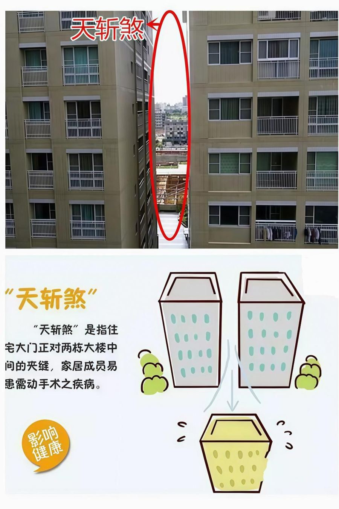
- 路冲：路垂直冲着你家，刹车失灵会撞进来；在屋后叫钢刀戳背（钢刀穿背），暗箭更难防。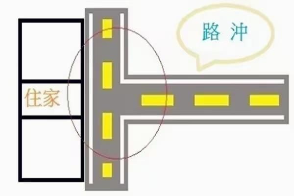
- 割脚煞：水或高速路平行而且离房子很近（路也算水）。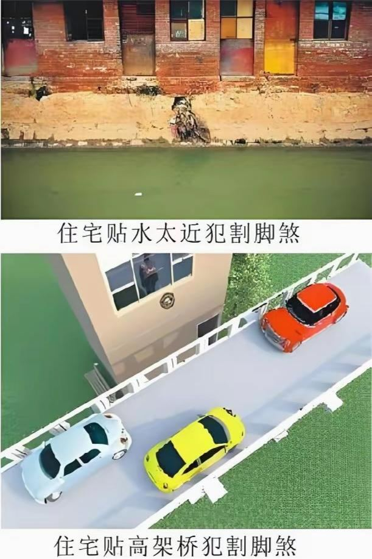
- 壁刀煞：别人家的墙垂直对着你家，风撞墙后拐向你家；墙外竖直的广告牌也一样，叫菜刀煞。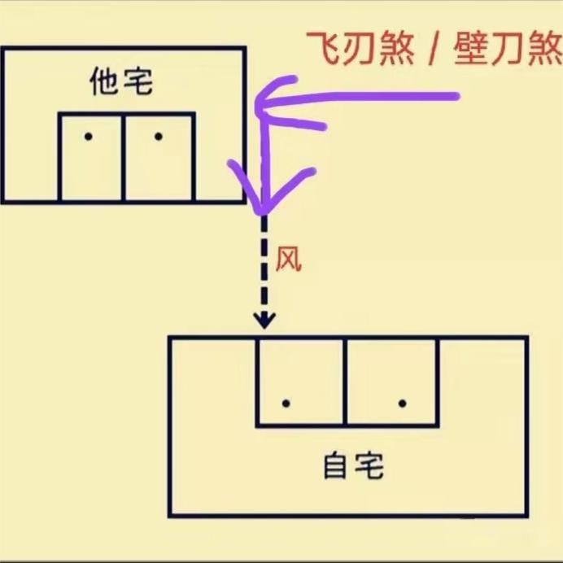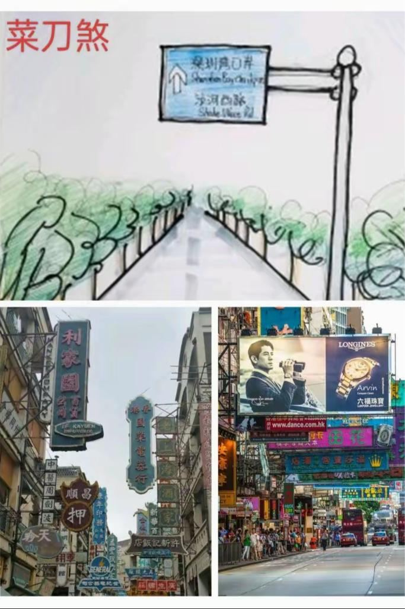
- 尖角煞：棱角直对房子，室内外都可能有。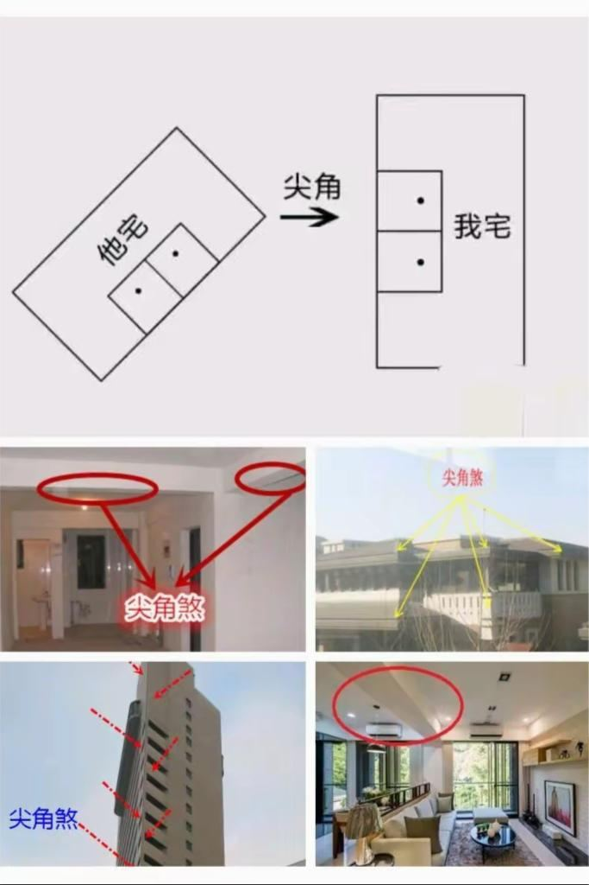
- 顶心煞：正对灯柱、电线杆、路牌、信号塔、大树干、烟囱等柱子；室内有柱子也算。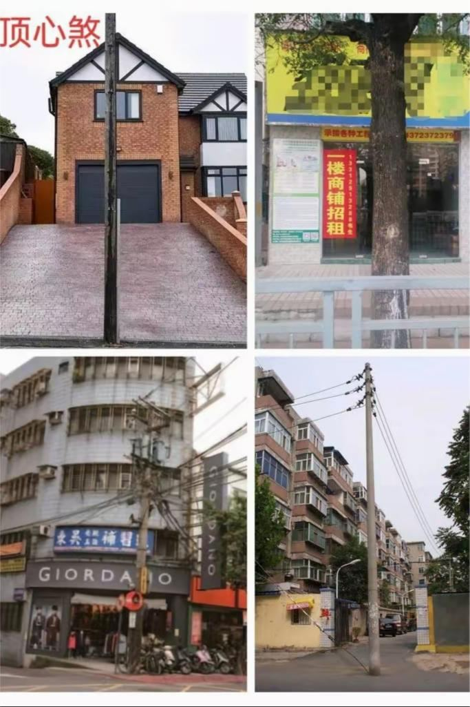
- 刀刃煞：薄片建筑对着你家。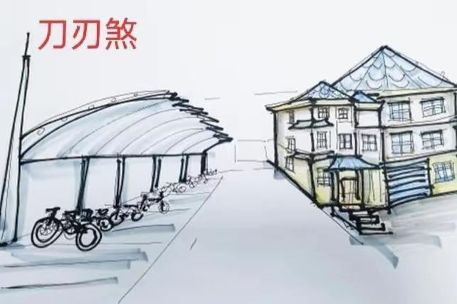
- 反弓水：路或河弯的外侧对着你家（刹不住车会撞进来）；弯的内侧反而是吉。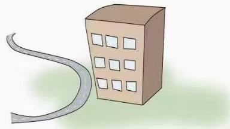
- 穿堂煞：门对窗、窗对窗形成对流风，气藏不住。横梁煞：床或沙发别放在横梁下面。
- 光煞：强反光、霓虹灯；室内大面积镜子或反光材料也算。刺煞：避雷针、电线、剪刀、菜刀、带刺植物（枣树、月季、金虎、仙人掌类、龙骨、虎皮兰等）。电磁煞：高压线、变压器、信号塔，属火煞。火形煞：三角形。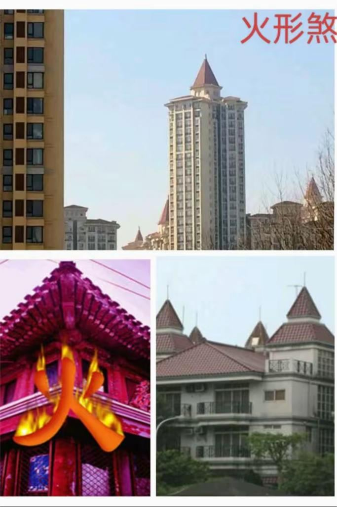
- 大部分煞都有直接的科学道理：撞车、飞物、风太强把气吹散，人就迷糊、破财、出意外。
- 名字不重要，看起来危险、让人不舒服的都算煞。君子不立于危墙之下。

关键词：煞、风煞、光煞、刺煞、路冲、天斩煞、穿堂煞、横梁、风水排查

## 第269章 你点个精，让我给你画龙？

化煞四法：避、挡、化、斗，首选避；照壁挡风最好；问问题要先自己想好，问成判断题或选择题。

- 问问题的礼貌：别丢一句话让老师讲半小时（"你点个睛，让我给你画龙"），把问题问具体，最好是判断题或选择题。
- 光煞：用不透光的窗帘挡住。刺煞：刀收进抽屉或刀盒，带刺植物搬出去。横梁煞：把床、沙发挪开。
- 穿堂煞：中间放屏风或挂珠帘，改变风的路径。
- 路冲、反弓水、割脚煞、天斩煞、壁刀煞、刀刃煞等风煞：让风别直冲房子。最好用照壁挡，钢刀戳背尤其如此；懒得做照壁可以种大型阔叶树。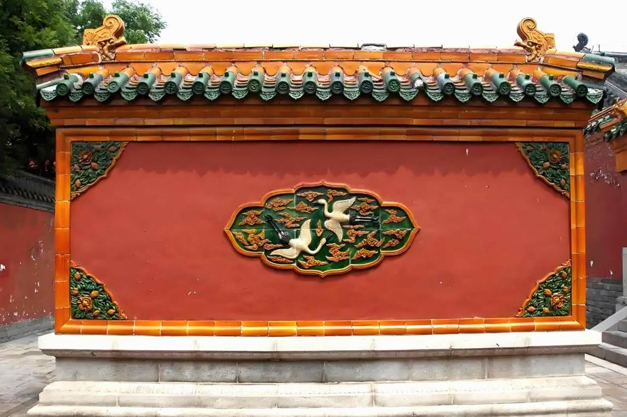
- "气遇风则散，遇水则止"：风煞可以用水化，比如路冲和房子之间有个池塘。但正北、正东不适用，会损伤那里的能量平衡。
- 火煞可以用水（鱼缸等）或属土的东西化解。
- 三点要记住：选吉日动，煞位用"偷修日"；不能顾头不顾腚，要综合考虑能量平衡；以人为本，人不舒服就说明摆放有问题，尽快调整。
- 实在不想动手，就用八卦镜、五帝钱、葫芦、麒麟、山海图等法器——作者说这相当于"花钱买小抄"。
- 正北有水坑，中间隔三排停车场，仍有影响；小水坑隔一栋楼或一道照壁就能隔住，大面积水隔着楼也有影响，北边多种树阻挡。
- 佛像要背靠实墙，不能放窗台；佛像和植物这两样调风水要谨慎：佛像要考虑吉凶位，植物品种多、说法不一，初学者不宜用。家里爱养植物的人大多脾胃不好。

> **风水调整｜化煞（避、挡、化、斗）**  
> 用来：家里或屋外有煞  
> 怎么做：1. 能避开就避开（挪床、挪沙发、收起刀具、搬走带刺植物）。2. 挡：光煞用遮光窗帘；风煞用照壁或大型阔叶树挡。3. 化：穿堂风用屏风或珠帘改风向；风煞可以用水化；火煞用鱼缸或土类物品。4. 最后才考虑法器。  
> 注意：动煞位选偷修日；正北、正东不要用水化煞；调完人不舒服要马上改回来。

> **风水调整｜火煞的化解**  
> 用来：屋外或屋内有火煞  
> 怎么做：用水（鱼缸等）或属土的东西来化解。

关键词：化煞、照壁、光煞、刺煞、横梁、佛像摆放、植物、提问

## 第270章 你不知道自己多优秀

家里爱养植物的人为什么脾胃不好：植物属木，木克土；而且九宫里土占三格，最容易受伤。学东西要先自己推理。

- 开口问之前先自己推理，问的时候写出推理过程；别人告诉你的是别人会的，自己推出来的才是自己会的。
- 农村房后排水沟也算正北见水；用水泥盖上，影响会小一些。
- 佛像放在哪里就加强哪里的能量：放凶位会加强凶，放风口聚不了气——不是佛菩萨不慈悲，而是顺应天道。
- 无花果能清热解毒、降三高，但吃多了舌头疼——信仰也一样，按规律来。"天地不仁，以万物为刍狗。"

关键词：植物、脾胃、推理、佛像摆放、无花果、坎1

## 第271章 天若有情天亦老

天地没有感情，只是规律；顺应规律就像被保佑。坎1放不了电器和佛像，可以放红色中国结；最大的护身符是德行。

- 刍狗是祭祀用的草狗，用完就扔。"天地不仁"不是一视同仁，而是天地根本没有心，只是规律。天若有情天亦老。
- 坎1宫能量偏低又放不下电器、佛像时，可以放红色物品；福字可以，红色中国结效果更好（颜色和线条走向都是吉祥的）。
- 风水的伤害像刀：最好把刀拿走；拿不走就"多穿几件衣服"。小刀可能完全挡住，大刀只能浅一点——敏感的人能感觉到，不敏感的人未必觉得有差别，但效果是一样的。
- 老人脑子迷糊不一定是年纪大，关键看乾位（管脑子）有没有受伤。
- 福地福人居，福人居福地：德行深厚的人自然会找到吉位，待在不好的位置也不受伤害。

> **风水调整｜坎1宫能量偏低时放红色物品**  
> 用来：正北（坎1）见水、能量低，又放不了电器或佛像  
> 怎么做：在该位置挂红色中国结（福字也可以）。

> **风水调整｜坎1能量低——放红色物品**  
> 用来：正北（坎1）能量偏低，又放不下电器、佛像  
> 怎么做：在坎1放红色的东西：福字可以，红色中国结效果更好（颜色和线条走向都吉祥）。

关键词：天道、德行、坎1、乾6、中国结、老人糊涂

## 第272章 改命的四种方法

八字像人生地图，能说哪里有弯、有坑，但不能断定你一定掉坑里；改命四法：积德、包容、和善、爱惜自己。

- 修行或积德的人会有变量：急转弯处停车救人反而没翻车；坑前有人来报恩送梯子。
- 《了凡四训》：袁了凡被算命先生算准了一生，后来经云谷禅师点拨，积德行善，结果考试名次、功名、得子、寿命都跟原来算的不一样了。
- "天作孽，犹可违；自作孽，不可活。"（《尚书》）"积善之家，必有余庆。"（《易经》）
- 《三命通会》也说同年同月同日生的人命运不同：八字只精确到时辰，没考虑空间；双胞胎在肚子里的位置都不同。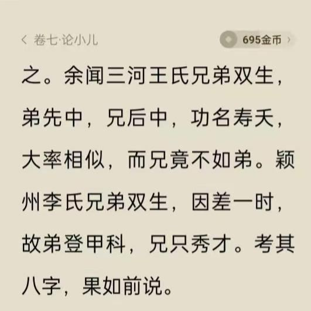

关键词：八字、改命、了凡四训、积德

## 第273章 八字准不准

八字只能推大运势，做不到百分百精准：道本身就模糊，八字时空不精确，理论也有分歧。

- 八字是天时，是人生的"起手牌"；但命运是天地人的综合结果。
- 历史：最早的八字算命法是唐朝进士李虚中发明的，韩愈评价"百不失一二"；后来徐子平改成四柱，就是现在的"子平八字"。
- 还有独立的神煞法；喜用神各派说法不同，有正断有反断，有的门派干脆不用。
- 作者：八字是"恰到好处的精准"，既有指引又给人留发挥空间；号称什么都能算准的大师，当神话故事看。

关键词：八字、预测、算命套路

## 第274章 精神内耗

艾伦把老客户转给作者，作者性格合不来却硬撑，陷入焦虑：脚步乱、常叹气、只剩"怎么办"。

- 焦虑的表现：走路越来越快、来回踱步、呼吸短浅总想深吸气（叹气），脑子里只有"怎么办"，静不下来思考。
- 韩愈《师说》："弟子不必不如师，师不必贤于弟子。"

关键词：焦虑、精神内耗

## 第275章 杀死精神内耗

同事丘书妍连问三遍"So what?（那又怎样？）"，作者一下想通：压力是自己给自己的。

- 想清楚最坏结果：老板会开除、鄙视、笑话我？我怕吗？并不怕。我有选择权和主动权。

关键词：精神内耗、那又怎样

## 第276章 面对的力量

用"那又怎样"一直追问到底，恐惧就消失了；这就是能量引导术——接受而不是对抗。

- 最坏也不过少赚点钱；钱能解决的问题都不是问题。
- 恐惧都是想出来的；敢于面对，结果往往没那么糟，甚至有意外之喜。
- 能量引导是接受和臣服：抗拒消耗能量；接受（甚至夸张地接受）会让负面能量消失。"受了受了，一受就了。"
- 相关：[能量引导术](../../book/07-修心/04-能量引导术.md)（第78章）。

> **修心方法｜"那又怎样"追问法**  
> 用来：焦虑、压力大、纠结放不下  
> 怎么做：遇到让你焦虑的事，问自己"那又怎样？"；如果还能找到焦虑的理由，再问一次；一直问到最坏结果出现"那又怎样"。想明白最坏结果也能接受，就有了面对的勇气。

关键词：精神内耗、那又怎样、能量引导术、焦虑、接受

## 第277章 内圣外王

想通后作者过于亢奋，抢着帮同事处理纠纷：一个小主管因为手下迟到被扣全勤奖而跟老板闹。

- 内圣外王：内心有力量时，外在世界就困不住你。

关键词：内圣外王

## 第278章 直面的解决问题

作者用合同和道理把小主管说得哑口无言，他回去上班了。

- 规则由发工资的人定；迟到了拿不到全勤奖本身是合理的，别人运气好没被抓，是别人的事。

关键词：职场、规则

## 第279章 不符合人性

合伙人说作者"不了解人性"：道理讲赢了，对方心里却憋屈；作者开始明白合理不一定合人性。

- 
- 小主管瘦长，是木行人；阴木的特点是好抗上、不服气。
- 上庭（额头）代表父母、长辈、领导；额头横纹杂乱的人，不尊重领导长辈（"亢上"），很难让他服软。

关键词：人性、面相、额头、木形人

## 第280章 梅毒终身制

有工人为省国内体检费直接来新加坡，结果查出肺结核、梅毒；新加坡嚼口香糖是违法的。

- 出国前一定先做国内体检：到了才查出传染病，治疗、食宿、雇主空岗都是大损失。
- 梅毒终身阳性，怀孕还可能母婴传染，需要定期复查并备案。
- 新加坡吃口香糖违法：初次罚几千人民币、留案底，再犯可能罚上万甚至判刑；要用纸巾包好扔进垃圾桶，别吐地上。

关键词：新加坡、出国打工、体检、梅毒、口香糖

## 第281章 再次遇见梅毒

气质温和的玉姐也查出梅毒，作者反思自己面相学得不到家。

- 作者看不出一个人私生活乱不乱——面相不能一眼看出谁有病。

关键词：梅毒、面相

## 第282章 知进退

玉姐是被丈夫传染的，为离婚偷偷出国；她出事还记得道歉，"知进退"让人舒服。

- 梅毒携带者在新加坡打针预防传染、备案、定期体检后，仍可以留下工作。
- 中介提供的是信息服务：签证、工作、按时拿工资；不是保姆，不管吃喝拉撒。

关键词：梅毒、知进退、中介

## 第283章 爱是生命的意义

善意会激起别人的善意；德行深厚的人万物都避让。玉姐的事也提醒作者：两性关系稍有不慎就是一辈子。

- 自私是生物本能，利他是德行的觉醒。
- 玉姐不怨恨不报复，只关注往前走——"受了受了，一受就了"。
- "含德之厚，比于赤子。毒虫不螫，猛兽不据，攫鸟不搏。"伤害一个善人比伤害恶人付出的心灵代价大得多。
- 《太上感应篇》："福祸无门，唯人自召。善恶之报，如影随形。"

关键词：德行、善、福人居福地、两性、性病

## 第284章 百人斩

作者劝"百人斩"：性病不是普通概率事件，一百次没中、中一次就是百分之百输了。

- 看起来干净不代表什么：一个人背后可能连着很多人。
- 做生意十次赔一次还赢了九次；这件事上中一次就全输了。

关键词：性病、两性、风险

## 第285章 天生我材必有用

天生我材必有用：作者建议他把"本事"做成情感培训，从生理需求提升到爱和尊重。

- 马斯洛需求理论：基本生理需求之上，还有安全、情感、被爱被尊重、发挥潜能、实现梦想。
- 取名"若水"：上善若水，又谐音"弱水三千，只取一瓢"；"若"的甲骨文是女人梳妆，意为顺应。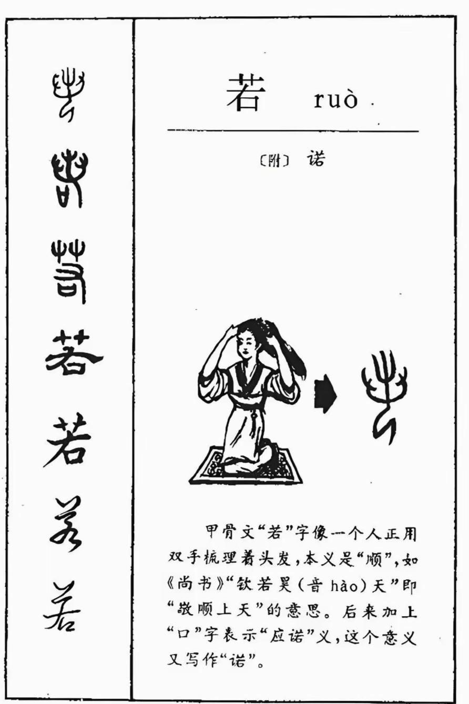

关键词：取名、天赋、需求层次

## 第286章 弱水三千

名字里有"若"字影响婚姻吗？作者不认同，"若"的本义是"顺"；柳凡茹认识七天就闪婚。

- 郭沫若婚姻多跟时代有关，不能赖"若"字。
- "若"主顺：认同顺应天地的人觉得是好字；爱争斗的人不喜欢用。感情需要两个人互相迁就。
- 作者的感情观："弱水三千，我只取一瓢饮"——见识过三千之后，只愿取你这一瓢。

关键词：姓名学、若、感情观

## 第287章 妖娆的工作服

珍珍把工作服穿出了"妖娆"的感觉，老板请作者吃饭。

## 第288章 全部男人

后厨三个人为珍珍拿刀打架，店里几乎全是男客人。

- 新加坡工签递交快，半天能办好签证和保险，第二天就能入境。

关键词：桃花

## 第289章 福祸相依

要不要给珍珍"斩桃花"？作者说斩桃花斩掉的也是人缘和生意，福祸相依；何香病危。

- "祸兮福之所倚，福兮祸之所伏"：被人喜欢多了是困扰，但没有这种喜欢，生活可能难以为继。
- 斩桃花斩的是别人对你的欣赏和喜欢，同时也斩掉了自己的人缘。
- 老板的办法：把后厨三人调到别的店，换女厨师。
- 何香感冒后感染到肾，引起急性肾衰竭，直接透析。

关键词：斩桃花、桃花、福祸相依、人缘

## 第290章 何香走了

何香因肾衰竭引发心衰去世；作者谈生死，决定去见比利牧师，了解基督教怎么看活着。

- 庄子妻死鼓盆而歌：生死交替像四季变换。
- "未知生，焉知死？""朝闻道，夕死可矣。"都是先把自己活明白。
- 新加坡邮政编码一楼一码，找地址很方便。

关键词：生死、何香、基督教

## 第291章 仙家是鬼吗

比利牧师：基督教反对占卜，是反对人听命于卦象；但按规律推理未来不算出卖灵魂。

- 大人知道抓刀刃会割手，就避开——这种预测只是规律推理。
- soul在希腊语里有"气息""生命"的意思；魔鬼是背叛上帝的灵体，背叛前是天使。
- 善易者不卜：不论有神论无神论，都相信人才是最关键的。

关键词：基督教、占卜、预测

## 第292章 宇宙的真相

比利牧师：科学与否不取决于你能不能理解，而取决于事实验证；有求必应的根本是爱。

- 电灯刚推广时说"灯头朝下"，用煤油灯的人觉得荒谬；用多了就没人怀疑了。
- 神爱世人；爱神、爱他人也是爱自己。给出去的力量就是给自己的力量。
- 佛家的慈悲、儒家的仁义礼智信、道家的天人合一，都是爱。

关键词：基督教、爱、科学、验证

## 第293章 伸出另一边的脸

人是神的殿；神的爱不分好人坏人；"有人打你右脸，连左脸也转过来给他打"。

- 爱人如己的前提是人本来爱自己。
- 儒释道和基督都说神或佛住在人心里："佛在灵山莫远求，灵山只在汝心头。"
- 基督不是黑社会：不论做什么只要是一伙就罩着——那不是神。爱不加害于人。

关键词：基督教、爱、忍辱

## 第294章 佛家是无神论

佛家六度（布施、持戒、忍辱、精进、禅定、般若）；作者说佛家其实是无神论：佛是开悟的人。

- 寒山问拾得：世人谤我欺我辱我怎么办？拾得答：忍他让他由他避他耐他敬他，不要理他，再待几年你且看他。
- 比利牧师：不信爱的人不是被神打入地狱，没有爱本身就在地狱。基督教不搞偶像崇拜，不烧香不磕头。
- 《金刚经》："若以色见我，以音声求我，是人行邪道，不能见如来。"

关键词：佛家、忍辱、六度、无神论

## 第295章 道家是无神论

作者认为道家也是无神论："我命由我不由天"；"人的命天注定"和"我命由我"说的不是同一个"命"。

- "人的命天注定"的命是起点：出生在什么时代、什么家庭，这改不了。
- "我命由我不由天"的命是过程：借助天地五行调整人生，即"命运"的"运"。

关键词：道家、命运、无神论

## 第296章 儒家是有神论

作者说儒家反而算有神论（"死生有命，富贵在天""敬鬼神而远之"）；儒家重哭丧，佛道倡导薄葬。

- 《黄帝内经》："道无鬼神，独来独往。"道家能抓鬼，就像警察抓坏人不代表信仰坏人。
- 儒家葬礼：哭三天入殓，服孝三年；佛家、道家、基督教都崇尚简约，念经或唱诗。道家重生轻死，反对生时不孝、死后哭鬼神。

关键词：儒家、葬礼、有神论

## 第297章 神阻挡骄傲的人

神阻挡骄傲的人，赐恩给谦卑的人；作者联想到谦卦和能量引导术里的"臣服"。

- 易经六十四卦里最吉利的是谦卦。
- 对抗消耗能量，臣服让能量回归自己；谦虚和臣服说的可能是同一件事。

关键词：谦虚、臣服、能量引导术、谦卦

## 第298章 奉献布施

基督教的十一奉献，和佛家、道家的布施、儒家的礼一样：想要有所得，先要有所舍。

- "捐得乐意的人，是神所喜爱的"——要随本心，不要勉强。
- 布施一词出自《庄子》："生不布施，死何含珠为？"
- 佛家三布施：财、法、无畏；道家三布施：法、身、财。
- 《金刚经》："应无所住行于布施"——无所求地给予，福德大到难以想象。

关键词：布施、奉献、舍得

## 第299章 花仙和树精

谁能做到不杀生？道家说的杀生是伤害生机，动植物都算；顺时而取不算杀。

- 佛观一钵水，八万四千虫——喝水、喘气都有微生物。
- 道家五戒之首是戒杀生；《太上感应篇》说"昆虫草木，犹不可伤"。
- 刚出生、生机旺盛的动植物不可杀；临老自死的、成熟的果实，顺应天道而取，不算杀害生机。儒家也讲顺时而取。

关键词：杀生、道家、万物有灵、顺时而取

## 第300章 财多伤人

财多伤人，多舍养身：儒释道和基督教都不提倡"把财宝积攒在地上"。

- "断一树，杀一兽，不以其时非孝也"——砍树打猎都要顺应天时。
- "仁者以财发身，不仁者以身发财。"（《大学》）钱不是永恒的宝贝，金多乱人心。
- 稻盛和夫捐出全部股份，带日航扭亏时拿零薪水。
- "施比受更为有福。"

关键词：钱、布施、财多伤人
