# 《改命记实录》逐章笔记：0301-0400

## 第301章 天地之主

"心者，天地万物之主也"不是说闭眼桌子就消失；看书要看原文，翻译容易走味。

- 例：塞翁失马里的"善术者"若译成"擅长骑马的人"，就讲不通了。所以作者引经据典尽量写原文。
- 儒释道和基督教都在用不同的话描述住在人心里的"天地万物之主"，所以都讲"有求必应""心想事成"。
- 焦点效应、聚光灯效应：人总以为别人很关注自己，其实大家都在忙自己的事，社交恐惧大多来源于此。

关键词：原文、心、焦点效应、社交恐惧

## 第302章 天道地道人道

心无挂碍就无有恐怖；致良知就是臣服；谦卦是唯一全吉的卦——"我有，但我不显"。

- 被情绪控制时，静坐旁观自己的念头（《臣服实验》）。
- "所不虑而知者，其良知也。"放下私心，站在天理的角度随心而为，就是良知，也是臣服。
- 地山谦：山在地下面。谦不是软弱，是明明有能力硬刚却选择低调。委曲求全的"曲"是弯曲，风水上"曲则顺，直则冲"。
- 谦卦卦辞：天道亏盈而益谦，地道变盈而流谦，鬼神害盈而福谦，人道恶盈而好谦——都趋向平衡。

关键词：谦卦、臣服、良知、恐惧

## 第303章 心的维度

越谦虚越被抬高，越高傲越被拉低；谦卦外顺内止，内心要知足；心的维度比脑子高。

- 没有人把谦虚的人当敌人；被人记恨的多半是嚣张狠戾的人。
- 知足："祸莫大于不知足"；"知足之人，虽贫而富"。
- 光环效应、投射效应、锚定效应都是大脑的推理；脑是一维的线，心是二维的面，差一个维度差无数倍。
- 修行靠行，不靠嘴。

关键词：谦虚、知足、心、心理学效应

## 第304章 无脑才能爽

无脑爽文放下了逻辑却没放下情绪；情绪被外物主宰时，快乐就不在自己手里。吴昊交了女朋友，问她金属过敏和牙痛。

- 修行讲的放空，既包括逻辑思维，也包括情绪起伏和执念。

关键词：情绪、放空、修行

## 第305章 气沉丹田

牙痛先默念象数000·777·000；牙痛、嗓子发炎多是气往上浮，要把气沉到丹田。

- 象数以默念、默想为主：出声念容易耗气；身边有人时出声会干扰别人，敏感的人听了可能头晕恶心。
- 上火多因生气，"火是气之余"。牙痛、嗓子发炎一般是气上浮了。
- 丹田在肚脐下方。练法：慢慢呼吸，感受吸入的气越来越深，一直沉到肚脐下方。
- 呼吸以绵长轻缓为好，不要太急、太粗、太短——"曲则顺，直则冲"。

> **象数｜象数 000·777·000 止牙痛**  
> 用来：牙痛，也可以缓解其他疼痛  
> 怎么做：默念或默想"零零零、七七七、零零零"，好了就停。  
> 注意：000是强烈加强，不要长时间念。

> **功法｜气沉丹田**  
> 用来：上火、牙痛、嗓子发炎等"气往上浮"的问题  
> 怎么做：先感受吸进来的气停在哪里（多数人只到胸口或嗓子）；然后慢慢地、绵长轻缓地呼吸，想象气一次比一次深，一直沉到肚脐下方的丹田。

关键词：牙痛、象数、丹田、呼吸、上火

## 第306章 艮八命宫

皮肤敏感主要跟脾胃有关，九宫里艮8主脾胃；要么家里艮8受伤，要么命宫就是艮8。

- 艮8命宫的人，皮肤过敏、缺钙、鼻炎等艮8对应的问题更容易中招。
- 艮8宫受伤的情况：放了红色物品、电器等属火的东西（能量过高）；有煞；缺角；被克（如植物，木克土）。
- 斗法（化煞第四法）：没有金刚钻不揽瓷器活，能避让就别斗。

> **风水调整｜艮8宫（东北）受伤的调整**  
> 用来：皮肤过敏、鼻炎、缺钙、脾胃问题  
> 怎么做：把红色物品、电器等属火的东西挪走；把植物挪走（木克土）；有煞就按避、挡、化处理；缺角就补土（见第312章）。

关键词：艮8、皮肤过敏、脾胃、命宫、鼻炎、缺钙

## 第307章 化煞

风水斗法的经典案例：香港中环汇丰银行怎么化解维多利亚港的煞气。

- 有情水与无情水：能藏风纳气的为有情（来水开阔、去水弯曲、水口紧锁）；直冲水、割脚水、反弓水、来水小去水大为无情。
- 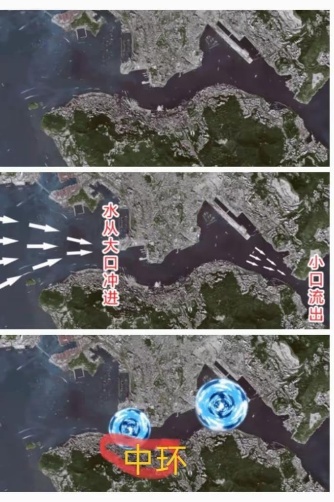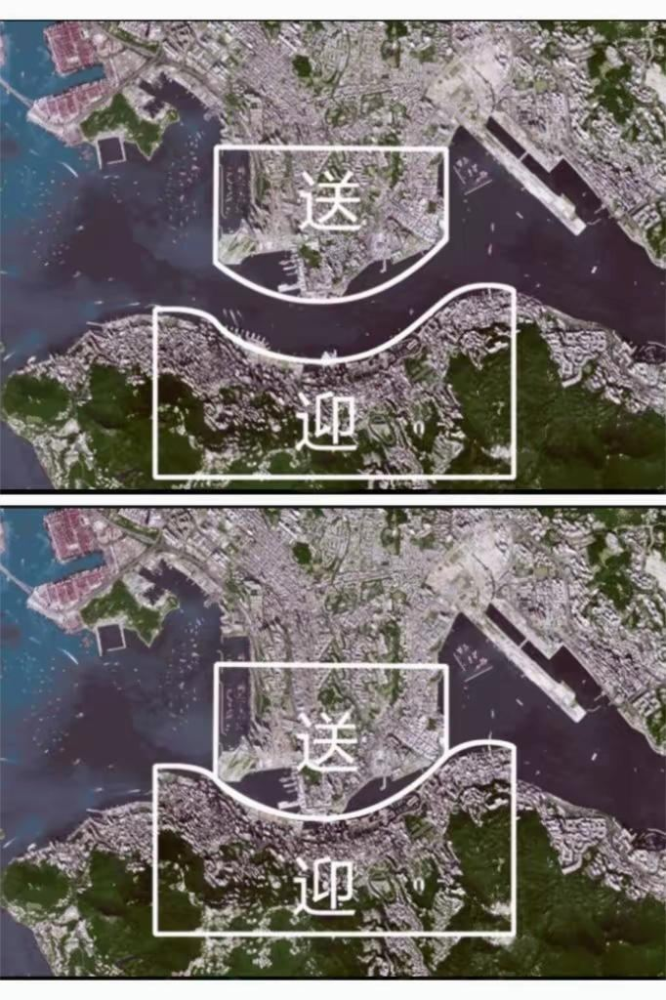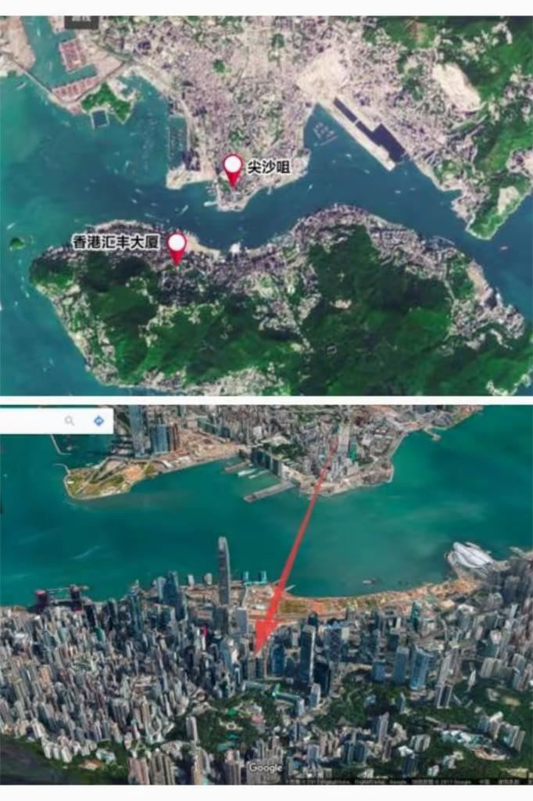
- 第一层：摩天轮让气循环，减弱直冲之势。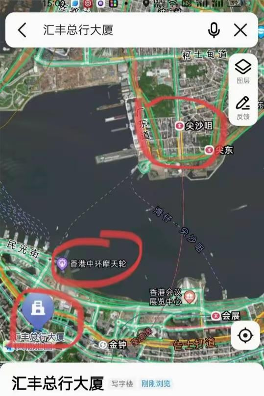
- 第二层：买下多一倍的地皮，临海一侧做成种满树的皇后像广场。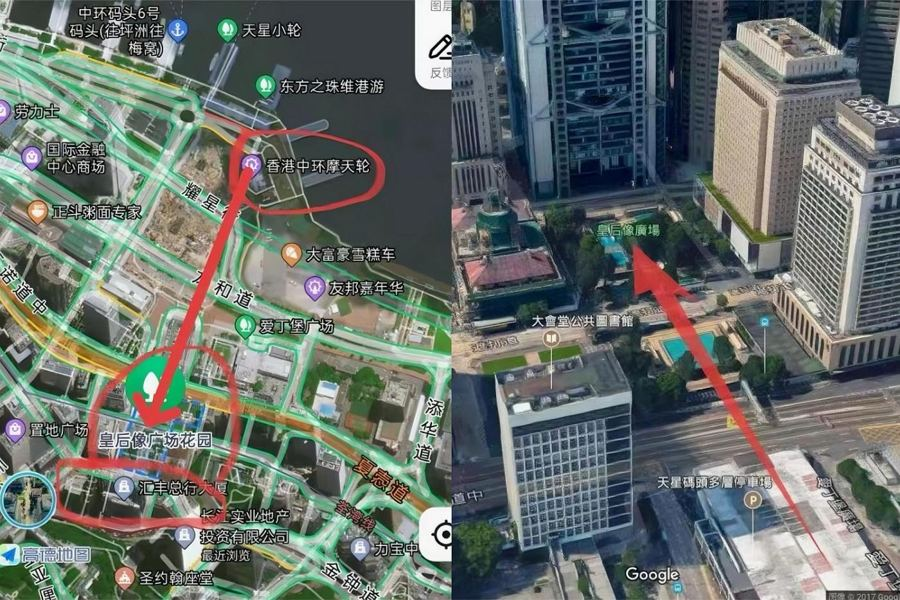
- 第三层：门口两头铜狮子（还印在了港币上——香港纸币由银行自己发行）。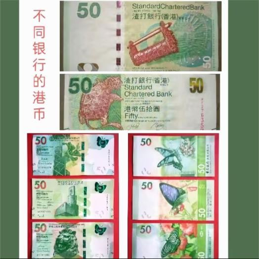

关键词：风水斗法、汇丰银行、有情水、无情水、化煞

## 第308章 煞气为财

汇丰一楼架空让煞气从底下过，二楼大屏幕当照壁，中庭像烟囱把气化成财；煞气和财气可以互相转化。

- 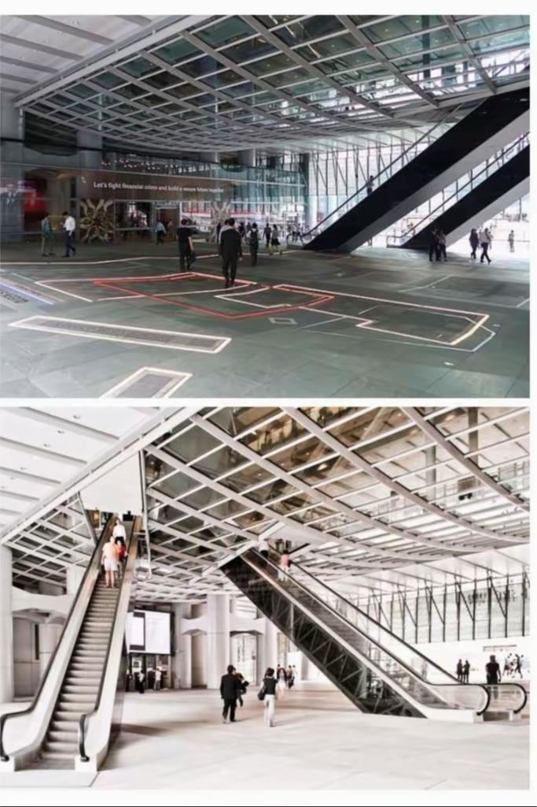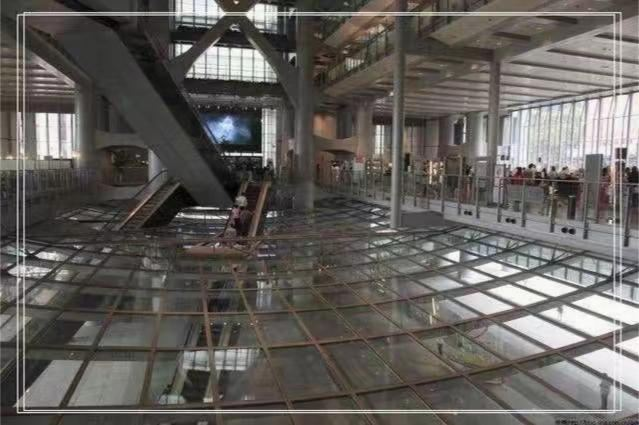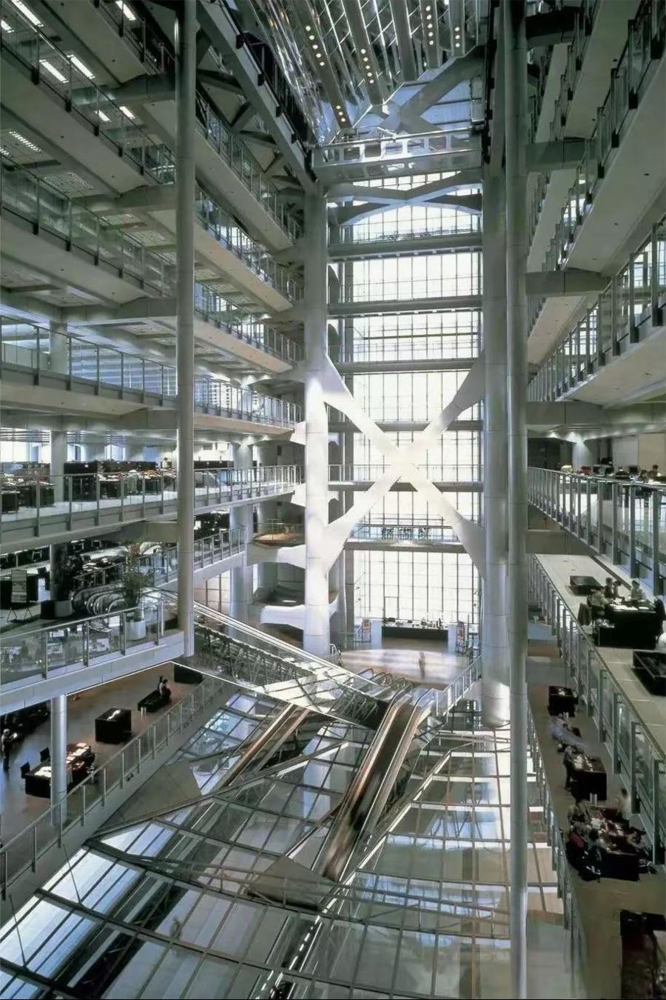
- 气太大就是煞，没气就死气沉沉；关键是要柔和。
- 上位者身上的"杀气"叫官威，不能太重。做人外圆内方、刚柔并济。
- 同样的气，运势旺、能驾驭时是财气，德行或运势不够时就成了煞气。中彩票后妻离子散、众叛亲离、赌博返贫、被骗、被抢——都是驾驭不了财气。

关键词：煞气、财气、汇丰银行、中彩票

## 第309章 每个人都知道答案

多大的财、多大的房子你能驾驭？每个人心里都知道——只要不贪心、不攀比。

- 就像跳沟：觉得自己跳得过去，大概率跳得过去；觉得不行还硬跳，大概率掉进去。
- 房子能驾驭的就是好的；挑不起硬挑，会伤筋骨——是自己的贪念伤了自己。
- 注意力就是生命力：把注意力放在自己身上，别人赚多少、住多大与你无关。"一切唯心造。"

关键词：驾驭、买房、贪心、攀比

## 第310章 煞气的大小

让自己舒服的房子是跟自己匹配的，但不一定是风水好的；十字路口的小煞气，压得住的大商场、银行反而能化为财。

- 太小的房子一进去压抑、太大的房子一进去心慌空荡，都不适合你。
- 跟选头像一样：心情差的人喜欢晦暗的头像，跟能量场匹配，但不助运。
- 中银大厦地小，建成三棱刀形，高度压过汇丰。刀刃越锋利，煞气越重（剪刀煞也是）。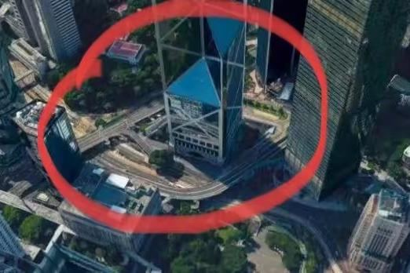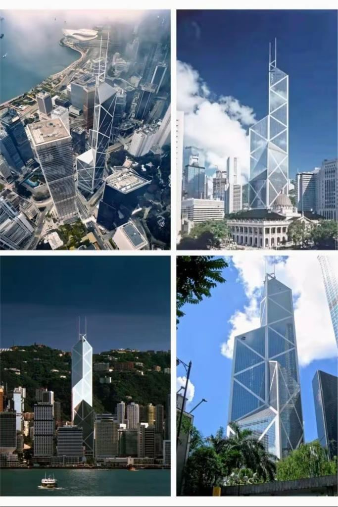
- 泼天的富贵，要看自己接不接得住；接不住就避开，否则伤财伤人。

关键词：买房、匹配、头像、十字路口、剪刀煞、中银大厦

## 第311章 风水大战

中银三刃分别指向港督府、驻军和汇丰；汇丰楼顶架"大炮"反击；长江实业大厦则以防御为主。

- 汇丰楼顶的"大炮"号称是清洗玻璃的吊车，人称"刀来炮往"。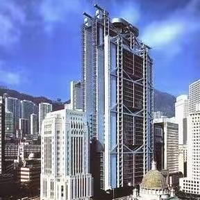
- 远东金融中心整栋做成大铜镜反煞；交易广场和政府总部前面设花园减煞；政府总部中间镂空，叫"门常开"。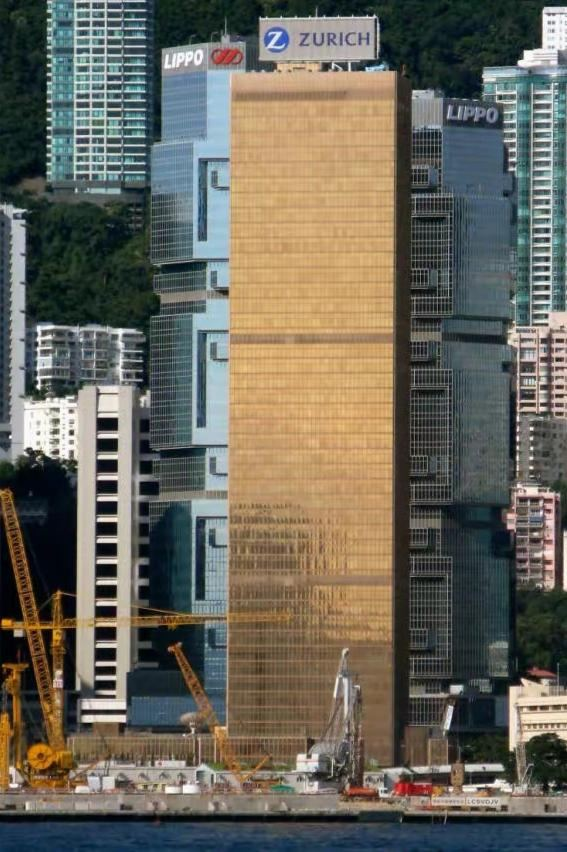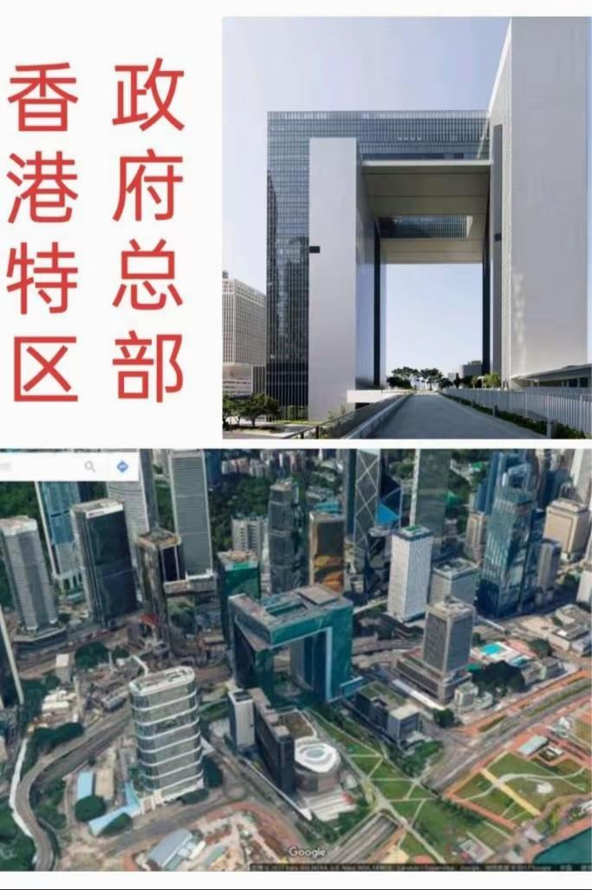
- 长江实业大厦：外墙防弹玻璃加钢骨，像四面盾牌；高度刚好低于中银和汇丰最高点的连线；汇丰在它的白虎位，"宁可青龙高千丈，不可白虎抬头望"；楼体棱角削平，显得内敛。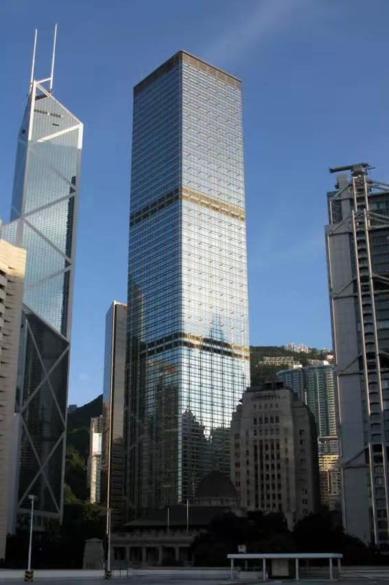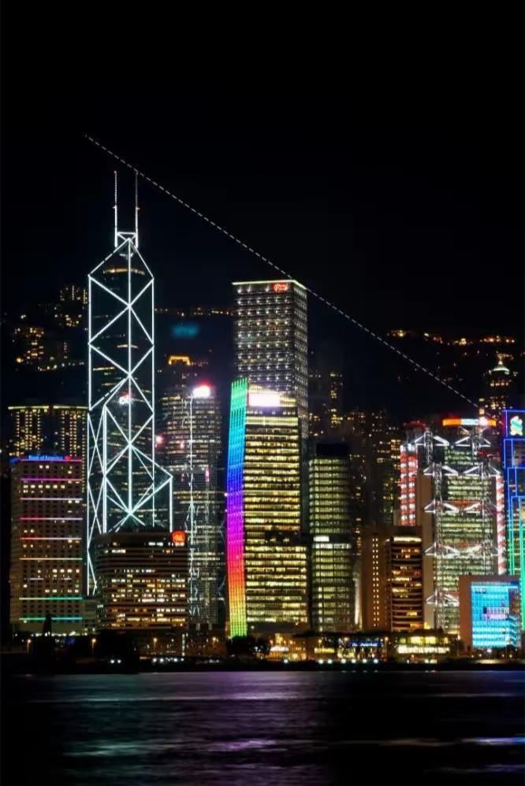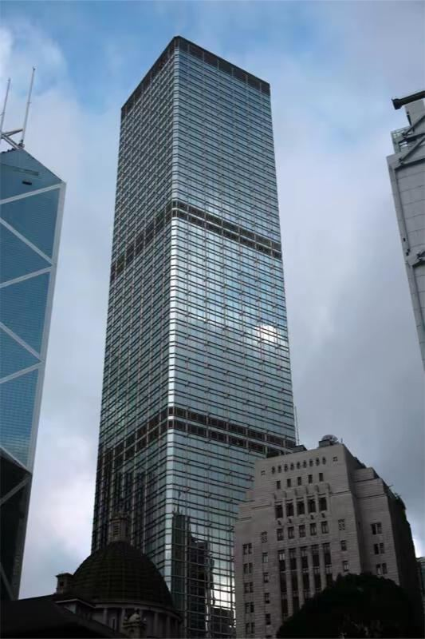
- 懂风水的人无非是借势；功夫再高也怕菜刀。

关键词：风水斗法、中银大厦、长江实业、青龙白虎

## 第312章 艮宫补角

艮8缺角就在那里放一盆土，容器首选正方形；不同形状有不同五行。000·777·000让女友牙不疼了。

- 形状的五行：三角形、尖锐像火苗——火；波浪曲线——水；细长方形像树——木；圆形——金（也有说属土）；方形（天圆地方）——土。
- 每个宫五行不同，缺角的补法也不同。

> **风水调整｜艮8（东北）缺角补土**  
> 用来：房子东北角缺角  
> 怎么做：在缺角的位置放一盆土，容器首选正方形，实在找不到再用圆形。

关键词：缺角、艮8、五行形状、补角

## 第313章 干土和湿土

为什么000·777·000能止痛：先天八卦里7是艮，艮为山、为止；平时护牙念1600·7200。后脑大椎上方爱出汗怕风，是卫气弱了。

- 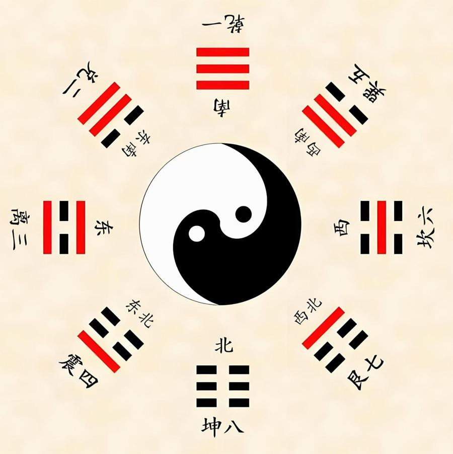
- 000是加强，7是"止"，所以能止痛。
- 1600·7200：金生水，肾主骨，牙齿属骨。
- 卫气是身体表层保护我们的气，防外邪、调体温；某处卫气薄，就收不住汗、挡不住寒。

> **象数｜象数 1600·7200 护牙**  
> 用来：平时保护牙齿  
> 怎么做：平时默念"一六零零、七二零零"。

> **穴位｜艾灸大椎补卫气**  
> 用来：后脑勺大椎穴上方一块容易出汗、怕风  
> 怎么做：用艾灸在这个部位稍微灸一下，几分钟就好；也可以练气功增强自身的气。  
> 注意：最长不要超过15分钟，时间长了容易上火。

关键词：牙痛、象数、先天八卦、卫气、出汗、怕风、艾灸、大椎

## 第314章 预防大于治疗

风水预防大于治疗，上医治未病；姑奶奶买了前房东"发家"的房子，住进来生意反而变差。

- 房子最好买之前就考虑好，出了问题再换很不方便。
- 东户、前房东不到45岁——作者一听就猜到问题在哪。

关键词：买房、预防

## 第315章 房子的流年运势

房子有"流年运势"：九宫从艮8开始，每宫管9岁，顺时针一圈；缺哪个角，对应年龄段的人运势不利。

- 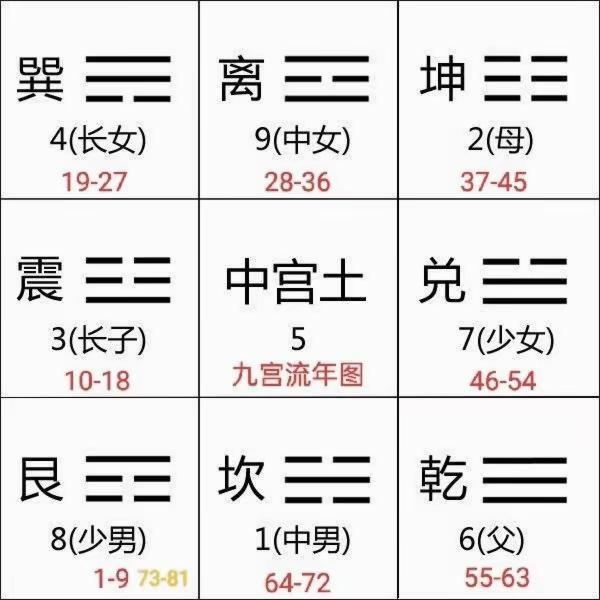
- 同一件衣服有人穿着好看有人不好看；房子也要跟人匹配。
- 姑奶奶家是东户：西北角是楼梯缺了一角，西南又多出一块——45岁以前那段流年特别旺，前房东刚好走这个运；他因孩子上学搬走，正好在临界点前。
- 老小孩：老人走一圈又回到艮宫（子孙位），重新带上小孩的特质。

关键词：买房、流年、缺角、九宫、年龄

## 第316章 法不责众吗

大家都缺角就"法不责众"吗？作者认为不会，大面积犯错就大面积受影响；乾6缺角可以放金属乾卦牌。

- 东北角是艮宫、子孙位：缺角伤子嗣、易流产。
- 西北角是乾宫、财库：缺角伤财、存不住钱。作者举例：以前农村人钱少却存得下；现在多数人欠着卡债。
- 以前住平房不缺角也有很多人流产，原因：艮宫受伤不一定是缺角（比如东北是厨房、有镜煞）；还有阴宅；风水只是地运，还有天时大运（唐山大地震、计划生育都是大运）。

> **风水调整｜乾6（西北）缺角挂金属乾卦牌**  
> 用来：房子西北角缺角、存不住钱  
> 怎么做：乾属金，可以在缺角处放金属摆件，金属的乾卦牌更好；安放要选吉日。  
> 注意：这只是"加盾牌"，最好的办法还是换房子避开。

关键词：缺角、乾6、艮8、法不责众、流产、存钱

## 第317章 最好的化解办法

最好的化解是避开（换房），其次才是"加盾牌"；就像高考，基础差只能"提高一分是一分"。

- 作者不爱随口给人看风水：随口问的人多想听好话，说真话招人烦，说假话自己不愿意——所以讲原理，让人自己决定。
- 想省事就把期望放低一点，这样就去除了贪念。

关键词：化解、期望、贪念

## 第318章 女主人住厕所？

开光就是念经诵咒，人人能做；"各司其位"不是让女主人住西南、男主人住西北分房睡。

- 法器从稳妥渠道、厚道的人那里正常请就行，不用太麻烦。
- 农村房子一样套九宫：整体是大太极，每个房间、院子是小太极。
- 婚配好的夫妻越亲密越好；婚配不好的分居可以减少不利能量。"各司其位"司的是五行属性和职能，不是具体的某个人。
- 学什么都要系统地学，东听一句西听一句容易出错。

关键词：开光、各司其位、分房睡、女主人位

## 第319章 现世报

入门书推荐《阳宅三要》《八宅明镜》；违法乱纪的人看似更容易富，但大多会"现世报"。

- 作者是实用主义：门派不重要，好用就行。
- 自利性偏差：成功归于自己厉害，失败归于外因；顺风顺水时容易傲慢，消耗福报很快。
- 不必看他们现在多嚣张，只看曾经嚣张的那些人现在在哪里。

关键词：入门书、德行、现世报、自利性偏差

## 第320章 皮肤过敏

皮肤过敏可以念象数0002或70·2000；洗发水过敏可以换成酸性洗发水。丘书妍请作者去看她哥哥家的风水。

> **象数｜象数 0002 或 70·2000**  
> 用来：皮肤过敏  
> 怎么做：默念"零零零二"，或"七零、二零零零"。

> **生活方法｜换酸性洗发水**  
> 用来：用洗发水头皮过敏  
> 怎么做：超市常见的海飞丝、飘柔等多是碱性，换成酸性洗发水。

关键词：皮肤过敏、象数、洗发水

## 第321章 十年没考下来的驾照

丘书妍让作者假装去打麻将，顺便看她哥哥家；她驾照考了十年没考下来。

- 自己的劣势，在别人眼里可能就是优势。

## 第322章 怪病

丘书妍的哥哥友真会突然浑身无力倒地，医院查不出原因。

关键词：怪病

## 第323章 绝对的随心所欲

友真家天清地浊反了：黑色吊顶、黑墙、纯白地面——"乌云盖顶"。

- 庄周贷粟：作者向往庄子的洒脱，但不想穷到吃不上饭。
- "天清地浊"：天花板要清新明朗，地面要深色浊重。深色吸收各种光，象征大地承载，也耐脏好打扫。
- 黑色顶本就不清明，再做吊顶压低层高，更压人。

关键词：装修、天清地浊、吊顶、颜色

## 第324章 Jaya走了

作者约好和丘书妍一起去泰国；阿茵来电话说Jaya走了。

- Jaya只是有点吐奶，不哭不闹，用小脚踢人"提醒"；查出严重脑炎，还在签ICU文件时就走了。

关键词：Jaya、报恩宝宝

## 第325章 生命的觉醒

阿茵觉得离开的时间是Jaya自己选的；她要助印作者整理的《地藏经》。

- 走的时候奶粉只剩一天量、纸尿裤只剩半天——一点不浪费。
- 他提示家人去医院，又不给医院留抢救时间，让家人不必自责"过度治疗"。
- 不求长命百岁，只求走得体面；能安详离开是莫大的福报。祝福是最好的告别。

关键词：Jaya、生死、地藏经、助印

## 第326章 风水上的能量不足

常出差、不爱回家，也可能是风水：房子太小或太低、对应宫位缺角或有煞，人就待不住。

- 人是环境的产物：身边的人都努力，你也不好意思睡懒觉。
- 房子太小、顶太低压人，人就会找理由往外跑：加班、出差、打牌。
- 家里对应的宫位缺角或有煞，对应的人在家能量不足，也会想出去。
- 命宫也有影响：巽4命宫（巽为风）的人本来就爱往外跑；被压在家里，身体和事业反而受影响。
- 努力是必须的，风水是外援。

关键词：风水、出差、不爱回家、缺角、巽4

## 第327章 何为吉日

作者不愿意给不信的人看风水，免得造口业；你选周末结婚，其实也是在"择吉"。

- 看了不改心里膈应，还不如不知道；最好先懂原理、自己验证，再决定改不改。
- 择吉无非是为了顺利；风水有一百多个门派，择吉标准各不同，好用就行。一切理论都是为人服务的。

关键词：择吉、口业、结婚日子

## 第328章 疑罪从无

对"开天眼"之类的说法，作者用"疑罪从无"：不能证明是假的，就保持中立，不盲从也不否定。

- 投射效应：相同投射（有一种冷叫妈妈觉得你冷）、情感投射（喜欢的人捂胸口是病美人，不喜欢的就是东施效颦）。

关键词：疑罪从无、投射、天眼

## 第329章 从迷茫中走出来

愿望投射是把自己不接纳的部分强加给别人；走出迷茫只要两步：每天问自己"现在有什么感觉"，再问"为什么"。

- 抱怨别人小气的人，自己往往也不大气。
- 不愤不启，不悱不发；人之患在好为人师——不问不教，不求不救。
- 同一栋楼户型一样，各家遭遇却不一样：东北艮土缺角，可能伤胎儿、伤小孩、伤脾胃、伤腿脚、过敏、鼻炎、缺钙；缺钙又可能是生长痛、骨质疏松、抽筋、长不高、盗汗、枕秃、鸡胸、罗圈腿、出牙晚等；再加上流年和八字、家里的摆设，结果当然不同。

> **修心方法｜两步走出迷茫**  
> 用来：情绪麻木、分不清自己想要什么  
> 怎么做：1. 每天找个时间问自己："我现在有什么感觉？"如果答案是"没感觉"，就继续找。2. 找到感觉后问："为什么会有这种情绪？我应该有什么样的情绪？"

关键词：投射、迷茫、艮8、缺角、缺钙

## 第330章 中宫太重要

厕所千万别放在中宫：中宫是房子的心脏，谁都管，宜静不宜动，放水会动荡、还拉低能量。

- 小月的大姑姐以为中宫没有对应的家人，就特意选了厕所在中宫的房子。
- 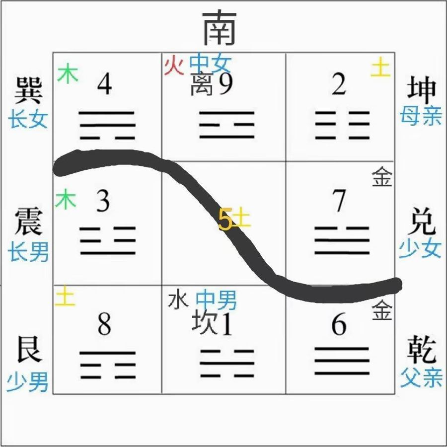

关键词：中宫、厕所、各司其位

## 第331章 万物皆可克

选房先看四象大势，再让每个宫格尽量趋向5的平衡；大姑姐把鱼缸放中宫是想"土克水、克者为财"——这是把话用歪了。

- 换房宁可伤点胳膊腿，也别伤到核心（中宫）。
- 四象地势：北玄武最高，东青龙次之，西白虎再次，南朱雀最低，要宽敞明亮；四个方位都不要有煞。
- 室内：每个宫格都向5平衡。厕所放大于5的宫位，厨房放小于5的宫位；但厕所是煞，大于5的宫位里还要避开乾6（脑）和离9（心）。

关键词：选房、四象、中宫、厕所位置、厨房位置、鱼缸

## 第332章 心静再做决定

放鱼缸就能发财，卖鱼的最发财了——"鱼缸旺财"更像吉祥话；风水以简洁为上，做多错多。

- 实践是检验真理的唯一标准；说的人多不代表符合规律。
- 中宫是厕所又一时换不了房：脏水在中宫动荡没有好办法，只能净化空气、减少浊气。
- 人在心静时才能做正确决定；迷糊的时候先把气沉下去，别做重大决定。

> **风水调整｜非要养鱼缸怎么放**  
> 用来：家里想放鱼缸  
> 怎么做：1. 放客厅，不放卧室（卧室喜静）。2. 放沙发前面，不放沙发后面（沙发后要有靠）。3. 放在数字大于5的宫位；12345位见水，作者见过都有对应的伤害。4. 鱼的颜色别用红色（属火），换成黑白色。  
> 注意：吉位、凶位哪个更适合放鱼缸，各门派说法相反，作者没有大量验证；作者本人不建议家里摆太多东西。

关键词：鱼缸、旺财、简洁、中宫、心静

## 第333章 师父大餐

大姑姐讲究的"水为财、克者为财、各司其位"都没错，错在没理解原理、用错了地方；同学君君带作者去拜访各路师父。

- 作者的比喻：穿内裤没错，但只买得起一件衣服时，宁可买条外穿的短裤——要理解原意，灵活变通。

关键词：风水误用、原理

## 第334章 不讲究风水

去五台山下来的善树师父的禅院；禅院坐西朝东，门开在土路通上来的地方。

- 作者拜访佛家师父的两个目的：问佛像摆放最正宗的说法；验证修行人受不受风水影响。
- 一般修行场所坐北朝南、背山面水。

关键词：禅院、佛像摆放

## 第335章 风水上的财务通道

禅院大殿和佛像都在兑7位：佛像属火，火克金，兑7又是财源（坤2）到财库（乾6）中间的"财务通道"——有钱进不了库。

- 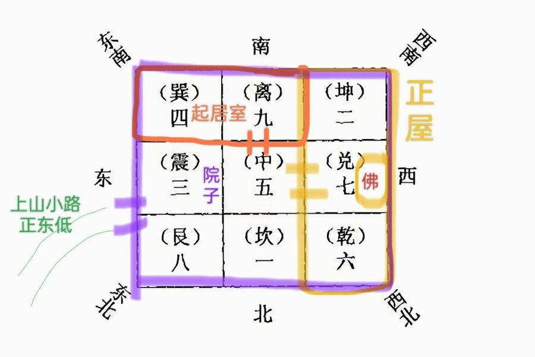
- 兑7属金，主肺，也主财。
- 善树师父一直咳嗽，说是业力；作者心里想的是兑7被克伤肺。

关键词：兑7、佛像摆放、火克金、财务通道、咳嗽、肺

## 第336章 附佛法外道

善树师父斥作者信风水是"附佛法外道""佛不欢喜"。

关键词：门户之见

## 第337章 趋吉避凶

内在的趋吉避凶：好听的我信，打压我的我不信。

- 张口闭口"佛不欢喜"、只有佛好其他都要贬低，本身就着相了。

关键词：趋吉避凶、心态

## 第338章 跳出五行之外

不是佛菩萨克谁，是五行火克金；业力解释为什么挨打，风水是那根打人的棒子。修行到很高才能跳出五行。

- 摆对有对的效果，摆错有错的效果，不涉及发心。

关键词：业力、风水、五行

## 第339章 峦头和理气

风水两大派：峦头派看得见的山形地势，理气派看不见的八卦气场；有形的物和无形的气都是能量。

- E=mc²：质量和能量可以互换，所以有形的峦头是大团的能量。
- 人的能量还有心灵和意识层面；力不从心不是心没力量，是不知道自己有。佛道都讲向内求。

关键词：峦头、理气、能量、向内求

## 第340章 力量的源泉

人生像骑车，靠自己蹬，没力气时外力推一把也有用，但别依赖；"峦头无假，理气无真"；东青龙是天道。

- 该内求内求，该借力借力。
- 峦头看得见做不了假；理气的吉凶位不好证明。
- 古时房子多坐北朝南，东青龙西白虎就是左青龙右白虎。后来房子朝向各异，有门派按房子坐向论左右——但太阳总从东边升起，东边是青龙，这是天道。

关键词：峦头、理气、青龙白虎、四象

## 第341章 兼顾

房子朝向和天道方位冲突时要"兼顾"：人天生左手护心，左边更有安全感。

- 坐南朝北的房子，右手是东边——天道的青龙位成了房子的白虎位，两种都要照顾到。
- 比喻：天道像婆婆，房子像媳妇；婆媳融洽最好，不合就得兼顾。

关键词：青龙白虎、坐向、兼顾

## 第342章 不聚气

禅院两套理论都缺青龙、白虎高（伤财、招小人、女人强势）；门前一路向下没有案山朝山，气聚不住，财就聚不住。

- 青龙主事业，缺青龙不利事业。
- 按房子坐向论，玄武（正房）高，个人有实力有靠山；按地理方位论，北边空、南边有厢房，有头无尾、先起后落，大势上缺靠山。
- 朱雀位宜宽敞明亮，但不能一望无际，前面要有案山、朝山聚气。

关键词：青龙、白虎、朱雀、玄武、聚气、案山

## 第343章 佛学院的执念

入户门正对向下的楼梯，也是不聚财；L形像镰刀的房子伤人；妙渡师父说：既不执着于风水，也不执着于排斥风水。

- 人有感应，住在镰刀形房子里被气场所伤，可能心浮气躁、说话难听——不一定是本心。
- 少林寺、大法王寺哪个不是顺应风水建造的？大自然规律谁都得遵守。
- 于师父用阳历生日推算，智策师父"不动不占"。

关键词：入户门、楼梯、镰刀煞、L形房、不执着

## 第344章 不同的结果

作者算杰夫去年会"破"，于师父用毕达哥拉斯数字法算出是今年；"破"属金，容易应在巳酉丑月（农历四、八、十二月）。

- 破是运势极差，像一把刀，伤最重要的东西：破大财，或破人（受伤、婚姻终止）。
- 测不准是忽视了新变量；算错正好找问题。
- 于师父的方法用阳历（公历）生日，据说源自毕达哥拉斯，叫数字能量、生命密码等。

关键词：流年、破、数字能量、生命密码

## 第345章 网评差PK网评差

于师父：同一套"生命密码"被各家老师改名演绎，准不准看人；作者用的是网评同样差的"八星理论"。

- 毕达哥拉斯是勾股定理、黄金分割的发现者；但公元纪年在他之后几百年才有，所以有人质疑这套理论不是他发明的。
- 很多八字大师算不准，不能赖八字理论本身。

关键词：生命密码、八星、预测

## 第346章 存同求异

八星理论简单、准确率高，基础是能量场；算出要"破"，可以用破财来消灾，但必须是"大笔"的破财。

- 八星看一眼卦就能断，不够精细；奇门一个卦能聊一个多小时。
- 宁可破财，不要伤人。能量像水，宜疏不宜堵：买个护身符就像拿水瓢舀堤坝里的水，能减压，不能根本解决。
- 破财分喜破（主动大笔花钱）和凶破（被罚、被骗、住院等）。
- 作者的看法：无论天时、地利、手机号、风水、头像，只要形成破的磁场就会破。

关键词：八星、破、破财消灾、能量场

## 第347章 揭晓谜底

谜底：杰夫在元旦假期后离的婚——阴历还是去年十二月、阳历已是今年，两人都算对了。

- 篇外提醒：网络上认识的人没有信任基础，不要轻易相信，私下金钱交易与本书无关。九运离火，离中虚，假的比真的多。

关键词：流年、破、离婚、防骗

## 第348章 三元命原始算法

三元命卦用公历年数字相加，只是数学上的简便算法，不是理论本身；原法是按三元九运和干支口诀排的。

- 八星出自八宅风水，据传唐朝僧人一行创立，讲房子与命卦匹配。
- 三元九运从轩辕黄帝元年（公元前2697年）起算：20年一运，三运（60年）一元，上中下三元共180年一个循环。
- 全书最需要记住的是九宫图：风水、命理、手相、面相、八字、奇门都要用。

关键词：三元命、命宫、三元九运、八宅、九宫

## 第349章 三元命口诀

三元命口诀：男命上元起坎、中元起巽、下元起兑，逆行，遇5寄坤2；女命上元起中五、中元起坤、下元起艮，顺行，遇5寄艮8。

- 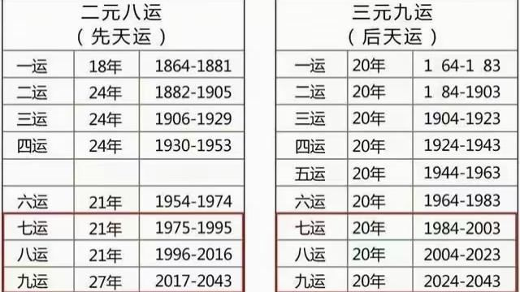
- 例：1984年是下元甲子年，男命兑7；1985乾6；1986中5寄坤2；1987巽4；1988震3；1989坤2；1990坎1；1991离9；1992艮8；1993又回到兑7，九年一循环。女命顺排。

关键词：三元命、命宫、口诀

## 第350章 师出有名

杰夫拜智策师父为师；每个人心里都有杆秤，谁也不愿白占便宜，有来有往才"师出有名"。

- 法不空传。

关键词：拜师、礼尚往来

## 第351章 生命密码

生命密码把人分成1到9号数字，多层叠加看性格；作者主性格是4：爱学习、正直、会配置资源，但固执、不善表达。

- 十二生肖分12组，三元命卦分9组（用家庭人物描述性格更贴切），生命密码则是多个数字从不同角度立体描述人。
- 作者认为生命密码对天赋有参考性，但内容浅，只适合简单参考。

关键词：生命密码、性格

## 第352章 四个纬度

奇门遁甲从天、地、人、神四个维度预测和化解；化解风水前要先"破场"，不能直接动手。

- 天是天时（星体运动），地是风水，人是太极点，神是更高维度的力量。
- 智策师父说奇门还能看八字、看姓名、化病、还阴债、补财库、超度、画符、排兵布阵。
- 例：白虎位多了一堵墙要砸掉，不能直接拎锤去砸；场没破就动白虎（主伤灾），可能出意外，需要先破场、护体。

关键词：奇门遁甲、破场、白虎

## 第353章 气场的感知

智策师父让大家去两个位置体会气场：一处让人觉得往下坠、闭合、灰蒙蒙；另一处开阔、明亮、轻盈。

- 场看不见，但能感受到它作用在人身上的结果。

关键词：气场、能量场、感知

## 第354章 变易与不易

那两处分别是奇门的"死门"和"开门"，不是宫位的五行；易首先是变易，固定的盘只是工具。

- 智策师父：八星等理论西北永远是乾，是"不易"；但世界是变化的。工具像一把枪，离了人就找不到靶子。
- 奇门共有八门，对应不同的能量场。

关键词：奇门遁甲、八门、变易

## 第355章 学会闭嘴

学奇门会发疯吗？正心正念就不会，搞歪门邪道才会反噬；算命的人要学会闭嘴——来问的人既想你算准，又怕你算太准。

- 只要心静，一般人都能感受到气场；人多人少不影响。
- 打坐练功时起贪念、执迷幻境，也可能出偏。邪人用正术也害人，正人用邪术也救人，术只是工具。
- 当说则说。

关键词：奇门遁甲、出偏、闭嘴、人性

## 第356章 还阴债

人人都有"阴债"，或轻或重；还阴债要慎重，别随便找人乱做。同一位置的气场会随天时变化，作用在人身上的吉凶也会变。

- 月圆月缺影响人的情绪，满月时犯罪率、车祸率上升；潮汐也跟月亮有关。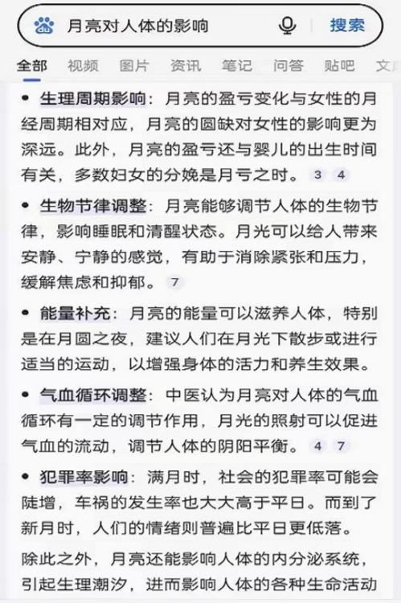
- 星体既影响外在风水，也影响人内在的气血循环。风水是为人服务的——以人为本。

关键词：阴债、天时、月亮、以人为本

## 第357章 因果

你正心正念地说，是你的因果；别人信不信，是他的因果。手机号比试：号码里多个5，断"身上有多处疤痕"。

- 智策师父劝一位缘主别投500万，后来证明是骗局——听劝是他的福报，不听是他的因果。
- 八星里5主伤疤，不一定是看得见的疤，拔牙、小时候的疤都算受伤。

关键词：因果、手机号、八星、疤痕

## 第358章 篇外：出路

篇外：找不到出路？先想自己愿意付出什么；实在不知道做什么，就一边学一边把学到的分享出去。

- 不会游泳，换个泳池也解决不了问题；缺的不是机会，是思维方式。反者道之动：想有所得，必先有所出。
- 在干中想比闷头想效率高；别让"还在学习"成为借口。
- 分享的内容最好是自己验证过的：生活小妙招、水培蔬菜、练功养生等都可以。
- 痛点即是出路：看到世界需要什么，就去做什么。

关键词：出路、分享、舍得

## 第359章 脾气好一切都好

号码里的121是两个"绝命"（12、21），主脾气硬、不受控制，巳酉丑年易破财；泰国白龙王说：脾气好，凡事都好。

- 八星看的是相邻两个数字之间的磁场。
- 绝命属金，带破的力量：喜破如买车买房，凶破如罚款、住院、被骗、生意赔钱。
- 同一套八星磁场可以看风水、流年、头像，一通百通。
- 禅院正东震3开门、兑7放佛像，3和7成绝命：佛像放哪就放大哪里的能量，绝命位主破财、破婚、破人（脾气冲、重病）。
- 不懂就尽量不摆佛像，少摆少错。麒麟是上古神兽，不是谁都压得住，压不住会反噬。

关键词：八星、绝命、手机号、脾气、佛像摆放、麒麟

## 第360章 断QQ号

不只手机号，QQ号、微信号、密码里有绝命（如12、96），也容易脾气不好、破财；尾号绝命或多个绝命，修行人也难控制脾气。

- 修身养性、脾气好的人，破坏力会小很多。
- 作者自嘲：奇门是国际一线大牌，八星是平替；奇门花50分努力得90分，八星、生命密码花10分努力得50分。
- 作者在文中注明：八星出自《八宅风水》，娱乐就好，不要迷信。

关键词：八星、绝命、手机号、微信号、密码

## 第361章 开光的能量

用手掌劳宫穴虚悬划过法器，可以感觉出哪些开过光；心越静越容易感知，也可以练。

- 孔子、老子、释迦牟尼、毕达哥拉斯都生活在公元前500年前后，东西方文明在同一时期高度发展。

> **功法｜用劳宫穴感知能量**  
> 用来：感受物件（如法器）有没有能量差别  
> 怎么做：手掌放松成虚掌，掌心（劳宫穴）对着物件，悬空慢慢依次划过，比较掌心的感觉。  
> 注意：心越静越容易感觉到；感觉不到也正常，可以练。

关键词：开光、劳宫穴、感知、法器

## 第362章 祭祖

祭祖的日子和祭品：过年、清明、中元节（农历七月十五）、寒衣节（十月初一）；与其求神拜仙，不如孝敬祖先。

- 元宵、重阳、冬至、腊八也有人祭拜。这些日子尽量别在外面待太晚；农历七月鬼节期间别半夜出去晃。
- 新加坡每个住宅区都有焚烧炉；国内很多寺庙、道观、公墓也有，可能要交场地费。
- 在哪里烧：能在坟上烧最好；不行就用焚烧炉。十字路口阴气重、孤魂野鬼多，祖先不一定收得到。在寺庙、公墓烧，最好带表文，写清楚烧给谁。
- 可准备：香、水果、路路通、打眼纸钱、通天币、三界通宝、冥币、"保佑子孙兴旺发达"元宝纸；有心还可以加往生咒轮、金刚解脱咒轮、不空罥（juàn）索观音咒。能备多少算多少，主要是心意。
- 也可以请真正有道行的师父代烧，成本几百块就够。

> **民俗方法｜给祖先烧纸**  
> 用来：祭祖、孝敬祖先  
> 怎么做：1. 选在过年、清明、中元节、寒衣节等日子。2. 能在坟上烧就在坟上烧，否则去寺庙、道观、公墓的焚烧炉。3. 带上表文写明烧给谁。4. 准备香、水果和各类纸钱（路路通、打眼纸钱、通天币、元宝纸等），有心可以加咒轮。  
> 注意：避开十字路口；鬼节期间晚上别在外面逗留太晚。

关键词：祭祖、烧纸、中元节、寒衣节、清明

## 第363章 贫富在人心

贫富不在表面，在人心；净宅最简单是洒粗盐，深度清理可以用火供。

- 杨筠松外号"杨救贫"，遇到品德好又穷苦的人会免费帮看风水。救贫积德和满足贪念有本质区别。
- 开二十万车的人可能欠着二十万贷款；租房住的人可能毫无负债。
- 火供可以清理家里的病气、浊气，也可以在运气差、情绪差的时候用。

> **风水调整｜洒粗盐净宅**  
> 用来：新家入住、家里气场不好  
> 怎么做：把粗盐撒在房子每个角落，尤其是墙角，放3到7天。

> **风水调整｜火供净宅**  
> 用来：深度清理家中病气、浊气；运气差、情绪差时  
> 怎么做：1. 先把门窗都打开。2. 把50度以上的高度白酒倒进不锈钢盆。3. 点燃一张纸放进去引燃。4. 火苗暗淡、发紫或发黄绿，说明有不好的气；一直烧到火苗红红的，就净化好了。  
> 注意：一定远离易燃物，安全第一；不方便就用粗盐。

关键词：净宅、粗盐、火供、救贫

## 第364章 八星全吉的手机号

智策师父用奇门看一个八星"全吉"的手机号，断出机主漂亮、爱穿艳色、追求品质，却欠着大堆信用卡还不上。

- 同样是全吉星，能量不均衡的话也不一定好。

关键词：手机号、八星、奇门遁甲

## 第365章 两边不得罪

门派冲突时最好两边都不得罪；奇门选号要依八字、职业、婚姻、子嗣、父母来定，比八星严格得多。

- 比喻：研究交通事故的说要守交规，研究食物的说别吃毒蘑菇——都有道理，谁家的忌讳都别犯。

关键词：门派、手机号、奇门遁甲、兼顾

## 第366章 离9管眼睛

作者断杰夫家正南（离9位）一定有红色物品、煞或电器——因为他戴眼镜，离9主眼睛。

- 红色系包括大红、粉红、紫红、玫红、枣红等。
- 大太极和每个房间的小太极，正南那一格都算。

关键词：离9、眼睛、红色

## 第367章 尖刺煞

果然在客厅、主卧、次卧的离9位找到红色书、红衣服、红把手拖把、粉色贴画；住宅周围有尖刺煞，也伤眼睛。

- 离9（正南）主眼睛，戴眼镜意味着离9受伤。最常见的是红色系物品（红窗帘、窗花、开花植物）；也可能是煞或电器，这两样影响更大，容易伤血液。
- 尖刺煞属火，跟离9同属性：住宅周围有尖刺，不论在哪个方位，都伤眼睛；大的还伤血液。农村常见，比如院子周围种枣树、月季等带刺植物。

> **风水排查｜离9（正南）排查——护眼睛**  
> 用来：近视、眼疾  
> 怎么做：检查大太极和每个房间的正南格，把红色系物品（书、衣服、拖把、贴画、窗帘、窗花、开花植物）挪走；电器和煞也尽量避开；屋外别种枣树、月季等带刺植物。

关键词：离9、眼睛、近视、红色、尖刺煞、枣树、月季

## 第368章 0和5的说法

东西是不是今天才放的不重要，卦与象一致；八星里0表示隐藏，5男变2、女变8可以用太极图解释。

- 人和离9宫有关联，换了房子也会有各种巧合伤离9，除非你懂并特意改变。
- 于师父村里一个天生眼疾的孩子，家里东南角种枣树、院里种月季。
- 把九宫格的2和8对调：左半圈从下到上1234，右半圈从下到上6789，正好成太极图，2和8是阴阳鱼的眼。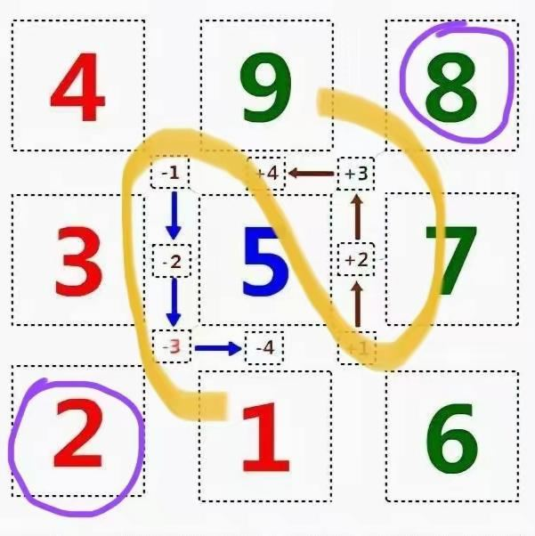
- 上半图为女为阴，下半图为男为阳：男遇5变2（升到坤宫，成阴鱼的阳眼），女遇5变8（降到艮宫，成阳鱼的阴眼）。

关键词：八星、0、5、太极、眼睛

## 第369章 篇外：聊聊流年大运

篇外：看流年就是看自己的命宫和当年年运命宫的关系；2024年男女年运都是震3，和震3成绝命的兑7命今年运势差。

- 2024：2+0+2+4=8；男11-8=3，女4+8=12→1+2=3，都是震3。
- 绝命年的人会有"一百个理由"想辞职、离婚，或总能碰上"投10万赚800万"的好生意——要冷静，那只是磁场干扰情绪。
- 易学培训班：作者没见过低于10万能学到真东西的，交三五十万的也大概率是坑。
- 奇门遁甲最好正式拜师；学九宫图从阳宅风水入手最直观。

关键词：流年、命宫、绝命、2024、震3、兑7、培训班、防骗

## 第370章 天赋的力量不可小觑

发挥天赋也是改命：在天赋领域努力能提升百倍，非天赋领域只提升十倍；"穷人算命，富人烧香"往往是同一批人在不同时期。

- 美国阅读速度研究：普通人每分钟200词、有天分者400词；训练后普通人2000、有天分者20000。
- 人顺的时候烧香做功德，不顺的时候才去算命找出路。
- 改命最省事的渠道是调风水；但风水不是一劳永逸，天体在动，至少一年要调一次。谁会都不如自己会。

关键词：天赋、改命、算命、风水

## 第371章 五行助运穿衣法

五行助运穿衣法：每天都有一个地支，地支有五行；穿天时五行"生"你的颜色最有利。

- 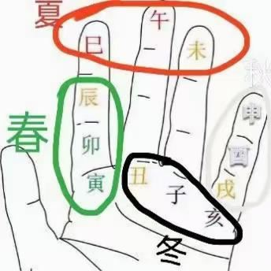
- 天时生我最有利；不生不克也行；我生天时、我克天时是耗泄；天时克我最麻烦。
- 这只是天时地支层面，还没考虑命理。势均力敌时多借一份天时，就能掌握主动。

> **生活方法｜五行助运穿衣法**  
> 用来：谈判、重要场合想借天时助力  
> 怎么做：查当天的地支及其五行，选穿被当天五行"生"的颜色（如当天属木，木生火，就穿红色系）；至少别穿去生或去克当天五行的颜色。

关键词：穿衣、颜色、地支、五行、天时

## 第372章 易经培训班的套路

免费易经班找上门：老师"自掏路费、不收谢礼"——作者好奇这种只出不进的模式怎么维持。

关键词：培训班、防骗

## 第373章 免费的课程

套路：先说老师有大爱、被同行诋毁，再说"只有有福报的人才能走进课堂"，最后收"场地费"每人1000，一天就能学会看风水。

- 只出不进不符合阴阳之道——总得有进钱的地方，否则资金链会断。

关键词：培训班、防骗、套路

## 第374章 喜报

小尹用"你不能剥夺君君的福报""介绍人不去像骗人"拿捏人心，两人各交了1000块。

关键词：培训班、防骗、套路

## 第375章 择吉的门派

择吉也是天时的一部分：不得真龙得年月，也应富贵旺人家；择日方法上千种，作者主张学个七八成就够。

- 借势的前提是自己既有能力又肯努力。
- 择日主要用于结婚、买房、买车、装修、搬家、签合同、出行、开业、动土、下葬。
- 常见方法：五行择日、三合、三元、飞星、奇门、斗首、江公、董公、乌兔择日等；五行又分正五行、玄空五行、三合五行、双山五行、纳音五行，一般五行择日用正五行。

关键词：择日、择吉、天时

## 第376章 金符经九星择日法

日子本身无吉凶，看什么人干什么事；看日子找靠谱的人，卦不二占；家里风水调整用"金符经九星择日法"。

- 到处算会让心乱，心乱了什么都干不成；不如只信自己，至少"人"这一分拿到了。
- 金符经全称《九天上圣秘传金符经》，又叫救苦经、宅宝经，简单又多有应验。

关键词：择日、金符经、卦不二占

## 第377章 择吉公式

金符经九星择日：九星中只有煞贡、直星、人专三颗吉星；再去掉金神七煞日；还要避开红砂日。

- 十天干：甲乙丙丁戊己庚辛壬癸；十二地支：子丑寅卯辰巳午未申酉戌亥；两两相配成六十甲子（10和12的最小公倍数是60）。
- 金符经九星：1妖星、2惑星、3禾刀星、4煞贡星、5直星、6卜木星、7角己星、8人专星、9立早星。
- 金神七煞日：甲己年的午未日、乙庚年的辰巳日、丙辛年的子丑寅卯日、丁壬年的戌亥日、戊癸年的申酉日。例：2024甲辰年，午日、未日不算吉日。
- 排法：每季第一个月（寅巳申亥月，即1、4、7、10月）的甲子日从妖星排起；第二个月（卯午酉子月）从惑星排起；第三个月（辰未戌丑月）从禾刀星排起，依次往下排。
- 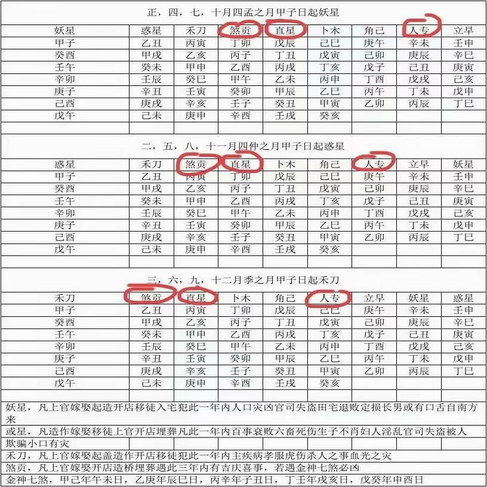
- 这里的"九星"和北斗九星、三元九星、奇门九星、八宅九星都不是一回事。
- 红砂日（红沙日、红煞日）是大凶日，结婚、出行、动土、就医都要避开。

> **民俗方法｜金符经九星择吉日**  
> 用来：结婚、搬家、装修、调风水等选日子  
> 怎么做：1. 查当天的天干地支和所在月份。2. 在九星表里找到当天对应的星，只取煞贡星、直星、人专星三颗吉星。3. 去掉当年的金神七煞日。4. 再去掉红砂日（见第380章）。

关键词：择日、金符经、九星、金神七煞、红砂日、天干地支

## 第378章 别出心裁的验证

君君故意穿了"天时克我"的颜色去签一份稳妥的合同，结果真没签成——她反而很兴奋。

关键词：穿衣、五行、验证

## 第379章 五行助运穿衣法详解

五行助运穿衣法详解：从寅日起，"两天红、一天白；两天黄、一天白；两天黑、一天白；两天绿、一天白"。

- 地支五行和颜色：寅卯木（绿）；辰土（黄）；巳午火（红）；未土（黄）；申酉金（白）；戌土（黄）；亥子水（黑）；丑土（黄）。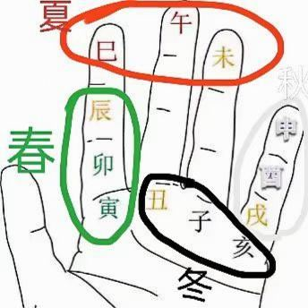
- 五行相生：金生水、水生木、木生火、火生土、土生金；相克：金克木、木克土、土克水、水克火、火克金。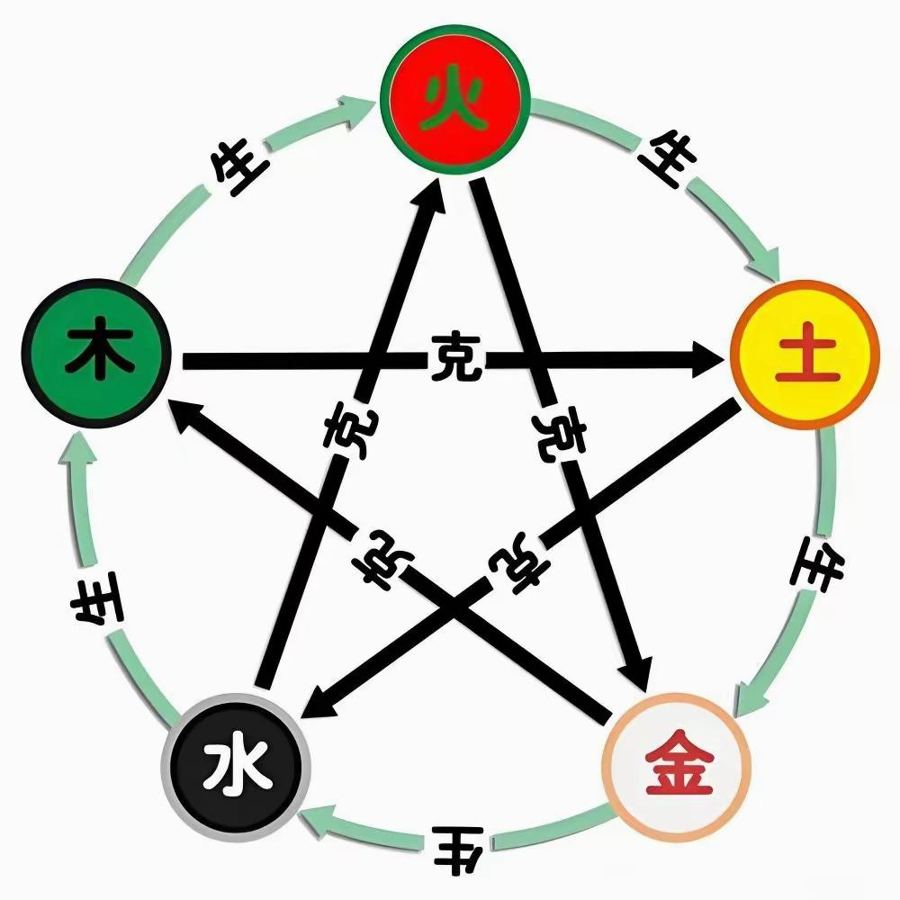
- 所以穿"被当天生"的颜色：寅卯日穿红；辰日穿白；巳午日穿黄；未日穿白；申酉日穿黑；戌日穿白；亥子日穿绿；丑日穿白。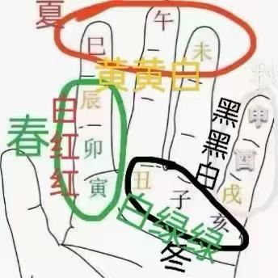
- 天时穿衣和八字喜用五行是"数学和英语"的关系，都重要；四柱八字、数字八字、命宫、属相各有五行，能一致的人极少。

> **生活方法｜五行助运穿衣法（每日颜色）**  
> 用来：重要的日子借天时助运  
> 怎么做：查当天地支：寅卯日穿红色；辰日白色；巳午日黄色；未日白色；申酉日黑色；戌日白色；亥子日绿色；丑日白色。口诀：从寅日起，两天红一天白，两天黄一天白，两天黑一天白，两天绿一天白。

关键词：穿衣、颜色、五行、地支、天时

## 第380章 红煞日算法

红砂日算法：每季第一个月（1、4、7、10月）的酉日，第二个月（2、5、8、11月）的巳日，第三个月（3、6、9、12月）的丑日。

- 天时和命理像两家公司：命理内部不一致时，就主要跟"天"合作。
- 巳酉丑三合金局，金为武器，在很多体系里都有肃杀之意。

关键词：红砂日、择日、巳酉丑

## 第381章 多重保障

大偷修日（神煞都上天汇报，可以动土修造）：壬子、癸丑、丙辰、丁巳、戊午、己未、庚申、辛酉，共八天。

- 记法：画在掌中诀上，丙从辰开始顺时针排到辛酉，壬癸放在子丑——像戴帽子的人。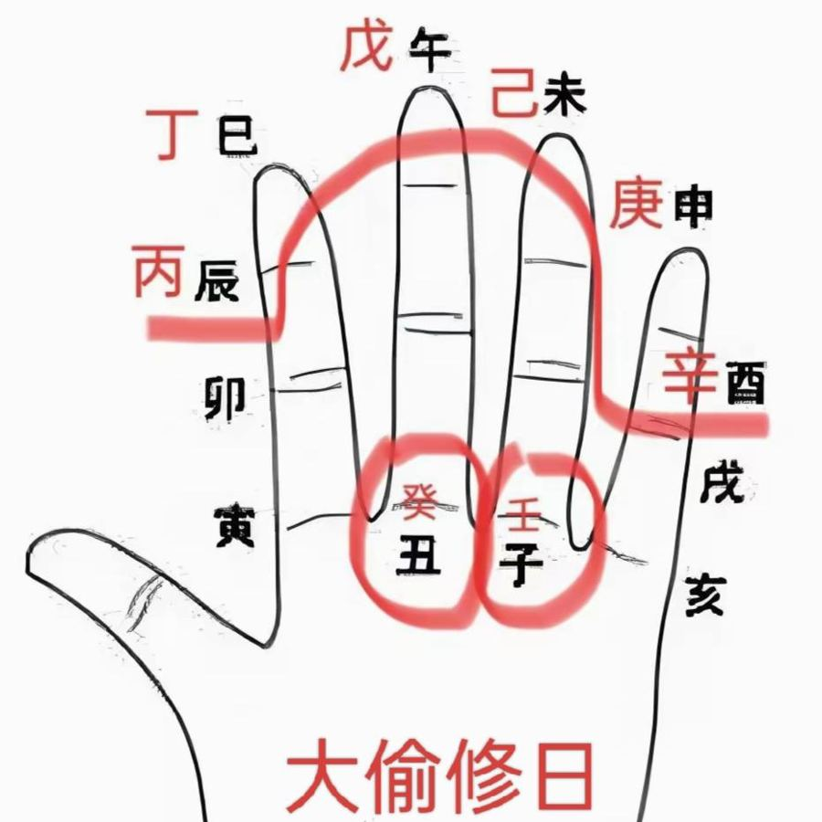
- 选日子的多重保障：先选吉日，再剔除金神七煞日、红砂日；要动土就再选偷修日。嫌麻烦，至少把红砂日这类大凶日去掉。
- 有钱人婚丧嫁娶考虑的门派更多，宁可多等一年。

> **民俗方法｜大偷修日**  
> 用来：动土、修造、调风水煞位  
> 怎么做：选壬子、癸丑、丙辰、丁巳、戊午、己未、庚申、辛酉这八个日子之一，同时避开金神七煞日和红砂日。

关键词：偷修日、择日、动土

## 第382章 长肉

小孩挑食很瘦：家里西南角（坤2）放了鱼缸、洗衣机上下水——坤主脾胃，见水伤脾胃；挪走后孩子很快长肉了。

- 有钱人讲究不是迷信，是做什么都全力以赴做到最好。
- 坤为土，也不要在坤位放植物（木克土）。
- 不能反推"想减肥就在西南放鱼缸"。

> **风水调整｜坤2（西南）去水——孩子瘦、脾胃弱**  
> 用来：孩子偏食、吃了不长肉、脾胃不好  
> 怎么做：把西南角的鱼缸、洗衣机及上下水挪走，水管也处理掉；西南也不要放植物。  
> 注意：不要反过来在西南放鱼缸来减肥。

> **风水调整｜西南（坤2）不放植物**  
> 用来：女主人、脾胃、妇科  
> 怎么做：坤属土，西南不要放植物（木克土）。  
> 注意：也不能反过来推"想减肥就在西南放鱼缸"。

关键词：坤2、脾胃、孩子瘦、鱼缸、洗衣机

## 第383章 五行穿衣的进阶版

五行穿衣进阶：上衣代表自己，别被下装克；还要看和对方衣服的生克。灰色偏白算金、偏黑算水。

- 男生木日不用穿一身红，上半身为主即可。
- 例：上衣红色（火），下装绿色（木生火）最好；嫌红配绿夸张，可以穿浅色裤子（偏金，火克金）。
- 优先级：别人生我最好；同类也可以；我克别人能克住也能得财；我生别人是单方面付出；被克最差。
- 三层：先看和天时的关系；再看自己上下内外的搭配（上面、里面代表自己）；最后看别被对方衣服颜色所克。
- 借运像借钱，有多少能力借多少，不贪心就不嫌麻烦。

关键词：穿衣、颜色、五行、灰色

## 第384章 卷帘水煞

助运只是"助"，实力悬殊时穿什么都没用；门口一层层向下的梯田或长楼梯叫"卷帘水煞"，不聚气。

- 借力改运的底线是以阳控阴：人不要自负，但要自主。
- 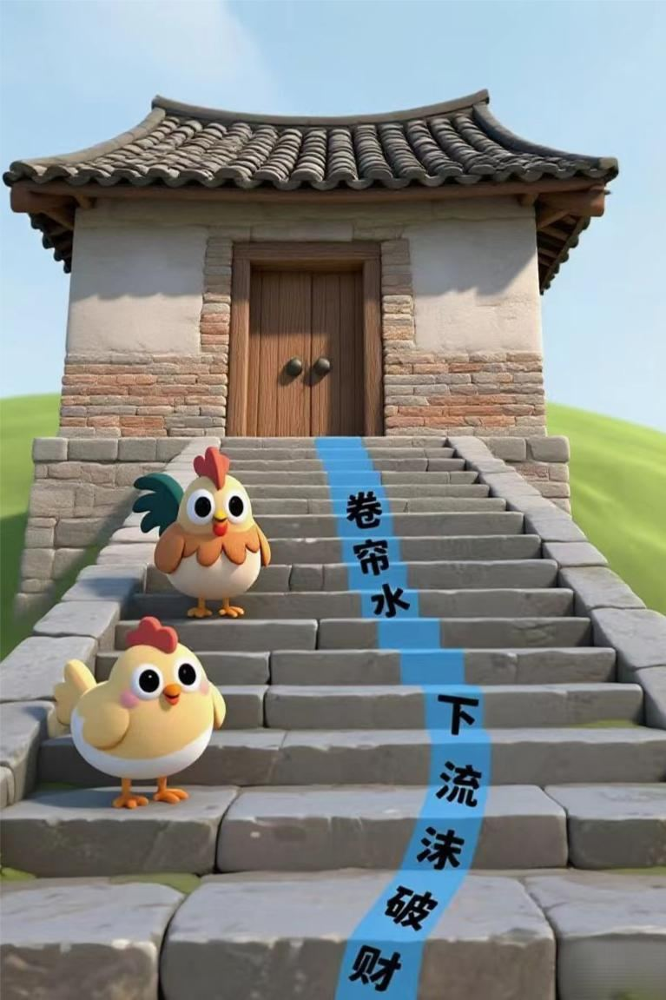
- 同样的格局也叫牵牛煞、溜财梯。懂原理、避开就行，名字不重要。
- 作者信鬼神存在，但主张敬而远之。

关键词：助运、卷帘水煞、溜财梯、聚气、鬼神

## 第385章 人类的局限性

人眼能看到的光、耳朵能听到的声音不到全部的万分之几——看不到不代表不存在；买房带只狗不是迷信。

- 道家说人有三魂（天魂、地魂、人魂）七魄；人死后魂飞魄散，投胎的只是其中一魂。

关键词：鬼神、感知、买房、三魂七魄

## 第386章 易经课程的套路

"免费"易经课的真实套路：讲一天各种惨案，唯一出路是买老师自创、别处买不到的摆件，一个缺角就要五位数，每人小十万。

- 场地一天几百块，光"场地费"就收十几万；真正目标是一天卖一千多万的摆件。
- 摆件对应各种需求：催桃花、斩桃花、延年益寿、催财旺官、文昌助运；再拿"不孝""不配当父母"来逼你买。
- 从头到尾没讲五行。

关键词：培训班、防骗、风水摆件、套路

## 第387章 赚了

作者反问推销的小尹：你自己一天一件都没卖出去，运势这么差，配给别人调风水吗？

- 花1000块看懂了一个日赚千万的套路，也算"赚了"。

关键词：防骗、套路

## 第388章 对抗催眠和洗脑

信风水是利用规律为我所用；迷信是被洗脑、没了自主。防洗脑的办法：让意识有"外流"，别只单向接受。

- 心情好脑子才灵；情绪低落时脑子转不动。
- 洗脑、催眠、PUA都是把人的意识引向单向内流：只接受、不输出。
- 家长常用否定式提问（你怎么这么慢、这么笨）打压孩子，孩子不反抗就容易陷入自我否定。

关键词：洗脑、迷信、PUA、催眠、教育

## 第389章 妇科问题

表婶胃和妇科反复犯：平房西南角（坤2，主脾胃和妇科）是厕所；可以在厕所的坤2位挂红色中国结，力度不够加个小冰箱。

- 正北坎1受伤也影响妇科（坎属水，管泌尿生殖；正北也是先天八卦坤卦的位置）。
- 邻居家西南角除了厕所还有一棵大葡萄树：藤蔓类植物（葡萄、猕猴桃、绿萝）有腾蛇之象，主小人、惊吓；葡萄属木克土，所以他胃吐血更重；葡萄树冻死后病好了，又长出新苗又犯了。
- 化解法器种类很多，三到六位数都有，不一定是红色。

> **风水调整｜坤2（西南）是厕所的化解**  
> 用来：胃病、妇科问题反复  
> 怎么做：1. 大太极西南是厕所时，再把厕所当作小太极画九宫，在厕所自己的西南格挂红色中国结。2. 高度在中间偏上，大约1米到1.5米。3. 力度不够可以加一个小冰箱。4. 选吉日挂，最好同时是偷修日。  
> 注意：不要随便挂在厕所其他角落。最根本的办法是把厕所挪走。

> **风水调整｜西南别种藤蔓植物**  
> 用来：脾胃问题、小人、受惊  
> 怎么做：西南（坤位）附近的葡萄、猕猴桃、绿萝等藤蔓植物挪走或移栽。

关键词：坤2、厕所、胃病、妇科、中国结、葡萄、藤蔓植物、腾蛇

## 第390章 心诚则灵

道不轻传，法不贱卖，师不顺路，医不叩门；心诚则灵——风水客观在起作用，但人的心理暗示能把它拉回来。

- 最好的解决办法是把厕所拆了挪走（大破大立）；放东西化解是退而求其次。
- 真想解决，什么都不是问题；不想解决，什么都是问题。
- 除了向外借力，更要向内修正心正念。

关键词：心诚则灵、化解、正念

## 第391章 要不要出国打工

国内月薪五千多的厨师要不要去新加坡？作者算账说不划算，他却说：国内年底剩零，新加坡年底能剩六万。

- 新加坡厨师综合收入约六千，每天实打实12小时、每月休2天，天气热，厨房更热。
- 能不能存下钱，完全取决于自己。

关键词：出国打工、新加坡、存钱

## 第392章 做生意还是劝退

作者把困难提前说清楚，母亲嫌他"劝退"；作者说提前打破幻想，后面就没麻烦。

- 出国打工赚的是辛苦钱，别因为是发达国家就抱幻想。

关键词：出国打工、中介

## 第393章 脚踏实地的赚钱

小凯是最脚踏实地又一心赚钱的人——想是阴，做是阳；篇外：体内热、体表怕冷的感冒可以试象数20·60·050·070。

- 自助者天助：足够坚定地想，又能脚踏实地去做，总能如愿。
- 篇外：月薪三四千、入不敷出的，先解决温饱再谈发展；只靠想没有出路，动手做才能"升阳"。

> **象数｜象数 20·60·050·070**  
> 用来：感冒：体内发热、体表怕冷  
> 怎么做：默念"二零、六零、零五零、零七零"。  
> 注意：作者说明自己不是医生，分不清各种流感。

关键词：行动、想与做、感冒、象数

## 第394章 第一次出国游

第一次出国游：买到难喝的泰国白酒、点到一只指甲盖大的生腌小螃蟹、被出租车绕楼转圈。

- 用钱能解决的问题都不是问题。

## 第395章 捐的好特意

丘书妍带大家打车很远去给无家可归者捐棺材钱；约好通宵上山拜见泰国白龙王。

关键词：捐款、白龙王

## 第396章 月经不调的小技巧

偶遇一位师父教月经不调的小技巧：捋小指根部的"水星丘"（九宫坤位）往指尖方向，每天3次、每次10分钟。

- 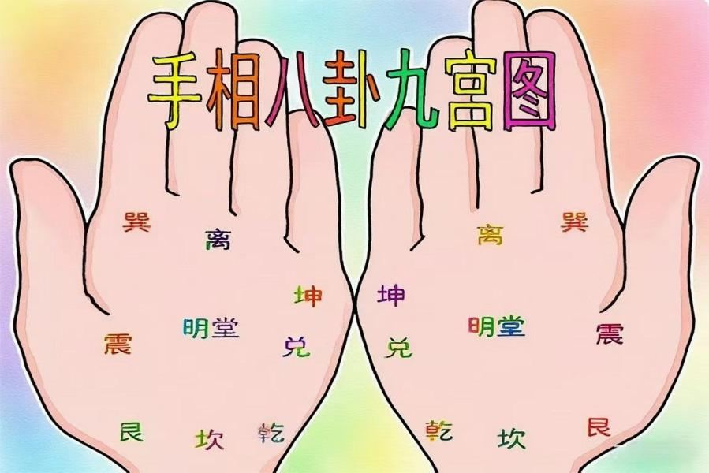
- 坤位主妇科和腹部。
- 改名：伟人的名字打分都不高，不必被分数困扰；你能出国旅游，有钱有闲有健康有心情，名字不用改。
- 见白龙王要穿全身白，最好鞋子也是白的。

> **穴位｜捋小指根（水星丘）调月经**  
> 用来：月经不调  
> 怎么做：手心朝下，用另一只手的食指按住小指根部，往小指指尖方向捋。每天3次，每次10分钟，捋几天、捋到不痛了，气血就通了。

关键词：月经不调、妇科、手掌九宫、水星丘、坤2、改名

## 第397章 白龙王

白龙王庙凌晨发号码牌；白龙王对作者问的绿卡说"早晚能拿到"。

- 白龙王问事不收费，但有人在报到时会被告知"无缘"。
- 多数人只得到菩草拍头祈福和一句开示，如"要谦虚""脾气要好"。

关键词：白龙王

## 第398章 指点

白龙王细数作者父亲的一生，说坎坷已经过去；还三次问作者和丘书妍是不是男女朋友。

关键词：白龙王

## 第399章 一问三不知

父亲点破："早晚能拿到"就是这次拿不到；作者意识到自己给人暗示时别人也常听不懂。

关键词：白龙王、暗示

## 第400章 见识决定格局

见识决定格局：乞丐发财后想换个金碗要饭；篇外：2024年五黄煞在正西，伤金伤肺，尽量别动大小太极正西的东西。

- 生命密码4号人的核心是安全感：诚实、爱学习、爱赚钱都是为了安全感。
- 篇外：家里九宫看不出问题却一直咳嗽，可能是大运所致。

> **风水调整｜2024年别动正西**  
> 用来：2024年咳嗽、肺部不适  
> 怎么做：2024年五黄煞在正西，尽量不要动大太极和各房间小太极正西位置的东西。

关键词：见识、格局、五黄煞、流年、咳嗽、兑7
