# 《改命记实录》逐章笔记：0501-0600

## 第501章 挂钟的风水

不要听别人说什么，多相信自己的感觉："如日中天"画看似亮堂，太阳到了最高点只能走向日落；挂钟有一堆讲究。

- 东墙青龙位宜高，非要挂画可以挂绿意盎然的山（但要注意没有不良穿宫）。
- 东墙同时是沙发背后（沙发的玄武位），宜静不宜动，不建议挂钟。
- 震3、巽4（属木）不宜挂圆形钟（圆属金，金克木），要挂选方形或长方形。
- 乾6挂圆钟五行虽合，但乾主脑子，挂钟可能让脑子日夜不停，睡眠不好的人不要挂。
- 兑7是白虎位，宜静不宜动。

> **风水调整｜墙上挂钟怎么挂**  
> 用来：客厅、沙发背后、各方位挂钟  
> 怎么做：正东墙（青龙位、沙发背后）宜静，不建议挂钟；正东、东南（属木）不挂圆形钟，要挂方形或长方形；西北（乾6）挂圆钟五行虽合，但乾管脑子，睡眠不好的人不要挂。东墙非要挂画，可以挂绿意盎然的山。  
> 注意：挂画也要看有没有不好的穿宫。

关键词：风水画、挂钟、钟表、沙发、震3、乾6、兑7

## 第502章 占卜

钟表一直在动，干扰比静物大：不挂门上、不对大门、不放卧室（尤其不对床头床尾）、不放正北。不诚不占——把神仙当遛狗一样叫，它也会跟你"开玩笑"。

- 少一样物品，少一样干扰；最好别买回家。
- 用卦测"投10万赚800万"的项目得了吉，结果平台卷款跑路——自己能想明白的事，就别去麻烦神仙。
- 世界富豪榜上没有一个全职占卜大师。

> **风水调整｜挂钟摆放要点**  
> 用来：家里放钟表  
> 怎么做：不挂在门上方（防掉落），不正对大门（财气不稳），不放卧室（尤其不对床头床尾），不放正北（玄武位）；不放沙发背后；震3、巽4位选方形钟，不用圆形钟。

关键词：钟表、占卜、不诚不占

## 第503章 跪赢的？

测算本身没有正邪，要看你拿它干什么；神仙也有事要做，各地土地神分级分片管理（《礼记》大社、国社、侯社、署社）。

- 不要测不现实、胡思乱想的事；不要把命运交给外力；初学者别给别人测，别拿因果开玩笑。
- 打赢战争靠自己，总不能靠给神仙磕头"跪赢"。

关键词：占卜、测算、土地神

## 第504章 厨卫同宫

卦像一本书，可以借鉴但别读丢了自己；厨卫同宫、灶挨着水池都要避"水火冲"。

- 尽人事，听天命：诸葛亮明知难成仍然出山、摆七星灯。
- 灶和水池不宜挨太近；厨房挨着厕所时，灶不要装在靠厕所的那面墙上；厕所是污浊之地，厨卫不同宫是为了不让浊气进厨房。
- 已经厨卫同宫：装修时能改就隔出一个小厅；改不了就保持清洁。所谓"凶"主要是健康、破财、官非，就从人的层面改：注意卫生、多运动；不投机；情绪稳定、少管闲事。

> **风水调整｜厨卫同宫的处理**  
> 用来：厨房和厕所在同一宫或紧挨着  
> 怎么做：选房时尽量避开；装修时能改格局就在中间隔出小厅；灶不装在靠厕所的墙上；灶和水池拉开距离；保持清洁减少细菌。

关键词：厨卫同宫、水火冲、炉灶、厕所

## 第505章 九宫面相

九宫面相：额头（印堂）是离9、鼻子是中宫、下巴是坎1；鼻高有肉财运通，鼻梁露骨、起节则包容心差、肝火旺。

- 印堂发红火气大，易有口舌是非；印堂有悬针纹、川字纹对心脑血管不好。
- 主流看法左边震3、右边兑7；也有门派说给别人看相时把九宫画在对方脸上，左右要反过来。
- 两颊长斑一般是肝气郁结、生了大闷气，往往肺火也旺（口干、口腔异味）。
- 脸窄鼻子太大叫"鼻子压脸"，心气高、易有怀才不遇感。
- 鼻根对应心肺，鼻梁对应肝胆，再往下是脾胃。鼻梁露骨相当于土缺，土主包容。
- 相由心生。

关键词：面相、九宫面相、鼻子、印堂、下巴、长斑

## 第506章 下巴有痣

鼻梁露骨怎么改？从"木主仁"改：仁慈心起来，包容心就强了，心改了相就改了；下巴有大凸痣，对应坎1（肾、男女科、二儿子）。

- 下巴痣的外在表现常是腰不太舒服。
- 别冒冒失失去问人"你是不是破财了、离婚了"：掀人遮羞布也是造口业；可以悄悄观察核实，不要说出口。
- 拓展：读者问木形人说话硬、肩颈痛、脾胃不好、跟母亲关系僵怎么办。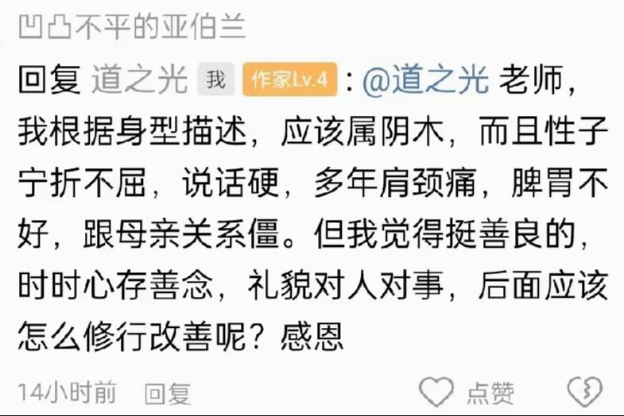作者：仁爱和孝顺，指的是观点不一致时如何顺从、包容对方——看不惯的地方，才是需要修行的地方。

关键词：面相、下巴、痣、木形人、孝顺、口业

## 第507章 炉灶向吉

反馈：灶改成坐吉向吉后，丈夫血压降了、脾气好了，还说饭好吃了；目前验证"炉灶向吉"（做饭人背靠吉位）更重要。去广州前一查攻略，满网都在提醒防骗。

- 原来是巽4开门、灶坐乾6向艮8（坐祸害向绝命）。

关键词：炉灶、血压、防骗、广州

## 第508章 跟团一日游

两人临时报了一个"中青旅"一日游。

关键词：防骗、旅游团

## 第509章 贴心的导游

导游很贴心，进了一家布局奇怪的"金店"还主动提醒大家"不用买"。

关键词：防骗、旅游团、套路

## 第510章 喜得贵子

店员说老板"喜得贵子"刚从马来西亚回来，全都跑去领红包；主管也被大家"劝"走了。

关键词：防骗、套路

## 第511章 只送不卖

老板带着列队鼓掌的店员进场：喜得双胞胎，"今天只送不卖"，愿意祝福的举右手。

关键词：防骗、套路

## 第512章 最高等级的翡翠

先送每人一个小指甲盖大的"顶级翡翠"，导游再"帮大家求"更多福利，引出"最粗的白金项链"。

关键词：防骗、套路

## 第513章 真正的白金项链

老板当众用玻璃刮项链证明"不掉色"，说市价6800"只送不卖"，只要请他喝一杯680的茶、加他微信做"一辈子的朋友"。

- 套路话术："金钱验人心"——让你用付钱来证明"真心"。

关键词：防骗、套路

## 第514章 交个朋友

货"不够"就去别店调；随后"一上头"全场一折"交朋友"——大家抢着刷卡。

关键词：防骗、套路

## 第515章 八心八箭

关灯用手电照出漫天蓝光，"3克拉八心八箭蓝钻"号称上百万，一万块"卖给识货的朋友"，众人哄抢。

关键词：防骗、套路

## 第516章 传家宝

最后的"镇店之宝"：全世界仅此一套的红宝石首饰，要送给"最有缘的人"。

- 这一整套流程（下章续）是作者在广州亲历的旅游购物店骗局：先建立信任、再送小礼、再用"交朋友""只送不卖"诱导付费，层层加码。
- 相关：[防骗：常见套路](../../docs/09-防骗/01-防骗：常见套路.md)。

关键词：防骗、套路、旅游购物

## 第517章 最有缘的人

骗局高潮："镇店之宝"有人喊价五百万，老板"不卖只送"，最后要一个两万八的"祈福红包"——丘书妍抢到了，打开一看奇丑无比、边角都没磨平。

关键词：防骗、套路、旅游购物

## 第518章 断子绝孙

老板拿刚出生的双胞胎发毒誓"有一件假货就断子绝孙"，全场被镇住；第二天鉴定：链子是白铜，宝石不是天然的，证书重量都对不上。

- 作者看老板面相：子女宫（卧蚕）塌陷带疤、脸小鼻子大（孤峰独耸）、人中发黑、下巴尖细无肉——下停主子嗣，本就是难有后的相。
- 白铜不掉色，因为银白就是它的本色。
- 作者记下了大巴车牌号。

关键词：防骗、套路、面相、卧蚕、子女宫、白铜

## 第519章 打开气机

白铜"按吨卖"；去报案被一句"你怎么确定是中青旅的人"挡回来，刷卡单写的是"工艺品店"。作者悟到：凡是要煽动气氛的场合都让人高举双手——腋窝是气机汇聚之地。

- 人生最幸运的事，是在有力气爬起来的时候摔倒。
- 庆幸我们是被骗的一方，而不是行骗的一方。
- 腋窝走心经，是中丹田气机运行的第一道门，是调心气的重要部位。会场、演唱会、迪厅都引导人举手、击掌、振臂——打开气机，气势就上来了。
- 最简单的消气操：振臂拍腋窝。

> **功法｜振臂拍腋窝（消气操）**  
> 用来：生闷气、心气不畅  
> 怎么做：把手臂举起，用另一只手拍打腋窝。（书中只给了这一句，拍腋窝的详细做法见第190章。）

关键词：防骗、报案、腋窝、心经、气机、消气

## 第520章 不害怕就没有伤害

对一段经历只有感恩没有愤恨，它就会带来智慧；怕什么来什么，不害怕就不会留下伤害。

- 同修小路热情邀请两人去珠海，住洗浴中心。

关键词：感恩、恐惧

## 第521章 累生累世的祖先

小路夫妇不只祭陈、张两家祖先，而是祭拜"生生世世所有的祖先"。

- 小路家每扇窗的窗帘按九宫五行配不同颜色（巽4淡绿、离9深棕、坎1淡粉红）。

关键词：祭祖、窗帘

## 第522章 无所求必满载而归

无所求，必满载而归；窗帘不必按九宫配五颜六色，选土色系（米色、棕色、咖色）就好——"土生万物，土旺四季"。

- 风水是为人服务的，要考虑看着舒不舒服、用着方不方便。
- 窗帘本身也是一个太极，还有开着和关着两种状态，配九宫色反而说不通。
- 久赌必输——赌场不怕你赢钱，就怕你不来。

> **风水调整｜窗帘选土色系**  
> 用来：不知道窗帘选什么颜色  
> 怎么做：选米色、棕色、咖色等土色系，各房间统一即可，不必按九宫给每扇窗配不同五行色。

关键词：窗帘、颜色、土、无所求、赌博

## 第523章 赌船

赌船上遇到一位穿道袍的道长。

关键词：赌博

## 第524章 赌博不科学

赌桌上常出现"长龙"这种极小概率事件，越不信邪它越连给你看——作者对赌博只看不下手。

关键词：赌博、概率

## 第525章 无情都在说法

作者用梅花易数感知骰子大小，只押最小筹码，连押连中；他感觉一起了贪念、押多了，马上就会被"收走"。

- 很多人不押钱时猜得很准，一下注就被"没收"。
- 朋友肖志一跟注，全桌都输。

关键词：赌博、梅花易数、贪念、运气

## 第526章 不服输不行

不服输不适合赌桌：运气差时要像丘书妍一样立刻下桌；作者劝肖志别再换筹码，反被怨恨——对输钱的人，你说什么都是错的。

- 劝人"休息一下"等于暗示他运气差，这种消极暗示会影响他的心气。
- 有些时候，好心不一定带来好结果。

关键词：赌博、运气、暗示、好心

## 第527章 夜叉有八块腹肌

道长谈健身：道家注重舒展筋骨、调和气血，不推崇练出肌肉块——"只有拿钢叉的夜叉才是八块腹肌"；过度锻炼大量出汗会耗气血。

- 适当锻炼能升阳；过度锻炼是把体内的精气调到四肢上，对内脏不友好。
- 汗为心之液；津、血、汗同源，大量出汗导致津液亏虚、气血不足。
- 怕鬼？如果鬼比人强，最坏就是人死了也变成更强的鬼，没吃亏；如果鬼没人强，怕它干什么。

关键词：健身、出汗、气血、养生、怕鬼

## 第528章 情绪是一味药

情绪也是一味药：五志相克——思克恐、怒克思、悲克怒、喜克悲、恐克喜。

- 五行对应：木主怒，火主喜，土主思，金主悲，水主恐。
- 土克水：思考能克恐惧——想明白了就不怕了（"那又怎样"也是一种思考）。
- 木克土：人一生气就失去理智，比如激将法。
- 金克木：悲伤的眼泪能化解怒火；自己气得暴跳如雷时哭一场，气就消得差不多了。
- 火克金：找点高兴好笑的事，悲伤就被冲淡了（冲喜）。
- 水克火：太高兴了泼点冷水；范进中举喜极而疯，被老丈人一巴掌打好。
- 焦虑是能量往头上走、想太多；去赌博放松不现实，赌博更费脑。

> **修心方法｜用情绪对治情绪（五志相克）**  
> 用来：害怕、焦虑、生气、悲伤、过度兴奋  
> 怎么做：害怕焦虑时就去思考，把逻辑想透（土克水）；生气时允许自己哭一场（金克木）；悲伤时找点开心好笑的事（火克金）；过度兴奋时冷静一下、泼点冷水（水克火）。

关键词：情绪、五志、恐惧、焦虑、愤怒、悲伤、五行

## 第529章 修真

焦虑的人要"去土里"：找块地干点农活，赤脚在泥土上走一走，把感知放在脚上，焦虑的能量就引下去了。道家修行也叫"修真"——真实做自己，能量才流畅。

- 道士只是侧重学习符咒和养生的人，没成仙之前也是人。
- 《黄帝内经》把高人分为真人、至人、圣人、贤人四级；庄子说"古之真人，其寝不梦，其觉无忧，其食不甘，其息深深"。
- 虚假的人内外相悖，气和情绪都容易卡住，很累；以为骗的是别人，伤的是自己。

> **养生方法｜赤脚踩土缓解焦虑**  
> 用来：焦虑、想太多、心里不踏实  
> 怎么做：找一块田地干点农活、刨刨土；赤着脚在泥土上走一走，把注意力放在脚底，让往上冲的能量沉下来。

关键词：焦虑、赤脚、接地、修真、真实

## 第530章 钱只是俗世的工具

做了法事就一定能发财吗？道长：人心太假，上天开了后门送来的能量也接不住——钱只是俗世的工具，不是人生目标。

- 赌注大小会影响心态（陈江挺《炒股的智慧》）：同样50%胜率，一次全押比分十次押更紧张。
- 道长拿一个筹码换成小筹码，随手押、随手输光，轻松走开。

关键词：法事、修心、赌注、心态

## 第531章 有病方为贵

道长：把把输、一点念想都没有，也挺好——倾家荡产的人都尝过甜头。"有病方为贵"：有坎坷的八字才是大格局，但有病得有药。

- "药"是：个人努力、贵人提携、积德行善、祖先保佑、外力助缘——抓住一切机会；没有谁的成功是只靠自己的。
- 苦难只是过程，关键是能否"动心忍性"；很多人被苦难磨得麻木，找不到心了。
- 修行也不是只靠自己：佛陀也拜师，道家炼丹也要丹方草药。
- 能在赌桌上说停就停的人，都不是一般人。

关键词：有病方为贵、苦难、贵人、赌博

## 第532章 这锅我是背定了

赌徒输了不肯收手，因为一收手就意味着前面的钱真赔了；赢了又觉得自己是命运宠儿——怎样都难下桌。

关键词：赌博、贪心

## 第533章 阳气的总开关

猎人等火鸡回笼最后空手而归——投机投的是侥幸心理；背部是阳气的总开关，背僵硬疼痛是督脉不通，阳气衰，财运也受堵。

- 生活中的很多苦，都来自无穷的贪心和欲望。
- 肖志背部僵硬，推拿无效，打算去针灸。

关键词：投机、侥幸、背部、督脉、阳气、财运

## 第534章 又来一个新锅

肖志的大姐背也不舒服，一问，公司项目果然出了问题；"背薄一寸，寿长十年"。作者和丘书妍去做精油推背，结果越推越依赖。

- 背部问题既影响财运也影响身体，身体的实证可能来得慢一些。
- 推背依赖的过程：开始很舒服，后来一个月不推就板，再后来一周、隔天、每天都要推，最后推完没到家背又硬成铁板。

关键词：背部、推背、依赖、财运、健康

## 第535章 业力是内因风水是外因

最后靠针灸通了经络才好；业力是种子，风水是环境——风水调整能让种子一时不发芽，但化解种子要靠内在发心去修。

- 能借外力就不锻炼，捷径有捷径的弊端；再懒也要动一动。
- 事业顺了就生傲慢：丘书妍嫌麻烦把盖镜子的帘子收了；办公室档案柜形成角煞也没管。
- 谦虚、利他的人，不容易被业力左右。

> **养生方法｜背部僵硬别只靠推背**  
> 用来：背部发板、僵硬、酸痛  
> 怎么做：自己多活动、锻炼；严重时去针灸疏通经络。  
> 注意：作者亲历：长期依赖精油推背反而越来越硬。

关键词：背部、针灸、业力、风水、傲慢、角煞

## 第536章 绿卡批了

绿卡批下来了，应验了"早晚能拿到"；作者把闲钱放进股市，防止丘书妍乱花。

- 日子是过给自己的，不是给别人看的；但作者后来也承认，总拿"好好过日子"扫别人的兴，也是问题。

关键词：绿卡、白龙王、股市、价值观

## 第537章 新手只会满仓

新手只会满仓：看股评就买、账户里几十只不认识的股票；BUN说自己是靠努力奋斗起家。

关键词：股市

## 第538章 懒出了新境界

BUN：人只要肯努力就能超过90%的人；懒是因为不知道该干什么、不知道怎么干、不知道能不能成——知道了就会去做，这才叫知行合一。

- 命运是弱者的借口，幸运是强者的谦词。
- 知是学习，行是验证；怕就怕你不知道却以为自己知道了。You can never be ready.

关键词：知行合一、努力、懒

## 第539章 理由

想是阴，做是阳：敢想敢做就超过了九成的人；BUN说除了明面上的努力，还有"桌子底下"的努力。

- 不做的事不需要理由，想做的事要有充分的理由。

关键词：知行合一、阴阳、想与做

## 第540章 典礼现场

秉烛师父在泰国山顶建寺，开光与第一批僧人剃度同日举行。

- 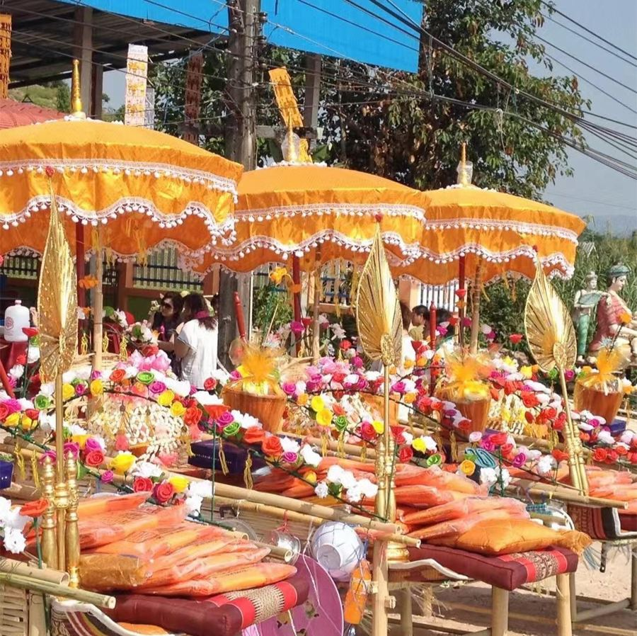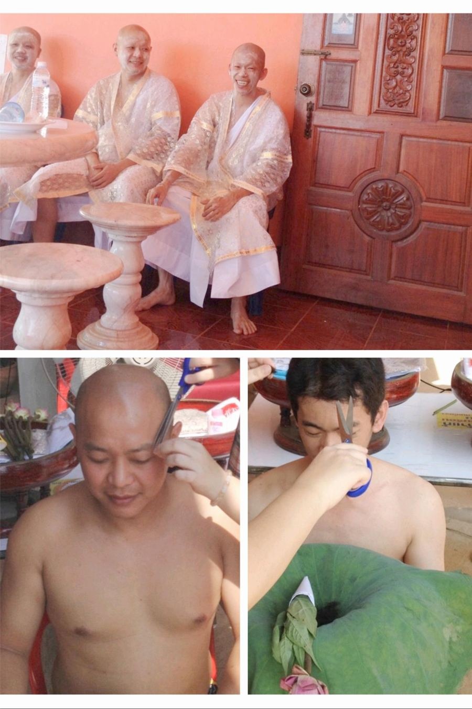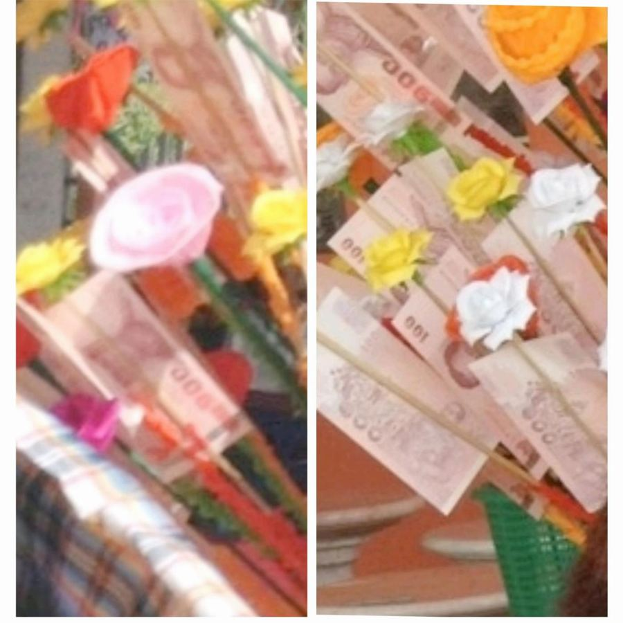
- 泰国男子基本都有出家一段时间的习俗。

关键词：泰国、寺庙、布施

## 第541章 幸运的晚宴

秉烛师父的"捐助"：晚会上让老板们出题找"最幸运的人"发红包，最后人人都是幸运者——作者说这是他见过最慈善的一场慈善。

关键词：布施、慈善

## 第542章 明抢

同学陈玉帮发小做贷款担保，发小跑路后倾家荡产；又只买了交强险，失眠开车撞死两人。妻子求作者找大师做法事"暴富"赔钱。

- 判不判刑是法律说了算，赔不赔得起是钱说了算，都不是法事能解决的。
- 人倒霉的时候没有侥幸可言；状态不好要多静心，心烦意乱时别上马路。

关键词：担保、保险、法事、防骗

## 第543章 厄运专找贪心人

陈玉妻子刷爆信用卡找"大师"，大师收钱就消失——不是"厄运专找苦命人"，而是厄运找贪心人；秉烛师父：化缘化的是人心。

- 化缘既化施主的舍得之心，也化化缘者的不贪之心；挥挥手就建出一座庙，为的是不劳而获。
- 秉烛师父对睡不好的BUN说：你一生可以喝的酒已经喝完了，以后不要再喝。

关键词：防骗、贪心、化缘、法事

## 第544章 双五鬼位

BUN不喝酒就睡不着：他卧室艮8开门、床头朝北（坎1），1和8成五鬼；他又是艮8命宫，命宫和床头也成五鬼——五鬼最易招阴邪。作者建议他头朝西睡。

- 头朝西（坤2、兑7、乾6都是西四命宫位），对艮8命的人比较友好。
- 睡觉朝向的几种说法：头朝南北顺着磁力线好；头不能朝门、朝窗（避风煞），朝南常对着窗；北半球离北磁极近，头朝北睡头部血液充足，易兴奋多梦、睡不着，对高血压脑出血风险不利。

> **风水调整｜调床头方向**  
> 用来：失眠、睡不好  
> 怎么做：先看房门所在宫位和床头所在宫位的八星关系，再看自己命宫与床头宫位的关系；避开五鬼、绝命等凶位，选和命宫同一组（东四或西四）的方向；床头不朝门、不朝窗。

关键词：失眠、床头、五鬼、命宫、艮8、坎1、睡觉方向、喝酒

## 第545章 头朝哪儿睡

头朝哪儿睡？东南西北各有说法都"不好"——只有适合自己的才最好：可按命宫、属相、八字喜用神来定。BUN头朝西睡，当晚就睡踏实了。

- 各种说法：头朝东迎阳气好；朝东血液从脚涌到头不好；"活人睡东西，死人睡南北"；朝西像"归西"不吉；顺着地球自转方向睡较好（颅内压高的病人在救护车上头要朝车头）；朝南为阳最好……
- 五鬼气场重的人：睡不着、多梦、睡醒很累、睡得晚——睡得晚也是睡不着的一种形式。
- 命宫：西四命（2786）的人住2786开门的卧室，头朝2786的方位最合适；东四命同理。
- 属相：寅卯（虎兔，木）头朝北或东；巳午（蛇马，火）朝东或南；申酉（猴鸡，金）朝西，或东北、东南（湿土生金）；亥子（猪鼠，水）朝西或北；丑辰（湿土）朝北、西及各自方位；未戌（干土）朝南及各自的西南、西北。原则：生自己或同五行的方位好，克自己的方位不好。
- 湿土与干土：冬春的丑、辰含水是湿土，能生万物；夏秋的未、戌含火是干土，不利于生金。
- 八字喜用神：喜火朝南或东；喜水朝北或西；喜木朝东或北；喜金朝西或东南、东北（湿土）；喜土朝各自土的方位。

> **风水调整｜按属相选床头方向**  
> 用来：睡不好、想选床头朝向  
> 怎么做：找生自己或与自己同五行的方位：虎兔朝北或东；蛇马朝东或南；猴鸡朝西或东北、东南；猪鼠朝西或北；牛龙朝北、西；羊狗朝南、西南、西北。同时避开床头朝门窗。

关键词：睡觉方向、床头、属相、命宫、喜用神、失眠、五鬼、湿土、干土

## 第546章 六度分隔理论

越开心越遇开心事，越生气越遇生气事——种什么种子结什么果；"六度分隔理论"。韩国国旗的太极没有"鱼眼"。

- 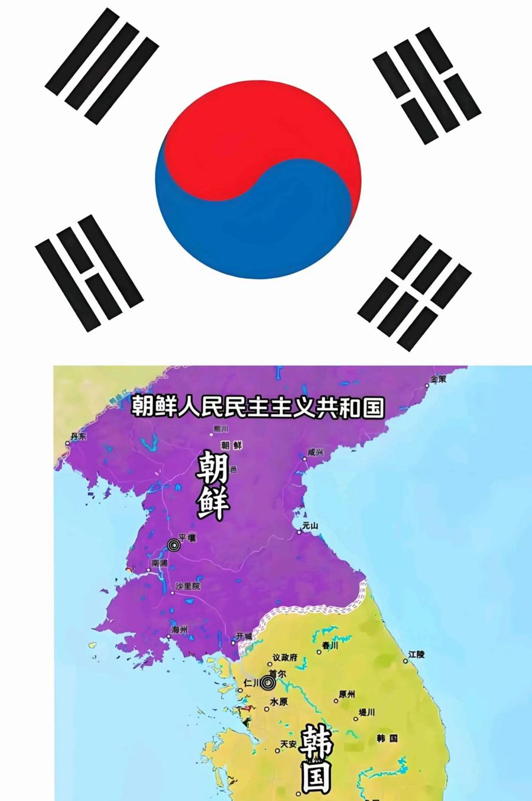

关键词：因果、种子、六度分隔、太极

## 第547章 青瓦台诅咒

太极无眼，阴阳不再互相转换而变成对立；韩国国旗只取乾坤坎离四卦，缺了山泽通气、雷风相薄。青瓦台靠山是孤峰尖角的火形煞，门前广场像苍蝇拍、马桶盖，马路成反弓。

- 好山好水不是凑数，要"山有势，水有情"。
- 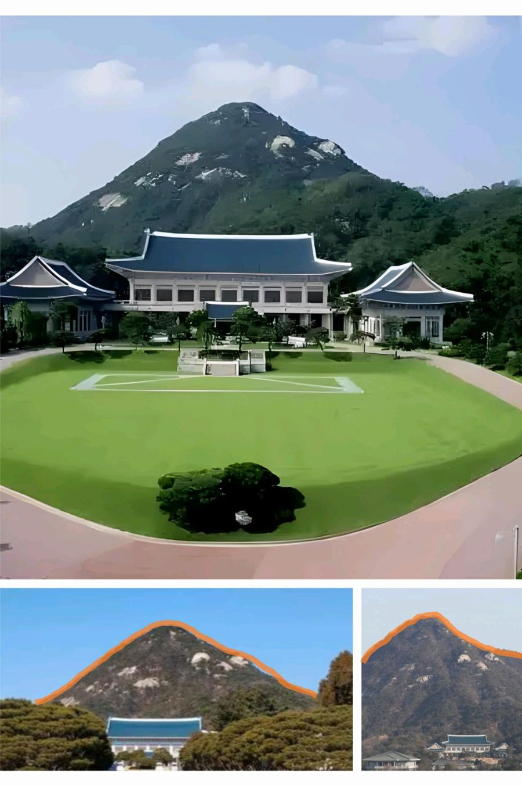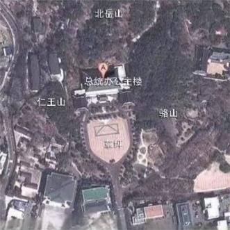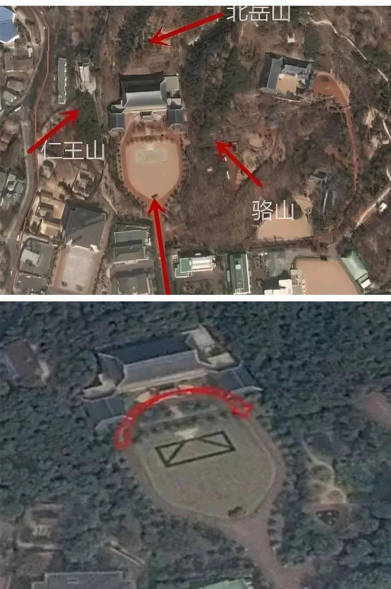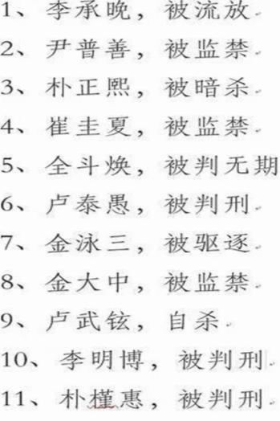
- 靠山土不厚、林不茂，乱石露白像怪兽脸——丑为鬼气，易犯小人。
- 朱雀位代表头部和心，这里"臭烘烘"，心不清神不静。

关键词：风水案例、太极、靠山、反弓、朱雀

## 第548章 天才的商业模式

丘书妍设计了一个"26个字母押中一赔三"的赌局；作者问：上哪儿找那么多傻子？

关键词：赌博、概率

## 第549章 五星好评

老风水师邱大哥因肾结石住院，自认是"业力病"。

关键词：肾结石、业力

## 第550章 肾结石

业力病一般也通过风水起作用；术后会不会复发，取决于风水有没有变。作者一问邱大哥家正北有没有见水，他愣住了。

- 也有调完风水还发病的情况，像"悬崖勒马"——因果已到悬崖边，未必勒得住；还可能是阴宅的问题。

关键词：肾结石、坎1、业力、复发

## 第551章 鹅卵石

邱大哥家客厅在坎1，客厅的正北放了一个大落地鱼缸——他用的是"坎属水就放水"的五行理论。

- 有的门派按五行认为坎1放水好；按能量平衡，坎1切忌放水，会进一步拉低能量、伤肾。

关键词：坎1、鱼缸、肾结石、五行、能量平衡

## 第552章 说破无毒

鱼缸里还铺满鹅卵石想当"玄武靠山"——石头属阴，一颗颗小石头代表能量不流畅，身体上易长结石、囊肿；坎为肾，水加石头正应在肾结石上。

- 镜子和石头在风水上都属阴，不建议家里摆。
- 风水讲五种山不可取，其中就有石山；光秃秃的山不能做靠山。
- 血糖也和坎1有关。
- 说破无毒。
- 现在很多"风水大师"靠线上包装和长相，讲的只是"缺角挂什么牌、文昌摆什么塔"。

关键词：鹅卵石、石头、结石、坎1、血糖、靠山

## 第553章 五短身材

邱大哥挪走鱼缸后，几年没再复发，血糖也降了；家里的决策尽量听运势好的那个人的。

- 相学："五短身材多富贵，长腿之人命多舛。"《太清神鉴》：五者俱短、骨细肉滑、印堂明润，是少卿公侯之相。
- 运势旺的人百毒不侵；可以用命宫与流年命宫的关系、喜用神与流年干支的关系看谁正走运。

> **风水调整｜坎1（正北）别放鱼缸和石头**  
> 用来：肾结石、肾病、血糖高  
> 怎么做：把正北（大太极和房间小太极的坎1）的鱼缸、鹅卵石、石头摆件挪走。

关键词：坎1、鱼缸、肾结石、面相、运势

## 第554章 降血糖偏方

降血糖偏方：蒲公英适量加一个鹅蛋煮汤，不放油盐，每天一份。君君父母长期吃，说比降糖药效果还好；后来血糖却突然失控。

- 作者没亲自验证过这个方子；他推测鹅蛋能补血、清热解毒，蒲公英利尿解毒，提升了代谢能力。

> **偏方｜蒲公英鹅蛋汤**  
> 用来：血糖偏高  
> 怎么做：蒲公英适量，加1个鹅蛋，用清水一起煮汤，不加油盐等调料，每天吃一份。君君父母是长期坚持吃的。  
> 注意：作者本人未验证；书中这家人后来血糖仍然突然升高。糖尿病是严重疾病，降糖药请遵医嘱，不要因为吃偏方自行停药。

关键词：血糖、糖尿病、偏方、蒲公英、鹅蛋

## 第555章 糖尿病的风水原因

血糖失控的原因：上个月正北窗台上放了三盆水培吊兰——坎1不宜见水、也不宜放草本植物，两条都占了；挪走后血糖从10点多慢慢降到7点多。

- 草本植物只有叶子没有树干，本身属低能量，又泡在水里。
- 老太太没等偷修日就把花搬走了：已经动了，就诚心忏悔，向各方土地神祇祷告"无知冒犯，请求原谅"。
- 后来在偷修日把冰柜挪到了坎1位（作者说细节要讲到二十四山时再说，先别急着动）。

> **风水调整｜坎1（正北）去水、去草本植物**  
> 用来：血糖高、糖尿病  
> 怎么做：把正北的水培植物、草本植物、鱼缸等挪走；选偷修日动；能量不足可以放冰柜等高能量电器（摆放细节作者说后面再讲）。  
> 注意：已经在非吉日动了，就诚心忏悔祷告。

关键词：坎1、血糖、糖尿病、吊兰、水培植物、冰柜、偷修日

## 第556章 以身试法手枪房

最怕"手枪房"：户型像数字"7"，套九宫后中宫5不在自己家——中宫在外，家宅不宁。

- 不信风水的弟弟想把吊兰摆回去"验证"，一听让他买手枪房自己试，吓得说买房必须宁可信其有。

关键词：手枪房、中宫、户型、买房

## 第557章 正北开门的化解

正北开门叫"败北门"（坎位是冬至、极阴之位）：化解可在门边坎1的坎1挂中国结，或在过门石下放朱砂。开大门首选巽4、离9，次选震3，但这只适用于坐北朝南的房子。

- 千斤大门四两屋；"门户辨阴阳之路，气口分祸福之机"。
- 纳阳为吉，纳阴为凶。
- 中国结墙上挂不开，也可以挂在门中间，尽量固定住别晃来晃去。
- 红色地垫也能临时用，但如果常上火、牙痛、口腔溃疡，就撤掉。
- 坐北朝南是坎1宅，1349都是东四命，所以349的门既向阳又是吉位；坐西向东的兑7宅开震3门就是绝命门。
- 住楼没得选，至少避开正北门，也避开西南坤2门。

> **风水调整｜正北门（败北门）的化解**  
> 用来：大门开在正北  
> 怎么做：在门边墙上的坎1位挂红色中国结，挂不开就挂在门中间并固定住；或在过门石下放朱砂；临时也可以放红色地垫。  
> 注意：地垫用后若容易上火、牙痛、口腔溃疡，就撤掉。最好的办法还是避开。

关键词：大门、正北门、败北门、坎1、中国结、朱砂、地垫、开门方位

## 第558章 慈善与赚钱

修行人可以赚钱吗？"诸苦所因，贪欲为本"——戒的是贪，不是钱；穷人也可能贪，富人也可能不贪。

- 故事：悟空和悟了都化缘，悟了把化来的存进布袋自己用，悟空化了就舍。

关键词：赚钱、修行、贪、化缘

## 第559章 天地万物都在循环

只知缘来之福、不懂缘去之福，久了就是一池死水；天地万物都在循环。塔塔集团65%的盈利属于慈善基金会。

- 帮助别人也得有能力才行。

关键词：循环、布施、慈善、赚钱

## 第560章 慈悲

有能力却因"不忍收钱"而不生产救命药，等于见死不救；不贪既包括收钱的过程，也包括花钱的过程。

- 每个人掏钱都是算过账的：花的钱让自己更开心、更舒服、更有创造力。
- 合作的例子：我出种子、你出种地技术，收成平分——没有人是受害者。

关键词：慈悲、赚钱、合作、贪

## 第561章 新加坡暴乱

零和游戏（如赌博）不增加社会财富，各取所需的交易才推动社会进步；2013年12月8日新加坡发生"小印度暴乱"，随后颁布禁酒令。

关键词：赚钱、零和、新加坡

## 第562章 纳阴气的吉门

坐北朝南的农村院子改开巽4吉门后反而更邪乎——原来门开在一条又细又长的胡同尽头。原来的坤2门既是鬼门，又和坎1宅成绝命门。

- 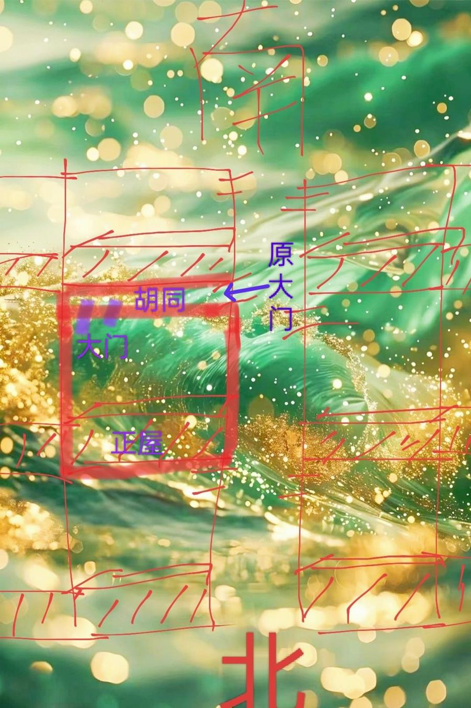
- 西南绝命门伤人又伤财，女主人尤其容易哪儿都不得劲。

关键词：大门、开门方位、鬼门、绝命、坤2、胡同

## 第563章 少挨点儿揍

又深又窄、阳光照不到的胡同容易藏阴，吉位的门开在这里也成了纳阴气。没有好选项时，只能在"不好"和"更不好"里选：宁可走正西的祸害门。

- 村里一半人家开西南门，天灾人祸、重病都多——有些人对故土有不要命的执念。
- 邱大哥的比喻：不好的风水像个脾气暴躁的人，最好远离；不远离就尽量讨好，讨好得越好"越少挨揍"。

关键词：大门、胡同、纳阴、化解

## 第564章 使命

琪儿的大儿子爱发呆不爱学习——萨古鲁小时候也爱发呆，爱迪生也被退学；每个孩子都有自己的天赋和使命。

- 我们眼中的笨孩子，也许是我们理解不了天才的思维。
- 阴极而阳，阳极而阴：香水最早的原料吲哚，含量低是香，含量高就很臭。
- 改变能改变的，接受不能改变的。

关键词：教育、孩子、天赋、阴阳

## 第565章 绿色通道

回国路过上海，同学小青带两人去拜访一位"神婆"。

## 第566章 火能跨越维度

火阿姨用火驱邪："火是生与死的标志，代表生命力，可以链接到其他维度。"家里可以点一盏植物油灯。

- 佛家讲四大：地、水、火、风；活人和死人主要差在火（温度）和风（呼吸）。
- 敬鬼神、请仙家要先点火焚香，还阴债要烧纸——都借助了火能跨越维度的特性。
- 植物或植物油燃烧时会产生一种光环，能提升健康和智慧，化工蜡烛没有这个作用。

> **生活方法｜点一盏植物油灯**  
> 用来：提升家里和自身的能量  
> 怎么做：家里有时可以点一盏油灯，用酥油灯，也可以用芝麻油或花生油代替；没有油灯就点天然植物做的香。  
> 注意：要用天然植物香，不要化工香；化工蜡烛没有这个效果。注意防火。

关键词：火、油灯、酥油灯、驱邪、四大

## 第567章 火能解蛊

火阿姨烧的是纯木材，还能隔空解蛊；收费只有几十块钱。

- 作者声明：书里写的师父都不会公开联系方式，也不会主动加人好友——提高警惕，谨防被骗。

关键词：火、解蛊、防骗

## 第568章 好人有好报吗

好人一定有好报吗？火阿姨说不一定：大多数人眼中的"好人"是对自己好、和自己三观一致的人，不一定符合天道。"天道无亲，常与善人"——善于遵守天道规律的人才有好报。

- 天道规则不止一条：赚钱有赚钱的规则，健康有健康的规则，花钱有花钱的规则，是不同的系统。
- 有钱人生病不等于"遭报应"，没钱的人也会生病。
- 赚了钱不交该交的税、不上该上的供，出了事，是违背了花钱的规则，与赚钱无关。
- 人不能赚超过自己支配能力的钱，会花不明白。

关键词：好人好报、天道、规则、赚钱、花钱

## 第569章 糊涂不难得

善良的人生病，不是善良导致的，而是没走健康之路的规则——就像学好语文不等于数学好；但善良的人朋友多，机缘也多。糊涂并不难得，难得的是看破不说破。

- 只是"不伤天害理"就期待好报，凭什么？凭不劳而获吗？

关键词：好人好报、天道、规则、善良

## 第570章 神仙不是无所不能

何为开悟？"开"就够了：能理解一切、包容一切、允许一切发生；神仙也不是无所不能的。

- 道不可言说，不是因为道玄，而是语言本身有局限——就像没法跟古人讲清楚手机，没法跟色盲讲清楚红色。

关键词：开悟、包容、道、语言

## 第571章 哪天能到账

作者不喜欢"顺嘴"给人看风水：任何事都无法用语言精准表达，随口一句建议除了糊弄人没有意义。小青竟问火阿姨补财库"哪天能到账"。

关键词：看风水、补财库

## 第572章 傲气伤自己

人有人道、鬼有鬼道，各道规则相似：落后就要挨打；求鬼神办事就像求人，拿点小礼就趾高气扬要结果——傲气对不起的是自己。

- 火阿姨说她做的，是把跑到人道来欺负人的东西送回它们自己的道。

关键词：鬼道、补财库、傲气、谦虚

## 第573章 我不能代替你强大

我只能帮你把当下的问题赶跑，不能代替你强大——自己强大才是根本。

- 弱肉强食在各个维度都存在；我们可以不欺负别的生灵，但不能不强大自己。
- 这世界上没有坏事：被鬼缠上一次，若能明白落后就要挨打、从此精进，也是好事。

关键词：自强、驱邪、修行

## 第574章 你礼貌吗

请教问题时"点一堆睛等师父画一排龙"，不礼貌；礼不礼貌不在口气，在行为。

关键词：提问、礼貌

## 第575章 懂事儿

健康的规律：日出而作，日落而息；春生、夏长、秋收、冬藏——秋冬是收藏的季节，非要大张旗鼓扩张事业，可能事业成了、健康受报。

关键词：养生、节气、春生夏长、秋收冬藏

## 第576章 只能试一试

火阿姨说：病由虚入实，火能解决"虚"的部分；最好在刚觉得不对劲、还没变成实病时就处理。

- 她列的"虚"的表现：心烦意乱、头迷糊、胸口闷、脾气暴躁、睡不着、查不出原因的咳嗽、身上反复痒、小孩噩梦夜啼。
- 已经完全变成实病、医院都放弃的，她也只能"试一试"。
- 古诗里的"西风"代表萧瑟，"北风"代表寒冷——秋冬的大环境不适合大展宏图。

关键词：虚病、实病、驱邪、节气、秋冬

## 第577章 风占灾异最验

季节反常要付代价："冬至南风短，来年多干旱""冬至东风雪满天，冬至南风干半年"；李淳风说"风占灾异最验"。同学李雪一天工作20小时，急着找大师改运。

- 冬至是冬天的冬天，该刮北风不刮就是反常。
- 外求不如内求。

关键词：节气、风、冬至、李淳风、改运

## 第578章 发怒可以辟邪

四季对应情绪：春木主怒（向上突破）、夏火主喜（成长）、秋金主悲（收敛）、冬水主恐（藏）；人在悲伤害怕时最容易"见鬼"，所以发怒可以辟邪。

- 火阿姨远程为李雪"清理"后说她没有阴邪问题，只是头部不舒服，让她睡一觉——李雪说没时间睡。
- 很少有人在暴怒或狂喜时见鬼。
- 想冲业绩时呼吸会不自觉地往上往前；秋冬是收藏的季节，这时开创事业，呼吸也是向上的，跟天时相反。

> **修心方法｜走夜路害怕时发怒**  
> 用来：走夜路害怕、怕"撞邪"  
> 怎么做：害怕的时候让自己生起一股怒气（木主怒，向上冲），而不是缩着害怕。

关键词：情绪、四季、辟邪、发怒、恐惧、呼吸

## 第579章 头眼清亮

作者熬夜成习惯、身体亚健康；在火阿姨那里"清理"后，当晚发现看远处更清楚了，能看清远处红绿灯的倒计时。

- 阿姨谢客不是不慈悲：避免应酬，才能省下时间做更有意义的事——不善是为了大善。

关键词：视力、熬夜

## 第580章 明天同一时间

在上海机场离起飞还有半小时就被拒绝登机、改签到"明天同一时间"。

## 第581章 赚钱不要命

李雪说清理后精神很好，看蓝天白云都更美，还要作者以后介绍各种大师帮她催财——年入几千万仍然对钱饥渴。

- 法事是外力，偶尔借力可以，关键是从内心改变；总想依靠外力不可能发大财。

关键词：贪欲、法事、外力

## 第582章 小费

第二天才发现登机口是起飞前15分钟才关——前一天根本不用改签；丘书妍给出租司机500块小费，让作者父母当场"宕机"。

关键词：消费观

## 第583章 开启修仙之旅

篇外：火阿姨不再接受预约——关键是自修，不要依赖外力；之后的内容开始讲"修仙"。作者带丘书妍见"吉月姐姐"，她说自己不是一般的仙家。

- 人人都是未开悟的佛，无需外求；找到本真的心、觉醒内在的力量才是长久的正途。
- 作者声明：吉月姐姐只是昵称，她不会主动联系读者；有人冒充要注意辨别；感知力没练到能辨真假之前，不建议外求。

关键词：自修、外力、防骗

## 第584章 气醒了

没有黑，又怎么知道白？正因有对比，人才会珍惜善意带来的感动。吉月姐姐说她们更像天道的守护者，守护各界众生，也主张修自己。

- "天下皆知美之为美，斯恶已；皆知善之为善，斯不善已。"

关键词：阴阳、对比、修行

## 第585章 椅子烫腚

出发前作者梦见车被偷、赶不上，被气醒；一路上雨没下，到DY时吉月姐姐坐立不安地赶去送一块小石头。

- 凌晨的清醒梦一般有寓意（见第480章）。
- 他们一切修心、不强求：该到的人或物到了就对了，没来也不催不问。

关键词：梦

## 第586章 元神出窍

吉月姐姐的师姐"元神出窍"做任务没能顺利回来，师父让作者和丘书妍也去旁观。

关键词：元神出窍、修仙

## 第587章 做法

师父说师姐化作树仙去干旱地区送水被困住；师姐一直喊"水"，把一瓶瓶水往自己身上倒，丘书妍的半瓶矿泉水用上后她才醒过来。

- 作者只是记录所见，对这类事的态度是：不否认，也不轻信。

关键词：元神出窍、修仙

## 第588章 神仙批发市场

师父说"元婴长大，元神才能出窍"；工作室里很多人气色灰暗、面相坎坷，作者心里存疑。

- 现在的骗子比真的多得多。

关键词：元神出窍、修仙、面相

## 第589章 谁来救他们

师父说"修行人首先要破相"：屋里的人原来有的疯了、有的绝望想自杀、有的穷得吃不上饭——"我不救他们，谁来救他们？"练出元婴靠"灵性的觉醒"。

- 很多人只认衣服不认人；有时间精心打扮的，往往没多少时间充实内在。

关键词：修行、破相、灵性、面相

## 第590章 索求

自私自利的人何谈觉醒？来求的人多是"我想身体好、我想多赚钱"——都是满足私欲；作者劝吉月姐姐开直播只讲修行。

- 众生苦是因为迷，心里装满了欲望；菩萨想救，总不能无限满足众生的私欲。
- 心正了再说借外力；自己才是修行的根本。

关键词：欲望、修行、觉醒、外力

## 第591章 自助者天助

自助者天助：正心正念努力的人遇到坎坷，会有德行高的人出手；一心外求、喂不饱的人，菩萨也不搭理。修自己才是根本。

- 师父强调"破相"：穷困的身体里住的不一定不是菩萨；穿袈裟道袍的反而极少是真的。
- 哪位佛菩萨是靠天天念经修成的？经书是过河的船，过了河就要放下（"法尚应舍，何况非法"）。
- 《法灭尽经》：末法时代，魔会披着法的外衣出现，诱发人的贪念和嗔恨。
- 嫌你随喜少、开口索要、拿"菩萨怪罪"吓唬你的"师父"，不必理会。

关键词：自助者天助、破相、念经、末法、防骗

## 第592章 贩卖老仙儿

不要出去乱拜：心术不正的人可能借看事给你做手脚——只要你起了贪念、对他有所求，他就能控制你。网上明码标价"卖老仙儿"的都是骗局。

- 吉月姐姐说：很多人运气好、能躲过事，背后有神灵护佑。
- 作者说抖音上就有很多卖"老仙儿"的，几千年道行标价几万，大家不要被骗。

关键词：防骗、贪念、卖仙家、乱拜

## 第593章 篇外：正气不是软柿子

篇外答疑：读《地藏经》不舒服就先别读，先读《金刚经》《道德经》"破相"；正气不是软柿子；不要用猫做头像。

- 读《地藏经》读出的是众生之苦、生起慈悲，说明心性够了；读出的是私欲、想靠念经满足索求，就先去破相。
- 去人欲去的是贪念，不是让人连风水都不讲——风水是无形的刀，该保护自己也要保护好自己。
- 火阿姨帮读者"清理"时，有问题的基本一家人都有，没问题的全家都干净——作者认为风水起了很大作用。
- 正气不是不发脾气，是"正气凛然"。
- 猫属阴、能通灵；病床前猫不走，情况不乐观；邪气重的地方容易有黑猫出现。头像尽量清理掉阴邪的象意。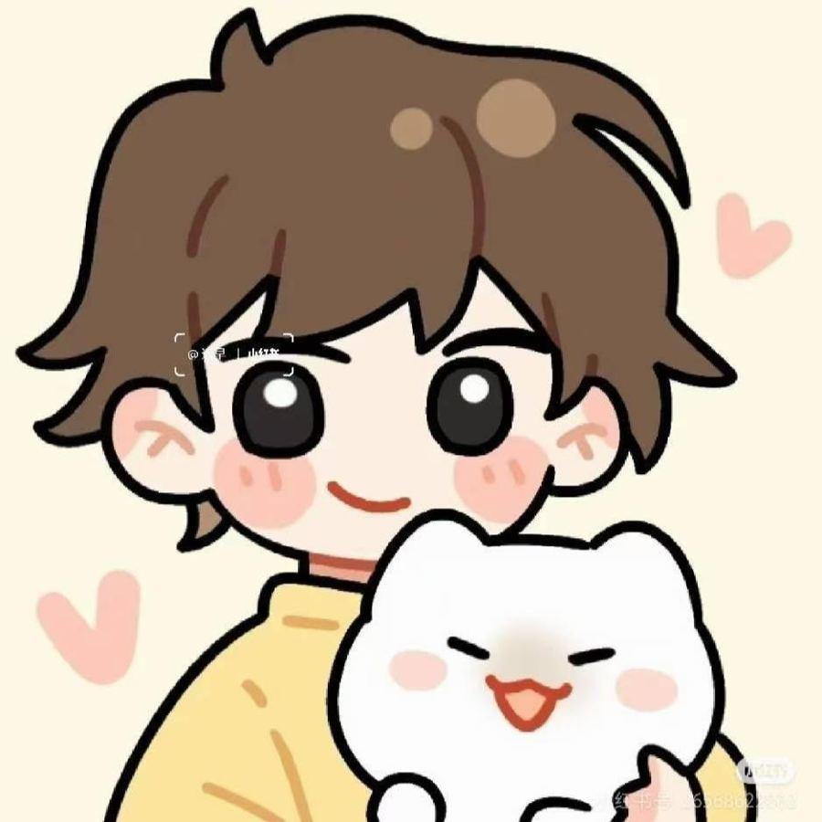

关键词：地藏经、金刚经、道德经、正气、头像、猫

## 第594章 篇外：一切的发生，必有利于我

父母不让调风水，要搬出去租房吗？不必浪费钱：父母的房子尊重父母，自己可以换个睡觉位置、调个床头朝向，再好好修心。

- 气场没转变的时候，总会有各种理由阻止你改变。
- 头像里黑白、人在影子里，九宫从2到4有一条线（五鬼穿宫）——他的睡觉位置果然也在凶位。
- 一切的发生必有利于我。

关键词：头像、五鬼、睡觉位置、父母家、修心

## 第595章 篇外：心脏的问题

心脏在离9：查有没有高能量物品和煞；但也不能轻易放水，以自己身体感受为准，不舒服就撤。可放绿萝，但别让它长过花盆。离9缺一块易有"外心"，坎1见水男人易不忠。

- 草本植物不开花的，也算低能量；用水不舒服的人可以放绿萝。
- 绿萝长得到处攀援，就成了腾蛇之象。
- 离9和坎1是跷跷板，要一起调。
- 离9既是心脏，也是心情、心意。楼体为了造型在离9凹进去一块，心缺了，容易有外心，尤其是女人。
- 坎1见水或有问题，男人容易不忠——离为心，坎为肾，"女人走心，男人走肾"。
- 但人才是决定因素：外力干扰心智，可以用意志力对抗；不过与其考验人性，不如先把家调好。
- 作者再次声明：这只是九宫五行层面的对应，以实践为准，不要迷信。

> **风水调整｜离9（正南）调整——心脏**  
> 用来：心脏问题、心慌  
> 怎么做：1. 检查正南有没有高能量物品（红色物品、电器）和煞，有就挪走。2. 不要轻易放水；需要降能量又不适合放水的，可以放绿萝。3. 坎1同时要调。4. 放上任何东西后身体不舒服，就马上撤掉。  
> 注意：绿萝不要让它长出花盆、到处攀爬。

> **风水调整｜用水不舒服就放绿萝**  
> 用来：想在某处放低能量的东西，但放水后不舒服  
> 怎么做：草本植物不开花的也算低能量，可以用绿萝代替水。

关键词：离9、心脏、绿萝、坎1、外遇、九运

## 第596章 篇外：写给抑郁的人

写给抑郁、负债的人：当你开始替他人着想时，善念就生起来了；给出去的，就是收获到的。所有"让你先掏钱、再教你赚钱"的项目都是假的。善要有度，在失控之前先把桌子掀了。

- 读者长信：父亲吸毒、丈夫隐瞒负债、自己负债近40万、想过自杀，读了这本书和《地藏经》后决定为孩子好好活下去。
- 计划只能计划认知以内的事，而富贵一定突破了原来的认知；穷算计会把人固化在原来的认知里。
- 越纯真、越不动心思的人，越容易连接天地能量，运气越好；跟着直觉走，走心别走脑。
- 防骗：交10万返500万，第一感觉是什么，真相就是什么；交6999教你抖音日入五位数——真有这种事他早就藏着了。违背"利益众生"天道规则的游戏不会长久。
- 偷盗诈骗零成本暴利，却没有人因此大富大贵——天网恢恢。
- 怕什么来什么：别盯着钱，问自己能帮别人什么；事做好了，钱是自然的结果。
- 抑郁的人大多是奉献型的；善要在自己可承受范围内，"一切的善都以我乐意为前提"。无底线包容、逼出嗔恨心，就容易"入魔"失控。
- 照顾别人之前先照顾好自己；善良不是软弱，敢于为自己发声也是勇敢。

关键词：抑郁、负债、防骗、钱、善良、边界、掀桌子

## 第597章 篇外：情绪是修行的重要指标

修行就是修情绪：不是压着不发火（那是内耗），而是内心本来就不起情绪；问问自己愿不愿意，不愿意就不做，只要不是"既要又要"。

- 例：家人不断网赌，自己不断容忍、替他填窟窿，把自己内耗成抑郁——这是纵容恶的生长，不是修行。谁违背天道谁难受，不要阻止他为自己的行为买单。
- 佛祖割肉喂鹰是心甘情愿，不内耗；我们不乐意却硬做，就会内耗。在哪个境界做哪个境界的事。
- 不想替弟弟补窟窿可以不补，但不能既不补又想要"兄友弟恭"的好名声——这就是贪念。
- 情绪ABC理论：A是事件，B是你对它的解读，C是结果。同样被扇耳光，解读成美容就开心，解读成侮辱就生气。
- 推荐书：《一念之转》。
- 情绪是活力的象征：小孩睡觉都眉开眼笑，睡觉也愁眉苦脸是死气沉沉。
- 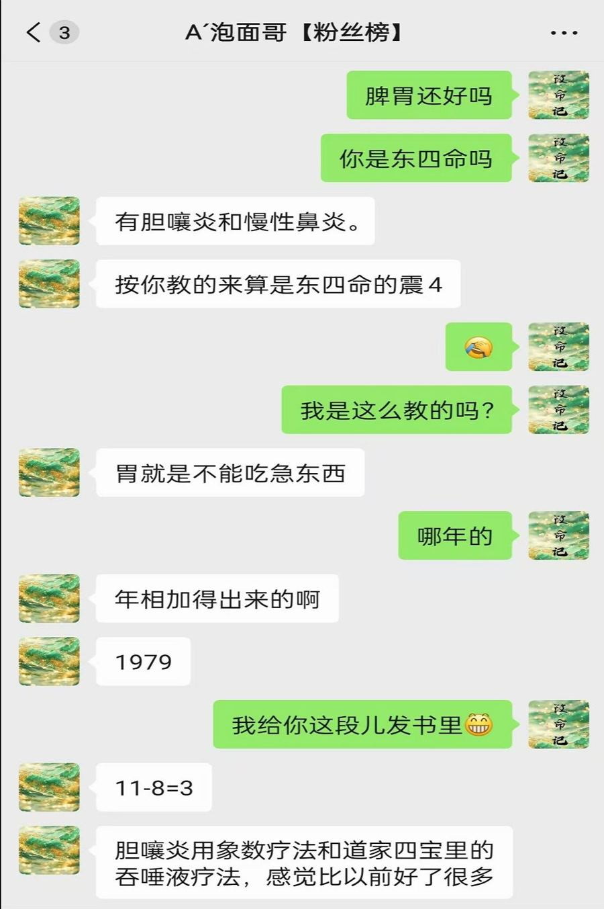

> **修心方法｜情绪梳理三问**  
> 用来：憋屈、内耗、心里不舒畅  
> 怎么做：1. 让我不开心的人或事，符不符合阴阳之道？2. 我做这件事是心甘情愿，还是被道德绑架？3. 放下面子和礼仪问自己的心：我愿意吗？不愿意就不做；想要什么就拿自己愿意付出的去换。再试着换个解读（转念）。

关键词：修行、情绪、内耗、边界、转念、ABC理论、既要又要

## 第598章 灵族降临

夜里在荒郊野外做大型法事，"接引灵族"。

关键词：法事、修仙

## 第599章 要脸

法事现场哭喊打滚，作者明白了为什么不让录像；问他想不想加入，他说"要脸"。熬了20多小时，醒来却精神百倍。

关键词：法事、修仙

## 第600章 你的心是不是自由的

所有的苦，都是某个贪念没被满足；注意力就是生命力——被欲望粘住的注意力越多，人越不快乐。没有期望就没有失望。

- 心理学的"自由注意力"：小宝宝的注意力全是自由的，看什么都开心；长大后有了分别心和欲望，注意力被粘住，就越来越不快乐。
- 开不开心与权利金钱无关，只与心有关。
- 当一个人把问题都归于外在时，问题是无解的。
- 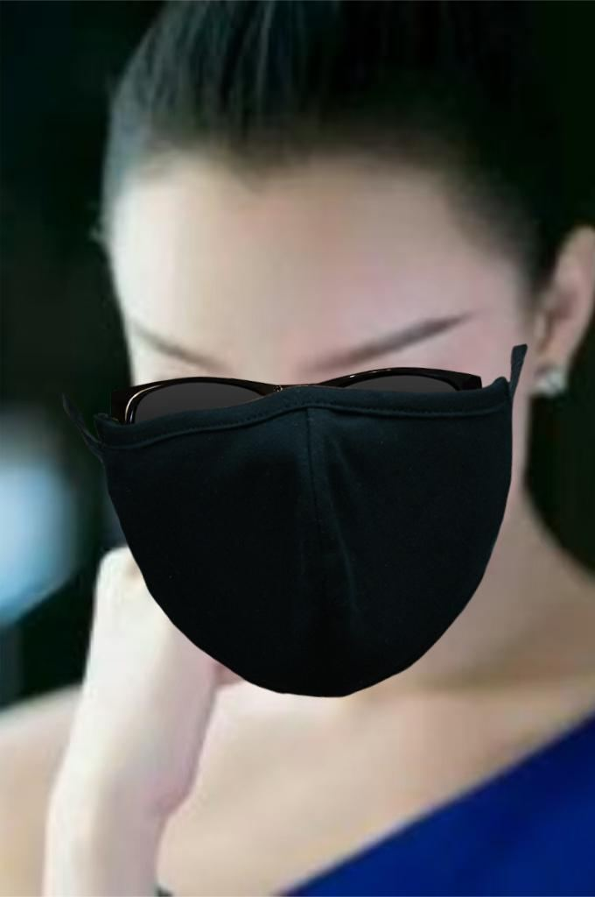

关键词：贪念、注意力、期望、剑眉、眉毛
