# 《改命记实录》逐章笔记：0601-0700

## 第601章 做法事需要知道的事儿

什么人适合还阴债：知道了就想还、手头宽裕的，可以还；还了就要对方保佑大富大贵的，先别还、好好修心；没钱、借钱来还的，也没必要。正气（情绪）足时，债主拿你没办法。

- 作者说他不接个案，也不卖课；算这笔账是想告诉负债的人：换个思路，几十万几百万也不算很多钱。只要活着，问题总有解。
- 无形的债分两种：阴债像"高速费"，人人都欠，差别不大；因果债是路上跟别人发生的纠葛、造成的伤害，差别很大。
- 阴债是公家的，可能冻结你的资产，"阴债不还，阳债补上"；还有私人恩怨——冤亲债主，比如往世杀过人，这一世对方可能来索命。很多付诸行动的自杀，背后都有索命的在迷惑心智。
- 不论恶鬼邪魔，都是钻了情绪的空子：情绪是正气的指标。
- 火阿姨的清理像"保镖"，用火提升正气把讨债的赶走；法事是直接还债。无法抑制的贪念，外力清理不了。
- 天地人相通：利益为先的仙家和利益为先的人比例差不多。能靠自己就靠自己，不要轻易外求——遇到心术不正的人扣了你的护法神，就麻烦了。
- 练习：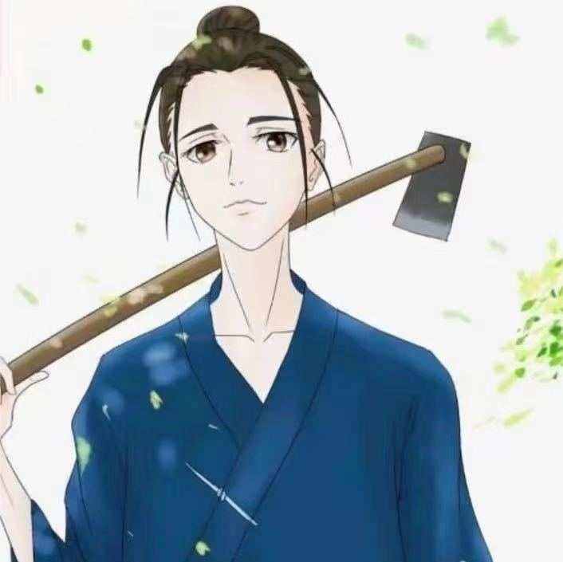

关键词：阴债、因果债、冤亲债主、正气、情绪、外求、头像

## 第602章 修正气

情绪是正气（阳气）的指标：情绪不阳光时正气不可能足；升阳最简单的办法是运动。修行就是修念头、修情绪。不求不救：自己还不会游泳，别跳进水里添乱。

- 阳气足的人，遇到不顺心的事也不当回事；能被影响，就说明阳气不足。
- 我们会愤怒，是因为控制不了自己的念头。
- 把看不见的存在想象成没有身体的"隐身人"：它们和人的脾性差不多，也会欺软怕硬、会算账。和它们的纠纷像跟债主谈：态度诚恳，别强势，没钱就好好商量宽限。
- 债多了一个个还没完没了；还了一个，风声传出去可能引来更多。
- 别有事没事打听妹妹家、朋友家的事——人家缘分没到，你思绪乱起，反而卷进负能量；先把自己过好，等人家求到你再帮。

关键词：正气、阳气、情绪、运动、不求不救、债主

## 第603章 夫妻宫

面相上太阳穴是夫妻宫：剑眉直指夫妻宫，影响夫妻感情，女人会比较强势或说话不柔和。《一念之转》四句话可以化解戾气。

- 拜伦·凯蒂的四句话："那是真的吗？""那真的是真的吗？""持有这个想法时，我会怎样？""不持有这个想法时，我会怎样？"
- 事实就是真相，生气是在跟事实争辩。
- 世上的事分三类：别人的事、自己的事、老天的事——尊重别人的事，管好自己的事。

> **修心方法｜一念之转四句话**  
> 用来：生气、委屈、对某人强烈不满  
> 怎么做：遇到让你不开心的想法（如"他不应该对我冷暴力"），依次问自己：1. 那是真的吗？2. 那真的是真的吗？3. 抱着这个想法时，我会怎样？4. 没有这个想法时，我会怎样？比较两种状态，哪种对彼此更好。

关键词：面相、夫妻宫、太阳穴、剑眉、一念之转、转念、婚姻

## 第604章 一念之间

看到别人身上的问题，其实都是自己的问题；看别人的优点是升阳，看缺点是收阴。许下的愿要还愿。乾6是天门，地支对应戌。

- 抱怨老公不爱自己的人，自己有好好爱老公、爱自己吗？
- 师父说：人间的贪念和嗔恨越重，法界邪恶的力量就越强——一念天堂一念地狱。
- 人生本自具足：心什么都知道，只是被习性和情绪蒙蔽了；就像学会骑车后不用再想动作，感觉大于理论。
- 许了愿、事成后要说声谢谢——阴阳平衡体现在细节上。寒衣节别忘了祭祖。
- 还阴债选日子和普通吉日不同，智策师父用奇门择日，选"天门地库打开"的日子。
- 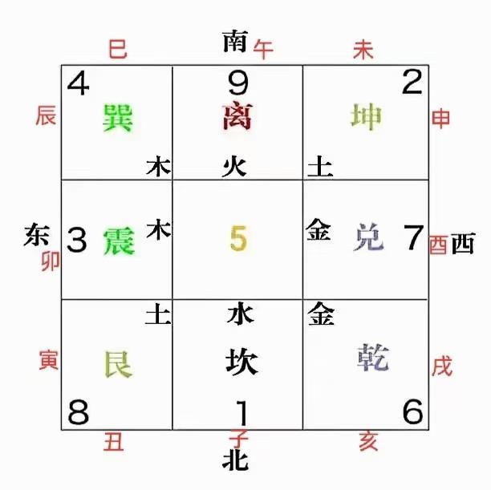
- 乾6既是天门，又是男主人、脑子，还对应大肠；大肠末端连着肛门，痔疮也跟乾6有关。
- 练习：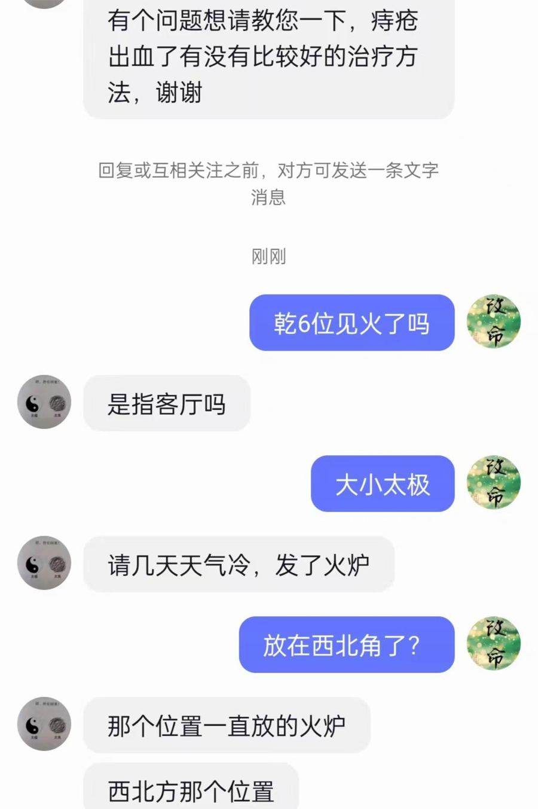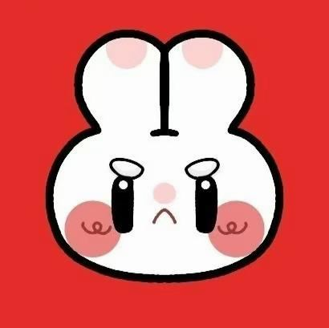

> **民俗方法｜许愿后还愿**  
> 用来：许过愿、事情已经成了  
> 怎么做：事成之后，回到许愿的地方或在心里诚心道谢、还愿。

关键词：升阳、看优点、许愿、还愿、乾6、痔疮、大肠、天门

## 第605章 篇外：乾6宫

乾6放绿植会影响男主人运势；一家人只有一个人痔疮严重，是因为命理和流年不同；熬夜（子时不睡）、吃辣等上火的行为都会"火克金"加重痔疮。

- 乾6位放草本植物能降能量，但影响男主人；头像乾6有绿色植物也算。整片都是植物的情况（花圃、满图草地）不单独算。
- 乾6代表财库、脑子、大肠、痔疮，头发也和这里有关；乾6受伤，有人破财、有人记忆力差、有人脑梗脑出血、有人老年痴呆、有人大肠病、有人痔疮、有人白头发；命硬的人一时看不出影响。
- 子午觉：子时（夜里11点到1点）睡觉可以滋阴；熬夜子时不睡，阴水不足，火就旺。
- 子午是跷跷板，熬夜还伤离9（心脏和血液）。
- 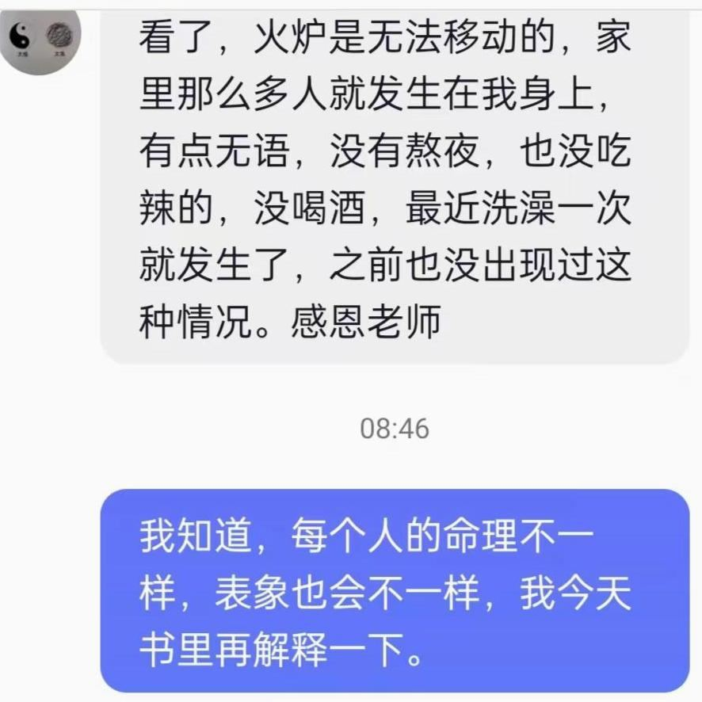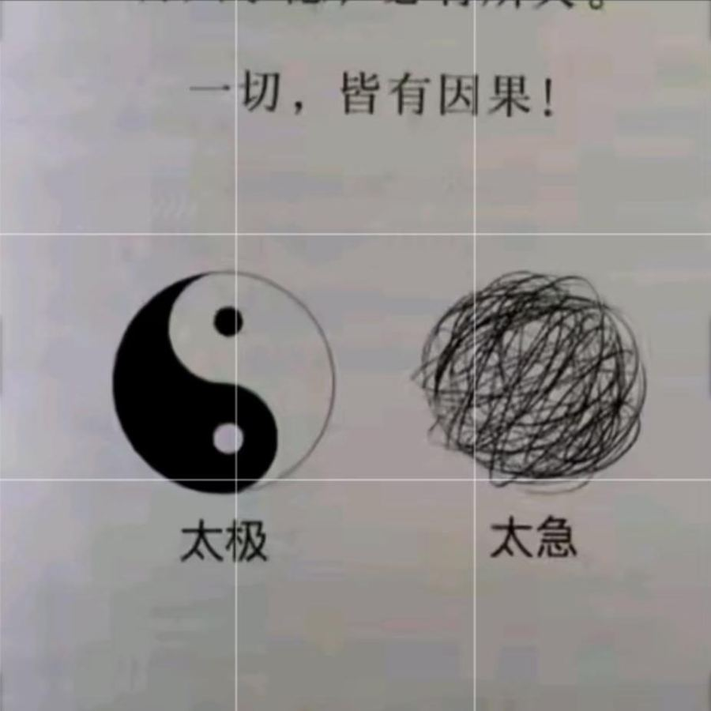
- 把人生当游戏，别太执着于"我"：一个痔疮，也可能是开启灵性的契机。
- 练习：同一位读者的三个头像。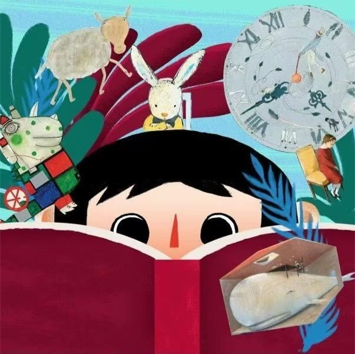

> **风水调整｜乾6（西北）护理——痔疮、大肠**  
> 用来：痔疮、大肠问题、记忆力差、白发  
> 怎么做：乾6位不放火（炉灶、红色物品）、不放草本绿植；头像的乾6位也别有绿植或"着急上火"的字样；生活上子时（11点前）睡觉、少吃辣、少熬夜。

关键词：乾6、痔疮、大肠、熬夜、子午觉、吃辣、上火、绿植、男主人、头像

## 第606章 音乐连接能量

音乐可以连接能量：放下大脑，用心去感受。作者"感受"出了法界带回来的半句诗的后半句，师父说"欢迎回家"。

- 作者第一次体会到"时间不存在"：有一种能超越时间和空间的力量。

关键词：音乐、能量、觉醒、修仙

## 第607章 拯救仙家

剑眉师姐转念之后，眉毛也弯了一些——相由心生；那晚师兄师姐们一个个"元神出窍"去法界救各路生灵。

- 吉月姐姐说她们救的众生包括人间、阴间和天上，仙家也是被救的众生之一。

关键词：相由心生、眉毛、修仙

## 第608章 邪门的导航

熬到凌晨犯困时，掐几分钟"太极阴阳八卦连环诀"闭目养神，就能精神饱满；回程导航反复把人带下高速，像"鬼打墙"。

- 打坐时掐这个手诀可以镇静辟邪；闭目养神时掐，子午相连、阴阳结合，形成封闭的气场，心安气行。
- 书中这里没有写手诀的具体做法（第158章有子午诀和握固的图）。

关键词：手诀、打坐、熬夜、辟邪

## 第609章 一切的发生都有原因

所谓"鬼打墙"其实是前方修路、导航想让他们回到原路线——别胡思乱想给自己加戏。吉月姐姐：越天然越好，合成、提纯、化工的都不如地里直接长出来的。

- 生活中常有考验：遇事慌不慌、起不起负面情绪。
- 食品安全问题背后是人的贪念无限；谁的贪念重，谁就可能被"魔"控制。
- 香水、洗发水、沐浴露都是化工；各种保健品还不如萝卜白菜。返璞归真，从广告的骗局里醒来。

关键词：胡思乱想、天然、化工、保健品、贪念

## 第610章 佛魔难辨

佛魔难辨：魔也会披着佛法、慈善、纯天然的外衣；讲易经风水、搞国学的，甚至素餐店老板，都可能扣人的护法神。自修是唯一的出路。

- 判断佛魔与收钱多少没有固定关系。
- 真假仙家就像真钞假币，眼睛难辨，只有不断修行、心思纯净了，用心去感受。
- 查"童子"：有的仙家法力不足，可能把童子还到地府里受苦，那还不如不还。

关键词：佛魔、防骗、护法神、自修、童子

## 第611章 除了自我成长其他都不真实

除了自我成长，其他都不是真实的：风水和清理业力都只是助力，清理好了又去追名逐利，还不如不清理。"童子"若被法力不足的人还到地府，改起来很麻烦——不够信任，就别乱做法事。

- 天上来的童子要还到天上；地仙还不到天上，法力强的能还到庙里修行，法力弱的可能还到地府。
- 万般带不去，唯有业随身；万法皆空，因果不空。
- 吉月姐姐：拉人一把就要保证他大富大贵，这种人不敢拉——一拉就引起他无限的贪念。
- 篇外：师父不接你的法事很正常，自己修好更好。心性还在摇摆时不要做法事；贪嗔痴慢疑，"疑"也是五毒之一。
- 支招：先默默地学，觉得学到了、验证有收获了再去尝试消费——这样稳赚不赔，也不会胡思乱想。

关键词：自修、法事、童子、疑、贪念、防骗

## 第612章 神仙是怎么来的

与其拜求有能力的人，不如向他学习——神仙也是人修成的；一是要自修，二是要心定，否则别人想点化也点不开。

- 想跟大佬发财，对方同意了你却怀疑"他为什么同意？是不是骗我？"——这种摇摆的心跟不了。
- 万法归一，这个"一"就是自己的心；人一疑神疑鬼，心乱了就容易入魔。所有让自己起疑和负面念头的事都远离，包括法事。
- 心定的人，风水命理是助力；心不定的人到处算，命就越算越薄。

关键词：心定、自修、疑、命理

## 第613章 乳腺问题

吉月姐姐不每天烧香："神仙几千年的道行，会因为你少上几根香就生气吗？"有的仙家到处抓人当弟马——不要活在别人的嘴里。

- 吉月姐姐澄清：仙本身没问题，问题在于做弟马的人心术不正。
- 遇事别用脑子胡思乱想，静下来多问问自己的心。

关键词：烧香、仙家、出马、修心

## 第614章 正心正念的人能不能收钱

作者先掏出收款码：你们认为正心正念的人不该收钱，那钱应该流向谁？修行修的是自己，不是用自己的道理去"修行"别人。

- 有位母亲天天念叨不爱学习的儿子，念了几年也没用——管了这么久没用，不管又能差多少？

关键词：修行、收钱、教育、唠叨

## 第615章 父母凭啥赚那么少的钱

孩子成绩不好不是他不愿意，就像父母赚得少不是不愿意；乳腺对应巽4（东南）：见水或有煞都伤乳腺，要找日子挪走。虎皮兰、龙骨、仙人掌、金虎都算带刺。

- 你都不是最优秀的父母，凭什么要求孩子是最优秀的孩子？
- 读者一家：客厅东南角是鱼缸；父母家东南角是厕所——以前还以为乳腺病是遗传。
- 煞可能是带刺的物品、镜子、石头，也可能是缺角或室外有冲撞。
- 孩子学习不好，可能是风水影响，可能是业力干扰，也可能他有自己的使命。不要打着"我为你好"的幌子欺负孩子。

> **风水调整｜巽4（东南）调整——乳腺**  
> 用来：乳腺增生、乳腺问题  
> 怎么做：检查大太极和房间小太极的东南角：有鱼缸、厕所等水，或有带刺植物（虎皮兰、龙骨、仙人掌、金虎）、镜子、石头等煞，选日子挪走。

关键词：巽4、乳腺、鱼缸、虎皮兰、带刺植物、教育、孩子学习

## 第616章 无条件的爱

无条件的爱：不论你怎样我都爱你；陪孩子找兴趣，试过了不行也无所谓。作者又教了命宫的用法：1349命宫的人住1349开门的房间、睡1349的方向。

- 修人为主，风水为辅；尽人事，听天命，无憾无悔。
- 作者"算"出这两位经济不宽裕：潜意识认为修行人不该收钱、收钱的都心术不正，钱自然流不到她们这里来。
- 作者让她们身体好转后帮一下有需要的人作为平衡，不必刻意去寺庙道观做善事。
- 先修心再调风水：心不正，调了风水往上拉30分，她一怀疑又往下拽40分。

关键词：无条件的爱、教育、命宫、东四命、西四命、修心

## 第617章 篇外解答（甲状腺、乳腺）

头像练习解析；巽4对应肝胆、神经、左肩、乳腺、甲状腺、淋巴等腺体，也主名声，宜明亮温暖，可加红花、红中国结、红字提升能量。打坐念经时看到光、听到声音都是幻境，不要执着。

- 
- 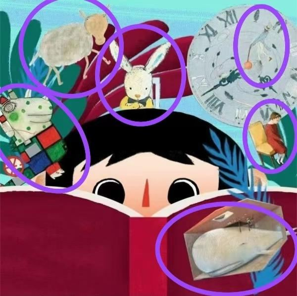
- 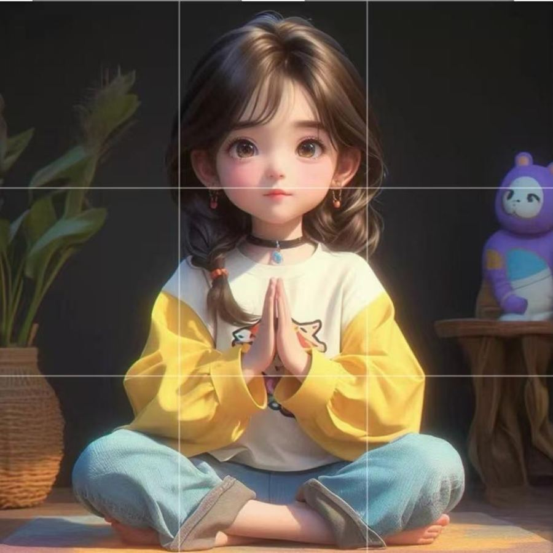
- 头像里不要有小布偶，尤其是丑的、藏在身后的；景区照片背后有一大群人也不适合——背后有人，下意识就不安心，俗称"有小人"。
- 穿宫：看线条从哪个宫穿到哪个宫，起点终点的八星关系决定吉凶。例：人从顶到底中线是1到9延年；盘腿从艮8到乾6是天乙；植物叶子3到4延年，连瓶子4到8就是绝命。
- 巽为风，也对应与风相关的问题，并和斜对角乾6（头发）关联；巽见水或能量低，相关部位易受伤、名声不利。
- 修改头像要照顾整体基调，别在蓝天上硬加一朵大红花。
- 读经时觉得"元神要出窍"，其实是魔怔了：看到光、听到说话、看到仙境地狱、身体有感觉，都是幻境——随它来去，不执着、不喜、不怕、不好奇。先读《金刚经》破相。
- 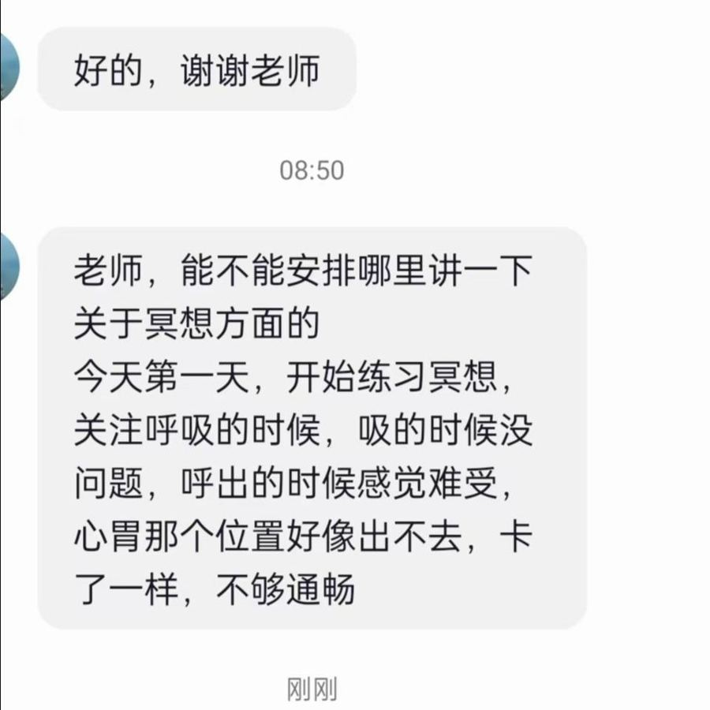冥想时不执着于某点、不加意念，静静关注呼吸、不带分辨。
- 平时容易生闷气，可以练张至顺道长的八部金刚功（作者另有视频），收功很重要。

> **风水调整｜巽4（东南）提升能量**  
> 用来：乳腺、甲状腺、淋巴、肝胆问题；名声不好  
> 怎么做：东南保持明亮温暖（但别形成光煞），可以放红色系的花、红色中国结或红字；把水和低能量的东西挪走。头像东南位也可同样处理，但要顾及画面整体。

> **修心方法｜观呼吸冥想**  
> 用来：心乱、想太多、生闷气  
> 怎么做：静坐，不执着于任何一个点，也不加意念，只是静静关注自己的呼吸，感受它，不评判。出现光、声音、画面等，随它来去，不理会。

关键词：头像、穿宫、巽4、乳腺、甲状腺、名声、打坐、冥想、幻境、八部金刚功

## 第618章 貔貅有没有屁眼儿

智策师父：人的念力很重要，所有人都坚定相信某物件能改运，它也会有一定效果；例：家里摆没有屁眼的貔貅，家里会有人容易得痔疮。

- 大众念力：所有人都认为盐、黄金要涨价，大家抢购，价格就真涨了——想法决定行为，行为导致结果。

关键词：貔貅、痔疮、念力、风水摆件

## 第619章 三次用不了

貔貅是兽，有吃就要有拉才阴阳平衡；"口大屁眼小"才是纳财之象，完全不拉就过度了，对应着人的屁眼也不舒服。

- 招财归招财，伤身是伤身；财大伤身，一切有度。
- 不方便戴、摆风水物件的人（如身份原因），可以通过法事助运，相当于身上带了个无形的物件。

> **风水调整｜貔貅要选"有屁眼"的**  
> 用来：家里或手串上有貔貅，家人痔疮  
> 怎么做：选嘴大、屁眼小但"有"屁眼的貔貅；完全没有屁眼的貔貅不要摆。

关键词：貔貅、痔疮、阴阳、风水摆件

## 第620章 随的什么缘

智策师父：学费设得低，是不想挡住真正有需要的人；随缘就是频率一致、说了对方能懂。

关键词：学习、随缘

## 第621章 额头接收天的能量

额头代表祖先，也代表天，能接收天的能量——厚刘海盖住额头，灵感弱；富豪榜上的人大多露着额头。

> **生活方法｜露出额头**  
> 用来：运势低、灵感弱  
> 怎么做：把盖住额头的刘海梳上去，让额头露出来。

关键词：面相、额头、刘海、灵感

## 第622章 200岁才可以退休

古人平均寿命只有二三十岁？作者推理：《礼记》说大夫七十致仕，若平均寿命真那么低，等于我们要二百岁才退休——提醒别全盘接受主流说法。

关键词：寿命、推理

## 第623章 人本来就是人，何必费劲去修人

面相：鼻翼有痣代表漏财（鼻翼是财库）；后脑发际线很低起运晚；八字眉性格不强势、异性缘好、易为情所扰，眉尾和眼角都下垂叫"四尾下垂"，更甚；眉毛的毛往下长容易抑郁。智策师父：人本来就是人，何必费劲去修人？

- 说了改不了、只会添堵的面相问题，作者一般不说。
- 想得越多就越不能做自己：总在意"我是不是不道德、不善良、别人会不会不喜欢我"，不断压抑天性，人就偏离了人。做回自己需要勇气。

关键词：面相、鼻翼、痣、发际线、八字眉、眉毛、抑郁、做自己

## 第624章 水利万物吗

"水利万物而不争"？发洪水时水会把你冲倒，不会游泳跳下去水也不会托起你——水只遵循自己的规律，谁遵守就利谁。爱自己，不活在别人的嘴里。

- 帛书版写作"上善治水，水善利万物而有静"。
- 讨厌现在的自己，说明不认可昨天种下的因；能做的是允许已种下的果发生，并修正行为、种下新的因。
- 我们比古代皇帝过得都舒服，却还不满足，因为在跟周围的人比。
- 人会抑郁，是考虑太多——为别人也为自己，不断苛责否定自己。

关键词：上善若水、爱自己、抑郁、因果、攀比

## 第625章 我们是利益共同体

涛哥想通：让自己闹心的，都是侵犯了"我"的那点利益；把格局放大，大家是利益共同体，还有什么可计较的。

- 佛家讲破"我执"。
- 篇外：读《道德经》可以把通俗版和帛书版对照着看。

关键词：我执、格局、利益共同体、道德经

## 第626章 人为什么会愤怒

桃花和抑郁在风水上是连着的（五行都属水）：想犯桃花又被压着，就会走向抑郁。根子是正气（阳气）不足。解决要内外一起：内在升阳、转念、打开格局；外在撤水，尤其坎1位的水。

- 头痛医头、脚痛医脚，会把事情之间的关联掐断。
- 我们为什么会愤怒？一是无能为力，二是不理解因果。看不懂因果、也没能力处理，就先远离，等格局提升了再回头看——站在十楼就看不到地上的蚂蚁了。
- 所有让自己不开心的事，都是自己的事。
- 坎1见水主抑郁。手机号尾数不要用111这种连号：水太重，要么两性关系复杂，要么伤肾（表现为腰不舒服）。

> **风水调整｜抑郁、犯桃花——撤水**  
> 用来：抑郁；控制不住犯桃花  
> 怎么做：内在：升阳气、转念正向思考，打开格局。外在：把家里的水尽量撤掉，尤其是坎1（正北）位；手机号尾数避开111这种连号；清理六煞数字组合（见[八颗星](../../book/04-名字和数字/10-八颗星.md)）。

关键词：桃花、抑郁、坎1、愤怒、格局、手机号、数字能量

## 第627章 六煞

六煞组合是16、47、29、38（不分前后）。六煞本意是心思敏锐，用对了是服务业的好能力；太强就会捕捉到所有人对自己的不满，犹豫不决、拖泥带水，烂桃花越积越多，还加重自卑。

- 要清理的地方包括：手机号、微信号、QQ号、各种头像、睡觉的位置等，所有跟自己相关的能量场。
- 数字里0代表隐藏：106去掉0等于16；但三位数代表两个磁场，所以106是两个六煞。
- 两个相同数字连在一起叫伏位，不好不坏，延续前面的气场：166也是两个六煞。
- 5的第一种说法：男用5变2，女用5变8。男人号码里59等于29，女人号码里35等于38，都算六煞。作者常用这一种。
- 5的第二种说法：加强。156就是强烈的六煞。
- 例子：作者看到有人给他的书打1星，点开发现那人给谁都打1星——傻呵呵地收不到伤害；六煞强的人，在五星好评里也能捕捉到细腻的伤害。
- 人会抑郁，往往是觉得自己没有价值，六煞会加重这种自卑。

> **风水调整｜清理六煞数字**  
> 用来：抑郁、犯桃花严重、犹豫不决  
> 怎么做：检查手机号、微信号、QQ号等数字，以及头像、睡觉位置里的16、61、47、74、29、92、38、83组合（注意0不计、伏位延续、5按性别变2或8），慢慢替换掉。  
> 注意：任何气场都有利有弊，按自己需要拿捏，过犹不及。

关键词：六煞、八颗星、数字能量、手机号、抑郁、桃花、敏感、自卑

## 第628章 犯桃花

六煞水多容易拉肚子（坤位见水也会）。"是什么命，得什么病"：坎1命伤腰肾情绪，离9命伤心血管和头部。几种招烂桃花的风水：东南（巽4）见水臭名声；乾6、兑7有花（包括画着团簇花朵的字画）；号码里有27或72。

- 坎1命宫的人尤其忌讳坎1位再见水或六煞重，以免雪上加霜。离9命宫的人选了离9位是厨房的房子，问题会更明显。
- 东南见水主色情和偏财——正常人家不宜见水；但人家本来靠这个赚钱，就别去断人财路。修行只修自己。
- 乾6是男主人位，不宜有花；兑7既指小姑娘又指小秘书，有花招惹外面的女人。
- 27/72：2为老女人，7为小女人，27天乙为财富——同时给不同的女人花钱之象；也可能是每月给女儿、岳母等生活费。
- 涛哥想讲升官发财，作者只讲升官：对拿固定薪水又有权力的人，催财容易出事。

> **风水排查｜烂桃花——查花和水**  
> 用来：招烂桃花、名声不好  
> 怎么做：东南（巽4）不放水；乾6（西北）和兑7（正西）不摆花，也不挂画着团团簇簇花朵的字画；号码里避开27、72。

关键词：桃花、拉肚子、六煞、巽4、乾6、兑7、花、名声、数字能量、命宫

## 第629章 二十四山

二十四山：12地支 + 8个天干（戊己中央土不算）+ 4个角宫，凑成24山。补角最好用实体墙垒上，其次用铝合金、塑钢窗、栅栏围起来，再次用摆件。

- 
- 升官的原理：背后有一堵又高又厚的实墙，注意力就能全部放在前面，看起来更勇敢。从提升智慧和勇气去布局没有副作用；搞邪术窃取别人运势，因果不空。
- 泰山石补角是常见化解办法（石头最接近土），作者自己不常用，但已经用了的没特殊情况可以不动。
- 生肖补角：哪个方位缺角，就摆对应的属相。三个注意：东北缺角不用虎（家里避免凶兽）；避开和家人属相相冲、相害的（例：正东缺角用兔，但家里有属龙或属鸡的就不能用）；注意材质五行（兔属木，就别用金属兔）。
- 作者也少用生肖补角，因为还要考虑全家人的八字冲克，一般师父不会细看。
- 师父没被问到的事，看到了一般也不会说——人只能靠自己学。
- 风水两大门派：峦头（看得见的山水物件）和理气（看不见的气场）。补角也分补形和补气；补形越密封效果越好，补不上形才补气。补气又分全部用土补和用五行八卦补两种。

> **风水调整｜补角——补形**  
> 用来：房子缺角  
> 怎么做：首选用实体墙把缺的角垒上；不能垒，就用铝合金、塑钢窗、栏杆、栅栏等把这块围起来，越密封越好。都做不到，再用摆件补气。

> **风水调整｜补角——生肖属相**  
> 用来：房子缺角  
> 怎么做：按二十四山，哪里缺角就摆对应地支的属相摆件，材质要与属相五行相合。  
> 注意：东北缺角不用虎；家人属相与它相冲或相害的不能用；家人八字和这个地支冲克的也会加重冲克。

关键词：二十四山、补角、缺角、泰山石、生肖、峦头、理气、升官

## 第630章 补角的方法1

补角像衣服打补丁：哪个宫缺角补哪个宫，但整个宫都没有就没法补。各宫补法：艮8放土再配一盆水；震3、巽4放木本绿植（别用发财树等断头树）；离9缺放草本植物；坎1缺放金属；坤2放干土；兑7、乾6用金。

- 用土补气只要注意土里别带很多小石块；泰山石也属于用土补。
- 离9和坎1是九宫里离中间数5最远的两宫：离9不能再放火（会抬高能量），坎1不能再放水（会降低能量），这两个位置最好不要缺角。
- 断头树：培植时会把树头砍掉，发财树就是。家里或公司摆发财树，不但不发财，还容易资金链出问题。
- 五行不只看材质，形状和颜色也有五行：圆形金、方形土、长方形木、三角形火、波浪形水；白色金、黄色土、绿色木、红色火、黑色水。
- 震3、巽4属木，用金属卦牌不合适（金克木）。

> **风水调整｜各宫五行补角**  
> 用来：房子某个宫缺角  
> 怎么做：艮8（东北）放一盆土，旁边最好再放一盆水凑成湿土；震3（正东）、巽4（东南）放木本绿植；离9（正南）放草本植物；坎1（正北）放金属；坤2（西南）放干土；兑7（正西）、乾6（西北）放金属。材质之外，还可以用对应的形状和颜色加强。  
> 注意：不能选发财树等断头树；整个宫都没有的情况补不了。

> **风水调整｜坎1缺角——抻开的钢丝球**  
> 用来：坎1（正北）缺角  
> 怎么做：用银白色的钢丝球，尽量抻开成弯曲的线条，放在缺角处——金属（金生水）＋波浪形（水）＋银白色（金），一层层加力，作者认为比买卦牌效果还好。

关键词：补角、缺角、五行、发财树、断头树、绿植、钢丝球、形状五行、颜色五行

## 第631章 补角的方法2

网上卦牌多是外行做的，不分材质、形状、颜色，甚至卦画都错——不如自己画，还能注入美好意念。补角要选吉日，偷修日更好；能配上对应的日和时更好，做不到也别纠结。升官局：水主智慧，肾主胆量，智慧和勇气都在坎1。

- 自己做卦牌：写上对应卦的字，再画上卦爻（从下往上画）和数字，一层是一层的力量，注意材质和颜色。
- 补角要配合装修风格，别满屋神神叨叨的风水物件。例：西南缺角放一堆土不好看，可以放陶瓷或泥做的艺术品；泥做的羊或猴，从材质、颜色和地支三层都补上了（不和家人属相冲突时）。
- 补哪个角选哪个日和时：补震位用卯日卯时；补乾位用戌日或亥日的戌时、亥时。找不到，就选偷修日的对应时辰；起不来，就只选偷修日。
- 一念天堂一念地狱，从灵的角度看是真实存在的。

> **风水调整｜自制卦牌补角**  
> 用来：房子缺角，想用八卦补气  
> 怎么做：用和该宫五行相合的材质、颜色自己做一块牌，写上对应卦名，从下往上画上卦爻，再写上对应数字，做的时候心里想着美好的愿望。选偷修日（最好配对应的地支日、时）放在缺角处。

关键词：卦牌、补角、偷修日、择日、念力、升官、坎1

## 第632章 升官发财局

升官发财局：坎1分壬、子、癸三山。壬山主男人勇猛发达，癸山主女人有能力，子山主发财；抬高这里的能量，勇气、权力和钱财一起涨。要发财则在正南的丙、丁位放水。都不能单独压在子位或午位上（子午线）。涛哥流鼻血，作者教他十指交叉紧握，几秒就止住了。

- 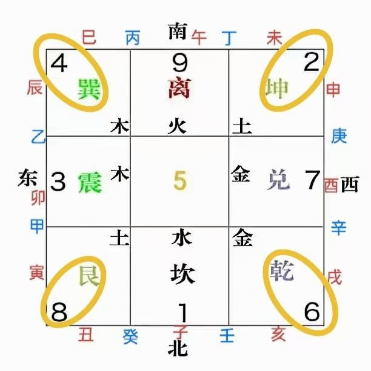
- 十天干两两一组，单数为阳（男）、双数为阴（女）：壬对应男人，癸对应女人；丙对应男人，丁对应女人。
- 壬山："壬砂发武贵，秀峰高大位"——有高大山峰，发达勇猛的人。癸山："癸砂女当家"——女人有能力。子山："子砂定发富，家有金钱库"。
- 抬高可以是物理的（北面加靠山、加高照壁），也可以是能量的（加电器等）。四象里讲"北高南低"。
- 子午线是家里正中正南正北的线，建房、调风水都要避开。可以压壬子、子癸或壬子癸，不能用小冰箱、大衣柜单独压在子位。物件太小够不着三山，就单独压壬或癸。
- 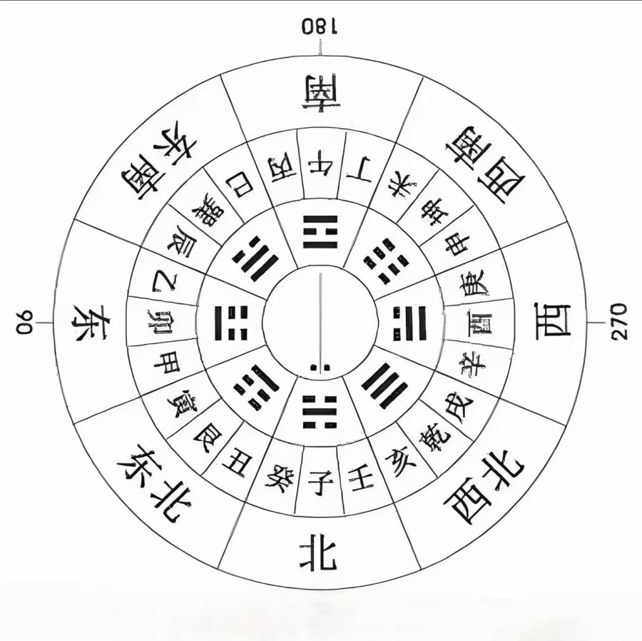三山是平分坎宫的，三等分量好，挨着分界线放，别过线压到乾6或艮8。
- 山主人丁水主财。南北有跷跷板关系：只调北边，南边的财也顺带旺。重点求财则在南边丙、丁位放水；午位单独有水、浑浊或形状不好，易犯桃花。
- 丙水："太微水，寿星光，催官催财水中央"——弯曲细微的有情水才好，汹涌澎湃的不行。丁水：有良田、有福寿。
- 正南开门，尽量别单独压在午上，偏东一点在丙位开门更好。每个山15度，一般用罗盘，指南针也能测。
- 朱雀位放水和八字有关，不是人人都适合：放上去心脏不舒服要及时撤。

> **风水调整｜升官局——抬高壬、癸位**  
> 用来：男人事业运、勇气胆量（壬）；女人事业运（癸）；顺带财运  
> 怎么做：用罗盘把家里正北（坎1）三等分为壬、子、癸。在壬位或癸位（最好两个都）加靠山、高柜、照壁或电器，抬高能量；可以连带压到子位，但不能单独压子位。选吉日放。  
> 注意：不要过线压到乾6或艮8。

> **风水调整｜财局——丙、丁位见水**  
> 用来：想提升财运  
> 怎么做：在正南（离9）的丙位、丁位放弯曲平缓的"有情水"，可以顺带压到午位，不能单独放在午位。  
> 注意：不是人人都适合，放了心脏不舒服要马上撤。

> **生活方法｜十指交叉止鼻血**  
> 用来：流鼻血  
> 怎么做：两只手十指交叉紧紧握住，挤住中指和无名指的指根。涛哥握了没几秒就止住了，又多捏了一会儿巩固。

关键词：升官、财局、二十四山、壬子癸、丙午丁、子午线、玄武、朱雀、罗盘、流鼻血

## 第633章 失眠的风水问题

失眠找风水：先查乾6（脑部）有没有高能量物品、煞或一直动的东西（钟表、风水局）；再查巽4（神经系统）有没有低能量或煞；再清理五鬼气场（24、18、36、79）。涛哥姥爷小脑萎缩，家里西北角是厨房（火克金），放水缓解。

- 原本的止血方法是掐某个固定手指的指根，作者记不住，干脆十指交叉，全部指根都卡住。
- 脑部问题都对应西北角（乾6）。西北厨房能挪最好，不想挪就放水降低能量——水要落地放，选吉日放。
- 五鬼指脑子停不下来：想睡睡不着，或有事耽搁没时间睡，或睡着了也做梦。要清理睡觉位置、书桌位置、手机号、微信号、各种头像里的五鬼组合。5可变，别漏查。
- 涛哥的头像就是"24五鬼穿宫"。

> **风水排查｜失眠——风水排查**  
> 用来：失眠、脑子停不下来  
> 怎么做：1. 查乾6（西北）：有没有高能量物品、煞，或一直在动的东西（钟表、风水局等），挪走。2. 查巽4（东南）：有没有低能量物品或煞。3. 清理五鬼组合24、42、18、81、36、63、79、97（5按规则变）：睡觉位置、书桌位置、手机号、微信号、头像。

> **风水调整｜西北厨房——放水**  
> 用来：家里西北角是厨房，老人脑部问题（如小脑萎缩）  
> 怎么做：能把厨房挪走最好；挪不了，就选吉日在这里放一盆水，水要落地放，降低这里过高的能量。  
> 注意：只是缓解，厨房还在西北角。

关键词：失眠、乾6、巽4、五鬼、八颗星、数字能量、厨房、小脑萎缩、老年痴呆、流鼻血

## 第634章 失眠的偏方

失眠象数820·160：820土生金，健脾益气、清痰养肺；160金生水，疏泄头部、补肾气（失眠和心肾不交有关）。脾肾强了还能减肥。顽固性失眠可以泡花生叶子喝，护肝安神。

- 卧室开门方位也算磁场：例如坤2命宫的人住进4开门的卧室，24已经形成五鬼。
- 象数用的是先天数字，对应后天五脏：8坤土主脾，2兑金主肺；1乾金主头，6坎水主肾。
- 失眠原因很多（神经衰弱、肝火旺、烦躁、脾虚），象数也要对症，像中药一样不同人不同方。
- 把象数当药用：配合作息，病好了就不要再念了。吃着减肥药还暴饮暴食是没用的。

> **象数｜象数820·160**  
> 用来：失眠（心肾不交型）；脾肾弱引起的肥胖  
> 怎么做：默念"八二零，一六零"。  
> 注意：要配合作息饮食；病好了就停。

> **偏方｜花生叶子泡水**  
> 用来：顽固性失眠；护肝  
> 怎么做：用花生叶子（干的、新鲜的都行，中药店有卖）泡水喝。  
> 注意：书里没给用量。

关键词：失眠、象数、820·160、减肥、花生叶子、心肾不交、命宫

## 第635章 降三高和利尿减肥的偏方

霜打的桑叶泡水喝可以减肥，还能清肝明目、养肺、清理血液。玉米须泡水降三高、补肾利尿——但孕妇脚肿喝了，羊水减少了，孕妇要适量。智策师父："西墙上有花，伤肺"——也是在说桃花。

- 西墙（兑7）有花，花为高能量，克金伤肺；身边异性多，往往对应西墙有花。
- 涛哥姥爷家西北厨房放水后，清醒的时候多了，但仍会犯迷糊；作者提醒大小太极都再找找高能量的东西。

> **偏方｜霜桑叶泡水**  
> 用来：减肥；清肝明目、养肺  
> 怎么做：用霜打过的桑叶（中药）泡水喝。  
> 注意：书里没给用量。

> **偏方｜玉米须泡水**  
> 用来：三高、利尿、补肾、水肿  
> 怎么做：用玉米须泡水喝。  
> 注意：孕妇要少量：书里孕晚期的人喝了消肿，但胎检羊水减少了，立刻停了。

> **风水调整｜西墙不摆花**  
> 用来：伤肺；桃花多  
> 怎么做：西墙（兑7）上的花、花的字画撤掉。

关键词：桑叶、减肥、玉米须、三高、水肿、孕妇、兑7、花、桃花、肺

## 第636章 打破业力才能改命

涛哥姥爷去世后才发现：姥姥24小时开着念佛机，放在西北角厨房窗口和正南客厅窗口——念佛机等和佛菩萨信仰相关的物品都是高能量。要改命必须打破业力，要打破业力必须有坚决改命的心，否则业力会糊住眼和心。

- 离9的念佛机也有影响：乾6管脑子，后天在西北，先天在正南（后天的离9位），先后天八卦有内在呼应。
- 平时看九宫（后天八卦）就行；后天调完没明显变化时，也要考虑先天八卦（甚至阴宅）。
- 补角补充：装修风格不方便放卦牌、生肖的，单从形状和五行补也行。乾6放任何金属物件，或圆形、白色物品（白色圆形更好），别用红色；这里喜静不喜动，优先选静态的。

> **风水调整｜乾6补角——白色圆形物品**  
> 用来：西北（乾6）缺角，不方便放卦牌或生肖  
> 怎么做：放金属材质的物件，或圆形、白色的物品（白色圆形最好），优先选不会动的。  
> 注意：不要用红色等火系的物品。

关键词：念佛机、高能量、乾6、离9、先天八卦、业力、补角、小脑萎缩

## 第637章 口腔溃疡

口腔溃疡：大门相当于房子的嘴巴，门口有红色（红对联、红地垫）对应嘴巴容易上火、起溃疡，上火时最好撤掉。芦荟消炎，但它带刺，不建议家里种，可以用芦荟胶代替。

- 门不论开在哪个方位，都代表口。不上火就无所谓，上火了就撤红色。
- 作者故意逗他妈："吸几口烟含一含，对口腔溃疡也有效。"
- 作者想和他妈打赌：布局收回欠了十几年的债就证明风水有用——他妈一句"应该哪天还？"把他KO了。

> **风水调整｜大门撤红色**  
> 用来：口腔溃疡、嘴巴上火  
> 怎么做：把大门口的红对联、红地垫撤掉。

> **偏方｜芦荟含服**  
> 用来：口腔溃疡  
> 怎么做：掐一块芦荟放在嘴里含一会儿；家里不种芦荟的，可以用芦荟胶代替。  
> 注意：芦荟带刺，不建议家里种；芦荟胶有添加剂。

关键词：口腔溃疡、上火、大门、红色、对联、地垫、芦荟、带刺植物

## 第638章 红色招邪还是辟邪

红色辟邪还是招邪？红属火有阳气，能吓住小鬼，但对厉害的鬼像拎着铁棍挑衅——所以晚上别穿一身红出去。现在人气旺，再多用红色就容易上火。

- 古人分散住在山上，阴气重，红色确实有辟邪作用。

> **民俗方法｜晚上不穿全身红**  
> 用来：避免招惹不干净的东西  
> 怎么做：晚上阴气重，不要穿一身红衣服出门。

关键词：红色、辟邪、招邪、穿衣

## 第639章 财库漏了

同学聚会上作者说一位张总监"男人不在家，手里存不住钱"——依据是她家西北角（乾6，男主人位、财库）缺角或被克。一桌人吓坏了：她刚买了几千万的游艇。

- 乾6有问题，男主人能量不足，男人不喜欢在家待着。
- 乾6也是财库，缺角或被克相当于财库漏了洞，有钱就花，存不下钱。

关键词：乾6、财库、缺角、漏财、男主人

## 第640章 相貌与风水的关系

财库漏窟窿只代表存不住钱，不代表赚不到钱、没能力。张总监说其实她家西北角缺了一整间卧室——那是"缺宫"。作者说：相由心生，人的相貌也和风水有关。

关键词：乾6、缺宫、财库、相貌

## 第641章 卧蚕网罗纹

西北角（乾6）管头发——张总监头顶头发稀少，对上了。卧蚕（下眼袋）是子女宫，有横竖交叉的"网罗纹"（井字纹）影响子女运；配上人中悬针纹，心量狭小、儿女无缘。卧蚕也是胃经的位置，凹陷或有乱纹，脾胃不好。

- 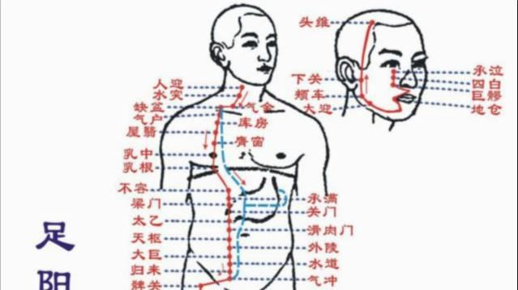
- 头像代表当下的运势，卡通头像上有网罗纹不代表本人有，所以只能说"目前的运势不利子女"。
- 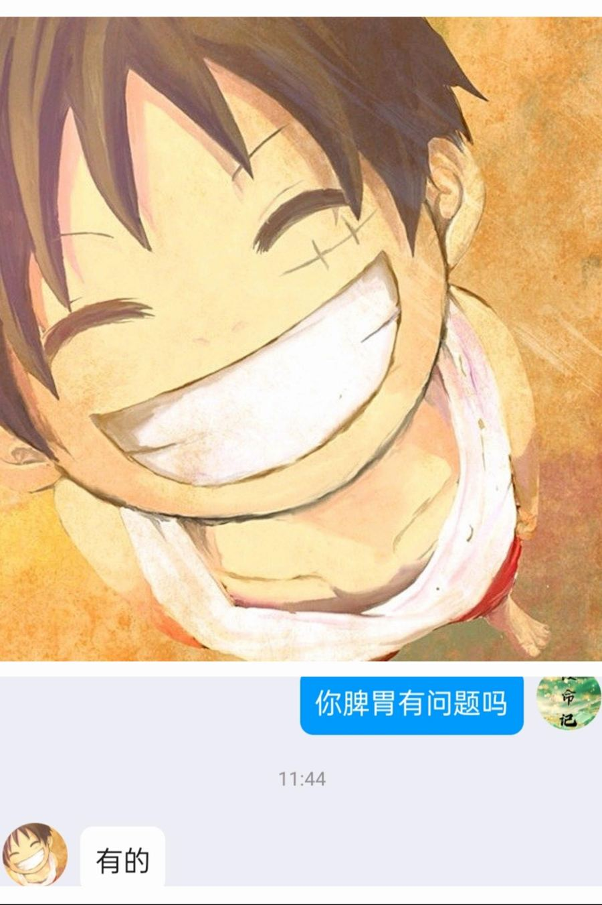

关键词：面相、头像、卧蚕、子女宫、网罗纹、悬针纹、脾胃、乾6、头发、脱发

## 第642章 搞垮阴间的经济体系

防骗：做微商的人换身道袍直播做法事，几百块钱"烧几个亿冥币"——看着越像真的越可能是假的。真假大师很难辨别，好好修自己，修为上去了自然能分辨，不要依赖外力。

- 属相怎么算？命理学上以"立春"为界，不是大年初一，也不是公历元旦；网上万年历多按大年初一改属相，并不准。
- 吉月姐姐的一位师兄受业力影响说话含糊，自修清业后越来越清楚。
- 作者说自己是"客观唯物主义"：尊重各法界的客观存在。

关键词：防骗、冥币、法事、属相、立春、辨别真假

## 第643章 绿卡包过的“大神”

防骗：新加坡绿卡"包过"收30万——其实只是一直拒签一直上诉，不保证时间；客户耗不起不想申请了就算"违约"，不退钱。填一张表十几分钟的事。

关键词：防骗、绿卡、合同套路

## 第644章 转型尝试

九运是离火，火也代表文化，作者想转去做文化培训。去辅导班面试，承诺一个月提分却没被录用——负责人说：我们的目标是让孩子玩得开心、愿意继续来，不是提高成绩。

- 马航MH370事件：能力不足时看不到真相，只能低头做好自己的事。

关键词：九运、离火、转行、辅导班

## 第645章 占卜赌球

丘书妍学占卜去地下赌球，赢了几场越押越大，一个平台卷钱跑路，最后一场押最大的一次输了。一个人的财富有限度，不要用占卜去赌；前面平台跑路就是一种提醒。

- 佛家讲"无情都在说法"：一草一木都在揭示道法，我们却解读不了。
- 对赌上头的人，不祝贺都可能被解读成诅咒。

关键词：占卜、赌博、财富限度、提醒

## 第646章 催财影响下辈子吗

催财也分怎么催：正当的催财是卸下压着你的担子，让你发挥出本来的能力，超不过你本身的界限；窃取运势的邪术，偷的可能是自己下辈子或子女的运势，没有白得的。

- 想超过自己的财富限度，只能靠修行提升福报和德行。
- 师父说股票市场只有1%的公司有投资价值，个人股民赚钱的也只有1%左右，不太建议入场。

关键词：催财、因果、下辈子、邪术、股票

## 第647章 意念治病

作者选股先看老板最新照片、视频里的"面相"运势，面相不好的清仓，效果不错。意念治病：病是一种提醒，对它全然接纳、无所谓（不排斥、不抵抗、不执着、不生气），病就会消失；用意念像拿纸杯喝水，不轻不重。

- 跟秉烛师父讲的"受了受了，一受就了"类似。
- 作者先试少白头，但心里其实在排斥它，试了几次没效果。

> **修心方法｜意念治病**  
> 用来：小毛病（作者用在小瘊子上有效）  
> 怎么做：对这个病全然接纳、觉得无所谓：不排斥、不抵抗、不执着、不生气，然后轻轻起一个念头，不轻也不重，像拿纸杯喝水一样。  
> 注意：越在意越不灵；念头要稳，乱起的念也会实现（见648章）。

关键词：意念治病、接纳、股票、面相、少白头

## 第648章 “得偿所愿”

作者大腿内侧两粒小瘊子，因为真不在意，随便用意念想了想，几天后消失得干干净净。可他又起念"要是掉的都是白头发就好了"，结果白头发比黑头发还多——心念不稳时，人不能轻易心想事成。

- 一位修行人闭关时想"这次可以不用继续修就好了"，没多久就因急病住院，"得偿所愿"地中断了。

关键词：意念、瘊子、白头发、心想事成、起心动念

## 第649章 篇外：亲子关系中的因果

篇外·亲子关系中的因果：小女孩从桌上摔下来大哭，妈妈冲过去狠狠揍她——这会在孩子心里种下怎样的种子？菩萨畏因，凡夫畏果；想改变孩子，先反思自己爱的是孩子还是自己。

- 天天唠叨，是在发泄自己的情绪，还是真为孩子好？
- 《道德经》："是以圣人无为，故无败；无执，故无失。"不执着就不会痛苦。

关键词：亲子关系、教育、因果、唠叨、无执

## 第650章 番外【个人改运与三元九运】

番外·个人改运：不知道适合做什么，就在当下可选的岗位里做最优选，边走边换；别人笨的地方，可能正是你的天赋。职场高情商11条；被抢功劳要有底气，并习惯工作留痕；被恶意中伤，就转念——蚊子吸不到血才嗡嗡叫。

- 高情商要点：真诚夸人、看见对方的不容易、因人而异不背套话、女人多哄男人多夸、不是人人都爱听真话、落实到行动、换位思考、交往的关键是提供价值（物质、情绪、信息）、注意力放在做事上、注意语速和气息。

关键词：职场、情商、找工作、天赋、抢功劳、中伤

## 第651章 番外：福利篇

番外·用本书封面讲头像：看头像和衣服，最上层（最外层）的图案代表自己；外界生自己（别人都喜欢你）或自己克外界（环境在你掌握中）为吉。绿色封面是一层层往上克，自己被克；直接用绿色背景图做头像，木克土，对脾胃不利。

- 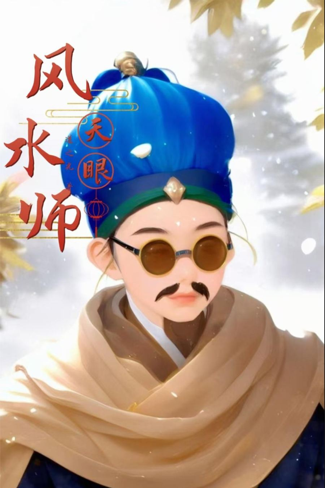
- 艮8到乾6的穿宫，尽量平着或轻微向上斜：上坡路难走但越走越高，别选越走越低的。
- 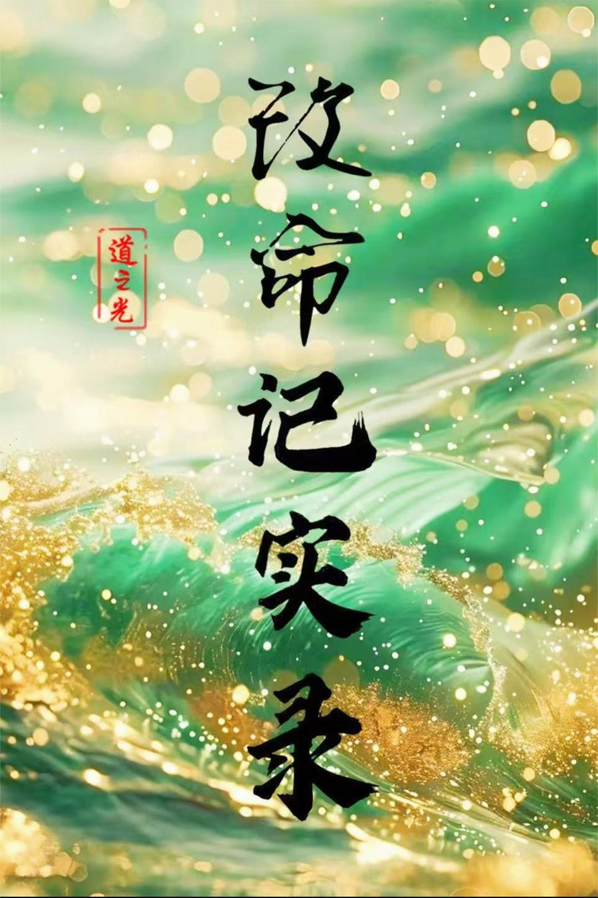
- 风水调整不能离开实用原则：白字更合五行，但看不清，只能用黑字。
- 克归克，还要看克不克得动：粗黑字是少量土克大量水，只是小克。
- 最理想的封面：淡绿色背景配红字，或淡红色背景配黑字。
- 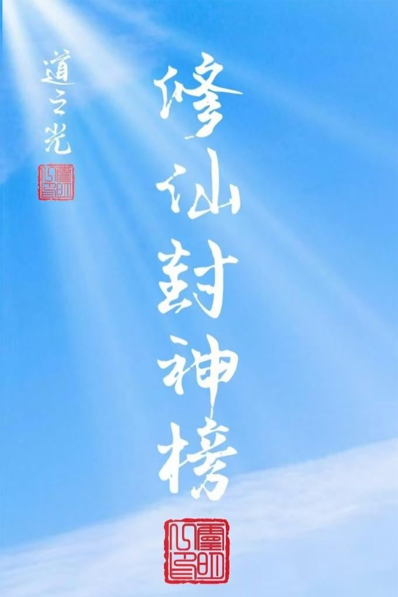

关键词：头像、封面、五行生克、穿宫、艮8、乾6、巽4、脾胃、颜色五行

## 第652章 被抓的小婴灵

念头能致病，也能治病（有心态好的癌症患者自愈）。百病生于气：小孩经常发烧，多是父母关系不和、常生气上火；孩子生病大多是父母影响的，长大后生病是自己念力影响的。

- 少听愤怒的音乐，少说负面的话，多起正面、温暖、祝福的念头。
- 同学的弟弟上了灵修课回来像魔怔了，不上学不上班、自言自语，医院查不出毛病。
- 吉月姐姐在忙：很多人"还童子"时抓了小婴灵去替还。

关键词：意念、小孩发烧、父母关系、情绪、灵修、魔怔、童子、婴灵

## 第653章 大部分的梦是正的

还童子的正确过程：先救出童子分身的灵、注入纸人、毁掉地下的替身、再送回本来的地方；很多人查不到替身，就随便抓小婴灵充数。超度有没有成功，父母静下心问自己的心就知道——真超度了心里是喜悦轻松的。心平静时，梦大多是正的。

- 梦见祖先过得好就是好，过得不好就是不好；不胡思乱想时，梦正的多、反的少。
- 一个口腔溃疡一年多吃药不好的人，吉月姐姐查到他前世特别爱钓鱼、杀鱼。
- 同学弟弟的情况：背后的护法神被扣了7个，魂也被勾了一个。

关键词：童子、婴灵、超度、堕胎、梦、托梦、口腔溃疡、业力、灵修、防骗

## 第654章 怀疑耗费正气

灵修体系不能随便去：禅修、冥想、打坐时神魂容易被惊动，能力弱时先保护好自己。修行归根结底是修欲望——有欲望就有弱点，别人（魔）就拿你想要的来诱惑你。怀疑最耗费正气。

- 不求不救：对方不着急解决，就别主动推荐，免得被当成想赚钱。
- 破除贪嗔痴慢疑：不贪心、不愤恨、不愚痴、不傲慢、不怀疑。《论语》：无欲则刚。
- 判断正途：对众生好的事（不只是人类）可以做；以某位大师的个人利益为目标、或用"你最终能得到什么好处"诱惑你的，是魔披着袈裟讲佛法。
- 吉月姐姐：你在哪方面不谦虚、执着一定要拿到，天道就在哪方面磨练你——执迷情关就情关不顺，执迷金钱就钱路不畅。修行是做减法。

关键词：灵修、打坐、冥想、欲望、怀疑、正气、防骗、执着、修心

## 第655章 手机号解读

篇外：先换头像、微信号这些简单的，别急着换手机号、车牌号。看号码先数气场：一个11位手机号有10个气场；一位读者新换的号码里7个都是天乙——天乙代表财源、善良、婚姻，太多反而花钱没顾忌、轻信被骗、不利感情。查喜用神可以搜"喜用神查询"，多比较几个网站。

- 学完先多看多验证，积累足够案例后再决定怎么改。
- 喜用神：不同网站排的八字不一定准，各派定喜用神也不一定一致；几个网站一致就直接用，不一致就要自己验证。
- 面相练习：看相基础是看五官，更关键的是看"气"——一种传达出来的神情。整过容的人五官单看都完美，凑在一起可能差点意思。

> **看人方法｜查喜用神**  
> 用来：想知道自己的喜用五行（穿衣、方位、床头等都要用）  
> 怎么做：网上搜"喜用神查询"，免费的就行；输入生辰后多比较几个网站的结果，一致就直接用，不一致的要自己慢慢验证哪个更准。

关键词：手机号、数字能量、八颗星、天乙、喜用神、面相、气、神情

## 第656章 讲几个笑话

篇外·防骗："佛法讲空，善=空、恶=空，所以善=恶"——就像"我=人，你=人，所以我=你"，是偷换概念。凡是说"别人都是假的，只有他是真的"的，肯定是假的。让你靠外力、连自修都要付费学的，要多谨慎。

- 自修是向内求，不是上灵修课能学到的；没有哪位佛菩萨是靠上课觉醒的。觉醒是做出来的，不是学出来的。
- 学习也要阴阳平衡：学是往里进，实践是往外出，学以致用。
- 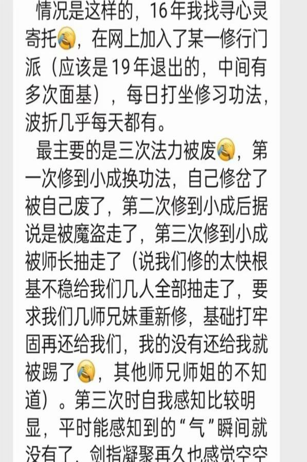
- 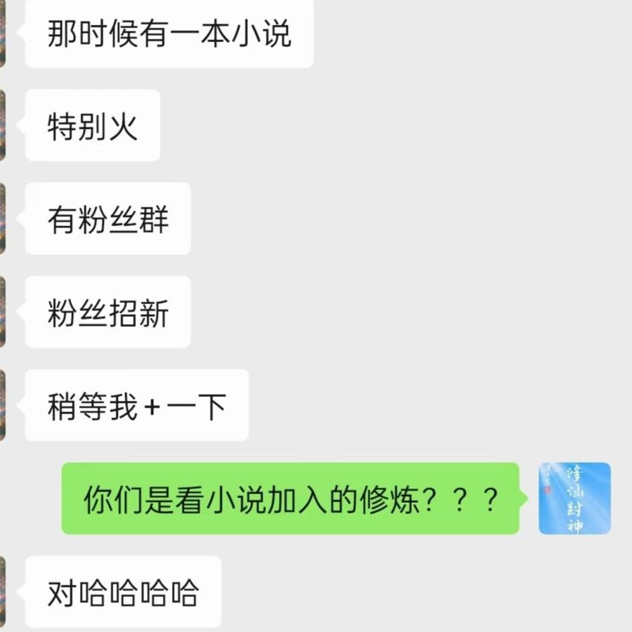
- 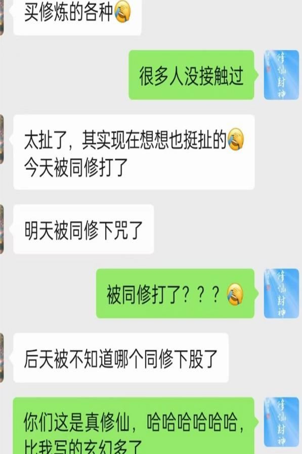
- 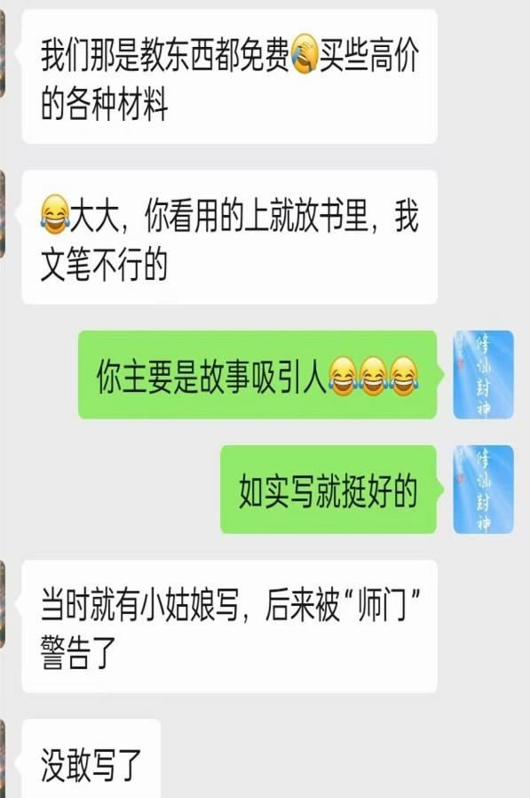
- 《道德经》："五色令人目盲"——太向外求，心灵的慧眼就关闭了。书里写"魔"的部分当故事看，一切以自己的感知为准。

关键词：防骗、修仙群、灵修、自修、偷换概念、五色令人目盲

## 第657章 五个亿

李雪打电话来找作者借钱——五个亿。作者当笑话讲给丘书妍听，丘书妍却问："她为什么要借五个亿？"

关键词：格局、借钱

## 第658章 笑话中的商机

丘书妍看出商机：不符合逻辑的地方才有门道，我们没钱但可以当中介，促成就有中介费。最后客户没借，但李雪尽心奔走，反倒成了她最长久的客户。见识决定思维模式，身在局中很难看见自己的格局。

关键词：格局、商机、中介、见识

## 第659章 篇外：邪教的温暖

篇外·邪教的温暖：魔一开始不会露出獠牙，都打着慈悲和爱的旗号，专找缺爱的人——女人、学生、老人，尤其是高学历的大学生。所有需要依赖外在形式的修行都是邪道，包括让你什么都不干只修行。先学会爱自己。

- 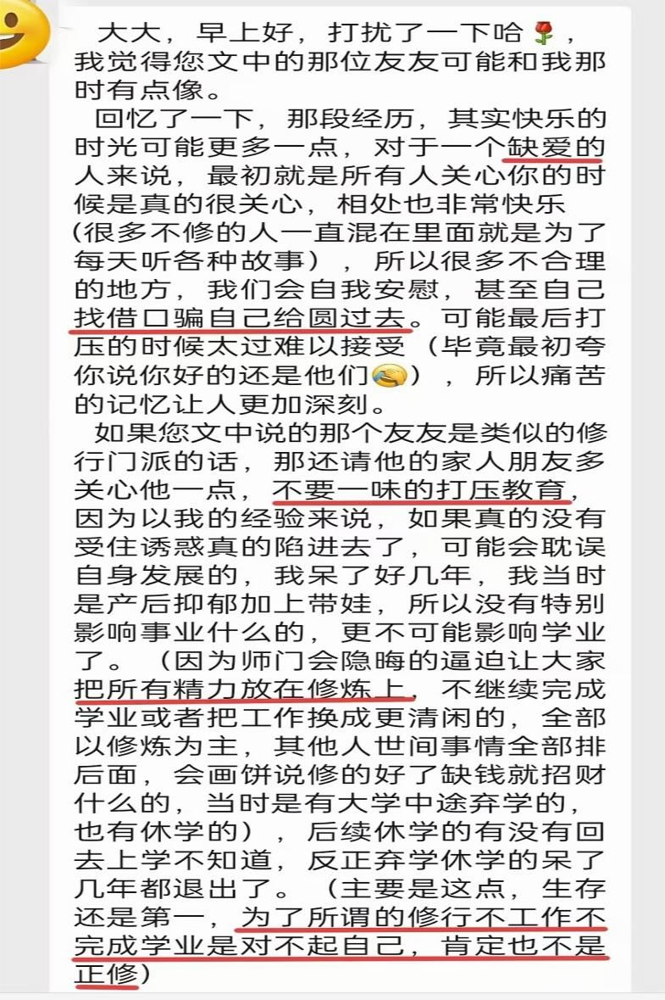
- 所有的依赖都是弱点，都可能被利用；自己缺爱，给出去的爱也可能是在绑架对方的情感。
- 人得先活着才谈得上修行；不上学不上班、靠啃家人"修"，是当生活的寄生虫。
- 逼孩子学习：问问自己为什么要逼——怕不合群？没面子？以后沾不到光？学习是孩子的责任，赚钱是你的责任；如果父母天天念叨你"赚钱赚钱"，你能感到爱吗？
- 快乐地工作，钱是自然的结果；快乐地学习，成绩是自然的结果；快乐地修行，神通是自然的结果。

关键词：防骗、邪教、修仙群、缺爱、爱自己、教育、孩子学习、依赖

## 第660章 再也没有不好的事儿了

一次没做成的生意，每个人都成了赢家。把眼光放长远，只要得到成长，赚钱是早晚的事——好事是好事，不好的事也是好事，"再也没有不好的事了"。

- 同样的事情不同的解读，会产生不同的情绪，最终导致不同的人生。

关键词：转念、格局、成长

## 第661章 好看的人穿什么都好看

孙奇瑞娶了上市公司老板的女儿，婚礼在新加坡顶尖酒店。丘书妍带作者买衣服：好衣服不是让衣服好看，而是让人好看；从头到脚大LOGO是怕别人看不出花了钱。

关键词：穿衣、审美、婚礼

## 第662章 一地鸡毛

孙奇瑞说婚礼"一地鸡毛"：他请的朋友进不了场，红包比餐费还低，回国办婚礼父母又赔了十几万，薪水连参加晚宴的衣服都不够买——光鲜背后的苦。

关键词：婚姻、阶层、面子

## 第663章 故宫

杨绛：谁家的锅底都有灰。作者和丘书妍去台湾，见到能看到气脉之光的豪德。

关键词：台湾、旅行

## 第664章 站着摘草莓

台湾的草莓种在齐腰高的架子上，可以站着摘。豪德说台湾的雾霾是从北京飘过来的。

关键词：台湾、雾霾

## 第665章 甩锅

人们习惯把问题归因于外在时，就不会修正自己；不内修就不会有提升。主流观点很容易让人失去自主分析能力。

关键词：甩锅、独立思考、内修

## 第666章 不动的气功

瑶池宫的师父提醒作者"记得祭祖，可以的话到泾川（甘肃平凉）西王母宫拜一下"。作者说自己懒得练功，有个"不动的气功"——念数字。万物皆生于数。

- 豪德：一天十几二十分钟练功，就能看到非常不错的效果。
- 篇外：后面几章太难可以划过去。

关键词：象数、练功、西王母、祭祖

## 第667章 给科学留点儿成长的时间

象数疗法的数字对应先天八卦：1乾（头、大肠）、2兑（口、肺）、3离（眼、心）、4震（脚、肝）、5巽（大腿、胆）、6坎（耳、肾）、7艮（手、胃）、8坤（腹、脾）。中医也讲定数，比如六味地黄丸的"6"是坎水对应肾。

- 功法里动作有定数，如道家养生四宝里转舌头、鸣天鼓一般都是36下。
- 人类用火上百万年，1777年才发现燃烧靠氧气——先用着，给科学留点成长的时间。
- 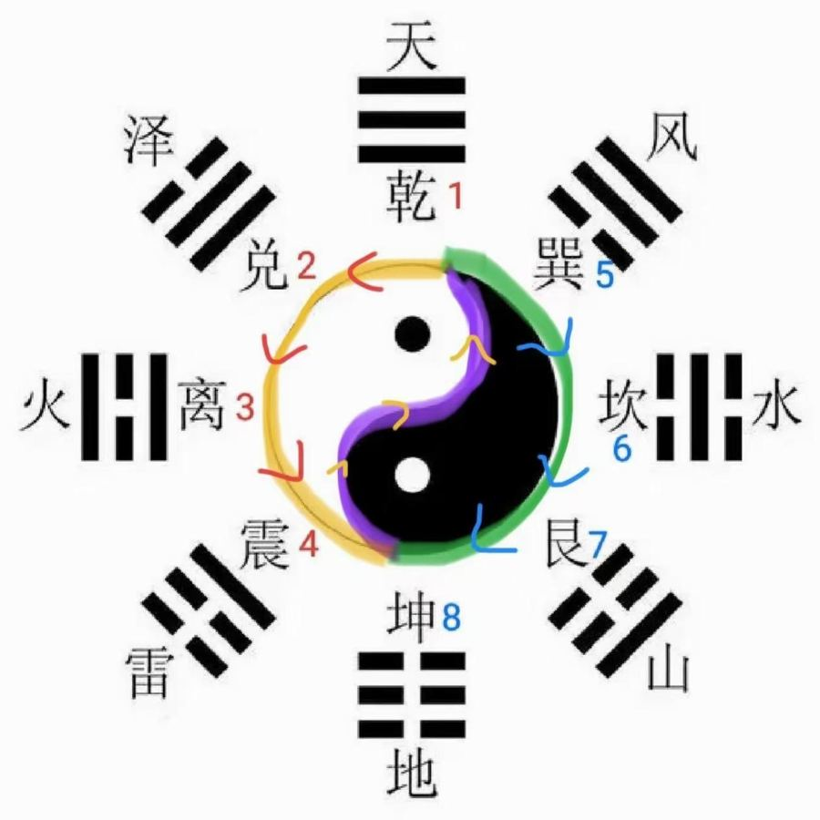
- 注意：这里的身体部位和九宫图（后天）略有不同：先天震代表脚（四肢），九宫里震代表手；先天巽代表大腿，九宫里巽代表左肩；先天艮代表手，九宫里艮代表左腿、关节。
- 一个数字既管外在又管内在，比如乾1不论头部问题还是大肠问题都找它；也可以按自己情况配数字组合，一把钥匙开一把锁。

关键词：象数、先天八卦、数字对应身体、六味地黄丸、定数

## 第668章 心念的磁场

象数讲究自然、自由、自疗：行走坐卧随时默念，不需要特殊姿势、不需要加意念——相信但无所期待地念，别一边念一边怀疑。000·777·000止痛；07治鼻炎。0代表太极之气，强化能量。用"·"隔开的一组叫一个"元"。

- 格雷格·布雷登说人的心念磁场能辐射到几公里外；他讲过一个"北京医院用意念3分钟治愈癌症"的案例——不是让你去找"大师"，而是明白意念的重要，随时修正念。
- 没有一个数可以念一辈子，随身体需要调整，缺啥补啥。
- 000·777·000：7是艮为山，山代表"止"，所以止痛；但艮属土，土多克水（肾），念太多下半身包括腰会不舒服。
- 0的规律：连续的0，偶数个滋阴、奇数个温阳；放在数字前面偏阴，放在后面偏阳。
- 组方核心：补不足而损有余。要补或要泄的放在同一个元里，不补不泄的单独成一个元。
- 例：肝属木（先天震4）。肝血不足用水生木：640；肝气郁结要疏泄，用木生火：430或4300。

> **象数｜象数000·777·000**  
> 用来：止痛（如牙痛等）  
> 怎么做：默念"零零零，七七七，零零零"。  
> 注意：艮土克肾水，念多了下半身、腰可能不舒服；痛止了就停。

> **象数｜象数07**  
> 用来：鼻炎  
> 怎么做：默念"零七"。

> **象数｜象数640**  
> 用来：肝血不足  
> 怎么做：默念"六四零"。

> **象数｜象数430 / 4300**  
> 用来：肝气郁结  
> 怎么做：默念"四三零"或"四三零零"。

关键词：象数、止痛、鼻炎、肝、肝气郁结、象数组方、意念

## 第669章 象数的部位

八个数字（先天八卦）各自对应很多身体部位——一个卦的"象"可以延伸。象数疗法：数取自先天八卦，象用后天八卦。

- 乾1：头、大肠、右脚、肠头。
- 兑2：口、肺、右胳膊、右肋、牙齿、嘴角、咽喉、痰涎、肛门、气管等呼吸系统。
- 离3：眼、心脏、小肠、乳房、三焦、血液。
- 震4：足、肝脏、筋爪、左胳膊、左肋。
- 巽5：大腿（股）、胆、左肩背、气管、胸部。
- 坎6：耳、肾、膀胱、脊背、腰骨、血液等体内液体、肛门等下窍。
- 艮7：手、胃、关节、骨、脚背、鼻子、乳房、男性生殖器、左脚、颧骨。
- 坤8：脾胃、腹部、肌肉、肥厚、右肩。
- 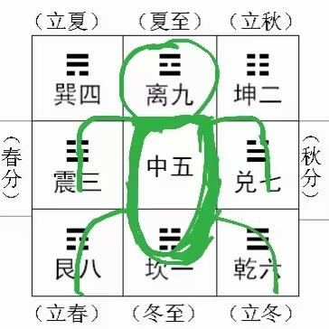

关键词：象数、先天八卦、后天八卦、九宫人形图、数字对应身体、象义

## 第670章 怀疑最耗费正气

篇外：想做法事又有疑虑，就别做——怀疑最耗费正气。"矫枉必须过正"：扔掉所有顾虑，什么外力都不想，认真把自己修好。正文继续解释每个卦为什么管这些部位。

- 乾1：乾为天为头；乾属金，大肠也属金；肠头是大肠末端，所以痔疮也和乾有关；人形图里右脚踩在乾宫。
- 兑2：兑代表口（牙齿、嘴角、咽喉、痰涎）；兑属金，肺属金（气管等呼吸系统）。肛门中医叫"魄门"，肺藏魄，所以肛门也归兑。
- 离3：离为火，对应心血管，小肠、三焦也属火。乳房也和离有关，因为乳房和血液相关——人奶就是人血，例假前胸胀，气血下行后就不胀了。
- 震4：《说卦传》"震为足，巽为股"；震属木对应肝，肝主筋；人形图里对应左胳膊、左肋。

关键词：象数、象义、痔疮、肛门、乳房、法事、怀疑

## 第671章 象义

象义可以自己类推：巽是弯曲细长的小草、也是风，所以气管、食道、肠道、血管、神经、呼吸器官、头发都可归巽；艮为山代表"凸出来"，所以管鼻子、乳房、男性生殖器、颧骨；坤土主厚。举例：辟谷念380·650；胆结石念720·40。

- 震和巽都属木：震是大树，巽是小花小草。
- 坎对应肾，肾主骨，所以脊骨、腰背等骨头也归坎。
- 温凉之分：木、火偏温；金、水偏寒。比如820土生金，念久了容易觉得冷。
- 380·650：3离（心）＋8坤（脾）火生土；6坎（肾）＋5巽（风）水生木——偏温热，辟谷时念可养心补肾、补气血、增加热量。
- 720·40：7艮是山、代表石头；720土生金，疏泄土气，让"石头"不那么结实，还补肺气；4震为雷，取震碎石头之意。
- 胆结石也可以用530（巽木生离火，疏泄胆经、补益心脏）或5000·720。卦的象是象征性的，可以灵活使用；五行是定的，象义可以延伸。

> **象数｜象数380·650**  
> 用来：辟谷时用：养心补肾、补气血、增加热量  
> 怎么做：默念"三八零，六五零"。

> **象数｜象数720·40**  
> 用来：胆结石  
> 怎么做：默念"七二零，四零"。也可用530，或5000·720。

关键词：象数、象义、辟谷、胆结石、温热、寒凉

## 第672章 象数配方

自己不会配象数，就从别人验证过的数组里找：既要对照症状描述是否和自己相符，也要按数理分析是否对症，还要先试念几分钟看有没有不良反应，然后再用。

- 同一种病（比如头疼）原因不唯一，配方也有很多种。
- 作者去西安见老同学白志高。

> **象数｜选用象数的步骤**  
> 用来：想用现成的象数配方  
> 怎么做：1. 找到别人验证过的数组；2. 对照症状描述，看和自己是否相符；3. 用五行生克分析是否对症；4. 先试念几分钟，看有没有不良反应；5. 没问题再用，好了就停。

关键词：象数、象数组方、试念

## 第673章 巨大的变化

白志高变化很大：以前面部皮肤很薄（皮薄的人敏感、易受情感左右）、声音尖锐，现在气沉下去了，走路稳了，声音不尖了，皮肤都厚实了——靠练气沉丹田，还读了大量国学书。

- 简单有效的功法很多，难得的是坚持做下去。

关键词：面相、皮肤薄、声音、气沉丹田、练功

## 第674章 掉进了宿命论里

白志高从坚定的唯物主义掉进了宿命论："一切都是命，抗争也没用。"作者说：命运不是死定的，你的面相都变了，运气肯定好了。

- 作者当年说他努力也不如自己，是想让他明白努力有前提，学会顺势而为，做好自己的使命。

关键词：宿命论、改命、面相、顺势而为

## 第675章 什么是正念

什么是正念？正就是不斜：念头一会儿东一会儿西、摇摆不定，就不是正念——正念的反面不只是邪念。怀疑或纠结最耗费正能量。正念是笃定的，不需要外在的肯定。

- 要么坚决相信命不好、和那几个女孩都断了，要么相信自己被运气眷顾、认真选一个交往——这才是正念。
- 地上一条水沟，我就是知道我能跳过去，这叫笃定。

关键词：正念、笃定、怀疑、纠结、修心

## 第676章 心理阴影

内耗自己也是伤害众生（自己也是众生一员）；大部分人不是伤天害理，而是在用纷乱的心念、语言伤害自己和别人。修行修得好坏，看结果：面相变得有福气、运势变好就是证明。

- 修了很多年却把生活越修越差，要深度反省。
- 庙门口老爷爷给作者画像，从英语本上撕下来一张。

关键词：正念、内耗、修行、面相

## 第677章 白头发的好处

老爷爷画的像：菱形大长脸、嘴角下耷、黑黢黢——作者付了50元把画留着，当作修行的"验金石"：哪天看着它不再有心理阴影，才扔掉。

- 这个世界上没有不好的事情。

关键词：修行、心理阴影、转念

## 第678章 白头发长脸

白头发好在哪？阴极而阳，坏的背面就是好，看怎么用。世间事分三种：自己的事、别人的事、老天的事——头发白不白是老天的事，我介不介意是我的事，别人介不介意是别人的修行。

- 相由心生，好好修自己，上天不会让我们看起来猥猥琐琐。
- 修行人要"破相"，不被表相糊住眼睛。

关键词：白头发、转念、三种事、阴阳、破相

## 第679章 百折不挠的贱人

苦难可以消业，但不等于日子越苦越消业：消业像还债，正常是越还越少、日子越过越顺；越"修"越差，说明修错了，明明是造业还以为是消业。苦难来了勇敢面对，但不主动找虐。

- 稻盛和夫《活法》说灾难来临要高兴——意思是庆幸有机会消业、勇敢面对，不是说苦难本身多好。
- 做一个百折不挠的人，越挫越勇；不主动惹事，也绝不怕事。
- 笑话人，不如人：看外在不满意，先看自己修得到不到位。
- 泾川西王母宫：无所求地拜，就不会被魔所利用；道场是正的，不正的是人心。
- 篇外：天然水晶净化能力最强，通透度越高功效越好。

关键词：消业、苦难、业力、修行误区、西王母、水晶

## 第680章 不要往家里捡东西

不要随便往家里捡东西：有人捡了个财神像回家，进那个房间就害怕——财神里有魔（上一任主人贪念重生出来的），粗盐、水晶这些小手段净化不了。羊头、鹿头、动物皮毛都容易招阴，工艺品也尽量少摆；家里留白更利于气场流通。

- 羊头、鹿头等有尖角的物品，风水上也犯煞。
- 每个物件都有磁场，摆太多会互相干扰。

> **风水排查｜不往家里捡东西，少摆物件**  
> 用来：家里某个房间让人害怕、招阴  
> 怎么做：不要把外面捡来的神像、物件带回家；撤掉羊头、鹿头、动物皮毛，工艺品尽量不摆，家里多留白。

关键词：捡东西、财神、神像、魔、招阴、羊头、鹿头、动物皮毛、留白、粗盐、水晶

## 第681章 神仙的能力也有限

魔不是鬼，是人心招来的：贪念和嗔恨会召唤魔，恶念一起人就被魔入心，可能做出杀人、自杀的事。神仙也管不过来，只能靠每个人自修：不起贪念、不生恨，也注意言行别惹别人生恨，善待每一个陌生人。

- 每个陌生人（飞行员、司机、水厂、核电厂的人）都可能关系着我们和家人的安全。
- 《道德经》：修之身，其德乃真；修之家，其德乃余……修之天下，其德乃博。
- 智策师父：借助外力可以，但不能把自己丢了；人一旦借鬼神的力好用，就容易依赖——我们是阳，他们是阴，阳岂能被阴控制。

关键词：魔、贪念、嗔恨、自修、正念、外力、依赖

## 第682章 外力是感冒药，能不吃就不吃

外力像感冒药：自己能扛就靠自己扛，免疫力（正气）会提升；扛不住就吃几粒辅助；依赖感冒药反而降低免疫力。智策师父用的是学生小欣做的纯植物香皂（几个月才固化、不加防腐剂、要放冰箱）。BUN戒酒了。

关键词：外力、正气、依赖、植物香皂

## 第683章 姜

姜的主要作用是发散和升阳：正常人早上吃姜好，晚上吃可能伤阴、睡不着（"晚上吃姜，毒过砒霜"）。BUN医院已放弃治疗，道医让他全天喝姜水，人越来越精神——大概因为他体内湿寒特别重。青牛师父：法事、风水都是工具，不要执着；有人痴迷法事催财，越做越穷。

- 信但不能迷信：反复怀疑、反复换大师、法事越做越贵，这就是痴迷。
- 象数和中药原理都是五行，但中药更看得见摸得着，人更容易接受。

> **食疗｜姜水**  
> 用来：体内湿寒重（书中BUN按道医要求全天喝）  
> 怎么做：一般人早上吃姜补阳气；湿寒特别重的人，书里是按道医的要求全天喝姜水。  
> 注意：晚上吃姜可能伤阴、睡不着；作者说自己不是医生，BUN是在道医指导下喝的。

关键词：姜、升阳、湿寒、晚上吃姜、法事、催财、痴迷、防骗

## 第684章 法事就像洗澡

青牛师父：贪念不除，不建议做法事，免得越做越想做。曲总：法事像洗澡——无形的能量场也会脏，水充足的人可以常洗；连喝的水都不够还要天天洗就极端了。能不能做看自己的情况，不执着于做或不做。

- 风水也一样：如果痴迷，不如不信，只修自己。
- 学八字可以从一个字开始学，慢慢验证、慢慢多学。

关键词：法事、洗澡比喻、贪念、八字、痴迷

## 第685章 八字看性格

八字入门第一个字：日干（出生日那一柱的天干，也叫日元）代表自己，它的五行代表本人的性格。阳干（甲丙戊庚壬）的人主动、直接、急躁；阴干（乙丁己辛癸）的人亲和、沉得住气、想得多、易生闷气。下面列了十天干的本质和十种性格。

- 十天干的本质：甲是直的向上（大树）；乙盘旋向上（藤蔓）；丙向外发射（太阳）；丁闪烁不恒定（星星、蜡烛）；戊容纳（容器、山石）；己弯曲（管道、蛇、田土）；庚锐利（刀剑）；辛软金属有光泽（首饰）；壬活水（江河）；癸不动的水（死水、杯中水、雨露）。
- 阴阳不只一层：五行本身也分阴阳——木火为阳、金水为阴；燥土（未、戌）为阳、湿土（丑、辰）为阴。所以丁虽是阴干，属火也会火气大。
- 甲木人：耿直、要强、不占便宜也不求人、硬气、易得罪人、讨厌虚伪。
- 乙木人：外柔内固执，柔韧、随机应变、善用人脉，心软、经不起诱惑。
- 丙火人：谦让热情、慷慨乐观；性急暴躁、没心机、善变、缺乏耐心和毅力。
- 丁火人：外柔内热、有上进心；双重性格、敏感多疑、易内耗、慢热、感情忽冷忽热；灵性和创新能力强。
- 戊土人：包容厚重、重诚信、靠谱；外硬内软、不善花言巧语、不善变通。
- 己土人：大度包容、外柔内固执、内在多疑、想要的多。
- 庚金人：刚硬倔强、好面子好争辩、爱憎分明、讲义气、闲不住。
- 辛金人：外在漂亮或有才华，儒雅细腻、灵活有韧性、自尊心强、现实、经不起打击。
- 壬水人：有冲劲、不安分、爱自由和冒险、理智重利益、变通强、野心大；外柔内倔，藏不住心事。
- 癸水人：温柔、能屈能伸、足智多谋、心思细腻内敛。
- 篇外：这些性格既包括日元是这个天干的人，也包括后天相由心生长成了这种五行人的。

> **看人方法｜用日干看性格**  
> 用来：了解自己或别人的本性  
> 怎么做：用八字排盘软件排出八字，找到出生"日"那一柱的天干（日干），对照上面十天干的性格。  
> 注意：这是本性，不一定是表现出来的样子；修行的人会改变。

关键词：八字、日干、日元、十天干、性格、阴阳、五行人

## 第686章 最泼皮的无赖

作者日干是丙火，小时候心情不好就拎根棍子坐在家门口，不让任何小朋友从门前过——村里人都以为他长大会是十里八乡最泼皮的无赖。曲总：修行人的八字是看不准的，八字像剧本，修行的人不按原剧本走。

- 作者至今仍没心机、善变、缺乏毅力：当老师、读书、做采购、做中介、创业，做中介是坚持最久的。

关键词：八字、丙火、性格、修行、改命

## 第687章 踩不到的底线

了解八字不是给自己贴标签，而是知道长处短处、知道从哪里改。曲总举例：甲木人知道自己硬气，就要学着谦卑；选爱人、合伙人首先看心正；和甲木人相处，多顾他面子、多夸他，他吃软不吃硬。甲木人太硬，腰椎、颈椎、腿脚容易有问题。

- 作者本人长得不是火型人，偏金水，也有水型人的随和洒脱、金型人的爱憎分明。
- 风水上讲：直则冲，曲则顺。性情柔和是每个人都要修的。
- 作者把自己的底线放得很低，低到很难被人踩到——改变不了别人就改变自己。

关键词：八字、甲木、性格、颈椎、腰椎、柔和、底线

## 第688章 八字看运势

八字看大概运势的简便法：月令（出生月份的地支）力量最大，"损有余"——能克月令五行的年、月、日、时，运势比较顺。例如春天（木旺）出生，申酉（金）年月日时较好；巳午月（火旺）出生，亥子（水）年较好。作者秋天出生（金旺），2013–2015巳午未火年最顺。

- 天道是损有余而补不足：日干太旺，天运耗泄你是帮你；日干太弱，天运生扶你才是帮你。
- 这个简便算法只适用于大部分普通人的八字，特殊格局不按此论。
- 运势有起有落才是阴阳。运势好时努力奋斗，不好时韬光养晦、静心打磨自己——没有蛰伏过，机会来了也抓不住。
- 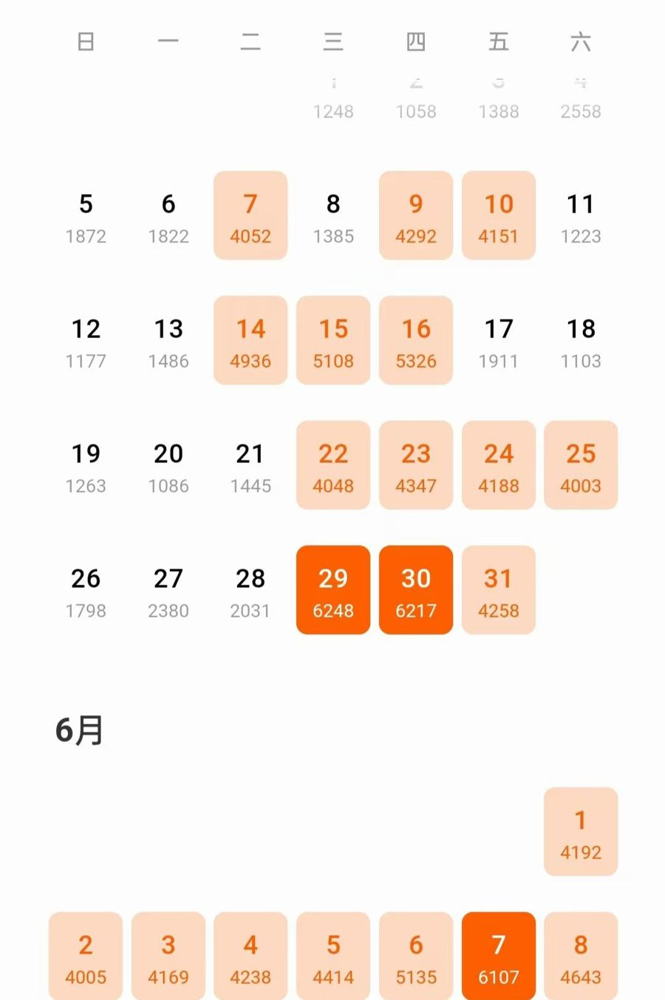
- 篇外：有读者没亲自去现场，护法神就被扣了；不要去不确信的地方有所求——每一份所求暗中都标好了价格。
- 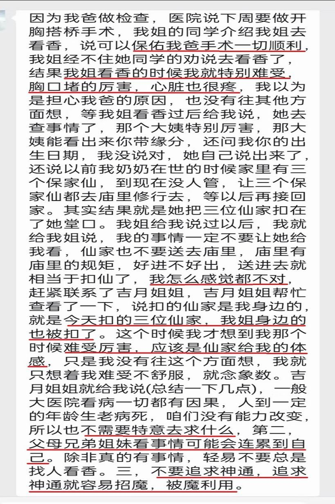
- 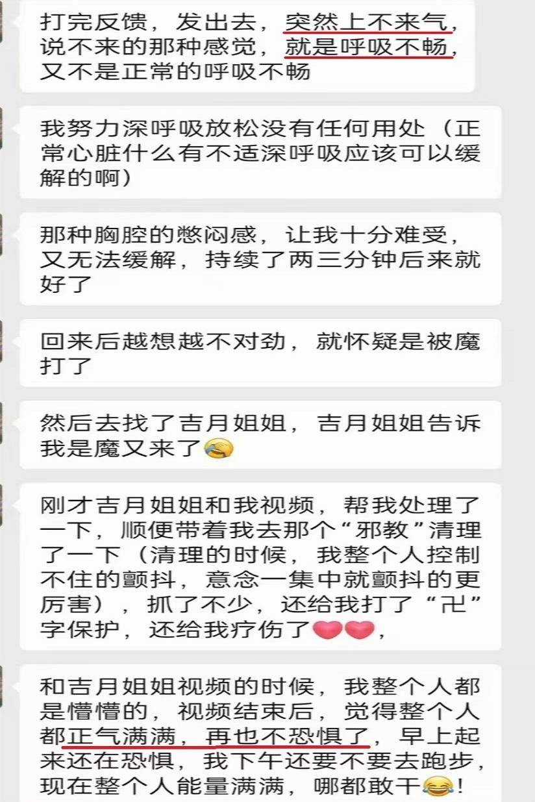
- 执着也是一种贪念，执着于念佛也是执着。

> **看人方法｜用月令看大概运势**  
> 用来：想知道哪些年份、月份对自己比较顺  
> 怎么做：找到八字里出生月份的地支（月令）的五行，找能克它的五行：火旺（巳午月，夏天）遇水年/冬天好；土旺遇木年/春天好；金旺（申酉月，秋天）遇火年/夏天好；水旺（亥子月，冬天）遇土年/季末好；木旺（寅卯月，春天）遇金年/秋天好。再拿自己往年最顺和最不顺的年份对照验证。  
> 注意：只算了一个字，是大概率情况；对不上的可能是特殊命格。

关键词：八字、月令、运势、流年、喜用神、韬光养晦、防骗、护法神

## 第689章 五行喜忌

五行喜忌：对大多数人，克制月令的五行是喜用神，对生活方方面面都有帮助；和月令同类的五行是忌神。作者金旺喜火，从小本能地不喜欢碰金属（首饰、金属筷子、眼镜腿都用树脂），往南方走合适。曲总：气血不足时身体会优先供心脑，这时强行锻炼四肢可能导致内脏供血不足。

- 只有一部分人能感知到自己的五行喜忌，很多人会被大脑影响；也可以对照往年运势好坏的流年五行来确认。
- 知道喜忌后，方便时可以在物品材质、穿衣颜色（五行穿衣的吉色与自己五行不合，就选次吉）、行业、城市方向上避开忌神。
- 人不能活在卦里，顺手能改的就改，不必大张旗鼓。
- 仙法助力用的是灵力法力，和五行关系不大；以自己的心为主，感觉舒服就好。
- 腿脚不利索：如果是不运动导致气血慢，动一动有好处；如果是气血本身不足，身体会自动减少手脚供应来保护内脏，这时硬练四肢，可能内脏供血不足而猝死。

> **生活方法｜按五行喜忌选物品和方向**  
> 用来：想在生活中借喜用神的力  
> 怎么做：先确认喜用神（月令简便法或网上查询，再用往年经历验证）。然后物品材质、穿衣颜色、从事行业、去哪个方向的城市，方便时就选喜用五行、避开忌神五行。  
> 注意：不必追求极致，感觉舒服最重要。

关键词：五行喜忌、喜用神、忌神、月令、五行穿衣、金属、方位、锻炼、气血不足、猝死

## 第690章 水果少吃

强调练四肢肌肉不一定好；古人的健身（站桩、太极拳）是用缓慢动作引导气血、锻炼内脏。练功性价比高；懒得练，保持正念也有用。水果大多寒凉，热胀冷缩，不是火大、血热的人尽量少吃太寒的东西；中医认为"苹果闭百脉"，病人尤其不建议吃。

- 作者日干是火：火是能量，热情烧完就想换行业，找到新兴趣又会燃烧——这和懒不冲突。
- 阴阳五行是运动变化的，固定说某一点好或不好都不科学。

> **养生方法｜少吃水果**  
> 用来：体寒、病人、气脉收缩  
> 怎么做：不是火大、血热的人，尽量少吃寒凉的水果；病人不建议吃苹果等水果。  
> 注意：每个观点都是相对的，火大、血热的人另当别论。

关键词：健身、站桩、太极拳、练功、水果、苹果、寒凉、正念

## 第691章 万事不要执着

万事不要执着，阴阳一体，没有绝对的好和不好。一位大姐抱怨家人邋遢——当人向外找问题时，问题是无解的。情绪能起也能主动平下去，才是阴阳平衡；只能起不能降就是失衡。

- 《黄帝内经》：法于阴阳。所有让自己不开心的事，都是阴阳上出了问题。
- 曲总问大姐：你有十分精力，三分花在收拾，三分花在怄气，还剩几分给你的使命？

关键词：执着、阴阳、情绪、家务、精力

## 第692章 篇外：五行

篇外·天干地支五行：按东南西北记——东方春木：甲乙、寅卯，辰为土；南方夏火：丙丁、巳午，未为土；西方秋金：庚辛、申酉，戌为土；北方冬水：壬癸、亥子，丑为土。看性格看"日干"，看运势看"月支"。八卦有很多是画错的：离中虚、坎中满，离和坎在先后天八卦里都在对立面。

- 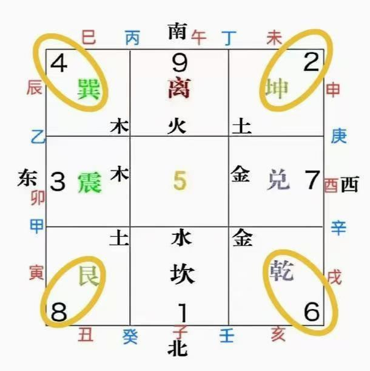
- 每个季节最后一个地支（辰、未、戌、丑）都是土，叫"库"。
- 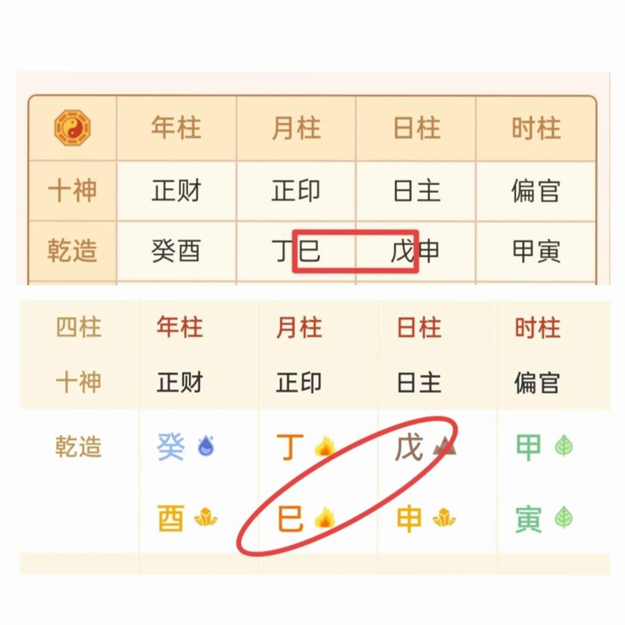
- 例：日干戊（土）——敦厚重诚信，变通弱；月支巳（火）太强，走到水的年头、冬天或半夜比较顺。
- 2024甲辰年，辰为土克水，亥月、子月出生的人今年比较旺。
- 也可以反推：你运势最好的年头是2019亥水年，水克火，看看你是不是夏天出生。
- 这里说的运势比较好，主要指心情顺畅。
- 手机贴：因2019年《中国古代神话》邮票被质疑画错引起风波，作者做手机贴表态。
- 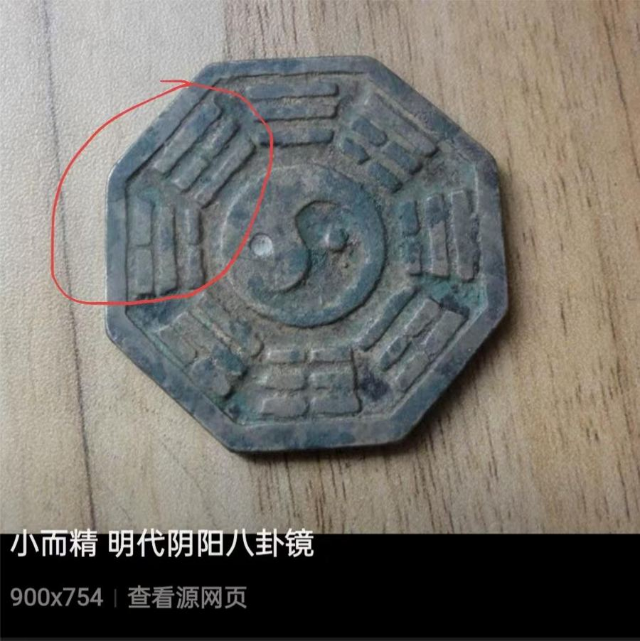
- 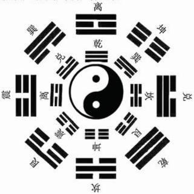
- 人+为=伪：发展归发展，有些传承要尊重。

关键词：天干地支、五行、二十四山、八字、月令、日干、八卦图、离中虚、坎中满、运势

## 第693章 注意力就是生命力

注意力就是生命力：注意力都去挑别人毛病，拿什么成就自己？愿力不是拼命想要什么，而是你真正愿意全力以赴、由强烈愿望催发出的行动力。财不入急门：着急是上火，火克金伤财。赚钱多少不只和体力成正比，也和心和脑有关。

- 例子：古时抄书的人夜以继日两天抄一本，会印刷术的人一边玩一天印几百本。

> **修心方法｜求财先静心**  
> 用来：急需用钱，越急越赚不到  
> 怎么做：先把心静下来，不着急上火；把注意力放在把事情做好、动脑找更有效的方法上，而不是一味重复体力劳动。

关键词：注意力、愿力、财不入急门、着急、火克金、求财、使命

## 第694章 刚洒下种子就想收获是贪念

付出是向外（阳），钱自然回流是向内（阴）；追着钱跑、主动抓钱就阳过强了。可以把钱看成爱：先把爱送出去，再等它自然回来。刚洒下种子就想收获，是贪念。"克者为财"要向外克、克得动才是财；着急上火是向内克自己，克不来财。

- 青牛师父：接了任务能胜任，叫克者为财；没胜任，就是被反克——像斧头不够硬，砍树反而卷了刃。
- 戒贪是修行的第一步。

关键词：求财、阴阳、克者为财、贪念、着急、爱

## 第695章 认真做事就没有时间内耗

发脾气分两种："愤怒的表达"是被情绪控制，火克金伤自己；"表达愤怒"只是把愤怒当工具，事情处理完就平静，不伤自己。认真做事就没时间内耗和生气。青牛师父：理解了就去执行，不理解就在执行中理解。

- 一想起三年前被骂过就气得睡不着的，才是内伤。
- 那一年作者处处是贵人，日子像天堂，没把运势转折当回事。

关键词：发脾气、愤怒、内耗、执行、运势

## 第696章 股票大神

一位股评"大神"发誓推荐的股票翻不了两三倍就退出股评界——作者看老板面相不好，但贪念一起大脑参与决策，心就藏起来了，他选择相信"专业人士"。买在最高点，跌了70%清仓；后来该股退市，董事长入狱。"大神"只是删帖继续他的人设。

- 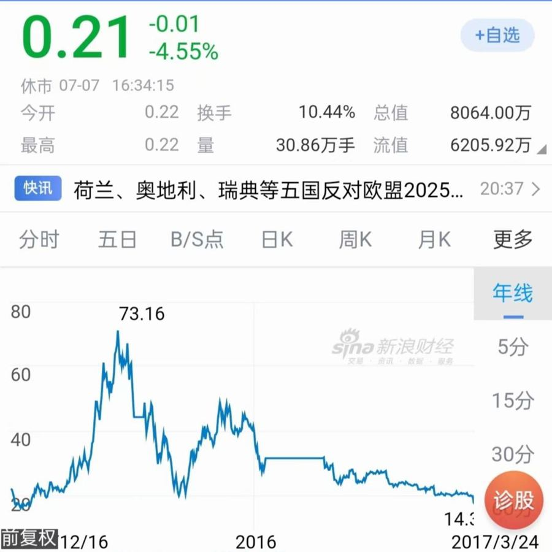
- 割在了地板上也是幸运：一旦反弹就会有期待，就不舍得出手了。

关键词：股票、防骗、股评、面相、贪念、直觉

## 第697章 决心和愿力

那位股评"大神"和广东卖传家宝的人长得像兄弟——同一块石头绊倒两次。BUN以为病全好了又喝酒，突然去世。篇外：家里这不能动那不能改？能改多少看决心和愿力——改变能改变的，接受不能改变的，不贪。

- 所有能让我们不能忍受的人或事，都是来成长我们的。
- 2015年曾仕强教授预言了疫情和神仙下凡。

关键词：防骗、面相、愿力、决心、风水调整、酒

## 第698章 可能会瘫痪

那只股票是腾信股份，董事长名字打出来系统自动跳出"虚伪"二字——运势低落时不适合做重大决策，脑子真会犯迷糊。八运是土运（有形），九运是火运（无形），九运重技术、轻资产；先天运2017年已进入九运，李嘉诚是最早撤出地产的。

- 无形的"技术"既包括高科技，也包括让人快乐的能力，如搞笑文化、心理疗愈、气功等。
- 
- 一个刚来的19岁工人从一米多高的平台跳下，腰骨多处骨裂，医生说要做高难度手术、可能瘫痪；作者和丘书妍做好了破产准备，雇主先垫付医药费。

关键词：运势低落、重大决策、九运、离火、三元九运、地产、防骗

## 第699章 护身符

作者在医院丢了钱包，监控确认就丢在病房里却怎么也找不到——里面有白龙王送的护身符。丘书妍说：也许符替我们挡灾，带着钱包一起消失了。第二天工人家里决定不做手术、回国保守治疗。

关键词：护身符、挡灾、白龙王

## 第700章 一步一个槛

国内三甲医院看报告说是骨裂没移位，孩子小能长好；动手术反而可能瘫痪。几个月后孩子已能正常下地。

关键词：骨裂、手术、第二意见
