# 《改命记实录》逐章笔记：0701-0800

## 第701章 韬韬

多年后火阿姨提醒作者：有许过的愿实现了却没还愿——作者想起当时听说孩子可能瘫痪时心里许过愿，立刻给白龙王上了三支香致谢。之后作者把国内业务交给信得过的非业内人周周。

- 我们永远不知道，一路走来有多少神灵在默默护佑着我们。
- 选合伙人，作者遵从了内心的感觉。

> **民俗方法｜还愿**  
> 用来：曾经许过的愿实现了  
> 怎么做：想起来就去给当时许愿的神灵（或师父）上三支香，表达感谢。

关键词：还愿、许愿、上香、合伙人、直觉

## 第702章 新的合伙人

胖总跳脚指责作者不讲情义，但那是"表达愤怒"，不是真生气。作者把资源全给了周周、只有口头君子协议，同行来挖墙脚全部铩羽而归。

关键词：合伙人、信任、表达愤怒

## 第703章 背刺

老朋友琪儿和高峰瞒着作者去挖周周——在利益面前多年友情说背刺就背刺。作者没受实质伤害，只是恶心，也可怜她：背弃朋友的人赚到钱会快乐吗？就算我不知道，天会不知道吗？敬畏天地。

关键词：背叛、友情、敬畏天地

## 第704章 提前退休

作者运势低落，提前过上退休般的生活：除了跟黄总他们打麻将，什么都提不起兴趣，大部分时间睡觉。秉烛师父说："你们生个孩子，就能过了这一劫。"丘书妍说自己还是个孩子。

- 篇外：世上的事分三种：写书是我的事，推荐是你们的事，分数是老天的事。
- 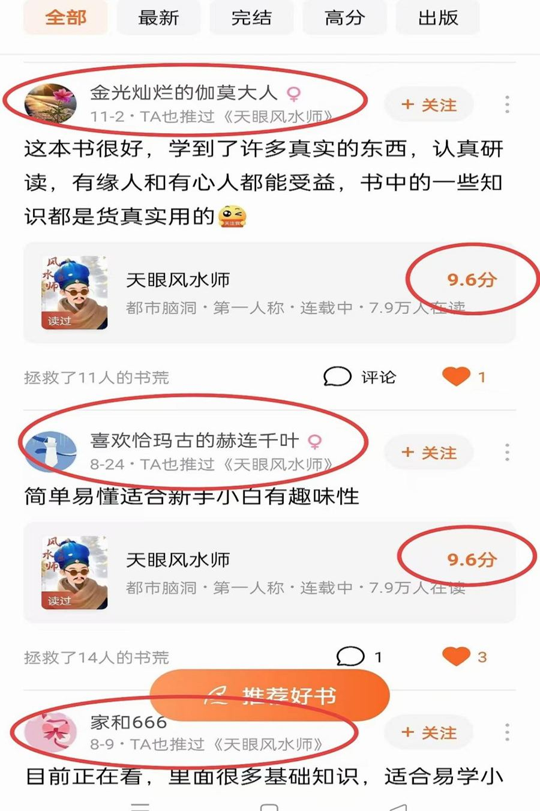

关键词：运势低落、劫、生孩子、三种事

## 第705章 嘴角上火

嘴角上火、吃维生素B和C都不好——作者推荐绿豆朱雀汤：绿豆清热解毒，朱雀汤（沸水冲鸡蛋）润燥。

- 人造的不如天然的。

> **食疗｜绿豆朱雀汤**  
> 用来：嘴角上火、发红、起泡  
> 怎么做：绿豆30克，冷水泡10分钟，加热煮沸5分钟；趁热用这碗绿豆汤冲一枚打散的新鲜鸡蛋液。早晚各一次，现做现喝。

关键词：嘴角上火、上火、绿豆、鸡蛋、朱雀汤、润燥

## 第706章 唯有真诚动人心

黄太太挑儿媳只看人品：小姑娘不知道她是老板娘时就对她和善。教小姑娘找话题：唯有真诚动人心——多向对方提问，实在找不到话题，就坦白说自己嘴笨、有点紧张，有风度的人会接住。

> **生活方法｜不会找话题时**  
> 用来：和人聊天冷场、紧张  
> 怎么做：多向对方提问，显得谦虚又给对方成就感；实在找不到话题，就如实说"我嘴笨，都不知道怎么找话题，现在有点紧张了"，再就着这件事聊彼此的尴尬趣事。

关键词：聊天、真诚、婚恋、人品

## 第707章 东食西宿

东食西宿：做人不能既要又要，选择自己喜欢的就好。很多人不幸福，是因为和别人比、被一时得失牵着走——这是一根筋的二元对立思维。篇外：数字9（离卦、九运）的特点：美丽爱打扮、注重名声、热情、点子多、善表达；缺点是急躁、虚荣、没耐心、虎头蛇尾。

- 数字9的财：创意、点子、人际交往的财。离既主分离，也主美丽；属火，有急躁、虚拟、创意等特质。

关键词：既要又要、幸福、二元对立、数字9、离卦、九运、数字能量

## 第708章 魔咒

把人生看成玩游戏：终有一死，享受过程就是幸福。妍爸想起多年前有位算命大师说他64岁寿终，整天念叨"今年注定要走"——这种念力，没病没灾的人也扛不住。作者相信预测，但不相信宿命论。

- 篇外：智策师父讲手机号时只讲了倒数第三位（人和）和倒数第六位，不是只看这两位；换手机号属于奇门的高端定制，不建议听几句课一上头就去换。先修心，再求术。

关键词：生死、算命、宿命论、念力、手机号、奇门遁甲

## 第709章 牵挂

人只有带着牵挂，才有求生的意志。作者故意说"把妍妈交给丘书妍你放心吗"，又找到妍爸未了的心愿：回海南祭祖。作者和丘书妍安排好了透析医院，还请人提前砍草平路方便轮椅。

关键词：求生意志、牵挂、祭祖、心愿

## 第710章 美好

登机要走楼梯，妍爸赌气说不去了；作者看出是反话，花比机票还贵的钱叫了升降梯。帮别人实现愿望，就是美好。

关键词：心愿、美好、祭祖

## 第711章 心愿

妍爸回到海南精神焕发，炫耀祖坟的风水：背山面水、青龙白虎。坟包五行属土，最怕木克土——尤其树根深扎进坟里透风透水最不好；他家坟边垒了平台、没有大树，只需清理杂草。作者从祖坟山上砍了一段树枝带回去，常在妍爸面前晃，提醒他祖坟护佑后人。

> **风水调整｜祖坟清理树木**  
> 用来：祭祖、维护祖坟风水  
> 怎么做：祭拜时把坟周围的杂草和树木清理掉，尤其别让根深的大树长在坟边，以免树根扎进坟里透风透水。

关键词：祖坟、祭祖、阴宅、木克土、树根、风水

## 第712章 寿命与医疗体系

海南的透析医院条件很差，作者暗示妍爸：同样的八字在不同的医疗体系下结果肯定不同——要是同一时间出生的人寿命都一样，新加坡怎么会是长寿之国？妍爸再没提生死，顺利过了64岁。

关键词：寿命、八字、宿命论、医疗

## 第713章 魔咒又捡回来了

妍爸过了64岁，又念叨"我现在应该是个死人了"——罔顾事实的"应该"，是在和客观存在较劲。人的信念很重要：自心是种子，法事和风水是水、阳光、土壤；种子没了，土壤再肥也发不了芽。秉烛师父回复："顺应因果。"

- 不论风水还是法事，说的都是因果：先要自己持正念，再说借外力。

关键词：信念、求生意志、法事、因果、宿命论、自心

## 第714章 感动自己的烂好人

不求不救：对不信、不想改变或缘分没到的人硬调外力，可能让他更抵触，反而造恶果。口口声声为对方好、对方不领情，这种掏心掏肺就是伤害——别做只感动自己的烂好人。篇外：师父提醒宇宙间的水气在减弱，容易在水和火上出问题，要比往年多喝点水，也要关注情绪。

- 因果不是我们觉得好，而是对方觉得好、最终也真的变好了，才是果。
- 他们最后还是找了个不太熟的师父悄悄做了场法事——与其说为妍爸，不如说为了让丘书妍心安。
- 妍爸透析用的血管通路，一般能用3–10年，这次一个月就堵一次。
- 火上的问题：燥、火气大，对应心脏、心血管；水上的问题：对应肾、肾结石。前几年是金气先减少，所以伤肺；金生水，金不足水也不足。
- 水生木，木主肝，肝主怒——注意自己和家人的情绪。

> **养生方法｜水气弱的年份多喝水**  
> 用来：空间五行水气减弱时，预防肾、心血管问题和急躁  
> 怎么做：比往年多喝一点水；同时关注自己和家人的情绪，少发怒。

关键词：不求不救、因果、烂好人、法事、水气、喝水、肾结石、心血管、情绪、肝

## 第715章 怀孕能不能吃螃蟹

怀孕能不能吃螃蟹？中医说螃蟹巨寒，孕早期、经期都不建议吃；肖志媳妇吃了几天后流产，西医说没关系。作者读《金刚经》"非法，非非法"想通：两种对立观点可以同时都对——胎儿强的吃什么都不怕，弱的受巨寒影响大；西医讲优胜劣汰，中医讲上天有好生之德。

- 很多事情不是二元对立的：可能你对我也对，也可能都不对，或者根本无所谓对错。
- 劝不劝的两难：说了让人心里犯嘀咕，不说又怕真有影响——作者试探着问了一句，对方表示不在意，就没再说。

> **养生方法｜孕早期、经期少吃螃蟹**  
> 用来：怀孕初期、经期（尤其体质弱的）  
> 怎么做：中医认为螃蟹巨寒，孕早期和经期不建议吃，体质弱的胎儿受寒性食物影响更大。  
> 注意：西医认为螃蟹营养丰富、和流产无关，书里两种说法都摆出来了。

关键词：螃蟹、怀孕、流产、寒凉、经期、中医、西医、二元对立、金刚经

## 第716章 能提升自己的事都是好事儿

所有能让我们提升的事都是好事——一件事好不好，取决于我们有没有找到它背后藏着的礼物。韩国和杭州的朋友暗戳戳提醒作者：丘书妍和一个帅哥走得近。

关键词：转念、礼物、成长

## 第717章 井喷式爆发的爱情

青岛的周周也问作者是不是和丘书妍分手了。丘书妍回来说没钱了要再取钱——出去前刚取了十万。

关键词：感情

## 第718章 坦诚相待才会长久

黄太太：两个人之间只有坦诚相待才能长久——黄总去哪、和谁在一起都随时报备。黄总：每个人的成就都不只靠自己，公司发展好也因为妻子贤惠旺夫，人不能忘本。丘书妍说"见了个朋友"，还嫌作者问题多。

关键词：坦诚、婚姻、旺夫、忠诚

## 第719章 他到底是谁

作者坦诚地摊开谈：如果你有了更好的选择，我真心祝福。丘书妍却说"如果我说有，你肯定会离开我"——不想分手。作者：你的幸福是幸福，我的幸福就不是幸福吗？

关键词：分手、坦诚、感情

## 第720章 赚了大便宜

那人是韬韬——韩国业务的代理人，嘴甜叫哥哥姐姐的研究生。作者先是震惊，接着真心替丘书妍高兴：杭州、青岛，是韬韬在展示家庭背景。

关键词：分手、感情

## 第721章 我的眼光好，我的人也好

作者转念：我们早就没有感情了，韬韬双手奉上了分手理由；他那么优秀能看上我看上的人，说明我眼光好、人也好。追求爱情可以，但别脚踩两条船——东食西宿。黄总说过分手后不再和丘书妍合作，她早就猜到了。

关键词：分手、转念、东食西宿、既要又要

## 第722章 分手

分手了。妍爸又住院。作者这才明白秉烛师父说"生个孩子能过这一劫"的意思：有了孩子，就有了责任和牵绊，两人大概率不会分开。但人生没有如果。

关键词：分手、劫、孩子、预言

## 第723章 不能分手

妍妈半夜打电话来，像广播一样重复："你们不能分手，妍爸会没命的。"父母一开始劝和，见作者想清楚了，就让他回国。

关键词：分手、父母

## 第724章 闭关

作者报了一个七天闭关练功班：早上五点多起床，公园里练八卦掌迎日出，再在室内动功静功结合练到晚上。气足不思食、神足不思眠——跟着身体感觉随意进食，他自然进入了辟谷，每天只睡五小时左右仍精力充沛，身轻如燕。

- 每个小组都有资深师兄师姐护法，避免练功出偏。
- 吉月姐姐说过：世界不是一个世界，三千大千世界层层叠叠，到处都是通道和接口，比如一幅画就是一个独立的世界。

关键词：闭关、练功、八卦掌、辟谷、气足不思食、护法

## 第725章 心如明镜

心极度安静时，世界都映在心里：地砖缝里的小花小草、叶脉、雨滴落在不同物件上的声音都清清楚楚；作者还无缘无故知道隔壁街拐角有家马来杂货店卖什么，过去一看果然是。恐惧来源于未知，心全然知道时就没有恐惧。辟谷几天人明显瘦了。

- 苏轼《赤壁赋》：江上之清风与山间之明月，耳得之而为声，目遇之而成色。

关键词：闭关、静心、感知、辟谷、减肥、恐惧

## 第726章 世界在我心里

柳凡茹笑作者"出现幻觉了"——夏虫不可语冰。她闪婚后受了情伤，想来新加坡散心。黄总以为作者是分手伤心瘦的。

关键词：闭关、辟谷

## 第727章 好名声留给了我

作者对黄总说：其实是丘书妍主动背了锅，把好名声留给了我。妍妈说千万别来医院，"你来了，他就会走的"——作者也有预感，就没去。

关键词：分手、预感

## 第728章 卡气

练功时用意念带气，作者突然一大团气从下丹田冲上来卡在胸口、顶住脖子，不能呼吸也说不出话——护法师姐让他做收功动作：双手举过头顶，手脚同时弹跳，多跳一会儿，气就下来了。收功很重要，不要省略。

- 张至顺道长的金刚功收功也是弹跳，是在腹部位置轻弹手指；作者那次是双手举过头顶弹指，同时脚掌弹、轻踮后脚跟。
- 带意念、观想的功法收功要更久；普世版金刚功只有动作没有心法，收功短，但也必须正式收功，否则气没收回来人会不舒服。

> **功法｜弹跳收功（卡气时）**  
> 用来：练功后收功；练功时气卡在胸口、喘不上气  
> 怎么做：双手高举过头顶，手指弹动，同时脚掌弹跳、轻踮后脚跟，连续多跳几分钟，把气引下来；卡气时要多跳一会儿，直到完全顺畅。  
> 注意：带意念的练功最好有人护法；每次练功都要认真收功，不要随手比划一下了事。

关键词：练功、收功、卡气、出偏、金刚功、张至顺、意念

## 第729章 再次见面

黄总夫妇和丘书妍的亲戚陪作者去医院看妍爸。妍爸拉着他的手说"你们俩一定要好好的"。

关键词：探病

## 第730章 成为更好的自己

丘书妍说她小时候算过命：感情上有个大坎、难善终；作者在泰国时也算过两人的八字，知道不对，还是想努力一次。两人都不后悔。

关键词：算命、感情、八字

## 第731章 精神分裂症

合也好分也好，两人都变成了更好的自己，这就是最美好的结局。自己的情绪自己消化；做决定前想清楚，做了就别后悔。妍爸去世那天凌晨，作者早上起来像身体里有两个灵魂，一会儿清醒一会儿迷糊，连坐错好几趟车。

关键词：分手、成熟、灵魂、迷糊

## 第732章 交代后事

作者怀疑自己要出大事，给周周发邮件交代了后事。练功时他哭得像开了水龙头，眼泪流完后头脑异常清醒。练功中打嗝、呕吐、流泪都可能是排毒反应。

关键词：练功、排毒反应、流泪

## 第733章 暗杀

妍爸是那天凌晨走的——作者明白了早上的迷糊。黄总：也许他吊着一口气就是为了见你最后一面，不要往自己身上背莫须有的责任。闭关结束时放了几年前师兄师姐刚进练功场的视频，从面相到气质都脱胎换骨。

关键词：去世、牵挂、练功、面相变化

## 第734章 做自由的人

练功师父：尽可能做真实的自己；气色不好就好好练功，实实在在修个好气色，别画个假脸。真正的能力是实践出来的。要做一个自由的人——别人说什么就做什么，活在别人嘴里，谈何自由？

- 妍爸早就知道韬韬的事，临终却拉着作者的手让他们好好的。

关键词：练功、自由、做自己、化妆、气色

## 第735章 他们的老婆也都出轨了吗

新加坡华人葬礼：遗体接回后在楼下摆七天流水席，再火化，家属轮流值守；作者每晚去诵经祈福。网上的出轨风波：一阴一阳之谓道，只强调一面是违背阴阳的；别人嘴里的"事实"，可能只是他的"观点"。

关键词：葬礼、守夜、诵经、舆论、阴阳、独立思考

## 第736章 思想自由是前提

思想自由是一切自由的前提。闭关后作者瘦了十几斤，但复谷没按要求喝米汤，很快反弹——辟谷简单，复谷难坚持。辟谷期他连水都没喝，小便开始发黄，第四天起完全清澈。

- 那次辟谷是随缘的：吃饭喝水需要就用，不需要不勉强。

> **养生方法｜复谷要循序渐进**  
> 用来：辟谷结束后防止反弹、伤胃  
> 怎么做：复谷期要按要求的步骤，先喝米汤慢慢恢复，不要一开吃就刹不住。  
> 注意：书里没写具体步骤；作者自己没坚持，很快反弹。辟谷应在有经验的老师带领下进行。

关键词：辟谷、复谷、米汤、减肥、反弹、思想自由

## 第737章 我竟然还是个海王

柳凡茹算感情经历，犹豫要不要把只聊过天的作者也算上。作者分手后，朋友们的关心各式各样：介绍对象的、劝和的、天天发鸡汤的。

关键词：感情、关心

## 第738章 控梦

作者回国前一路玩云南、贵州、西藏；西藏高原上打火机点不着，要用火柴。拼车进藏认识了能控梦的小石——吉月姐姐说过，梦是连接不同世界的主要通道，能控梦的人都是天之骄子。

关键词：控梦、清醒梦、梦、西藏

## 第739章 王侯将相宁有种乎

控梦（清醒梦）：在梦里知道自己在做梦，还能思考、记得事、自主控制行为——申一帆在梦里解白天不会的题，达利在梦中创作。小石学会控梦，只是因为总在梦里被鬼欺负。他觉得阶级固化了、努力没用。王侯将相，宁有种乎！

- 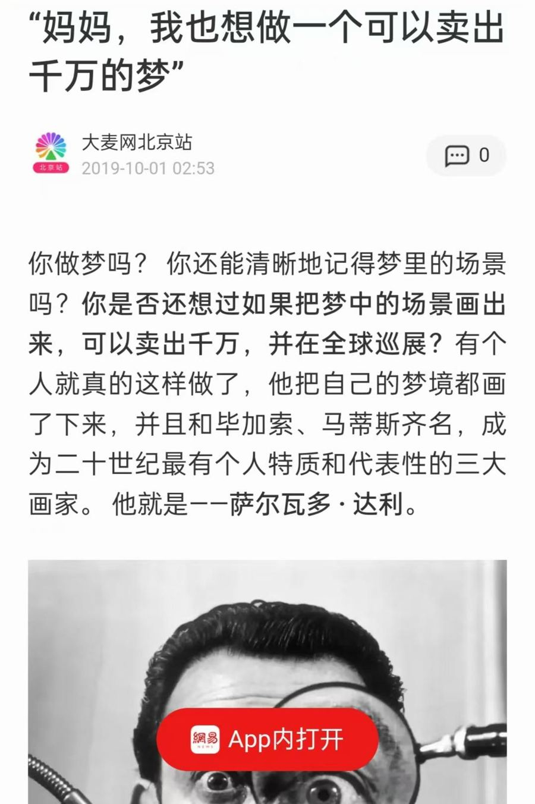

关键词：控梦、清醒梦、梦、阶级固化、天赋

## 第740章 纸条

方向不对就换方向，圈子不对就换圈子，这条路不对就换下一条路——作者靠"天无绝人之路"赚到了路费。路上遇到人工区间测速关卡，他们没拿到纸条。

关键词：天无绝人之路、努力、西藏

## 第741章 区间测速

关卡要求回去拿纸条（区间测速，规定这段危险路程不得少于2小时），作者火气上来，掏出手机录像："只有一条路没有岔路，我们怎么跳过关卡？你们的失误凭什么让我们负责？"

关键词：吵架、讲理

## 第742章 硬刚

七哥抢过手机删了视频、赔笑道歉，请对方打电话问上一个关卡，最后放行了。小石说他每次吵完架都觉得没发挥好，晚上气得睡不着。

关键词：吵架、内耗

## 第743章 吵架的阴阳之道

吵架的阴阳之道：任何事阴阳失衡人就不舒服。别人污蔑你，你拼命自证，两者的方向都对着你——没有一进一出，这就违背阴阳。吵架一定不要进入自证的陷阱：人只要企图证明自己不是傻子，就已经在做傻事了。

- 例子：朋友开饭店不收你钱，你就不愿再去——阴阳失衡了，心里不舒服。
- 小石觉得控梦是病，不想"传染"作者。

关键词：吵架、阴阳、自证、被污蔑、控梦

## 第744章 你有病吧

不自证，直接进攻——向内为阴，向外为阳。别人说你衣服丑，你不必证明它不丑，可以反问"设计、缝制、进货的人都觉得没问题，只有你的审美……"。七哥的简便法：用原话阴阳怪气地怼回去（"是，就你的最好看"），或者一句必杀技"你有病吧？"。

- 自省是自己愿意提升时内省，而不是别人逼着我们反省。
- 别人好说好商量，咱也好声好气；想欺负人，咱也不是软柿子。

> **修心方法｜被挑刺时不自证**  
> 用来：被人污蔑、挑毛病，事后气得睡不着  
> 怎么做：不去证明自己，把矛头扔回去，找对方的问题；不会找角度，就用原话阴阳怪气地回一句（"是，就你最好看""是，就你没偷懒"），或者直接回"你有病吧？"。

关键词：吵架、阴阳、自证、被污蔑、内耗、软柿子

## 第745章 不讲武德

七哥夜宵时教训作者：在那种地方举手机拍人，人家一个"破坏民族团结"的由头就能把你拿下。除了一阴一阳，还要讲"直则冲，曲则顺"——你直直地怼回去，就煞到了别人。

关键词：吵架、直则冲曲则顺、煞、阴阳

## 第746章 没有意义的胜利，毫无意义

弱者逞强，强者示弱；如果不会示弱，那就真的输了。没意义的胜利，毫无意义——夫妻、父子间鸡毛蒜皮的争论有什么意义？阴阳要看人：小石太软可以多硬一点，作者硬有余软不足，就要多学"曲则顺"。

- 布达拉宫里一尊不足一米高的天然菩萨像前，地面被常年五体投地的叩拜磨得油光铮亮。

关键词：示弱、吵架、阴阳、直则冲曲则顺、布达拉宫

## 第747章 篇外：爱是所有问题的答案

篇外·自修：任何让我们起情绪的事都是人生卡点，要觉察自己在哪类事上容易动气。爱是所有问题的答案；我是一切的根源。允许一切发生，但不纵容犯罪——看到骗子该举报就举报，只是不再起情绪。可以改善面相的运动：大礼拜（五体投地，西藏朝圣者三步一叩就是这种）。

- 改变自己是神，改变别人是神经病。
- 作者的卡点是颠倒黑白的骗子，至今第一反应还是上头，反应过来是阴阳之道才释怀。
- 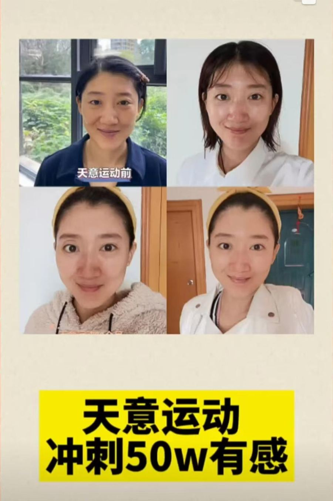
- 做法可以网上搜"张朝阳示范最好的运动大礼拜天意运动"，有些短视频剪辑不完整，多看几个比较。
- 作者曾推荐过专用垫子，那位博主流量起来后以次充好，就下架了——推荐的只是产品，不是人心。

> **功法｜大礼拜（五体投地）**  
> 用来：提升精气神、改善面相；辟谷时补能量  
> 怎么做：按网上"张朝阳示范大礼拜（天意运动）"的视频学动作，多比较几个完整的。垫子要2.3–2.5米长（双手要伸直），普通瑜伽垫只有2米，可以在前面再接一个小坐垫放手。  
> 注意：辟谷期间动作要慢，做几个心静了就行，不必太多。

关键词：自修、卡点、情绪、爱、大礼拜、天意运动、108拜、面相、朝圣

## 第748章 篇外：辟谷

篇外·辟谷：有全辟谷（不吃不喝）、清水辟谷、只断某一种（盐、肉、主食、火食）等。一般第三四天习气干扰、心念摇摆，过了就好；7天为一个节点，少于7天算轻断食。开始前心里对自己说"我要辟谷了"，结束说"我要复食了"——这叫元神启动。

- 丹道家：人生百病，人身自有百药以疗之。
- 信则气聚：嗤之以鼻的"切"，气是往外走的；骄傲是膨胀向外，谦虚是气往内收。
- 辟谷开始时能量稍不足，可以对着太阳或信仰对象做大礼拜（要慢），或念经持咒（心经、金光咒等自己相信的）。
- 心性不稳的，可以服气、咽津液，或者从半辟谷循序渐进；半辟谷也要少吃。
- 天不助无道之奉，德不扶难明之人。能辟就辟，不能就先自修，不必强求。

> **养生方法｜辟谷入门**  
> 用来：清理身体、修心（书中说满7天可能清理业力）  
> 怎么做：开始前在心里对自己说"我要辟谷了"；能量不足时慢慢做几个大礼拜，或念自己相信的经咒；心不稳可以服气、咽口水，或从只吃少量单一蔬菜的半辟谷开始；结束时对自己说"我要复食了"，再按步骤复谷。  
> 注意：期间不剧烈运动、不生气；每个人情况不同，要根据自己身体决定，作者后来也说带人辟谷需要足够经验（见754章）。

关键词：辟谷、断食、元神、信念、谦虚、大礼拜、念经、心经、金光咒、复谷

## 第749章 篇外：篆书的灵力加持

篇外·写篆书也能获得灵力加持：篆书没有顿笔和锋利钩角，像画符，越写心越柔软；要用软笔，手法也要柔。没时间写的，任何只动手不动脑的简单重复动作都能解压——描红、撕纸、用小抹布擦地、手洗衣服，把注意力放在手的感觉上。防骗：识别短视频套路（完播率、互动率）；牛奶补钙是商业炒作，牛奶阴寒，成年人不建议喝。

- 作者先描了篆书2500字，再写《道德经》；《黄帝内经》《千字文》也不错。
- 软笔老分叉，是因为笔锋太硬、没刚柔并济——有意识地放柔力度就好了。
- 很多病都是情绪引起的气血淤堵；把心打开、气血通了，抑郁和身体不适会自然散开。
- 读者分享的"看完吊打95%风水师""罗盘骗了中国风水一千年"视频：只凭一个旋转的24山就说无一不准，不可信；身价过亿和一个图没有必然关系。
- 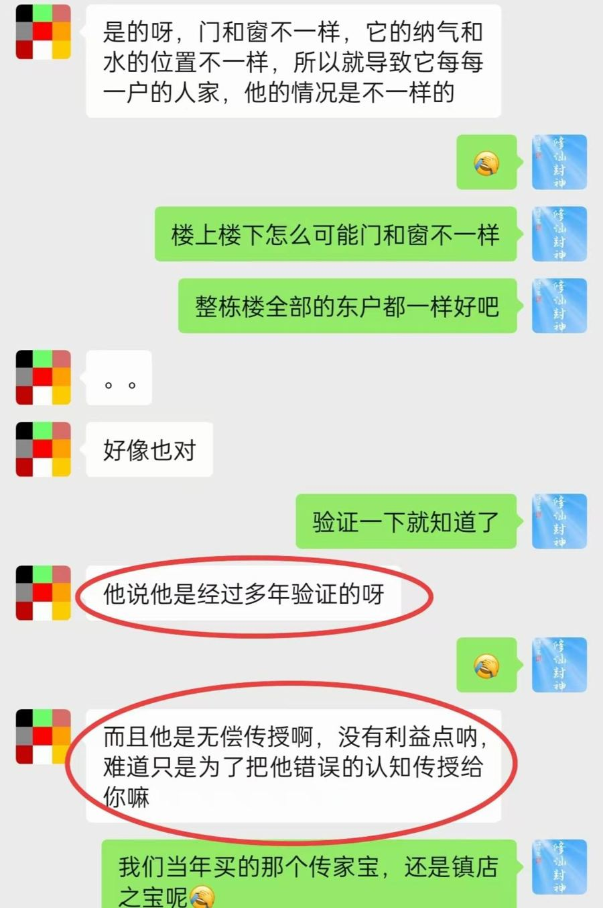
- 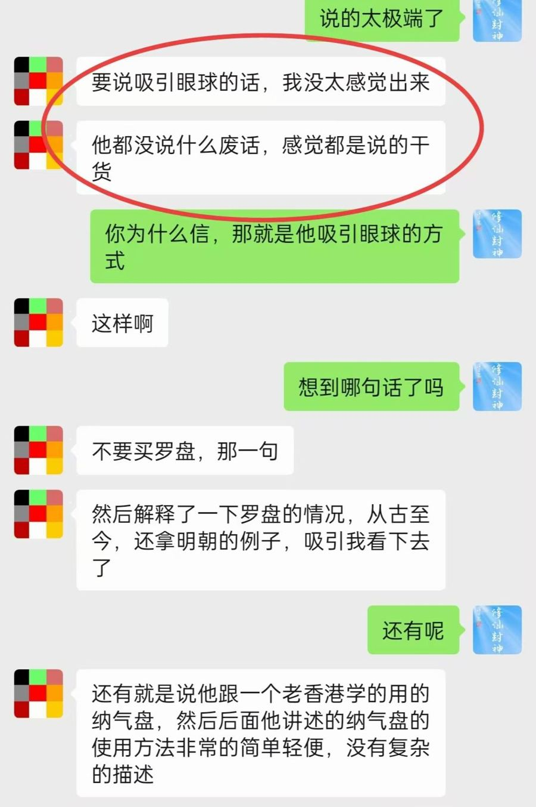
- 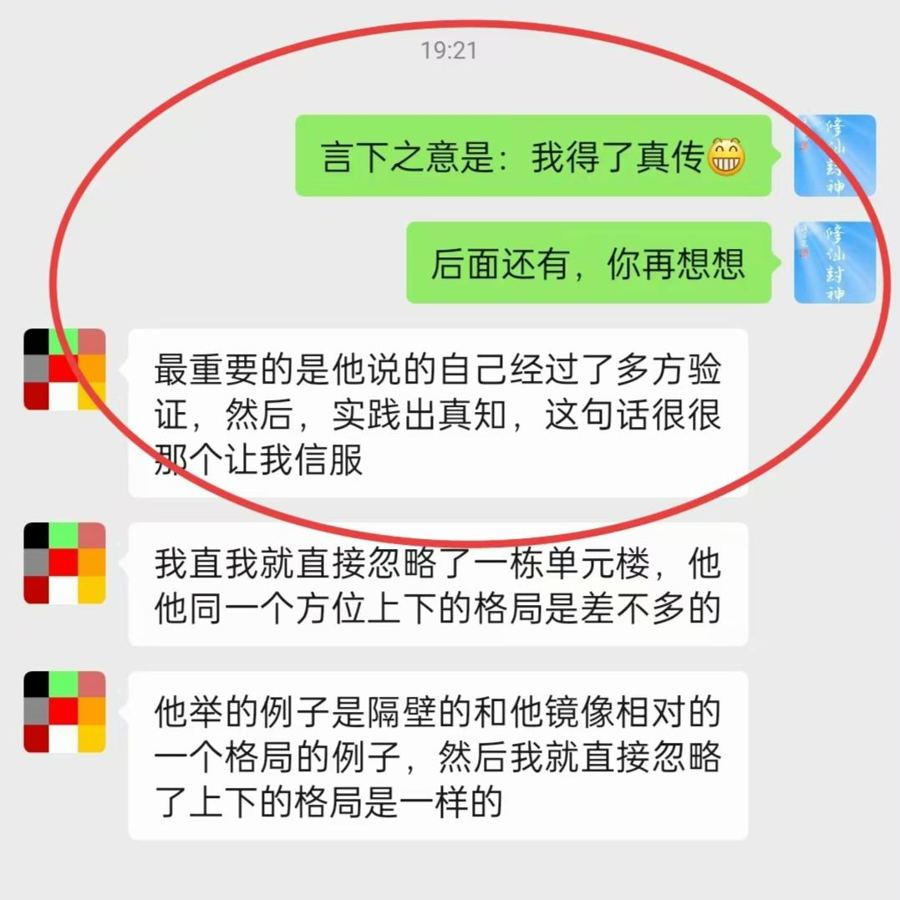
- 别人的多年验证抵不过自己亲自验证；每个人要有自己的信息过滤门槛。
- 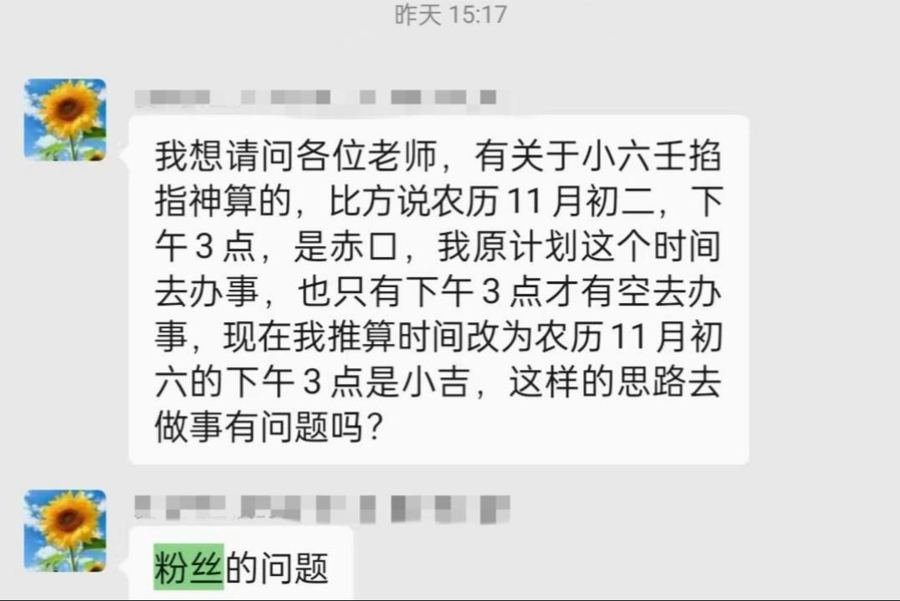
- 不要因为"人家免费、没骗我钱"就推断他讲的是真的。
- 短视频套路：说"三个点，最后一个最重要"的，是为了完播率；骂的人越多越火，是为了互动率。"吃饺子千万不能蘸醋"和"不蘸醋都是汉奸"两种视频都有。
- 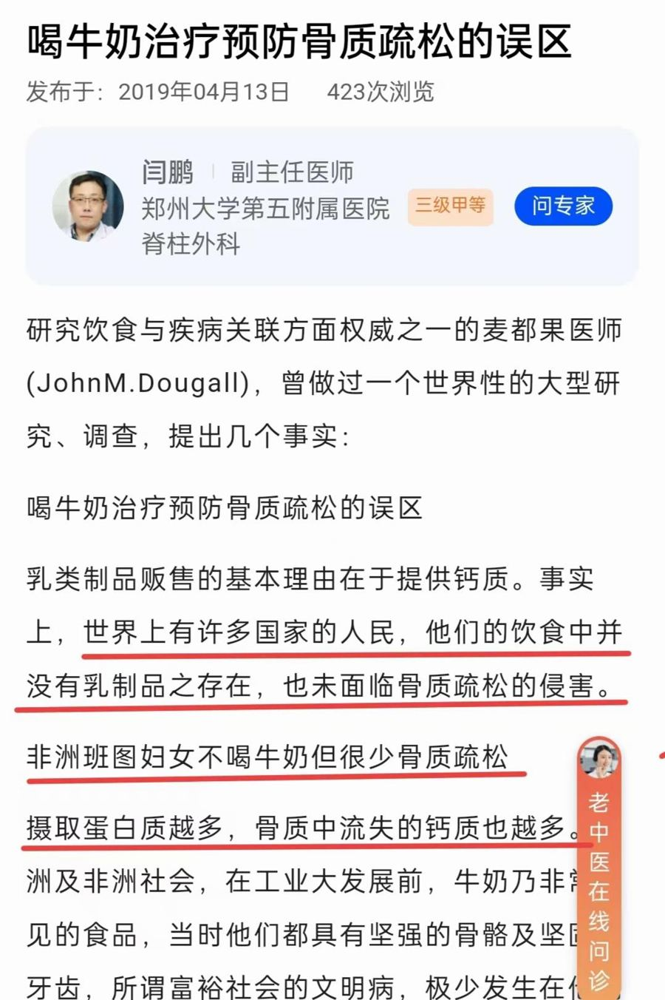
- 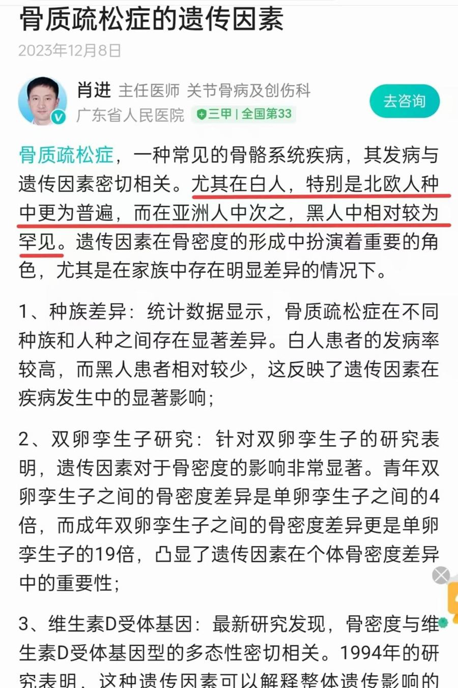
- 哺乳动物的奶是给幼崽喝的，小孩是纯阳之体，阴阳和合刚好；成年人、老人不建议喝。
- 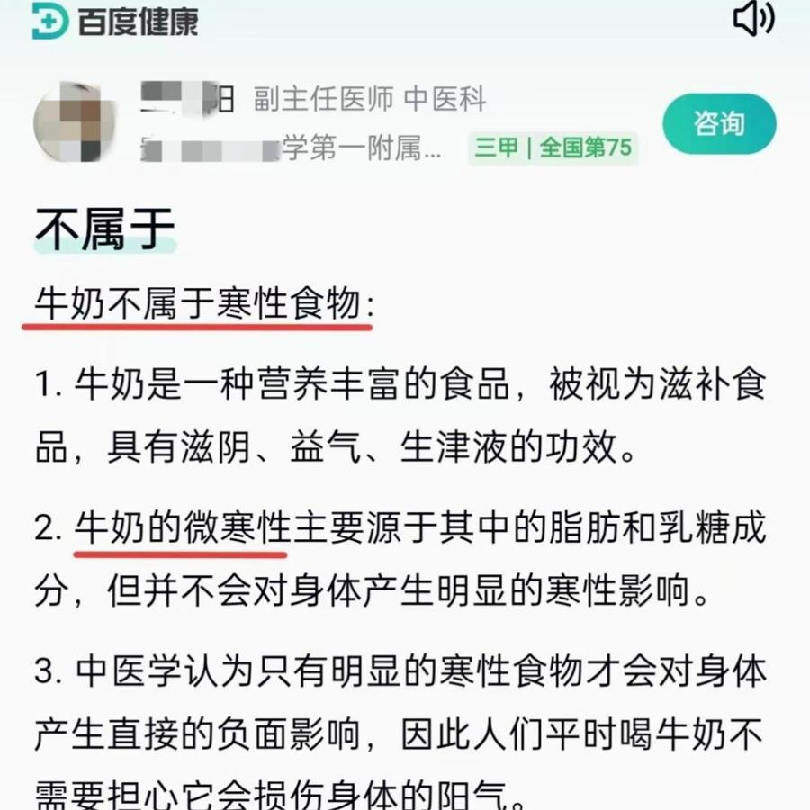
- 吃的方面，人造的不如天造的；可以多查商业利益没那么重时的古籍。

> **修心方法｜写（描）篆书**  
> 用来：静心、借文字能量加持  
> 怎么做：用软笔（秀丽笔、钢笔式毛笔）描篆书字帖或抄《道德经》，下笔放柔，不用硬笔的力道。  
> 注意：经济不宽裕或没时间的不必买，这不是摆件。

> **修心方法｜只动手不动脑的解压法**  
> 用来：压力大、想太多、情绪淤堵  
> 怎么做：描红、撕纸、用小抹布擦地板、用手搓洗衣服等简单重复的动作；做的时候把注意力放在手上，感受笔的柔软、地板的平滑、水流过手指。

> **养生方法｜成年人少喝牛奶**  
> 用来：体寒、想补钙  
> 怎么做：书中认为牛奶阴寒，补钙是商业炒作，成年人和老人不建议喝。

关键词：篆书、描红、解压、灵力、情绪、气血淤堵、防骗、短视频套路、罗盘、牛奶、补钙、醋

## 第750章 布达拉宫的灵魂

作者在布达拉宫那尊天然木菩萨（布达拉宫的"灵魂之宝"）前做大礼拜，第三次五体投地时房间突然像开了灯一样亮了。莲花生大士心咒以"唵阿吽"开头。莲花生大士预言了末法时代：车不用马拉、手机、出家人追名逐利、第三者插足、佛像法器成商品。篇外·防骗：网上批量"皈依证"百十来块，后面是连环坑。

- 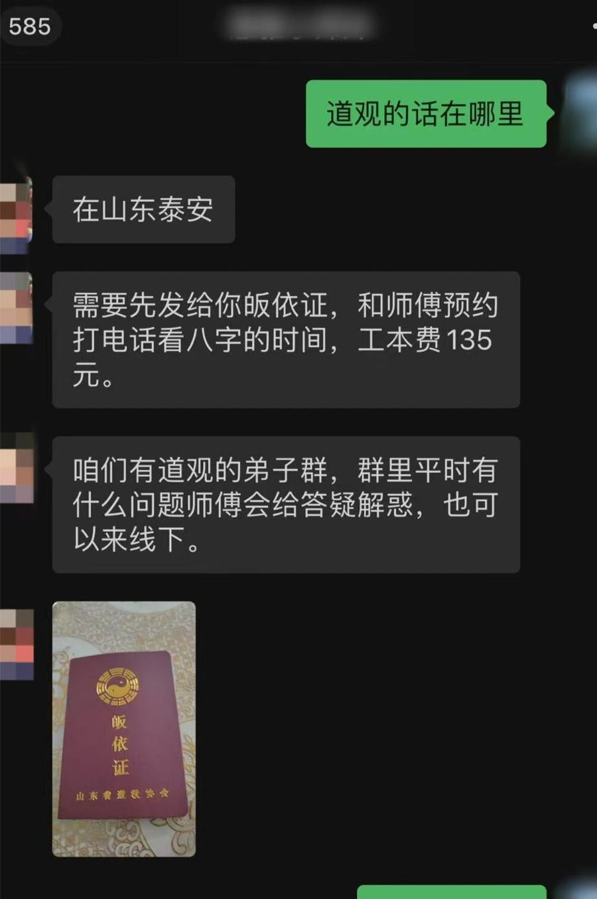
- 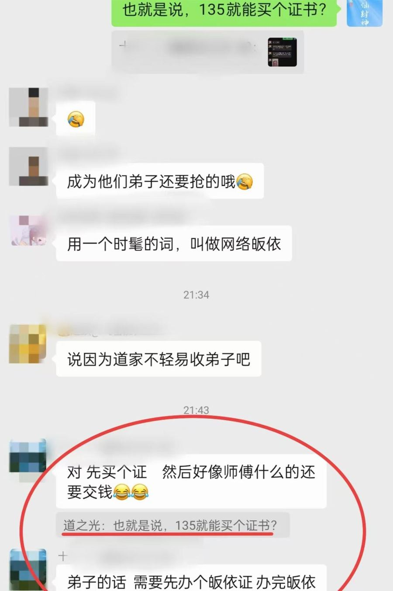
- 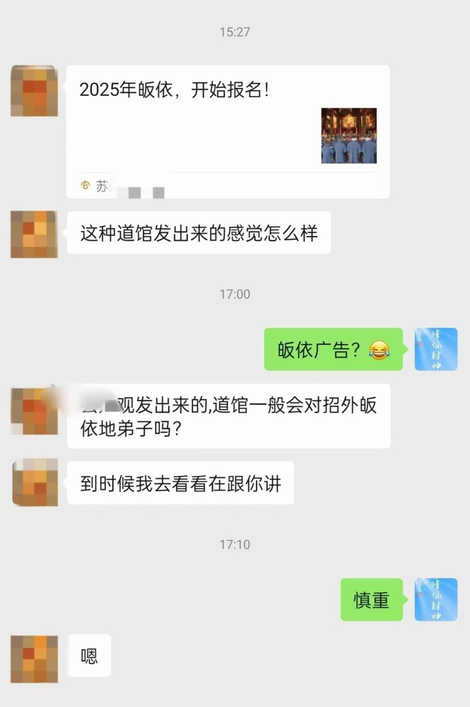
- 皈依要认可宗教理论、认可师父，师父也要考察弟子心性，往往一年半载甚至三五年；师父都不知道在哪就急着收钱，皈依的是钱？
- 缘分没到不要硬靠，硬靠也是贪念和执着。别信广告、证书、演戏，只信自己的心。
- 《清静经》：人能常清静，天地悉皆归。

关键词：布达拉宫、大礼拜、莲花生大士、预言、末法时代、防骗、皈依、清静经

## 第751章 篇外：莲花生大士的预言

篇外：莲花生大士关于末法时代的预言全文（两个译本）。里面提到：酗酒、暴食者死于脑血管病，赌博无度者死于胃病，恶口诽谤者死于喉病，吸烟过量者死于肺病，猎杀者死于肝肠病；消灾办法是昼夜持诵莲师心咒"班扎咕噜"。

关键词：莲花生大士、预言、末法时代、莲师心咒、因果

## 第752章 腰痛

火车上遇到常年花几千几万上灵修课的姐姐——课程只能学到术，修行要自己切实行出来；她家里人"愚钝"不用同意，学费却找老公要。作者问她腰是不是不好：腰杆子硬（心里不服气）的人，腰就容易不舒服。

- 花钱看二人转、吃火锅、旅游也快乐——只要钱到位一般都快乐，但那不是修行。
- 修行修理的是每个人身上的各种"不服"，对应的身体症状也在自己身上。

关键词：腰痛、不服气、灵修课、防骗、修行

## 第753章 等我学好了再去渡人

腰不好怎么调？柔和、包容，该软的时候软下来。很多人修行修成了事不关己、谁都看不上——修掉清高，修出爱和慈悲。无为不是啥也不干；"等我学好了再去渡人"就永远不会开始。篇外：辟谷不只是不吃主食——《内经》"谷不入，半日则气衰"；常年只吃果蔬肉减肥会伤精气，辟谷期间最重要的是不生气。

- 不起情绪是修自己，该处理事情还是要处理，不是任人宰割。
- 《黄帝内经》：五谷为养，五果为助，五畜为益，五菜为充。

> **修心方法｜腰不好——修柔和**  
> 用来：腰痛、腰不舒服（心里常不服气的人）  
> 怎么做：有意识地柔和、包容，该软的时候软下来，修掉自己的清高和不服。

关键词：腰痛、柔和、清高、慈悲、无为、辟谷、主食、减肥、生气

## 第754章 篇外：什么是正心正念

篇外：粉丝建的辟谷群里有人带着魔进群，作者左小臂突然沉得抬不起来，吉月姐姐说护法神为保护他受伤了——辟谷会激发潜在的欲望和执念，心念不稳易被钻空子，暂停。正心正念：把利他放第一位；让对方感觉物超所值，是积德更大的方式。风水练习：东南（巽4）见水对应甲状腺；门口枣树带刺伤眼睛。

- 如果一件事帮人多赚得少、一件事帮人少赚得多（比如零食加添加剂），正心的人会先考虑利他。
- 《道德经》：失道而后德，失德而后仁，失仁而后义，失义而后礼；夫礼者，忠信之薄而乱之首。
- 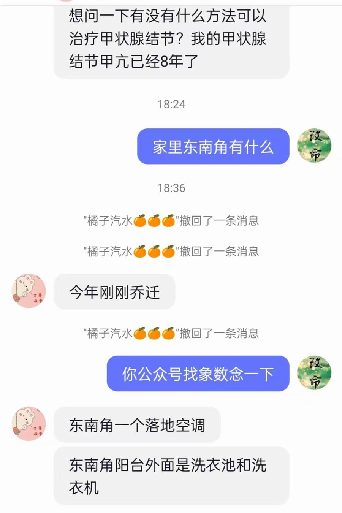
- 找不到风水原因的，可以从其他方面改善，比如象数。
- 有人请风水师选的楼，家人接二连三癌症去世——吉月姐姐看是楼下原本镇压着东西，挖地基破坏了封印。
- 磁场会跟着人：那位读者是甲状腺先出问题才住进这房子；一位肺不好的大叔，城里楼房和农村老房的兑7都有问题；他儿子小时候家门口有枣树（带刺伤眼），自己买的房子正南离9又是厨房，也伤眼。
- 改命要有意识地改，不是随便换个表相不一样的房子。心是根本，风水是术，道术同修。

> **风水排查｜门口不种枣树等带刺树**  
> 用来：眼睛不好  
> 怎么做：家门口有枣树等长刺的树，考虑移走；同时检查离9（正南）是不是厨房。

关键词：辟谷、魔、护法神、正心正念、利他、积德、巽4、甲状腺、洗衣机、兑7、肺、枣树、带刺植物、眼睛、离9、厨房、磁场

## 第755章 颈椎问题

颈椎不舒服的人，心里常对人不服气（尤其领导、老师、长辈、兄长）——"梗着脖子"，较劲时颈部肌肉紧绷，情绪的气会淤堵在那里，比低头写作业伤害更大。找到生气的原因，解开心结就好。学习是向内（阴），向外做事是阳；抑郁时尤其要动起来、为别人做点实事。1岁多的孩子不敢睡、睡着了闭眼大哭——可能睡在五鬼位。

- 外力都不持久，只有自己的心能源源不断生出力量；心要在生活中、在每一次起情绪时修。
- 别人利益熏心是自私，自己躲去清净又何尝不是另一种自私。
- 学习有陷阱：一直学可能成了逃避现实的借口，比如为了不工作一直读到三十多岁。
- 向外付出体力劳动的升阳效果和单纯运动不同；以前大家种地时，抑郁的人很少。
- 作者把五鬼组合"18、36、79、24"写给那位妈妈，让她看孩子房间的门和床是否形成五鬼。

> **修心方法｜颈椎痛——解开"不服气"**  
> 用来：颈椎不舒服（排除长期保持一个姿势的情况）  
> 怎么做：想一想自己对谁不服气、和谁较劲（领导、老师、长辈、兄长等），找到原因，把心结解开。  
> 注意：如果是累的，活动一下、气血通了就好；情绪造成的要从情绪上解。

> **修心方法｜抑郁时向外做事升阳**  
> 用来：抑郁、低落  
> 怎么做：动起来，向外为别人做点实事、出点体力，赚不赚钱先放一边，把注意力放到外面的事情上。

关键词：颈椎、不服气、性情疗法、情绪、抑郁、升阳、学习陷阱、孩子睡觉、夜哭、五鬼

## 第756章 睡觉问题

孩子睡东南屋，6（乾）开门、床在3（震）的位置——36是五鬼，作者让调头朝7睡试试。五鬼磁场：门和床、门和人（命宫）、人和床，任何一组形成五鬼都算，一般以门（地场）为主。五鬼位对大人是睡得晚、脑子过于活跃、火气大；对灵性强的小孩，可能感知到不好的东西。

- 这个孩子命宫9，卧室门6，69是绝命；调头朝7睡，79又成五鬼——但门和床位的关系更重要。
- 隔壁大房间太大不聚气，所以先调头试试。
- 火车上一位大哥反驳"色盲"的比喻：大部分人看不到的事，个别人说能感知，谁知道是不是骗子——作者觉得有道理。别人说什么，听听就好，不否定也不全信，一切以自己的验证和感知为本。
- 作者不认同"少数服从多数"：真理往往掌握在少数人手里。

> **风水调整｜孩子夜哭、不敢睡——查五鬼**  
> 用来：小孩晚上不敢睡、睡着了闭眼大哭叫不醒  
> 怎么做：画出九宫，看孩子卧室的门在哪一宫、床（头的方向）在哪一宫、孩子命宫是几，三者中任意两者组成18、81、36、63、79、97、24、42就是五鬼；优先以门和床的关系为准，调整床的方向或换房间避开。

关键词：五鬼、孩子睡觉、夜哭、命宫、绝命、八颗星、床位、验证

## 第757章 命宫的性格

命宫决定内在性格的"性别"：坤2老母亲、巽4大姐、离9二姐、兑7小姑娘是女性命宫，不论男女都偏温柔细腻、爱打扮、想被关心；坎1二哥、震3大哥、乾6老父亲、艮8小儿子是男性命宫，偏果断、有事业心和掌控欲。孩子掉头睡后，第一晚就不再哭醒了。

- 坎1是阳的起点，虽是男命宫，比其他男命宫更注重细节。
- 震3、乾6的女孩子，化着精致的妆也不耽误内心果断硬气；让她在婚姻里做林黛玉，内在会很憋屈。
- 不熟的人不好验证，大家都戴着社交面具。
- 命宫9和床位7形成的五鬼也有影响，但没那么大；正气足就不受影响，不足就尽量避开。
- 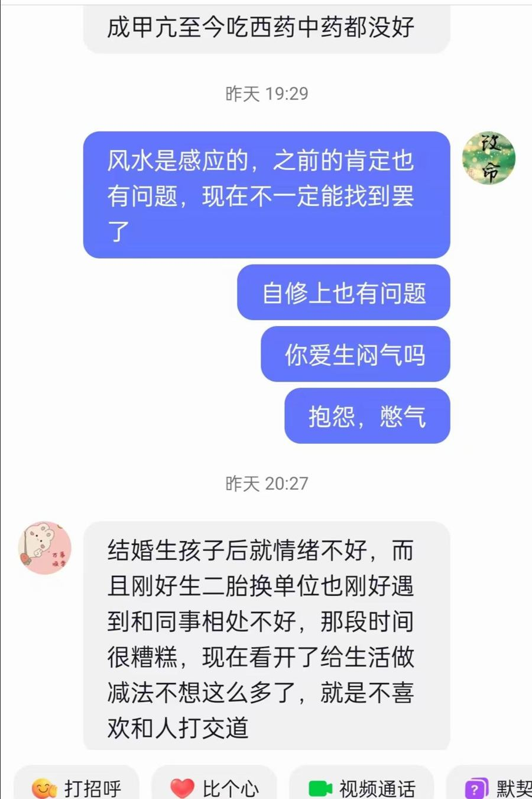
- 《黄帝内经》：百病生于气。甲状腺问题是生闷气导致的（风水上是巽4见水）。
- 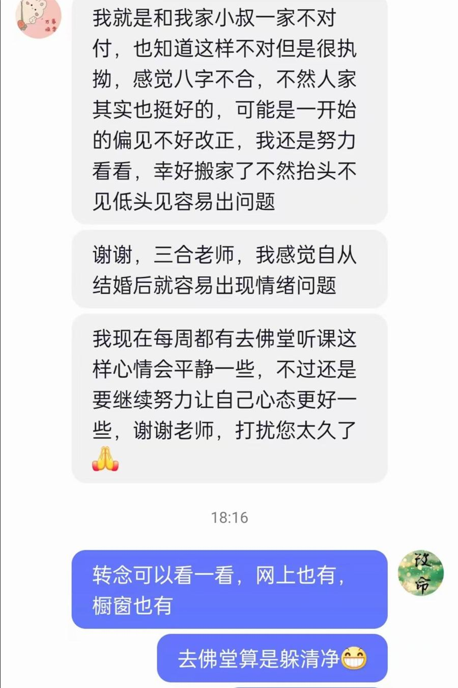
- 平时容易想不开的人可以多看《一念之转》。
- 肠的重大疾病：肠属金，风水上看西边的金受伤（火克金、缺角、有变压器等煞）；情绪上看不起别人或记恨别人（尤其长辈）。还可以试试曾仕强教授晚年用的"和自己身体沟通"。
- 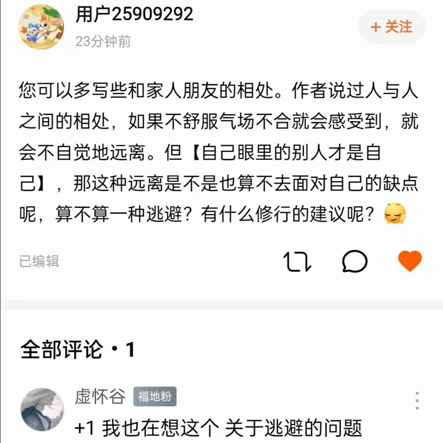
- 打得过就打，打不过就跑，以自己不受伤为前提；逃避是给自己喘口气、成长的空间，但不能一辈子跑。

> **修心方法｜甲状腺——不生闷气**  
> 用来：甲状腺问题、甲亢  
> 怎么做：风水上检查东南（巽4）有没有水；情绪上找出让自己生闷气的事，转念想通、彻底释怀。  
> 注意：躲去佛堂清净不算化解。

> **修心方法｜肠道问题——查西方的金、放下看不起和记恨**  
> 用来：肠部疾病  
> 怎么做：风水上检查正西、西北（金）有没有火克金、缺角，或变压器等煞；情绪上想想自己是不是看不起谁、记恨谁（尤其长辈），自己想通才算解开。

关键词：命宫、性格、五鬼、甲状腺、甲亢、生闷气、巽4、肠、兑7、乾6、记恨、一念之转、逃避

## 第758章 地产运

吉月姐姐：小孩被吓掉魂也会夜里哭闹，以前叫一叫就回来，现在魔到处偷魂魄，要灭了魔才能找回——调五鬼位只适用于魂魄俱全的孩子。作者认定九运地产没戏，2016到2019年坚持不买房（2017年王健林、潘石屹都在甩卖）。孩子头面部过敏的性情原因：头部问题多是"犯上"——跟领导、长辈、老师、兄长生气。

- 
- 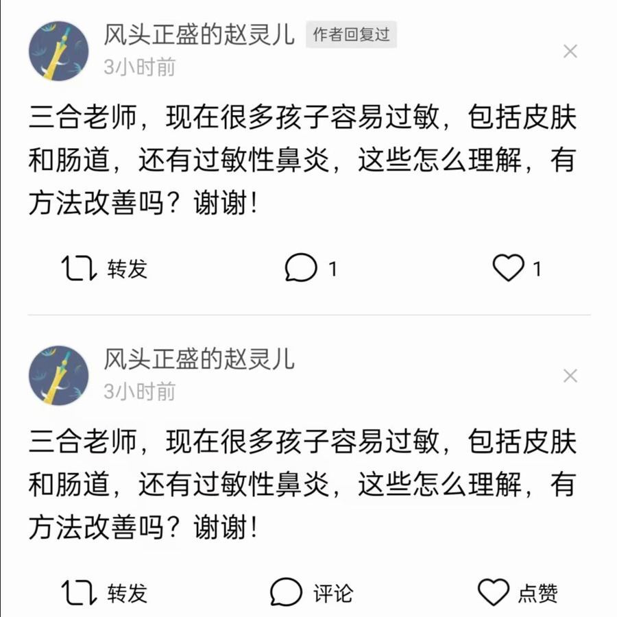
- 艮8命宫的孩子更容易出这类问题。
- 营养学上，蛋白质摄入过多（鸡蛋、奶制品）也可能容易过敏。
- 头晕、头痛都和犯上有关；鼻子长在头上也和犯上有关，鼻子还是通气的进出口，出问题也容易是沟通不畅。
- 皮肤问题对应脾气、火气大，或者馋——肉里藏着阴火，肉吃多了火气大；皮肤也和业力、父母有关。

关键词：掉魂、夜哭、魔、九运、地产、买房、过敏、鼻子、皮肤、犯上、头痛、头晕、艮8、蛋白质、吃肉、上火

## 第759章 篇外：打破禁锢

篇外·打破禁锢：工作不开心有三种原因——和使命相反、有不合天道的地方良心不安、或自己只盯着负面。第三种转念就好：10个客户只有2个刺头，已经很幸运了；多看正能量是聚阳，盯着负能量是收阴。做自己喜欢又对别人有用的事，也能温饱不愁。赚钱首先戒贪。

- 被扭曲的假设：帮人就赚不到钱、开心的事不赚钱。被这种想法固执住了，就真的不赚钱。
- 大礼拜和辟谷一样能激发自我修复能力：一位欧美师姐练到冬天穿单衣就够。中医认为万病之源是湿寒淤堵，体内热量足以化开时身体自然好；体温是活力的象征，大礼拜是内在的补，和桑拿、艾灸这类外在的补不同。
- 一位淋巴癌的姐姐：夏天特别爱吃雪糕，又一直看不上老公生气；生病时老公不离不弃，她释怀了，决定好好珍惜他。
- 体温高的人不容易生气，小孩打完架一会儿就和好；提升体内热量有助于疏通情绪郁结。很多重大疾病患者每天先做十个二十个大礼拜。
- 一位200多斤、有脂肪肝和类风湿的博主做大礼拜受益，自己设计了垫子，把爱好和养家结合起来。
- 再紧急，太阳月亮转一圈也要24小时，稳住，跟着天道走。

关键词：工作、赚钱、转念、聚阳、收阴、戒贪、大礼拜、湿寒、体温、淋巴癌、雪糕、脂肪肝、类风湿

## 第760章 篇外：自由的心

篇外·自由的心：作者不太赞同皈依——皈依意味着要接受教义的一切，对的错的都要接受；站在局外择善而从，选择性才大。丹霞烧佛：不执着于烧，也不执着于不烧。心里有多少个"应该"，就有多少生气——是执念把自己捆住了。

- 《金刚经》：知我说法如筏喻者，法尚应舍，何况非法——过了河就别背着船。
- 遇到不被自己宗教经典禁锢的师父，也可以皈依。

关键词：皈依、自由、执着、丹霞烧佛、应该、生气、金刚经

## 第761章 头、心、胃等问题的根源

头部问题和"犯上"有关；心脏病和精神病都是"恨人"得来的（痰迷心窍的痰也是恨气）；脑萎缩、脑瘫一般是小时候的病根，小孩的病根源在母亲——母亲犯上、和长辈生气。性情调理身体的原理：用阳气疏通阴气。看人不顺眼、怄气、上火是收阴；有问题找自己、多看别人优点是聚阳。

- 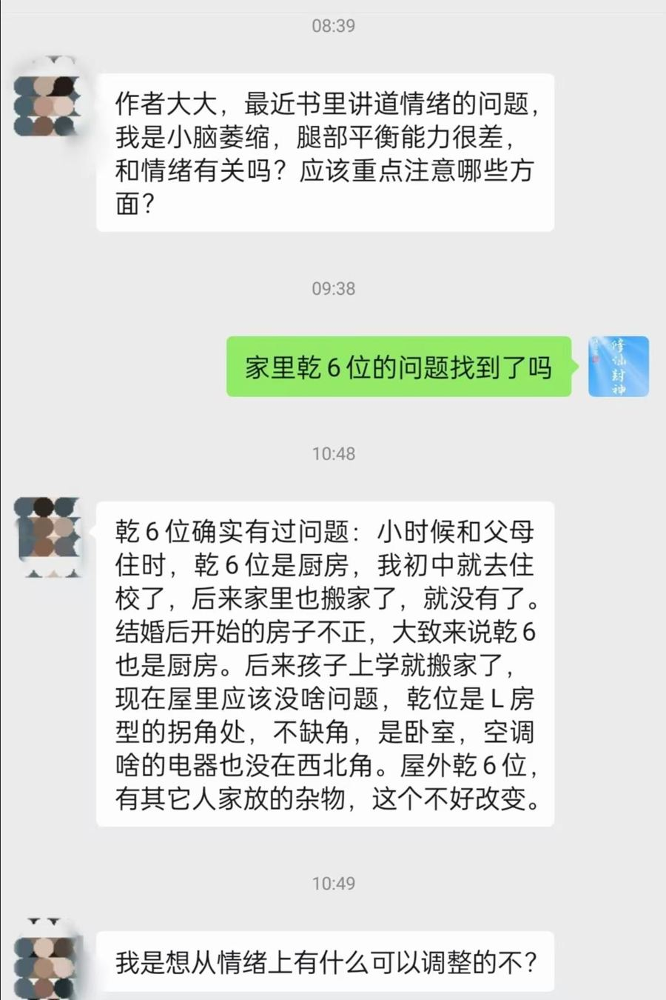
- 一想起来就气得发抖，是因为心里有个"应该"——那只是我们的认知，强迫别人服从我们的认知，算不算一种霸凌？
- 很多重大疾病患者病后恍然大悟：人生转瞬即逝，生什么气呢——想通了，病不医而愈的案例很多。
- 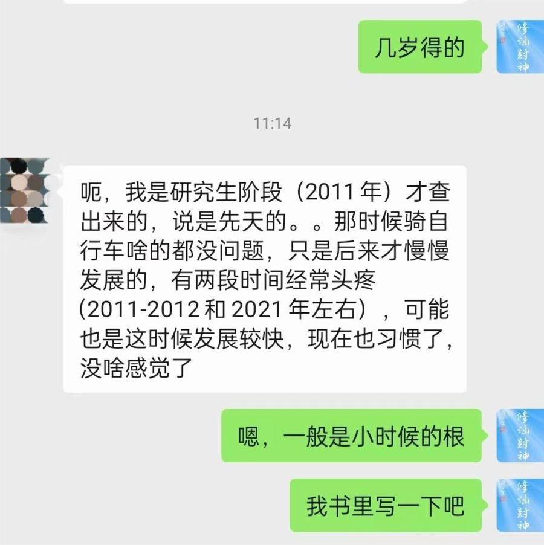
- 自己没有这个业力，也不会遇到"犯上"的母亲——世界丝丝相关。
- 母亲还在，就让她想想当年跟谁生气；自己长大了，也回想自己和父母、师长、兄长等长辈有没有生气或顶撞。

> **修心方法｜性情疗法——找"犯上"和"恨"**  
> 用来：头部问题（头痛、头晕等）；心脏问题；孩子的脑萎缩、脑瘫等  
> 怎么做：回想自己（孩子的问题就让母亲回想）跟谁生过气、恨过谁，尤其是领导、长辈、老师、兄长——包括明面顶撞后回家生的闷气；找到根源，放下心里那个"应该"，把情绪疏通开。平时多看别人的优点（聚阳）。

关键词：性情疗法、犯上、头痛、恨、心脏病、精神病、痰迷心窍、脑萎缩、脑瘫、母亲、孕妇、聚阳、收阴、应该、一念之转

## 第762章 篇外：只分享案例，不接个案

篇外：作者不接个案，只把有共性的问题写进书里。孕妇一念影响两个人，要有转念的意识。防骗：刷短视频报的课说能改八字又能看风水、两千多块、"看不得大家受苦受难做布施"——贩卖焦虑、利用贪念。判断标准：学完验证觉得物超所值是真的；还没学光听就觉得超划算，就是在利用你的贪念。

- 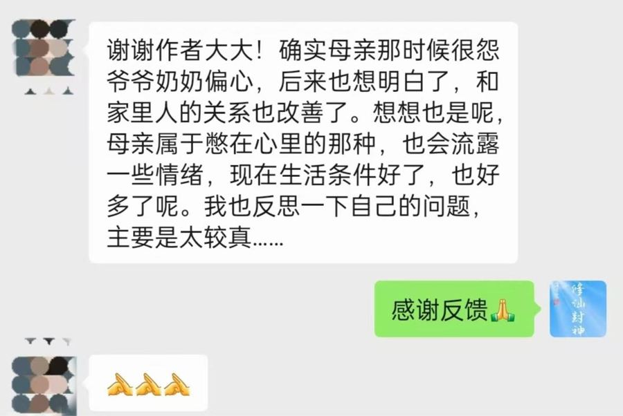
- 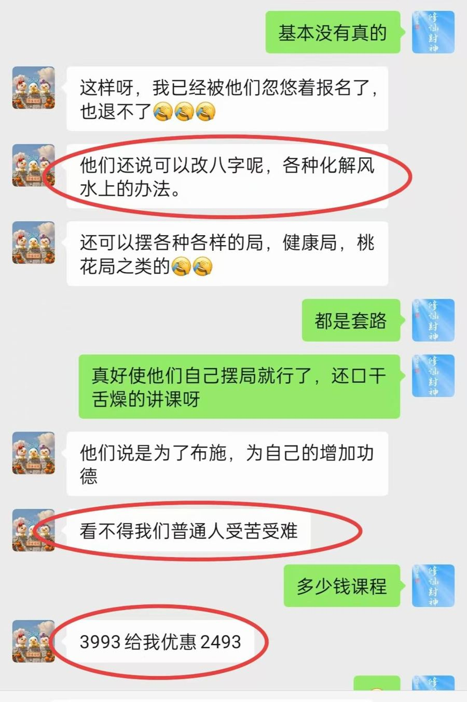
- 功德不是自己说的，是别人学完觉得物超所值说的。
- 套路问题都是谁测谁准："你是不是财运不顺、感情不顺、遇小人？"——冷读。
- 所有被骗都是因为贪；间谍喊口号可能比一般人还响。
- 风水学五行八卦这些各门派公认的就够了，剩下各派分歧大，越学越乱、越易入魔。
- 头像青龙白虎有两种理论：从我们的角度看左青龙右白虎；或人站在画里向外看，正好相反。作者找了一位读者验证。
- 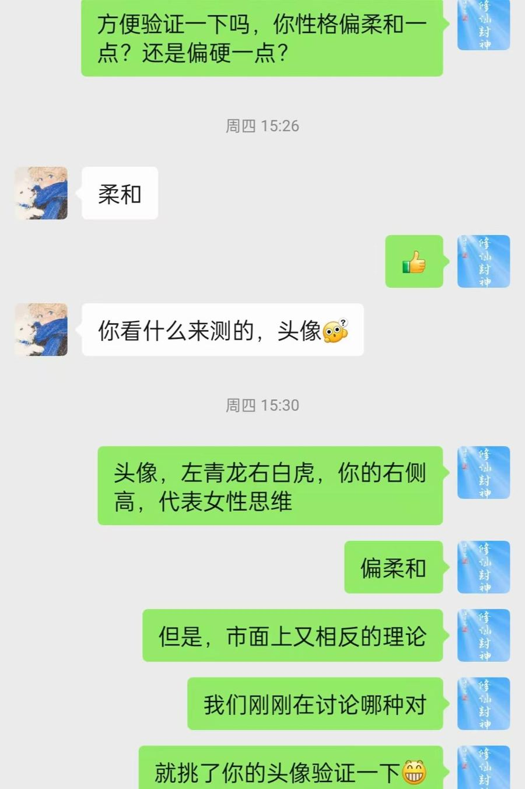

关键词：不接个案、孕妇、转念、防骗、改八字、风水课、贩卖焦虑、冷读、贪念、头像、青龙白虎

## 第763章 篇外：怨伤脾胃

男性命宫的人也可能看起来温柔——那可能是社交面具（如琪儿）。作者被老公急刹车按喇叭吵醒，刚想抱怨就转念道歉：我一个睡觉的人凭什么责怪干活的人？脾胃病就是怨气导致的——遇事先怨别人，毒气就存进胃里。胃不好，少抱怨，吃瘪花生米效果也不错。

- 作者在这里提到"我爱人开车"——指写书时的现任伴侣。
- 哪怕被骗，骗子可恶，我能被骗也说明我有自己的问题——不向外怨，就不产生怨毒，吃一堑长一智，坏事变好事。

> **偏方｜胃不好——少抱怨＋瘪花生米**  
> 用来：胃病、脾胃不好  
> 怎么做：遇事先找自己的问题，少抱怨别人；同时可以吃瘪花生米。  
> 注意：书里没写瘪花生米怎么吃、吃多少。

关键词：脾胃、胃病、怨气、抱怨、瘪花生米、花生、命宫、社交面具、转念

## 第764章 篇外：排毒反应

坎1有两种说法（属水宜放水／能量低不宜放水），作者实践中不建议坎1放水。情绪五毒：怒伤肝，恨伤心，怨伤脾，恼伤肺，烦伤肾（尿毒症和烦躁有关）。性情疗法化解时常有排毒反应：轻的打几个嗝，重的吐痰——各种颜色味道，可能每天吐几个小时，叫"翻良心"。背痛：风水上找正北（坎1）和艮8；性情上是背后中伤了别人。

- 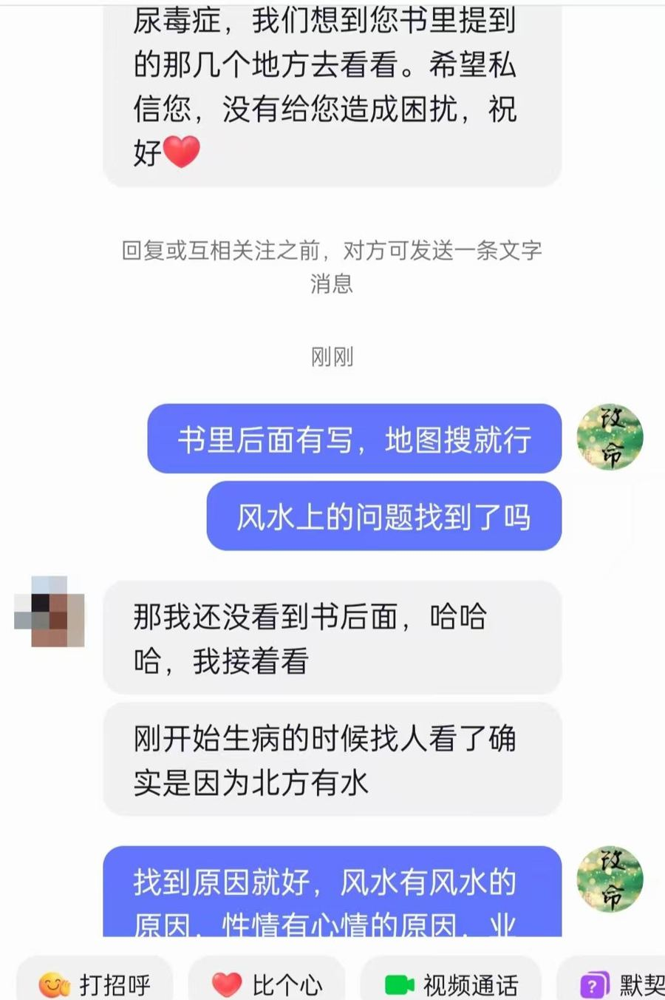
- 风水问题解决了，没有持续伤害，人体会自我修复；损伤太大才需要多层面一起处理。
- 生气时气往上走（正常是气沉丹田），排毒就是把逆行的气排出来；越久越重的病，越会吐痰。辟谷、师父加持时也有排毒反应，但没自己"翻良心"那么剧烈。
- 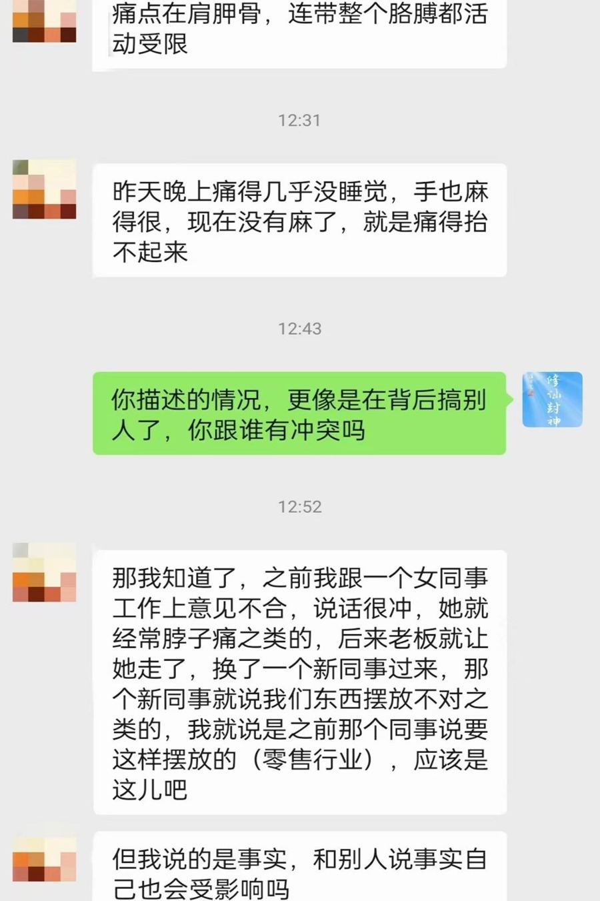
- 说的是事实算不算中伤？看动机：客观描述不带情绪就不算；带着情绪想抹黑对方就算。
- 不是所有背痛都是这个原因，痛一会儿自己好了，也可能是通窍。
- 三魂（天魂、地魂、人魂）注入身体的只是分身；元神觉醒是体内这一丝元神和天上的本尊联系上。
- 病的食物就是火气，不生气不上火，病就饿死了。

> **修心方法｜背痛——查北方、停止背后中伤**  
> 用来：背痛  
> 怎么做：风水上检查正北（坎1，肾主骨）和东北（艮8，也管骨）；性情上想想自己有没有带着情绪在背后说别人坏话，停止并化解。

关键词：坎1、放水、情绪五毒、怒伤肝、恨伤心、怨伤脾、恼伤肺、烦伤肾、尿毒症、排毒反应、吐痰、翻良心、背痛、中伤、艮8、元神、三魂七魄

## 第765章 篇外：个人的业力得自己修

篇外：个人的业力得自己修，亲人的事你替不了——先让本人把书读完、有共识再说。孩子羊癫疯，性情上是父母亏了孝道。德行是护身符：德行够，护法神拼命保护；不够，护法神冷眼旁观。讨债的孩子是往世业力，先站在天道的角度修正自己的心。头像脖子细、有一圈红——喉轮代表沟通表达，说话着急。肩周炎是担子太重。

- 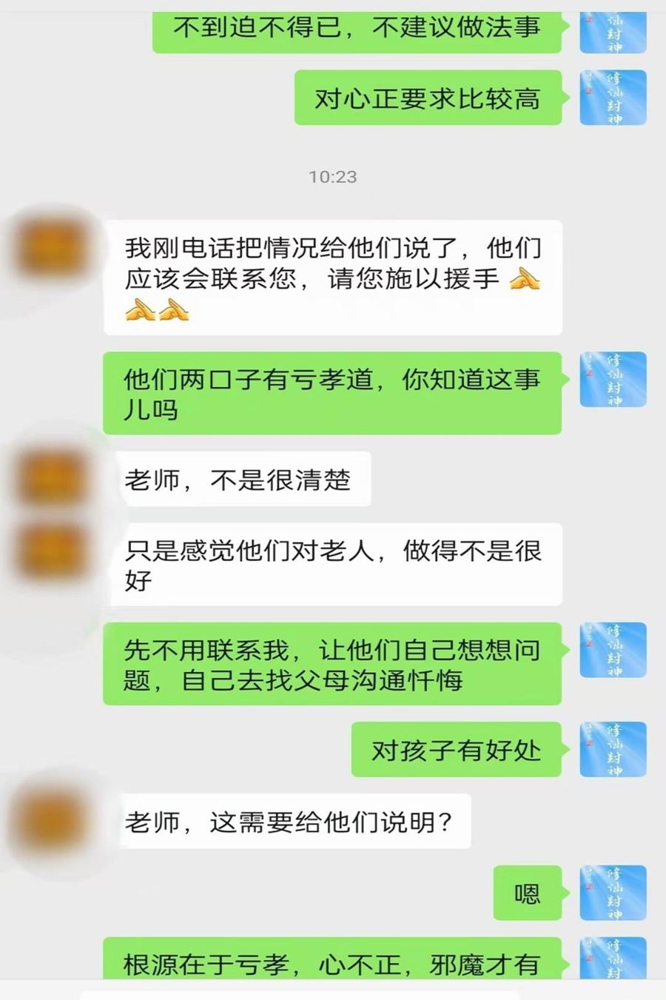
- 心不正不建议做法事：做完贪念一起又招魔，再做再招，还赖师父法力不行。
- 孙思邈：上医医国，中医医人，下医医病。
- 福人居福地，福地福人居——前提是别到处外求，否则护法神都被扣没了。
- 你家孩子把别人打伤了，你只想把自家孩子救出来，人家那口气咽得下去吗？
- 心正也体现在看新闻、刷视频、听音乐上，避开负面消极、三观不正的。
- 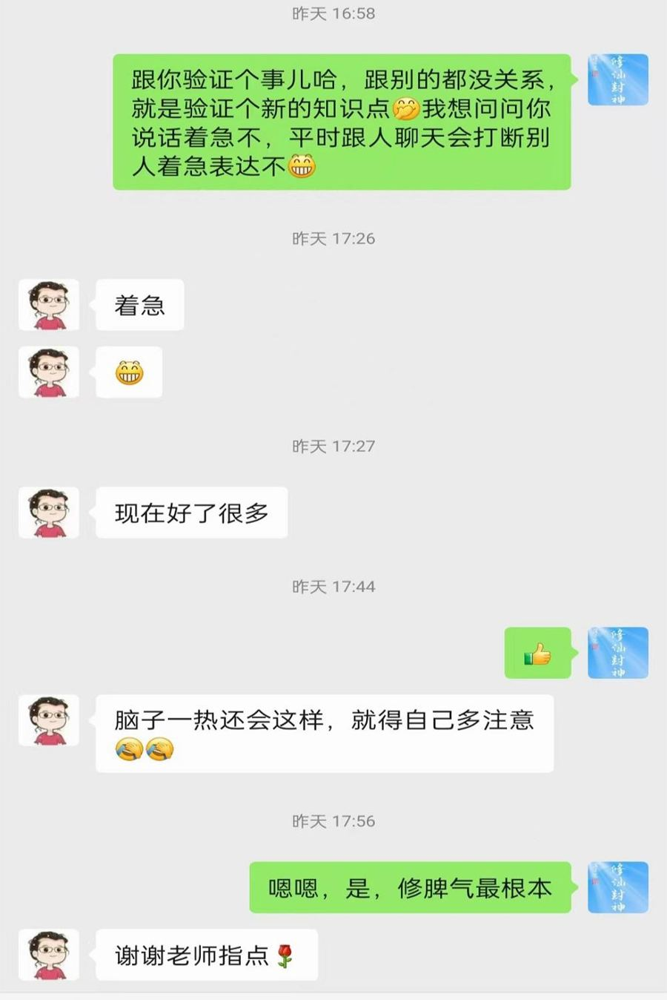
- 
- 咽喉炎、扁桃体炎的人容易打断别人、抢话（也和上火有关）；粗脖根则相反，是有事说不出、憋的。
- 图画也是一个小世界，和我们互相感应，头像尽量选正常的。
- 肩周炎化解：别谁的事都想管，该放的放下。
- 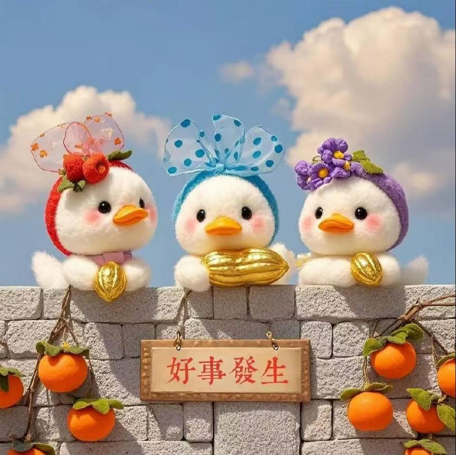
- 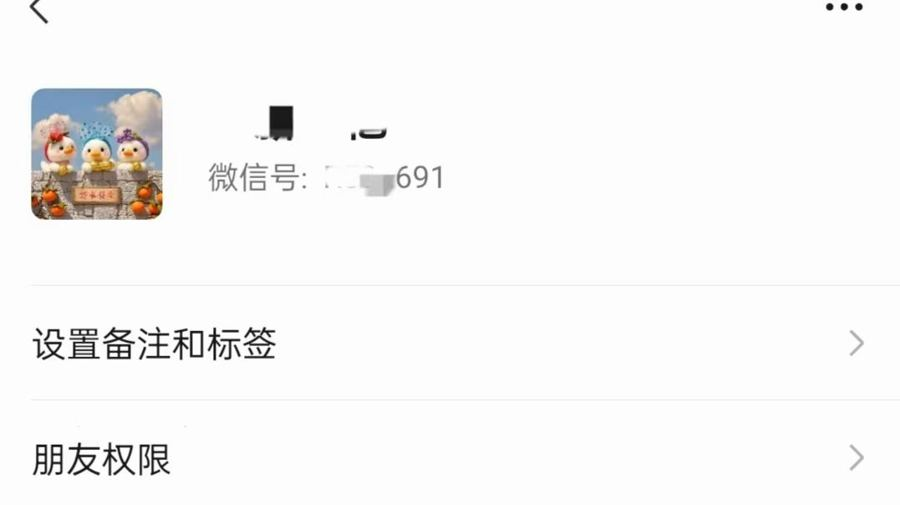

> **修心方法｜肩周炎——放下担子**  
> 用来：肩周炎、肩膀酸痛僵硬  
> 怎么做：别谁的事都想管，该放下的放下，减轻心理压力。

关键词：业力、不求不救、羊癫疯、孝道、德行、护法神、讨债的孩子、头像、脖子、喉轮、七脉轮、咽喉炎、扁桃体炎、肩周炎、脾气

## 第766章 寸

2019年春胖总新开了两家酒店：婚宴酒店整面临街墙连门全是玻璃，很不聚气；私人会所乌漆嘛黑很压抑。当年年底疫情封城，出国劳务全停。作者2020年2月3日暴跌时清仓、3月初追高买入、再跌时又卖——精准地卖在最低、买在最高；庚子年金水当令，他喜用木火，却忘了这茬，纯用脑子分析。

- 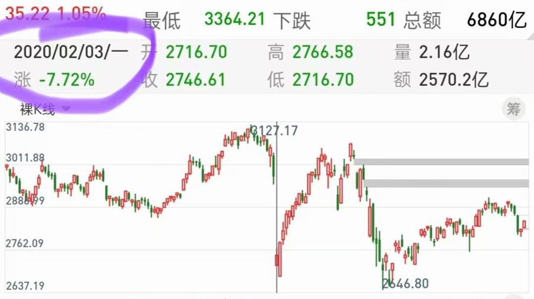
- 作者发现自己赚钱时觉得"哦"，赔钱时反而觉得刺激——好像不能和钱友好相处了。

关键词：聚气、玻璃墙、店铺风水、疫情、股票、流年、庚子年、喜用神、运势低落

## 第767章 骗子的祖师爷

防骗·"骗子的祖师爷"：2020年疫情期间，一位据说是公安局领导请来的"易学大神"，宣称交7800学费就保证学员三代以内终身不得重大疾病、疫情无一人感染、学完半年财务自由——当地一群给人看事儿的老师父和作者都报了。口号："两天让小白成为大师，吊打十年老师父"。

- 修行人"擅长"内省，宁可认为自己学艺不精，也不怀疑讲易经的人是骗子。
- 第一天上午讲慈悲、尊师重道、孝敬父母——听一上午正能量，都觉得值。

关键词：防骗、易经培训班、包治百病、尊师重道、贪念

## 第768章 实践是不是检验真理的唯一标准

7800两天只讲了个九宫格（1234喜砂、6789喜水，连9放水可能伤心脏都没说），接着推49000的"私人订制风水"；台上一个接一个老学员分享"孩子成绩提高、业绩翻倍"，大师说"纠结最耗费能量"——作者为了"心定"刷了卡。

- 分享的人多到不像托儿——作者被"实践是检验真理的唯一标准"这句话禁锢住了。

关键词：防骗、易经培训班、学员分享、促单、纠结

## 第769章 获取无穷的宇宙能量

49000的课只讲了命宫，大师把天干地支写错三个字（戊写成戌、戌写成戍、卯少一条腿），还推2万的"终身免费旅游式密训"。篇外：咳嗽带黄痰、嗓子干、小便黄，可以吃连皮香蕉冰糖汤。

- 大师说："我讲课跟着现场的能量走，每场不一样，要多来复训。"
- 
- 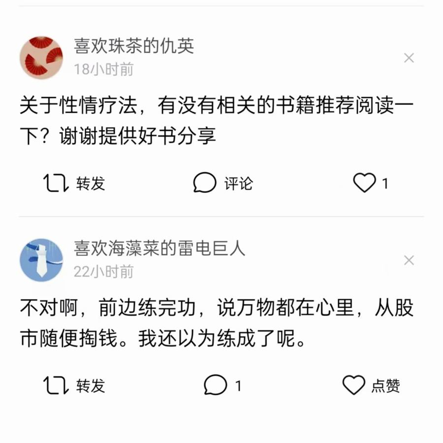
- 读者问的书：刘有生《让阳光自然播撒》，现在不好买，可以网上搜作者的视频。
- 练功像练字、练舞：三天不练手生，不是练到一个程度就能一辈子保持。
- 作者这次辟谷反应特别剧烈，新手不一定扛得住；辟谷能连接业力，近几年玄的部分变化很大。
- 古萨满师父说明年（2025年）还会出现新类型的疾病；星象师父的书写过2025年很难，经济和婚姻压力都很大——只能修好自己的情绪，把注意力放在自己身上。

> **偏方｜连皮香蕉冰糖汤**  
> 用来：咳嗽，带黄痰、嗓子干、小便黄（热咳）  
> 怎么做：香蕉带皮切段，加水和少许冰糖煮成汤；饭前空腹喝汤、吃香蕉肉（也可以连皮吃）。早晚各一次，一般吃两三根就可以了。  
> 注意：适合带黄痰、嗓子干、小便黄的热咳。

关键词：防骗、天干地支、咳嗽、黄痰、嗓子干、香蕉、冰糖、练功、辟谷、2025

## 第770章 篇外：修心：正心正念

篇外·安全提醒：接下来一年多，尽量别去险峻的地方，人多拥挤的景点里有栏杆、水泥假山、大桥的地方都远离——很多建筑疏于维修或质量有问题。死胡同、深邃不透明的花瓶、南北细长照不进阳光的房子都招阴，高层深邃的电梯通道也要注意。正心正念的两个基本标准：笃定和自省。

- 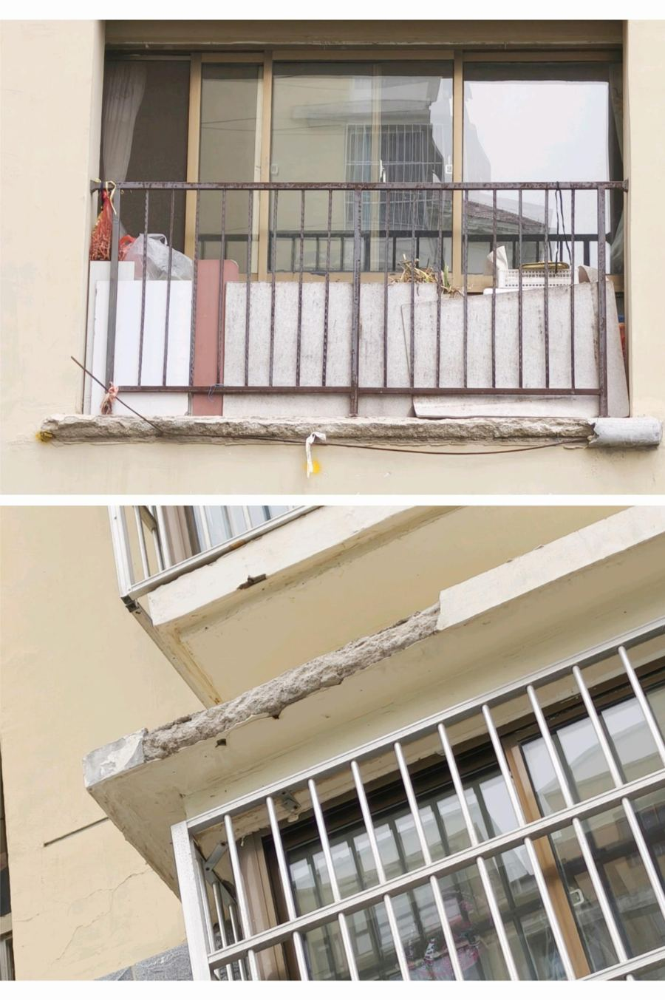
- 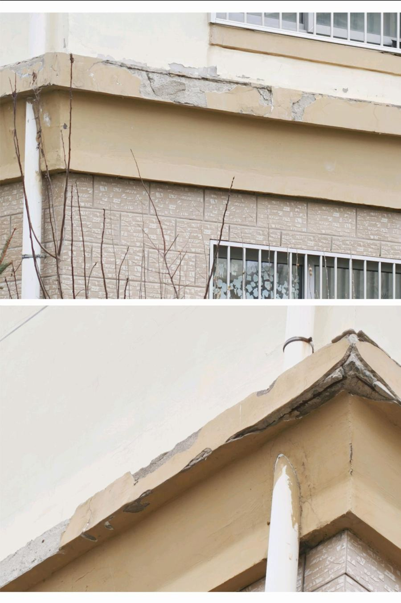
- 笃定：没有证据、没有具体对象就怀疑别人害自己，是疑神疑鬼，心随怀疑四处飘荡。
- 自省：看全世界都是反的，会不会是自己头朝下了？
- 【一切的问题，都是我的问题。】【一切的发生必有利于我。】所有问题先问自己：在这件事里我的问题是什么？
- 如果找到的答案是"我瞎了眼遇到这个人"，那还是在怪对方。实在找不到自己的问题，就去找对方的优点——当初看上他总有原因。
- 心不定时不要四处外求，万一对方把你的护法神扣了，生活会难上十倍百倍。自助者天助。

> **风水排查｜避开招阴的环境**  
> 用来：选房、居家，避免阴气重  
> 怎么做：不住狭窄（尤其是死胡同）、照不到阳光又不通风的地方；家里不放深邃不透明的深花瓶；不选南北细长、阳光只照到南边一小部分的房子。

关键词：安全、景点、栏杆、假山、房屋质量、招阴、死胡同、花瓶、电梯、正心正念、笃定、自省、外求

## 第771章 免费还要交钱

"大爱的刘老师"说复训终身免费，结果每次要交349"场地费"，再推2万密训说交了就全国终身免费。八字课收了学员八字，却总以"天阴伤身""上天不让讲"为由不讲——因为要尊师重道，谁也不敢让老师硬讲。

关键词：防骗、易经培训班、场地费、尊师重道、八字

## 第772章 帮助众生才是最大的善

原来刘老师不会八字（拜师后因心性不好被赶出来）。每人花了十万左右，包括必须买的护身符——不买就是不尊师。布局没效果，他说"你们福报不够，要帮众生脱离苦海"——就是让大家拉人头。

关键词：防骗、拉人头、福报、护身符、尊师重道

## 第773章 交钱的速度，就是改变的决心

刘老师的话术："所有让你不舒服的点都是你的卡点""办法总比问题多""交钱的速度就是改变的决心""没有钱是你懦弱的借口"——道理听着都对，却是让工薪族刷信用卡来凑学费。

关键词：防骗、话术、信用卡、拉人头

## 第774章 连笔字

有人倒腾到30多张信用卡拆东墙补西墙。当义工要选长得好、穿四位数衣服的，自己掏食宿路费还要包老师花销。作者提醒他戍、戌、戊的区别，他说"我写的是连笔字"。加微信先发1314红包，问问题先发红包，看户型五位数起步。

- 戍（shù）戍边：里面一点看成子弹；戌（xū）戌狗：里面一横看成狗毛；戊（wù）：里面什么都没有。

关键词：防骗、红包、尊师重道、天干地支、戊戌戍

## 第775章 大量的案例验证

作者当义工帮学员看户型、查布局，短时间攒了大量案例：娟子把财局的水从离9大门两边"踢一踢"，踢到了坤2——坤2是进财口，放水降低能量，生意越来越差；挪回后就好了。坤2能否放水各派有争议，实践中坤2见水不利生财。一位乐善好施的苏总家只有坐便器朝向小问题（易便秘）；利己的李总花六位数请的风水师让她把厕所挪到坎1，还在院子西南建大鱼塘。

> **风水排查｜坤2不放水**  
> 用来：布了财局反而生意变差  
> 怎么做：检查放水的位置有没有偏到坤2（西南）——坤2是进财口，不要放水；财局的水按632章放在正南丙、丁位，别踢偏到巽4、坤2。

关键词：财局、坤2、放水、进财口、离9、坐便器、便秘、坎1、厕所、鱼塘、防骗

## 第776章 尽人事听天命

人算不如天算：与人为善地做好自己，不必精心算计每一个人。刘老师天天盯义工拉人头，作者把父母、妹妹、姨、伴侣都报了上去。公益课上刘老师"断卦"：你老公运势不顺，是你压制了他——答案都在我的正式课里。

- 作者回国后结婚了，细节留到新书写。

关键词：尽人事听天命、防骗、冷读、拉人头

## 第777章 阴阳之道

智策师父听了半场就走了："营销手段，绝对厉害。"——"你学到他普度众生的本事了吗？你可长点儿心吧！"刘老师说年轻女孩阳气足，贴身助理都要年轻漂亮的；后来在船上当众对20出头的女学员上下其手。

关键词：防骗、营销、阴阳、贴身助理

## 第778章 这里有个卦象

在大连的课上，刘老师把手放在年轻女孩胸部说"这里有个卦象"，被助理用掌声"欢送下场"。事后说是被下药了，医院查不出问题——作者看更像被下了咒、激发了本性。回到威海，师母把义工扣在酒店房间盘问。

关键词：防骗、性骚扰

## 第779章 大义

作者以为是考验，说"一切正常"。萍萍事后说她特意为作者争取了"站队"的机会——她把作者私下提醒她的话一字不落学给了师母，说"跟师父师娘的事比，我的个人感情算个屁"。

关键词：站队、人心

## 第780章 风水脸

师母对外说刘老师"拯救众生太多遭同行暗算"。之后不断上新项目：纹眉16800、点痣每颗300、风水耳钉项链、医美……脸做坏了也说"你德行不够"。作者不肯靠外力改脸，被影射"顶着一张丑脸还想运势变好"。

- 改变运势靠修心，不是靠往脸上打针。闭关时师兄师姐靠练功练出好气色，才是作者追求的方向。

关键词：防骗、医美、点痣、纹眉、风水饰品、面相、德行

## 第781章 破格录取

将近两年、几十次课，从没听到完整的八字，五星级密训也从没出现过。大家要求退钱，刘老师说"进了教室就不能退"。他讲的道理（慈悲、孝顺、大爱、行善）都对，只是做的和说的不一样——河南发大水，他捐的比学员还少。组织者说儿子靠他布局被"破格录取进中央"。

关键词：防骗、退款、言行不一

## 第782章 又遭天谴？

刘老师的妹妹（会计）说"终身免费"只是另收1490场地费，"就当给老师包个红包，不怕遭天谴吗？"——这是第二个骗子这么问作者（上一个是把他骗去新加坡的冯大叔）。人生中重复出现同样的问题，说明是自己的人生课题；没完成，类似场景还会不断出现。

- 收了学费就是交易，钱货两清，没有再包红包的道理。

关键词：防骗、天谴、人生课题、重复模式、红包

## 第783章 福利

作者只要求退最后那次没兑现的课费，刘老师却说"八字改不了学不学不重要""五星酒店因为疫情去不了"，还让他"问问其他人这样对吗"——作者最容易炸毛的就是颠倒黑白，发了视频，转发一万多。

关键词：防骗、退款、颠倒黑白

## 第784章 不至于灭口

刘老师两年收了三万多学员，一个人均10万的群就是一千多万。作者引《刑法》：以非法占有为目的、虚构事实骗取较大数额财物，就是诈骗。见面谈只同意退一点、还要作者认错，作者拒绝了。

- 作者能把人和事分开：课题是自己的，没有老刘也会有别的"大爱老师"，不针对人，但该解决的事要解决。

关键词：防骗、诈骗罪、维权、人生课题

## 第785章 人性

作者把谈判细节告诉几个熟悉的受害者，第二天刘老师就知道了——一位学员转头去当卧底，求刘老师看在忠心的份上多退她一点。伴侣说："你想拉她们上岸，她们却想把你踩下水，这是人性。"最早偷偷退了最多钱的萍萍，却在公开场合骂退钱的人不要脸。

关键词：人性、背叛、防骗、两面三刀

## 第786章 免费看八字的套儿

那位当卧底的学员后来也成了"易学大师"：卖风水摆件、护身符、太岁符（拼多多2块的卖200）。99%的学员不敢维权，因为上课时把八字给了刘老师"免费看看"——怕他拿八字做点什么。不要把自己的八字随便交给别人。

- 不好使就是"你德行不够"，多渡众生（拉人头）积福报——套路一模一样。

> **生活方法｜不把八字交给别人**  
> 用来：防止被人拿捏  
> 怎么做：学八字可以学术、学技巧，学完自己验证；不要把自己的八字（生辰）送给别人"免费看看"，同修讨论时也可以婉拒。

关键词：防骗、八字、隐私、太岁符、护身符

## 第787章 被骗的最惨的人

几百名受害者分组报案，有转账记录和"百分百保证终身不得重大疾病"的录音，过程中却出了各种"奇异"事件；作者说可以查他手机里的群，第二天所有群都解散了。有人看刘老师没事，也去装大师骗了10万，被判了六年多——他可能才是被老刘骗得最惨的人。

关键词：防骗、报案、维权

## 第788章 善过了就是恶

善过了头就是恶：无底线的包容也是歧途。看相：方会计尖嘴猴腮、含胸驼背、走路轻浮，唇薄如刀——唇薄的人伶牙俐齿、自私薄情；作者当时被"大爱"糊住了脑子，觉得不该以貌取人。"实践是检验真理"为什么在这里失效？刘老师利用了概率：基数大，哪怕10%的人变好，站出来分享的也有几十个；变不好的被说德行不够、不许发言。

- 生意、成绩本来就上上下下，好了说老师厉害，不好说你德行不够——里外都是他占理。
- 实践是检验真理的唯一标准，只适用于自己检验；别人的"检验"听听就好，不否定不相信。
- 不到最后一刻，谁也不敢说哪个人就是好的——此时的好，可能只是利益诱惑还不够大。

关键词：善恶有度、包容、面相、薄唇、防骗、概率、幸存者偏差、实践检验

## 第789章 大师的发明创造

怎么避免被骗？除了戒贪，最简单的：上赶着不是买卖——所有追着撵着要帮你、渡你、带你赚钱的都别信；让人一看就觉得占了大便宜的事，多想想阴阳平衡。刘老师的"发明"隔路改门：在卧室里挂一道从顶到底的厚帘子，隔出一个"坎1开门"的小空间——大房间套小房间不利婚姻。

- 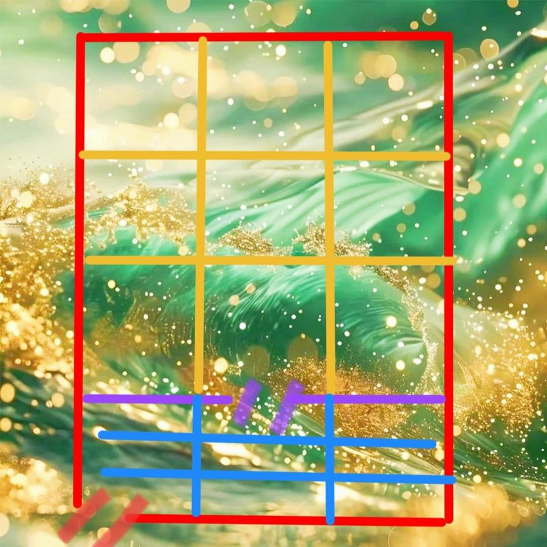
- 命宫、房门、床三者最好同是东四命或西四命（见264、616章）。
- 大房间套小房间都不利婚姻：卧室里隔出洗手间、卧室里套小卧室、去厕所要经过厨房门等。

关键词：防骗、上赶着不是买卖、阴阳平衡、隔路改门、帘子、命宫、东四命、西四命、婚姻、套间

## 第790章 没有断不准的卦

一位学员照"隔路改门"给东四命的儿子改了卧室，进门先经过一段幽黑狭窄、厚帘子不透光的空间——等于人为做了个死胡同，儿子本来身体就弱，改完更神神叨叨地害怕。离开了阴阳，就不是易经；阴阳是易经的灵魂。老徐："只要想骗人，就没有断不准的卦。"

> **风水排查｜不要用帘子"隔路改门"**  
> 用来：想让卧室开门方位符合命宫  
> 怎么做：不要在卧室里挂厚帘子隔出狭长幽暗的通道；真要改，就把门改到对应的宫位，或换一间开门合适的房间。  
> 注意：狭长、幽暗、不通风的空间招阴，大房套小房不利婚姻。

关键词：隔路改门、帘子、死胡同、招阴、阴阳、防骗、断卦

## 第791章 压男人运势

老徐拆穿"闭眼断"：说"你生的是儿子"，对了就吹，不对就PUA"好好的儿子被你嘚瑟没了"；说"你老公错过很多机会，是你压了他的运势"——人人都错过过机会，谁断谁准，对短发干练的女人说更准。蒙对是道法高深，蒙不对是你的问题。

关键词：防骗、冷读、断卦、PUA、压男人运势

## 第792章 病好了

不在运势上的时候容易糊里糊涂、一步一个坑，作者那几年基本窝在家看书。老刘不来后，各地"大师"涌来，说只收三五万、干货多十倍，学员又掉进新坑。人不宿命，但要顺命——像跳蹦床，该沉时沉下去，才能在该起时弹起来。融创、富力接手万达后倒在了九运门口。小石说他控梦的"病"这两年好了。

- 在运上时积极努力，不在运上时韬光养晦，少做少错。

关键词：运势低落、韬光养晦、顺命、九运、地产、防骗、控梦

## 第793章 篇外：粉丝反馈

篇外·读者反馈：书里不是教大家什么，而是提醒大家本来就会的事——剑指出气、洗心养神，心清净了一般人都能做到；很多功法叫"归元功"，我们本自具足。外力像利刃，能控制它才事半功倍，蹒跚学步的孩子拿刀只会伤自己。

- 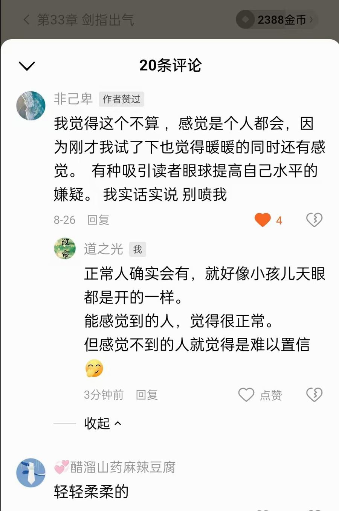
- 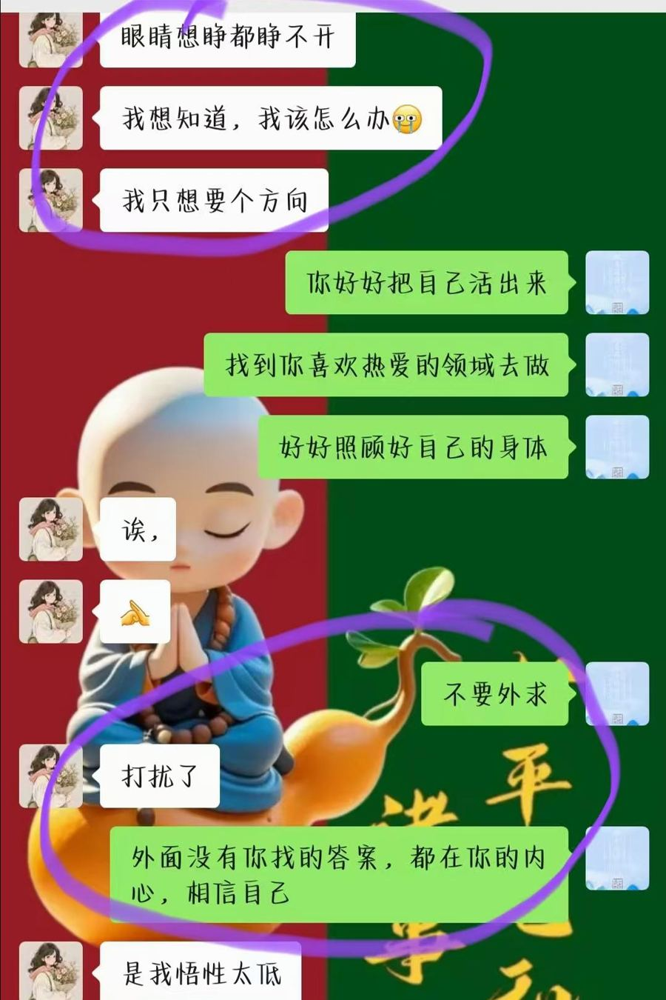
- 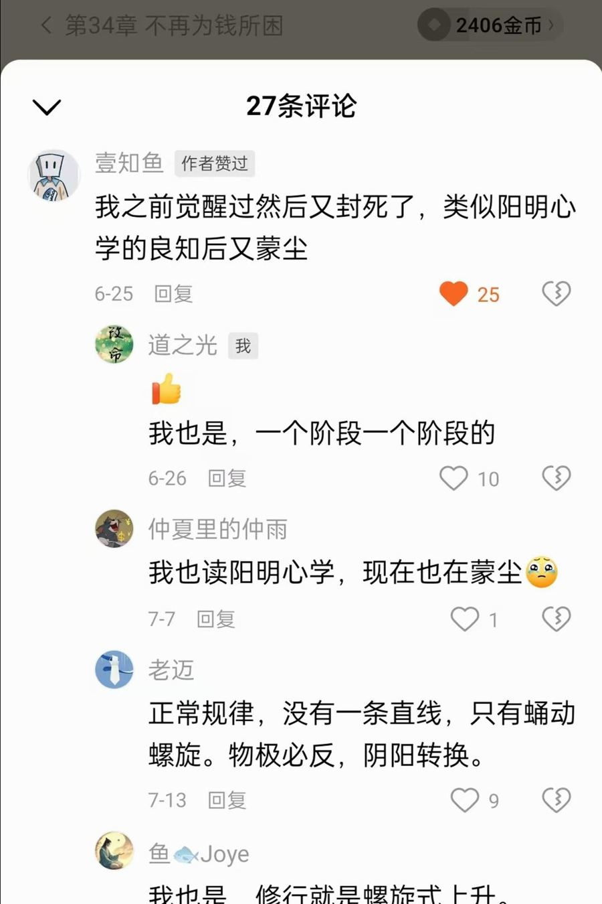
- 心够静时很容易看到灵性的光，随着人生起伏状态也会上下，但只要努力，光不会很远。
- 在不同体系里有不同名字](../../images/改命记实录/ch0306.jpg)
- 把飞走的注意力收回来，放在可触摸的真实世界里，就会对心神有正向作用。
- 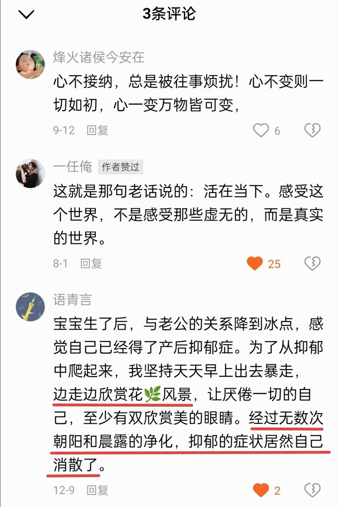
- 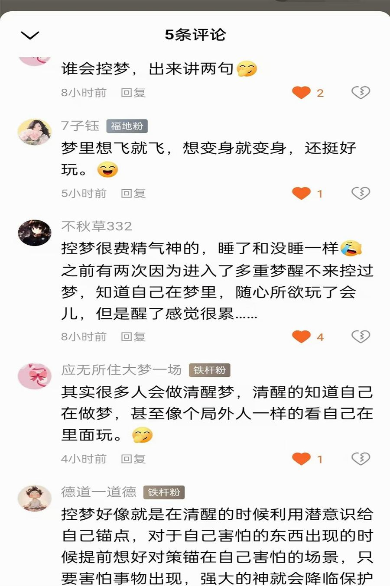

关键词：剑指、洗心养神功、归元、本自具足、外力、觉醒、光、控梦、注意力

## 第794章 套里面有套儿

遇到老刘之后，作者好像从天堂落到人间：玄学套路、资金盘、赚钱培训班、保健品……套里有套。滴滴司机小范：买车"交两倍车钱、两年返一辆车"，只返了2万商家就倒闭了；他赚得不少却总存不下钱，一天只吃一顿，问是不是财库漏了。

关键词：防骗、返利、资金盘、财库

## 第795章 算账

作者帮小范算账：24万的车8年报废，每年折旧3万，加上保险维修四五万，扣掉成本一个月只赚三千来块——不是花得多，是赚得少，和财库无关。没技能的人，销售最赚钱；九运以虚拟为主，别开实体店、别投有形资产。离9代表中年女人、美丽、心情，能从这些层面满足别人就能赚钱——但"虚"也代表虚假，需要先投钱的事尽量不干。

> **生活方法｜先算清账，再怪财库**  
> 用来：觉得自己赚得多却存不下钱  
> 怎么做：把收入里的成本（折旧、保险、维修等）一项项扣掉，算出真实收入，再看问题在哪里。

关键词：算账、财库、九运、离9、虚拟、实体店、销售、防骗

## 第796章 暴富项目

小范还是借了15万加盟"医美项目"（拉3个加盟商就"净赚60万"），老板说"九运离火主美丽、赚女人的钱最符合大运"——他只记住了"美丽"，忘了"虚假"和"不要投资"。陌生拜访美容院一家没谈成，欠了一屁股债。

关键词：防骗、加盟、拉人头、医美、九运、离9

## 第797章 篇外：神话故事

篇外：读者说上班像"当奴隶"好崩溃——用情绪ABC看：同样是工作（A），解读成奴隶（B）就崩溃（C），解读成有意义就有成就感。不能创造价值的生命不会真正快乐：不结果的苹果树会快乐吗？蓝色是最接近灵魂的颜色：七脉轮里蓝色在眉心轮（天眼），《零极限》提到用蓝色玻璃杯装水可以清理负能量。

- 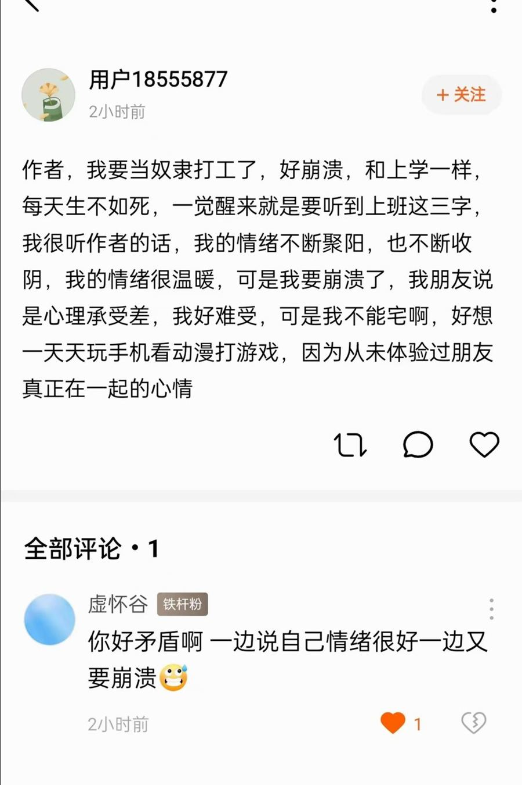
- 觉得工作没意义，就换一个——服务员、扫大街，只要为别人提供方便就有意义。
- 有豪车的人大多板着臭脸，霸总没几个笑嘻嘻的——"有钱就快乐"只是以为。
- 我们面临的大部分问题，是对问题的解读方式导致的。一切的发生，必有利于我。
- 
- 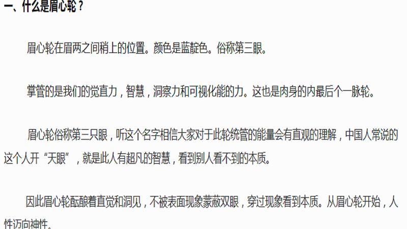
- 自己保持正念也能提升正气，不一定非要借外物，不必执着。

> **生活方法｜蓝色玻璃杯装水**  
> 用来：清理负面能量、稳定心性  
> 怎么做：用蓝色玻璃杯（瓶）装水喝（出自《零极限》）。  
> 注意：只是辅助，保持正念同样能提升正气，不必执着。

关键词：情绪ABC、认知疗法、工作、价值、蓝色、七脉轮、眉心轮、天眼、零极限、负能量

## 第798章 番外：常见的风水问题

番外：114条常见风水禁忌（逐条原文见[速查：书里列的 114 条风水口诀](../../book/02-看房子/17-速查：书里列的114条风水口诀.md)）。作者说死记硬背难记，试着分析每条为什么是禁忌，能分析出来就能举一反三。

- 院子和外部：院内要阳光充足别被树木笼罩；宅后有大坑、池塘、靠大路都凶；门前路反弓不好，弯曲环抱的"有情路"、月牙形路好；院外西南40米内有高房（白虎含笑煞）、20米内两旁有高楼夹（两屋夹）凶；住宅南方10–20米有成片竹林吉，东南有竹子"节节高"。
- 门和厅：没有门槛钱财外流；门口对窗口、大门对阳台、大门直冲后门（穿心宅）都不聚财；厅堂太小赚钱不多，客厅要大于其他房间；大门装饰太花易破财；平民家门口别放狮子。
- 卧室：床下不堆杂物；床头不放镜子；电视、电脑别对着床；床别对着房门；梁不要横过床；卧室别紧贴厨房；卧室太大叫"房欺主"。
- 厨房厕所：灶在西北伤家父；灶门别对厕所门，灶下别走下水道，灶后别空旷；厨厕同宫必有一凶；住宅中央别设厕所。
- 摆设：家中不挂先人像、名人遗像，喜房尤其不放；不随处摆神像；水晶灯别用泪珠状；镜子到处是最招邪；不摆动物标本、头颅、恶虎和鸟兽雕像；不存放年代久远的凶器；过世老人的衣物后人别穿；壁画别挂太多（要留白）；鱼缸不高于站立时鼻子的高度；家里植物别太多；不挂与家人属相相冲的工艺品字画。
- 方位：西北别挂女子照片、别摆桃花，西南别挂男子照片、别摆桃花，否则易有外遇；西南缺角损母亲、西北缺角损父亲、东北缺角损小孩；东北（艮）别有水流过、别有井；巽位有坑主淫乱。
- 其他：家有孕妇不修房建房；住宅大住人少凶；室内长期杂乱不整理家道中落；天花板太低压力大；住宅凹凸不方正，人易有病症。

关键词：风水禁忌、院子、门、厅堂、卧室、床、镜子、厨房、灶、厕所、遗像、神像、鱼缸、桃花、缺角、反弓路、竹子、孕妇

## 第799章 免费赠送

作者成了妈妈的"御用司机"，帮亲戚老人查手机费：姨姥姥家莫名开通了彩铃、视频业务，打客服取消就好。后来作者也接到10016的电话：免费赠送会员，回复短信就能领。

> **生活方法｜帮老人查话费**  
> 用来：老人手机费莫名上涨  
> 怎么做：翻出话费详单，看有没有开通彩铃、视频等增值业务，打运营商客服取消；以后话费不对随时查。

关键词：防骗、话费、增值业务、老人

## 第800章 花钱免费领取

客服一口一个"免费"，短信里却写着每月15元——"额外付15元就可以免费领取"。老人的话费就是这么被忽悠上去的。睁着眼睛说瞎话是作者最不能容忍的点，他打电话投诉了。

关键词：防骗、话费、免费陷阱、投诉
