# 《改命记实录》逐章笔记：0801-0900

## 第801章 谁生气谁修行没到位

周周笑他：分手都没见你生气，15块钱气成这样，"谁生气谁修行不到位"——这是作者以前安慰他的话。理智上知道"一切的发生必有利于我"，心里还是真生气。

关键词：生气、卡点、修行

## 第802章 八卦的对错

能气成这样肯定不只是钱的事，作者回想每次生气的共性，都和玄学被颠倒黑白有关。2019年中国邮政《中国古代神话》邮票画的是先天八卦"太极在掌中"（从外往里看），被网暴说画错了——其实古代风水物件、罗盘大多是从外往里看。篇外：冬至大过年，阳气初生，这几天早点休息。

- 
- 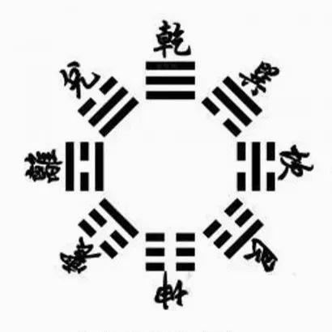
- 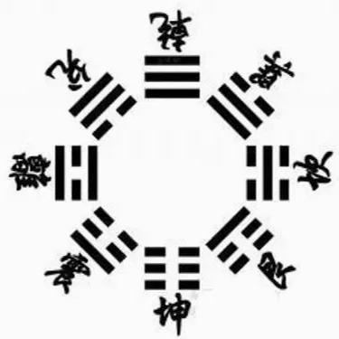
- 两种角度下乾坤坎离四正卦位置一样，四个角上的卦正好相反。
- 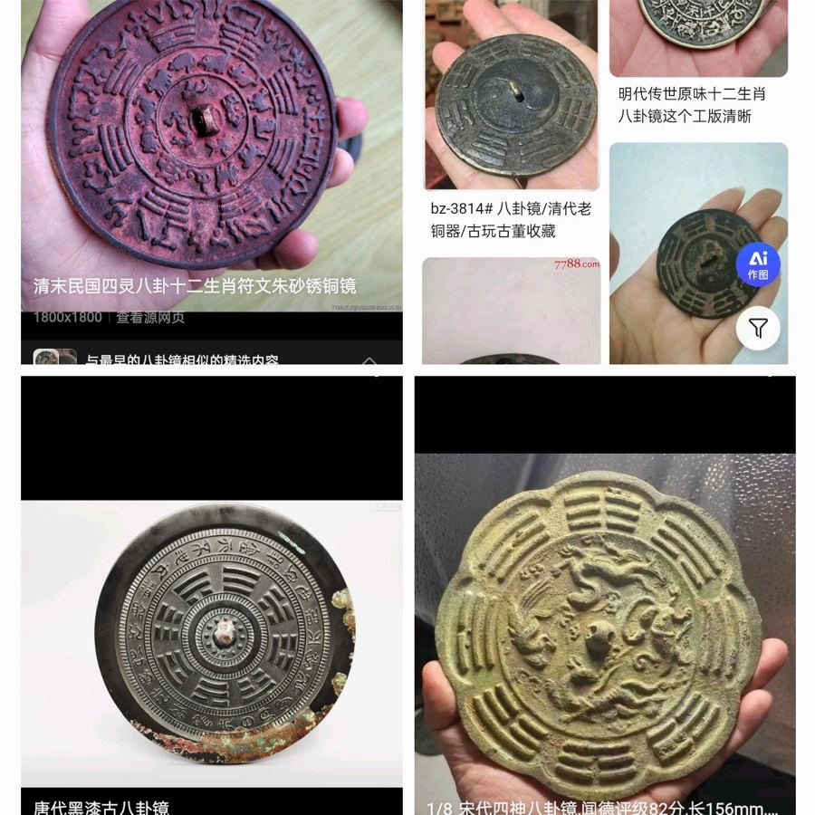
- 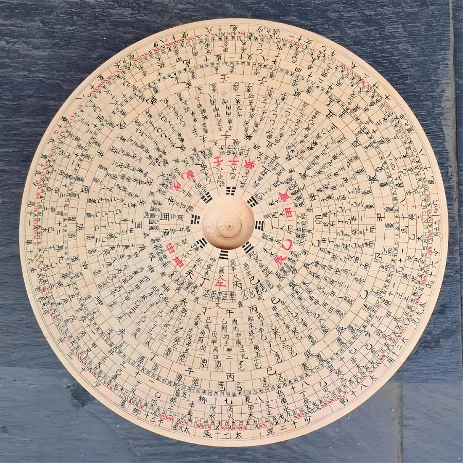
- 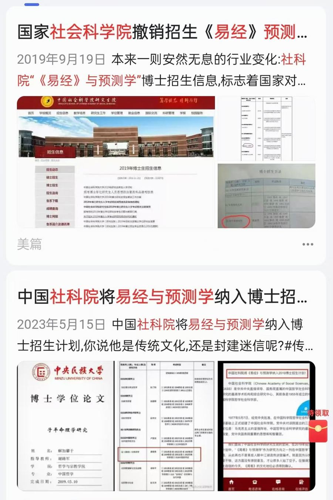
- 冬至是一年中阴最长、阳最短的一天，从这天起阴阳转换、阳气初生。

> **养生方法｜冬至前后早休息**  
> 用来：保护初生的阳气  
> 怎么做：冬至前后几天早点睡，保持好情绪，不生气。

关键词：卡点、生气、八卦图、先天八卦、太极在掌中、人在太极中、罗盘、邮票、冬至、阳气

## 第803章 卡点的共性

2019年邮票、社科院专业、国考考《易经》都被喷——正的出不来，邪的就越来越猖狂。太极阴阳图东方为阳主生发，南方阳最盛，阳极生阴，冬天阴极生阳，市面上十之八九画反了。《黄帝内经》"四气调神"：顺应节气。作者找出卡点：不能容忍睁着眼睛说瞎话的人和事。篇外：生气最灭阳。

- 《论语》：巧言令色，鲜矣仁。
- 《黄帝内经》：四时失序，万化不安，变民病也；得神者昌，失神者亡。
- 秋收冬藏：冬天藏好了，春天才有生发的底气。

关键词：卡点、颠倒黑白、太极图、阴阳、四气调神、黄帝内经、节气、生气、冬藏

## 第804章 番外【称骨算命歌诀】

番外：称骨算命歌诀（从二两一钱到七两一钱的断语全文，见[称骨算命歌诀](../../book/05-算时间/20-称骨算命歌诀.md)）。这只是普通意义上"有福之人"的参考，不少伟人的称骨都很轻——成大事的人都经历过磨难。测出骨轻，只要放下贪念、跨过情绪卡点，同样有非凡成就，不必执着于数字。

关键词：称骨算命、命理、不执着

## 第805章 卡点

智策师父不理解作者为什么气画错的八卦："主流从内往外看，我们顺势而为，自己知道对错就好；过刚易折。"作者觉得站在太极外更利于保持清醒、人在局外。古萨满师父："传错了改过来就是，但要用对方能接受的方式慢慢因势利导；气一动，心就不稳，就丢了正心。"

- 观点，就是观看事物的点。

关键词：卡点、生气、八卦图、正心、因势利导、过刚易折

## 第806章 君子有成人之美

世界不是非黑即白，很多人云亦云的人在灰色地带，是可以争取的。不取于相，如如不动：看缘起缘灭、世事无常，心不被扰。反者道之动：越想要爱情越远离，越想要健康越不健康（过思伤脾），越想发财越留不住钱——放下外求，做好自己。

- 也许客服不骗人就赚不到钱，度过艰难以后就不做了；画错八卦的人可能是生活压力，也可能是贪念。
- 《论语》：君子有成人之美；君子谋道不谋食，君子忧道不忧贫。
- 大部分人还没能"去人欲"，很正常，何必动气；我们以前也一样。

关键词：如如不动、缘起缘灭、反者道之动、外求、过思伤脾、成人之美、去人欲

## 第807章 动气便是恶

古萨满师父：坚持违背天道观点的人是心病了，要做帮他治病的医生，而不是站在对立面生气。王阳明：循理便是善，动气便是恶；不动于气，即无善无恶，是谓至善。无为不是什么都不做，是不"人为"、顺应天地去做。篇外：脚气、脚后跟干裂，用香蕉皮内侧擦；梦里生气也算——梦里的考核最真实；子时（23–1点）要睡觉，不睡伤肾，有些脂肪肝就是熬夜熬的。

- 一个巴掌拍不响：我跟他们生气，就不只是他们的问题。
- 《道德经》第二章"处无为之事，行不言之教"，第三章紧接着讲"圣人之治"——无为不是不做。
- 万法皆空，因果不空；佛家讲空，也讲行善。
- 梦是连接不同法界的主要渠道，可能是提醒，也可能是对心性（脾气、贪念）的考试；醒来还记得很清楚的梦，可以悟一下深意，悟不出就放下。
- 每天子时、午时相当于一年的冬至、夏至，要好好休息。子时属水，水生木（肝胆）。

> **偏方｜香蕉皮内侧擦脚**  
> 用来：脚气（脚趾缝起皮、痒）；冬天脚后跟干裂  
> 怎么做：用香蕉皮的内侧（白色那面）直接擦患处。一般擦一两次就很明显。  
> 注意：之前说过的无花果汁等办法也有效，各有利弊。

> **养生方法｜子时前睡觉**  
> 用来：护肾、护肝胆；预防脂肪肝  
> 怎么做：尽量晚上11点前睡下，尤其是冬天。

关键词：如如不动、王阳明、动气、无为、脚气、脚后跟干裂、香蕉皮、香蕉、梦、熬夜、子时、脂肪肝、肾

## 第808章 篇外：聊聊天

篇外：超度有余力可以做（有些亡人阳寿未到入不了轮回），但以人为本——自己都饿肚子就先顾好自己；把他们当成"无形人"对待就行。有些读者身上护法神被抓光了，常去上身心灵课。《道德经》"弱其志，强其骨"：不要靠意志力逼自己，去做天性喜欢的事；骨气是自发的，志气要硬撑。"无知无欲"——想知道的东西多是为了满足欲。

- 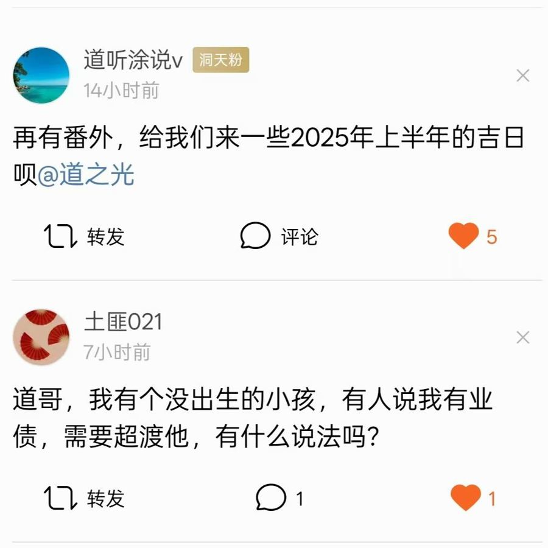
- 用意志力压着自己做事是能量消耗，消耗完了就躺平（见[能量引导术](../../book/07-修心/04-能量引导术.md)）。
- 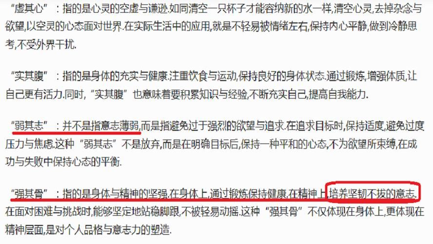
- 欲太重，灵性就出不来；不要为了灵性到处上课，花钱让别人来抓自己的护法神。尤其警惕口口声声"大爱"的人。

关键词：超度、无形人、护法神、身心灵课、防骗、弱其志强其骨、意志力、骨气、无知无欲、道德经

## 第809章 番外：性情疗法（讲病1）

番外·性情疗法（一）：一生气，体内的风（气）和水（血）就运行不畅——体外风水影响健康，体内风水更是生病的直接原因。百病生于气，不生气就不生病。本章列了40种常见病和对应的脾气（全表见[性情疗法：病和脾气对照表](../../book/06-身体与养生/40-性情疗法：病和脾气对照表.md)）。

- 以后少生气；以前生过的气，要深刻反省、真诚忏悔，把淤堵的气（痰）排出来。
- 举例：咽喉炎——爱打断别人、抢话；高血压、耳鸣——生闷气；胆结石——跟老人（多是男长辈）生怒气；颈椎病——背后不满长辈或领导；肩周炎——管事太多担子太重；腰痛——烦人（烦丈夫、妻子）伤肾；偏头痛偏左是和男长辈生气、偏右是和女长辈；风湿关节炎——恨怨恼怒烦五毒全有；青春痘——遇事脸急、着急上火；膀胱病——憋的或烦的（多是烦男的）；鼻炎——怨老人或有火；儿童骨折——父母木性太强太硬。
- 儿童咳嗽：原因在妈妈和公婆或自己父母不开心——妈妈亏孝，孩子得肺病。
- 精神病的治法：在他清醒时，让他知道这股恨气是跟谁生的，找人家的好处，认自己的不是。
- 血压高来自压抑的无名火："逆来顺受天加福，非来正对了前因"——改性格，诚心道歉。
- 外五行决定长相："木瘦金圆水主肥，土形墩厚背如龟"。

关键词：性情疗法、百病生于气、忏悔、咽喉炎、高血压、耳鸣、胆结石、颈椎、肩周炎、腰痛、偏头痛、风湿、青春痘、膀胱、鼻炎、儿童咳嗽、精神病、骨折

## 第810章 番外：性情疗法（讲病2）

性情疗法（二）：业障病怎么消？大忏悔——跟谁生的气就向谁忏悔，真忏悔会有呕吐、排泄、放屁、打嗝等反应，然后大笑把阳气提起来。病根是贪嗔痴慢疑、怨恨恼怒烦。怨伤脾，恨伤心，恼伤肺，怒伤肝，烦伤肾。本章列了头面五官的病和对应的"过"（全表见[性情疗法：病和脾气对照表](../../book/06-身体与养生/40-性情疗法：病和脾气对照表.md)）。

- 怨伤脾：胃胀、胃炎、胃溃疡甚至胃癌；恨伤心：冠心病、心肌炎、心梗、癫狂；恼伤肺：气喘、咳嗽、肺炎；怒伤肝：头晕眼花、耳聋、牙疼、中风、肝胆病；烦伤肾：腰疼腿酸、腰间盘突出、股骨头坏死、糖尿病、尿毒症。
- 恼伤肺里还说：鼻炎因争强好胜，挑理导致感冒，冒犯长辈会发烧，不服人得肺病。
- 举例：白天头痛——为外事发愁；黑天头痛——为家事发愁；抬头痛——巴结不上人；低头痛——看不起人；失眠——思虑过多；多梦——欲望太多实现不了；耳鸣耳聋——爱听闲话；口腔溃疡——爱说刺激话；扁桃体炎——打断人、说话噎人；烂上嘴唇——对长辈说话过分，烂下嘴唇——对晚辈说话过分；甲亢——爱生闷气、遇事不表态；牙痛牙龈出血——心有怨恨发不出、咬牙切齿。
- 关键在自己：按本位去做，任劳任怨，孝养父母，友爱兄妹，照顾家人，关爱乡邻。

> **修心方法｜大忏悔**  
> 用来：业障病、性情引起的病  
> 怎么做：回想当初是跟谁生气招来的病，真心向那个人（或在心里）忏悔、认自己的不是；出现呕吐、排泄、放屁、打嗝等反应是在排；之后大笑，把阳气提起来。以后照本位踏实做人。

关键词：性情疗法、忏悔、情绪五毒、怨伤脾、恨伤心、恼伤肺、怒伤肝、烦伤肾、头痛、失眠、多梦、耳鸣、口腔溃疡、扁桃体炎、嘴唇、甲亢、牙痛、鼻炎、感冒、发烧

## 第811章 番外：性情疗法（讲病3）

性情疗法（三）：心、肝、胆、脾胃、肺、肠、肾、膀胱和妇科的病对应的"过"（全表见[性情疗法：病和脾气对照表](../../book/06-身体与养生/40-性情疗法：病和脾气对照表.md)）。

- 心脏病——爱逞能、爱激动、脾气暴、恨人不饶人；心脏偷停——办事犹豫不果断。
- 胆囊炎、胆结石——暗中较劲、和老人生闷气；乙肝——觉得窝囊委屈、夫妻闷气；脂肪肝——贪吃；肝癌——生闷气、生气喝酒。
- 胃炎、胃溃疡——怨人恨人、抱怨；胃幽门长疙瘩——赌气吃饭。
- 咳嗽——生盼望心，总认为是为人家好；气短——打断人说话；肺病——忌恨、忧思、悲伤、亏孝道。
- 肠道疾病——看不起人、和老人生气不交流；便秘——心狠、嫉妒、暗中整人；痔疮——爱骂人（包括心里暗骂）。
- 肾病——做事过分、抓住别人过错不放；尿毒症——烦人怨人不认账；膀胱炎——爱生气还不说；前列腺病——恨人解不开；阳痿——和父母顶撞、瞧不起父母。
- 妇科病——夫妻性格不合、对丈夫疑心怨恨憋着；痛经——对母亲有嗔恨心；月经特别多——怨恨丈夫；闭经——爱着急上火、揭人短；乳腺增生、乳腺癌——心量小、跟爱人生气、反感男人；内分泌失调——喜欢一个人又不敢表现、放不下。
- 血液病（白血病、红斑狼疮）——和金钱利益有关（血为水，水为财）；红斑狼疮——做事断人后路。

关键词：性情疗法、心脏病、胆结石、乙肝、脂肪肝、胃病、咳嗽、肺病、肠、便秘、痔疮、肾病、尿毒症、膀胱、前列腺、阳痿、妇科、痛经、月经、乳腺、内分泌、白血病、红斑狼疮

## 第812章 番外：性情疗法（讲病4）

性情疗法（四）：颈肩腰背、骨、腿、皮肤、小孩病等对应的"过"，共114条（全表见[性情疗法：病和脾气对照表](../../book/06-身体与养生/40-性情疗法：病和脾气对照表.md)）。同一种病起因不一定一样，对照着自己找；找不到可以看刘有生讲病的视频。学任何术都要先修好情绪——调好体内的风水。

- 脖子硬、颈椎病——爱较劲、不服气；肩周炎——兄弟姐妹妯娌间抗上、亏孝道；腰痛——夫妻不和、互相压着硬撑；腰间盘突出——硬撑、生闷气、烦；后背痛——做的坏事太多；后背冷——胆小害怕；腿脚膝盖病——恨晚辈、看晚辈不是。
- 皮肤病——洁癖、暴躁、瞧不起人，杀生重也会；也可能家里有人放高利贷或做暴利生意；痒病——看别人闹心；青春痘——着急上火；冷病——冷酷无情不疼人；感冒——爱上火、事办不成老盼望。
- 小孩紫癜——父母夫妻生气；小孩癫痫——父母对老人不孝；小孩肾炎——父母贪图钱财。
- 糖尿病：遇事容易上火、好烦、饮食过盛。
- 起个念也会长病：念一起，气血循环就受影响。做事先做人，先修心念，再把术当兴趣爱好。

关键词：性情疗法、颈椎、肩周炎、腰痛、腰间盘突出、背痛、膝盖、皮肤病、青春痘、感冒、紫癜、癫痫、肾炎、糖尿病、刘有生

## 第813章 篇外：回答友友们的提问

篇外答疑：额头窄怎么改？额头主智慧和格局，静心修行、心宽了，额头也容易变宽（"智慧秃"），五官额头也会更立体饱满；悬针纹是心里存了恨气，心柔和了面相会光亮饱满。"缺宫"（整个宫没有）比缺角严重得多，补不了——能换房就换，换不了就修德补人的层面。调节情绪的手印就是握固。

- 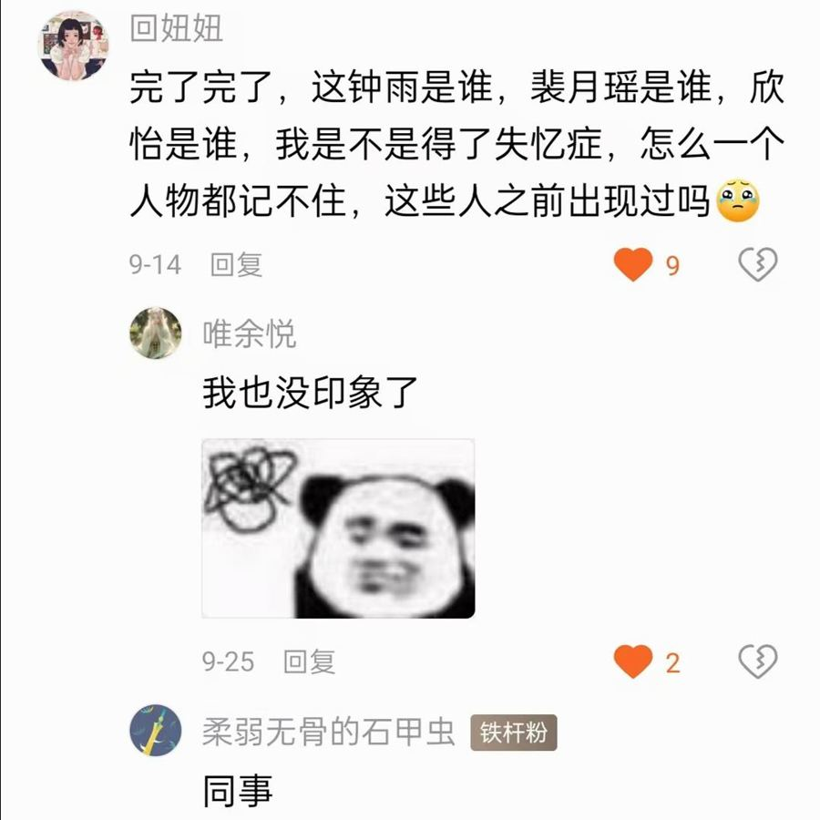
- 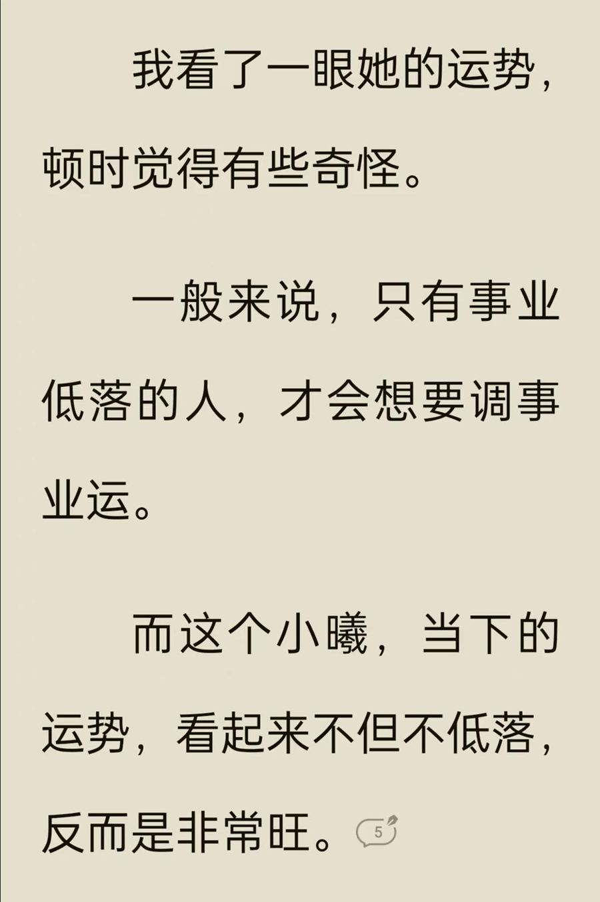
- 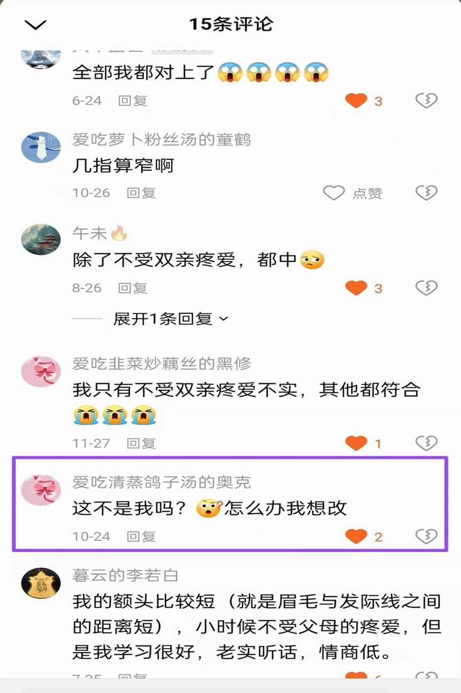
- 稻盛和夫：人生的意义，是死的时候灵魂比生的时候更干净一点点。
- 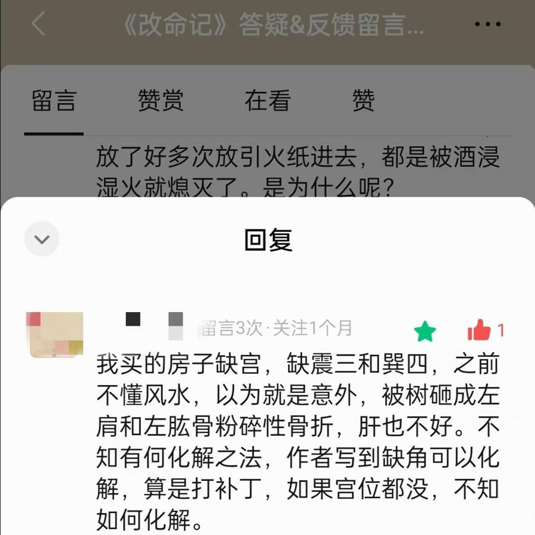
- 震3、巽4对应身体左边（人趴在九宫图上）；一梯三户的房子容易缺宫。
- 缺角像某一科偏弱，补角像报个辅导班；缺宫像这一科零基础，补都没法补。风水只是人生的一个层面——福人居福地，道生德养，德行护体。
- 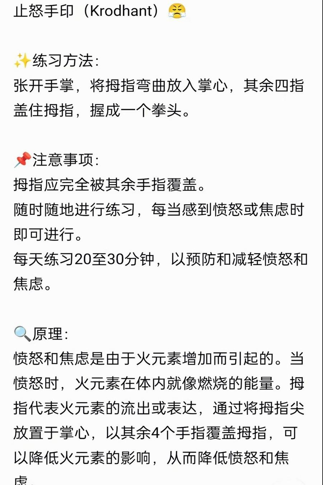
- 握固能补肾，肾水足了火气就降下来，肾气足的人不太容易真生气。

> **手印｜握固调情绪**  
> 用来：情绪控制不住、火气大  
> 怎么做：用大拇指指尖压住无名指指根（掌中诀的子位），其余四指把大拇指包在手心里，用力握紧——像小婴儿攥拳头那样紧（做法见216–217章）。  
> 注意：握得太松没效果。

> **风水调整｜缺宫的房子**  
> 用来：房子整个宫都没有（不是缺角）  
> 怎么做：能换房子就换；实在不能换，就多修德行、为众生做事，从人的层面补能量。

关键词：额头、面相、发际线、悬针纹、缺宫、缺角、震3、巽4、骨折、德行、握固、手印、情绪、补肾

## 第814章 篇外：聊天

篇外：吉月姐姐感冒了——太累免疫力就下降。一位读者分享的黄豆水偏方可以退烧，还能补脾胃、调血脂。天然水晶多少有棉絮冰裂，不完美才是阴阳之道。案例：读者脑部问题——西北角有个从没用过的黑暗小洗澡间（招阴），屋外西北有猪圈、废旧铁、垃圾箱，北边地势低还有大马路；东南有电话线杆对大女儿有利；家里佛堂压在中宫。

- 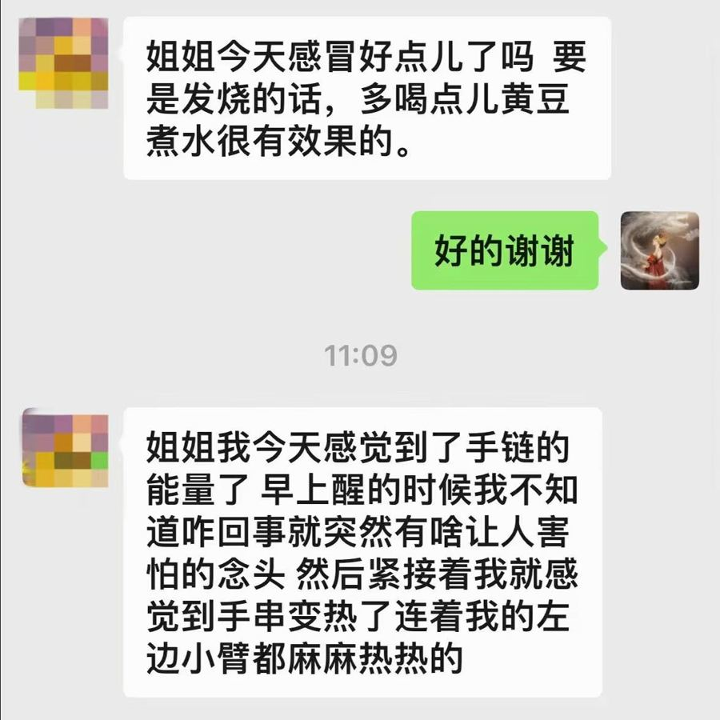
- 天然水晶手链不完美很正常；完美的人设、完美的脸、完美的"大爱文化"都是假的。感知力弱的先自修。
- 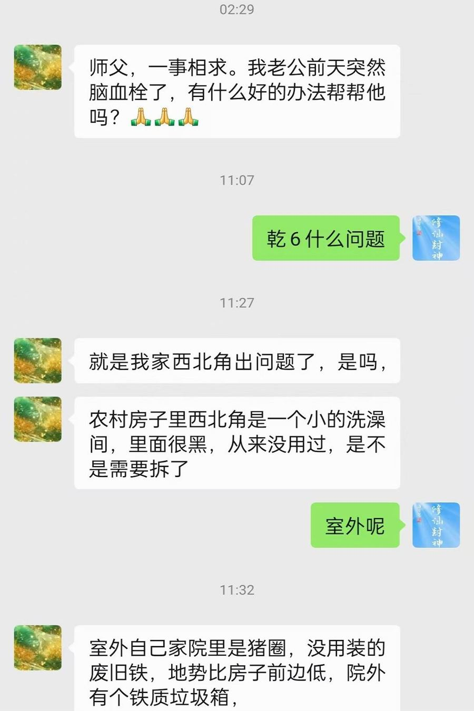
- 黑暗不透风的小空间像"胡同""花瓶"，招阴，一般让人情绪低落、脑子迷糊、身上发沉，不太会单独诱发大病。
- 猪圈、鸡圈等有粪便堆积、能闻到异味的叫"味煞"（污秽煞）；薄片状、像刀片、有尖角的废铁也算煞；垃圾堆是煞气聚集地，越脏乱越重。
- 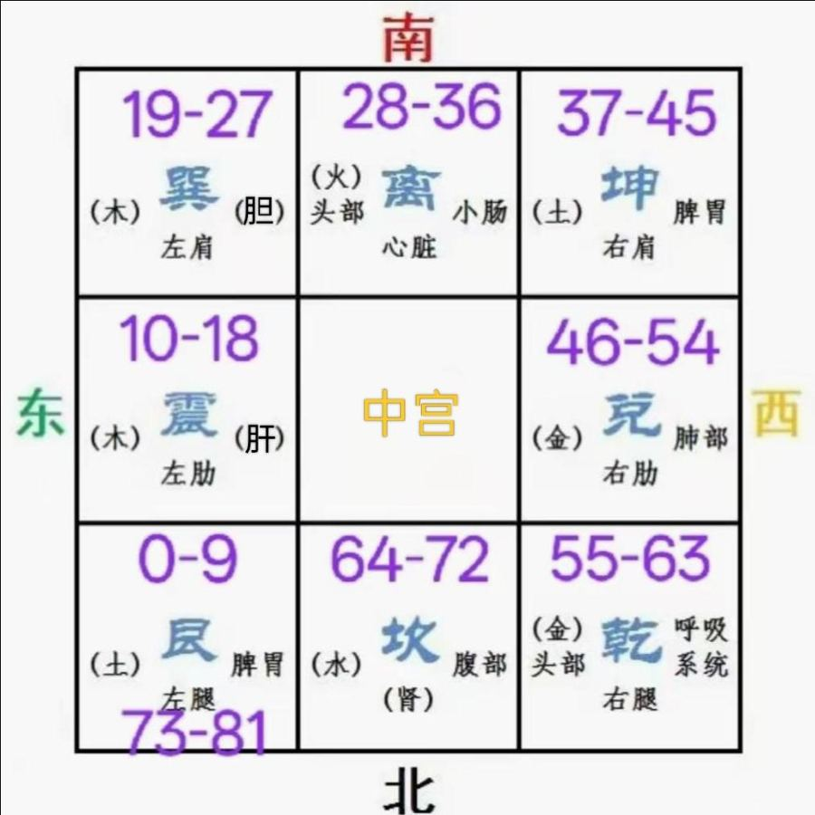
- 房子北边地势低：年龄在左半圈（大约40岁前）的人是上升趋势，从坤位往后的人运势慢慢走下坡。
- 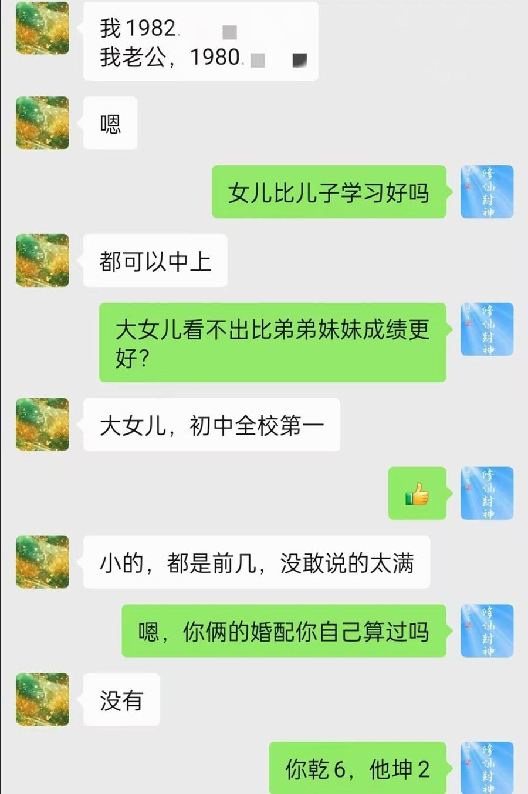
- 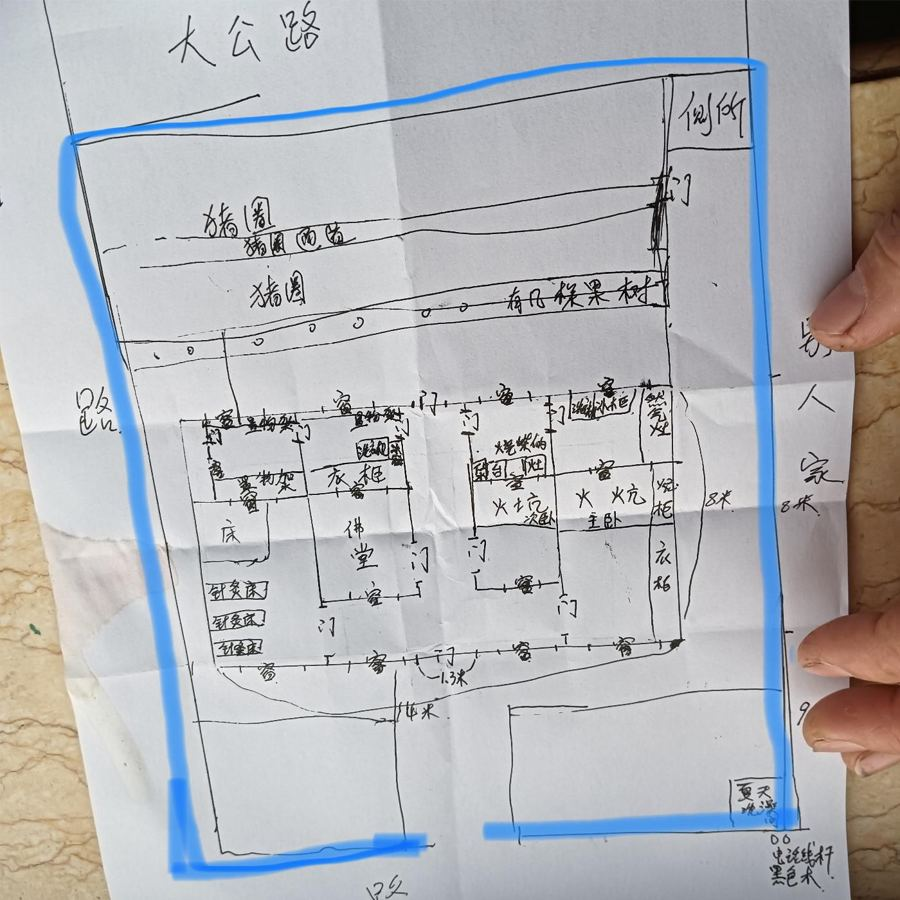
- 房子和猪圈之间有果树，够多够高可以当山用，挡部分风煞。
- 东南（巽4，长女位）有高一点的东西对孩子好，尤其对大女儿；但如果是高压电线杆，有电火煞，影响巽4和对角乾6的健康。画图写的是"电话线杆"就按电话线杆论——错挂错断。
- 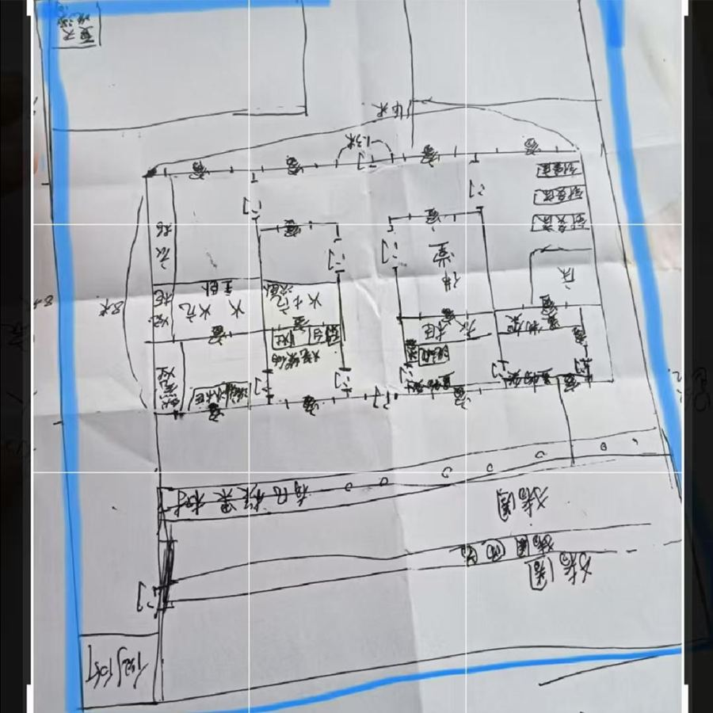
- 中宫5是房子的核心，不能见水，也不能有高能量物品（柜子、树木、佛像用品等），宽敞明亮为上。
- 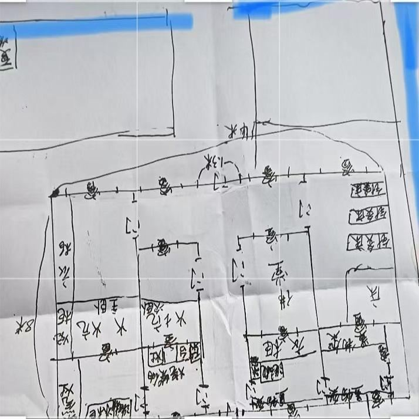
- 佛堂摆放禁忌很多，不太建议摆；买房尽量别买在寺庙、道观、公检法附近。
- 头部问题：和长辈、领导、老师生气，或违背天理。这家夫妻是坤2和乾6的延年婚（一等婚），能挡很多事。
- 布施不一定要捐钱，善言善语、和颜悦色也是善；能帮到真正需要的人更好。

> **偏方｜黄豆水**  
> 用来：发烧；补脾胃、调血脂  
> 怎么做：喝黄豆煮的水。  
> 注意：书里只说是读者分享的、截图在图里，正文没写做法和用量。

> **风水排查｜屋外西北的煞——查猪圈、废铁、垃圾**  
> 用来：家人脑部问题  
> 怎么做：检查屋里西北角有没有黑暗不用的小空间；屋外西北有没有猪圈等味煞、薄片尖角的废铁、垃圾箱；北边是不是地势低或有大马路。能清理就清理、能挡就挡（种树当山）。

关键词：黄豆水、发烧、退烧、脾胃、血脂、水晶、乾6、脑部、招阴、味煞、猪圈、垃圾箱、废铁、地势、年龄走势、巽4、电线杆、电火煞、佛堂、中宫、延年婚、布施

## 第815章 篇外：护法神

篇外·护法神：护法神是跟我们有累生累世缘分、在无形中守护我们的"无形人"，很多莫名的好运和危险时突然的感应都是他们。护法神大多是在寺庙、道观、身心灵场所被抓的——参观没事，一旦起心动念有所求就要付代价。被抓了一般能救回来但会受伤；靠自修让他们自己回来比较难。

- 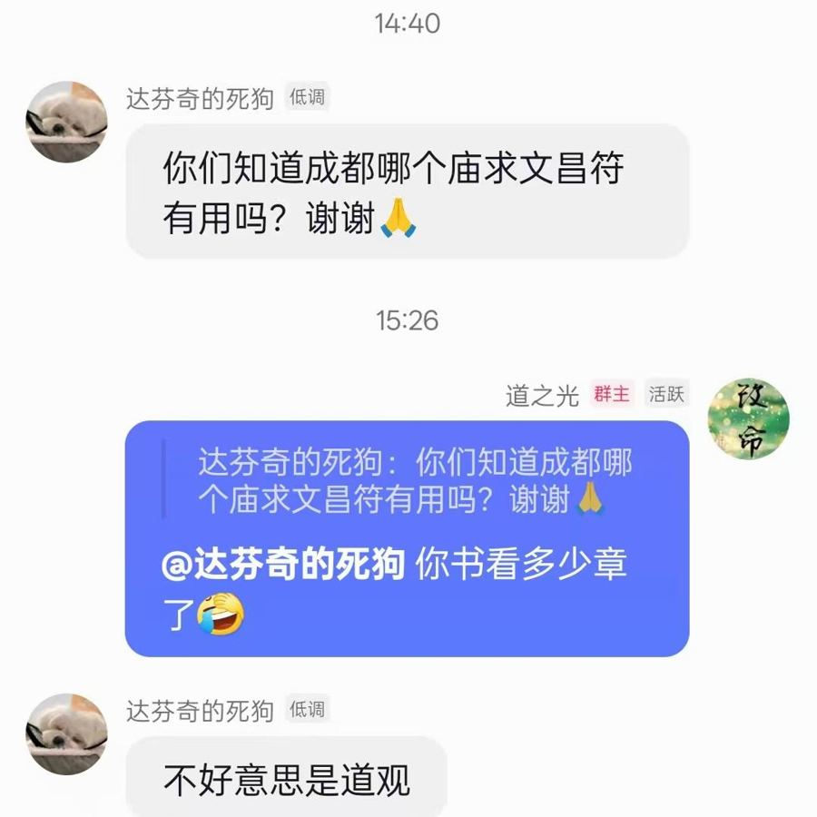
- 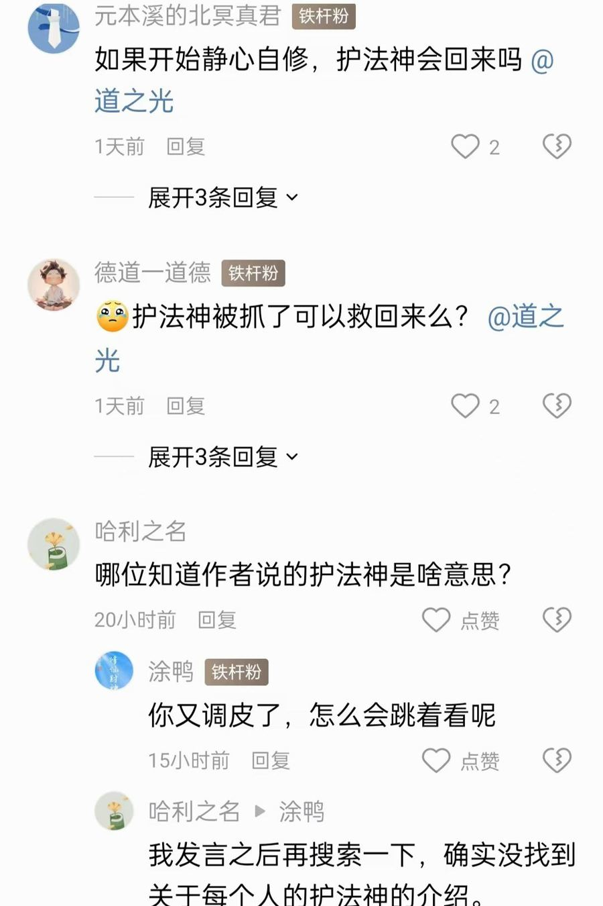
- 一位读者抑郁割腕时，一个不常联系的朋友突然非要找她，破门进去把她救了回来。
- 因德行不好护法神"离家出走"的，德行修到了可以自己回来，但这种很少，大多是被邪魔抓走。
- 护法神被扣，大多是我们无意间起了贪念，相当于和邪魔做交易把他们"卖"了。救回来还反复被卖，不如先把自己修好。

关键词：护法神、外求、贪念、寺庙、道观、身心灵课、防骗

## 第816章 篇外：心正不正

篇外·心正不正：读者感觉"大师"有点邪气，因为是熟人介绍还是信了——护法神已经提醒过了，你偏不信，下次还会提醒吗？要先相信自己的心。还阴债32000、后面要立堂口——是冲着六位数去的。坚定相信、或坚定不信鬼神，心都是正的；疑神疑鬼又不够敬畏，才是不正。注意力要放在自己身上。

- 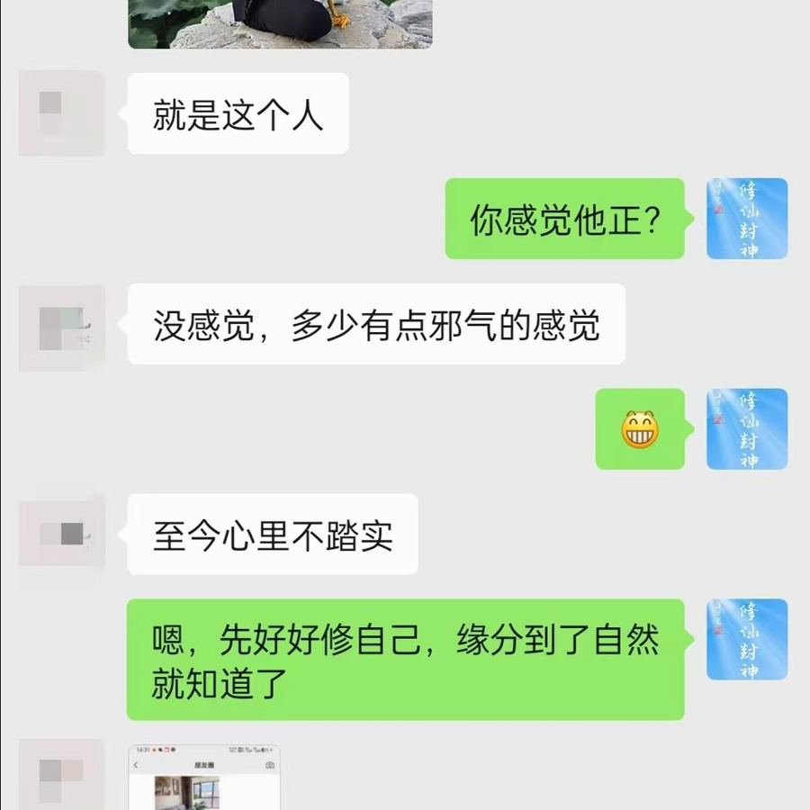
- 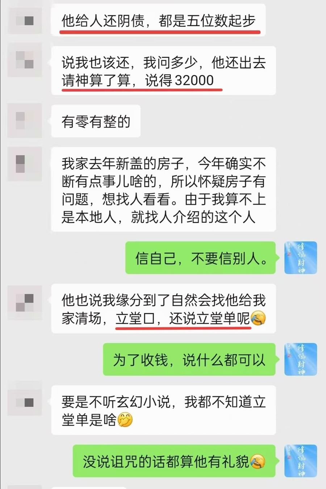
- 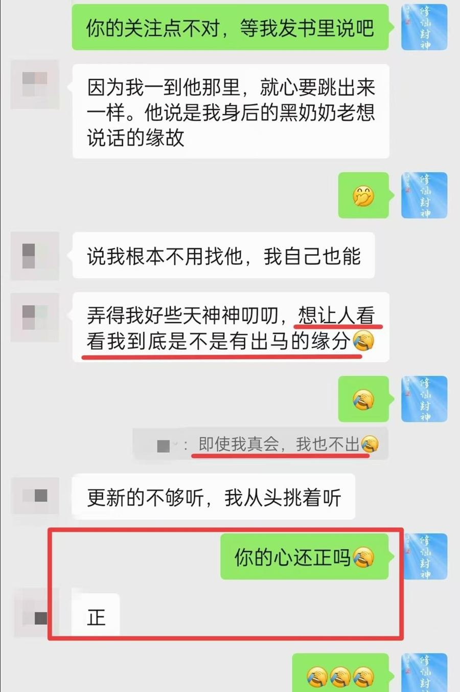
- 不怕有问题，只怕有问题自己却觉察不到。
- 别人让烧香就烧香、让供奉就供奉，信的可能不是鬼神，只是骗子。
- 打坐观呼吸，就是为了把注意力放在自己身上；修行不一定打坐，但一定要关注自己。
- 很多人立了堂口三五年也没什么感应——除了自修，没有捷径。

关键词：心正、相信自己、护法神、防骗、还阴债、立堂口、出马、注意力、打坐

## 第817章 篇外：调整的几个层面

篇外：孩子生病只发一个八字来问，是外求。水晶手链只是净化磁场的辅助，不能治病，也不能替人背业力。西北卧室是"帝王位"，住的人有主见、强势——最好是家里说了算的人住；住孩子或佣人就不好管，需要被照顾的病人住这里会很固执。调整的几个层面：天时、地利、人和，人和占首位；厚德载物。

- 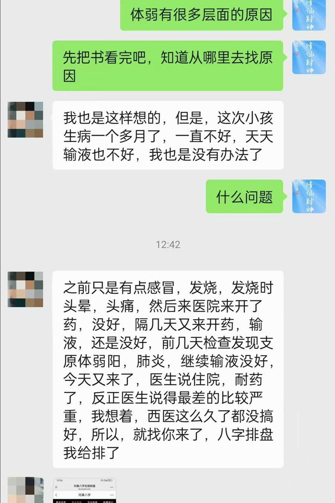
- 菩萨畏因，凡夫畏果：结果没出来前未雨绸缪，能做多少做多少。
- 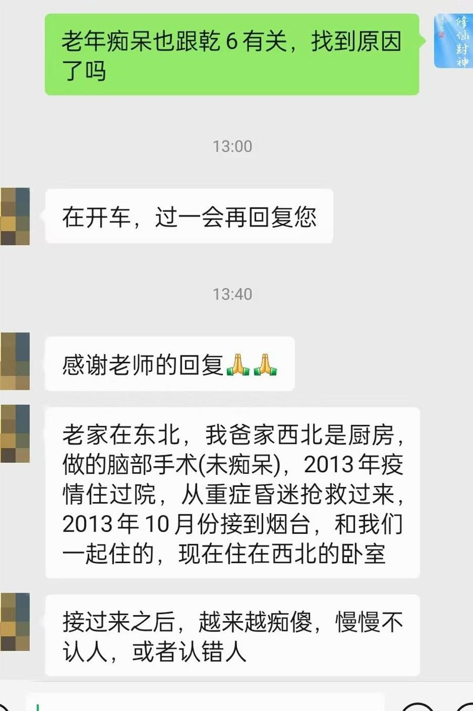
- 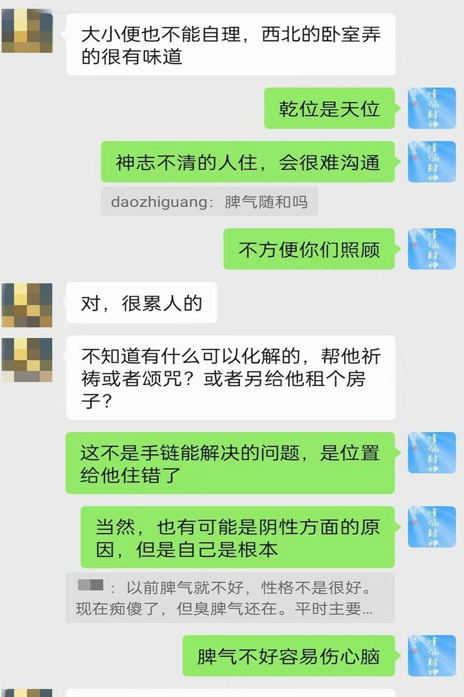
- 心脑有问题的人性格比较执拗。"各司其位"只是兼顾的一个点，易经是活的。
- 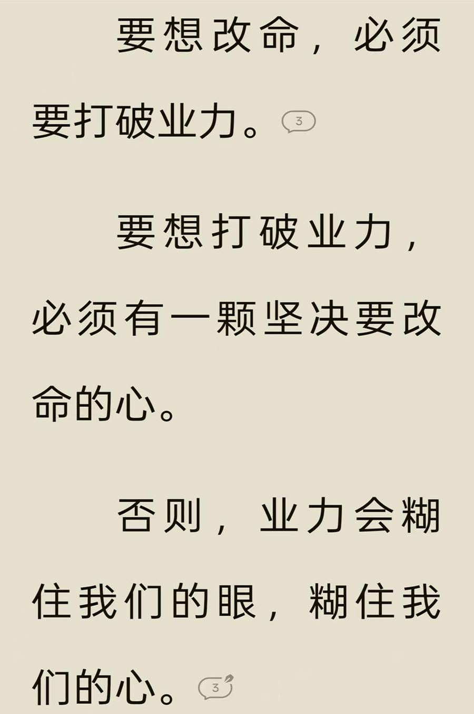
- 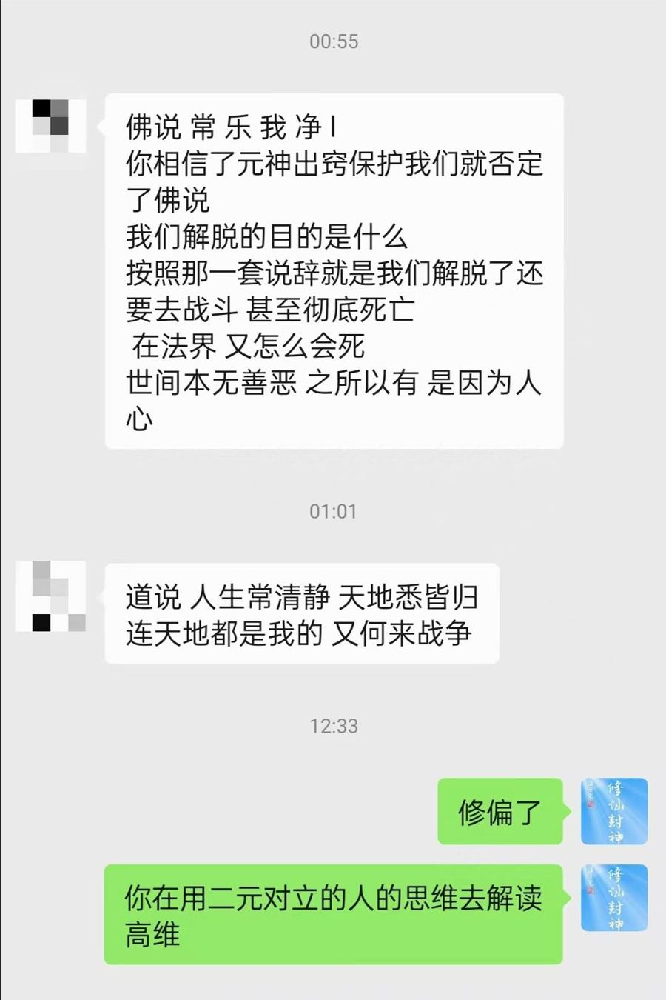
- 在哪个境界做哪个境界的事；理解不了先放一边，活在当下，关注自己的一言一行对众生（包括自己）是否有利。

> **风水调整｜西北卧室给谁住**  
> 用来：家里人不好管、病人不配合照顾  
> 怎么做：西北（乾6）卧室最好让家里说了算的人住；不要安排孩子、佣人或需要被照顾的病人住。

关键词：外求、水晶手链、乾6、西北卧室、帝王位、强势、固执、天时地利人和、厚德载物、业力

## 第818章 锁屏密码

王阳明"循理便是善，动气便是恶"：只要动气，就有一个"我"的执念在。作者设计了命理手机贴：按命宫五行配色（坎1黑、坤2艮8黄、震3巽4绿、乾6兑7白、离9红），从里向外太极、两仪、四象、八卦，外圈"卍"字、13个（天乙数）。一个女孩总摔碎屏幕，原来锁屏密码里有12和37（绝命），换了以后再没碎过。

- 绝命组合：12、37、48、69（不分前后）。

> **风水调整｜锁屏密码避开绝命数**  
> 用来：手机屏幕老是摔碎  
> 怎么做：检查锁屏密码里有没有12、21、37、73、48、84、69、96这些绝命组合，换掉。

关键词：手机贴、命宫、颜色五行、锁屏密码、绝命、八颗星、数字能量、执念

## 第819章 割双眼皮

美容院请作者去给客户讲课很难：营销型风水师通过按摩足疗知道客人哪里不好，反推家里哪个方位有问题（肾—北，肝—东，胆—东南，妇科脾胃—西南，脑—西北，肺—西，心—南），一说就"神了"。客户问割双眼皮好不好——上眼皮是田宅宫（家庭宫），变窄不利房产和婚姻；眼睛是监察宫，"眼大漏神"，心里苦、茫然。

- 见水、被克、有煞、缺角，无非这几种情况。
- 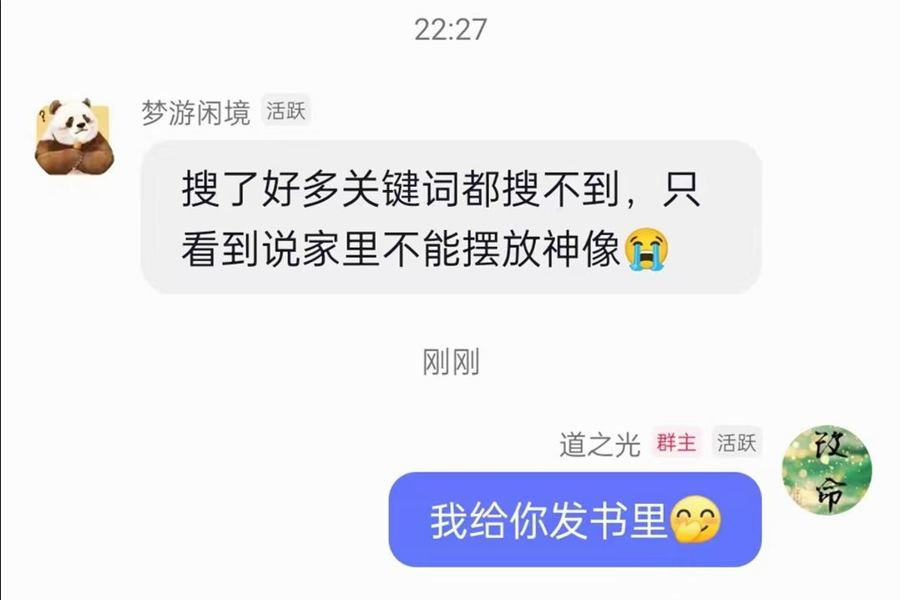

关键词：身体对应方位、面相、双眼皮、田宅宫、监察宫、眼大漏神、医美、防骗

## 第820章 篇外：贵人不可贱用

篇外：贵人不可贱用，贱己者不可贵用——对能帮你的人（包括护法神）不随意打扰、呼来唤去，情谊贱用就消耗没了。头像要选"正常"的：卡通头像常见脖子太细、头太大、眼太大、眉太细、鼻子太小、耳太大、嘴太小、胳膊腿太细等比例问题。

- 
- 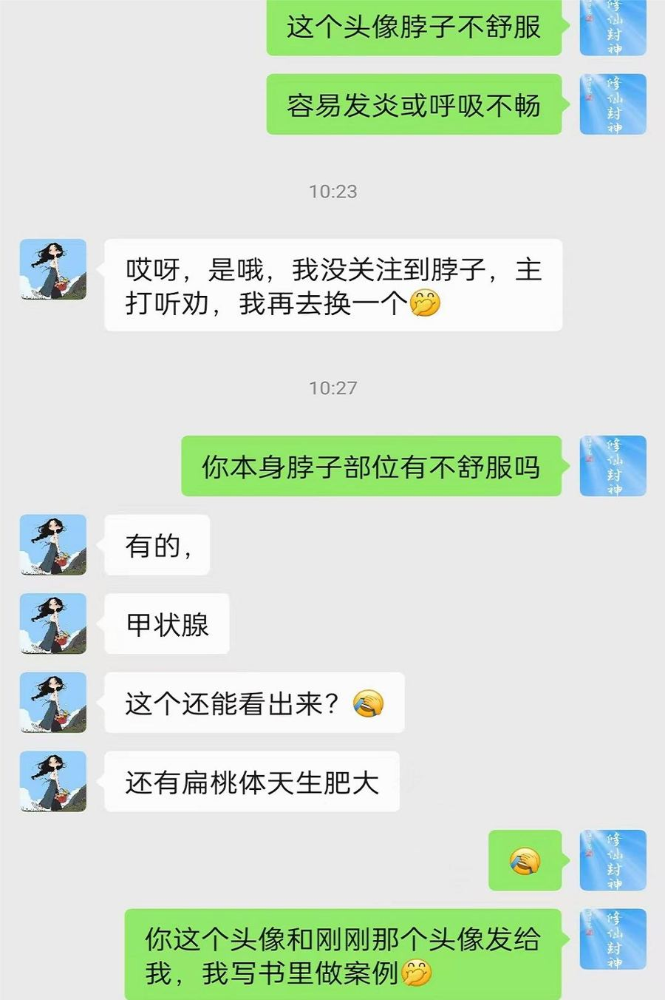
- 
- 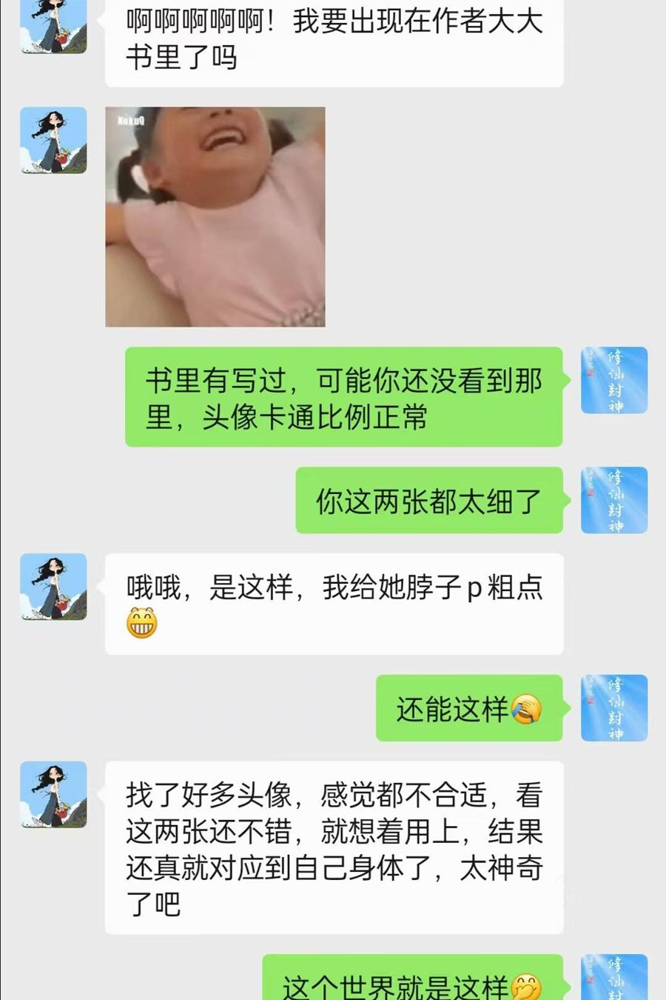

关键词：贵人不可贱用、护法神、头像、卡通头像、脖子、比例

## 第821章 篇外：卡通头像

卡通头像可以直接按图上人物的五官看面相：头特别大，思维过于活跃、静不下来，打坐也是体静神不静；没有鼻子或鼻梁很低，不利财运（鼻子是财路），艮也代表儿子——想生儿子尤其别用。眉毛怎么看：长、清、弯、黑、亮为优，短、粗、薄、散、乱为差（详见[眉毛怎么看](../../book/03-看人/20-眉毛怎么看.md)）。

- 
- 判断真修行还是做样子：感知自己的气有没有沉下去。
- 剑眉直指太阳穴（夫妻宫），影响夫妻感情；女人纹成一根线的细长眉，夫妻运差、人缘一般、做事懒散。
- 
- 眉毛细的敏感，粗的相反。
- 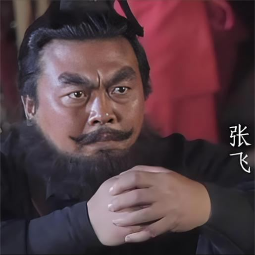
- 眉毛的毛向上竖着长：果敢、上进、有阳刚气；向下垂：依赖性强、不自信、好色；逆向生长（不是从眉头顺向眉尾）：缺乏忠孝、贪心自私、脾气暴。
- 眉形偏短或半眉：偏感性、脆弱易受伤；偏长：理智。又粗又黑又长：冷酷；又宽又黑又短：胆大有魄力。
- 浓眉运势好、得师长偏爱；但黢黑黢黑过浓的，有狡猾倾向、私心重，表面好人背后蔫坏。

关键词：头像、卡通头像、面相、头大、鼻子、财运、生儿子、眉毛、剑眉、细眉、浓眉、夫妻宫

## 第822章 篇外：扁桃体问题

扁桃体问题和性子急有关，小孩的问题主要在父母。作者小时候扁桃体肥大、一感冒就发炎呼吸困难，十岁出头开始自己打坐练功、体会气沉丹田，性格不急了，再感冒也不呼吸困难。"气有余便是火"——气沉下来，火就下来了。家族遗传的心脑血管病，注意保养也躲不开因果——要修脾气、积德行。

- 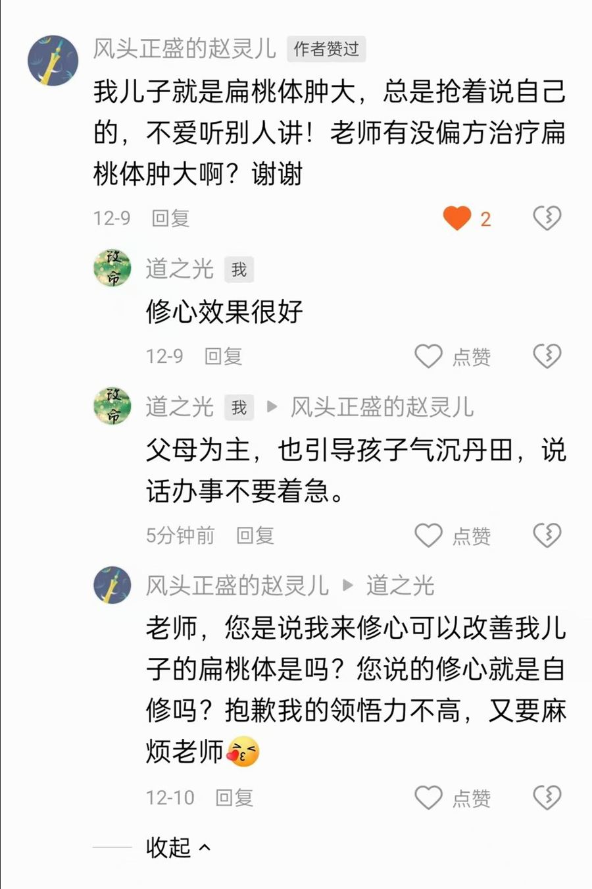
- 相由心生：作者小时候火偏金、瘦瘦的爱蹦跳；修行后水偏金、肥嘟嘟不爱跳了。
- 气上浮的人性格一般都急。脾气修好了不急了，气自然沉下来。
- 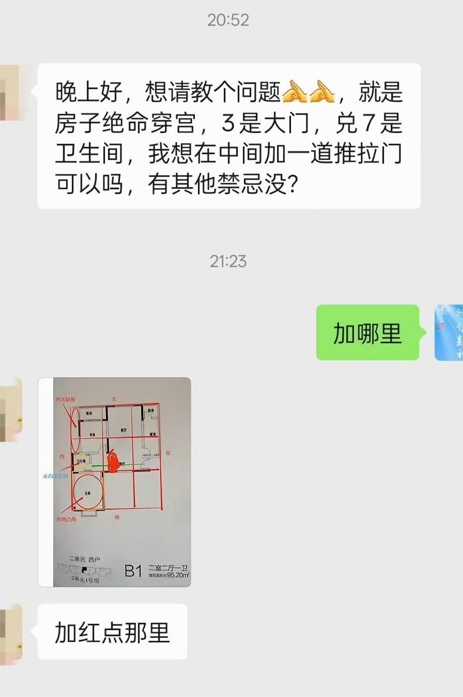
- 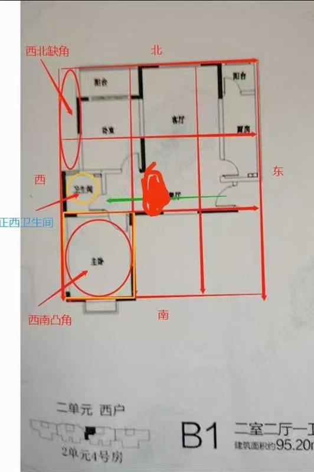
- 不想自修也不想花钱请人，又想运气变好——就像不想学又想上清华。
- 2025年：把目标降到最低，低到好好活着就行；放下贪念。
- 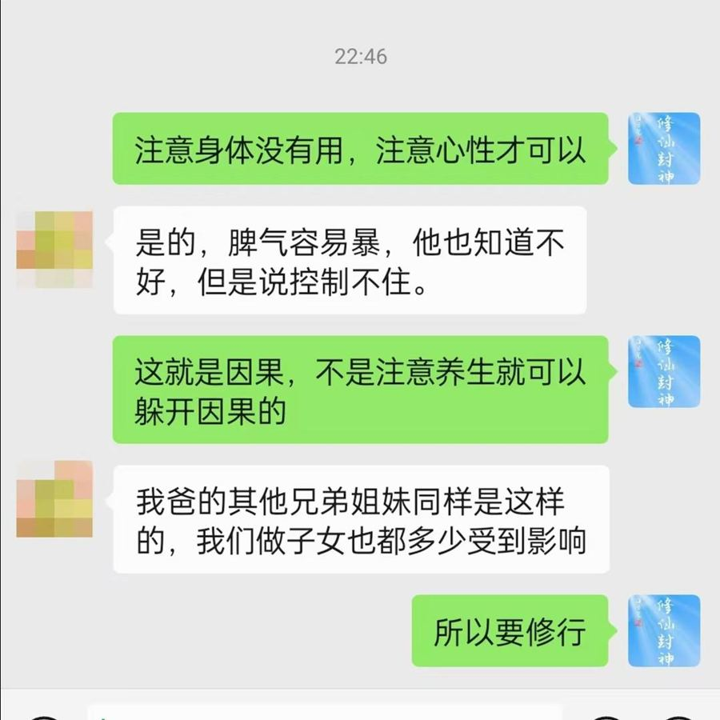
- 注意保养身体是向内（私欲），帮助众生是向外、升阳；越在意什么越得不到什么。想脱离原本的业力轨迹，唯一的办法是积攒德行。
- 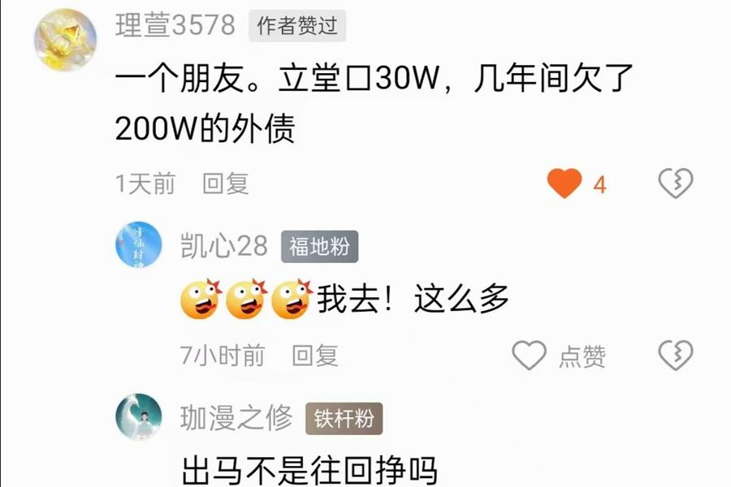
- 德行不是念经、放生：念经让心静下来、致良知去做善事；放生是培养慈悲心去帮助众生——落到实事上，我们为世界做了什么。
- 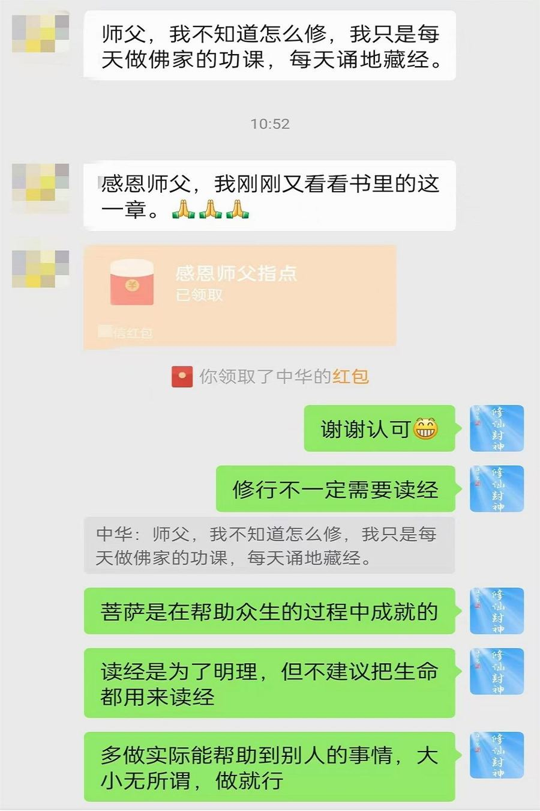
- 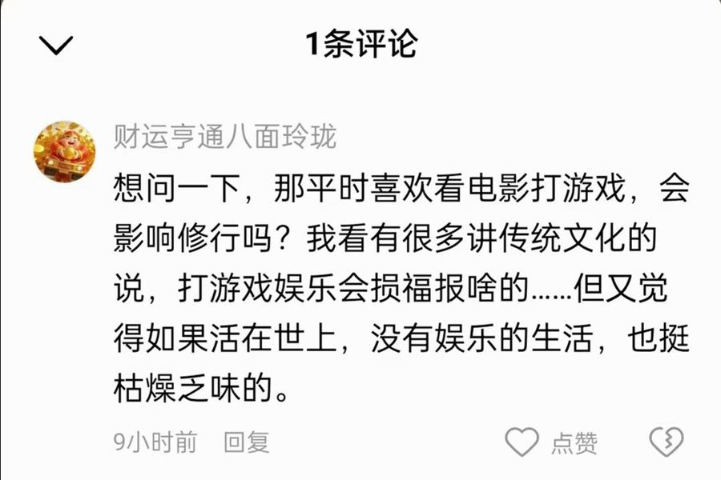
- 德行和福报只跟众生有关：物超所值地帮助别人就积德，和收不收钱没有必然关系；损害众生（包括自己）利益就损福报，偶尔放松不算。
- 有人冒充师父主动加人——正修的师父都不求不救，主动送上门的基本都是陷阱。
- 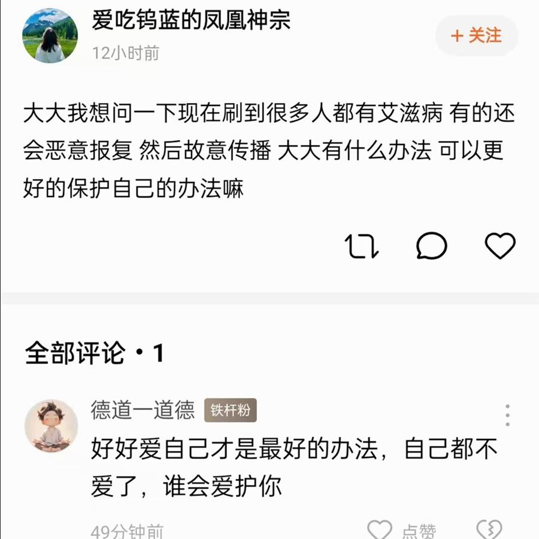
- 
- 阻断率不是100%，不要侥幸；除了洁身自好、增加德行没有特别好的办法。

> **功法｜扁桃体——练气沉丹田、改急脾气**  
> 用来：扁桃体肥大、一感冒就发炎（尤其性子急的人和孩子）  
> 怎么做：关注自己的情绪，同时随时感受自己的气吸到哪里，有意识地气沉丹田（方法见826章）；孩子的问题，父母先改自己的急脾气。

关键词：扁桃体、性子急、气沉丹田、气有余便是火、打坐、心脑血管、遗传、德行、念经、放生、福报、防骗、艾滋病、2025

## 第825章 长在表面是好事儿

美容院老板承认割双眼皮影响婚姻，只是解释成"变美后见了更高的圈子"。寻求外力改变长相也是一种贪念：面相和健康、无形的力量相关，人为改了表相，问题只是被藏起来了。长痘、长斑、长皱纹长在表面都是好事，是提醒——藏进身体里可能小问题憋成大问题。

- 断人财路，犹如伤人父母——作者不去拆美容院的台，但也不昧良心劝人去割。
- 不是靠自己修来、额外求得的好处，早晚要还。
- 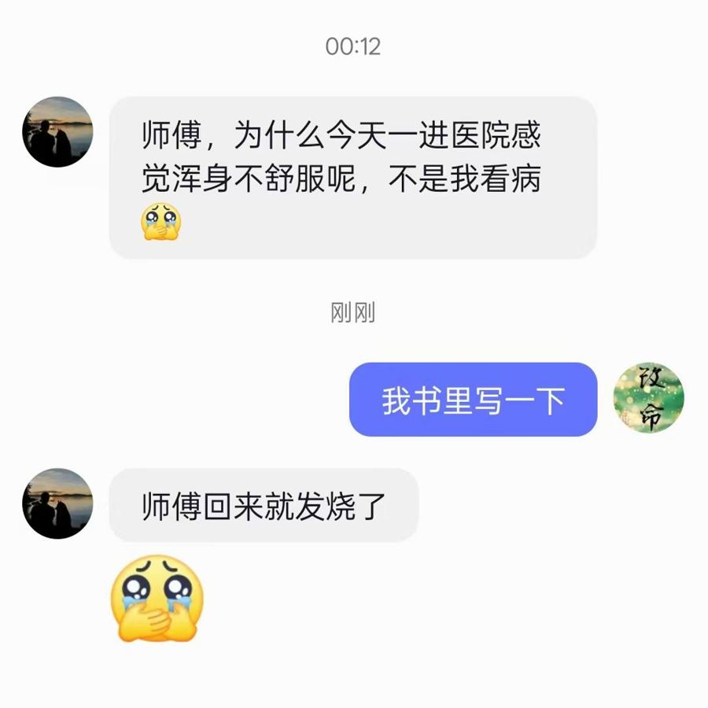
- 最近一年会有大批人开始觉醒，感知越来越敏锐，阴的一面也能感知到；运势低的人也容易感知到负面能量。所有拉低运势的事都尽量避免，比如黑漆漆的头像。
- 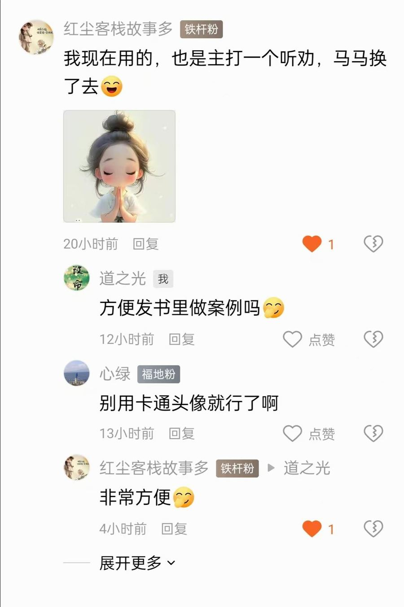
- 
- 

关键词：双眼皮、医美、面相、贪念、痘痘、斑、皱纹、头像、觉醒、运势低落

## 第826章 篇外：气沉丹田

上题答案：新头像有绝命穿宫、没鼻子、额头被遮、箭头指坎宫、假花、"放弃""坚持"传递艰难、名字被箭穿住不自由。气沉丹田：丹田不在肚皮上，而在中脉上"脐后肾前"；沉下去的不是吸进肺的空气，而是"炁"——像拎很重的水桶时丹田憋住的那股劲儿。要点是腰放松、含胸拔背（虚领顶劲）。

- 习题答案逐条：人站在左边，巽4到艮8是绝命穿宫；还是没有鼻子；额头被遮住；腿比头长不了多少；箭头指向坎宫；箭头箭尾形成坎1和乾6穿宫；假花；"放弃""坚持"像在说"我不怕，我一定能过好"；"小杜"两字被箭串住，心不自由。
- 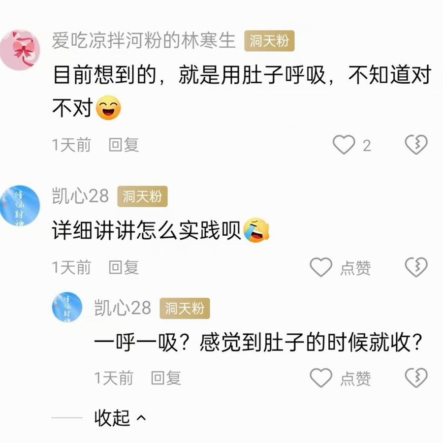
- 网上有说腹式呼吸（吸气鼓小腹），有说逆腹式（吸气鼓胸、呼气鼓小腹）——都只说了小腹，不精准。
- 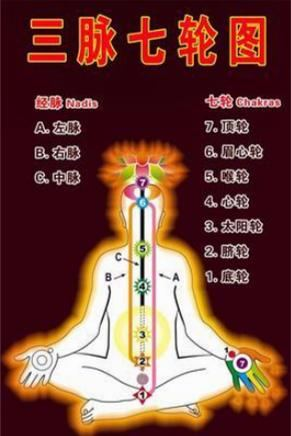
- 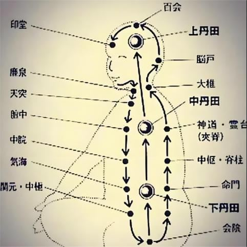
- 硬气功"胸口碎大石"是把气聚在胸口；气沉丹田也是一股"力气"。它不是大脑想象出来的意念，而是神识感知到"炁"沉下去了。
- 挺胸收腹翘臀，气沉不下来，有意念也不行。
- 传统气功为"凝神"，吸气时小腹自然隆起；武术为"炼气"，常用逆腹式。怎么舒服怎么来，只要炁沉下来就行。
- 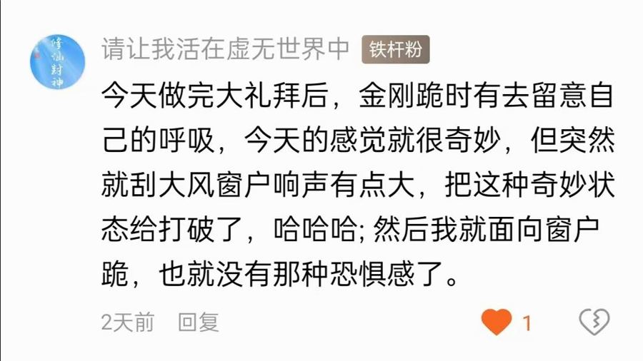
- 打坐禅静要避免受惊（选安静处，提前和家人打招呼）、避免受凉（普通人别在室外打坐）。
- 面向窗户就不怕：前方朱雀喜动、后方玄武喜静——人潜意识里把动的东西放在面前更安心。

> **功法｜气沉丹田**  
> 用来：性子急、气往上浮、静不下来；练功打坐的基础  
> 怎么做：腰放松；含胸——上身微微环抱，尾骨向前，不翘臀（轻轻的感觉，不用使劲弯）；拔背——百会穴有一点向上顶的感觉（也只是轻轻的）。呼吸时感受那股劲儿往下沉到脐后肾前的位置，就像拎重水桶时丹田憋住的那口力气。吸气时小腹鼓不鼓都可以，怎么舒服怎么来。  
> 注意：不要挺胸收腹翘臀；打坐时避免受惊、受凉。

关键词：气沉丹田、丹田、中脉、炁、含胸拔背、虚领顶劲、腹式呼吸、打坐、受惊、受凉、头像、穿宫、绝命、朱雀、玄武

## 第827章 番外：香蕉偏方

番外·香蕉偏方大全（每条怎么用见[香蕉偏方](../../book/06-身体与养生/20-香蕉偏方.md)）：不能吃甜的咳嗽可以用枇杷叶煮水。香蕉性寒平时不建议多吃，但作为药膳用处很多，香蕉皮、根、果柄也能用。还有5个香蕉食疗方和9条注意事项。上章习题：完全空白的头像不好——头像空，头脑也空，自己的领地不占领就会被外在思想占领。

- 痔疮、便后出血：香蕉两个不去皮，炖热连皮吃（《岭南采药录》）；或两条连皮放火上烤，趁热吃；痔疮出血、大便干结：每天早上空腹吃1–2根。
- 咳嗽日久：香蕉1–2根加冰糖炖服，每天1–2次，连服几天（可连皮吃）。肺燥干咳无痰、口鼻干：3条香蕉去皮切段，加冰糖和一碗清水，隔水炖一小时，连渣吃下。
- 高血压：香蕉皮或果柄30–60克煎汤喝；香蕉花水煎服（能防脑溢血、中风）——正在住院或吃药治疗的慎用，以免冲突。原发性高血压：玉米须、西瓜皮、香蕉一起煎服（《四川中药志》）。
- 牙痛：香蕉两个煎成一碗热汁，含着漱口（《经验方》）。
- 中耳炎：鲜品捣烂外敷或捣汁搽患处，或取茎汁滴耳。
- 手足皮肤裂口：香蕉皮贴敷；手足冻裂：香蕉皮内面擦患处，连续几天。
- 皮肤瘙痒、脚气：新鲜香蕉皮在痒处反复擦，或香蕉皮煎水洗，连续几天。蚊虫叮咬：香蕉皮内面轻擦，退肿消炎。
- 痤疮：半根香蕉捣泥加适量牛奶调糊，敷脸10–15分钟洗掉。
- 胆固醇高：香蕉果柄50克洗净切片，开水冲饮，连喝10–20天；量不能太大，否则会腹泻。
- 痛经：每晚睡前喝一杯加一勺蜂蜜的香蕉热牛奶。
- 痈肿疔肿、热疖肿毒：鲜香蕉根（茎、叶）捣烂绞汁或捣烂外敷患处。
- 肾结石：香蕉根煮水喝，利尿排石——五六把香蕉根，每天早晚各一大碗，喝半个月（《中华本草》）。
- 其他摘录：止渴润肺解酒、清脾滑肠；早上无精打采时早餐后午饭前吃少量；有天然制酸性和镇痛作用（心绞痛）；维生素B高可舒缓紧张；流行性乙型脑炎用香蕉根汁、国外香蕉凝集素治艾滋病的研究——这两条是重病，书里只是摘录，必须就医。
- 食疗：香蕉米羹（宝宝夏季）、翠皮香蕉（平肝泄热，适合高血压头昏耳鸣）、香蕉奶味粥（7个月以上宝宝防便秘）、两种香蕉面膜。
- 注意：痹证病人忌食；司机别空腹吃香蕉（血钾升高会麻木嗜睡）；土豆和香蕉同吃生雀斑；香蕉别放冰箱；性寒，脾胃虚寒者慎食；胃痛、腹泻者少吃，胃酸多的最好不吃；吃多了伤胃肠；急慢性肾炎、肾功能不好的不能吃；糖尿病人量不能多。
- 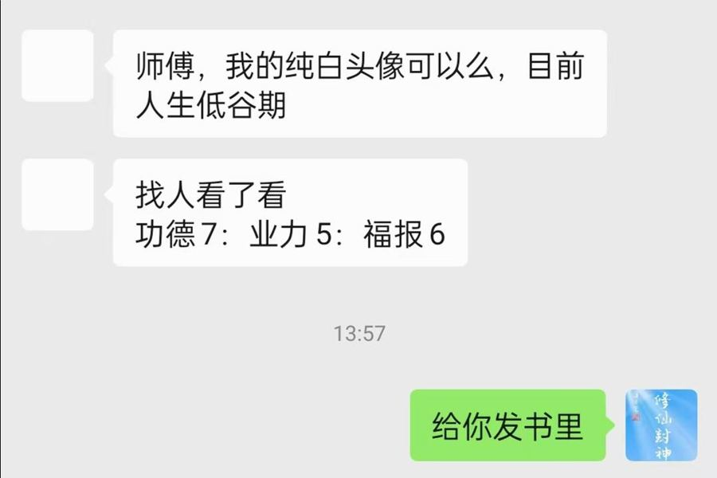

> **偏方｜枇杷叶煮水**  
> 用来：咳嗽有痰（不能吃甜、不适合用冰糖香蕉的人）  
> 怎么做：用枇杷叶煮水喝。老叶比较大，一天用一片就够；对症的话一片就能明显感觉痰少了，普通咳嗽几片叶子就够。

> **偏方｜连皮炖香蕉**  
> 用来：痔疮、便后出血  
> 怎么做：香蕉两个不去皮，炖热，连皮一起吃；或者两条香蕉连皮放火上烤，趁热吃。痔疮出血、大便干结的，每天早上空腹吃1–2根香蕉。  
> 注意：香蕉性寒，脾胃虚寒、腹泻的慎用。

> **偏方｜冰糖炖香蕉**  
> 用来：久咳；肺燥干咳无痰、口鼻干燥  
> 怎么做：久咳：香蕉1–2根加冰糖炖，每天1–2次，连吃几天，可连皮吃。干咳无痰：3条香蕉去皮切段，加冰糖和一碗清水，隔水炖一小时，连渣吃。

> **偏方｜香蕉皮（果柄）煎汤**  
> 用来：高血压  
> 怎么做：香蕉皮或香蕉果柄30–60克，煎汤喝。  
> 注意：正在住院或吃药治疗的慎用，以免冲突。

> **偏方｜香蕉果柄冲水**  
> 用来：胆固醇偏高  
> 怎么做：香蕉果柄50克洗净切片，开水冲泡喝，连续10–20天。  
> 注意：量不能太大，否则腹泻。

> **偏方｜香蕉热汁含漱**  
> 用来：牙痛  
> 怎么做：香蕉两个煎成一碗热汁，含在嘴里漱口。

> **偏方｜香蕉根煮水**  
> 用来：肾结石（利尿排石）  
> 怎么做：五六把香蕉根煮水，每天早晚各喝一大碗，连喝半个月。

> **食疗｜香蕉蜂蜜热牛奶**  
> 用来：痛经  
> 怎么做：每晚睡前喝一杯加了一勺蜂蜜的香蕉热牛奶。

> **偏方｜香蕉皮擦患处**  
> 用来：皮肤瘙痒、脚气、手足冻裂、蚊虫叮咬  
> 怎么做：用新鲜香蕉皮的内面在患处反复擦，连续几天；也可以用香蕉皮煎水洗。

关键词：香蕉、香蕉皮、香蕉根、香蕉果柄、枇杷叶、咳嗽、痔疮、便血、高血压、胆固醇、牙痛、中耳炎、皮肤瘙痒、脚气、手足皲裂、痤疮、痛经、肾结石、蚊虫叮咬、食疗、头像

## 第828章 美人在骨不在皮

徒手正骨比磨骨好：颧骨高、腰间盘突出多不是骨头多长了，而是肌肉和筋太紧把骨头拉错位；法令纹、悬针纹也是筋肉的问题，光搓表皮一会儿又被拉回去。《内经》：心主脉，肺主皮，肝主筋，脾主肉，肾主骨——肝主筋对应怒气，脾主肉对应想太多。篇外：悬针纹的手法放松。

- 修心也很重要：别这边放松，那边还在继续发怒、多虑，不断制造新的拉扯。
- 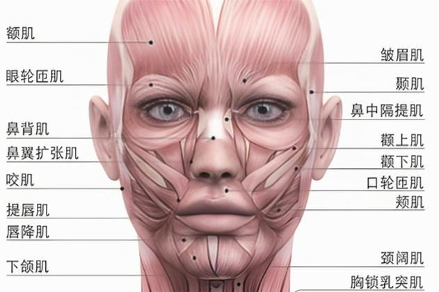
- 骨头的调整需要配合呼吸，文字不好表述，等视频。

> **身体调理｜悬针纹手法放松**  
> 用来：眉间悬针纹  
> 怎么做：1. 在皱眉肌附近（眉头）找到肌肉很厚、淤堵紧绷的地方，把皮捏起来，放松里面的肌肉，连续几分钟；2. 顺着眉毛方向，从眉头到眉尾用捏脊的手法擀皮；3. 用眼保健操刮眼眶的手势，用食指稍用力刮眉毛，刮的是里面的肌肉。  
> 注意：最重要的是修心，少发怒、少多虑——让放松的速度大于产生新淤堵的速度。

关键词：悬针纹、法令纹、颧骨高、正骨、筋、肌肉、肝主筋、脾主肉、怒气、思虑、面相、手法

## 第829章 唯有套路得人心

庄子："得者时也，失者顺也；安时而处顺，哀乐不能入也。"十八岁有十八岁的美，八十岁有八十岁的美，把美固化就会起情绪。事情好不好在于怎么做、发心是什么：用套路是为骗钱还是为让人越来越好？凶财凶出。面相："骨多肉少主辛劳，骨瘦如柴财不到。"

- 《道德经》：天下皆知美之为美，斯恶已。
- 一位卖减肥产品（9万8入伙）的主管说"九运离火主美丽，别再错过20年红利"，还骂作者一身肥肉。

关键词：美、执着、发心、套路、凶财凶出、面相、瘦、减肥、防骗、九运

## 第830章 躺平和接纳

那位主管手冰凉，作者确认她运势很差："面无三两肉，奸滑多算计"，露骨主贫贱——她老公是无底洞，赚几百万老公能祸祸上千万。胖瘦都要线条流畅、气才流畅：瘦不露骨，肥不露肉最好。躺平是追不上、放弃抵抗；接纳是做好该做的、静等开花结果——前者憋屈，后者豁达。

- 脖子胖到肌肉僵硬淤堵，会拉扯面部线条不流畅；瘦到皮包骨也不流畅——"露骨无肉，福缘浅薄，命中凄苦"。
- 例子：幼儿园小朋友没礼貌，你在同一层面就会生气还不能还手（躺平）；站在成年人角度根本不在意（接纳）。与其改变小朋友，不如强大自己的心。

关键词：面相、露骨、瘦、胖、手凉、运势低落、躺平、接纳、强大内心

## 第831章 篇外：让自己变得更好

篇外：问"是不是作者本人"是在浪费时间——随时问自己：我这句话、这个行为，会不会让自己变得更好？看到亲友家摆错了，不求不救，静等花开。作者核对2025年吉日时发现网上很混乱：有人以大年初一、有人以立春算新一年，月份不论干支、日子又论干支——不懂天干地支的人大量传播"易经"，会搞乱整个体系。

- 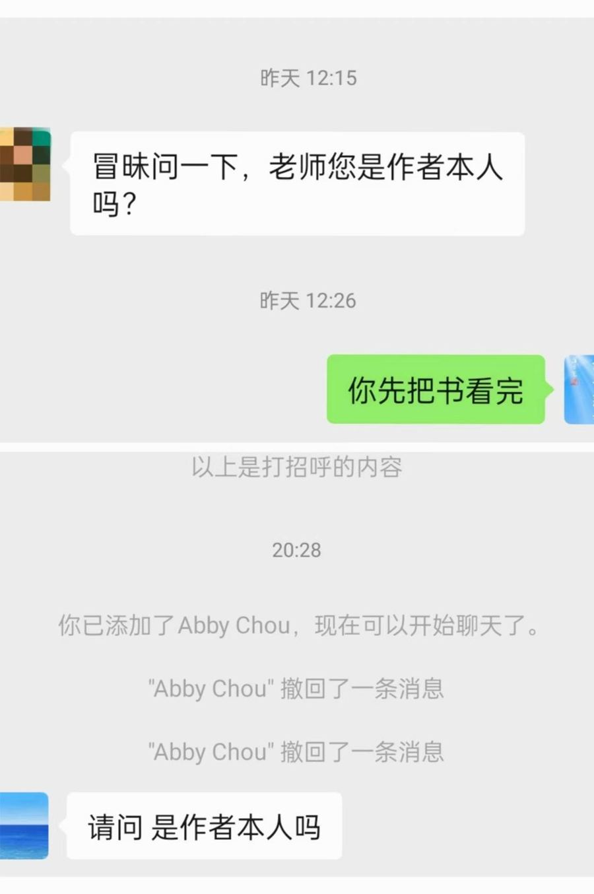
- 
- 作者平时很少用吉日：大部分时间都要做事，心存敬畏就好。

关键词：注意力、不求不救、择日、吉日、天干地支、立春、防骗

## 第832章 篇外：不求而求

篇外：手链不能治病、不能化解业力。戴手链吃火锅回来肚子不舒服？脾胃不好，风水上查大小太极的坤2（西南），也查头像，和微信号、手机号里水多不多（1和六煞都属水，多次出现或在后三位影响大）。越想外求越得不到：特别想要时屏住呼吸、气沉不下去——顺其自然，不求而求。修自己不是挑自己毛病，包容别人也包容自己。不会爱孩子？无条件的爱才是真爱；小时候是人生的春天，"赏而勿罚"。

- 
- 天天骂爱人懒、孩子皮，自己就成了搅屎棍——搅到哪里哪里不得安宁。
- 
- 别人身上让我们难以忍受的缺点，一般也是自己的缺点：孩子磨蹭、贪玩、不管自己的事——反思自己是不是也这样。
- 有条件的爱（你让我开心我才喜欢你）是交易，爱的是自己。
- 《黄帝内经》四气调神：春三月，生而勿杀，予而勿夺，赏而勿罚。孩子没浇灌好就修剪，适得其反；不施肥还骂庄稼没隔壁长得好，是贪念。
- 注意力就是生命力：给孩子的是关注和陪伴，不是打压苛责。一个人修得好不好，主要看他对父母、爱人、孩子是不是和声细语。

> **风水排查｜脾胃不好——查西南和数字**  
> 用来：脾胃不好、吃东西后肚子不舒服  
> 怎么做：检查大太极和房间小太极的坤2（西南角）有没有问题；看头像；看微信号、手机号里1和六煞（16、47、29、38）是否太多，尤其在后三位。

关键词：水晶手链、脾胃、坤2、头像、手机号、数字能量、六煞、不求而求、无为、呼吸、包容、爱、无条件的爱、教育、孩子、赏而勿罚、四气调神

## 第833章 篇外：几个偏方

篇外·几个偏方：念象数病好了也是阴阳平衡——你花了时间精力去念，注意力就是生命力；但一直念同一个五行也会失衡，好了巩固一下就停。以手指为针叩打淤堵处叫"五行杵"（凤凰三啄），能美容、醒脑。内求不是自责，而是找自己的"贪"在哪里——人生大部分痛苦都能从贪上找到答案。灰指甲两个偏方：醋精、紫皮大蒜片。

- 
- 第824章讲过用牙签扎病灶"以刺化煞"的办法——这一章原文不在本站使用的TXT里（823、824章缺失），无法给出具体做法。
- 
- 
- 李雪是同学里最有钱的，却总因"没赚够钱、对不起家人"自责、逼自己少睡多干——这不是修行意义上的自省，是向外求。
- 
- 只要有痛苦，都是因为存在未被满足的需求：能解决的解决，不能解决的放下。
- 把自己的家庭角色做好就有价值；有付出、家里给经济反馈，也是阴阳平衡。想赚钱，可以用自己的天赋（"生而知之"）去帮人，比如拍孩子日常、搞笑对话、美食收纳。
- 
- 

> **身体调理｜五行杵（凤凰三啄）**  
> 用来：面部淤堵（美容）；脑子迷糊（提神醒脑，作者说这是他知道最有效的醒脑法）  
> 怎么做：五根手指尖捏在一起，轻轻叩击皮肤。醒脑：轻叩头顶百会穴和眉心（祖窍）。美容：轻叩面部摸起来特别厚的淤堵处。也可以叩后脑勺、颈椎、胸口等有淤堵的地方。  
> 注意：1. 适量：淤堵叩开了就停，不用天天做。2. 用五指，不习惯可用三指，别翘小指用四指（单数为阳）。3. 尽量避开耳后、腋下，只叩晒得到太阳的裸露部位（除非那里淤堵很厚）。4. 避开太阳穴，要叩就叩它斜上方发际线里——眉头到眉峰的延长线和鬓角向上延长线的交点附近，可从听宫一路往上叩。

> **偏方｜醋精涂灰指甲**  
> 用来：灰指甲  
> 怎么做：把醋精涂在灰指甲表面和蜂窝状的小孔里，每天涂几次，直到长出新指甲。

> **偏方｜紫皮大蒜片贴灰指甲**  
> 用来：灰指甲  
> 怎么做：紫皮大蒜切片，贴在指甲上；几天后如果稍微有点疼，说明新指甲要长出来了。  
> 注意：原理是醋精和大蒜都抗真菌。

> **象数｜象数好了就停**  
> 用来：念象数的人  
> 怎么做：针对性调整，病好了巩固一下就不要再念，避免某个五行一直被加强而失衡。

关键词：象数、阴阳、五行杵、凤凰三啄、梅花针、醒脑、美容、百会、祖窍、太阳穴、内求、贪念、自责、宝妈、天赋、灰指甲、醋精、大蒜

## 第834章 篇外：好的不灵坏的灵

篇外·手相补充：大拇指弯（能往后仰）性格随和、会聊天，大拇指直的人性子直不会拐弯——这是天分，和人品无关，和会不会撒谎也无关。食指长：语言记忆强、有野心、事业型；无名指长：乐观、不易焦虑抑郁、肢体协调好。放弃天分容易（向下改命），发展出另一种特质是向上改命。靠意志力改命难持久，但努力过总会留下痕迹。作者给了几张比较可以的头像底图——加上字再用。

- 
- 
- 
- 拇指直但很会说话的人有，但非常少；拇指弯却不会聊天的可能性大一些——随和是一种能力，有的人要放弃很容易。
- 
- 
- 因为可以改命，手相、面相、八字都不一定百分百和预判一样；但改命不容易，大多数人在随波逐流。
- 
- 例：一个本来懒得读书的人拼了三年考上大学，之后可能又懒了，但大学毕业证留下了；学过的英语也会留下储备。
- 道士：作者说的道士指遵循天地自然规律的人，不一定有证书。
- 
- 
- 
- 

关键词：手相、大拇指、食指、无名指、性格、改命、意志力、头像、头像底图

## 第835章 篇外：向内求

篇外·头像实战：天天梦见鬼被吓醒，不要先往"阴债""鬼"上想，先看自己——他的头像就有问题。学习是向内（阴），得动起来改才是阳。另一位读者换头像换到另一个极端：中宫5有巨大的光煞照着人的上半身。给底图加字时，要同时注意字的五行颜色和穿宫。颜色五行的中间色：橙色是火＋土，蓝色是水也带木，灰色在金水之间。看房先找准方向：指南针会被钢筋干扰，每面墙、室内外都要测。运势低时别搞大投资。

- 
- 
- 道理大家基本都懂，就是不改——怕换得更差；结果有人真换得更差了：中宫5巨大光煞照着上半身，"很阳光"。
- 要改变命运轨迹，需要付出足够大的心力；用更笃定的心把书再认真看一遍。
- 
- 
- 橙色：火＋土，橙黄偏土、橙红偏火。蓝色：水，也有木的属性。灰色：介于金和水之间，深灰偏水，浅灰偏金，有时也按土论。
- 
- 天地人，人最重要；修行修自己，别修别人——比房子风水更重要，因为福人居福地。
- 
- 
- 
- 方向很重要，有的房子可以做到四个角缺八个。
- 
- 
- 人生像跳蹦床：下沉时顺势蹲低，弹起时才能更高；床往下时硬往上窜，还容易撞伤腿脚——顺势而为。运势低（阴）时不要搞大投资（向外投资为阳），这是逆势。
- 家里两个人一个运好一个运差，听运好的；运势差的人脑子迷糊，总能精准避开正确选项；两个都差就一起臣服下来。努力的前提是方向要对。没有什么比人心还大。

> **风水排查｜看房测方向**  
> 用来：买房、画九宫图前确定方位  
> 怎么做：用指南针测方向时，要贴着每一面墙都测一下，室内、室外都测；钢筋混凝土会干扰，有时偏差很大。

> **看人方法｜头像加字的注意事项**  
> 用来：用底图做头像  
> 怎么做：底图太空，要加字（阳光、温暖的诗句）；加字时注意字的颜色五行，以及字的位置和走向形成的穿宫是吉是凶，不要形成光煞。

> **生活方法｜运势低时不投资**  
> 用来：运势低、负债、创业失败后想翻身  
> 怎么做：先判断自己在什么运势；运势低时不做大的向外投资，顺势收缩、修自己；家里听运势好的那个人的决定。

关键词：头像、梦见鬼、阴债、光煞、中宫、颜色五行、橙色、蓝色、灰色、穿宫、九宫图、缺角、指南针、测方向、投资、运势低落、顺势而为、蹦床、防骗、风水摆件

## 第836章 篇外：加一句小诗有多难

篇外：给头像底图加一句小诗，大家花样百出——字本身也有"面相"，带刀带刺的字体不和气；截图时把坎1到巽4的14生气穿宫截成了48绝命。作者做了几张成品头像，字体用美图秀秀里的免费字体，可以擦掉换成自己喜欢的诗句。选头像最好配合自己的命宫或喜用神：作者艮8命宫、喜火，用红色系，火生土又帮扶喜用神。

- 
- 
- 
- 
- 
- 
- 
- 
- 
- 
- 截头像时，再检查一遍穿宫对不对。
- 命宫和喜用神两个体系兼顾不到，就先按其中一个试，不行再换另一个；总结过往经历很容易推出哪个五行对自己好。手链的五行颜色能兼顾更好，兼顾不到也没关系。

> **看人方法｜选头像配五行**  
> 用来：想让头像帮到自己  
> 怎么做：头像主色尽量选生扶自己命宫五行、或符合喜用神的颜色；加字选不带尖刀锋利感的柔和字体；截图后检查穿宫，避开绝命等凶穿宫。

关键词：头像、字体、穿宫、生气、绝命、命宫、喜用神、颜色五行、艮8

## 第837章 篇外：本书正确的打开方式

篇外·本书正确打开方式：自修、自证，少想多做。怎么判断淤堵？皮下有"大肉垫"、咯咯楞楞的地方就是；捏脊时皮能捏起来往前撵的是通的，疼得像刀割、捏不起来或捏起来凹凸不平的是堵的；长皱纹的地方都不通。经常给印堂和眉毛擀皮，川字纹、悬针纹都能变浅。手链就是普通水晶，差别在灵性的"炁"——就像立春的雨水和平常雨水化学上一样，中医却说立春雨水有生发之气。

- 
- 
- 
- 密宗师父讲过，人体经络气脉有光，病灶处的光暗淡，就是病气、浊气；道医书里也说身体表层有肉眼不可见的彩色光网。
- 《本草纲目》：立春节的雨水有春升生发之气，不孕不育的夫妇这天各喝一杯（见139章）。
- 《道德经》：专气至柔，能婴儿乎？回归本真的人才能感知灵性层面。没有期望就没有失望，一有失望就觉察自己哪里起了贪念。
- 
- 
- 
- 
- 
- 
- 不适合戴的五行：按八字是忌神；自身某五行过旺时，克它的反而是好事，以平衡为吉。
- 作者不是医生，不能治病；但风水的问题调风水，性情的问题解心结，大家自己可以给自己调。

> **身体调理｜擀皮**  
> 用来：皮下淤堵；川字纹、悬针纹；判断哪里堵  
> 怎么做：用捏脊的手法把皮捏起来往前推着走（擀皮）。经常擀印堂和眉毛部位；不方便捏脊的，捏手背擀擀皮也好。捏不起来、很疼、凹凸不平的地方就是淤堵。  
> 注意：淤堵重的会很疼，怕疼的慢慢来。

关键词：自修、自证、淤堵、捏脊、擀皮、皱纹、川字纹、悬针纹、水晶手链、炁、立春雨水、头像、痛风、乾6、五行喜忌

## 第838章 篇外：每个起心动念都是种子

篇外·每个起心动念都是种子：要进手术室了才问怎么办——种了西瓜，等结了西瓜又想要玉米，只能去偷别人的玉米，正法不会这么做。用占卜算股票彩票，忽视了因果：每个人福报一定，想得到就要付出你有、别人也想要的东西（时间、健康、生命、子孙运势）——有人拿命换钱，最后拿钱换命也换不回来。只有德行是整个法界的硬通货。

- 修行修在平时：行善积德、正心正念、未雨绸缪，提前种下善的种子。
- 每个人都有良知：让自己心里不舒服的行为，从此刻开始改，这就是种子。
- 心是天地之主，遇到什么事都要笃定，修正心、存正念。

关键词：因果、种子、起心动念、占卜、彩票、股票、福报、德行、良知、外求

## 第839章 篇外：阴阳

篇外·阴阳：这本书最想表达的是"打破迷信"——执迷于看得见的是迷，执迷于虚无缥缈的也是迷；不执迷于有，也不执迷于无。风水、性情疗法、法事、医疗都有用，但都是工具，"我"才是根本；依赖任何人事物（包括父母、爱人）都算外力。门口红地垫影响口，大门开在兑位影响更大。打坐不是修行本身——贪图神通也是贪，有位能看见佛菩萨的师父就是贪神通出偏入魔。积德就是多给别人：阳德有明确感谢对象，阴德是做好事不留名、更大更持久。

- 
- 
- 
- 工具像镰刀，不好用随时可以换；一旦迷恋就产生依赖，等于放弃了选择权。
- 众生利益是一体的，自己也是众生一员：一句话要么对对方有利，要么对自己有利。
- 注意力就是生命力：吃饭感知每一口的味道，走路感知脚落地和风吹过皮肤，用心感受声音、气味、颜色——有觉知地活着。
- 
- 
- 把脾气修好、把日子过得富足和谐，比会打坐会念经修行高得多。
- 神通像小孩自带的功能，归真就好；佛道都不提倡修神通，以免修偏。
- 少给别人就亏德，比如缺斤少两、虚假宣传。推荐好书、分享偏方别人用了好却不知道是谁——这是阴德。
- 
- 

> **修心方法｜有觉知地生活**  
> 用来：注意力被情绪和欲望牵走、心神不宁  
> 怎么做：把注意力放在当下：吃饭时感知每一口的味道，走路时感知脚的一起一落和风吹过皮肤，用心听、闻、看身边的声音气味颜色形状。

关键词：迷信、阴阳、工具、依赖、红色地垫、大门、兑7、口腔、注意力、觉知、打坐、神通、入魔、积德、阴德、阳德、头像、光煞

## 第840章 篇外：何为正道

篇外·何为正道：一位读者家人重病、外欠贷款，头像却邪得作者不敢放进书里，名字里全是人民币符号——一灯能除千年暗，看了书就要马上改，让阳光照进来。正北见水（路也算水）对应白血病。按承浆穴可以缓解口腔溃疡和嗓子疼。快乐的本质是变成更优秀的自己；不贪不等于不赚钱——把注意力放在利他上，钱是结果。正道就是众生的总体利益上升（众生包括自己）。

- 
- 
- 
- 不同的宫格有不同的五行八卦场，挪动一点点就可能看到效果。
- 
- 承浆穴是唾液的开关，唾液能灌溉脏腑、滋阴降火、生津补肾。
- 只有自己验证过的才是真理；不起贪念，只信自己。
- 深陷困境不知从哪开始：看到哪个点就试哪个点，一遍不行多看几遍，连评论区一起看。
- 
- 
- 
- 
- 贪，是不想认真种种子就想要大果子：烧几块钱的香许几个亿的愿；"还没做就知道能赚大钱"的机会大概率是坑。
- 别人兜里的一块钱弄到自己兜里，众生总体利益没增加，不是正道；作者写书，给出一份、大家收获千万份，是正道。
- 
- 卖头像赚钱本身没问题，问题是没帮到人却赚了钱——众生总体利益减少，就是贪甚至是骗。

> **穴位｜按承浆穴**  
> 用来：口腔溃疡、嗓子疼  
> 怎么做：按揉下唇正下方、下巴中间凹陷处的承浆穴。  
> 注意：书里只说按承浆穴，没写按多久；穴位位置为常规描述。

> **风水调整｜孩子书桌放生气位**  
> 用来：孩子学习  
> 怎么做：按孩子的命宫找到生气位，把书桌挪到那个方位，哪怕只挪一点点。

关键词：头像、正道、利他、贪念、白血病、坎1、正北、见水、马路、承浆穴、口腔溃疡、嗓子疼、唾液、生气位、孩子学习、书桌、光煞、腰痛、赚钱

## 第841章 篇外：口碑和人设

篇外·口碑和人设："万物皆可为我所用"和"向外求"的区别是有没有主动权——向外求是盲信大师、活在别人嘴里；为我所用是学了亲自实践验证，内在核心提升。梅花香自苦寒来：香是因为梅花，不是因为苦寒，苦难不值得歌颂。网上出现很多冒充"道之光""三合老师""吉月姐姐""火阿姨"的人——口碑是别人给的，自己封的叫人设、叫广告。

- 有人道德绑架说吃苦就是消业——你爱吃苦就都送给你，祝你有吃不完的苦。
- 《道德经》：上德不德，是以有德；下德不失德，是以无德。满口仁义道德的，就像口口声声标榜自己有钱的人。
- 反者道之动——这五个字要刻在骨子里。
- 心不定、没有分辨力时，不要贪求外力。可以多抄《道德经》，尤其是篆书体。

关键词：外求、为我所用、主动权、苦难、消业、冒充、防骗、口碑、人设、反者道之动、道德经、篆书

## 第842章 篇外：孩子的问题

篇外·孩子的问题：孩子上大学一直玩、父母气到凌晨三点睡不着——孩子的问题多是父母"懒"：不施肥浇水，只盯着结果抱怨。作者和孩子玩"数学版剪刀石头布"：喊一二三各出几根手指，比谁先算出总数，玩一会儿再做卷子题都变简单了。玩游戏也可以挑有答题关卡的。一位常打坐的朋友说"孩子倒数第一就随缘吧"——随缘不是这么用的。

- 
- 孩子发现每次出1就能更快算出答案——不能否定他（否定就是打压），作者反过来说"我发现你总出1，那我提前准备好就赢定了"，孩子就自觉守规则了。可以升级成两只手、二十以内、乘法。
- 快乐的本质，是变成更优秀的自己。
- 那位爸爸连孩子会不会乘法口诀都不知道；孩子自己说"爸爸想让我好好学习"，还会用AI搜"不喜欢写作业怎么办"。

> **生活方法｜数学版剪刀石头布**  
> 用来：孩子不爱做题、算得慢  
> 怎么做：喊"一二三"，大人孩子同时伸出几根手指，看谁先算出两人手指加起来是多少；大人大多和孩子同时说、偶尔慢一点，让孩子常赢。熟了升级成两只手（20以内），二年级以上可以玩乘法。玩一会儿再做卷子。  
> 注意：孩子钻规则空子时不要否定，用游戏的方式让他自己愿意守规则。

关键词：教育、孩子学习、游戏、数学、随缘、父母、快乐

## 第843章 篇外：我可以做什么让事情变得更好

随缘是尽人事、听天命：该播种施肥都做了，收成看天；不播种不施肥躺着等"随缘"，是另一种贪。修自己的意思是："我可以做什么，让事情变得更好？"——骂孩子是损人不利己，骂几年放弃了是什么都不做的懒惰。不要让"爱"和"为你好"的幌子蒙蔽了事实：你的行为真的让他变好了吗？

- 孩子也是人，会累，也有低谷，累的时候也想要一个无条件的拥抱。
- 顺势而为首先要顺应孩子的运势：该休息时（晚上、低谷期）一直逼他，白天他就没精神，只有游戏的刺激画面能让他睁开眼。
- 先把因果理顺、把心立正，再说术的层面。

关键词：随缘、修自己、教育、为你好、唠叨、顺势而为、因果、孩子、爱

## 第844章 篇外：六煞磁场

篇外·六煞磁场：那个大学生命宫震3（春天、长子、"东宫太子位"），艮8和震3命宫的人最不适合打压——《内经》春天"赏而勿罚"；木型（修长直溜）的人也一样。妈妈微信号9122：91延年、12绝命、22叠加绝命，全是硬气的金，金克木两败俱伤。孩子宿舍：离9门、睡在乾6兑7、头朝坤2——69绝命、79五鬼、29六煞：脑子停不下来想的全是负面情绪，容易觉得活着没意思。

- 
- 什么情况孩子会一直玩？心里没有阳光没有爱的时候，只能用游戏麻痹自己（大人也是）。
- 
- 
- 树从嫩芽期就被大石头压着，要么压成废柴，要么顶翻压力，但也长不直。震3的人走第一步就看到长远规划，最怕老师家长指手画脚。
- 
- 
- 绘画心理学：画面大说明气场向外、火力全开；画面小说明自我评价低、缺安全感、退缩；画在纸偏上乐观，偏下悲观。这位妈妈全金磁场却画得很小——金气不但伤了别人，更伤了自己的心气。
- 六煞的正向作用是观察敏锐、心思细腻、沟通能力强——看本人愿不愿意发挥出来。发挥出正向能量、在生活中变得更好，就不再需要游戏里虚无的成就感。
- 与其强行拿走孩子那一点点希望，不如给他更多的光，让他感到有人无条件地爱他。
- 
- 
- 16169：16、61、16三个六煞（属水，16是六煞里能量最强的），1本身也是水，69绝命收尾——水多为寒，情绪极低落，压不住就暴躁爆发；她泡在冰水里，别人多努力爱她她也收不到。理解了她，就不那么生气、受伤。

> **看人方法｜震3、艮8命宫的孩子——不打压**  
> 用来：孩子被管得越严越叛逆、越消沉  
> 怎么做：艮8、震3命宫（或修长直溜的木型人）的孩子，多表扬少处罚，顺着他的特性引导，不强势说教。

> **风水排查｜查宿舍床位和号码的五鬼、六煞**  
> 用来：孩子想得多、负面情绪重、沉迷游戏  
> 怎么做：画出宿舍或卧室九宫，看门、床位、头的朝向与命宫是否组成五鬼（18、36、79、24）、六煞（16、47、29、38）、绝命（12、37、48、69）；能换就换，不能换就引导发挥六煞的敏锐细腻等正向能力。也检查父母的微信号、手机号是否全是硬气或水太重的组合。

关键词：六煞、五鬼、绝命、延年、命宫、震3、艮8、赏而勿罚、教育、游戏、微信号、数字能量、绘画心理学、抑郁、宿舍

## 第845章 篇外：六字诀功法

篇外·六字诀：气功不建议自学，跟着网上视频的"吸气—呼气"节奏练，很多人会胸闷气短、头晕恶心——每个人气沉深度不一样。想练功推荐张至顺道长的金刚功（必须收功），或者既简单又安全的六字诀：嘘、呵、呼、嘶、吹、嘻，把病气吐出来。顶轮是紫色，代表开悟；九紫离火运，2025年除了蓝色也可以选紫色。

- 运动运动，"运"在"动"前——运的是气。
- 六字诀原理：用不同字音改变气的运行，震动气脉排出病气；吐故在纳新之前。
- 运势通畅时气足，面相更圆润；面相圆润和胖瘦无关，大胖子脸上凹凸不平的叫横肉。
- 
- 
- 

> **功法｜六字诀**  
> 用来：把病气吐出来；调肝、补心、调脾、养肺、补肾、调三焦  
> 怎么做：六个字依次是：嘘（hü，调肝）、呵（ho，补心气）、呼（fu，调脾）、嘶（sei，养肺）、吹（cui，补肾）、嘻（hei，补三焦，整体疏通上中下焦）。读音类似广东话、客家话。做法：1. 面对太阳，开着窗但避开风口，中午前更好；2. 先叩齿、用舌头在嘴里搅动（赤龙搅海），满口唾液后轻轻咽下；3. 念的时候只出气不出声；4. 轻轻低头用口呼气，轻轻仰头用鼻吸气；5. 吸气时间要大于或等于呼气时间。每个字6遍为一组，六个字各6遍共36遍是小周天；某个脏腑有病，单独把那个字再念36遍（无病则六个字再各6遍，共72遍）是中周天；三个36共108遍是大周天。病情重的每个字练50次，六个字共300次，并配合咽唾液。  
> 注意：呼气太长会泄多补少；每个人呼吸深浅不同，不强求每次吐干净（见846章）。

> **功法｜金刚功（张至顺道长）**  
> 用来：想练功强身  
> 怎么做：跟张至顺道长的八部金刚功练。  
> 注意：一定要做收功（弹跳收功），否则气没收回来人不舒服。

关键词：六字诀、气功、金刚功、张至顺、收功、呼吸、吐故纳新、叩齿、赤龙搅海、咽津、面相、横肉、顶轮、紫色、九运、2025、头像

## 第846章 篇外：随缘是修行者的大忌

篇外·随缘是修行者的大忌：想起某人就生气、坚决不来往还说"随缘"——执着于无，也是执着；只要还有情绪就没放下。能力不足可以暂时逃避，但要知道这是逃避。想避开的人越多，能量淤堵越多。修行者尽量不提"随缘"，前提是尽人事。心不自由的人先读《金刚经》（或《心经》）。网上很多功法要"大几千解锁"——假的多真的少。姓名学性价比不高。

- 傻乐的人快乐：不多想，不在心里加戏。心里挂事伤肾，肾主骨也主胆子，做事会畏手畏脚。
- 分清别人的事、自己的事、老天的事：别人讲不讲理是别人的事；我能决定的事里，怎么做能让众生总体利益增加，才是标准。
- 魔披着袈裟讲"随缘"的法，消磨斗志，让人逆来顺受——像当年侵略者宣扬"奴化教育"。
- 
- 观心术：观察自己的心比观察别人的心重要——心藏神，把心观明白了通神。
- 读《金刚经》约半小时；没耐心就读《心经》（两百多字）；《道德经》核心一样，可以对照着读。
- 一个小男孩被人说衣服丑，决定再买一件一样的天天换着穿，让他看习惯——我们才是未来的佛，不活在别人嘴里。
- 重症读者找到了各方面的根源；重大疾病的能量释放需要长时间呕吐才能吐干净，光理智理解不够。
- 
- 
- 风水和情绪疗法在改命里性价比最高：好学、好找问题、影响大，因为我们一天到晚都泡在这种气场里。

关键词：随缘、执着、放下、逃避、能量淤堵、傻乐、肾、胆子、三种事、观心、金刚经、心经、防骗、功法、六字诀、坎1、姓名学

## 第847章 番外：【姓名学1】

番外·姓名学（一）：名字首先看大义——刘德华原名刘福荣，"福荣"是私欲向内为阴，"德华"向外为阳；起名先顺应天道、尊道贵德，再论五行。文字的五行可以从字义、偏旁字形、音律、笔画数来分。笔画五行有河图数、天干数两种，还有一堆特殊规定，分歧太大，作者建议顺便兼顾、不作主要依据；字义五行（江河湖海属水、山岩峰属土）最有共识。（姓名学汇总见[姓名学](../../book/04-名字和数字/20-姓名学.md)）

- 
- 河图："天一生水，地六成之；地二生火，天七成之；天三生木，地八成之；地四生金，天九成之；天五生土，地十成之。"奇数为天数为阳，偶数为地数为阴；12345为生数，678910为成数。
- 
- 楼层五行也按河图数算，但实用性不强——不通风不透气的一楼，属水那点助力弊大于利。
- 
- 天干数字五行：1甲木、2乙木、3丙火、4丁火、5戊土、6己土、7庚金、8辛金、9壬水、10癸水。问题是"水""木""火"都是4画，按河图都属金、按天干都属火，明显不合理；还有繁简体、不同字体笔画不同。
- 网上常见的"三才五格"打分，按笔画但又掺了别的理论，同样笔画数五行可能不同。
- 
- 姓名学的特殊笔画：氵算4（水），月字旁算6（肉），扌算4（手），辶算7（走），忄算4（心），犭算4（犬），礻算5（示），衤算6（衣），斜王旁算5（玉），左耳旁阝算8（阜，土山），右耳旁算7（邑），艹算9（有的按6），数字按本义（五算5、九算9、十算10），"逢折算画"如"万"算4。
- 
- 
- 
- 

关键词：姓名学、名字、五行、河图、天干、笔画、三才五格、楼层五行、偏旁

## 第848章 番外：【姓名学2】

姓名学（二）：字形和音律相当于"符"和"咒"。笔画形状的五行：点为水，竖为木，横为土，撇为火，钩（提、捺）为金。名字从上到下（姓、第二字、第三字）可对应早年/长辈、中年/配偶平辈、晚年/晚辈下属。各种偏旁也有性格含义：草头脑子灵活但三心二意、易神经衰弱；带手的有手艺；带脚的爱动、婚姻或工作易变；带口的易犯口舌也利于口才职业；带"王、君、令"有掌控欲；窄玉旁（石头）易能量淤堵长结节；品字形（晶、鑫、磊）不利合伙。

- 水（点）：主智慧和财。点在上（亮、之）足智多谋但想多做少；点在左（江、涛）在青龙位主贵人、爱帮人、为平辈花钱；点在右（梅）在白虎位，处处为人着想却出力不讨好；点在下，走出去易得财；点很多（杰、燕）有来财渠道但不聚财。点也代表伤疤、结石：头上有点（文、京）易头部受伤或头晕多梦。两点水寒，三点水常温，四点底热（按火论）。女人名字水太多易体寒、对妇科不好——升阳、少想多做。
- 金（钩、刀、刂、矛、匕等）：硬气；与刀光剑影有关（医生、律师、理发、屠宰等职业，或开刀、意外、血光、孤独不利婚姻）——修好脾气、多利他可减弱。本身软弱、金是喜用神的人，加点硬气未必不好。
- 孤独（生离或死别）的字：梅、冬、霜、冰、雪、霞、婵、玉、月、贞、亭、素、萍等；风水上正北开门也是类似影响。
- 土（横、土石山田旁）：财运好有天赋，但职场晋升易受压；土主信，弱点是固执——放下"疑"。
- 火（撇、四点底、火日光旁）：热情、奉献、消耗，风风火火——气沉丹田可化解。四点底也带水性，女生慎用。例：王熙凤，熙是四点底，凤撇撇捺捺。
- 木（竖、木草禾竹）：生发向上。木字旁（林、松）是阳木，独当一面；草字头（芳、芝）是阴木，灵动善动脑赚钱，但伤眼、易神经衰弱、完美主义、易钻牛角尖抑郁，脸上易有疤。
- 绞丝旁：心绪缠绕，考虑缜密。带手（扌、手）手闲不住、可能好赌；带脚（八、乂、辶、走）闲不住，在中间婚姻不稳，在结尾利工作但可能为他人作嫁衣。
- 带口：口在前易和长辈犯口舌（多做少说），在中间易和平辈（注意表达方式），在结尾易和晚辈下属（言行一致、信守承诺）。
- 带"相、臣、二、亚、士、次"（如"平"）：能做事不适合出头，属军师型。
- 书写习惯：撇写得重爱付出；捺写得重行动力强但爱索取、硬气。"上外左"代表男、"下内右"代表女，女人写名字右边大是白虎欺青龙，易强势。
- 合伙和感情都喜欢互补：命宫婚配如乾6配乾6（都硬气）、震3配震3（都不服气）易互相硬刚。

关键词：姓名学、字形、五行、点、草字头、偏旁、口舌、结节、孤独、婚姻、合伙、命宫、写字

## 第849章 番外：【姓名学3】

姓名学（三）：读音的五行按发音最用力的部位分：唇音（b、p、m、f、w）属土；舌音（d、t、n、l）属火；喉音（g、k、h、ng）属水；齿音（z、c、s、zh、ch、sh、r）属金；牙音（j、q、x、y）属木。但普通话、方言、古音发音部位不同，五行也会变。还可以听声音看性格和易病部位。

- 
- 
- 
- 中医"闻"诊是听声音，声音反映气的强弱。
- 
- 木型人：声音直而短、干脆；注意肝胆、脾胃、筋脉；木主仁，以德养性、与人和善。
- 火型人：声音沙哑、尖、破音；注意心血管和头部（耳朵、牙齿、失眠）；火主礼，守礼守分、戒贪戒斗。
- 土型人：声音发嗡、鼻音重、沉稳；注意脾胃消化；土主信，不怨天尤人、诚实信人。
- 金型人：响亮悦耳、有穿透力；注意肺、大肠、呼吸系统；金主义，多看别人优点、不懊恼。
- 水型人：柔缓低长、语速慢；注意肾、泌尿生殖、腰；水主智，少烦恼、多运动升阳。

> **看人方法｜听声音辨五行**  
> 用来：判断一个人的性格和容易生病的部位  
> 怎么做：听他说话：直短干脆是木，沙哑尖破是火，发嗡鼻音重是土，响亮有穿透力是金，柔缓低长语速慢是水；再对照上面的易病部位和化解办法。

关键词：姓名学、读音、五音、唇音、舌音、喉音、齿音、牙音、声音、闻诊、五行人、性格

## 第850章 番外：【姓名学4】

姓名学（四）：起名补五行不是缺什么补什么，而是看喜用神（强者制之泄之，弱者补之助之；某五行强到无法抗衡就顺势）。字的五行有争议时，兼顾顺序是：字义、偏旁、字形、笔画数、音律，模棱两可的字可以放弃。还要兼顾属相：避开刑冲克害，用三合三会；按属相的吃食、住处、习性选字。花几百块改个名字就想改命，不如把钱省下来读书提升自己。

- 
- 三才五格是日本人熊崎健翁发明的，有一定准确性，可兼顾参考。
- 例：心——按笔画（钩）属金，三个点属水，中医心属火；李——按河图数属火、天干数属金，部首木、下面子属水，字义李子树属木。
- 属鼠：申子辰三合，宜用申、辰字形；亥子丑三会北方水；子午冲，不用马字旁；子未相害，避"羊"；子卯相刑，避"卯""柳"。其他属相类推。
- 吃五谷的属相（鼠、牛、兔）可用米、豆、麦、禾、田、艹；吃肉的（虎、蛇）可用心、月、忄，不宜米豆禾艹；龙不食人间烟火。
- 住处：虎喜山林（山、木）；鼠兔蛇猴鸡狗猪喜洞穴（口、冖、宀）；牛马羊喜居家（宀）；虎、龙用"口"就成了"困"。
- 鼠、蛇不喜阳光，避日、光；鼠虎龙可用大字（王、帝、主、大、令、君、长）；不喜人的（鼠、虎、兔、龙、蛇）避"人""彳"。
- 属羊避虎字头（如"彪"）；属虎也不用虎字头（一山不容二虎）；猴、鸡避金、申、酉、西、兑、秋（金金相遇代表战争）；"它"是蛇的本字，"长虫"也是蛇，属鼠、属虎避"虫""它"。
- 
- 巴菲特：读书是投资回报率最高的事。名字有大问题可以改，改一个层面是一个层面。
- 测字还看字写的大小胖瘦、笔的颜色、纸张："木瘦金方水主肥，土形敦厚背如龟，上尖下阔名为火，字象人形一样推。"

关键词：姓名学、起名、喜用神、属相、三合、三会、刑冲克害、测字、读书

## 第851章 番外：吉日计算

番外·吉日计算（以2025年为例，汇总见[择日：九星吉日怎么算](../../book/05-算时间/10-择日：九星吉日怎么算.md)）：四步——找九星吉星当值的日子、扣掉金神七煞日、扣掉红煞日、标出偷修日。注意过了立春年的干支就换了。

- 金神七煞日：甲己年午未日，乙庚年辰巳日，丙辛年子丑寅卯日，丁壬年戌亥日，戊癸年申酉日。有争议的一律排除。例：2024甲辰年，全部午日、未日都不算吉日；2025年2月3日立春后是乙巳年，辰日、巳日是金神七煞日。
- 
- 十二个月分三组（像麻将"一四七、二五八、三六九"）：孟月1、4、7、10月（驿马）查第一组；仲月2、5、8、11月（四正）查第二组；季月3、6、9、12月（墓库）查第三组。寅月是正月。
- 
- 红煞日（巳酉丑日）：孟月遇酉、仲月遇巳、季月遇丑为煞。记忆：孟月是人生开始，遇金修剪为凶（初始阶段要鼓励）；仲月是人生最旺，要谦虚，不宜见火；季月是晚年，遇土墓库为凶。
- 
- 例：2025年1月1日庚午、1月2日辛未是金神七煞日（甲辰年午未日），排除；1月3日丙子月壬申日在妖星下，不吉；1月5日起是丁丑月（季月，第三组），甲戌日在煞贡下——吉。只有红色那几列（煞贡、直星、人专）是吉。2025年1月九星吉日：5、6、9、14、15、18、23、24、27日。1月20日己丑日是红沙日（季月遇丑）。
- 大偷修日歌诀：壬子、癸丑、丙辰、丁巳、戊午、己未、庚申、辛酉八日，诸位凶神尽朝天——调整房屋不易冒犯神灵。例：2025年2月12日壬子日。
- 
- 想深入可以看乾隆作序、收入《四库全书》的《协纪辨方》，非从业者不建议花大量时间。
- 同样的日子有人丢钱有人捡钱，关键在自己；能顺便尊重就谦虚一下，太麻烦不如好好修自己。

> **民俗方法｜算九星吉日**  
> 用来：想挑日子调风水、补角、做重要的事  
> 怎么做：1. 先确定当天的年、月、日干支（年以立春为界）；2. 按月份是孟、仲、季月，在九星表对应组里查当天干支，落在煞贡、直星、人专下的是吉日；3. 排除金神七煞日；4. 排除红煞日（孟月酉日、仲月巳日、季月丑日）；5. 若同时是大偷修日（壬子、癸丑、丙辰、丁巳、戊午、己未、庚申、辛酉）更好。

关键词：择日、吉日、九星、金神七煞日、红煞日、红沙日、偷修日、驿马、四正、墓库、立春、协纪辨方、2025

## 第852章 篇外：人活一口气

篇外·人活一口气：心如止水才感知得到风，心硬的人也感知不到；卡气的人也不行——脖子太细、头比身子大的头像就卡气。一块一块拼起来的头像各自为政、不聚气。脾气好可以化煞，坏脾气本身就是煞；常怀感恩可以化解坏脾气。头像反映的是潜意识状态，不是换个头像就完事，身边负面影响的物件也要整理。色彩心理学：紫色深度思考、蓝色降压舒缓、绿色缓解压力护眼、红色加快心跳（焦虑者和卧室少用）、黄色温暖稳定、白色肃杀、黑色否定恐惧——黑白头像和照片不要常在视野里。

- 《谒金门》：风乍起，吹皱一池春水。
- 
- 
- 
- 硬气、运气、气数已尽——气反映性格、运势和生命状态；藏风纳气、气机流畅，体内体外都要关注。
- 人起情绪是因为"我"的利益被侵犯；透彻理解"一切的发生必有利于我"，就没什么可气的。
- 
- 《生命的重建》作者露易丝·海：童年受虐、未婚先孕被抛弃、婚后被遗弃、50多岁确诊癌症，转念疗愈后完全康复，活到90岁。
- 
- 细脖子配大项链大耳坠，加重肩颈负担、容易压力大（肩膀酸痛僵硬代表心理压力大）；没鼻孔不透气；闭着眼过日子没头绪。
- 
- 
- 
- 人对环境、人、物品的判断主要靠视觉，尤其是颜色。蓝色介于水和木之间；绿色属木主肝，肝开窍于目；卧室装修用浅咖色比较平和。
- 遇到的"大师"90%以上是假的，真有水平的基本不做流量。九运离中虚，既指虚拟的技术文化，也指虚假。
- 
- 
- 拜佛前先问自己：我拜的是佛，还是心中的贪念？

> **生活方法｜整理视野里的颜色**  
> 用来：情绪低落、焦虑、压力大  
> 怎么做：换掉黑白色的头像，少把黑白照片放在常看到的地方；焦虑的人少用大红色，卧室不用太活跃的颜色、可用浅咖色；多看绿色植物；需要平静可用蓝色，需要深思可用紫色。

关键词：气、卡气、感知、头像、脖子、项链、聚气、脾气、化煞、感恩、生命的重建、色彩心理学、颜色、黑白头像、卧室、防骗、拜佛

## 第853章 篇外：正念是2025年最重要的护身符

篇外·人的本质是一切社会关系的总和，改命也可以理解为改变自己的社会关系。不存在完全没人脉的人，问题是人家为什么要帮你——感恩是最大的资本。感恩运气顺，抱怨德不存。让人厌恶的"善"可能只是打着"为你好"的幌子；善恶的标准是众生的总体利益是否增加。2025年很难，也是机会——正心正念做事是最大的护身符。

- 
- 马克思：人的本质在其现实性上，是一切社会关系的总和。一个好汉三个帮。
- 活没少干、嘴里没句好话的人，功劳苦劳全被自己嘚吧没了。
- 例：孩子不写作业就骂是"为他好"，结果只有伤害；找到他的卡点、给他更简便的方法、让他越写越快越开心，才是善。
- 
- 危机，拆开是危险和机会。

关键词：社会关系、人脉、贵人、感恩、抱怨、善恶、为你好、教育、2025、正念

## 第854章 篇外：何为贪

篇外：读者起疹子，艮8位有冰箱——不好的风水像小刀每天割一点，查问题只看摆错了什么，不看哪天摆的。福德厚的人像多一层护体；暂时改不了的风水就多做正心正念的事用福报化解，能避开的顺手避开——不执着于风水，也不执着于忽视风水。睡眠不好：五行杵敲耳朵上方眉毛高度处和脖子侧面的筋。牙痛：颧骨下沿苹果肌附近找淤堵通开，盐水、花椒、掐耳垂也好。多搓耳朵有益健康。执着于神通、想在梦里修道也是贪。

- 
- 艮8主皮肤？——这里命宫、流年都没问题，所以还是风水：艮8有冰箱。
- 福德可能是自己积的，也可能是祖上留下的；福德用不完能留给后代，没必要消耗在能避开的不利上。
- 
- 
- 耳朵像一个倒着的婴儿，耳垂对应头部，适合天天揉。面相：耳垂大有福、聪慧；耳垂薄记忆力和执行力弱（修心开智慧会变大变厚）；耳垂附近有皱褶，易脑供血不足或心血管问题。
- 按脸疏通就当休息，别痴迷于好看、每天花大量时间。
- 
- 哪一位佛菩萨不是利益众生而证道的？因果是唯一的正途，违背因果的偏门都是魔的诱惑。
- 
- 当老板要有包容工人笨的觉悟——工人不笨就自己当老板了；中介像媒婆，只负责牵线，结婚后吵架借网贷不归媒婆管。

> **风水排查｜皮肤起疹子——查艮8**  
> 用来：起疹子  
> 怎么做：检查东北（艮8）位有没有放冰箱等不合适的物件，挪走。

> **身体调理｜失眠——敲头侧和颈侧**  
> 用来：睡眠不好（头部有淤堵）  
> 怎么做：用五行杵（五指捏拢轻叩）敲两处：耳朵上方、和眉毛同高的位置（避开太阳穴）；脖子侧面的筋（按左侧时头向右转更好按，反之亦然）。  
> 注意：分不清肌肉和颈动脉的，脖子这里不要轻易动。

> **身体调理｜牙痛——通开颧骨下的淤堵**  
> 用来：牙痛  
> 怎么做：在耳朵上方（眉毛高度）和颧骨下沿苹果肌附近找摸起来淤堵的地方，慢慢揉开、叩开；也可以用盐水、花椒、掐耳垂。  
> 注意：书里没写盐水和花椒的具体用法（出自第102章读者留言）。

> **养生方法｜常搓耳朵**  
> 用来：日常保健；头部、心脑血管  
> 怎么做：平时多搓搓耳朵，尤其揉耳垂。

关键词：疹子、皮肤、艮8、冰箱、风水、福德、失眠、五行杵、牙痛、耳垂、面相、耳朵、心血管、神通、贪念、梦、因果、老板、中介

## 第855章 篇外：自我实现的预言

篇外·自我实现的预言：你相信什么，什么就会实现——认为老板喜欢你，多派活是重用、少派活是照顾；认为他不喜欢你，多派是穿小鞋、少派是边缘化。"我穷=我没价值=我不能付出=没人帮我"不成立：经济的本质是交换，交换的本质是互通有无——贵人有钱你没钱，才有交换的空间；拿不出钱还可以分担贵人的时间。所有的"不行""没有""必须""不能"都是禁锢。

- 
- 罗伯特·默顿提出"自我实现的预言效应"。
- 作者认为自己运气好，就处处看到证据：书写得一般大家还这么支持，心里只有感恩。
- 隋巧花一年薪水不如作者一个月，却花钱送他礼物——让对方有压力的礼不合适；宁可她来帮忙擦擦玻璃。表达感谢不一定用钱。
- 能量是相互的，让彼此都舒服的选择才可持续。
- 破圈要向上社交：不是热脸贴冷屁股，是用你有的满足对方的需求；有钱人抑郁的多，你有让人快乐的能力就不缺贵人。
- 分享面部调骨只是给容貌焦虑的人多一个选择；可以不在乎形象，但要有选择的自由。

关键词：自我实现的预言、信念、贵人、交换、互通有无、向上社交、破圈、感恩、禁锢、必须、容貌焦虑、自由

## 第856章 篇外：利他即是利己

篇外·利他即是利己："穷在闹市无人问"归因方向错了，像考试没及格去骂老师。我们不讨论对错，只讨论利弊：向内求越活越开心；怪外面容易抑郁，甚至有轻生念头——这就是入魔。别人都不喜欢我？问自己：我有什么特质能满足别人的需要，能提供什么价值？我们有多少价值，就匹配多少喜欢。

- 吾日三省吾身：把注意力收回来放在自己身上。
- 主耶稣和佛菩萨都不能让所有人喜欢，有人喜欢就行；但所有人都不喜欢自己，就要反思——什么都不会，打扫卫生总可以吧？
- 别人喜不喜欢是别人的事，成为更好的自己是自己的事。

关键词：利他、向内求、抱怨、抑郁、价值、被喜欢、三种事、自省

## 第857章 篇外：捡了个大元宝

篇外：读者说五行杵啄了一星期，肉垫消了几天又出现——一边清理一边因情绪产生新淤堵；另外气是流动的，别处的淤堵也可能流过来，持续清理就好。修行的根本是两点：感恩、多看事情好的一面（聚阳）——而且感恩只跟自己的起心动念有关，不是发红包。她的微信号也全是凶的数组。不贪图结果就没有期望，没期望就没失望：但行好事，莫问前程。

- 
- 
- 
- 
- 《道德经》：治大国若烹小鲜，以道莅天下，其鬼不神。《黄帝内经》：百病生于气。
- 作者被质问时转念：又有案例可写了，捡了个大元宝。
- 换成读者的角度：没花钱还有效果多好，找到反弹原因更好，找不到也好——只有好和更好两种结果，就不会起情绪。
- 
- 一位读者非要师父看前世，师父婉拒还闹——就像看小说看上霸总要求作者安排约会。前世看了又能怎样，好好修自己。

关键词：五行杵、淤堵、反复、感恩、聚阳、期望、但行好事、微信号、数字能量、前世、自修

## 第858章 篇外：放屁容易破产吗？

篇外·"命不能改只能改运"是文字游戏：人生只有一个结果，就是当下的事实，命和运分不开。小的能改大的难改，不是不能，而是付出多少努力改多少结果——大多数人想要的只是现状的两倍。"读《地藏经》会招阴"和"乞丐都放过屁，所以放屁容易破产"是同一种荒谬推理；心不稳就先读《金刚经》《心经》。硬气=气硬=失去活力，强势的人容易腰不舒服；要外柔内刚。懂命理的人明知有坑还踩，要么不够敬畏，要么掉进宿命论——命理是赛道地图，知道棍子来了就要躲。

- 
- 
- 允许自己在低谷，人生需要蛰伏和休养；活得清醒、觉知自己的状态就好。
- 
- 
- 《地藏经》不能随便念的说法不是经书所示，也不是高僧所传，只流传于民间。
- 
- 作者日元丙火（太阳之火，热烈急躁），说话直；丁火是蜡烛炉灶之火，柔和温暖。
- 
- 
- 
- 业力大的可能要看三四遍才有收获；读书是投资回报率最高的事。
- 
- 不建议找别人解命追大成就：得到就是失去，不到最后不知道代价是什么——可能是健康、至亲。
- 
- 每个人有财富上限：上限内勤劳就能兑现福报；想超出上限，努力方向要改成提高上限（修德）。大部分人还没活出自己，先努力再说。

关键词：改命、改运、宿命论、努力、地藏经、招阴、归因、金刚经、心经、硬气、腰痛、外柔内刚、丙火、丁火、头像、八字、财富上限、福报

## 第859章 篇外：戒贪，是每个人的终身功课

篇外：面相看流年——脸上各部位对应年龄（虚岁），鼻头、人中附近大约是50岁；某部位线条不流畅、紧绷拧巴就是那个年龄段卡气、运气不好（运气=气运行得好）。户型歪斜，九宫格不必是正方形，长方形外框每边三等分即可。一位做水电的读者意念能当"电笔"用——练气功、静修。迷茫和踩坑都因为贪：贪健康、贪神通、贪功德、贪面子都是贪。没钱还用钱去装面子，是自己给自己找不自在。

- 
- 
- 看不出卡气，可以对着镜子做同样的表情，感觉鼻翼两侧有没有向内的压迫感；多找几张不同角度、修图不重的照片对比。
- 
- 
- 人能常清静，天地悉皆归：放下念头、注意力放在呼吸上，容易入静，感知力就会扩大。
- 作者当年贪的是"三代不得重大疾病、终身不缺钱"——10万换三代人的健康和财富，既违背因果又违背阴阳。
- 
- 作者的电脑是一千多块的二手；只取需要的那部分，够用就好。
- 不休学也能赚生活费：线上客服、剪视频、夜班等，没有特长可以用时间换钱；但别报短视频剪辑课这种用钱换钱的坑。
- 越贫穷越在意表面；表面的好看会贬值，内在的才华越积越多——面子问题的根在内心不够强大。

> **风水排查｜给斜户型画九宫**  
> 用来：房子不是正南正北、户型歪斜  
> 怎么做：用一个能框住整个房子的长方形做外框（不必是正方形），每条边三等分，连起来就是九宫格。

> **看人方法｜看面相流年卡气**  
> 用来：判断某个年龄段的运势  
> 怎么做：对照面相流年图，看对应部位的线条是否流畅；紧绷、拧巴、不流畅的地方，对应的虚岁就容易运气不好。可以对镜做同样表情体会，或多看几张照片。

关键词：面相、流年、鼻头、人中、卡气、运气、九宫图、户型、斜户型、气功、静修、感知、贪念、面子、防骗

## 第860章 篇外：积极心理学

篇外：迷茫抑郁的可以看哈佛沙哈尔教授的积极心理学（《幸福的要素》《幸福的方法》《幸福超越完美》，或网上搜"哈佛幸福课"），想更了解人性看阿伦森《社会心理学》。尖的东西能破煞，但本身也是煞。巽4和坎1不宜见水。走心的忏悔可以排毒：吐出来的像水其实是痰，擦的时候黏糊拉丝，可能连吐几天甚至几个月，吐干净就不吐了。网上很多AI模拟名人口型嗓音的视频在胡说八道。

- 社会心理学例子：当街施暴围观者多却没人报警——大家以为别人已经报了。所以求助时不要对一群人喊，要盯着一个具体的人求助；工作上要落实到个人责任。
- 
- 身体不舒服就在对应方位找问题，大小太极都看——先推理再验证。
- 
- 
- 
- 她找风水大师花了七千多——不够自信；但对照大师的建议检验自己学的值多少钱，也是好事。
- 

> **生活方法｜求助要点名**  
> 用来：遇险需要别人帮忙  
> 怎么做：不要对着一群人喊救命，在人群中找一个具体的人，看着他的眼睛向他求助。

> **修心方法｜忏悔排毒**  
> 用来：性情引起的病  
> 怎么做：走心地忏悔，跟随身体反应：想吐就吐，不想吐不刻意；吐出来的多是黏痰，可能持续几天到几个月，吐干净自然停。

关键词：积极心理学、沙哈尔、幸福课、社会心理学、阿伦森、旁观者效应、求助、抑郁、尖角煞、巽4、坎1、见水、头像、忏悔、排毒反应、吐痰、AI视频、防骗

## 第861章 篇外：修心大于吃药

篇外：大门开在兑位、面朝坤——按九宫在兑宫，走动带动兑金；按朝向也受坤宫影响，房子像人一样性格是综合的。床和座位也一样：不光看在哪个宫格，朝向本身也有影响。按喜用神吃绿豆黑豆不如穿五行衣服；属水的2025年用藏蓝代替黑色，尤其别全身黑。九运要火的行业（玄学、五行、中医、影视、剪辑）网上课程基本都是假的。房屋左前方（巽4）有坑，影响房主和女儿。一边喝中药一边胡思乱想，药效有限——修脾气性价比更高。

- 作者的新书叫《修仙封神榜》。
- 
- 
- 
- 窗户对气的流动也有影响。
- 
- 
- 
- 等行业清理得差不多再系统学；现在自己看书学更稳妥。
- 
- 有道无术，术尚可求；有术无道，止于术。

> **风水调整｜摆床和座位看朝向**  
> 用来：摆床、摆书桌座位  
> 怎么做：除了看床或座位落在哪个宫格，还要看头的朝向、后背朝向，以及床的宽度跨到哪些宫——这些方位的五行也会影响你。

> **生活方法｜2025年属水的用藏蓝**  
> 用来：喜用神是水、想穿五行色  
> 怎么做：用藏蓝（靛蓝）代替黑色，避免全身黑。

关键词：大门、兑7、坤2、朝向、床位、座位、窗户、喜用神、五行穿衣、藏蓝、黑色、2025、防骗、网课、巽4、坑、中药、修脾气、修仙封神榜

## 第862章 篇外：越学习，离道越远

篇外：作者不组织捐款（个人不能组织募捐，也不赌人性）；善可以不涉及钱——对家人有爱有耐心，向遇到的每个人传递善意，像涟漪一样扩散。很多人差的不是术，而是"神"——心藏神，心不静越学越不静，学得越多安静时间越少，离道越远；就像吃了不吸收又急着吃新的。

- 
- 
- 
- 状态好和心情烦躁时考试能差出很多分——不是不会，是心不定发挥不出来。
- 
- 玄学就像画画跳舞，有了基本功，能不能有生命力取决于静；艺术家大多喜欢独处。
- 

关键词：公益、捐款、善意、静、心藏神、学习、道、防骗

## 第863章 篇外：理论与实践

篇外·理论与实践：巽4（木）放洗衣机，按"水生木"该是相生，实际兄弟家甲状腺、乳腺病都出现了——能量失衡的弊端更大；脑子分析得再有道理，经不起验证就是推理错了。震3影响腰，是因为人形图上震3实实在在对应腰。洗衣机、冰箱有说属水有说属火，验证下来按水论，洗衣机不建议放坎1。考试小窍门：不会的题，没有足够理由就别改，第一感觉一般是对的。

- 
- 
- 
- 坎1影响腰，是因为坎为水对应肾，肾虚腰疼。
- 市面上很多"大师"只长了脑子缺少实战，教人在震3、巽4特意放盆水凑水生木——会给自己和家人造成很大伤害。
- 
- 
- 梅花易数主要在灵感——心要静，看到什么是什么。
- 
- 喊着"发财"的一般没钱，写着"心静"的一般不静。
- 
- 梅花易数也可以解读任何看到的图像，从不同角度得出同样判断更准。
- 
- 心的感知比脑子快；不在意时心最自由灵性最强，下定决心一定要蒙对，反而蒙不对。关键还是认真复习。

> **风水调整｜震3、巽4不放水**  
> 用来：腰痛（震3）；甲状腺、乳腺病（巽4）  
> 怎么做：不要因为"水生木"在正东、东南放水；那里有洗衣机、洗衣池、鱼缸等，考虑挪走。

> **风水调整｜洗衣机、冰箱按水论**  
> 用来：放洗衣机、冰箱的位置  
> 怎么做：洗衣机、冰箱按五行水来考虑，不要放坎1（正北），也不要放巽4。

> **生活方法｜考试第一感觉**  
> 用来：考试遇到不会的题  
> 怎么做：第一遍认真做完，不会的选择判断也先选一个；检查时没有足够理由证明错了，犹豫要不要改的，一般保留第一感觉。  
> 注意：只针对不会的题，关键还是认真复习。

关键词：理论与实践、验证、巽4、震3、见水、水生木、洗衣机、冰箱、坎1、腰痛、甲状腺、乳腺、梅花易数、灵感、头像、个性签名、考试、第一感觉

## 第864章 篇外：自我疗愈

篇外·自我疗愈：自修三步——先读经书（《道德经》《金刚经》，嫌长就读《心经》《清静经》，四本说的是同一件事），再在生活里好好做事、修脾气，最后才是打坐冥想；看不进书也可以先练功，但刚开始别在意呼吸，顺其自然。身体哪里疼，心平气和地用注意力去感知疼的范围、形状、强弱、最核心的点——一般找着找着疼就消失了。不是坎1命宫尽量别用纯黑头像，喜水可用靛蓝。

- 
- 
- 练功练的是气；只打坐练功没有前两步，容易落入"空"。
- 
- 开门不足以导致重大问题；震3和兑7有跷跷板作用；小太极和室外也要看。
- 作者说自己写得像干木耳，一小把能泡出一盆菜——有基础的人能从一句话延伸很多。
- 
- 
- 不好改的地方用德行补——这里说的德行指修脾气，不是捐款。
- 
- 心肾相交（水火既济）：肾水受伤，不能与心火相交，也容易火气大。重大问题一般还伴随阴的问题。别人的问题得别人自己修，光有同情心改变不了他人命运。
- 
- 

> **修心方法｜用注意力感知疼痛**  
> 用来：身体任何部位疼痛  
> 怎么做：心平气和，不急不躁，把注意力放到疼的地方，去感知疼痛的范围、形状、强弱，找最核心的那个点；一般还没找到核心点疼就消失了。一次不行，就先把注意力放到外面的实物上（如[洗心养神功](../../book/07-修心/03-洗心养神功.md)）一两分钟，再回来感知，反复几次。  
> 注意：原理：疼痛是提醒，注意到了它，能量就不再淤堵。

> **修心方法｜自修三步**  
> 用来：不知道从哪开始修  
> 怎么做：1. 读经书（《道德经》《金刚经》，或较短的《心经》《太上老君说常清静经》，《黄帝内经》也可）；2. 在生活里好好做事、修行为修脾气；3. 再用打坐冥想加强"静"。看不进书也可以先练功，呼吸顺其自然。

关键词：自修、自我疗愈、疼痛、注意力、洗心养神功、经书、道德经、金刚经、心经、清静经、打坐、练功、缺角、震3、兑7、中国结、坎1、泌尿、心肾相交、头像、黑色、靛蓝

## 第865章 篇外：利他

篇外·利他：师父们之间意见相左，比如超度——和解算、离开人体算、送去修行算、进入轮回才算，各说各的；看不见的作者不予置评，不否定不迷信，看结果。师父弟子那么多，凭什么提点你？贵人喜欢帮有感恩之心、能切实输出价值的人。即使自己没能力，也可以借势、做中间人——不用啥都自己会。任何套路都不如实实在在的利他。

- 
- 有多少层天、多少层地，就有多少层看不见的物质。
- 有的师父说作者到了觉醒的时间，有的说马年才打开灵性——"阴间分多少层、多少界，你知道多少？"
- 韩愈《师说》：弟子不必不如师，师不必贤于弟子，闻道有先后，术业有专攻。
- 银行行长和石油大亨女婿的故事：一个父亲两头借势，让儿子当上行长又娶了大亨女儿。

关键词：利他、超度、师父、贵人、感恩、价值、借势、中间人、社会关系

## 第866章 篇外：出版

篇外：性情疗法可以配合象数一起用。便秘符很多人一画就灵，不需要开剑指；画不出效果的，师父说跟八字有关——八字里有"甲"或"丁"天干、天解日出生的人更容易画出有能量的符。择吉日：公众号的吉日只用了九星法；动土尽量避开天干地支是土的日子（戊、己、辰、戌、丑、未）；还要看个人——如乙巳日，属猪的人（亥巳相冲）不宜用。修到日日是好日。法器能量真实存在，但市面上极少是真的。

- 
- 发自内心要改变时，身体也会发生对应改变——一念天堂。
- 
- 
- 
- 
- 别用术数助力赌博。
- 
- 测吉日的方法常见的就有十几种，黄道吉日也是一个参考，全兼顾可能几个月挑不出一天。
- 
- 
- 
- 

> **民俗方法｜动土择日避土日**  
> 用来：动土、装修  
> 怎么做：选日子时尽量避开天干地支是土的日子：戊、己、辰、戌、丑、未；同时避开和自己属相相冲的日子（如属猪避巳日）。

关键词：性情疗法、象数、排毒反应、便秘符、画符、祝由、八字、五行穿衣、吉日、择日、动土、属相相冲、法器、防骗、赌博

## 第867章 篇外：贪心是大忌

篇外·贪的本质是阴阳失衡：能力（福德）配不上想要的结果，比如没技能想要高工资。想过更好的生活没问题，要自修让能力匹配追求。房子和人的能量相匹配，请师父看也只能在你能选到的房子里挑好一点的；心急迷糊时不要做买房这种大决定。土多的人：土主思（思绪乱飘）、主犟（固执）、主信、主疑（疑神疑鬼钻牛角尖）——拨阴取阳，多发挥土的承载、可靠、守信；木是喜用神的可以戴木质或绿色手串，木能松土。

- 
- 当对方反复输出都接收不到时，作者也容易着急。
- 
- 
- 看完不是标准，关键看进去多少；术看不懂可以先跳过，自修的部分别划走——心清净了才更容易看懂术。
- 

> **生活方法｜土多的人戴木**  
> 用来：八字土多、固执、多疑、想太多（木是喜用神时）  
> 怎么做：戴木质或绿色的手串，木能松土，土透气了就不那么固执。

关键词：贪念、阴阳失衡、能力、买房、重大决策、心急、八字、土、固执、多疑、思虑、手串、木、绿色

## 第868章 篇外：敬畏

篇外·敬畏：阳宅风水选吉日就能调，调错了能感知、能纠偏；但不是所有问题都能动手试——别人的心要别人自己修，不要轻易去动别人的因果。正气足，邪不可干："天上地下，唯我独尊"是天人合一的浩然正气。一位读者被邪气缠身：头像里人还没栏杆高、戴佛珠的大玩偶被线拉着、旁边还有小玩偶；微信号69开头96结尾（暴躁戾气），中间30508（女生5变8）＝30808，四个六煞，极敏感易抑郁。五行杵后淤堵又长出来，可能是新淤堵，也可能是别处的淤堵流过来了，要持续清理。

- 
- 德不够，就得不到；帮助别人最好的办法是引导他人自修向善。
- 
- 每个人灵敏度不一样，自己感知不到不代表别人感知不到。
- 
- 
- 自己气势弱，什么小猫小狗都敢上来吠两声；只找师父清理，转头又招惹一堆。
- 
- 
- 人体是小宇宙，哪里能解决问题，就把问题转移到哪里去解决。
- 
- 

关键词：敬畏、因果、正气、邪气、头像、玩偶、微信号、数字能量、六煞、绝命、暴躁、五行杵、淤堵、婚配、震3、艮8

## 第869章 篇外：胜境

篇外·胜境：无锡永兴寺偏殿的"金刚胜境"让人惊艳（"殊胜"），灵山胜境只是"有钱"；灵气好的地方大多不收门票，像南昌万寿宫每座殿都写着不烧香、不跪拜、不捐赠；导游推荐的著名景点浊气反而重。看景点评价可参考差评不易删的平台。春夏为阳，多出门走走晒太阳、踏春，吸收天地阳气——阳气不足容易抑郁。

- 灵气好的地方一般人都能感受到，至少心容易沉静下来。
- 
- 《黄帝内经》：春三月，赏而勿罚；夏三月，无厌于日。
- 以前吃不饱穿不暖人反而积极；现在冬有暖气夏有空调，日不晒雨不淋，抑郁的人越来越多。

> **养生方法｜春夏多晒太阳**  
> 用来：阳气不足、抑郁  
> 怎么做：春夏经常出门走走、晒晒太阳、踏春，吸收太阳和大地的生发之气。

关键词：灵气、寺庙、永兴寺、灵山、万寿宫、景点、阳气、晒太阳、踏春、抑郁、春夏

## 第870章 篇外：根

篇外·根："天雨虽宽，不润无根之草；佛法虽广，不渡无缘之人。"满脑子都是鬼、睡着醒着都是鬼，就是无根之草。道德是生命力的根——作者理解为对众生有帮助，包括利他和提升自己（精神和肉体两方面）。无财不养道，靠外力像打营养液，既负担不起也比不上自身迸发的生命力。注意力就是生命力：天天想着自己有病就真得病，天天想着鬼要吃我就常遇邪乎事。清明今年非必要不动土，烧纸到寺庙、道观或指定地点。

- 
- 
- 鬼又叫"清风"——无根之草风一吹就散；疾风知劲草，自己先要站得住脚。
- 齐白石的画不能用纸的成本衡量，贵的是时间和人力。
- 
- 抑郁、无助、暴躁时问自己：我今天有帮助到别人吗？有提升自己吗？

关键词：无根之草、有缘、道德、利他、外力、注意力、鬼、疑神疑鬼、清明、动土、烧纸、祭祀

## 第871章 篇外：思维方式

篇外：象数是不是伪科学？对用出效果的人就是科学——就像榴莲，你不喜欢它对你就不好吃。读者反馈象数对近视、胃和膝盖、偏头痛有效。作者的脚气更像排毒（右脚掌固定位置鼓痘），多是寒湿、经络不通——辅助经络疏通就好；忙的时候用香蕉皮内侧擦一下。各种办法都是工具，以目标为导向，可以同时用。手心搓脚心叫"引火归元"，补肾气、助睡眠。

- 
- 
- 
- 
- 
- 
- 作者第一次脚气是睡前念读者留言里的脚气象数，念着睡着，醒来就好了（书里这一章没写出具体数字）。
- 
- 大喜时拍手、气愤时捶胸顿足，是人无意间震动劳宫、涌泉来纾解情绪。
- 
- 
- 练功和性情疗法调的是气，气推血行，对每个人都适用。

> **穴位｜手心搓脚心（引火归元）**  
> 用来：心肾不交、睡不好；补肾气  
> 怎么做：左手心（劳宫穴）搓右脚心（涌泉穴），右手心搓左脚心。不方便搓时，单独拍拍手震动劳宫，或颠颠后脚跟震动涌泉，也可以。

关键词：象数、伪科学、验证、近视、胃、膝盖、偏头痛、脚气、香蕉皮、排毒、寒湿、练功、劳宫穴、涌泉穴、引火归元、心肾不交、失眠、补肾

## 第872章 篇外：聊聊运气

篇外·聊聊运气：运气关键在"气"——想改善生意的读者，头像是有心无力的气。运势太弱时不建议借外力，像蹒跚学步的孩子别拿镰刀；虚不受补，也不是换个气足的头像就好。九运要火的国学、中医、太极拳、传统文化课很多是资本包装：自己的气卡在脖子上，还义正言辞地抨击西医、"捍卫传统"，激发你的怒气（像田单复国激将法）把你绑上船。提升正气，也别被人利用了怒气。

- 
- 请师父催财包200红包多赚2000，很多人还嫌少——玄学行业十倍回报都满足不了期待；作者也没有凭空扩大十倍百倍的办法，因在自己身上。
- 
- 《孙子兵法》五事第一是"道"：令民与上同意，士气是成败关键。
- 
- 骗子比普通人看起来还真诚，假的比真的更像真的——五色令人目盲。
- 听到认可的观点，自己默默验证，不要轻易买票上船；不拉踩别人，也不必仰望别人。
- 气足不一定就好：一呼一吸有进有出才是生命，该韬光养晦时心甘情愿地臣服。

关键词：运气、气、头像、外力、虚不受补、防骗、国学课、中医课、资本、怒气、孙子兵法、田单、五色令人目盲、韬光养晦

## 第873章 篇外：人心才是最大的风水

篇外·人心是最大的风水：作者从没推荐用泰山石——它五行没错但阴性重（阴阳不合适），已经摆了的没特殊情况可以不动，别疑神疑鬼乱了心神；也不推荐五帝钱。化煞的根本在五行之气，不必花钱买特定东西。塑料、油墨、衣服都"有毒"怎么办？先活着再考虑健康地活；天天疑神疑鬼觉得自己不健康，才真会出问题。大家都不能忍受的问题，就是赚钱的机会。

- 
- 
- 断人财路，如杀人父母——道理讲明白，大家自己决定。
- 
- 
- 有毒是人类的共同业力，共业要共修。
- 
- 各行各业大面积不正（如威海阳台事件上了热搜）——问题也是机会：讨厌什么就去解决什么，既帮人也帮己。
- 
- 
- 没收到回复的好处：想骗你的人又少了一个。

关键词：人心、泰山石、五帝钱、化煞、石头、阴性、有毒、疑神疑鬼、共业、商机、防骗

## 第874章 篇外：象数的用法

篇外·象数的用法：先在网上或公众号搜到对应症状的象数，再用象义核对是否和自己的症状相符，然后自己试。例：感冒鼻塞用20·60·50（2兑肺、6坎肾水、5巽风通气）；鱼刺卡喉用扁桃体炎的象数也好用；痛经用380·650（3离火＋8坤土温暖子宫，6坎水＋5巽木加强气血循环）。鱼刺卡喉也可以用祝由"化骨水"。子宫问题先查西南（坤）。好了就停药也好、停念也好——调理像吃饭，没法一劳永逸。

- 
- 
- 象数对应的是身体部位，部位对就可以试。
- 
- 
- 阴阳五行代表昼夜交替、春夏秋冬，与宗教信仰无关。
- 
- 
- 万物皆为我所用，象数、练功、药物哪种好用用哪种；排斥某种或执迷某种都是偏激。
- 缺宫、缺角、凸出：九宫某格完全没有房子叫缺宫；某处多出一小块像长痘叫凸；一边多出另一边必然相对少。
- 

> **象数｜象数20·60·50**  
> 用来：感冒鼻子不通气  
> 怎么做：默念"二零，六零，五零"。

> **象数｜象数380·650**  
> 用来：痛经（也可温暖子宫、加强气血循环）  
> 怎么做：默念"三八零，六五零"。

> **祝由｜化骨水（祝由）**  
> 用来：鱼刺卡喉咙  
> 怎么做：一碗凉开水，上面交叉放一双筷子，把水面分成四份，每次喝其中一份，顺时针依次喝完。找不到筷子，就用剑指在水面上画个"井"字（收笔时顺时针画3个或9个圈），一般画1、3、7、21或49遍。  
> 注意：卡得深、疼痛加重或出血要及时就医。

> **象数｜自己选象数的步骤**  
> 用来：想找适合自己症状的象数  
> 怎么做：1. 网上或公众号按症状搜现成的象数；2. 对照先天八卦数字的象义（如2兑肺、6坎肾、5巽风/胆、3离心火、8坤脾腹）看是否符合；3. 自己试念，看反应；4. 好了就停，症状反复再念。

关键词：象数、感冒、鼻塞、鱼刺、扁桃体炎、化骨水、祝由、剑指、减肥、痛经、子宫、坤2、子宫肌瘤、辟谷、低压高、缺宫、缺角、头像、聚气

## 第875章 篇外：辨别

篇外·辨别：正邪不能用钱衡量，免费的"义工"也可能是邪的，往家里请供奉物品尤其要慎重。旧衣服正常可以送人，但人碰过的东西会留下气息能量（狗能感知），体质特殊的人谨慎些。养心补肾手印：中指和无名指弯曲比伸直能量更柔和——直则冲曲则顺，这也是气功讲含胸拔背的原因。风水解决一部分后，再从情绪找根源：抗上包括对抗领导、长辈、兄长等一切能压制自己的人。阳宅、阴宅、业力、情绪、饮食、运动、福报，每一层都有影响，买个摆件保证不了万事大吉。所有外求都是因为恐惧和不满足。

- 
- 
- 买房时可以抱只小狗去，房子不干净狗很容易感知到。讲究的修行者只有很少几件衣服，避免信息飘散。
- 
- 
- 
- 
- 
- 

> **手印｜做手印时手指微弯**  
> 用来：做养心补肾等手印  
> 怎么做：中指和无名指微微弯曲，不要绷直，能量更柔和。

关键词：辨别、防骗、供奉、旧衣服、气息、狗、手印、养心补肾、直则冲曲则顺、含胸拔背、头痛、抗上、风水摆件、外求、恐惧

## 第876章 篇外：从术数到修行（一）

篇外·从术数到修行（一）：一位读者女儿抑郁严重需服药，作者推荐她先看《生命的重建》——一个月后孩子情绪身体都有好转，她还发现"原来孩子的问题都出在我身上"。很多人问孩子问题满眼都是孩子不好，那是在"修"孩子。努力可以偿还业力：即使婚配是绝命婚加子午冲，自己努力也能好转。不自修，换个老公也解决不了——"渣男体质"在心理学叫强迫性重复，玄学叫业力。

- 
- 某位玄学作者："功德高只能让你做什么顺什么"，但前提是得做；好好锻炼、改善脾气，让业力想体现都找不到机会。
- 有人说"这辈子苦点、死后另一个世界能过好"——作者认为这辈子先过好再说。
- 
- 要不要离婚是个人选择，作者不发表意见。

关键词：孩子、抑郁、生命的重建、自修、业力、努力、婚配、绝命婚、子午冲、强迫性重复、渣男体质、脾气

## 第877章 篇外：从术数到修行（二）

篇外·从术数到修行（二）：读者念"唵啊吽"（宇宙根本音，唵读om，念时头颅内有震动）治好了嗓子。喝点酒悟性高，是因为酒麻痹了大脑——饮鸩止渴，清醒的觉悟和微醺不是一个量级。读者清理了坎1和门口后腰疼、牙龈炎消失。腰疼急救：推手背指骨缝、揉脚无名趾关节的痛点。发炎是火大，疼痛淤堵是寒重；积极想法为阳，消极想法为阴，起心动念都影响气血。

- 
- "唵"是唐朝音译最接近om的写法；读成an或weng都偏差大，但只要心怀正念也有效。
- 
- 
- 腰疼到底是腰的问题还是肾的问题，自己试试就知道；心思越纯净越容易感知气场变化。
- 
- 
- 

> **祝由｜念"唵啊吽"**  
> 用来：嗓子不舒服（读者反馈有效）  
> 怎么做：默念或轻念"唵（om）啊吽（hong）"，"唵"读om，念时感觉头颅里有震动。

> **穴位｜腰疼急救按摩**  
> 用来：急性腰疼  
> 怎么做：手：在手背上顺着指骨之间的缝隙往手腕方向推开指骨缝，哪个缝里有疙瘩（或像长在一起）就推哪里；找不到就在指骨交叉点沉下去按。有人帮你两点一起按更好，同时前后活动不舒服的腰部。脚：在无名趾的关节处，从趾根往趾尖方向捋，中间有痛点就揉开，内外两侧都要揉，一两分钟揉透即可（可用按摩工具，能脱袜子的话脚比手效果好）。  
> 注意：腰部问题大的话脚上会很疼。

关键词：唵啊吽、咒语、嗓子、喝酒、灵性、坎1、腰痛、牙龈炎、急救、按摩、手背、脚趾、发炎、寒、起心动念、气血、剑指

## 第878章 篇外：从术数到修行（三）

篇外·从术数到修行（三）：读者问心衰的象数、无所求，作者主动请火阿姨帮忙十几次，病人"明显好一些"——如果一开始就说进了ICU请求，期待太重作者反而不接；无所求的顺其自然是缘分。提升灵魂有"吃"（外力）和"修"（内力）两条路，外力要经常"吃"、没法一劳永逸，自修是根本。很多"我只是……"的问题牵涉多个层面，与其层层外求不如从性情疗法内修。找不准喜用神可以用deepseek参考，作者测过命理准确率90%以上。

- 
- 作者自己也隔段时间请火阿姨帮自己和家人助力，但不宣传，因为没完没了容易被诟病。
- 
- 
- 
- 作者是处女座，习惯低调服务他人。
- 发现有平台发作者本人直播视频的，请提醒博主撤下，换成大家自己录的。

关键词：心衰、象数、火阿姨、外力、自修、无所求、缘分、性情疗法、人工智能、deepseek、喜用神、星座

## 第879章 篇外：洗发水

篇外·洗发水：网上代煮的中药洗发水一般加了防腐剂等化工原料（中药汤放几天就坏、也不起泡），自己做更稳妥。基础方：侧柏叶和当归1:1煮水，可以喝也可以洗。作者自己懒，用面粉水加一点醋洗头。被卖西瓜的恶语相向，不要归因成"有收获就要付代价"，看自己言行有没有能改善的，也可能只是对方心情不好——别人的心情是别人的事。

- 
- 小欣当年用的是倪海厦推荐的方子，加精油做成香皂，要足够时间氧化；自己用直接煮水更简单。
- 孙思邈养生十三法"目常运"视频那位博主也测过：先用洗发水洗完，再用中药泡一会儿；敏感皮肤直接用中药汤当洗发水就行。
- 
- 

> **偏方｜侧柏叶当归洗发水**  
> 用来：生发、黑发、头皮痒  
> 怎么做：侧柏叶和当归1:1（一般每次各20克），煮水，可以喝也可以用来洗头。按需要加：何首乌（黑发）、浮萍（止痒、活血化瘀助生发）、生姜（促进血液循环、刺激毛囊）、无患子（起泡、滋养皮肤）、皂角（去污）。药材先泡一两个小时，至少煮40分钟。  
> 注意：不用全加，按自己情况选。自己做的不加防腐剂，现做现用。

> **生活方法｜面粉醋水洗头**  
> 用来：日常洗头，温和、头发不易出油  
> 怎么做：两勺面粉（火锅勺那种）放进冷水搅匀，加热煮熟，过程中一直搅拌以免结成面球；洗时加一点低度醋，搓洗一会儿冲干净。有淘米水更好。

关键词：洗发水、侧柏叶、当归、何首乌、浮萍、生姜、无患子、皂角、生发、黑发、白头发、头皮痒、面粉、醋、淘米水、归因、注意力

## 第880章 篇外：风水和福报的关系

篇外·风水和福报：风水、占卜、命理都是"术"，只能帮我们避开错误选项，像知道湿手不能碰电——能避免伤害，但不增加福报、不升官发财，更不能脱离轮回。术是人生地图，有了地图还得"走"（尊道）；一辈子都在研究地图，人还在起点——有术无道，止于术。自修没有门槛，练功是强身不是为神通，神通是正常吃饭睡觉工作学习的自然结果。闲着没事找"大师"算，只会被说得暗无天日——人生不如意十之八九，一算肯定有事。

- 没有钱却能顿悟、停止内耗、内心喜乐，就已经达到了"开心"的目的，可以跳过钱。
- 
- 
- 算完给钱，后面一堆"化解"要出钱；不给钱，"大师"可能说更难听的——图啥？不如做大礼拜、练金刚功，治这种外求的"皮痒"。

关键词：风水、术、道、福报、有术无道、自修、神通、练功、算命、外求、防骗、大礼拜、金刚功

## 第881章 篇外：贪念

篇外·贪念：孩子心脏不好，非要找"虚病实病都精通的道医"——任何一门学精都很难，真有这种神仙咱也排不上队，按概率只会遇到骗子；期待超出可行性，就是上赶着找人骗自己。高三学生觉得学习活着都没意义：努力锻炼、到阳光下跑步、修好脾气——"努力可以偿还业力"；期待家人多爱自己，等于把主动权和注意力交给了别人。学历是普通人突破圈层最便捷的垫脚石，学历可以不重要但学习很重要；有了能力（选择权）才能"不满意就换"。

- 重大问题都不是单一因素：有业力才遇到生气的事，有阴性干扰才迷迷糊糊住进有问题的房子。
- 推荐作者学道医的师父只靠手通经络，每天都约满，一边做一边教病人回家自己做；不扎针、不开药、不画符、不做法事。
- 
- 大部分抑郁是找不到生命的意义。不是活着没意思，是失去了主动权，感知不到世界有意思。
- 照顾好自己才更有能力利他：穷则独善其身，达则兼济天下。
- 
- 
- 放弃很简单坚持很难；拥有过再主动放弃，才有资格说它不重要——吃到葡萄才能说酸甜。马云可以说钱不重要，佛陀可以说名利不重要。
- 作者说没有学历，他在新加坡最多刷盘子，遇不到合伙人和丘书妍。
- 学历是不服输、心性坚定的证明。

关键词：贪念、期待、道医、防骗、心脏、抑郁、焦虑、高考、学历、学习、主动权、注意力、选择权、努力、业力、意义

## 第882章 篇外：别欺负孩子

篇外·别欺负孩子：艮8命宫的孩子住在乾6（帝王位）、巽4开门——48是绝命门；户型还正北开门、东北厨房、正东卫生间，妈妈在正东卫生间挂中国结（卫生间一部分在艮8，挂进艮8会加重孩子火气）。孩子在这样的环境里还坚持学习，妈妈该感动而不是苛责。风水改不了、自己也改不了——能做多少做多少，别内耗也别苛责他人。作者回应有人说他借书赚钱：赚钱正常，问题是贪不贪；他不开收费群、不推课程法事，"非必要别花钱"。

- 
- 把孩子放在乾位帝王位，还要求他听自己的，就是欺负人。
- 
- 
- 
- 会感恩的人可以对抗魔性。
- 
- 
- 不要在评论区攻击那位朋友，也不要去别人评论区吵架；不要网暴任何人。
- 
- 
- 狗能追踪人走过的路——人留下的不只是气味，作者统称为"痕迹"；图画、声音、文字也能携带痕迹，心被欲望情绪蒙住就感知麻木。

> **风水调整｜孩子房间不放乾6**  
> 用来：孩子叛逆、不服管、压力大  
> 怎么做：不要让孩子住西北（乾6）帝王位的房间；同时检查孩子房门和孩子命宫是否组成绝命等凶组合，以及家里正北开门、东北厨房等问题。挂中国结等化解物时注意大小太极，别挂进对孩子不利的宫位。

关键词：孩子、教育、中考、艮8、乾6、帝王位、巽4、绝命、正北开门、厨房、卫生间、中国结、大小太极、感恩、网暴、痕迹、感知

## 第883章 篇外：心的力量

篇外·心的力量：命理适合某个方向，但那个地区大势不利就不建议去——天运地运大于人运，像股市大势好大部分人都能赚。内修后感到"强大的力量"不一定是守护神，不必在意。读经也能收回注意力，正气不足先读《金刚经》《心经》《道德经》《清静经》；象数、经书、短视频、书只要有发凉、心不舒服、头晕、发酸、像被腐蚀等异常感觉，都先停下来，用感恩（提升正气）和忏悔（排毒气）化解。读者念子宫象数没效果，她的头像是一大片河水、坎1既有水又有石头——阴寒。

- 
- 
- 
- 
- 
- 
- 象数念了没反应，可以从业力、自己不够相信、念的力度不够几方面找原因。
- 
- 
- 上火时可以借河水把火气带走；但要暖子宫时，信息场持续阴寒就是一边加热一边泻火。
- 
- 原因是一层一层的，不是换个没水的头像就完事。相信相信的力量——信的是自己，不是传销产品或宗教偶像。

> **修心方法｜内修时出现异常感觉**  
> 用来：念象数、读经、看视频或书时感到发凉、心里不舒服、头晕、发酸、像被腐蚀  
> 怎么做：先停下来；用感恩来提升正气，用忏悔来排出毒气。

关键词：大势、天运、方位、内修、守护神、读经、金刚经、心经、道德经、清静经、异常反应、感恩、忏悔、象数、腰痛、子宫、头像、河水、坎1、石头、阴寒、相信自己

## 第884章 篇外：相信相信的力量

篇外：作者当年在无优禅师现场使劲鼓掌，是灵魂喜悦到手舞足蹈只能借鼓掌宣泄，不是传销式狂热；但任何人都不能迷信——人心险恶不行就撤，要用当下判断，不能刻舟求剑看"过去的名声"。子时该睡觉还是练功？神足不思眠，但自己练的功未必补得上神，像气不足硬饿着不叫辟谷。炼气、辟谷、修炼灵魂等术法要慎重，没有正统师父带不要自己搞——伤了精气神等于伤命，不如认真调好家里风水、正心正念做事积福报。为修神通而修神通，佛道都算歪门邪道。

- 原书本章有几张读者截图，本站资料里缺图。

关键词：迷信、当下、子时、睡觉、练功、神足不思眠、辟谷、炼气、出偏、精气神、神通、风水、福报

## 第885章 篇外：钱和情要分清楚

篇外·钱和情要分清楚：利他是心甘情愿、不求回报的，而且不是对所有人都这样——不乐意的人可以不帮。如果心里想的是交换（比如帮领导做事想评优），就提前说清楚条件；最怕对方以为你在无私帮忙，你心里却在做交易，两边都难受。送是送、借是借，帮是帮、交易是交易。自修≠自责：对方的问题对方自己修，我们只看"我能做什么让事情变得更好"。在哪个境界做哪个境界的事，不想无偿帮就公平谈交易，别"既要又要"。

- 修炼功法不建议看书学：作者以为说清楚了，读者理解可能有偏差。
- 新书第35章小娥：可以花上百块请大家吃饭，但帮她捎个5毛钱的馒头，钱也必须要回去。
- 一位师父想立清高慈悲人设，化解前不说价钱，做完对方以为是免费的，他又生气对方不给钱——做人简单一点好。
- 自己提了要求对方不给：衡量是自己高估了自己（调整自己），还是对方低估了你（换人）。
- 外面欠钱要不回来，如果家里财局和财路都顺，可能有别的因果；查可以但没必要，自己做好，天道会在别处补偿。

关键词：利他、交易、钱和情、既要又要、自修、自责、内耗、选择权、欠债、财局、因果

## 第886章 篇外：择吉的补充

篇外·择吉补充：作者为前几天推荐别人的书道歉——有人把那位作者当成神，又变成外求；崇拜外在偶像等于把生命力交出去。三煞也是常用的择吉方法（读者补充），不小心犯了煞，就像冒犯了人一样虔诚道歉。择吉只用九星法太单薄，最好兼顾黄道吉日等，作者推荐用一个兼顾多种择吉法的APP（右下角有九星金符经），能看懂几个看几个，不犯大忌讳。高估了自己就客观调整：勾践高估自己兵败为奴，认清后卧薪尝胆才成霸主。

- 原书本章有读者补充的三煞资料截图和APP截图，本站资料里缺图；APP名称书中没有写出文字。
- 天上的神尚且要当人看，何必在心里给自己树一个人间的神。
- 用发展的眼光看问题，现在不行不代表未来不行。

> **民俗方法｜不小心犯煞时道歉**  
> 用来：动土、调整时不小心冲犯了三煞等  
> 怎么做：把对方当成人一样，像在人间冒犯了别人那样，虔诚地道歉、请求原谅。

关键词：择日、吉日、三煞、黄道吉日、九星、犯煞、道歉、偶像崇拜、外求、注意力、勾践、高估自己

## 第887章 篇外：修好自己这尊佛

篇外·修好自己这尊佛：没有绝对好或坏的人，大师也只是某方面厉害；关键不在别人正不正，而在自己正不正——心正不贪，跟着骗子也能学到东西；盲目崇拜，就把对方阴的阳的全接收了。"不害人"不等于有功德福报；卖"仙家还阳丹"的人过得滋润，是因为善良的人没站出来——雪崩时没有一片雪花是无辜的。该救的人没救等同杀生，不作为也是业力；看不惯的地方就是自己要努力的地方，持正念的人要比骗子更努力，站到更高的位置上。

- 原书本章读者截图本站资料里缺图。
- 笛卡尔：越学习，越发现自己的无知。
- 作者只是提醒大家本就具备的能力；"懂了逻辑道理，原话就不用记"——是本书最正确的学习方式，要吸收到心里（心藏神）。
- 一位读者想给团队做减法、让大家不内耗，开车听书都能听进心里——这就是善念善行。
- 在其位不谋其政，人间法律也有"不作为"要担责。

关键词：盲目崇拜、心正、大师、功德、福报、善良、不作为、业力、使命、努力、正念、防骗

## 第888章 篇外：八字大神

篇外·八字小技巧：用九宫看八字，子午卯酉正好在四正位（正北、正南、正东、正西）——八字里子午卯酉多的人，有才华、有魅力、灵性强；但过正则刚，情绪管理差、说话硬、不委婉（四个字占两个就有这特点），容易任性、执行力不足、崇尚自由不喜约束。过敏念象数又吃药没消，再找风水原因——一层一层助力。只要不炼气、不意守（不瞎想），看看术数不会走火入魔。"物极必反"不是钱少了就算到极致——放下沉没成本，人还好好的就很幸运。

- 一位读者第一章没看完就猜对了作者八字四个字里的三个。
- 原书本章读者截图本站资料里缺图（含九宫看八字图、第108章手指补充、便秘和入睡慢的象数反馈等）。
- 第139章讲过五指对应九宫的五行属性。
- 当真的能生出感恩之心时，事情背后的礼物就拿到手了。

> **看人方法｜看八字里的子午卯酉**  
> 用来：了解性格（才华、灵性、脾气硬不硬）  
> 怎么做：数一下八字里有几个子、午、卯、酉（四正位）；占两个以上，多半有才华灵性，但说话硬、情绪管理差、不爱被约束。

关键词：八字、子午卯酉、四正、性格、灵性、情绪、过敏、象数、便秘、失眠、走火入魔、物极必反、沉没成本、感恩

## 第889章 篇外：迷

篇外·迷：迷的根源主要是傲慢——不一定在表面态度上，也可能藏在贪婪甚至谦卑下面；《圣经》"神阻挡骄傲的人，赐恩给谦卑的人"，心愿意臣服时迷雾自然散。一位运势很低的读者找新房，偏偏又选正北开门（原来住的就是正北开门对电梯），换几个户型不是厕所中宫就是厨卫同宫——业力会让人冥冥中选同样的磁场，要下决心把书看进去。开在坎1宫的门，不论是不是在正中，都算正北开门。过了40岁住东户还是西户？主要看缺角：自己走到的流年对应的部位不要缺——40多岁从西南往西那一段不要缺。

- 原书本章读者截图和户型图本站资料里缺图。
- 好好看书是彼此调频、慢慢去除傲慢的过程；书看进去，很多问题自己就能找到根源。
- 风水好的房子少，就跟命好的人比例一样；但正北开门、厨卫同宫这种大问题应该能避开。
- 问问自己：我谦卑吗？我愿意尊重看起来比我高的人吗？我愿意尊重看起来不如我的人吗？

> **风水排查｜按年龄选不缺角的房子**  
> 用来：选房，担心缺角影响自己  
> 怎么做：按九宫年龄走势（每宫约9岁）找到自己正在走的年龄段对应的宫位，选那个位置不缺角的房子；例如40多岁，从西南往西那一段不要缺。

关键词：傲慢、迷、谦卑、臣服、业力、选房、正北开门、坎1、电梯、厕所中宫、厨卫同宫、缺角、年龄走势、东户、西户

## 第890章 篇外：八星与健康

篇外·八星与健康（汇总见[八颗星](../../book/04-名字和数字/10-八颗星.md)）：延年（金）——能力强、强势，压力大，心脏、头部、睡眠、肩颈脊背承压，金克木也要注意脾气伤肝；天乙（土）——财富、善良、包容、正桃花，过重易被骗、影响心脑血管，要多疏散多利他；生气（木）——乐观、贵人、机缘，过重懒散粗心、久了生暗气伤肠胃；伏位（木）——延续、持续消耗，易焦虑缺安全感、伤心脑；六煞（水）——细腻敏感、情绪不安、易空虚、异性缘好，注意精神问题和湿寒（手脚凉、宫寒、拉肚子）；祸害（土）——钻牛角尖、爱面子、嘴硬、冲动、耳根软易被骗，影响口眼耳、气管喉咙胸腔，身上易长"土包"；五鬼（火）——有才华、思绪不稳、鬼点子多、易憎恨、火气大，伤免疫系统、易突发病，注意心肺和妇科；绝命（金）——情绪管理差、极端冲动、敢想敢做、重朋友，透支身体伤肾（糖尿病、泌尿生殖），暴躁伤肝。

- 原书本章读者头像和微信号截图本站资料里缺图；例子是一个尾号1999的微信号——19延年，三个9压力更大。
- 被生活压垮了脊梁的反面是气宇轩昂；气不足撑不起胸背。性格强势或抗压时气短粗紧张，久了加大心脑和骨骼压力。
- 运气和健康取决于功德福报：一看积累，二看损耗——"火烧功德林"。不论什么磁场重，归根结底还是修脾气。

> **风水调整｜用八星磁场调性格**  
> 用来：某种磁场太重带来的性格和健康问题  
> 怎么做：先修脾气；外力上可以适当调号码、头像、床位等磁场：懒散的人加一点延年；抑郁的人多清理六煞（16、47、29、38）。

关键词：八颗星、八星、延年、天乙、生气、伏位、六煞、祸害、五鬼、绝命、健康、性格、微信号、数字能量、脾气、功德、抑郁、湿寒、糖尿病

## 第891章 篇外：修心的案例

篇外·修心的案例：大部分疼痛是"气"被卡住了——痛则不通，通则不痛；穴位、针灸、加热、运动、象数都能通，但"放下"情绪才是去根。离9命宫的人走巽4门（49天乙，门对），但睡在兑7——79五鬼（思绪活跃）、47六煞（敏感），又敏感又爱多想，失眠甚至抑郁；调头朝东睡后"来不及念象数就睡着了"。能避开的外因就避开，不必故意给自己两刀锻炼坚强。家里两人胆结石：胆的问题主要在巽4（她家巽4有洗衣机），肝的问题多在震3。痔疮找乾6（大小太极、头像的乾6）——见火、有煞、缺角或阴影石头；找不到再查貔貅。

- 原书本章读者截图本站资料里缺图。
- 艮8缺角、有厨房也是问题，但不是胆结石的原因。
- 那位读者的头像叶子也尖尖带刺——有尖刺形状一般都算刺，模棱两可的图形不用更好。

> **风水调整｜失眠——调床头避开五鬼六煞**  
> 用来：失眠、敏感多想  
> 怎么做：以命宫和房门为准，检查床位（头的方向）是否和命宫成五鬼、和门成六煞；调整床头朝向，换到和命宫、门都是吉组合的方向。

> **风水排查｜胆结石——查巽4**  
> 用来：家人胆结石  
> 怎么做：检查东南（巽4）有没有洗衣机、水等，挪走；肝的问题多查正东（震3）。

> **风水排查｜痔疮——查乾6和貔貅**  
> 用来：痔疮  
> 怎么做：检查大太极、各房间小太极以及头像的西北（乾6）：有没有见火、有煞、缺角，图像那里有没有阴影、石头；都没问题再查家里貔貅有没有"屁眼"（见618–619章）。

关键词：修心、疼痛、气、放下、失眠、离9、巽4、兑7、五鬼、六煞、天乙、床位、胆结石、洗衣机、震3、肝、痔疮、乾6、貔貅、头像、带刺

## 第892章 篇外：八星的化解

篇外·八星的化解：原理是增强吉星的正力量来压制凶星。《八宅明镜》：生气（贪狼，木）降五鬼火；天医（巨门，土）欺绝命金；延年（武曲，金）制六煞水——"修其所生，以泄其凶"。作者的理解：五鬼火气大，用生气的乐观化；绝命脾气爆，用天医的善良化；六煞太敏感，用延年的责任担当化；祸害嘴犟，用天医的善良和生气的乐观化——爱是一切问题的答案。水肿、心慌、低血糖、反复发烧多和坎1、离9有关，免疫力先查坎1。厕所在中宫、坎1缺宫，放不放土都是小事，能换就换。

- 原书本章《八宅明镜》截图和读者户型图本站资料里缺图。
- 读者"没买房前心脏就不好"——人和房子互相感应。
- 作者不直接说"必须换房"：每个人有难处，说了必须又换不了，住在里面会很膈应；最优解是避开、离伤害越远越好，大家自己衡量做到什么程度。
- 那位读者家正西是厨房，财运不畅，换房时又选了厕所压坎1和中宫的房子；说"我们这里的房子大多都是中宫厕所"——认知性偏差：人大概率会住到和自己磁场相似的房子里。
- 运势低落时更要先调心，静下来再做决策，否则越做越错。

> **风水调整｜八星化解**  
> 用来：号码、床位、房门里有凶星组合  
> 怎么做：用吉星压凶星：五鬼（火）配生气（木）；绝命（金）配天医/天乙（土）；六煞（水）配延年（金）；祸害（土）配天医和生气。同时在性格上，用乐观、善良、担当去化解对应的脾气。

> **风水排查｜免疫力差、反复发烧——查坎1**  
> 用来：反复发烧、水肿、心慌、低血糖  
> 怎么做：先检查正北（坎1），再查正南（离9），两者有跷跷板作用。

关键词：八颗星、八星化解、八宅明镜、生气、天医、天乙、延年、五鬼、绝命、六煞、祸害、爱、坎1、离9、免疫力、发烧、水肿、心慌、低血糖、厕所中宫、缺宫、不孕、换房、认知偏差

## 第893章 篇外：把万物都看做“人”

篇外·把万物都看做"人"：为什么测算不准、拜了那么多神不好使？想想恭敬：你会拿100块往省长桌上一放，命令他让你考上事业编吗？万物皆有灵，把神仙、佛菩萨、天道看成比我们更有能力的"人"——对现实中的贵人什么态度，对无形的"人"只能更恭敬。跪不跪只是形，关键在心；给上面的"人"一个愿意帮你的理由，而不是只想不劳而获。

- 例：一个跪着说"确保我考上，考不上就证明你没本事"；一个站着说"希望有更大的舞台帮助更多人，时机未到也不必为难，我都会努力成为更好的自己"——你会帮谁？
- 第539章：不做的事不需要理由，想做的事一定要有充分的理由。

关键词：恭敬、求神、拜佛、测算、贵人、态度、万物有灵、不劳而获

## 第894章 篇外：利他是有前提的

篇外·利他是有前提的：烧香、磕头、念经、持咒、风水都有用，就像吃饭一样基本，但光做这些不能保证万事如意，要把更多精力用来做正事。利他的前提是自己有能力：修身、齐家、治国、平天下——自己家里鸡飞狗跳，就琢磨修神通拯救众生，像一年级题都只能考五六十分就想去大学当教授开导学生。贪图功德、好高骛远也是贪，被"无私"的假象迷住更难察觉。

- 修身：给自己足够的爱，让自己开心；齐家：给父母、伴侣、孩子足够的爱。连家人都不爱，谈何爱众生。

关键词：利他、能力、修身齐家、贪念、功德、好高骛远、神通、烧香、念经、风水

## 第895章 篇外：出偏

篇外·出偏：起了贪念就算偏——贪不只看钱，看是否匹配。不正是我们的常态，意识到改了就好。网上"心想事成"的功法如果真灵，发视频的人为什么还辛苦发视频？就像洗发水广告。玄学被骗，被骗钱是最轻的后果，灵魂层面出偏拿什么补救？执迷见到去世的母亲，就有每月1800的"路数"等着你。一位读者买了五行阴阳符、五帝钱、四个石敢当，运势越来越差还继续找大师——先把飘散的注意力收回来、放下执着。儒家中庸、道家无为、佛家放下，核心都是不执着；作揖、抱拳、合十、跪拜都是恭敬，心意到了就行。容易执迷神通的人，建议从儒家经典开始自修。

- 原书本章读者截图本站资料里缺图。
- 提醒：看完书再大动，别没看完就乱改，心要先笃定。
- 能把执着和贪念放下，就是很好的修行。

关键词：出偏、贪念、匹配、心想事成、功法、广告、防骗、灵魂、去世亲人、五帝钱、石敢当、符、外求、注意力、执着、儒释道、中庸、无为、放下、恭敬、神通

## 第896章 篇外：粉丝的经历分享

篇外·读者的被骗经历（一万多字）：一位刚毕业、运势低迷的年轻人，在堂哥公司遇到一对"法力无边"的E先生和F女士——一眼说出堂哥患过脑部重病、公司里有小婴灵，又做"链接祖先"法事时恰好电闪雷鸣，让他深信不疑；之后布风水、收徒、搭场地、为师父掏心掏肺。几个师兄弟陆续出现绝症、横祸、家庭破裂，他自己一周瘦了20公斤、肺炎卧床、胃痛吃不下饭，E先生说"这是你的劫"。后来遇到0女士才发现：他们被当成了"充电宝"，运势、健康、法器都被借走了。

- 原书本章读者原文较长，下面是他自己总结的这类骗子的共同点：
- 1. PUA大师：展示一点神通后让你一味相信他，出了问题都说是你的问题，只有他能解决，让你依赖他。
- 2. 前后观点冲突，对矛盾不解释或解释不了。
- 3. 讲大道理时夹带私货，否认权威、树立自我权威，不让手下人出去做事，让人加剧内耗和自我怀疑。
- 4. 组织团体，突出仁爱慈悲，吹嘘能力，把别人发展好归功于自己，常让人上台分享。
- 5. 遇到解决不了的问题，就以"时机未到""上面不让说"搪塞。
- 终极判断：你现实中过得好不好，有没有过得更好。生活就是一场修行，修行就是为了更好的生活。他们当时欠债几十万、家庭破裂、重病缠身，还全职学神通、全职服侍"师父"，月入几十万的师父每月"好心"给1000元工资。
- 最狠毒的是只教结果不讲原理：就像在粮仓里洒一把毒米，你没法分辨好坏，大部分人一辈子就与真学无缘了。
- 读者的反思：根源在外求、对自己不负责、在贪——贪名利、贪一劳永逸、贪别人的惊叹羡慕、贪术、贪高人一等。中间很多次发现端倪却不愿承认，因为迷信对方、否定了自己。
- 谁也不能保证谁永远不会成为E先生；只有相信自己、不迷信，才可能走稳自己的路。

关键词：防骗、被骗经历、神通、法事、风水、PUA、依赖、借运、护法神、贪念、外求、迷信

## 第897章 篇外：不迷信任何人

篇外·不迷信任何人：E先生和F女士，和"大爱的刘老师"夫妻像同一个老师教出来的——一个唱红脸讲慈悲大爱，一个唱白脸贪财卖宝石。走上邪路的使命者对没觉醒的人也是降维打击，只要人有贪念就容易被拿捏。收到感应也可能是魔给的，要辨正邪。刚有感应别急着立堂口、帮人还阴债送婴灵——正邪不辨时做超度，可能是在帮魔抓婴灵。只以事实为依据：自己有没有过得更好（内心的祥和喜乐，也不能把债越背越多）；日子越过越苦、身体越来越差，就要反省做的是不是正的。

- 原书本章公众号留言和上章截图本站资料里缺图。
- 仙家就是无形的"人"，各有脾气；我们看不到他们，他们能看到我们，可以直接跟他们商量（用嘴或用心）。
- 看到光、影，梦见神、鬼，好好做人就行；胡思乱想本身就代表了贪。
- 很多人立了三次堂口还在"自己摸索"；带使命的人来自上面，出马的小动物仙家一般查不明白。
- 仙家还没成仙，只是走在修仙路上，可以当成老爷爷老奶奶——年纪大经验多，但不一定全对。
- 能力越大，责任越大，出偏产生的业力也越大。贪图功德也是贪。

关键词：不迷信、防骗、感应、正邪、魔、立堂口、出马、仙家、还阴债、超度、婴灵、贪念、功德、过得更好

## 第898章 篇外：互动

篇外·互动：读者在第一章给新读者留言"看完书再调整，不然会出事"——话说得太吓人；好的表达是阳光正向的，比如"书看一半时别急着买摆件，看完再做决定效果更好"，重点落在"更好"。给人建议尽可能给人以希望。能和别人吵起来是好事——找到了自己要修的点：别人说你丑你生气，可能你心里在意形象；说你穷你受伤，可能你内心是匮乏的。我们的心会不会被别人言行带着大起大落，才是要修的地方。

- 原书本章读者截图本站资料里缺图。
- 例：考30分的人问努力能不能考清华，与其说"做梦吧"，不如说"努力一分有一分收获"，或者建议他往更能发挥天分的方向努力。
- 和修行高的人可以直话直说，普通人不一定受得住重话。

关键词：表达、正向、希望、吵架、卡点、情绪、修心、自省

## 第899章 篇外：心境

篇外·心境：看到光影，看到就看到了，看不到了也别在意，不强求，否则易出偏。deepseek在自己懂的前提下可以辅助分析，完全不懂就别太在意它的结果。端午正阳水：端午午时晒的水叫正阳水（见140章），端午有五月五日、午月第一个午日（重午）、丙午日几种说法——丙午日天地一炉阳气最盛（古代丙午镜、丙午剑都选这天锻造），今年午月第一个午日刚好是丙午日。疑神疑鬼的人不要做任何尝试，只修脾气。揉拉耳屏能补肾、提升免疫力，缓解头晕头痛、鼻子耳朵和嗓子的问题。修脾气没有副作用。

- 原书本章截图本站资料里缺图。
- 午时水和其他时候的水差别可能明显，午时和午时之间差别较小，可以自己试试喝不喝得出区别。
- 归因很重要：吃苹果下雨了，吓得不敢吃苹果又下雨了——会让自己怎么做都不对。所有能引起疑神疑鬼的事都不要去尝试。
- 让自己快乐的就是最好的：唯物主义让你快乐就用唯物主义。所有的术都是工具，能驾驭哪个用哪个；心的笃定最重要。

> **民俗方法｜端午正阳水**  
> 用来：民俗：取阳气最足的水  
> 怎么做：在端午（五月初五，或午月第一个午日、丙午日）的午时（11–13点）晒一碗水，叫正阳水。  
> 注意：疑神疑鬼、心不定的人不要尝试。

> **穴位｜揉拉耳屏**  
> 用来：鼻塞、嗓子有痰；头晕头痛、头脑不清醒；补肾、提升免疫力  
> 怎么做：揉、拉耳眼前面的小凸起（耳屏），它的反射区对应头部。可配合对应的象数。

关键词：心境、感应、deepseek、端午、正阳水、午时水、丙午日、疑神疑鬼、归因、耳屏、补肾、免疫力、鼻塞、头晕、头痛、修脾气、笃定

## 第900章 篇外：持经达变

篇外·持经达变：第5章讲的伴侣方位（从月上数日，落点地支代表方向），用阴历月份数是简化版，能分清干支月更好，偏差不大。历法：阳历按太阳（公历、二十四节气、干支都属太阳历），阴历按月亮，农历是阴阳合历；闰年"四年一闰，百年不闰，四百年再闰"；闰月是阴历才有的，命理一般用干支历、不考虑闰月（少数门派如小六壬会考虑）。时辰：传统子时是23–1点，有人把12点前叫前子时算前一天；属相：古代以立春为岁首，民国才改成正月初一。曾仕强"持经达变"：掌握不变的原理应对万变的现象。

- 原书本章截图本站资料里缺图。
- 伴侣方位例：落在申是西南——你在她的西南，或她在你的西南，反向延长线也算。
- 阴历一个月29或30天，12个月354天，比太阳历少11天，用"19年7闰"补；没有中气的月份定为闰月。
- 测算有"错卦错断"：你想怎么算，起心动念就会刚好在"合适"的时间——所以门派之间争不出对错，高维世界不是二元对立。
- 按正月初一换属相，会出现甲子年出生却属猪或属牛的情况。
- 《道德经》"执古之道，以御今之有"，帛书版写作"执今之道"。曾仕强：当整个社会都充满变时，社会永远不能安定。

> **看人方法｜找伴侣方位**  
> 用来：想知道另一半大概在哪个方向  
> 怎么做：按第5章的方法：从出生月份对应的地支（一月寅）开始，按日子往下数，落在哪个地支，那个方位（如申为西南）就是伴侣相对你的方向，反方向也算；能用干支月更准。  
> 注意：只是粗略参考。

关键词：伴侣方位、婚姻、历法、阳历、阴历、农历、干支历、闰年、闰月、二十四节气、子时、时辰、属相、立春、正月初一、小六壬、错卦错断、持经达变、曾仕强
